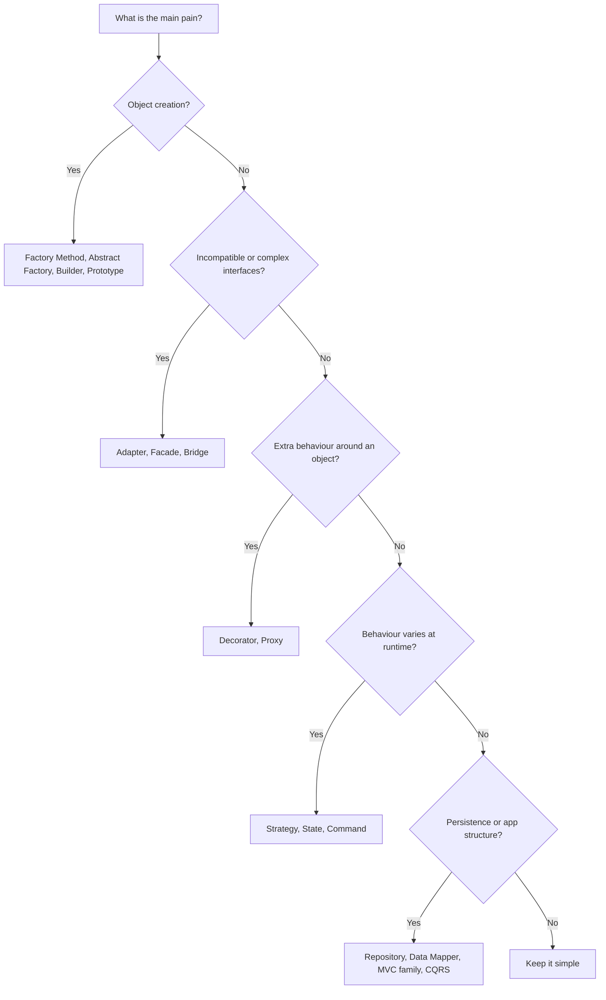

# Choosing a Pattern

Pattern catalogues are organised by _category_ (creational, structural, behavioral). Real work is organised by _problem_. This page starts from the problem you have and points you at the candidates worth considering, with a one-line reason for each.

::: tip Start with the simplest thing
A pattern is worth its indirection only when the force it addresses is actually present. If a plain function, a closure or a single `if` solves the problem clearly, stop there. Reach for a pattern when the second or third variation shows up, not in anticipation of it.
:::

## Quick Decision Flow

The flowchart is a first cut. The sections below go one level deeper.

## Creating Objects

### "I need to create objects without coupling to concrete classes"

| Candidate                                                | Why                                                                              |
| -------------------------------------------------------- | -------------------------------------------------------------------------------- |
| [Factory Method](/creational/factory-method)             | One product; subclasses (or a creator hook) decide which concrete class to build. |
| [Abstract Factory](/creational/abstract-factory)         | Several related products that must be used together as a consistent family.      |
| [Dependency Injection](/architectural/dependency-injection) | Often the real answer: let the composition root decide and pass the object in.  |

See also: [Factory Method vs Abstract Factory](/comparisons/factory-method-vs-abstract-factory).

### "Construction is complicated, with many optional parts"

| Candidate                        | Why                                                                         |
| -------------------------------- | --------------------------------------------------------------------------- |
| [Builder](/creational/builder)   | Step-by-step construction, validation at `build()`, readable fluent API.    |
| [Prototype](/creational/prototype) | Copy a pre-configured instance instead of repeating the configuration.    |

### "Objects are expensive to create or there must be exactly one"

| Candidate                              | Why                                                                                     |
| -------------------------------------- | --------------------------------------------------------------------------------------- |
| [Object Pool](/creational/object-pool) | Reuse costly instances (connections, buffers) instead of creating and discarding them. |
| [Flyweight](/structural/flyweight)     | Share immutable intrinsic state across thousands of fine-grained objects.              |
| [Singleton](/creational/singleton)     | A genuine uniqueness constraint. Prefer a singleton-scoped DI registration.            |

## Integrating and Simplifying

### "I need to use a class whose interface doesn't fit"

| Candidate                      | Why                                                                    |
| ------------------------------ | ---------------------------------------------------------------------- |
| [Adapter](/structural/adapter) | Translate an existing interface into the one your client expects.     |
| [Facade](/structural/facade)   | Give a sprawling subsystem one simple, task-oriented entry point.     |

### "Two dimensions vary and my class hierarchy is exploding"

| Candidate                    | Why                                                                         |
| ---------------------------- | --------------------------------------------------------------------------- |
| [Bridge](/structural/bridge) | Split abstraction and implementation into two hierarchies joined by composition. |

See also: [Adapter vs Facade vs Bridge](/comparisons/adapter-vs-facade-vs-bridge).

### "I need to treat single items and groups the same way"

| Candidate                          | Why                                                                     |
| ---------------------------------- | ----------------------------------------------------------------------- |
| [Composite](/structural/composite) | Leaves and containers share one interface, so clients recurse blindly. |
| [Iterator](/behavioral/iterator)   | Traverse any structure without exposing how it is stored.              |
| [Visitor](/behavioral/visitor)     | Add new operations over a stable set of node types without editing them. |

## Adding Behaviour

### "I need to add behaviour without subclassing"

| Candidate                                                     | Why                                                                                 |
| ------------------------------------------------------------- | ----------------------------------------------------------------------------------- |
| [Decorator](/structural/decorator)                            | Stack responsibilities (logging, caching, retries) around an object at runtime.    |
| [Proxy](/structural/proxy)                                    | Control access to an object: laziness, remoting, permission checks, caching.        |
| [Chain of Responsibility](/behavioral/chain-of-responsibility) | Pass a request through ordered handlers that may handle it or pass it on.         |
| [Strategy](/behavioral/strategy)                              | Inject the varying algorithm instead of overriding it.                              |

See also: [Decorator vs Proxy](/comparisons/decorator-vs-proxy).

### "I need to vary an algorithm"

| Candidate                                      | Why                                                                          |
| ---------------------------------------------- | ---------------------------------------------------------------------------- |
| [Strategy](/behavioral/strategy)               | The client (or configuration) picks one of several interchangeable algorithms. |
| [Template Method](/behavioral/template-method) | The skeleton is fixed; subclasses fill in specific steps.                    |
| [Interpreter](/behavioral/interpreter)         | The "algorithm" is a small language users write rules or expressions in.    |

### "Behaviour depends on what state the object is in"

| Candidate                    | Why                                                                                |
| ---------------------------- | ---------------------------------------------------------------------------------- |
| [State](/behavioral/state)   | Each state is an object; transitions replace sprawling `switch (status)` blocks. |
| [Null Object](/behavioral/null-object) | A do-nothing state or collaborator that removes `null` checks.           |

See also: [Strategy vs State](/comparisons/strategy-vs-state).

## Requests, Events and Communication

### "I need to react to state changes"

| Candidate                                  | Why                                                                          |
| ------------------------------------------ | ---------------------------------------------------------------------------- |
| [Observer](/behavioral/observer)           | Subjects notify subscribers without knowing who they are.                   |
| [Mediator](/behavioral/mediator)           | Many components react to each other; centralise the wiring in one place.   |
| [Event Sourcing](/architectural/event-sourcing) | The changes themselves are the source of truth and must be replayable. |

### "I need to queue, log or undo operations"

| Candidate                        | Why                                                                        |
| -------------------------------- | -------------------------------------------------------------------------- |
| [Command](/behavioral/command)   | A request becomes an object that can be queued, logged, retried or undone. |
| [Memento](/behavioral/memento)   | Snapshot state so it can be restored, without breaking encapsulation.     |

### "Work is produced faster or slower than it is consumed"

| Candidate                                              | Why                                                                   |
| ------------------------------------------------------ | --------------------------------------------------------------------- |
| [Producer-Consumer](/architectural/producer-consumer)  | A bounded queue decouples producers from consumers and adds backpressure. |
| [Scheduler](/architectural/scheduler)                  | Decide when and in what order tasks get access to shared resources.  |
| [Read-Write Lock](/architectural/read-write-lock)      | Many concurrent readers, exclusive writers.                          |

## Data and Persistence

### "I need to keep the domain independent of the database"

| Candidate                                     | Why                                                                                 |
| --------------------------------------------- | ----------------------------------------------------------------------------------- |
| [Repository](/architectural/repository)       | A collection-like interface for aggregates; the domain never sees SQL.             |
| [Data Mapper](/architectural/data-mapper)     | A separate layer moves data between objects and tables; objects stay persistence-ignorant. |
| [Active Record](/architectural/active-record) | The opposite trade-off: rows and behaviour in one class. Fast for simple CRUD.     |
| [Unit of Work](/architectural/unit-of-work)   | Track changes in a business transaction and commit them atomically.               |
| [Identity Map](/architectural/identity-map)   | Load each record once per session so there is one in-memory object per row.     |

See also: [Repository vs Data Mapper vs Active Record](/comparisons/repository-vs-data-mapper-vs-active-record).

### "I need to separate reads and writes"

| Candidate                                       | Why                                                                         |
| ----------------------------------------------- | --------------------------------------------------------------------------- |
| [CQRS](/architectural/cqrs)                     | Different models for commands and queries, each optimised for its job.     |
| [Event Sourcing](/architectural/event-sourcing) | Writes append events; reads come from projections. Pairs naturally with CQRS. |
| [Read-Write Lock](/architectural/read-write-lock) | The in-process, concurrency-level version of the same idea.             |

## Structuring the Application

### "I need to separate UI from logic"

| Candidate                       | Why                                                                          |
| ------------------------------- | ---------------------------------------------------------------------------- |
| [MVC](/architectural/mvc)       | Controller handles input, model holds state, view renders.                  |
| [MVP](/architectural/mvp)       | A passive view behind an interface; the presenter is plain, testable code.  |
| [MVVM](/architectural/mvvm)     | The view binds declaratively to an observable view model.                   |
| [MVT](/architectural/mvt)       | Django's naming of the same separation; the framework is the controller.    |

See also: [MVC vs MVP vs MVVM](/comparisons/mvc-vs-mvp-vs-mvvm).

### "I need to wire dependencies without hard-coding them"

| Candidate                                                   | Why                                                                         |
| ----------------------------------------------------------- | --------------------------------------------------------------------------- |
| [Dependency Injection](/architectural/dependency-injection) | Dependencies are explicit constructor parameters; the default choice.      |
| [Service Locator](/architectural/service-locator)           | A central registry objects ask at runtime. Hides dependencies; use sparingly. |

## Smells That Point to a Pattern

| Smell in the code                                           | Likely candidate                     |
| ----------------------------------------------------------- | ------------------------------------ |
| `switch (type)` that creates objects, duplicated in places  | Factory Method                       |
| `switch (status)` repeated in every method                  | State                                |
| `if (strategy === "x")` choosing an algorithm               | Strategy                             |
| Constructor with eight optional parameters                  | Builder                              |
| Subclasses like `LoggingCachingRetryingClient`              | Decorator                            |
| `if (user != null)` everywhere                              | Null Object                          |
| Components holding references to all other components       | Mediator                             |
| SQL strings inside business services                        | Repository / Data Mapper             |
| Read queries contorting the write model                     | CQRS                                 |

## Commonly Confused Pairs

- [Strategy vs State](/comparisons/strategy-vs-state)
- [Decorator vs Proxy](/comparisons/decorator-vs-proxy)
- [Factory Method vs Abstract Factory](/comparisons/factory-method-vs-abstract-factory)
- [Adapter vs Facade vs Bridge](/comparisons/adapter-vs-facade-vs-bridge)
- [MVC vs MVP vs MVVM](/comparisons/mvc-vs-mvp-vs-mvvm)
- [Repository vs Data Mapper vs Active Record](/comparisons/repository-vs-data-mapper-vs-active-record)

::: warning Patterns are not goals
Naming a class `PaymentStrategyFactoryProvider` is not a design. Pick the pattern that removes the specific duplication or coupling in front of you, and be ready to delete it if the variation never materialises.
:::

For a compact overview of every pattern, see the [Quick Reference](/quick-reference).
