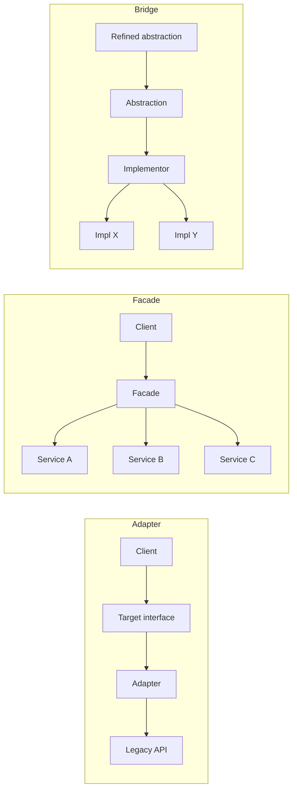

# Adapter vs Facade vs Bridge

[Adapter](/structural/adapter), [Facade](/structural/facade) and [Bridge](/structural/bridge) all place an interface between client code and some implementation, and all three are built with plain composition. Their class diagrams overlap enough that teams routinely call any wrapper an "adapter".

They differ in **what problem they answer and when in the design they appear**:

- **Adapter** — makes an _existing_ interface usable where a _different_ interface is expected. It is a retrofit: both sides already exist and you cannot (or should not) change them.
- **Facade** — defines a _new, simpler_ interface over a _whole subsystem_. It does not translate one interface into another; it hides many objects behind a few task-oriented methods.
- **Bridge** — separates an abstraction from its implementation _up front_ so that both can be extended independently. It is a design-time decision, not a retrofit.

## Structure at a Glance



## Side-by-Side

| Aspect                      | Adapter                                                | Facade                                                  | Bridge                                                         |
| --------------------------- | ------------------------------------------------------ | ------------------------------------------------------- | -------------------------------------------------------------- |
| **Intent (GoF)**            | Convert an interface into one clients expect           | Provide a unified, higher-level interface to a subsystem | Decouple an abstraction from its implementation so both can vary |
| **Wraps**                   | One object (or class)                                  | Many objects in a subsystem                             | An implementor hierarchy, by design                            |
| **Interface it exposes**    | An interface that already exists (the target)          | A new, simpler interface it defines                     | An abstraction hierarchy that delegates to implementors       |
| **When it appears**         | After the fact — integrating code you do not control   | When a subsystem is too complex for its callers         | Up front — when you foresee two independent axes of change    |
| **Who controls what**       | Client owns the target; adaptee is untouched            | Facade owns the workflow; subsystem stays usable directly | Abstraction owns high-level logic; implementor owns platform details |
| **Typical use**             | Third-party SDKs, legacy APIs, test doubles for vendor code | SDK wrappers, "place order" over inventory + payment + shipping | Shapes × renderers, notifications × channels, drivers |
| **Pitfalls**                | Leaky translation of errors and semantics              | Becoming a god object that everything depends on        | Premature abstraction when only one axis actually varies      |

## The Decisive Difference in Code

::: code-group

```typescript [Adapter]
// The interface our code already depends on.
interface PaymentGateway {
  charge(amountCents: number, token: string): Promise<{ id: string }>;
}

// A vendor SDK we cannot change, with a different shape.
declare class AcmePay {
  createPayment(req: { value: string; currency: "USD"; card: string }): Promise<{ paymentRef: string }>;
}

class AcmePayAdapter implements PaymentGateway {
  constructor(private acme: AcmePay) {}

  async charge(amountCents: number, token: string) {
    const res = await this.acme.createPayment({
      value: (amountCents / 100).toFixed(2), // translate units
      currency: "USD",
      card: token,
    });
    return { id: res.paymentRef }; // translate the result
  }
}
```

```typescript [Facade]
declare const inventory: { reserve(sku: string, qty: number): Promise<void> };
declare const payments: { charge(cents: number, token: string): Promise<{ id: string }> };
declare const shipping: { schedule(orderId: string, address: string): Promise<void> };
declare const email: { sendConfirmation(to: string, orderId: string): Promise<void> };

// A new, simpler interface over several collaborating services.
class CheckoutFacade {
  async placeOrder(o: { sku: string; qty: number; cents: number; token: string; address: string; email: string }) {
    await inventory.reserve(o.sku, o.qty);
    const { id } = await payments.charge(o.cents, o.token);
    await shipping.schedule(id, o.address);
    await email.sendConfirmation(o.email, id);
    return id;
  }
}
```

```typescript [Bridge]
// Implementor hierarchy: HOW a message is delivered.
interface Channel {
  deliver(to: string, text: string): void;
}
const emailChannel: Channel = { deliver: (to, t) => console.log(`email ${to}: ${t}`) };
const smsChannel: Channel = { deliver: (to, t) => console.log(`sms ${to}: ${t}`) };

// Abstraction hierarchy: WHAT kind of notification it is.
abstract class Notification {
  constructor(protected channel: Channel) {}
  abstract send(to: string): void;
}

class PasswordReset extends Notification {
  send(to: string) { this.channel.deliver(to, "Your reset code is 1234"); }
}

class WeeklyDigest extends Notification {
  send(to: string) { this.channel.deliver(to, "Here is your weekly summary"); }
}

// 2 kinds x 2 channels, without 4 classes.
new PasswordReset(smsChannel).send("+998901234567");
new WeeklyDigest(emailChannel).send("a@b.uz");
```

:::

The Adapter adds no new capability; it only reshapes `AcmePay` into `PaymentGateway`. The Facade invents `placeOrder`, a method no single service offers. The Bridge is not wrapping anything foreign at all — it is how the notification code was _designed_ so that kinds and channels grow independently.

::: tip A useful test

- Does an interface the client needs **already exist**, and you are bridging a mismatch? → **Adapter**.
- Are you **inventing** a smaller interface so callers stop orchestrating many objects? → **Facade**.
- Are you **designing** two hierarchies so that N × M combinations do not become N × M classes? → **Bridge**.

:::

## Neighbouring Patterns

- [Decorator](/structural/decorator) and [Proxy](/structural/proxy) also wrap, but they keep the _same_ interface. Adapter changes it. See [Decorator vs Proxy](/comparisons/decorator-vs-proxy).
- [Mediator](/behavioral/mediator) resembles Facade, but the subsystem objects _know_ about the mediator and talk through it; with a Facade the subsystem is unaware of it and communication is one-directional.
- [Abstract Factory](/creational/abstract-factory) is often used to pick the concrete implementor for a Bridge.

## When to Pick Which

**Pick Adapter when:**

- You integrate a library, legacy module or external API whose interface does not match yours.
- You want vendor types to stop leaking into your domain (an anti-corruption layer is a collection of adapters).
- You need a seam to replace a third-party dependency in tests.

**Pick Facade when:**

- Callers repeat the same multi-step orchestration across several services.
- You want to give a layer or module a small public surface while keeping internals accessible for advanced uses.
- Onboarding to a subsystem requires knowing too many classes.

**Pick Bridge when:**

- Two dimensions vary independently and inheritance would multiply classes.
- You want to switch implementations at runtime (renderer, driver, channel) without touching high-level logic.
- Both the abstraction and the implementation are expected to gain new subclasses.

::: warning Do not over-apply Bridge
If only one dimension really varies, a single interface plus [Strategy](/behavioral/strategy) or DI is enough. Bridge pays for itself when you have, or credibly expect, growth on both sides.
:::

## Related Pages

- [Adapter](/structural/adapter)
- [Facade](/structural/facade)
- [Bridge](/structural/bridge)
- [Choosing a Pattern](/choosing-a-pattern)
