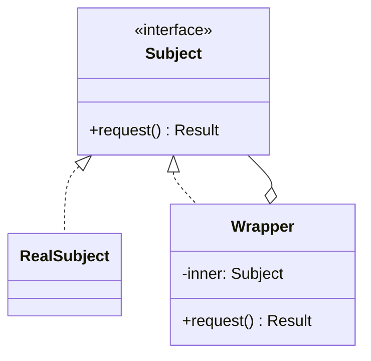

# Decorator vs Proxy

[Decorator](/structural/decorator) and [Proxy](/structural/proxy) look almost identical in code: a class implements the same interface as another object, holds a reference to it, and forwards calls. Both are transparent to the client. Both can be used to add caching or logging. It is no surprise they get mixed up.

The GoF distinction is about **intent and lifecycle**:

- **Decorator** _adds responsibilities_ to an object dynamically. Decorators are designed to be stacked, and the client (or composition root) assembles the stack around an object it already has.
- **Proxy** _controls access_ to an object. A proxy usually stands in for exactly one subject, often manages that subject's lifecycle (creating it lazily, connecting to it remotely), and is not meant to be stacked.

## Shared Structure



Same shape. What differs is what `Wrapper` does around the forwarded call and who created `inner`.

## Side-by-Side

| Aspect                    | Decorator                                                       | Proxy                                                                   |
| ------------------------- | --------------------------------------------------------------- | ----------------------------------------------------------------------- |
| **Intent (GoF)**          | Attach additional responsibilities to an object dynamically     | Provide a surrogate or placeholder to control access to another object |
| **Who creates the inner object** | The client passes an existing object in                 | Often the proxy itself (lazy creation, remote handle)                  |
| **Stacking**              | Designed for it: `new Retry(new Log(new Http()))`               | Usually one proxy per subject                                           |
| **Does it always forward?** | Yes; it enhances, it does not refuse                          | Not necessarily; it may block, defer or short-circuit the call         |
| **Client awareness**      | Client chooses which decorators to apply                       | Client typically does not know a proxy is there                        |
| **Typical use**           | Logging, metrics, retries, compression, middleware layers      | Lazy loading, remote access, access control, caching, ORM lazy relations |
| **Pitfalls**              | Order-dependent stacks; identity checks break; deep wrapper chains | Hidden latency (remote/lazy); surprising failures behind a "plain" call |

### The GoF Proxy Kinds

| Kind                 | Controls                                             |
| -------------------- | ---------------------------------------------------- |
| **Virtual proxy**    | When the expensive subject is created (lazy loading) |
| **Remote proxy**     | Where the subject lives (another process or machine) |
| **Protection proxy** | Who is allowed to call it                            |
| **Smart reference**  | Extra bookkeeping: ref counting, locking, caching    |

Every one of these is about _access_ to the subject, not about adding a feature to it.

## The Decisive Difference in Code

::: code-group

```typescript [Decorator]
interface HttpClient {
  get(url: string): Promise<string>;
}

class FetchClient implements HttpClient {
  async get(url: string) {
    return (await fetch(url)).text();
  }
}

// Adds a responsibility; always delegates.
class LoggingClient implements HttpClient {
  constructor(private inner: HttpClient) {}
  async get(url: string) {
    console.log(`GET ${url}`);
    return this.inner.get(url);
  }
}

class RetryClient implements HttpClient {
  constructor(private inner: HttpClient, private attempts = 3) {}
  async get(url: string) {
    for (let i = 1; ; i++) {
      try { return await this.inner.get(url); }
      catch (e) { if (i >= this.attempts) throw e; }
    }
  }
}

// The client composes the stack around an existing object.
const client = new RetryClient(new LoggingClient(new FetchClient()));
```

```typescript [Proxy]
interface ImageSource {
  render(): string;
}

class HighResImage implements ImageSource {
  constructor(private path: string) {
    console.log(`Loading ${path} from disk...`); // expensive
  }
  render() { return ``; }
}

// Controls access: owns the subject's creation and may never create it.
class LazyImage implements ImageSource {
  private real?: HighResImage;
  constructor(private path: string, private canView: () => boolean) {}

  render() {
    if (!this.canView()) return "<span>Restricted</span>"; // short-circuit
    this.real ??= new HighResImage(this.path);             // lazy creation
    return this.real.render();
  }
}

const img: ImageSource = new LazyImage("/photos/raw.tiff", () => user.isAdmin);
```

:::

The decorators receive an already-built `HttpClient` and always call through. `LazyImage` constructs its own subject, may never construct it at all, and may refuse the call.

::: tip A useful test
Ask "would it make sense to wrap this twice with different variants?" If yes, it is a Decorator. Ask "does this wrapper decide _whether_, _when_ or _where_ the real work happens?" If yes, it is a Proxy.
:::

## Grey Areas

- **Caching** fits both. A caching decorator layered into a middleware stack is a Decorator; a caching proxy in front of a remote service that hides the network is a Proxy. Name it by the role it plays in your design.
- **JavaScript `Proxy`** is a language feature for intercepting property access. It can implement either pattern; the name does not decide the intent.
- **Adapter** also wraps, but it _changes_ the interface. Decorator and Proxy both _preserve_ it. See [Adapter vs Facade vs Bridge](/comparisons/adapter-vs-facade-vs-bridge).

## When to Pick Which

**Pick Decorator when:**

- You need optional, combinable features (logging, metrics, retries, compression).
- Different call sites need different combinations of those features.
- Subclassing would produce combinatorial classes like `LoggingRetryingClient`.

**Pick Proxy when:**

- The real object is expensive and should be created only on first use.
- The real object lives elsewhere and you want a local stand-in.
- Calls must be authorised, rate-limited or audited before reaching the subject.
- You need to manage the subject's lifecycle invisibly to the client.

::: warning Watch for identity and order
Both patterns break `===` checks against the inner object. Decorator stacks are additionally order-sensitive: retry-outside-logging logs every attempt, logging-outside-retry logs once. Make the order explicit at the composition root.
:::

## Related Pages

- [Decorator](/structural/decorator)
- [Proxy](/structural/proxy)
- [Chain of Responsibility](/behavioral/chain-of-responsibility) — a chain may stop; a decorator always forwards
- [Choosing a Pattern](/choosing-a-pattern)
