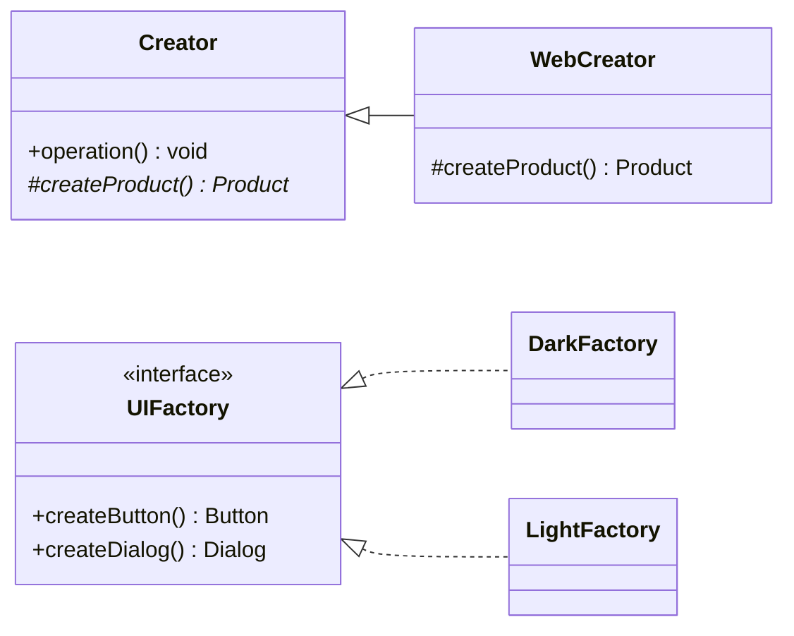

# Factory Method vs Abstract Factory

Both [Factory Method](/creational/factory-method) and [Abstract Factory](/creational/abstract-factory) keep client code from calling `new ConcreteClass()` directly. Both return products typed as interfaces. And in practice an Abstract Factory is usually implemented _with_ factory methods, which makes the line even blurrier.

The GoF distinction is about **scope and mechanism**:

- **Factory Method** — a _single method_ creates _one kind_ of product. The variation comes from overriding that method in a subclass (inheritance). The creator class usually has other responsibilities and just defers one creation step.
- **Abstract Factory** — an _object_ whose whole job is creating a _family_ of related products. The variation comes from passing a different factory object (composition). Its key promise is that the products it returns are compatible with each other.

## Structure



Left: Factory Method — a hook inside a class that does other work. Right: Abstract Factory — a dedicated object with one creation method per product in the family.

## Side-by-Side

| Aspect                    | Factory Method                                              | Abstract Factory                                                   |
| ------------------------- | ----------------------------------------------------------- | ------------------------------------------------------------------ |
| **Intent (GoF)**          | Let subclasses decide which class to instantiate            | Create families of related objects without naming concrete classes |
| **Number of products**    | One product type                                            | Several product types that belong together                        |
| **Mechanism**             | Inheritance: override a method                              | Composition: inject a factory object                               |
| **Who controls variation**| The subclass of the creator                                 | Whoever chooses which factory to pass in                           |
| **Creator's other work**  | Yes — the creator has business logic that uses the product | No — creation is the factory's only responsibility                |
| **Consistency guarantee** | None across products                                        | Products from one factory are designed to work together            |
| **Typical use**           | Framework hooks, document/parser creation, plugin points    | UI themes, cross-platform widgets, database driver families        |
| **Pitfalls**              | Subclass per product just to override one method            | Adding a new product type changes every factory                    |

## The Decisive Difference in Code

::: code-group

```typescript [Factory Method]
interface Notifier {
  send(to: string, msg: string): void;
}

abstract class AlertService {
  // Business logic that uses a product it does not construct.
  alert(user: string, event: string): void {
    const notifier = this.createNotifier(); // the factory method
    notifier.send(user, `Alert: ${event}`);
  }

  protected abstract createNotifier(): Notifier;
}

class EmailAlertService extends AlertService {
  protected createNotifier(): Notifier {
    return { send: (to, m) => console.log(`email ${to}: ${m}`) };
  }
}

class SmsAlertService extends AlertService {
  protected createNotifier(): Notifier {
    return { send: (to, m) => console.log(`sms ${to}: ${m}`) };
  }
}
```

```typescript [Abstract Factory]
interface Button { render(): string; }
interface Dialog { open(content: string): string; }

// One object, a whole family of compatible products.
interface UIFactory {
  createButton(label: string): Button;
  createDialog(): Dialog;
}

const darkTheme: UIFactory = {
  createButton: (l) => ({ render: () => `<button class="dark">${l}</button>` }),
  createDialog: () => ({ open: (c) => `<dialog class="dark">${c}</dialog>` }),
};

const lightTheme: UIFactory = {
  createButton: (l) => ({ render: () => `<button class="light">${l}</button>` }),
  createDialog: () => ({ open: (c) => `<dialog class="light">${c}</dialog>` }),
};

// The client receives the factory; it can never mix dark and light widgets.
function renderSettings(ui: UIFactory): string {
  return ui.createDialog().open(ui.createButton("Save").render());
}

renderSettings(darkTheme);
```

:::

`AlertService` is not a factory — it is a service with one creation hook. `UIFactory` exists only to create things, and its value is that `createButton` and `createDialog` always agree on the theme.

::: tip A useful test
Count the products and ask how variation is supplied. One product, chosen by subclassing → Factory Method. Several products that must match, chosen by passing an object → Abstract Factory.
:::

## How They Relate

- Each method on an Abstract Factory is, structurally, a factory method. GoF notes that concrete factories are often implemented with factory methods or with [Prototype](/creational/prototype).
- Concrete factories are frequently single instances per family, which is why [Singleton](/creational/singleton) appears alongside Abstract Factory — though a DI registration is usually the better way to get that.
- A "simple factory" (a static `create(type)` function with a `switch`) is neither pattern in the GoF sense. It is a useful idiom, but it has no polymorphic creator.

## Extension Axes

| Change you need to make           | Factory Method          | Abstract Factory                            |
| --------------------------------- | ----------------------- | ------------------------------------------- |
| Add a new variant (e.g. Push)     | Add one subclass        | Add one factory implementing every method  |
| Add a new product type (e.g. Toast) | Add a new factory method where needed | Change the interface and every factory |

Abstract Factory makes adding _families_ easy and adding _product types_ expensive. Choose it when the set of product types is stable.

## When to Pick Which

**Pick Factory Method when:**

- A class does useful work but one object it needs should be decided by subclasses or a framework hook.
- There is only one product type in play.
- You are writing a framework or base class that users extend.

**Pick Abstract Factory when:**

- Several products must be used together and mixing variants would be a bug.
- You want to switch the whole family at once (theme, platform, vendor) via configuration.
- The set of product types is stable while the number of families may grow.

::: warning Often you need neither
If the concrete class is chosen once at startup, plain [Dependency Injection](/architectural/dependency-injection) of the product itself is simpler than either pattern. Use a factory when creation must happen _later_, _repeatedly_, or _per request_.
:::

## Related Pages

- [Factory Method](/creational/factory-method)
- [Abstract Factory](/creational/abstract-factory)
- [Builder](/creational/builder) — for one complex product built step by step
- [Choosing a Pattern](/choosing-a-pattern)
