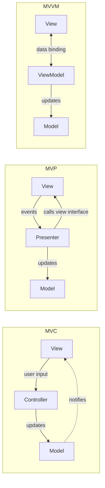

# MVC vs MVP vs MVVM

[MVC](/architectural/mvc), [MVP](/architectural/mvp) and [MVVM](/architectural/mvvm) all split an interactive application into a **model** (domain state and rules), a **view** (what the user sees) and something in between. They are confused because the model and the view are nearly identical in all three, frameworks use the names loosely, and "MVC" on the server means something different from the original Smalltalk MVC.

The differences are in the middle layer and the arrows:

- **MVC** — the _controller_ interprets input and updates the model; the _view_ observes the model (or, in server-side MVC, is rendered by the controller with model data).
- **MVP** — the _presenter_ receives every event from a passive view through an interface, talks to the model, and pushes formatted data back into the view. The view knows nothing about the model.
- **MVVM** — the _view model_ exposes observable state and commands; the view **binds** to them declaratively. The view model has no reference to the view at all.

## The Arrows



## Side-by-Side

| Aspect                          | MVC                                                  | MVP                                                   | MVVM                                                      |
| ------------------------------- | ---------------------------------------------------- | ----------------------------------------------------- | --------------------------------------------------------- |
| **Middle layer**                | Controller                                           | Presenter                                             | ViewModel                                                 |
| **Who receives user input**     | Controller (directly or via the view)               | View, which forwards every event to the presenter    | View, which invokes bound commands on the view model     |
| **Who updates the view**        | View observes the model, or controller renders it   | Presenter calls methods on a view interface          | Binding engine, reacting to view model changes            |
| **Does the middle know the view?** | Usually yes (selects or renders it)              | Yes, through an interface (`LoginView`)               | No — it only exposes state                                |
| **Does the view know the model?** | Often yes                                          | No                                                    | No; it knows only the view model                          |
| **Relationship**                | Controller to views often 1:N                        | Usually 1:1 presenter to view                         | 1:N possible; several views can bind one view model      |
| **Testability of middle layer** | Moderate; tends to depend on framework request types | High; mock the view interface                         | High; assert on view model state, no view needed         |
| **Typical use**                 | Server-rendered web apps (Rails, Spring MVC, ASP.NET MVC) | Android (classic), WinForms, GWT, UI with no binding | WPF, Angular, Vue, Knockout, SwiftUI, Jetpack Compose   |
| **Pitfalls**                    | "Massive controller"; fat views reading the model   | Boilerplate view interfaces; presenter grows large   | Binding magic hides flow; view model becomes a dumping ground |

::: tip Server MVC vs classic MVC
In Smalltalk-80 MVC, views observed models and each widget had its own controller. In web frameworks, a request hits a controller, which loads models and picks a template. That is closer to a [Front Controller](https://martinfowler.com/eaaCatalog/frontController.html) plus template view; [MVT](/architectural/mvt) is Django's name for the same arrangement.
:::

## The Decisive Difference in Code

The same feature — a counter with an increment button that shows "Clicked N times".

::: code-group

```typescript [MVC]
class CounterModel {
  private listeners: Array<() => void> = [];
  count = 0;
  increment() { this.count++; this.listeners.forEach((l) => l()); }
  subscribe(l: () => void) { this.listeners.push(l); }
}

// View observes the model and reads it directly.
class CounterView {
  constructor(private model: CounterModel, private el: HTMLElement) {
    model.subscribe(() => this.render());
  }
  render() { this.el.textContent = `Clicked ${this.model.count} times`; }
}

// Controller translates input into model operations.
class CounterController {
  constructor(private model: CounterModel) {}
  onClick() { this.model.increment(); }
}
```

```typescript [MVP]
// The view is passive and hidden behind an interface.
interface CounterView {
  showLabel(text: string): void;
  onIncrement(handler: () => void): void;
}

class CounterPresenter {
  private count = 0; // or a model object
  constructor(private view: CounterView) {
    view.onIncrement(() => this.increment());
    this.view.showLabel(this.label());
  }
  private increment() {
    this.count++;
    this.view.showLabel(this.label()); // presenter pushes to the view
  }
  private label() { return `Clicked ${this.count} times`; }
}

// Test: pass a fake CounterView and assert on showLabel calls.
```

```typescript [MVVM]
import { ref, computed } from "vue";

// The view model knows nothing about any view.
export function useCounterViewModel() {
  const count = ref(0);
  const label = computed(() => `Clicked ${count.value} times`);
  const increment = () => { count.value++; };
  return { label, increment };
}

// The view binds declaratively:
// <button @click="vm.increment">+</button>
// <span>{{ vm.label }}</span>
```

:::

Follow the update path. In MVC the view pulls from the model after a notification. In MVP the presenter explicitly calls `view.showLabel(...)`. In MVVM nobody calls the view; the binding engine notices `label` changed.

## When to Pick Which

**Pick MVC when:**

- You are building a request/response web application; your framework is already MVC-shaped.
- Views are mostly templates and the interaction model is simple.

**Pick MVP when:**

- The UI toolkit has no data binding, and you want presentation logic fully unit-testable.
- You want to swap view implementations (desktop, web, test fake) behind one interface.
- You prefer explicit calls over reactive magic.

**Pick MVVM when:**

- Your platform has a mature binding or reactivity system (WPF, Angular, Vue, SwiftUI, Compose).
- Several views present the same state, or the state is rich and interdependent.
- You want the presentation layer to be testable as pure state transitions.

::: warning None of them is a domain architecture
All three organise the _presentation_ layer. Business rules belong in the model and the services behind it, not in controllers, presenters or view models. Persistence is a separate concern — see [Repository vs Data Mapper vs Active Record](/comparisons/repository-vs-data-mapper-vs-active-record).
:::

## Related Pages

- [MVC](/architectural/mvc)
- [MVP](/architectural/mvp)
- [MVVM](/architectural/mvvm)
- [MVT](/architectural/mvt)
- [Observer](/behavioral/observer) — the mechanism behind MVC notifications and MVVM bindings
- [Choosing a Pattern](/choosing-a-pattern)
