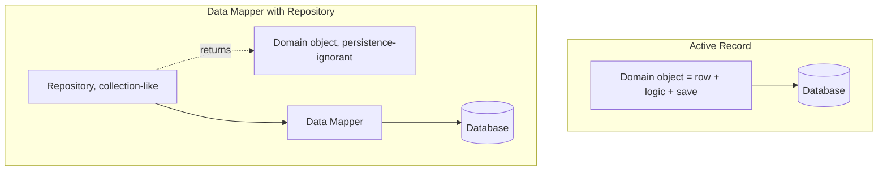

# Repository vs Data Mapper vs Active Record

[Repository](/architectural/repository), [Data Mapper](/architectural/data-mapper) and [Active Record](/architectural/active-record) all come from Martin Fowler's _Patterns of Enterprise Application Architecture_. They are confused because ORMs blur them: an ORM "repository" may really be a thin data mapper, and Active Record frameworks often add repository-style query methods.

They answer different questions:

- **Active Record** — _an object wraps a row_ and carries both domain logic and its own persistence (`user.save()`). The class and the table are one-to-one.
- **Data Mapper** — _a separate layer_ moves data between in-memory objects and the database, keeping the two independent. Domain objects have no idea a database exists.
- **Repository** — _a collection-like interface_ for retrieving and storing domain objects (usually aggregates), expressed in domain terms. It sits **on top of** a mapping layer and hides query construction from the domain.

Active Record and Data Mapper are alternatives. Repository is not a third alternative to them — it is an abstraction you typically place over a Data Mapper (and sometimes over Active Record).

## Layering



## Side-by-Side

| Aspect                         | Active Record                                     | Data Mapper                                            | Repository                                                   |
| ------------------------------ | ------------------------------------------------- | ------------------------------------------------------ | ------------------------------------------------------------ |
| **Definition (PoEAA)**         | An object that wraps a row, encapsulates DB access and adds domain logic | A layer of mappers that moves data between objects and the DB while keeping them independent | Mediates between domain and mapping layers using a collection-like interface |
| **Where SQL / queries live**   | In the domain class (or its framework base class) | In mapper classes                                      | Behind the repository; built via mappers or query objects   |
| **Domain knows about the DB?** | Yes — inherits persistence                        | No                                                     | No — sees only `findById`, `add`, domain-named queries      |
| **Object-to-table shape**      | Roughly one class per table, field per column     | Free: inheritance, value objects, aggregates           | Whatever the domain model needs; often per aggregate root   |
| **Who controls persistence**   | The object (`order.save()`)                       | The mapper (`mapper.insert(order)`)                    | The application service, usually with a [Unit of Work](/architectural/unit-of-work) |
| **Typical use**                | CRUD-heavy apps, Rails, Laravel Eloquent, simple domains | Rich domain models, legacy schemas, Hibernate, Doctrine, TypeORM data-mapper mode | DDD aggregates, testable application services, swapping storage |
| **Pitfalls**                   | Domain logic coupled to schema; hard to unit test; fat models | More code and mapping configuration; can feel ceremonial for CRUD | Leaky "generic repositories" that just re-expose the ORM    |

## The Decisive Difference in Code

::: code-group

```typescript [Active Record]
declare const db: { query(sql: string, params: unknown[]): Promise<any[]> };

// Row + domain logic + persistence in one class.
class Account {
  constructor(public id: string, public balance: number) {}

  withdraw(amount: number) {
    if (amount > this.balance) throw new Error("Insufficient funds");
    this.balance -= amount;
  }

  async save() {
    await db.query("UPDATE accounts SET balance = $1 WHERE id = $2", [this.balance, this.id]);
  }

  static async find(id: string) {
    const [row] = await db.query("SELECT * FROM accounts WHERE id = $1", [id]);
    return new Account(row.id, Number(row.balance));
  }
}

const acc = await Account.find("a-1");
acc.withdraw(50);
await acc.save();
```

```typescript [Data Mapper]
declare const db: { query(sql: string, params: unknown[]): Promise<any[]> };

// Pure domain object: no imports from the persistence layer.
class Account {
  constructor(readonly id: string, private balanceCents: number) {}
  withdraw(cents: number) {
    if (cents > this.balanceCents) throw new Error("Insufficient funds");
    this.balanceCents -= cents;
  }
  get balance() { return this.balanceCents; }
}

// The mapper owns the translation in both directions.
class AccountMapper {
  async findById(id: string): Promise<Account> {
    const [row] = await db.query("SELECT id, balance_cents FROM accounts WHERE id = $1", [id]);
    return new Account(row.id, Number(row.balance_cents));
  }
  async update(a: Account): Promise<void> {
    await db.query("UPDATE accounts SET balance_cents = $1 WHERE id = $2", [a.balance, a.id]);
  }
}
```

```typescript [Repository]
// The domain-facing contract, expressed in domain language.
interface AccountRepository {
  byId(id: string): Promise<Account | undefined>;
  overdrawnSince(date: Date): Promise<Account[]>;
  save(account: Account): Promise<void>;
}

// Implementation delegates to a mapper; tests use an in-memory one.
// (AccountMapper as in the Data Mapper tab, plus a findOverdrawn query.)
class SqlAccountRepository implements AccountRepository {
  constructor(private mapper: AccountMapper) {}
  byId(id: string) { return this.mapper.findById(id); }
  overdrawnSince(date: Date) { return this.mapper.findOverdrawn(date); }
  save(a: Account) { return this.mapper.update(a); }
}

// The application service never sees SQL or the mapper.
async function withdraw(repo: AccountRepository, id: string, cents: number) {
  const account = await repo.byId(id);
  if (!account) throw new Error("Not found");
  account.withdraw(cents);
  await repo.save(account);
}
```

:::

In Active Record, `Account` cannot be constructed or tested without a database in reach. With Data Mapper, `Account` is plain TypeScript and the mapper is the only code that knows column names. The Repository adds the domain-shaped API (`overdrawnSince`) and the seam where an in-memory implementation can replace the database in tests.

::: tip A useful test
Look at the domain class's imports and methods. `save()` or a DB import on the entity → Active Record. A separate class with column names → Data Mapper. An interface in the domain layer with methods named after business questions → Repository.
:::

## Supporting Patterns

- [Unit of Work](/architectural/unit-of-work) tracks which objects changed and commits them in one transaction — essential once a Data Mapper handles more than one object per operation.
- [Identity Map](/architectural/identity-map) ensures each row is loaded once per session, so two lookups return the same object.
- Full-featured ORMs (Hibernate, Doctrine, EF Core, TypeORM) bundle Data Mapper, Unit of Work and Identity Map; their "repositories" are frequently just generic data mappers.

## When to Pick Which

**Pick Active Record when:**

- The domain is mostly CRUD and the object model mirrors the tables.
- Speed of delivery matters more than isolating domain logic from the schema.
- Your framework (Rails, Laravel) is built around it — fighting it costs more than it saves.

**Pick Data Mapper when:**

- Domain objects have real behaviour and invariants that should be testable without a database.
- The object model and the schema diverge (value objects, inheritance, legacy tables).
- You need to evolve the schema and the domain model independently.

**Add a Repository when:**

- You model aggregates and want the domain to depend on an interface, not the ORM.
- Queries should be named in domain language and reused, not scattered as ad-hoc ORM calls.
- You want fast application-service tests with an in-memory implementation.

::: warning Avoid the generic repository trap
`Repository<T>` with `findAll`, `findBy(criteria)` and `update(T)` usually re-exposes the ORM with a worse API. Repositories earn their keep when they are specific to an aggregate and speak the domain's language. For read-heavy screens, consider bypassing them with dedicated query models — see [CQRS](/architectural/cqrs).
:::

## Related Pages

- [Active Record](/architectural/active-record)
- [Data Mapper](/architectural/data-mapper)
- [Repository](/architectural/repository)
- [Unit of Work](/architectural/unit-of-work)
- [Identity Map](/architectural/identity-map)
- [Choosing a Pattern](/choosing-a-pattern)
