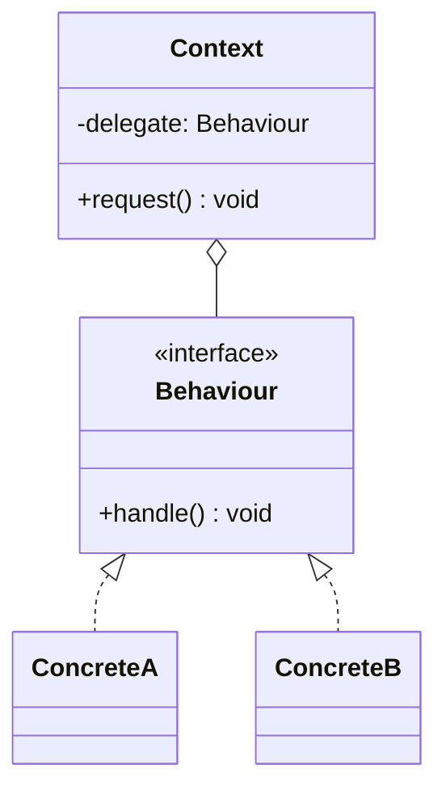

# Strategy vs State

[Strategy](/behavioral/strategy) and [State](/behavioral/state) are the textbook example of patterns that share a structure but not an intent. In both, a context object holds a reference to an interface and delegates work to whichever concrete implementation is currently plugged in. Draw the UML and you cannot tell them apart.

The difference lies in **who changes the delegate and why**:

- **Strategy** — the _client_ picks an algorithm. The strategies are independent, interchangeable ways of doing the same job, and usually do not know about each other.
- **State** — the _object itself_ changes behaviour as its internal condition changes. States know about the transitions and often trigger them.

## Shared Structure



Read the arrows as "Strategy" and the client sets `delegate`. Read them as "State" and `ConcreteA` replaces itself with `ConcreteB`.

## Side-by-Side

| Aspect                     | Strategy                                                        | State                                                                  |
| -------------------------- | --------------------------------------------------------------- | ---------------------------------------------------------------------- |
| **Intent (GoF)**           | Define a family of algorithms and make them interchangeable     | Let an object alter its behaviour when its internal state changes      |
| **Who selects the object** | Client or configuration, from outside                          | The context or the current state, from inside                          |
| **Awareness of siblings**  | None — strategies are independent                              | States know which states they can transition to                        |
| **How often it changes**   | Rarely; usually once per operation or per configuration         | Frequently, as a direct consequence of calls on the context            |
| **Interface shape**        | Usually one method (`compress`, `calculate`, `sort`)            | Usually one method per event the context accepts (`pay`, `ship`, `cancel`) |
| **Replaces**               | `if (algorithm === "x")` selection logic                        | `switch (this.status)` repeated across many methods                    |
| **Typical use**            | Pricing rules, compression, sorting, auth providers, retry policies | Order lifecycle, TCP connections, document workflows, UI modes     |
| **Pitfalls**               | A class per trivial variation; a function is often enough       | Transitions scattered across states; hard to see the whole machine    |

## The Decisive Difference in Code

::: code-group

```typescript [Strategy]
interface ShippingCost {
  calculate(weightKg: number): number;
}

const standard: ShippingCost = { calculate: (w) => 5 + w * 1.2 };
const express: ShippingCost = { calculate: (w) => 15 + w * 2.5 };

class Checkout {
  constructor(private shipping: ShippingCost) {}

  // The CLIENT decides; Checkout never swaps it on its own.
  setShipping(shipping: ShippingCost): void {
    this.shipping = shipping;
  }

  total(subtotal: number, weightKg: number): number {
    return subtotal + this.shipping.calculate(weightKg);
  }
}

const checkout = new Checkout(standard);
checkout.setShipping(express); // user picked express in the UI
```

```typescript [State]
interface OrderState {
  pay(order: Order): void;
  ship(order: Order): void;
}

class Order {
  // The ORDER owns the current state; clients never set it.
  constructor(public state: OrderState = new Pending()) {}
  pay() { this.state.pay(this); }
  ship() { this.state.ship(this); }
}

class Pending implements OrderState {
  pay(order: Order) { order.state = new Paid(); } // transition from inside
  ship() { throw new Error("Cannot ship an unpaid order"); }
}

class Paid implements OrderState {
  pay() { throw new Error("Already paid"); }
  ship(order: Order) { order.state = new Shipped(); }
}

class Shipped implements OrderState {
  pay() { throw new Error("Already paid"); }
  ship() { throw new Error("Already shipped"); }
}

const order = new Order();
order.pay();  // Pending -> Paid
order.ship(); // Paid -> Shipped
```

:::

Notice two tells. In Strategy, every implementation answers the same question in a different way. In State, the _same_ call (`ship()`) is legal in one state and an error in another, and the implementations themselves move the context forward.

## Where Transitions Live

With State you must decide who owns the transition logic:

| Option                          | Trade-off                                                                    |
| ------------------------------- | ---------------------------------------------------------------------------- |
| States trigger transitions      | Classic GoF; each state is self-contained, but the full graph is scattered. |
| Context triggers transitions    | One place shows the whole machine; states become simpler, more strategy-like. |
| Transition table / state machine library | Best when there are many states and events; the graph becomes data. |

::: tip A useful test
If you could draw a state diagram with arrows between the implementations, it is State. If the implementations are just a dropdown of options with no arrows between them, it is Strategy.
:::

## When to Pick Which

**Pick Strategy when:**

- The variation is a policy or algorithm chosen by a caller, a user or configuration.
- Implementations are interchangeable and stateless (or carry only their own config).
- You want to unit test each algorithm in isolation and inject it into the context.
- A simple function type (`(w: number) => number`) is often all you need.

**Pick State when:**

- The same method must behave differently depending on lifecycle phase.
- You see the same `switch (status)` duplicated across several methods.
- Illegal operations per phase need to be explicit and enforced.
- Transitions are part of the domain and deserve to be modelled, not buried in flags.

::: warning Do not force State onto two-state flags
An `isOpen` boolean with two behaviours does not need three classes. State pays off once there are several states, several events, and real rules about which transitions are allowed.
:::

## They Combine Well

A state can _use_ a strategy: a `Paid` order state might delegate refund calculation to a `RefundPolicy` strategy chosen per customer tier. The context's lifecycle (State) and the policy for one step (Strategy) vary on independent axes.

## Related Pages

- [Strategy](/behavioral/strategy)
- [State](/behavioral/state)
- [Template Method](/behavioral/template-method) — the inheritance-based alternative to Strategy
- [Choosing a Pattern](/choosing-a-pattern)
