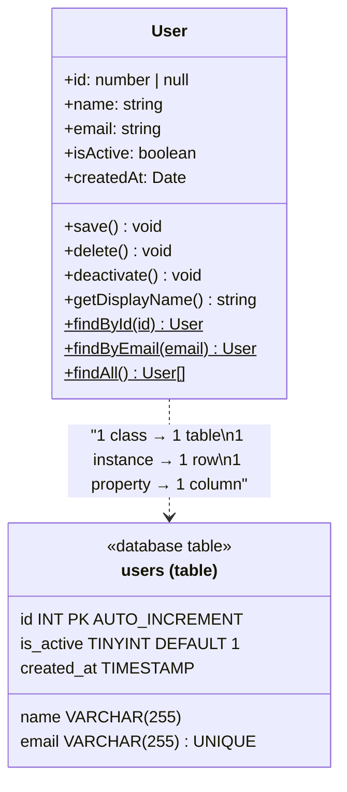
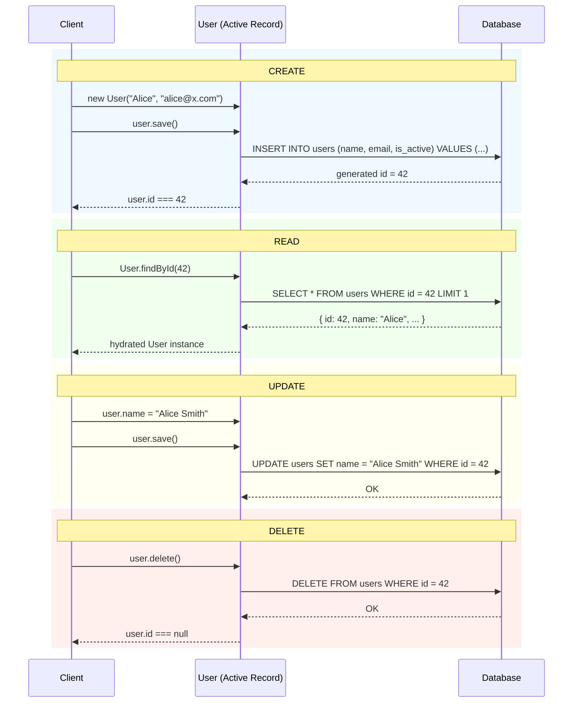
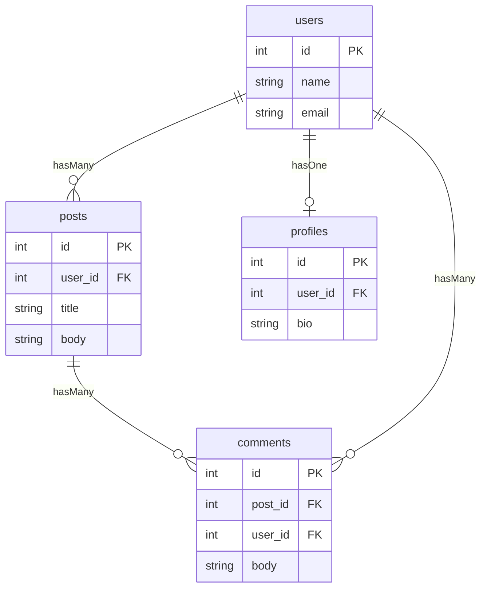
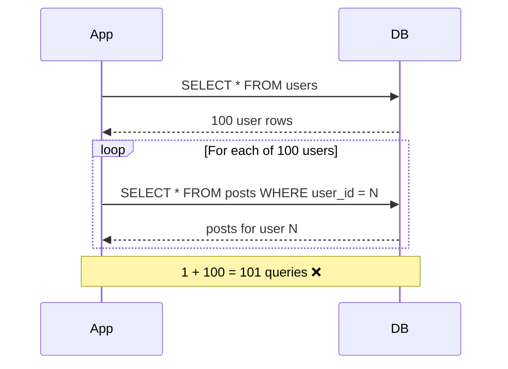
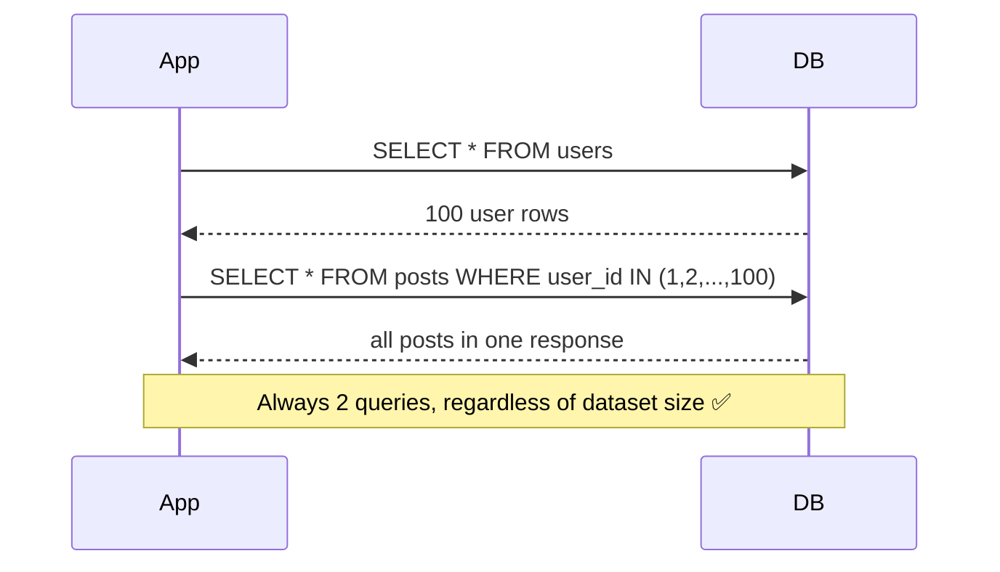
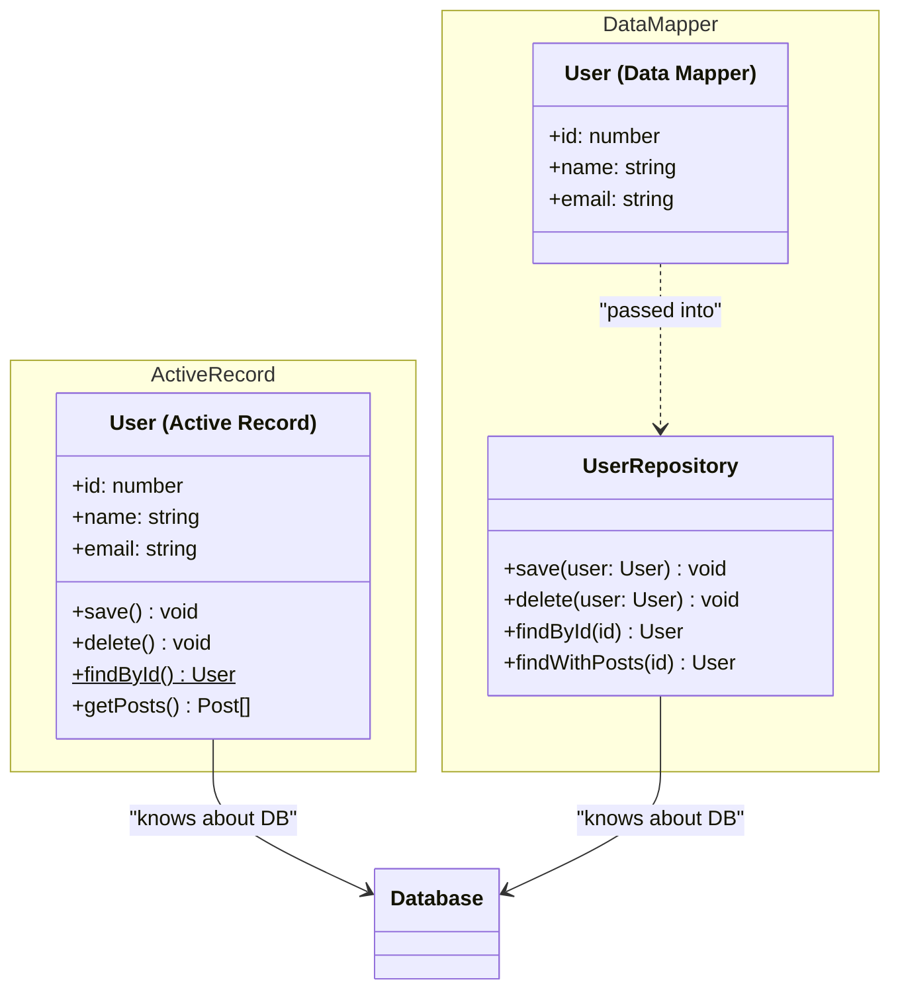
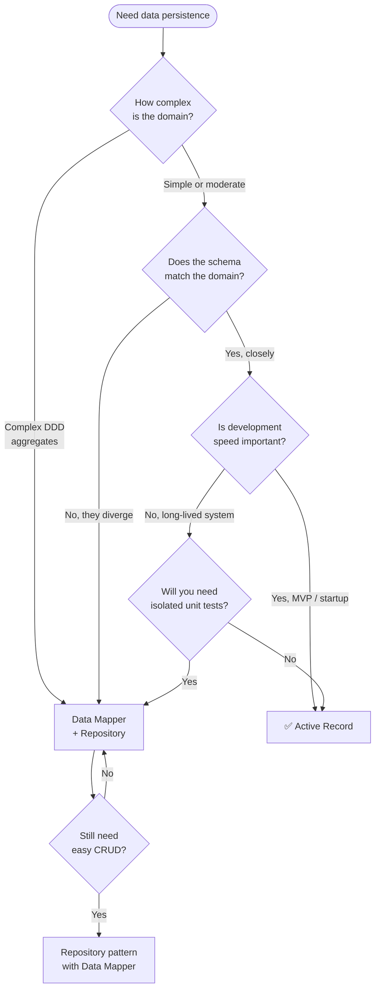

# Active Record Pattern

<CoverImage src="/covers/architectural/active-record.webp" alt="Cover">
  <h1>Active Record</h1>
  <p>Ulkan, muskulli multfilm qo'l-oyoqlariga ega kulgili papka o'z ma'lumot varaqlarini ko'tarib, o'zini joylashtirish uchun tartibli hujjat javoni tomon ishonch bilan qadam tashlamoqda.</p>
</CoverImage>

## Umumiy ko'rinish (Overview)

**Active Record** (Faol yozuv) patterni ma'lumotlar bazasidagi bitta qatorni o'zini qanday saqlashni ham biladigan obyekt ichiga o'raydi. Klass jadvalga, instansiya (instance) qatorga, xususiyatlar esa ustunlarga mos keladi. Saqlash (persistence) amallari — `save()`, `delete()` va statik qidiruv (finder) metodlari — biznes mantiq bilan birga bevosita domen obyektining o'zida joylashadi.

Bu ko'plab yirik veb-freymvorklarning asosidir: Ruby on Rails'ning `ActiveRecord`, Laravel'ning `Eloquent` va Django ORM — barchasi shu patternni amalga oshiradi. Domain-Driven Design (DDD) amaliyotchilari bu patternni Yagona javobgarlik tamoyilini (Single Responsibility Principle) buzgani uchun tanqid qilishadi va murakkab domenlarda bu tanqid o'rinli. Ammo domen modeli ma'lumotlar bazasi sxemasini yaqindan aks ettiradigan va ishlab chiqish tezligi arxitektura sofligidan muhimroq bo'lgan ilovalarning katta qismi uchun Active Record nihoyatda samarali.

Uning kuchli tomonlari va zaif nuqtalarini tushunib olsangiz, qachon undan foydalanish — va qachon uning o'rniga [Data Mapper](/uz/architectural/data-mapper)ni tanlash kerakligini aniq bilasiz.

## Hayotiy o'xshatish (Real-World Analogy)

**O'zini o'zi joylashtiradigan hujjatni** tasavvur qiling. Ko'pchilik hujjatlar passiv bo'ladi — siz ularga ma'lumot yozasiz, keyin alohida arxiv xodimi ularni olib, qayerda saqlashni hal qiladi. Active Record hujjati boshqacha: u o'zining joylashtirish qoidalarini biladi. Unga ma'lumotlaringizni yozing — u o'zi kerakli javonga boradi, to'g'ri tortmani ochadi va o'zini joyiga qo'yadi. So'rasangiz, keyinroq o'zini qaytarib olib kela oladi va kerak bo'lmay qolganda o'zini maydalab yo'q qiladi.

Hujjatning ma'lumotlari va uni joylashtirish xatti-harakati ajralmas — ular birga harakatlanadi. Aynan shu birlashuv Active Record'ning ham jozibasi, ham arxitekturaviy murosasi (trade-off) hisoblanadi.

## Muammo (The Problem)

Tartibli ma'lumotlarga kirish patterni bo'lmasa, SQL biznes mantiqqa sizib kiradi va natijada testlash qiyin, qo'llab-quvvatlash qiyin va xavfsiz refaktor qilib bo'lmaydigan kod paydo bo'ladi.

```typescript
// ❌ Xom SQL biznes mantiq bo'ylab sochilgan
function registerUser(name: string, email: string): number {
  // Validatsiya saqlash bilan aralashib ketgan
  if (!email.includes("@")) throw new Error("Invalid email");

  database.execute(
    "INSERT INTO users (name, email, is_active) VALUES (?, ?, 1)",
    [name, email],
  );

  // Yaratilgan ID kerakmi? Yana bitta so'rov.
  const result = database.query("SELECT id FROM users WHERE email = ?", [
    email,
  ]);
  return result[0].id;
}
```

**Nima noto'g'ri ketadi:**

- `INSERT INTO users` beshta turli servis faylida yoziladi.
- Ma'lumotlar bazasidagi ustun nomini o'zgartirish butun kod bazasi bo'ylab "grep qilib, omad tilash"ni anglatadi.
- Bu funksiyani unit-testlash uchun ishlab turgan ma'lumotlar bazasi kerak.
- Chaqiruvchi bu funksiya umuman ma'lumotlar bazasiga murojaat qilishini bilmaydi.

## Yechim (The Solution)

Saqlash haqidagi barcha bilimni ma'lumotlarga egalik qiluvchi klassga ko'chiring. Klassning o'zi CRUD operatsiyalari uchun yagona vakolatli joyga aylanadi va chaqiruvchilar hech qachon SQL yozmaydi.

```typescript
// ✅ Active Record: ma'lumot va saqlash bir joyda
const user = new User("Alice", "alice@example.com");
user.save(); // INSERT bajaradi — chaqiruvchi buni bilmaydi ham, qiziqmaydi ham

const existing = User.findById(1); // SELECT bajaradi — tiplangan obyekt qaytaradi
existing.name = "Alice Smith";
existing.save(); // UPDATE bajaradi — o'sha chaqiruv, boshqa SQL yo'li
```

Chaqiruvchi kod o'qilishi oson, o'z-o'zini hujjatlaydi va SQL sintaksisidan ajratilgan.

## Xaritalash qanday ishlaydi (How the Mapping Works)



### Ishtirokchilar (Participants)

| Ishtirokchi                      | Vazifasi                                                                                                                                                         |
| -------------------------------- | ---------------------------------------------------------------------------------------------------------------------------------------------------------------- |
| **Active Record klassi** (`User`) | Ma'lumotlar bazasi jadvaliga mos keladi. Har bir ustun uchun xususiyatlarni, saqlash va biznes mantiq uchun instansiya metodlarini hamda so'rovlar uchun statik metodlarni o'z ichiga oladi. |
| **Active Record instansiyasi**   | Ma'lumotlar bazasidagi bitta qatorni ifodalaydi. `save()` chaqirilganda ID mavjudligiga qarab yozuv qo'shiladi yoki yangilanadi.                                  |
| **Ma'lumotlar bazasi**           | Asosiy saqlash ombori. Active Record klassi u bilan bevosita qanday muloqot qilishni biladi.                                                                      |

## CRUD hayot sikli (CRUD Lifecycle)



`save()` metodining ikki tomonlama roli — yangi yozuvlar uchun INSERT, mavjudlari uchun UPDATE — Active Record'ning eng qulay xususiyatlaridan biri. Chaqiruvchi qaysi SQL buyrug'ini ishlatishni hech qachon hal qilishi shart emas.

## Amalga oshirish (Implementation)

### Asosiy qadamlar (Core Steps)

1. Ma'lumotlar bazasiga ulanish mantiqini va umumiy `save()` / `delete()` / `find()` implementatsiyalarini saqlovchi bazaviy klass yarating (yoki freymvorkingiz taqdim etganini kengaytiring).
2. Bazaviy klassni kengaytiruvchi entity klassini yarating. Jadval ustunlariga mos xususiyatlarni e'lon qiling.
3. Biznes mantiqni bevosita entity klassiga instansiya metodlari sifatida qo'shing.
4. `SELECT` so'rovlarini bajarib, to'ldirilgan (hydrated) instansiyalarni qaytaradigan statik qidiruv metodlarini qo'shing.
5. `save()` ni `id` null (INSERT) yoki o'rnatilgan (UPDATE) bo'lishiga qarab tarmoqlanadigan qilib amalga oshiring.

::: code-group

```typescript [TypeScript]
// Soxta ma'lumotlar bazasi
const db = {
  execute: (sql: string, params: unknown[] = []) =>
    console.log(`[DB] ${sql}`, params),
  query: (sql: string, params: unknown[] = []) => {
    console.log(`[DB] ${sql}`, params);
    return [{ id: 1, name: "John Doe", email: "john@test.com", is_active: 1 }];
  },
};

class User {
  public id: number | null = null;
  public name: string;
  public email: string;
  public isActive: boolean;
  public createdAt: Date = new Date();

  constructor(name: string, email: string, isActive = true) {
    this.name = name;
    this.email = email;
    this.isActive = isActive;
  }

  // ── Biznes mantiq ─────────────────────────────────────────────────────────

  deactivate(): void {
    this.isActive = false;
    this.save();
  }

  getDisplayName(): string {
    return `${this.name} <${this.email}>`;
  }

  // ── Saqlash ───────────────────────────────────────────────────────────────

  save(): void {
    if (this.id === null) {
      db.execute(
        "INSERT INTO users (name, email, is_active) VALUES (?, ?, ?)",
        [this.name, this.email, this.isActive ? 1 : 0],
      );
      this.id = 1; // Production'da: db.lastInsertId()
    } else {
      db.execute(
        "UPDATE users SET name = ?, email = ?, is_active = ? WHERE id = ?",
        [this.name, this.email, this.isActive ? 1 : 0, this.id],
      );
    }
  }

  delete(): void {
    if (this.id === null) return;
    db.execute("DELETE FROM users WHERE id = ?", [this.id]);
    this.id = null;
  }

  // ── Qidiruvchilar ─────────────────────────────────────────────────────────

  static findById(id: number): User | null {
    const rows = db.query("SELECT * FROM users WHERE id = ? LIMIT 1", [id]);
    if (!rows.length) return null;
    return User.hydrate(rows[0]);
  }

  static findByEmail(email: string): User | null {
    const rows = db.query("SELECT * FROM users WHERE email = ? LIMIT 1", [
      email,
    ]);
    if (!rows.length) return null;
    return User.hydrate(rows[0]);
  }

  static findAllActive(): User[] {
    const rows = db.query("SELECT * FROM users WHERE is_active = 1");
    return rows.map(User.hydrate);
  }

  private static hydrate(row: Record<string, unknown>): User {
    const user = new User(
      row.name as string,
      row.email as string,
      row.is_active === 1,
    );
    user.id = row.id as number;
    return user;
  }
}

// ── Foydalanish ───────────────────────────────────────────────────────────

const user = new User("Alice", "alice@example.com");
user.save(); // INSERT

user.name = "Alice Smith";
user.save(); // UPDATE

const found = User.findById(1);
found?.deactivate(); // biznes mantiq + UPDATE

found?.delete(); // DELETE
```

```python [Python]
from datetime import datetime

class MockDB:
    @staticmethod
    def execute(sql: str, params: tuple = ()) -> None:
        print(f"[DB] {sql} | {params}")

    @staticmethod
    def query(sql: str, params: tuple = ()) -> list[dict]:
        print(f"[DB] {sql} | {params}")
        return [{"id": 1, "name": "John Doe", "email": "john@test.com", "is_active": 1}]


class User:
    def __init__(self, name: str, email: str, is_active: bool = True):
        self.id: int | None = None
        self.name = name
        self.email = email
        self.is_active = is_active
        self.created_at = datetime.now()

    # ── Biznes mantiq ─────────────────────────────────────────────────────────

    def deactivate(self) -> None:
        self.is_active = False
        self.save()

    def get_display_name(self) -> str:
        return f"{self.name} <{self.email}>"

    # ── Saqlash ───────────────────────────────────────────────────────────────

    def save(self) -> None:
        if self.id is None:
            MockDB.execute(
                "INSERT INTO users (name, email, is_active) VALUES (?, ?, ?)",
                (self.name, self.email, int(self.is_active))
            )
            self.id = 1  # Production'da: db.lastrowid
        else:
            MockDB.execute(
                "UPDATE users SET name = ?, email = ?, is_active = ? WHERE id = ?",
                (self.name, self.email, int(self.is_active), self.id)
            )

    def delete(self) -> None:
        if self.id is not None:
            MockDB.execute("DELETE FROM users WHERE id = ?", (self.id,))
            self.id = None

    # ── Qidiruvchilar ─────────────────────────────────────────────────────────

    @classmethod
    def find_by_id(cls, user_id: int) -> "User | None":
        rows = MockDB.query("SELECT * FROM users WHERE id = ? LIMIT 1", (user_id,))
        return cls._hydrate(rows[0]) if rows else None

    @classmethod
    def find_all_active(cls) -> list["User"]:
        rows = MockDB.query("SELECT * FROM users WHERE is_active = 1")
        return [cls._hydrate(row) for row in rows]

    @classmethod
    def _hydrate(cls, row: dict) -> "User":
        user = cls(row["name"], row["email"], bool(row["is_active"]))
        user.id = row["id"]
        return user


# ── Foydalanish ───────────────────────────────────────────────────────────

user = User("Alice", "alice@example.com")
user.save()             # INSERT

user.name = "Alice Smith"
user.save()             # UPDATE

found = User.find_by_id(1)
if found:
    print(found.get_display_name())
    found.deactivate()  # biznes mantiq + UPDATE
    found.delete()      # DELETE
```

```java [Java]
import java.time.LocalDateTime;

class MockDB {
    static void execute(String sql, Object... params) {
        System.out.printf("[DB] %s%n", sql);
    }
    static Object[] queryRow(String sql, Object... params) {
        System.out.printf("[DB] %s%n", sql);
        return new Object[]{1, "John Doe", "john@test.com", true};
    }
}

class User {
    private Integer id;
    private String name;
    private String email;
    private boolean active;
    private LocalDateTime createdAt = LocalDateTime.now();

    public User(String name, String email) {
        this.name = name;
        this.email = email;
        this.active = true;
    }

    // ── Biznes mantiq ─────────────────────────────────────────────────────────

    public void deactivate() {
        this.active = false;
        this.save();
    }

    public String getDisplayName() {
        return name + " <" + email + ">";
    }

    // ── Saqlash ───────────────────────────────────────────────────────────────

    public void save() {
        if (id == null) {
            MockDB.execute(
                "INSERT INTO users (name, email, is_active) VALUES (?, ?, ?)",
                name, email, active
            );
            this.id = 1; // Production'da: Statement.RETURN_GENERATED_KEYS
        } else {
            MockDB.execute(
                "UPDATE users SET name = ?, email = ?, is_active = ? WHERE id = ?",
                name, email, active, id
            );
        }
    }

    public void delete() {
        if (id != null) {
            MockDB.execute("DELETE FROM users WHERE id = ?", id);
            this.id = null;
        }
    }

    // ── Qidiruvchilar ─────────────────────────────────────────────────────────

    public static User findById(int searchId) {
        Object[] row = MockDB.queryRow(
            "SELECT * FROM users WHERE id = ? LIMIT 1", searchId
        );
        if (row == null) return null;
        User user = new User((String) row[1], (String) row[2]);
        user.id = (Integer) row[0];
        user.active = (Boolean) row[3];
        return user;
    }

    public Integer getId() { return id; }
    public void setName(String name) { this.name = name; }
}

// ── Foydalanish ───────────────────────────────────────────────────────────

// main() ichida:
User user = new User("Alice", "alice@example.com");
user.save();

user.setName("Alice Smith");
user.save();

User found = User.findById(1);
if (found != null) {
    System.out.println(found.getDisplayName());
    found.deactivate();
    found.delete();
}
```

```go [Go]
package main

import "fmt"

// MockDB ma'lumotlar bazasini simulyatsiya qiladi
var db = struct {
    Execute func(sql string, params ...any)
    Query   func(sql string, params ...any) map[string]any
}{
    Execute: func(sql string, params ...any) {
        fmt.Printf("[DB] %s %v\n", sql, params)
    },
    Query: func(sql string, params ...any) map[string]any {
        fmt.Printf("[DB] %s %v\n", sql, params)
        return map[string]any{
            "id": 1, "name": "John Doe",
            "email": "john@test.com", "is_active": true,
        }
    },
}

// User — Active Record struct'i
type User struct {
    ID       *int
    Name     string
    Email    string
    IsActive bool
}

func NewUser(name, email string) *User {
    return &User{Name: name, Email: email, IsActive: true}
}

// ── Biznes mantiq ─────────────────────────────────────────────────────────

func (u *User) Deactivate() {
    u.IsActive = false
    u.Save()
}

func (u *User) GetDisplayName() string {
    return fmt.Sprintf("%s <%s>", u.Name, u.Email)
}

// ── Saqlash ───────────────────────────────────────────────────────────────

func (u *User) Save() {
    if u.ID == nil {
        db.Execute(
            "INSERT INTO users (name, email, is_active) VALUES (?, ?, ?)",
            u.Name, u.Email, u.IsActive,
        )
        id := 1
        u.ID = &id
    } else {
        db.Execute(
            "UPDATE users SET name = ?, email = ?, is_active = ? WHERE id = ?",
            u.Name, u.Email, u.IsActive, *u.ID,
        )
    }
}

func (u *User) Delete() {
    if u.ID != nil {
        db.Execute("DELETE FROM users WHERE id = ?", *u.ID)
        u.ID = nil
    }
}

// ── Qidiruvchilar ─────────────────────────────────────────────────────────

func FindUserByID(id int) *User {
    row := db.Query("SELECT * FROM users WHERE id = ? LIMIT 1", id)
    if row == nil {
        return nil
    }
    uid := row["id"].(int)
    return &User{
        ID:       &uid,
        Name:     row["name"].(string),
        Email:    row["email"].(string),
        IsActive: row["is_active"].(bool),
    }
}

// ── Foydalanish ───────────────────────────────────────────────────────────

func main() {
    user := NewUser("Alice", "alice@example.com")
    user.Save()

    user.Name = "Alice Smith"
    user.Save()

    found := FindUserByID(1)
    if found != nil {
        fmt.Println(found.GetDisplayName())
        found.Deactivate()
        found.Delete()
    }
}
```

```rust [Rust]
use std::collections::HashMap;

struct MockDB;
impl MockDB {
    fn execute(sql: &str, params: &[&str]) {
        println!("[DB] {} {:?}", sql, params);
    }
    fn query(sql: &str, _params: &[&str]) -> Option<HashMap<&'static str, &'static str>> {
        println!("[DB] {}", sql);
        Some(HashMap::from([
            ("id", "1"), ("name", "John Doe"),
            ("email", "john@test.com"), ("is_active", "1"),
        ]))
    }
}

pub struct User {
    pub id: Option<i32>,
    pub name: String,
    pub email: String,
    pub is_active: bool,
}

impl User {
    pub fn new(name: &str, email: &str) -> Self {
        Self { id: None, name: name.into(), email: email.into(), is_active: true }
    }

    // ── Biznes mantiq ─────────────────────────────────────────────────────────

    pub fn deactivate(&mut self) {
        self.is_active = false;
        self.save();
    }

    pub fn get_display_name(&self) -> String {
        format!("{} <{}>", self.name, self.email)
    }

    // ── Saqlash ───────────────────────────────────────────────────────────────

    pub fn save(&mut self) {
        let active = if self.is_active { "1" } else { "0" };
        if self.id.is_none() {
            MockDB::execute(
                "INSERT INTO users (name, email, is_active) VALUES (?, ?, ?)",
                &[&self.name, &self.email, active],
            );
            self.id = Some(1);
        } else {
            let id_str = self.id.unwrap().to_string();
            MockDB::execute(
                "UPDATE users SET name = ?, email = ?, is_active = ? WHERE id = ?",
                &[&self.name, &self.email, active, &id_str],
            );
        }
    }

    pub fn delete(&mut self) {
        if let Some(id) = self.id {
            MockDB::execute("DELETE FROM users WHERE id = ?", &[&id.to_string()]);
            self.id = None;
        }
    }

    // ── Qidiruvchilar ─────────────────────────────────────────────────────────

    pub fn find_by_id(id: i32) -> Option<User> {
        let row = MockDB::query(
            "SELECT * FROM users WHERE id = ? LIMIT 1",
            &[&id.to_string()],
        )?;
        Some(User {
            id: Some(row["id"].parse().unwrap()),
            name: row["name"].to_string(),
            email: row["email"].to_string(),
            is_active: row["is_active"] == "1",
        })
    }
}

fn main() {
    let mut user = User::new("Alice", "alice@example.com");
    user.save();

    user.name = "Alice Smith".into();
    user.save();

    if let Some(mut found) = User::find_by_id(1) {
        println!("{}", found.get_display_name());
        found.deactivate();
        found.delete();
    }
}
```

:::

## Assotsiatsiyalar (Associations)

Active Record'ning eng kuchli xususiyatlaridan biri — birlashtirish (join) so'rovlarini avtomatik generatsiya qiladigan assotsiatsiya e'lonlari: `hasMany`, `belongsTo`, `hasOne`. Rails va Laravel kabi freymvorklar aynan shu yerda porlaydi va patternning yashirin xarajatlari ham aynan shu yerda ko'rina boshlaydi.

### Assotsiatsiya turlari (Types of Associations)



```typescript
// TypeScript: bog'lanishlarni qo'lda yuklash (framework sehrisiz)
class Post {
  public id: number | null = null;
  public userId: number;
  public title: string;
  public body: string;

  constructor(userId: number, title: string, body: string) {
    this.userId = userId;
    this.title = title;
    this.body = body;
  }

  // hasMany: postda ko'p izohlar bor
  getComments(): Comment[] {
    const rows = db.query("SELECT * FROM comments WHERE post_id = ?", [
      this.id,
    ]);
    return rows.map(Comment.hydrate);
  }

  // belongsTo: post foydalanuvchiga tegishli
  getAuthor(): User | null {
    return User.findById(this.userId);
  }

  save(): void {
    /* INSERT yoki UPDATE */
  }

  static findById(id: number): Post | null {
    /* SELECT */ return null;
  }
  static hydrate(row: Record<string, unknown>): Post {
    const post = new Post(
      row.user_id as number,
      row.title as string,
      row.body as string,
    );
    post.id = row.id as number;
    return post;
  }
}

// Foydalanish: foydalanuvchi postlarini mualliflari bilan yuklash
const posts = Post.findByUserId(1);
posts.forEach((post) => {
  const author = post.getAuthor(); // ⚠️ Har bir post uchun bitta qo'shimcha so'rov — N+1!
  console.log(`${author?.name}: ${post.title}`);
});
```

Freymvork implementatsiyalarida (Rails, Eloquent) bu assotsiatsiyalar deklarativ tarzda e'lon qilinadi:

```ruby
# Ruby on Rails — Active Record bog'lanishlari
class User < ApplicationRecord
  has_many :posts
  has_one  :profile
  has_many :comments, through: :posts
end

class Post < ApplicationRecord
  belongs_to :user
  has_many   :comments
end

# Rails barcha postlar + mualliflarni 2 ta so'rovda yuklaydi (eager loading)
User.includes(:posts).find(1).posts.each do |post|
  puts post.title
end
```

```php
// Laravel Eloquent — xuddi shu g'oya
class User extends Model {
    public function posts() {
        return $this->hasMany(Post::class);
    }
}

// N+1 dan qochish uchun eager load
User::with('posts')->find(1)->posts->each(fn($p) => dump($p->title));
```

## N+1 so'rov muammosi (The N+1 Query Problem)

Bu Active Record kod bazalaridagi eng keng tarqalgan va eng zararli ishlash tezligi xatosidir. U yozuvlar ro'yxatini yuklab, keyin sikl ichida har biridagi assotsiatsiyaga murojaat qilganingizda yuzaga keladi — har bir iteratsiyada bitta so'rov ishga tushadi.

### Muammo (The Problem)



```typescript
// ❌ N+1 — beozor ko'rinadi, lekin juda sekin ishlaydi
const users = User.findAllActive(); // 1 ta so'rov: SELECT * FROM users

users.forEach((user) => {
  // Bu tsikldagi har bir foydalanuvchi uchun yangi SELECT ishga tushiradi
  const posts = user.getPosts(); // N ta so'rov: SELECT * FROM posts WHERE user_id = ?
  console.log(`${user.name} has ${posts.length} posts`);
});
// Jami: 1 + N ta so'rov
```

### Yechim: Oldindan yuklash (The Fix: Eager Loading)



```typescript
// ✅ Eager loading — nima kerakligini so'rovga oldindan ayting
const users = User.findAllWithPosts(); // Soniga qaramay, jami 2 ta so'rov

// Framework sintaksisi (Rails / Eloquent uslubi):
// User.includes(:posts).where(is_active: true)
// User::with('posts')->where('is_active', 1)->get()

users.forEach((user) => {
  // postlar allaqachon xotirada — qo'shimcha so'rov yo'q
  console.log(`${user.name} has ${user.posts.length} posts`);
});
```

::: warning Har doim bir qadam oldinni o'ylang
Kolleksiya bo'ylab iteratsiya qilib, so'rovni ishga tushirishi mumkin bo'lgan biror xususiyatga murojaat qilishdan oldin o'zingizdan so'rang: "Bu har bir qator uchun SELECT ishga tushiradimi?" Agar ha bo'lsa, oldindan yuklashdan (eager loading) foydalaning. Shu birgina odat Active Record'dagi ishlash tezligi muammolarining aksariyatining oldini oladi.
:::

## Active Record va Data Mapper (Active Record vs. Data Mapper)

Bu backend dasturlashdagi eng ko'p uchraydigan arxitekturaviy qaror nuqtalaridan biri. Tanlov butun saqlash qatlamingizni shakllantiradi.



| O'lchov                         | Active Record                       | Data Mapper                                         |
| ------------------------------- | ----------------------------------- | --------------------------------------------------- |
| **Ma'lumotlar bazasi bilimi**   | Entity ichida yashaydi              | Alohida mapper/repository'da yashaydi               |
| **Domen obyektining sofligi**   | Sxemaga bog'langan                  | Sof — saqlash bilan bog'liq vazifa yo'q             |
| **Unit-testlash**               | MB yoki murakkab mock'lar talab qiladi | Domen obyektlari sof xotirada testlanadi         |
| **Sxema moslashuvchanligi**     | Model MB'ni aks ettirishi shart     | Model va MB farqlanishi mumkin                      |
| **Assotsiatsiyalar**            | Deklarativ, ichki o'rnatilgan       | Aniq (explicit), ko'proq nazorat                    |
| **Ishlab chiqish tezligi**      | CRUD uchun juda tez                 | Dastlabki sozlash sekinroq                          |
| **Kod bo'ylab harakatlanish**   | Hamma narsa uchun bitta klass       | Alohida domen + saqlash qatlamlari                  |
| **Eng yaxshi freymvork misollari** | Rails, Eloquent, Django ORM      | TypeORM (data mapper rejimi), Hibernate             |
| **Ideal holat**                 | CRUD ilovalar, MVP'lar, standart veb | DDD, murakkab domenlar, mikroservislar             |

Gap qaysi biri "yaxshiroq" ekanligida emas — qaysi biri domeningiz murakkabligi va jamoangiz ustuvorliklariga mos kelishida.

## Afzalliklari va kamchiliklari (Advantages and Disadvantages)

### ✅ Afzalliklari

- **Dasturchi tezligi**: Har qanday pattern ichida ma'lumotlar bazasi sxemasidan ishlaydigan CRUD operatsiyalarigacha bo'lgan eng tez yo'l.
- **O'qilishi oson chaqiruv joylari**: `user.save()` niyatni aniq ifodalaydi. Kezib chiqish kerak bo'lgan repository, fabrika yoki mapper'lar yo'q.
- **Konfiguratsiyadan ko'ra kelishuv (Convention over configuration)**: Freymvorklar jadval nomlari, tashqi kalitlar (foreign keys) va birlashtirish shartlarini o'zi aniqlaydi va shablon kodni yo'q qiladi.
- **Birga joylashuv (Colocation)**: Biznes mantiq va saqlash birga yashaydi. Oddiy domenlarda bu fayllar orasida kontekst almashtirishning kognitiv xarajatini kamaytiradi.
- **Boy assotsiatsiya qo'llab-quvvatlovi**: `has_many`, `belongs_to` va `through` assotsiatsiyalari har bir yirik freymvork implementatsiyasida birinchi darajali imkoniyatdir.

### ❌ Kamchiliklari

- **Yagona javobgarlik tamoyilining buzilishi**: Parollarni tekshiradigan, email yuboradigan va SQL bajaradigan `User` klassi juda ko'p ish qiladi.
- **Testlash murakkabligi**: Biznes mantiq testlari ko'pincha ishlab turgan ma'lumotlar bazasini talab qiladi, bu test to'plamining vaqtini va mo'rtligini keskin oshiradi.
- **Sxemaga bog'lanish**: Domen modeli ma'lumotlar bazasi sxemasini aks ettirishga majbur. Ishlash tezligi uchun normallashtirish yoki o'qish uchun denormallashtirish noqulay domen API'larini keltirib chiqaradi.
- **"Semiz model" o'sishi (Fat model creep)**: Intizom bo'lmasa, har bir jamoa a'zosi qulay markaziy klassga "yana bitta metod" qo'shgani sari entity klasslari minglab qatorgacha o'sib ketadi.
- **N+1 so'rov xavfi**: Assotsiatsiyalarga boy kodda uni bilintirmasdan kiritib qo'yish oson va uni ushlaydigan statik tahlil yo'q.

## Qachon foydalanish kerak (When to Use)

::: tip Active Record'dan quyidagi hollarda foydalaning...

- **Tezkor ishlab chiqish ustuvor bo'lganda**: Bozorga chiqish vaqti uzoq muddatli arxitektura masalalaridan muhimroq bo'lgan startaplar, MVP'lar va ichki vositalar.
- **Domeningiz CRUD'ga boy bo'lganda**: Agar operatsiyalarning aksariyati murakkab ko'p-agregatli jarayonlarsiz yozuvlarni yaratish, o'qish, yangilash va o'chirishdan iborat bo'lsa.
- **Sxema domenni aks ettirganda**: `User` jadvali oradagi noqulay o'zgartirishlarsiz `User` obyektiga toza mos kelganda.
- **Jamoangiz kichik bo'lganda**: Hamma butun modelni boshida saqlay olsa, Active Record'dagi vazifalarning birga joylashuvi afzallikka aylanadi.

:::

::: warning Active Record'dan quyidagi hollarda qoching...

- **Sizga sof domen modellari kerak bo'lganda**: Agar domen mantiqingiz hech qanday ma'lumotlar bazasi infratuzilmasisiz ishlashi kerak bo'lsa (qat'iy DDD, hexagonal arxitektura), Data Mapper'dan foydalaning.
- **Sxemangiz va domeningiz farqlanganda**: Kuchli normallashtirilgan o'qish modellari, shardlangan jadvallar yoki boshqa jamoaga tegishli sxemalar Active Record uchun yomon mos keladi.
- **CQRS'dan foydalanganda**: Active Record o'qish va yozishni qattiq bog'laydi. CQRS esa ularning alohida bo'lishini talab qiladi.
- **Murakkab agregatlar bir nechta jadvalni qamraganda**: "Order" `orders`, `order_items`, `inventory` va `invoices` bo'ylab muvofiqlashtirishni anglatsa, yagona klass modeli barbod bo'ladi.
- **Test tezligi juda muhim bo'lganda**: Ma'lumotlar bazasi holatiga bog'liq katta test to'plamlari sekin va mo'rt bo'lib qoladi.

:::

## Active Record'dan foydalanishim kerakmi? (Should I Use Active Record?)



## Keng tarqalgan xatolar (Common Mistakes)

### ❌ Semiz model (The Fat Model)

Uzoq muddatdagi eng katta muvaffaqiyatsizlik holati. Hamma narsa bitta klassda yashagani uchun har bir dasturchi o'z funksiyasini `User` klassiga qo'shadi, chunki bu eng ko'zga tashlanadigan joy.

```typescript
// ❌ Jamoa o'sib borgan 18 oydan keyin
class User {
  // Asosiy ma'lumotlar
  id: number;
  name: string;
  email: string;

  // Autentifikatsiya
  hashPassword(pw: string): string {
    /* ... */
  }
  validatePassword(pw: string): boolean {
    /* ... */
  }
  generateJWT(): string {
    /* ... */
  }

  // Email'lar
  sendWelcomeEmail(): void {
    /* ... */
  }
  sendPasswordResetEmail(): void {
    /* ... */
  }
  sendWeeklyDigest(): void {
    /* ... */
  }

  // Billing
  createStripeCustomer(): void {
    /* ... */
  }
  charge(amount: number): void {
    /* ... */
  }
  cancelSubscription(): void {
    /* ... */
  }

  // Saqlash
  save(): void {
    /* ... */
  }
  delete(): void {
    /* ... */
  }
  static findById(id: number): User {
    /* ... */
  }
  // ... yana 2 400 qator
}
```

```typescript
// ✅ Modelni ixcham saqlang. Boshqa vazifalarni service klasslariga o'tkazing.
class User {
  id: number;
  name: string;
  email: string;
  deactivate(): void {
    /* faqat asosiy domen mantiqi */
  }
  save(): void {
    /* saqlash */
  }
}

class AuthService {
  hashPassword(pw: string): string {
    /* ... */
  }
  generateJWT(user: User): string {
    /* ... */
  }
}

class BillingService {
  createCustomer(user: User): void {
    /* ... */
  }
  charge(user: User, amount: number): void {
    /* ... */
  }
}
```

### ❌ N+1 so'rov muammosi (The N+1 Query Problem)

Yuqorida batafsil yoritilgan. Qisqasi: Active Record obyektlari bo'ylab sikl yuritib, sikl ichida assotsiatsiya metodini chaqirsangiz, assotsiatsiyani oldindan yuklamagan bo'lsangiz, N+1 ta so'rov yuborayotgan bo'lasiz.

### ❌ Sikl ichida `save()` ni chaqirish (Calling `save()` in a Loop)

Har bir `save()` chaqiruvi ma'lumotlar bazasiga bir marta borib-kelishni anglatadi. 10 000 ta yozuvni birma-bir import qilish bir necha daqiqa olishi mumkin; ommaviy qo'shish (bulk insert) esa bir necha soniya oladi.

```typescript
// ❌ 10 000 ta alohida INSERT buyrug'i
for (const row of csvData) {
  const user = new User(row.name, row.email);
  user.save(); // har bir qator uchun DB'ga bitta borib-kelish
}

// ✅ Bitta buyruqda ommaviy insert
User.insertMany(csvData.map((r) => ({ name: r.name, email: r.email })));
// INSERT INTO users (name, email) VALUES (?, ?), (?, ?), ...
```

### ❌ Tranzaksiyalarni e'tiborsiz qoldirish (Ignoring Transactions)

Bir nechta Active Record operatsiyasi birgalikda muvaffaqiyatli bo'lishi yoki birgalikda bekor qilinishi kerak bo'lsa, sizga aniq tranzaksiya kerak. Usiz yarim yo'ldagi xato ma'lumotlar bazasini nomuvofiq holatda qoldiradi.

```typescript
// ❌ Agar createProfile() xato tashlasa, User allaqachon saqlangan bo'ladi
const user = new User("Alice", "alice@example.com");
user.save();
const profile = new Profile(user.id!, "Software Engineer");
profile.save(); // bu muvaffaqiyatsiz bo'lsa-chi?

// ✅ Tranzaksiyaga o'rang
await db.transaction(async () => {
  const user = new User("Alice", "alice@example.com");
  user.save();
  const profile = new Profile(user.id!, "Software Engineer");
  profile.save();
  // Ikkalasi ham muvaffaqiyatli bo'ladi yoki ikkalasi ham bekor qilinadi
});
```

### ❌ Active Record obyektlarini DTO sifatida ishlatish (Treating Active Record Objects as DTOs)

Active Record obyektlarini qatlam chegaralari orqali uzatish xavfsiz emas. Ular jonli ma'lumotlar bazasi ulanish kontekstini, dangasa yuklanadigan (lazy-loaded) assotsiatsiyalarni va o'zgarishlarni kuzatish holatini tashiydi. Ularni to'g'ridan-to'g'ri API javoblariga seriyalash siz kiritishni niyat qilmagan ustunlarni oshkor qilishi mumkin.

```typescript
// ❌ is_active, created_at va ichki maydonlarni ochib qo'yadi
app.get("/users/:id", (req, res) => {
  const user = User.findById(Number(req.params.id));
  res.json(user); // butun obyektni, DB holati bilan birga serializatsiya qiladi
});

// ✅ Qaytarishdan oldin oddiy DTO'ga o'giring
app.get("/users/:id", (req, res) => {
  const user = User.findById(Number(req.params.id));
  res.json({ id: user.id, name: user.name, email: user.email });
});
```

## Haqiqiy freymvorklardagi Active Record (Active Record in Real Frameworks)

Bularning barchasi kichik farqlarga ega Active Record implementatsiyalaridir. Pattern amaliyotda qanday ko'rinishini tushunish ekotizimlar orasida o'tishda yordam beradi.

| Freymvork                | Til            | Izohlar                                                                          |
| ------------------------ | -------------- | -------------------------------------------------------------------------------- |
| **Rails ActiveRecord**   | Ruby           | Kanonik implementatsiya. Kelishuvlar qat'iy va kuchli.                           |
| **Laravel Eloquent**     | PHP            | Hissiyot jihatidan Rails'ga eng yaqin. Boy assotsiatsiya va scope API'si.        |
| **Django ORM**           | Python         | Texnik jihatdan Data Mapper, lekin `Model.save()` tufayli Active Record'dek tuyuladi. |
| **TypeORM (AR rejimi)**  | TypeScript     | Bitta kutubxonada ham Active Record, ham Data Mapper rejimlarini qo'llab-quvvatlaydi. |
| **Sequelize**            | JavaScript     | Aniq model ta'riflariga ega Active Record.                                       |
| **GORM**                 | Go             | Ustunlarni xaritalash uchun struct teglaridan foydalanadigan Active Record uslubi. |
| **ActiveAndroid / Room** | Android/Kotlin | Patternning SQLite uchun mobil moslashtirilgan variantlari.                      |

## Aloqador patternlar (Related Patterns)

- **[Data Mapper](/uz/architectural/data-mapper)** — arxitekturaviy qarama-qarshisi. Domen obyektlari ma'lumotlar bazasi haqida hech narsa bilmaydi; saqlash bilan alohida mapper shug'ullanadi. Domen murakkab bo'lsa yoki izolyatsiyada testlanishi kerak bo'lsa, shundan foydalaning.
- **[Repository](/uz/architectural/repository)** — Active Record yoki Data Mapper ustida turishi mumkin bo'lgan abstraksiya qatlami; obyektlarni so'rash uchun kolleksiyaga o'xshash interfeys taqdim etadi.
- **[Unit of Work](/uz/architectural/unit-of-work)** — bir nechta Active Record operatsiyasini yagona atomar ma'lumotlar bazasi tranzaksiyasiga muvofiqlashtiradi.
- **[Identity Map](/uz/architectural/identity-map)** — har bir ma'lumotlar bazasi qatori bitta so'rov davomida xotiraga faqat bir marta yuklanishini ta'minlaydi va bir xil qator bir necha marta yuklanganda eskirgan dublikat obyektlarning oldini oladi.

## Intervyu savollari (Interview Insights)

::: details Active Record va Data Mapper o'rtasidagi asosiy arxitekturaviy farq nima?

Active Record'da domen entity'si ma'lumotlar bazasi haqida biladi — u `save()`, `delete()` va qidiruv metodlarini tashiydi. Data Mapper'da entity hech qanday saqlash mantiqiga ega bo'lmagan oddiy obyekt; xotiradagi obyekt va ma'lumotlar bazasi qatori o'rtasidagi tarjima uchun alohida mapper yoki repository klassi javobgar.

Oqibati: Active Record `User` ni ma'lumotlar bazasisiz (yoki og'ir mock'larsiz) unit-testlab bo'lmaydi. Data Mapper `User` esa testda hech qanday ma'lumotlar bazasisiz yaratilishi, o'zgartirilishi va tekshirilishi mumkin bo'lgan oddiy obyekt.

:::

::: details Nega DDD amaliyotchilari Active Record'ni yoqtirishmaydi?

Domain-Driven Design domen modeli biznes qoidalarini saqlash tafsilotlari bilan cheklanmagan holda, sof xotirada ifodalashini talab qiladi. Active Record buni ikki yo'l bilan buzadi:

1. **Sxemaga bog'lanish** — domen modeli infratuzilma masalasi bo'lgan ma'lumotlar bazasi tuzilmasini aks ettirishi shart.
2. **Javobgarliklarning aralashuvi** — biznes mantiq va SQL generatsiyasi bir klassda yashaydi, bu domen mantiqini testlashni va mustaqil tahlil qilishni qiyinlashtiradi.

Oddiy CRUD ilovalari uchun bu murosalar maqbul. Agregatlar, qiymat obyektlari (value objects) va bir nechta jadvalni qamraydigan invariantlarga ega murakkab domenlarda esa ular arxitekturaviy yukka aylanadi.

:::

::: details Active Record N+1 so'rovlarni keltirib chiqarayotgan holatni qanday hal qilasiz?

Avval muammoni aniqlang — ma'lumotlar bazasi so'rov loglari yoki APM vositasi (New Relic, Datadog) bitta so'rovda 100+ deyarli bir xil so'rovni ko'rsatishi uning belgisidir.

Yechim — oldindan yuklash (eager loading): iteratsiyadan oldin qaysi assotsiatsiyalar kerakligini oldindan e'lon qiling. Rails'da: `User.includes(:posts)`. Eloquent'da: `User::with('posts')`. TypeORM'da: `userRepo.find({ relations: ['posts'] })`.

Agar assotsiatsiya shartli ravishda kerak bo'lsa yoki so'rov quruvchi (query builder) buni toza qo'llab-quvvatlamasa, qidiruv metodida qo'lda yozilgan JOIN so'roviga qayting.

:::

::: details Qachon Active Record'dan Data Mapper'ga o'tish kerak?

O'tish vaqti kelganini bildiruvchi signallar:

- Unit-testlar ishlab turgan ma'lumotlar bazasini talab qiladi va sekin ishlaydi.
- Domen modelida ahamiyatli xaritalash mantiqiga ega, bir nechta jadvalni qamraydigan murakkab agregatlar bor.
- Ma'lumotlar bazasi sxemasi va domen modeli farqlanishi kerak (masalan, MB yozish tezligi uchun kuchli normallashtirilgan, domen obyekti esa denormallashtirilgan).
- Jamoa CQRS'ni joriy qilmoqda va alohida o'qish va yozish modellariga muhtoj.

O'tish bosqichma-bosqich amalga oshiriladi: avval mavjud Active Record klasslari ustiga Repository interfeysini kiriting, keyin chaqiruvchilarni o'zgartirmasdan, uning ostidagi implementatsiyani Data Mapper bilan almashtiring.

:::

::: details "Semiz model" muammosi nima va uni qanday hal qilasiz?

Active Record entity bilan bog'liq barcha mantiqni bitta klassga joylashtirishga undaydi. Vaqt o'tishi bilan, funksiyalar qo'shilgani sari, bu klass autentifikatsiya mantiqi, email yuborish, billing va saqlash aralashib ketgan "hamma narsa uchun" joyga aylanadi — ba'zan minglab qatordan oshib ketadi.

Yechim — **servislarga ajratish (service decomposition)**: modelni uning asosiy ma'lumot invariantlari va saqlashga qaratilgan holda saqlang, alohida operatsiyalarni (autentifikatsiya, bildirishnomalar, billing) esa domen obyektini kirish sifatida qabul qiladigan maxsus servis klasslariga ko'chiring. Bu testlanuvchanlikni ham keskin yaxshilaydi, chunki har bir servisni mock yoki stub obyekt bilan mustaqil testlash mumkin.

:::
