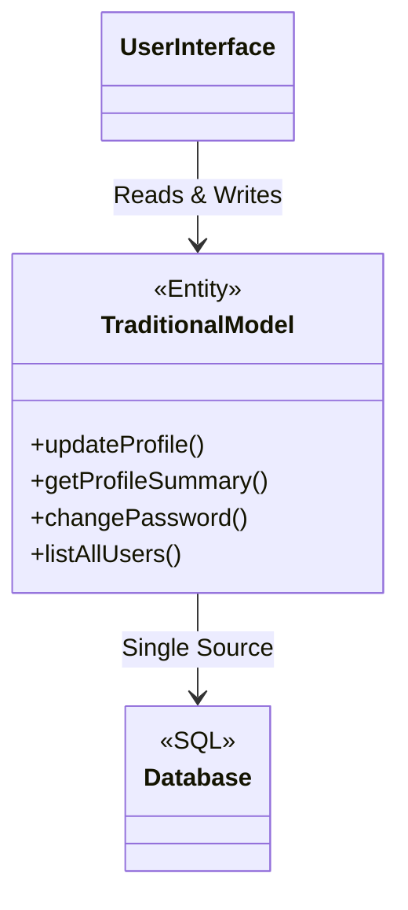
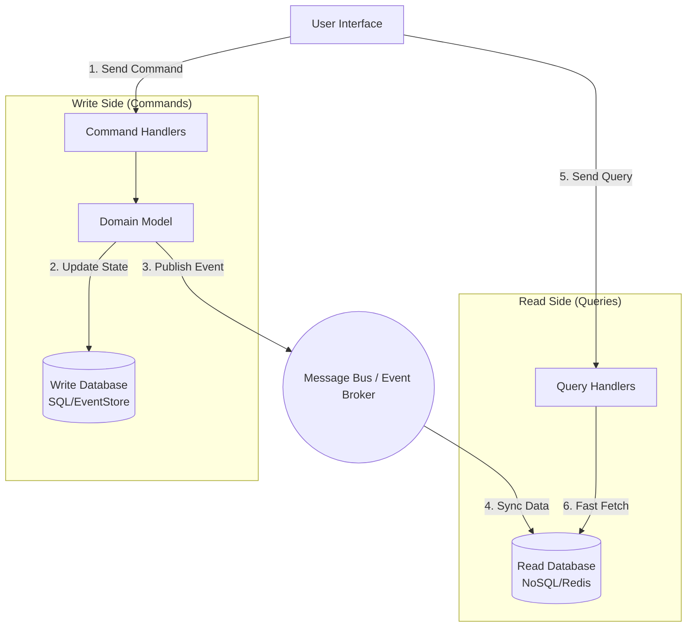

# Command Query Responsibility Segregation (CQRS)

<CoverImage src="/covers/architectural/cqrs.webp" alt="Cover">
  <h1>CQRS</h1>
  <p>Ikki tomonlama ish stoli: chap tomonda ulkan bolg'a bilan obyektlar yasayotgan og'ir mexanik ustaxona (Yozish), o'ng tomonda esa tartibli, oldindan tayyorlangan varaqlarni ko'rsatib turgan nurli lupa bilan toza shisha stol (O'qish).</p>
</CoverImage>

## Umumiy ko'rinish (Overview)

**Command Query Responsibility Segregation (CQRS)** - ilovangizning konseptual modelini ikkita alohida qismga ajratadigan ilg'or arxitektura patternidir:
- **Command tomoni (Yozish)**: Holatni o'zgartiradigan amallarni (mutatsiyalarni) qayta ishlaydi. U murakkab biznes qoidalari va validatsiyalarni majburiy qo'llaydi.
- **Query tomoni (O'qish)**: Holatni qaytaradigan amallarni (ma'lumot olishni) qayta ishlaydi. U murakkab domen mantig'ini chetlab o'tadi va UI ga to'g'ridan-to'g'ri tekis, optimallashtirilgan ma'lumotlar tuzilmalarini qaytaradi.

Bu ikki mas'uliyatni qat'iy ajratish orqali siz o'qish va yozish yo'llaringizni bir-biridan butunlay mustaqil ravishda optimallashtirishingiz, masshtablashingiz va himoyalashingiz mumkin.

## Muammo (The Problem)

An'anaviy N-Tier yoki CRUD (Create, Read, Update, Delete) arxitekturasida ma'lumotlarni o'qish uchun ham, yozish uchun ham aynan bir xil Domen modeli va ma'lumotlar bazasidan foydalaniladi.



Ilova o'sgani sari bu jiddiy tor joylarni (bottleneck) keltirib chiqaradi:
1. **Nosimmetrik yuklama**: Aksariyat tizimlarda (Twitter yoki elektron tijorat kabi) har 1 ta yozishga 1000 ta o'qish to'g'ri keladi. Faqat ulkan o'qish trafigini ko'tarish uchun butun monolit ma'lumotlar bazasini masshtablash juda qimmat.
2. **Bir-biriga zid optimallashtirishlar**:
   - *Yozish* yaxlitlikni ta'minlash va anomaliyalardan qochish uchun normallashtirilgan (3NF) ma'lumotlarni xohlaydi.
   - *O'qish* esa sekin SQL `JOIN` operatsiyalaridan qochish uchun kuchli denormallashtirilgan ma'lumotlarni (JSON blob'lar, NoSQL) xohlaydi.
3. **Murakkab so'rovlar**: Dashboard ko'rinishini qaytarish 8 xil jadvalni birlashtirishni talab qilishi mumkin, bu esa dahshatli SQL ishlash tezligi va murakkab ORM mapping kodiga olib keladi.

## Yechim (The Solution)

CQRS arxitekturani ikkiga ajratadi.

1. Foydalanuvchi **Command** (buyruq) yuboradi (masalan, `UpdateUserProfileCommand`).
2. Command Handler biznes mantig'ini bajaradi, **Write Database** (yozish bazasi) ni yangilaydi va **Event** (hodisa) chiqaradi (`UserProfileUpdated`).
3. Event Listener bu hodisani ushlab oladi va kuchli denormallashtirilgan **Read Database** (o'qish bazasi) ni yangilaydi (masalan, ElasticSearch, Redis yoki tekislangan SQL jadval).
4. Foydalanuvchi **Query** (so'rov) yuboradi (masalan, `GetUserProfileQuery`).
5. Query Handler domen modelini butunlay chetlab o'tadi, oldindan hisoblangan ma'lumotlarni Read Database'dan oladi va darhol qaytaradi.



## Hayotiy o'xshatish (Real-World Analogy)

**Gazeta agentligi**ni tasavvur qiling.
- **Command tomoni (Jurnalistlar va muharrirlar)**: Ular tadqiqot qiladi, faktlarni tekshiradi, qat'iy tahririyat qoidalarini (biznes mantig'ini) qo'llaydi va maqolani yozadi. Bu sekin va ehtiyotkor jarayon.
- **Event Broker (Bosmaxona)**: Maqola yakunlangach, u minglab gazetalarga bosiladi.
- **Query tomoni (Gazeta kiosklari)**: Xaridorlar shunchaki kelib, oldindan bosilgan gazetani olishadi va darhol o'qishadi. Ular jurnalistlar bilan gaplashmaydi.

Yangiliklarni *yaratish* jarayoni yangiliklarni *iste'mol qilish* jarayonidan butunlay ajratilgan.

## Bosqichma-bosqich amalga oshirish (Step-by-Step Implementation)

1. **Command va Query'larni aniqlang**: Foydalanuvchi niyatini ifodalovchi oddiy ma'lumot obyektlarini yarating.
2. **Handler'larni ajrating**: Command'larni (yozish) va Query'larni (o'qish) qayta ishlash uchun alohida klasslar yarating.
3. **(Ixtiyoriy, lekin keng tarqalgan) Ma'lumotlar bazalarini ajrating**: Relyatsion bazaga (PostgreSQL) yozing va ma'lumotlarni tezkor o'qish omboriga (Redis, MongoDB yoki ElasticSearch) proyeksiya qiling.

## Kod misollari (Code Examples)

Biz oddiy CQRS tuzilmasini amalga oshiramiz. E'tibor bering, Query tomoni Domen modelini butunlay e'tiborsiz qoldiradi va shunchaki tekis Data Transfer Object'larni (DTO) qaytaradi.

::: code-group

```typescript [TypeScript (NestJS Style)]
// --- 1. COMMAND TOMONI (Yozish) ---

class CreateUserCommand {
  constructor(public email: string, public age: number) {}
}

class CreateUserCommandHandler {
  constructor(
    private writeRepo: UserWriteRepository,
    private eventBus: EventBus
  ) {}

  async execute(command: CreateUserCommand): Promise<void> {
    // Biznes qoidalarini qo'llash
    if (command.age < 18) throw new Error("User must be 18+");
    
    const userId = generateId();
    await this.writeRepo.save({ id: userId, email: command.email, age: command.age });
    
    // Event'ni e'lon qilish
    await this.eventBus.publish(new UserCreatedEvent(userId, command.email));
  }
}

// --- 2. KO'PRIK ---

class UserCreatedEventHandler {
  constructor(private readRepo: UserReadRepository) {}

  async handle(event: UserCreatedEvent) {
    // Tez o'qiladigan formatga proyeksiya qilish (masalan, Redis)
    const readModel = {
      id: event.userId,
      displayEmail: event.email.toLowerCase(),
    };
    await this.readRepo.save(readModel);
  }
}

// --- 3. QUERY TOMONI (O'qish) ---

class GetUserQuery {
  constructor(public userId: string) {}
}

class GetUserQueryHandler {
  constructor(private readRepo: UserReadRepository) {}

  async execute(query: GetUserQuery): Promise<UserReadDto> {
    // To'g'ridan-to'g'ri, chaqmoqdek tez o'qish. Biznes mantiq yo'q.
    const data = await this.readRepo.findById(query.userId);
    return new UserReadDto(data.id, data.displayEmail);
  }
}
```

```python [Python (FastAPI Style)]
# --- 1. COMMAND TOMONI (Yozish) ---
from dataclasses import dataclass

@dataclass
class CreateUserCommand:
    email: str
    age: int

class CreateUserCommandHandler:
    def __init__(self, write_db, event_bus):
        self.write_db = write_db
        self.event_bus = event_bus

    def execute(self, command: CreateUserCommand):
        if command.age < 18:
            raise ValueError("Must be 18+")
            
        user_id = "uuid-123"
        self.write_db.save({"id": user_id, "email": command.email, "age": command.age})
        
        self.event_bus.publish(UserCreatedEvent(user_id, command.email))

# --- 2. KO'PRIK ---
class UserCreatedEventHandler:
    def __init__(self, read_db):
        self.read_db = read_db

    def handle(self, event):
        # Tez o'qish uchun ma'lumotni proyeksiya qilish
        self.read_db.save_view({
            "id": event.user_id,
            "display": event.email.lower()
        })

# --- 3. QUERY TOMONI (O'qish) ---
@dataclass
class GetUserQuery:
    user_id: str

class GetUserQueryHandler:
    def __init__(self, read_db):
        self.read_db = read_db

    def execute(self, query: GetUserQuery) -> dict:
        # Domenni chetlab o'tib, proyeksiyani darhol olish
        return self.read_db.get_view(query.user_id)
```

```java [Java (Spring Boot Style)]
// --- 1. COMMAND TOMONI (Yozish) ---
record CreateUserCommand(String email, int age) {}

@Service
class CreateUserCommandHandler {
    private final WriteRepository writeRepo;
    private final ApplicationEventPublisher publisher;

    public CreateUserCommandHandler(WriteRepository writeRepo, ApplicationEventPublisher publisher) {
        this.writeRepo = writeRepo;
        this.publisher = publisher;
    }

    @Transactional
    public void handle(CreateUserCommand command) {
        if (command.age() < 18) throw new IllegalArgumentException("Must be 18+");
        
        String userId = UUID.randomUUID().toString();
        writeRepo.save(new UserEntity(userId, command.email(), command.age()));
        
        publisher.publishEvent(new UserCreatedEvent(userId, command.email()));
    }
}

// --- 2. KO'PRIK ---
@Component
class UserProjector {
    private final ReadRepository readRepo;
    public UserProjector(ReadRepository readRepo) { this.readRepo = readRepo; }

    @EventListener
    public void onUserCreated(UserCreatedEvent event) {
        // Redis / ElasticSearch'ga saqlash
        readRepo.save(new UserReadModel(event.id(), event.email().toLowerCase()));
    }
}

// --- 3. QUERY TOMONI (O'qish) ---
record GetUserQuery(String userId) {}

@Service
class GetUserQueryHandler {
    private final ReadRepository readRepo;
    public GetUserQueryHandler(ReadRepository readRepo) { this.readRepo = readRepo; }

    public UserReadModel handle(GetUserQuery query) {
        return readRepo.findById(query.userId());
    }
}
```

```go [Go]
package main

import (
	"errors"
	"fmt"
)

// --- 1. COMMAND TOMONI ---
type CreateUserCommand struct {
	Email string
	Age   int
}

type CommandHandler struct {
	writeDB  *WriteDatabase
	eventBus *EventBus
}

func (h *CommandHandler) HandleCreateUser(cmd CreateUserCommand) error {
	if cmd.Age < 18 {
		return errors.New("must be 18+")
	}

	userId := "usr_123"
	h.writeDB.Save(userId, cmd.Email, cmd.Age)
	
	h.eventBus.Publish(UserCreatedEvent{UserId: userId, Email: cmd.Email})
	return nil
}

// --- 2. EVENT VA KO'PRIK ---
type UserCreatedEvent struct {
	UserId string
	Email  string
}

type EventBus struct {
	readDB *ReadDatabase
}

func (bus *EventBus) Publish(event UserCreatedEvent) {
	// O'qish DB'siga proyeksiya qilish
	bus.readDB.SaveView(event.UserId, event.Email)
}

// --- 3. QUERY TOMONI ---
type GetUserQuery struct {
	UserId string
}

type QueryHandler struct {
	readDB *ReadDatabase
}

func (h *QueryHandler) HandleGetUser(query GetUserQuery) string {
	return h.readDB.GetUserView(query.UserId)
}

// Soxta DB'lar
type WriteDatabase struct{}
func (db *WriteDatabase) Save(id string, email string, age int) { fmt.Println("Saved to Write DB (SQL)") }

type ReadDatabase struct{}
func (db *ReadDatabase) SaveView(id string, email string) { fmt.Println("Projected to Read DB (Redis)") }
func (db *ReadDatabase) GetUserView(id string) string { return "Fast JSON View for UI" }
```

```rust [Rust]
use std::sync::{Arc, Mutex};

// --- 1. COMMAND TOMONI ---
struct CreateUserCommand {
    email: String,
    age: u8,
}

struct CommandHandler {
    write_db: Arc<Mutex<WriteDatabase>>,
    event_bus: Arc<Mutex<EventBus>>,
}

impl CommandHandler {
    fn handle(&self, cmd: CreateUserCommand) -> Result<(), &'static str> {
        if cmd.age < 18 {
            return Err("must be 18+");
        }

        let user_id = "usr_123".to_string();
        self.write_db.lock().unwrap().save(&user_id, &cmd.email, cmd.age);
        
        self.event_bus.lock().unwrap().publish(UserCreatedEvent {
            user_id,
            email: cmd.email,
        });
        
        Ok(())
    }
}

// --- 2. KO'PRIK ---
struct UserCreatedEvent {
    user_id: String,
    email: String,
}

struct EventBus {
    read_db: Arc<Mutex<ReadDatabase>>,
}

impl EventBus {
    fn publish(&self, event: UserCreatedEvent) {
        self.read_db.lock().unwrap().save_view(&event.user_id, &event.email);
    }
}

// --- 3. QUERY TOMONI ---
struct GetUserQuery {
    user_id: String,
}

struct QueryHandler {
    read_db: Arc<Mutex<ReadDatabase>>,
}

impl QueryHandler {
    fn handle(&self, query: GetUserQuery) -> String {
        self.read_db.lock().unwrap().get_view(&query.user_id)
    }
}

// Soxta DB'lar
struct WriteDatabase;
impl WriteDatabase {
    fn save(&self, id: &str, email: &str, age: u8) { println!("Saved to Write DB (SQL)"); }
}

struct ReadDatabase;
impl ReadDatabase {
    fn save_view(&self, id: &str, email: &str) { println!("Projected to Read DB (Redis)"); }
    fn get_view(&self, id: &str) -> String { "Fast JSON View".to_string() }
}
```

:::

## Yakuniy izchillik (Eventual Consistency) - murosaning narxi

Agar O'qish va Yozish ma'lumotlar bazalarini ajratsangiz, **Eventual Consistency** (yakuniy izchillik) ni olib kirasiz.
Foydalanuvchi o'z profilini yangilaganida (Command), Event Bus Read Database'ni yangilashi uchun bir necha millisekund vaqt ketadi. Agar foydalanuvchi sahifani darhol yangilasa (Query), u bir lahzaga o'zining *eski* profil ma'lumotlarini ko'rishi mumkin.

UI ni bunga moslab loyihalashingiz kerak (masalan, optimistik UI yangilanishlari yoki polling).

## Afzalliklari va kamchiliklari (Pros and Cons)

### Afzalliklari (Advantages)
- **Mustaqil masshtablash**: Agar ilovangiz o'qish trafigi ostida ezilib qolsa (masalan, Black Friday da), Write Database'ga tegmasdan Read Database'ni (Redis nusxalarini) masshtablashingiz mumkin.
- **Ishlash tezligini optimallashtirish**: Ma'lumotlarni aynan UI ga kerakli formatda proyeksiya qilishingiz mumkin. O'qishda endi murakkab SQL `JOIN` lar yo'q.
- **Soddaroq xavfsizlik**: Command'lar holatni o'zgartiradi va jiddiy avtorizatsiyani talab qiladi. Query'lar esa shunchaki ma'lumot qaytaradi. Ularni ajratish xavfsizlik auditini ancha osonlashtiradi.

### Kamchiliklari (Disadvantages)
- **O'ta yuqori murakkablik**: CQRS kod hajmini uch barobar oshiradi. Har bir funksiya uchun sizga Command, CommandHandler, Event, EventHandler, Query va QueryHandler kerak bo'ladi.
- **Eventual Consistency**: Dasturchilar va UI dizaynerlar yozishdan keyin ma'lumotlar darhol mavjud bo'lmaydigan tizimlarni qurishni o'rganishlari kerak.
- **Infratuzilma xarajatlari**: Endi ikki xil ma'lumotlar bazasi texnologiyasini va message broker'ni (masalan, Kafka yoki RabbitMQ) qo'llab-quvvatlashingizga to'g'ri keladi.

## Qachon foydalanish kerak (When to Use)

- **Yuqori unumdorlikdagi mikroservislar**: O'qish/yozish nisbati keskin farq qiladigan tizimlar (masalan, Twitter, Netflix, Amazon).
- **Vazifaga yo'naltirilgan UI'lar (Task-Based UIs)**: Umumiy CRUD formalari o'rniga aniq foydalanuvchi niyatlariga ("Parolni o'zgartirish", "Obunani yangilash") e'tibor qaratadigan UI'lar.
- **Event Sourcing bilan birgalikda**: Agar Event Sourcing ishlatayotgan bo'lsangiz, CQRS deyarli majburiy, chunki faqat qo'shiladigan (append-only) hodisalar oqimidan o'qish UI so'rovlari uchun juda sekin.

## Qachon foydalanmaslik kerak (When NOT to Use)

- **Oddiy CRUD ilovalar**: Agar ilovangiz shunchaki yozuvlarni yangilash uchun admin panel bo'lsa, CQRS haddan tashqari ortiqcha murakkablikdir. MVC yoki Active Record dan foydalaning.
- **Qat'iy izchillik talablari**: Agar biznes o'qish yozishning aynan o'sha millisekunddagi holatini *mutlaqo aks ettirishi shart* deb talab qilsa (masalan, qat'iy moliyaviy savdo algoritmlari), eventual consistency tizimingizni buzadi.

## Keng tarqalgan xatolar (Common Mistakes)

- **Query'larda buyruq berish**: QueryHandler ichida tasodifan holatni o'zgartirish. Query'lar yon ta'sirlarsiz (side-effect free) bo'lishi SHART.
- **Command'larda so'rov qilish**: CommandHandler'ning UI da ko'rsatish uchun murakkab ma'lumotlar tuzilmalarini qaytarishi. Command odatda faqat `void`, ID yoki xatolikni qaytarishi kerak.

## Aloqador patternlar (Related Patterns)

- **[Event Sourcing](/uz/architectural/event-sourcing)**: CQRS deyarli har doim Event Sourcing bilan birga ishlatiladi. "Write DB" faqat qo'shiladigan Event Store'ga aylanadi.
- **[Unit of Work](/uz/architectural/unit-of-work) / [Repository](/uz/architectural/repository)**: Ko'pincha Command Handler ichida yozish operatsiyasi va hodisani e'lon qilish atomar ravishda muvaffaqiyatli bo'lishini ta'minlash uchun ishlatiladi.
- **[Mediator](/uz/behavioral/mediator)**: Monolit CQRS implementatsiyalarida (masalan, C# dagi MediatR) Command va Query'larni qattiq bog'liqliksiz tegishli handler'larga yo'naltirish uchun Mediator patternidan foydalaniladi.
