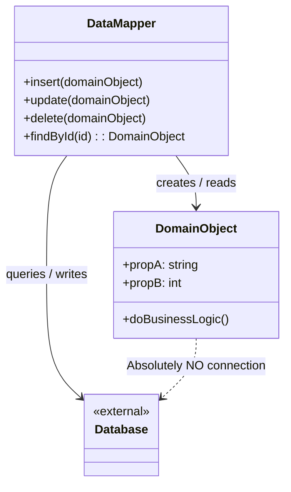

# Data Mapper Pattern

<CoverImage src="/covers/architectural/data-mapper.webp" alt="Cover">
  <h1>Data Mapper</h1>
  <p>Qadimiy o'ram (scroll) formatida yozilgan maktublarni tartibli zamonaviy raqamli planshetlarga tarjima qilayotgan, o'ram va planshetni bir-biridan butunlay alohida saqlayotgan do'stona pochtachi robot.</p>
</CoverImage>

## Umumiy ko'rinish (Overview)

**Data Mapper** patterni — bu ma'lumotlar bazasi bilan barcha o'zaro aloqani domen obyektlaridan chiqarib, alohida, maxsus qatlamga ko'chiradigan arxitekturaviy ma'lumotlarga kirish patterni. Domen obyektlari ma'lumotlar bazasi mavjudligidan ham butunlay bexabar bo'lib qoladi.

**Asosiy afzallik**: U vazifalarning qat'iy ajratilishini (separation of concerns) ta'minlaydi va asosiy biznes mantiqingiz SQL buyruqlari, ORM sintaksisi yoki ma'lumotlar bazasi sxemasining cheklovlari bilan ifloslanmasligini kafolatlaydi.

**Zamonaviy nuqtai nazar**: Data Mapper korporativ darajadagi ORM'larning (Java'da Hibernate/JPA, PHP'da Doctrine, .NET'da Entity Framework va Node.js'da TypeORM/MikroORM kabi) arxitekturaviy asosidir. U Domain-Driven Design (DDD) uchun oltin standart hisoblanadi, chunki dasturchilarga murakkab biznes qoidalarini sof xotirada modellashtirish va ularni faqat zarur bo'lganda ma'lumotlar bazasiga xaritalash imkonini beradi.

## Muammo (The Problem)

Active Record patternidan foydalanganingizda, ma'lumotlar bazasi sxemangiz obyekt dizayningizni belgilaydi.

```typescript
// ❌ Yomon: Domen obyekti ma'lumotlar bazasi sxemasiga bog'langan
class Order extends ActiveRecord {
  // Bu xususiyatlar ma'lumotlar bazasi ustunlariga aynan mos kelishi kerak
  public id: number;
  public customer_db_id: number; // DB sxemasi majburlagan noqulay nomlash
  public status_varchar: string; // Ma'lumotlar bazasi tiplari domenga sizib kiradi

  public ship() {
    this.status_varchar = "SHIPPED";
    this.save(); // To'g'ridan-to'g'ri ma'lumotlar bazasiga bog'langan
  }
}
```

Bu jiddiy cheklovlarni keltirib chiqaradi:

1. **Testlash dahshatga aylanadi**: `ship()` mantiqini testlash uchun butun ma'lumotlar bazasi ulanishini mock qilishingiz kerak, chunki `save()` chaqiruvi SQL'ni ishga tushiradi.
2. **Sxemalarning nomuvofiqligi**: Agar Order'ni normallashtirilgan SQL ma'lumotlar bazasida saqlamoqchi bo'lsangiz-u, domen mantiqi Order obyektining chuqur ichma-ich joylashgan, boy obyektlar grafi bo'lishini talab qilsa-chi? Active Record 1:1 xaritalashga majburlaydi, bu esa murakkab xaritalashni imkonsiz qiladi.
3. **Ma'lumotlar bazasi migratsiyalari biznes mantiqni buzadi**: Agar DBA `status_varchar` ni `order_state` deb qayta nomlasa, asosiy biznes mantiqingizni o'zgartirishingiz kerak bo'ladi.

## Yechim (The Solution)

Data Mapper patterni sof Domen obyekti va Ma'lumotlar bazasi o'rtasida turadigan vositachi klassni — Mapper'ni kiritadi.

1. **Domen obyekti (Domain Object)**: Oddiy eski obyekt (POJO, POCO va h.k.). U biznes mantiqni o'z ichiga oladi, lekin ma'lumotlar bazasi mantiqini _o'z ichiga olmaydi_. U hech qanday freymvork bazaviy klasslarini kengaytirmaydi.
2. **Data Mapper**: Domen obyektini olib, uning ma'lumotlarini ajratib chiqarish va kerakli SQL `INSERT/UPDATE` buyruqlarini generatsiya qilish uchun javobgar bo'lgan alohida klass. U shuningdek ma'lumotlar bazasiga so'rov yuborish va xom qatorlardan yangi Domen obyektlarini to'ldirish (hydrate) bilan ham shug'ullanadi.

```typescript
// ✅ Yaxshi: Toza domen obyekti
const order = new Order("cust-123");
order.ship(); // Toza biznes mantiq. Ma'lumotlar bazasiga murojaat yo'q.

// ✅ Yaxshi: Saqlash bilan Mapper shug'ullanadi
orderMapper.save(order);
```

## Tuzilma (Structure)



## Jarayon (Flow)

1. **Yaratish/Yangilash**: Mijoz (client) xotirada sof Domen obyektini yaratadi yoki o'zgartiradi. Tugatgach, mijoz obyektni `DataMapper.save(obj)` metodiga uzatadi. Mapper obyekt xususiyatlarini ma'lumotlar bazasi ustunlariga xaritalaydi va SQL'ni bajaradi.
2. **O'qish**: Mijoz `DataMapper.findById(1)` ni chaqiradi. Mapper ma'lumotlar bazasiga so'rov yuboradi, xom qator ma'lumotlarini oladi, sof Domen obyektini yaratadi, uni to'ldiradi va qaytaradi.

## Hayotiy o'xshatish (Real-World Analogy)

**Birlashgan Millatlar Tashkilotidagi tarjimonlarni** tasavvur qiling.
Sizda fransuz diplomati (Domen obyekti) va yapon diplomati (Ma'lumotlar bazasi) bor. Ular bir tilda gaplashmaydi va hech biri boshqasining tilini o'rganishni xohlamaydi.

Fransuz diplomatini yapon tilini o'rganishga majburlash (Active Record) o'rniga, siz professional Tarjimonni (Data Mapper) jalb qilasiz. Fransuz diplomati faqat sof fransuz tilida gapiradi (Biznes mantiq). Tarjimon tinglaydi, tushunchalarni moslashtiradi va boshqa diplomatga yapon tilida gapiradi. Hech bir diplomat tarjima qanday amalga oshganini bilmaydi.

## Bosqichma-bosqich amalga oshirish (Step-by-Step Implementation)

1. **Sof Domen obyektlarini yarating**: Biznes entity'laringizni ifodalaydigan klasslar yarating. Bu fayllarga hech qanday ma'lumotlar bazasi kutubxonasini import qilmang.
2. **Data Mapper'ni yarating**: Aynan shu entity uchun saqlashni boshqaradigan klass (masalan, `UserMapper`) yarating.
3. **To'ldirishni amalga oshiring (Qatordan obyektga)**: Mapper'da xom ma'lumotlar bazasi qatorini (Dictionary, JSON yoki struct) olib, Domen obyektini yaratadigan metod yozing.
4. **Ajratib olishni amalga oshiring (Obyektdan qatorga)**: Mapper'da Domen obyektining xususiyatlarini o'qib, SQL parametrlarini yaratadigan metod yozing.
5. **Saqlash operatsiyalarini amalga oshiring**: Mapper'da `insert`, `update`, `delete` va `find` metodlarini amalga oshiring.

## Kod misollari (Code Examples)

Biz oddiy `User` Domen obyekti va ma'lumotlar bazasi bilan o'zaro aloqani boshqaradigan `UserMapper` ni quramiz.

::: code-group

```typescript [TypeScript]
// 1. Toza domen obyekti (E'tibor bering: DB importlari yo'q, save() metodi yo'q)
class User {
  constructor(
    public id: string | null,
    public firstName: string,
    public lastName: string,
    public email: string,
  ) {}

  // Toza biznes mantiq
  public getFullName(): string {
    return `${this.firstName} ${this.lastName}`;
  }

  public changeEmail(newEmail: string): void {
    if (!newEmail.includes("@")) throw new Error("Invalid email");
    this.email = newEmail;
  }
}

// Soxta ma'lumotlar bazasi ulanishi
const db = {
  execute: (sql: string, params: any[]) =>
    console.log(`[DB EXECUTE] ${sql} | Params:`, params),
  query: (sql: string, params: any[]) => {
    console.log(`[DB QUERY] ${sql} | Params:`, params);
    // Xom DB qatorini qaytaradi (snake_case nomlashga e'tibor bering)
    return [
      {
        user_id: "uuid-1",
        first_name: "John",
        last_name: "Doe",
        email_address: "john@test.com",
      },
    ];
  },
};

// 2. Data Mapper
class UserMapper {
  // DB qatorini domen obyektiga o'giradi
  private toDomain(row: any): User {
    return new User(
      row.user_id,
      row.first_name, // DB'dagi 'first_name' ni obyektdagi 'firstName' ga moslash
      row.last_name,
      row.email_address,
    );
  }

  // Domen obyektini DB qatoriga / SQL bajarilishiga o'giradi
  public save(user: User): void {
    if (user.id === null) {
      user.id = "uuid-" + Math.floor(Math.random() * 1000); // ID yaratish
      db.execute(
        "INSERT INTO users (user_id, first_name, last_name, email_address) VALUES (?, ?, ?, ?)",
        [user.id, user.firstName, user.lastName, user.email],
      );
    } else {
      db.execute(
        "UPDATE users SET first_name = ?, last_name = ?, email_address = ? WHERE user_id = ?",
        [user.firstName, user.lastName, user.email, user.id],
      );
    }
  }

  public findById(id: string): User | null {
    const rows = db.query("SELECT * FROM users WHERE user_id = ?", [id]);
    if (rows.length === 0) return null;
    return this.toDomain(rows[0]);
  }
}

// 3. Mijoz kodi
const mapper = new UserMapper();

// Domen obyektini faqat xotirada yaratish va o'zgartirish
const user = new User(null, "Alice", "Smith", "alice@example.com");
user.changeEmail("alice.smith@example.com");

// O'zgarishlarni Mapper orqali saqlash
console.log("--- Saving User ---");
mapper.save(user);

// Mapper orqali olish
console.log("\n--- Finding User ---");
const loadedUser = mapper.findById("uuid-1");
if (loadedUser) {
  console.log(`Found Domain Object: ${loadedUser.getFullName()}`);
}
```

```python [Python]
from typing import Optional, Dict, Any

# Soxta ma'lumotlar bazasi ulanishi
class MockDB:
    @staticmethod
    def execute(sql: str, params: tuple) -> None:
        print(f"[DB EXECUTE] {sql} | Params: {params}")

    @staticmethod
    def query(sql: str, params: tuple) -> list:
        print(f"[DB QUERY] {sql} | Params: {params}")
        # snake_case bilan xom DB qatori
        return [{"user_id": "uuid-1", "first_name": "John", "last_name": "Doe", "email_address": "john@test.com"}]

# 1. Toza domen obyekti
class User:
    def __init__(self, user_id: Optional[str], first_name: str, last_name: str, email: str):
        self.id = user_id
        self.first_name = first_name
        self.last_name = last_name
        self.email = email

    # Toza biznes mantiq
    def get_full_name(self) -> str:
        return f"{self.first_name} {self.last_name}"

    def change_email(self, new_email: str) -> None:
        if "@" not in new_email:
            raise ValueError("Invalid email")
        self.email = new_email

# 2. Data Mapper
class UserMapper:
    def _to_domain(self, row: Dict[str, Any]) -> User:
        return User(
            user_id=row["user_id"],
            first_name=row["first_name"], # DB nomlarini obyekt nomlariga moslash
            last_name=row["last_name"],
            email=row["email_address"]
        )

    def save(self, user: User) -> None:
        if user.id is None:
            user.id = "uuid-999" # ID yaratish
            MockDB.execute(
                "INSERT INTO users (user_id, first_name, last_name, email_address) VALUES (?, ?, ?, ?)",
                (user.id, user.first_name, user.last_name, user.email)
            )
        else:
            MockDB.execute(
                "UPDATE users SET first_name = ?, last_name = ?, email_address = ? WHERE user_id = ?",
                (user.first_name, user.last_name, user.email, user.id)
            )

    def find_by_id(self, user_id: str) -> Optional[User]:
        rows = MockDB.query("SELECT * FROM users WHERE user_id = ?", (user_id,))
        if not rows:
            return None
        return self._to_domain(rows[0])

# 3. Mijoz kodi
if __name__ == "__main__":
    mapper = UserMapper()

    # Xotiradagi domen mantiqi
    user = User(None, "Alice", "Smith", "alice@example.com")
    user.change_email("alice.smith@example.com")

    # Saqlash
    print("--- Saving User ---")
    mapper.save(user)

    # Olish
    print("\n--- Finding User ---")
    loaded_user = mapper.find_by_id("uuid-1")
    if loaded_user:
        print(f"Found Domain Object: {loaded_user.get_full_name()}")
```

```java [Java]
import java.util.UUID;

// Soxta DB
class MockDB {
    public static void execute(String sql, Object... params) {
        System.out.printf("[DB EXECUTE] %s%n", sql);
    }

    public static Object[] queryRow(String sql, Object... params) {
        System.out.printf("[DB QUERY] %s%n", sql);
        // Xom DB qatorini qaytaradi
        return new Object[]{"uuid-1", "John", "Doe", "john@test.com"};
    }
}

// 1. Toza domen obyekti
class User {
    private String id;
    private String firstName;
    private String lastName;
    private String email;

    public User(String id, String firstName, String lastName, String email) {
        this.id = id;
        this.firstName = firstName;
        this.lastName = lastName;
        this.email = email;
    }

    // Qisqalik uchun getter va setter'lar tushirib qoldirilgan
    public String getId() { return id; }
    public void setId(String id) { this.id = id; }
    public String getFirstName() { return firstName; }
    public String getLastName() { return lastName; }
    public String getEmail() { return email; }

    // Toza biznes mantiq
    public String getFullName() {
        return firstName + " " + lastName;
    }

    public void changeEmail(String newEmail) {
        if (!newEmail.contains("@")) throw new IllegalArgumentException("Invalid email");
        this.email = newEmail;
    }
}

// 2. Data Mapper
class UserMapper {
    private User toDomain(Object[] row) {
        return new User(
            (String)row[0], // user_id
            (String)row[1], // first_name
            (String)row[2], // last_name
            (String)row[3]  // email_address
        );
    }

    public void save(User user) {
        if (user.getId() == null) {
            user.setId(UUID.randomUUID().toString());
            MockDB.execute(
                "INSERT INTO users (user_id, first_name, last_name, email_address) VALUES (?, ?, ?, ?)",
                user.getId(), user.getFirstName(), user.getLastName(), user.getEmail()
            );
        } else {
            MockDB.execute(
                "UPDATE users SET first_name = ?, last_name = ?, email_address = ? WHERE user_id = ?",
                user.getFirstName(), user.getLastName(), user.getEmail(), user.getId()
            );
        }
    }

    public User findById(String id) {
        Object[] row = MockDB.queryRow("SELECT * FROM users WHERE user_id = ?", id);
        if (row == null) return null;
        return toDomain(row);
    }
}

// 3. Mijoz kodi
public class DataMapperDemo {
    public static void main(String[] args) {
        UserMapper mapper = new UserMapper();

        // Xotiradagi domen amallari
        User user = new User(null, "Alice", "Smith", "alice@example.com");
        user.changeEmail("alice.smith@example.com");

        System.out.println("--- Saving User ---");
        mapper.save(user);

        System.out.println("\n--- Finding User ---");
        User loadedUser = mapper.findById("uuid-1");
        if (loadedUser != null) {
            System.out.println("Found Domain Object: " + loadedUser.getFullName());
        }
    }
}
```

```go [Go]
package main

import (
	"fmt"
	"strings"
)

// Soxta DB
var MockDB = struct {
	Execute func(sql string, params ...interface{})
	Query   func(sql string, params ...interface{}) map[string]interface{}
}{
	Execute: func(sql string, params ...interface{}) {
		fmt.Printf("[DB EXECUTE] %s | Params: %v\n", sql, params)
	},
	Query: func(sql string, params ...interface{}) map[string]interface{} {
		fmt.Printf("[DB QUERY] %s | Params: %v\n", sql, params)
		return map[string]interface{}{
			"user_id":       "uuid-1",
			"first_name":    "John",
			"last_name":     "Doe",
			"email_address": "john@test.com",
		}
	},
}

// 1. Toza domen obyekti (Struct)
type User struct {
	ID        *string
	FirstName string
	LastName  string
	Email     string
}

func NewUser(firstName, lastName, email string) *User {
	return &User{
		FirstName: firstName,
		LastName:  lastName,
		Email:     email,
	}
}

// Toza biznes mantiq
func (u *User) GetFullName() string {
	return fmt.Sprintf("%s %s", u.FirstName, u.LastName)
}

func (u *User) ChangeEmail(newEmail string) error {
	if !strings.Contains(newEmail, "@") {
		return fmt.Errorf("invalid email")
	}
	u.Email = newEmail
	return nil
}

// 2. Data Mapper
type UserMapper struct{}

func (m *UserMapper) toDomain(row map[string]interface{}) *User {
	id := row["user_id"].(string)
	return &User{
		ID:        &id,
		FirstName: row["first_name"].(string),
		LastName:  row["last_name"].(string),
		Email:     row["email_address"].(string),
	}
}

func (m *UserMapper) Save(u *User) {
	if u.ID == nil {
		id := "uuid-999" // Soxta ID yaratish
		u.ID = &id
		MockDB.Execute(
			"INSERT INTO users (user_id, first_name, last_name, email_address) VALUES (?, ?, ?, ?)",
			*u.ID, u.FirstName, u.LastName, u.Email,
		)
	} else {
		MockDB.Execute(
			"UPDATE users SET first_name = ?, last_name = ?, email_address = ? WHERE user_id = ?",
			u.FirstName, u.LastName, u.Email, *u.ID,
		)
	}
}

func (m *UserMapper) FindByID(id string) *User {
	row := MockDB.Query("SELECT * FROM users WHERE user_id = ?", id)
	if row == nil {
		return nil
	}
	return m.toDomain(row)
}

// 3. Mijoz kodi
func main() {
	mapper := &UserMapper{}

	user := NewUser("Alice", "Smith", "alice@example.com")
	user.ChangeEmail("alice.smith@example.com")

	fmt.Println("--- Saving User ---")
	mapper.Save(user)

	fmt.Println("\n--- Finding User ---")
	loadedUser := mapper.FindByID("uuid-1")
	if loadedUser != nil {
		fmt.Printf("Found Domain Object: %s\n", loadedUser.GetFullName())
	}
}
```

```rust [Rust]
use std::collections::HashMap;

// Soxta DB konteksti
struct MockDB;
impl MockDB {
    fn execute(sql: &str, params: &[&str]) {
        println!("[DB EXECUTE] {} | Params: {:?}", sql, params);
    }

    fn query(sql: &str, _params: &[&str]) -> Option<HashMap<&'static str, &'static str>> {
        println!("[DB QUERY] {}", sql);
        let mut row = HashMap::new();
        row.insert("user_id", "uuid-1");
        row.insert("first_name", "John");
        row.insert("last_name", "Doe");
        row.insert("email_address", "john@test.com");
        Some(row)
    }
}

// 1. Toza domen obyekti
pub struct User {
    pub id: Option<String>,
    pub first_name: String,
    pub last_name: String,
    pub email: String,
}

impl User {
    pub fn new(first_name: &str, last_name: &str, email: &str) -> Self {
        Self {
            id: None,
            first_name: first_name.to_string(),
            last_name: last_name.to_string(),
            email: email.to_string(),
        }
    }

    pub fn get_full_name(&self) -> String {
        format!("{} {}", self.first_name, self.last_name)
    }

    pub fn change_email(&mut self, new_email: &str) -> Result<(), &'static str> {
        if !new_email.contains('@') {
            return Err("Invalid email");
        }
        self.email = new_email.to_string();
        Ok(())
    }
}

// 2. Data Mapper
pub struct UserMapper;

impl UserMapper {
    fn to_domain(row: HashMap<&str, &str>) -> User {
        User {
            id: Some(row.get("user_id").unwrap().to_string()),
            first_name: row.get("first_name").unwrap().to_string(),
            last_name: row.get("last_name").unwrap().to_string(),
            email: row.get("email_address").unwrap().to_string(),
        }
    }

    pub fn save(&self, user: &mut User) {
        if user.id.is_none() {
            user.id = Some("uuid-999".to_string());
            MockDB::execute(
                "INSERT INTO users (user_id, first_name, last_name, email_address) VALUES (?, ?, ?, ?)",
                &[
                    user.id.as_ref().unwrap().as_str(),
                    &user.first_name,
                    &user.last_name,
                    &user.email
                ]
            );
        } else {
            MockDB::execute(
                "UPDATE users SET first_name = ?, last_name = ?, email_address = ? WHERE user_id = ?",
                &[
                    &user.first_name,
                    &user.last_name,
                    &user.email,
                    user.id.as_ref().unwrap().as_str()
                ]
            );
        }
    }

    pub fn find_by_id(&self, id: &str) -> Option<User> {
        if let Some(row) = MockDB::query("SELECT * FROM users WHERE user_id = ?", &[id]) {
            Some(Self::to_domain(row))
        } else {
            None
        }
    }
}

// 3. Mijoz kodi
fn main() {
    let mapper = UserMapper;

    let mut user = User::new("Alice", "Smith", "alice@example.com");
    user.change_email("alice.smith@example.com").unwrap();

    println!("--- Saving User ---");
    mapper.save(&mut user);

    println!("\n--- Finding User ---");
    if let Some(loaded_user) = mapper.find_by_id("uuid-1") {
        println!("Found Domain Object: {}", loaded_user.get_full_name());
    }
}
```

:::

## Afzalliklari va kamchiliklari (Pros and Cons)

### Afzalliklari (Advantages)

- **Vazifalarning qat'iy ajratilishi**: Asosiy biznes qoidalari ma'lumotlar bazasi sxemalari va SQL nozikliklaridan izolyatsiya qilingan.
- **Testlanuvchanlik (Testability)**: Domen obyektlarini ma'lumotlar bazasini mock qilmasdan darhol unit-testlash mumkin, chunki ularda hech qanday saqlash mantiqi yo'q.
- **Murakkab modellashtirish**: Bitta murakkab Domen obyektini bir nechta jadvalga yoki bir nechta jadvalni bitta Domen obyektiga xaritalashingiz mumkin. Siz 1:1 jadval-klass xaritalashi bilan cheklanmaysiz.
- **Sxema o'zgarishlariga immunitet**: Ma'lumotlar bazasi o'zgarsa, faqat Mapper'ni yangilaysiz. Ilovaning qolgan qismi umuman o'zgarishsiz qoladi.

### Kamchiliklari (Disadvantages)

- **O'rganish qiyinligi (Steep Learning Curve)**: Arxitektura qatlamlarini, Dependency Injection'ni va holatni ehtiyotkorlik bilan kuzatishni tushunishni talab qiladi.
- **Shablon kod (Boilerplate)**: Har bir entity uchun maxsus Mapper yaratish Active Record'ga qaraganda ancha ko'p kod yozishni talab qiladi.
- **Ishlash tezligiga qo'shimcha yuk**: To'ldirish (ma'lumotlar bazasi qatorlarini obyektlarga xaritalash) oraliq ma'lumot tuzilmalari va refleksiyalarni (to'liq ORM'larda) yaratadi, bu esa xom SQL struct'larini qaytarishga nisbatan ko'p CPU va xotira sarflashi mumkin.

## Qachon foydalanish kerak (When to Use)

- **Korporativ ilovalar**: Domen mantiqi juda murakkab bo'lgan va ma'lumotlar bazasi texnologiyasidan uzoqroq yashashi kutilayotgan katta, uzoq muddatli ilovalar.
- **Domain-Driven Design (DDD)**: DDD'ni qo'llaganda Domen entity'lari sof bo'lishi SHART. Bu arxitekturada Data Mapper majburiy.
- **Eski (legacy) ma'lumotlar bazasi bilan integratsiya**: Dahshatli, 20 yillik eski ma'lumotlar bazasi sxemasi ustiga yangi, toza ilova qurishingiz kerak bo'lganda. Data Mapper bu yomon sxemani toza domen obyektlaringizdan yashiradi.

## Qachon foydalanmaslik kerak (When NOT to Use)

- **Tezkor prototiplar / Oddiy CRUD**: Agar ilovangiz shunchaki veb-formalarni to'g'ridan-to'g'ri ma'lumotlar bazasi jadvallariga xaritalasa, Mapper'lar yozishning katta qo'shimcha xarajati vaqtni behuda sarflashdir. Active Record'dan foydalaning.
- **Oddiy domenli mikroservislar**: Faqat bitta kichik ishni bajaradigan mikroservisda to'liq Data Mapper arxitekturasini o'rnatish, ehtimol, ortiqcha bo'ladi.

## Keng tarqalgan xatolar (Common Mistakes)

### 1. Biznes mantiqni Mapper'ga joylashtirish

Mapper _faqat_ ma'lumotlarni u yoqdan-bu yoqqa tarjima qilishi kerak. Agar Mapper'ning `save()` metodida hisob-kitoblar, validatsiyalar yoki biznes qoidalarini topsangiz, Domen mantiqini saqlash qatlamiga sizdirayotgan bo'lasiz.

### 2. N+1 so'rov muammosi (To'ldirish paytida)

Boshqa obyektlar kolleksiyalarini o'z ichiga olgan obyektlarni xaritalashda (masalan, ko'plab OrderItem'larga ega Order), yomon yozilgan Mapper'lar to'ldirish paytida Order uchun bitta SQL so'rovini, keyin esa _har bir_ OrderItem uchun alohida SQL so'rovini bajaradi. To'liq ORM'lar buni "Eager Loading" (oldindan yuklash) bilan hal qiladi.

## Aloqador patternlar (Related Patterns)

- **[Active Record](/uz/architectural/active-record)**: Falsafiy qarama-qarshisi. Domen obyekti va ma'lumotlar bazasi mantiqini bitta klassga birlashtiradi.
- **[Repository](/uz/architectural/repository)**: Ko'pincha Data Mapper'larni o'rash uchun ishlatiladi. Mapper bitta entity'ni xaritalash bilan shug'ullansa, Repository kolleksiyaga o'xshash interfeysni (masalan, `repository.findAll()`) taqdim etish uchun Mapper'dan foydalanadi.
- **[Unit of Work](/uz/architectural/unit-of-work)**: Og'ir Data Mapper ORM'larida (Hibernate/Entity Framework kabi) Unit of Work patterni siz xotiraga yuklagan barcha Domen obyektlarini kuzatadi, qaysilarini o'zgartirganingizni aniqlaydi va ularni bir vaqtda saqlash uchun Data Mapper'ga yuboradi.

## Intervyu savollari (Interview Insights)

- **Savol**: "Agar men Data Mapper'dan foydalansam va Domen obyekti Mapper mavjudligini bilmasa, Mapper Domen obyekti yangilanganini qanday biladi?"
  - **Javob**: "Ikki yo'li bor. 1) Mijoz kodi obyektni o'zgartirishni tugatgach, `mapper.update(domainObject)` ni qo'lda chaqiradi. 2) Ilg'or ORM'lar **Unit of Work** patternidan foydalanadi: u domen xususiyatlarini proksilarga o'raydi yoki ularning asl holatini kuzatadi va tranzaksiya oxirida o'zgargan obyektlarni avtomatik ravishda mapper'ga yuboradi."
- **Savol**: "Data Mapper ma'lumotlar bazasi ishlash tezligini oshira oladimi?"
  - **Javob**: "O'z-o'zidan yo'q. Aslida, qatorlarni obyektlarga xaritalash CPU'ga qo'shimcha yuk qo'shadi. Biroq u ishlash tezligini yaxshilashga _imkon beradi_, chunki biznes mantiqning birorta qatorini ham o'zgartirmasdan asosiy saqlash strategiyasini butunlay almashtirishingiz mumkin (masalan, MySQL'dan Redis'ga o'tish)."

## Zamonaviy alternativalar (Modern Alternatives)

- **Query Builder'lar bilan birlashtirilgan Repository patterni**: Og'ir qo'lda yozilgan Data Mapper'lar qurish yoki ulkan ORM'lardan (ular ko'pincha _haddan tashqari_ ko'p narsani abstraksiya qiladi) foydalanish o'rniga, zamonaviy backend dasturlashda ko'pincha yengil Repository'ga o'ralgan sof Query Builder'lar (Knex.js yoki Go'dagi sqlc kabi) ishlatiladi. Bu Repository xom qatorlarni to'g'ridan-to'g'ri Data Transfer Object'larga (DTO) xaritalaydi va "Holatga ega Domen obyekti"ni butunlay chetlab o'tadi.
