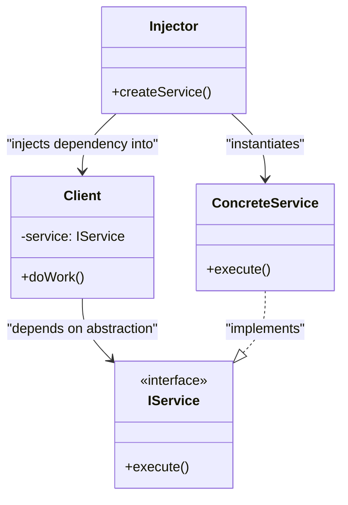

# Bog'liqliklarni kiritish andozasi (Dependency Injection)

<CoverImage src="/covers/architectural/dependency-injection.webp" alt="Cover">
  <h1>Bog'liqliklarni kiritish</h1>
  <p>Ko'kragida ochiq uyasi bo'lgan yoqimtoy kichkina robot, ulkan mexanik qo'l esa to'liq zaryadlangan, porlab turgan quvvat blokini tashqaridan to'g'ridan-to'g'ri o'sha uyaga ehtiyotkorlik bilan joylashtirmoqda.</p>
</CoverImage>

## Umumiy ko'rinish (Overview)

**Bog'liqliklarni kiritish** (Dependency Injection, DI) — bu fundamental arxitektura andozasi bo'lib, unda obyekt yoki funksiya o'zi bog'liq bo'lgan obyektlarni (uning bog'liqliklarini) ichkarida yaratish o'rniga, ularni tashqaridan oladi.

**Asosiy afzallik**: U obyektni yaratishni obyektning xatti-harakatidan butunlay ajratadi. Bu modulli, yuqori darajada testlanadigan va qo'llab-quvvatlash oson bo'lgan kod yozishning asosiy toshidir.

**Zamonaviy nuqtai nazar**: Bog'liqliklarni kiritish endi shunchaki "andoza" emas; u zamonaviy dasturiy injiniringda majburiy arxitektura tamoyilidir. U "Boshqaruvning inversiyasi" (Inversion of Control, IoC) ortidagi asosiy tushuncha bo'lib, deyarli barcha zamonaviy korporativ freymvorklar (Java'da Spring Boot, TypeScript'da NestJS/Angular, C#'da ASP.NET Core) tomonidan qat'iy qo'llaniladi.

## Muammo (The Problem)

Klass o'z bog'liqliklarini o'zi yaratganda, u aynan shu implementatsiyalarga doimiy va qattiq bog'lanib qoladi.

```typescript
// ❌ Yomon: Servis o'z bog'liqliklarini o'zi yaratadi
class UserService {
  private db: PostgresDatabase;
  private logger: FileLogger;

  constructor() {
    // Muayyan konkret klasslarga qattiq bog'langan
    this.db = new PostgresDatabase("localhost:5432");
    this.logger = new FileLogger("/var/log/app.log");
  }

  public createUser(name: string) {
    this.logger.log(`Creating user ${name}`);
    this.db.query("INSERT INTO users...");
  }
}
```

Bu jiddiy arxitekturaviy kamchiliklarni keltirib chiqaradi:

1. **Unit-testlash imkonsiz**: `UserService` ni ishlab turgan Postgres ma'lumotlar bazasi va fayl tizimiga kirishsiz testlab bo'lmaydi.
2. **Yagona javobgarlik tamoyilining buzilishi**: Endi `UserService` ma'lumotlar bazasiga qanday ulanishni va log fayllari qayerda saqlanishini bilishga ham javobgar.
3. **Qattiqlik (Rigid)**: Agar testlash uchun `MockDatabase` yoki ishlab chiqishda `ConsoleLogger` dan foydalanmoqchi bo'lsangiz, `UserService` kodini o'zgartirishingiz kerak.

## Yechim (The Solution)

Bog'liqliklarni yaratish o'rniga, klass ularni **so'rashi** kerak. Ideal holda u aniq klasslarni emas, _interfeyslarni_ so'rashi kerak.

```typescript
// ✅ Yaxshi: Bog'liqliklar konstruktor orqali inject qilinadi
class UserService {
  // Konkret klasslarga emas, interfeyslarga bog'liq
  constructor(
    private db: IDatabase,
    private logger: ILogger,
  ) {}

  public createUser(name: string) {
    this.logger.log(`Creating user ${name}`);
    this.db.query("INSERT INTO users...");
  }
}

// Production'da:
const service = new UserService(new PostgresDatabase(), new FileLogger());

// Testda:
const service = new UserService(new MockDatabase(), new ConsoleLogger());
```

## Bog'liqliklarni kiritish turlari (Types of Dependency Injection)

1. **Konstruktor orqali kiritish (Constructor Injection)** (Tavsiya etiladi): Bog'liqliklar klass konstruktori orqali uzatiladi. Obyekt yaratilganda har doim to'g'ri holatda bo'lishini ta'minlaydi.
2. **Setter orqali kiritish (Setter Injection)**: Bog'liqliklar ochiq setter metodlari orqali uzatiladi (`service.setLogger(logger)`). Ixtiyoriy bog'liqliklar uchun foydali.
3. **Interfeys orqali kiritish (Interface Injection)**: Bog'liqlikning o'zi unga uzatilgan har qanday mijozga bog'liqlikni kirituvchi injector metodini taqdim etadi. (Kamdan-kam ishlatiladi.)

## Tuzilma (Structure)



## Jarayon (Flow)

1. **Ta'riflash**: Bog'liqlik uchun interfeysni aniqlang (masalan, `ILogger`).
2. **Amalga oshirish**: Interfeysni amalga oshiruvchi aniq klasslarni yarating (`ConsoleLogger`, `FileLogger`).
3. **Kiritish nishoni**: Mijoz (Client) klassi interfeysni o'z konstruktori orqali qabul qilishini ta'minlang.
4. **Hal qilish (Resolution)**: Tashqi obyekt (`main` funksiyasi yoki IoC konteyneri) aniq bog'liqlikni yaratadi va uni Mijozga uzatadi.

## Hayotiy o'xshatish (Real-World Analogy)

**Operatsiya xonasidagi jarrohni** tasavvur qiling.
Jarroh o'z skalpellarini o'zi yasamaydi va operatsiya paytida ularni olish uchun shkafga bormaydi. Bunday qilish uning diqqatini va sterillikni buzgan bo'lardi.

Buning o'rniga, operatsiya hamshirasi (Injector) kerakli asbobni to'g'ridan-to'g'ri jarrohning qo'liga beradi (Bog'liqliklarni kiritish). Jarroh faqat skalpeldan _qanday foydalanishni_ (Interfeys) bilishi kerak, uning qanday yasalgani yoki qayerda saqlanganini emas.

## Bosqichma-bosqich amalga oshirish (Step-by-Step Implementation)

1. **Interfeyslarni ajratib oling**: Klassga kerak bo'lgan bog'liqliklarni aniqlang va ular uchun interfeyslar ta'riflang.
2. **Konstruktorni o'zgartiring**: Nishon klassni ushbu interfeyslarni konstruktori orqali qabul qiladigan qilib yangilang.
3. **`new` kalit so'zlarini olib tashlang**: Nishon klass ichidagi bog'liqliklarning barcha yaratilishlarini o'chirib tashlang.
4. **Hammasini bog'lang (Composition Root)**: Ilovangizning eng boshlang'ich kirish nuqtasida (masalan, `main.ts`, `Program.cs`) barcha bog'liqliklarni yarating va ularni servislaringizga uzating. Muqobil ravishda, buni avtomatik bajarish uchun DI konteynerini sozlang.

## Kod misollari (Code Examples)

Biz `Database` va `Logger` ni talab qiladigan ilova quramiz. Qo'lda bog'liqliklarni kiritishni (hammasini `main` metodida bog'lashni) namoyish etamiz.

::: code-group

```typescript [TypeScript]
// 1. Interfeyslarni aniqlash
interface ILogger {
  log(message: string): void;
}

interface IDatabase {
  save(data: string): void;
}

// 2. Konkret implementatsiyalar
class ConsoleLogger implements ILogger {
  log(message: string): void {
    console.log(`[CONSOLE] ${message}`);
  }
}

class PostgresDatabase implements IDatabase {
  save(data: string): void {
    console.log(`[POSTGRES] Saving '${data}' to database...`);
  }
}

class MockDatabase implements IDatabase {
  save(data: string): void {
    console.log(`[MOCK DB] Pretending to save '${data}'...`);
  }
}

// 3. Mijoz (Servis) - Constructor Injection'dan foydalanadi
class UserService {
  // Interfeyslarni qabul qiladi, konkret implementatsiyalardan mutlaqo bexabar
  constructor(
    private readonly db: IDatabase,
    private readonly logger: ILogger,
  ) {}

  public processUser(name: string): void {
    this.logger.log(`Processing user: ${name}`);
    this.db.save(name);
  }
}

// 4. Composition Root (Qo'lda DI)
function main() {
  console.log("--- Production Configuration ---");
  // Bog'liqliklarni ulash uchun 'main' funksiyasi javob beradi
  const prodLogger = new ConsoleLogger();
  const prodDb = new PostgresDatabase();
  const prodService = new UserService(prodDb, prodLogger);

  prodService.processUser("Alice");

  console.log("\n--- Testing Configuration ---");
  // UserService'ga tegmasdan ma'lumotlar bazasi implementatsiyasini darhol almashtirish
  const testDb = new MockDatabase();
  const testService = new UserService(testDb, prodLogger);

  testService.processUser("Bob");
}

main();
```

```python [Python]
from abc import ABC, abstractmethod

# 1. Interfeyslarni aniqlash (Abstrakt bazaviy klasslar)
class ILogger(ABC):
    @abstractmethod
    def log(self, message: str) -> None:
        pass

class IDatabase(ABC):
    @abstractmethod
    def save(self, data: str) -> None:
        pass

# 2. Konkret implementatsiyalar
class ConsoleLogger(ILogger):
    def log(self, message: str) -> None:
        print(f"[CONSOLE] {message}")

class PostgresDatabase(IDatabase):
    def save(self, data: str) -> None:
        print(f"[POSTGRES] Saving '{data}' to database...")

class MockDatabase(IDatabase):
    def save(self, data: str) -> None:
        print(f"[MOCK DB] Pretending to save '{data}'...")

# 3. Mijoz (Servis) - Constructor Injection'dan foydalanadi
class UserService:
    def __init__(self, db: IDatabase, logger: ILogger):
        self._db = db
        self._logger = logger

    def process_user(self, name: str) -> None:
        self._logger.log(f"Processing user: {name}")
        self._db.save(name)

# 4. Composition Root (Qo'lda DI)
if __name__ == "__main__":
    print("--- Production Configuration ---")
    prod_logger = ConsoleLogger()
    prod_db = PostgresDatabase()
    prod_service = UserService(prod_db, prod_logger)

    prod_service.process_user("Alice")

    print("\n--- Testing Configuration ---")
    # UserService'ga tegmasdan ma'lumotlar bazasi implementatsiyasini darhol almashtirish
    test_db = MockDatabase()
    test_service = UserService(test_db, prod_logger)

    test_service.process_user("Bob")
```

```java [Java]
// 1. Interfeyslarni aniqlash
interface ILogger {
    void log(String message);
}

interface IDatabase {
    void save(String data);
}

// 2. Konkret implementatsiyalar
class ConsoleLogger implements ILogger {
    @Override
    public void log(String message) {
        System.out.println("[CONSOLE] " + message);
    }
}

class PostgresDatabase implements IDatabase {
    @Override
    public void save(String data) {
        System.out.println("[POSTGRES] Saving '" + data + "' to database...");
    }
}

class MockDatabase implements IDatabase {
    @Override
    public void save(String data) {
        System.out.println("[MOCK DB] Pretending to save '" + data + "'...");
    }
}

// 3. Mijoz (Servis) - Constructor Injection'dan foydalanadi
class UserService {
    private final IDatabase db;
    private final ILogger logger;

    // Interfeyslarni qabul qiladi, konkret implementatsiyalardan mutlaqo bexabar
    public UserService(IDatabase db, ILogger logger) {
        this.db = db;
        this.logger = logger;
    }

    public void processUser(String name) {
        logger.log("Processing user: " + name);
        db.save(name);
    }
}

// 4. Composition Root (Qo'lda DI)
public class DependencyInjectionDemo {
    public static void main(String[] args) {
        System.out.println("--- Production Configuration ---");
        ILogger prodLogger = new ConsoleLogger();
        IDatabase prodDb = new PostgresDatabase();
        UserService prodService = new UserService(prodDb, prodLogger);

        prodService.processUser("Alice");

        System.out.println("\n--- Testing Configuration ---");
        // UserService'ga tegmasdan ma'lumotlar bazasi implementatsiyasini darhol almashtirish
        IDatabase testDb = new MockDatabase();
        UserService testService = new UserService(testDb, prodLogger);

        testService.processUser("Bob");
    }
}
```

```go [Go]
package main

import "fmt"

// 1. Interfeyslarni aniqlash
type ILogger interface {
	Log(message string)
}

type IDatabase interface {
	Save(data string)
}

// 2. Konkret implementatsiyalar
type ConsoleLogger struct{}

func (l *ConsoleLogger) Log(message string) {
	fmt.Printf("[CONSOLE] %s\n", message)
}

type PostgresDatabase struct{}

func (db *PostgresDatabase) Save(data string) {
	fmt.Printf("[POSTGRES] Saving '%s' to database...\n", data)
}

type MockDatabase struct{}

func (db *MockDatabase) Save(data string) {
	fmt.Printf("[MOCK DB] Pretending to save '%s'...\n", data)
}

// 3. Mijoz (Servis) - Constructor Injection'dan foydalanadi
type UserService struct {
	db     IDatabase
	logger ILogger
}

func NewUserService(db IDatabase, logger ILogger) *UserService {
	return &UserService{
		db:     db,
		logger: logger,
	}
}

func (s *UserService) ProcessUser(name string) {
	s.logger.Log(fmt.Sprintf("Processing user: %s", name))
	s.db.Save(name)
}

// 4. Composition Root (Qo'lda DI)
func main() {
	fmt.Println("--- Production Configuration ---")
	prodLogger := &ConsoleLogger{}
	prodDb := &PostgresDatabase{}
	prodService := NewUserService(prodDb, prodLogger)

	prodService.ProcessUser("Alice")

	fmt.Println("\n--- Testing Configuration ---")
	// UserService'ga tegmasdan ma'lumotlar bazasi implementatsiyasini darhol almashtirish
	testDb := &MockDatabase{}
	testService := NewUserService(testDb, prodLogger)

	testService.ProcessUser("Bob")
}
```

```rust [Rust]
// 1. Trait'larni aniqlash (Interfeyslar)
pub trait ILogger {
    fn log(&self, message: &str);
}

pub trait IDatabase {
    fn save(&self, data: &str);
}

// 2. Konkret implementatsiyalar
pub struct ConsoleLogger;

impl ILogger for ConsoleLogger {
    fn log(&self, message: &str) {
        println!("[CONSOLE] {}", message);
    }
}

pub struct PostgresDatabase;

impl IDatabase for PostgresDatabase {
    fn save(&self, data: &str) {
        println!("[POSTGRES] Saving '{}' to database...", data);
    }
}

pub struct MockDatabase;

impl IDatabase for MockDatabase {
    fn save(&self, data: &str) {
        println!("[MOCK DB] Pretending to save '{}'...", data);
    }
}

// 3. Mijoz (Servis) - Constructor Injection'dan foydalanadi
// Rust'da dinamik dispatch (dyn Trait) yoki statik dispatch (Generics) ishlatiladi.
// Bu yerda OOP tillaridagi kabi moslashuvchanlik uchun dinamik dispatch ishlatamiz.
pub struct UserService {
    db: Box<dyn IDatabase>,
    logger: Box<dyn ILogger>,
}

impl UserService {
    pub fn new(db: Box<dyn IDatabase>, logger: Box<dyn ILogger>) -> Self {
        Self { db, logger }
    }

    pub fn process_user(&self, name: &str) {
        self.logger.log(&format!("Processing user: {}", name));
        self.db.save(name);
    }
}

// 4. Composition Root (Qo'lda DI)
fn main() {
    println!("--- Production Configuration ---");
    let prod_logger = Box::new(ConsoleLogger);
    let prod_db = Box::new(PostgresDatabase);
    let prod_service = UserService::new(prod_db, prod_logger);

    prod_service.process_user("Alice");

    println!("\n--- Testing Configuration ---");
    let test_logger = Box::new(ConsoleLogger);
    let test_db = Box::new(MockDatabase);
    let test_service = UserService::new(test_db, test_logger);

    test_service.process_user("Bob");
}
```

:::

## Afzalliklari va kamchiliklari (Pros and Cons)

### Afzalliklari (Advantages)

- **Testlanuvchanlik (Testability)**: Eng katta afzallik. Mock ma'lumotlar bazalari yoki mock logger'larni darhol kiritishingiz mumkin.
- **Bo'sh bog'lanish (Loose Coupling)**: Klass o'z bog'liqliklari _qanday_ ishlashi haqida hech narsa bilmaydi, faqat ular taqdim etadigan API'ni biladi.
- **Moslashuvchanlik**: Mahalliy MySQL ma'lumotlar bazasidan bulutli REST API'ga o'tish asosiy biznes mantiqingizda aynan nol qator kodni o'zgartirishni talab qiladi.
- **SOLID'ga muvofiqlik**: Bog'liqliklar inversiyasi tamoyilini (D) va Yagona javobgarlik tamoyilini (S) bevosita ta'minlaydi.

### Kamchiliklari (Disadvantages)

- **Sozlashdagi murakkablik**: Chuqur ichma-ich joylashgan obyektlarni yaratish bog'liqliklarni zanjir bo'ylab eng pastgacha uzatishni talab qiladi.
- **Shablon kod (Boilerplate)**: DI konteynerisiz "Composition Root" (hamma narsa bog'lanadigan joy) juda katta bo'lib ketishi va uni qo'llab-quvvatlash zerikarli bo'lishi mumkin.

## Qachon foydalanish kerak (When to Use)

- **Har doim**: Zamonaviy ilovalarni ishlab chiqishda konstruktor orqali bog'liqliklarni kiritish servislar, repozitoriylar va kontrollerlarni qurishning standart usuli bo'lishi kerak.
- **Unit-testlash**: Tashqi I/O'ga (Ma'lumotlar bazasi, Tarmoq, Fayl tizimi, Tizim soati) tayanadigan klassingiz bo'lsa va uni izolyatsiyada testlamoqchi bo'lsangiz.

## Qachon foydalanmaslik kerak (When NOT to Use)

- **Oddiy skriptlar**: Agar 50 qatorli Python skript yozayotgan bo'lsangiz, interfeyslar yaratish va bog'liqliklarni kiritishni sozlash vaqtni katta isrof qilishdir.
- **Data Transfer Object'lar (DTO)**: Oddiy ma'lumot obyektlariga (masalan, `User` struct) bog'liqliklarni kiritish kerak emas. Ular shunchaki ma'lumot saqlaydi.

## Keng tarqalgan xatolar (Common Mistakes)

### 1. Qisman kiritish (Partial Injection)

Ba'zi bog'liqliklarni ichkarida yaratish, boshqalarini esa kiritish. _Yechim: Agar klass tashqi servis yoki holatga tayansa, u ALBATTA kiritilishi kerak._

### 2. Ortiqcha kiritish (Constructor Over-injection)

Agar konstruktoringiz 15 xil bog'liqlikni talab qilsa, muammo DI'da emas — klassingiz Yagona javobgarlik tamoyilini buzmoqda va juda ko'p ish qilmoqda. Klassni kichikroq komponentlarga ajrating.

## Aloqador andozalar (Related Patterns)

- **[Servis lokatori](/uz/architectural/service-locator)**: DI'ning anti-andoza hisoblangan muqobili, unda klasslar o'z bog'liqliklarini global ro'yxatdan (registry) "so'raydi".
- **IoC konteyneri (IoC Container)**: Bog'liqliklarni kiritishni avtomatlashtiradigan freymvork andozasi. Siz klasslaringizni ro'yxatdan o'tkazasiz, konteyner esa refleksiya yoki kod generatsiyasi yordamida bog'liqliklar grafini siz uchun avtomatik yaratadi.
- **[Fabrika metodi](/uz/creational/factory-method)**: Ko'pincha DI bilan birga bog'liqliklarni talab qiladigan, lekin hayot davri DI konteyneri tomonidan boshqarilmaydigan obyektlarni yaratish uchun ishlatiladi.
