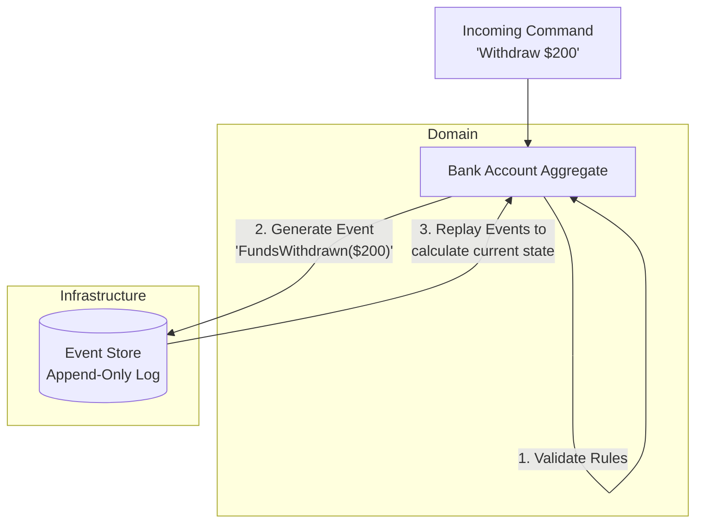

# Event Sourcing andozasi

<CoverImage src="/covers/architectural/event-sourcing.webp" alt="Cover">
  <h1>Event Sourcing</h1>
  <p>Har bir sahifasida oddiy tranzaksion hodisa ("+1 olma", "-2 olma", "+5 olma") yozilgan tartibli, porlab turgan hisob daftari, uning yonida esa robot sahifalarni qayta o'ynatgani sari olmalar savati avtomatik ravishda yangilanib boradi.</p>
</CoverImage>

## Umumiy ko'rinish (Overview)

**Event Sourcing** (Hodisalar manbai) an'anaviy ma'lumotlarni saqlash usulidan tubdan farq qiladi. Entity'ning _joriy holatini_ ma'lumotlar bazasi jadvalida saqlash o'rniga, Event Sourcing shu entity bilan sodir bo'lgan **har bir holatni o'zgartiruvchi hodisani** faqat qo'shib boriladigan (append-only) jurnalda saqlaydi.

Entity'ning joriy holatini olish uchun jurnaldagi barcha hodisalarni o'qiysiz va ularni tartib bilan "qayta o'ynatasiz" (replay).

Asosiy tushunchalar:

- **Hodisalar (Events)**: O'tmishda sodir bo'lgan narsaning o'zgarmas yozuvlari (masalan, `FundsDeposited`, `AddressChanged`).
- **Hodisalar ombori (Event Store)**: Hodisalar ketma-ketligini saqlash uchun maxsus optimallashtirilgan, faqat qo'shib boriladigan ma'lumotlar bazasi.
- **Proyeksiyalar (Projections)**: Event Store'ni tinglab, joriy holatning so'rov qilinadigan ko'rinishini quradigan o'qish modellari (CQRS bilan chambarchas bog'liq).
- **Snapshot'lar (Snapshots)**: 10 000 ta hodisani qayta o'ynatish vaqt talab qilgani uchun tizim vaqti-vaqti bilan ma'lum bir vaqt nuqtasidagi holatning "Snapshot"ini (surati) saqlab qo'yadi.

## Muammo (The Problem)

An'anaviy CRUD ma'lumotlar bazalari dunyoning faqat _joriy_ holatini saqlaydi.

```sql
-- ❌ An'anaviy CRUD: ma'lumot yo'q qilinadi!
UPDATE BankAccount SET balance = 500 WHERE id = 123;
```

Relyatsion ma'lumotlar bazasidagi qatorni ustiga yozganingizda, oldingi ma'lumotlar butunlay yo'q qilinadi. Bu katta biznes muammolarini keltirib chiqaradi:

1. **Haqiqiy audit izi yo'q**: Agar bank balansi to'satdan $10 000 ga kamaysa, faqat joriy qatordan foydalanib, bu _nima uchun_ yoki _qachon_ sodir bo'lganini ishonchli isbotlay olmaysiz. (Audit jadvallari ko'pincha keyinroq, o'ylanmasdan yamab qo'shiladi.)
2. **Yo'qotilgan biznes qiymati**: Ma'lumotlar tahlilchilari tarixiy ma'lumotlarni yaxshi ko'radi. Ma'lumotlarni ustiga yozish foydalanuvchi xatti-harakatini vaqt o'tishi bilan tahlil qilish imkoniyatini yo'q qiladi.
3. **Nosozliklarni tuzatish qiyin**: Agar tizimingiz noto'g'ri holatga tushib qolsa, xatoga aynan qaysi operatsiyalar ketma-ketligi sabab bo'lganini ko'rish uchun ma'lumotlar bazasini "orqaga o'rab" bo'lmaydi.

## Yechim (The Solution)

Event Sourcing'da ma'lumotlar bazasi shunchaki hodisalar ro'yxati. **Siz hech qachon ma'lumotlarni UPDATE yoki DELETE qilmaysiz.** Faqat APPEND (qo'shish) qilasiz.

```text
✅ Event Sourcing (The Bank Account Ledger)
1. AccountCreated (balance: $0)
2. FundsDeposited (amount: $1000)
3. FundsWithdrawn (amount: $200)
4. AddressChanged (new_city: "New York")
5. FundsWithdrawn (amount: $300)
```

Joriy balansni bilish uchun tizim hodisalarni yuklaydi va ularni qo'llaydi: `$0 + $1000 - $200 - $300 = $500`.
Agar foydalanuvchining o'tgan seshanbadagi balansini bilmoqchi bo'lsangiz, hodisalarni shunchaki o'tgan seshanbagacha qayta o'ynatasiz.



## Hayotiy o'xshatish (Real-World Analogy)

**Bank hisob varag'ingizdan ko'chirmani** (Bank Account Statement) tasavvur qiling.
Bankingiz joriy balansingiz yozilgan bitta yopishqoq qog'ozchani saqlamaydi. U sodir bo'lgan har bir depozit, pul yechish va to'lov (komissiya) qayd etilgan hisob daftarini saqlaydi.
Sizning "joriy balansingiz" shunchaki daftardagi barcha tranzaksiyalarni qo'shib hisoblangan proyeksiyadir. Agar biror to'lovga e'tiroz bildirsangiz, bank hodisalarning aniq tarixiy ketma-ketligini ko'rib chiqa oladi. Event Sourcing shu moliyaviy hisob daftari tushunchasini dasturiy ta'minot arxitekturasiga qo'llaydi.

## Bosqichma-bosqich amalga oshirish (Step-by-Step Implementation)

1. **Domen hodisalarini ta'riflang**: O'tmishda sodir bo'lgan narsalarni ifodalovchi o'zgarmas klasslar yarating (ular o'tgan zamonda nomlanishi shart).
2. **Agregat ildizini (Aggregate Root) yarating**: Buyruqlarni qabul qiladigan, ularni joriy holatiga nisbatan tekshiradigan va yangi hodisalarni chiqaradigan asosiy entity.
3. **Apply metodlarini amalga oshiring**: Hodisa qayta o'ynatilganda Agregat o'z ichki holatini o'zgartiradigan metodlarga ega bo'lishi kerak.
4. **Repozitoriyni amalga oshiring**: Event Store'dan hodisalarni oladigan, bo'sh Agregat yaratadigan va holatni qayta tiklash uchun hodisalarni unga uzatadigan klass.

## Kod misollari (Code Examples)

Biz Bank hisobi (Bank Account) agregatini amalga oshiramiz. E'tibor bering, `withdraw` buyrug'i holatni to'g'ridan-to'g'ri o'zgartirmaydi — u faqat hodisa yaratadi. Holat faqat `apply` metodi ichida o'zgaradi.

::: code-group

```typescript [TypeScript]
// 1. Event'larni aniqlash (O'zgarmas, o'tgan zamonda)
interface DomainEvent {
  type: string;
  timestamp: Date;
}

class AccountCreated implements DomainEvent {
  type = "AccountCreated";
  constructor(
    public accountId: string,
    public timestamp = new Date(),
  ) {}
}

class FundsDeposited implements DomainEvent {
  type = "FundsDeposited";
  constructor(
    public amount: number,
    public timestamp = new Date(),
  ) {}
}

class FundsWithdrawn implements DomainEvent {
  type = "FundsWithdrawn";
  constructor(
    public amount: number,
    public timestamp = new Date(),
  ) {}
}

// 2. Aggregate Root
class BankAccount {
  public id: string = "";
  public balance: number = 0;
  private uncommittedEvents: DomainEvent[] = [];

  // Holatni qayta qurish uchun tarixiy event'larni qayta ijro etish
  public loadFromHistory(history: DomainEvent[]) {
    history.forEach((event) => this.apply(event));
  }

  // --- COMMAND'LAR (Biznes mantiq va validatsiya) ---

  public createAccount(id: string) {
    if (this.id) throw new Error("Account already exists");
    this.recordThat(new AccountCreated(id));
  }

  public deposit(amount: number) {
    if (amount <= 0) throw new Error("Deposit must be positive");
    this.recordThat(new FundsDeposited(amount));
  }

  public withdraw(amount: number) {
    if (this.balance < amount) throw new Error("Insufficient funds");
    this.recordThat(new FundsWithdrawn(amount));
  }

  // --- HOLAT O'ZGARISHI (Faqat event'lar orqali) ---

  private recordThat(event: DomainEvent) {
    this.uncommittedEvents.push(event); // Keyinroq commit qilish uchun saqlash
    this.apply(event); // Joriy holatni o'zgartirish
  }

  private apply(event: DomainEvent) {
    switch (event.type) {
      case "AccountCreated":
        this.id = (event as AccountCreated).accountId;
        break;
      case "FundsDeposited":
        this.balance += (event as FundsDeposited).amount;
        break;
      case "FundsWithdrawn":
        this.balance -= (event as FundsWithdrawn).amount;
        break;
    }
  }

  public getUncommittedEvents() {
    return this.uncommittedEvents;
  }
  public clearUncommittedEvents() {
    this.uncommittedEvents = [];
  }
}

// Bajarish
const account = new BankAccount();

// Command'larni qayta ishlash
account.createAccount("acc_123");
account.deposit(500);
account.withdraw(200);

console.log("Current Balance:", account.balance); // 300

// Keyinroq, ma'lumotlar bazasidan qayta qurish:
const historyFromDb = account.getUncommittedEvents();
const rebuiltAccount = new BankAccount();
rebuiltAccount.loadFromHistory(historyFromDb);
console.log("Rebuilt Balance:", rebuiltAccount.balance); // 300
```

```python [Python]
from datetime import datetime
from typing import List

# 1. Event'lar
class DomainEvent:
    def __init__(self):
        self.timestamp = datetime.now()

class AccountCreated(DomainEvent):
    def __init__(self, account_id: str):
        super().__init__()
        self.account_id = account_id

class FundsDeposited(DomainEvent):
    def __init__(self, amount: float):
        super().__init__()
        self.amount = amount

class FundsWithdrawn(DomainEvent):
    def __init__(self, amount: float):
        super().__init__()
        self.amount = amount

# 2. Aggregate
class BankAccount:
    def __init__(self):
        self.id = None
        self.balance = 0.0
        self.uncommitted_events: List[DomainEvent] = []

    def load_from_history(self, history: List[DomainEvent]):
        for event in history:
            self._apply(event)

    # Command'lar
    def create_account(self, account_id: str):
        if self.id: raise ValueError("Already exists")
        self._record_that(AccountCreated(account_id))

    def deposit(self, amount: float):
        if amount <= 0: raise ValueError("Must be positive")
        self._record_that(FundsDeposited(amount))

    def withdraw(self, amount: float):
        if self.balance < amount: raise ValueError("Insufficient funds")
        self._record_that(FundsWithdrawn(amount))

    # Ichki holatni qo'llash
    def _record_that(self, event: DomainEvent):
        self.uncommitted_events.append(event)
        self._apply(event)

    def _apply(self, event: DomainEvent):
        if isinstance(event, AccountCreated):
            self.id = event.account_id
        elif isinstance(event, FundsDeposited):
            self.balance += event.amount
        elif isinstance(event, FundsWithdrawn):
            self.balance -= event.amount

# Bajarish
account = BankAccount()
account.create_account("acc_123")
account.deposit(500)
account.withdraw(200)

print(f"Current Balance: {account.balance}") # 300

# Qayta qurish
history = account.uncommitted_events
rebuilt = BankAccount()
rebuilt.load_from_history(history)
print(f"Rebuilt Balance: {rebuilt.balance}") # 300
```

```java [Java]
import java.util.ArrayList;
import java.util.List;

// 1. Event'lar
abstract class DomainEvent {}

class AccountCreated extends DomainEvent {
    public final String accountId;
    public AccountCreated(String id) { this.accountId = id; }
}

class FundsDeposited extends DomainEvent {
    public final double amount;
    public FundsDeposited(double amount) { this.amount = amount; }
}

class FundsWithdrawn extends DomainEvent {
    public final double amount;
    public FundsWithdrawn(double amount) { this.amount = amount; }
}

// 2. Aggregate
class BankAccount {
    private String id;
    private double balance = 0;
    private List<DomainEvent> uncommittedEvents = new ArrayList<>();

    public void loadFromHistory(List<DomainEvent> history) {
        for (DomainEvent e : history) apply(e);
    }

    // Command'lar
    public void createAccount(String accountId) {
        if (this.id != null) throw new IllegalStateException("Already exists");
        recordThat(new AccountCreated(accountId));
    }

    public void deposit(double amount) {
        if (amount <= 0) throw new IllegalArgumentException("Must be positive");
        recordThat(new FundsDeposited(amount));
    }

    public void withdraw(double amount) {
        if (this.balance < amount) throw new IllegalStateException("Insufficient funds");
        recordThat(new FundsWithdrawn(amount));
    }

    // Holat o'zgarishi
    private void recordThat(DomainEvent event) {
        uncommittedEvents.add(event);
        apply(event);
    }

    private void apply(DomainEvent event) {
        if (event instanceof AccountCreated e) {
            this.id = e.accountId;
        } else if (event instanceof FundsDeposited e) {
            this.balance += e.amount;
        } else if (event instanceof FundsWithdrawn e) {
            this.balance -= e.amount;
        }
    }

    public double getBalance() { return balance; }
    public List<DomainEvent> getUncommittedEvents() { return uncommittedEvents; }
}

public class EventSourcingDemo {
    public static void main(String[] args) {
        BankAccount account = new BankAccount();
        account.createAccount("acc_123");
        account.deposit(500);
        account.withdraw(200);

        System.out.println("Balance: " + account.getBalance());

        // Qayta qurish
        List<DomainEvent> history = account.getUncommittedEvents();
        BankAccount rebuilt = new BankAccount();
        rebuilt.loadFromHistory(history);
        System.out.println("Rebuilt Balance: " + rebuilt.getBalance());
    }
}
```

```go [Go]
package main

import (
	"errors"
	"fmt"
)

// 1. Event'lar
type DomainEvent interface {
	EventType() string
}

type AccountCreated struct { AccountId string }
func (e AccountCreated) EventType() string { return "AccountCreated" }

type FundsDeposited struct { Amount float64 }
func (e FundsDeposited) EventType() string { return "FundsDeposited" }

type FundsWithdrawn struct { Amount float64 }
func (e FundsWithdrawn) EventType() string { return "FundsWithdrawn" }

// 2. Aggregate
type BankAccount struct {
	ID                string
	Balance           float64
	uncommittedEvents []DomainEvent
}

func (a *BankAccount) LoadFromHistory(history []DomainEvent) {
	for _, e := range history {
		a.apply(e)
	}
}

// Command'lar
func (a *BankAccount) CreateAccount(id string) error {
	if a.ID != "" { return errors.New("already exists") }
	a.recordThat(AccountCreated{AccountId: id})
	return nil
}

func (a *BankAccount) Deposit(amount float64) error {
	if amount <= 0 { return errors.New("must be positive") }
	a.recordThat(FundsDeposited{Amount: amount})
	return nil
}

func (a *BankAccount) Withdraw(amount float64) error {
	if a.Balance < amount { return errors.New("insufficient funds") }
	a.recordThat(FundsWithdrawn{Amount: amount})
	return nil
}

// Holat o'zgarishi
func (a *BankAccount) recordThat(event DomainEvent) {
	a.uncommittedEvents = append(a.uncommittedEvents, event)
	a.apply(event)
}

func (a *BankAccount) apply(event DomainEvent) {
	switch e := event.(type) {
	case AccountCreated:
		a.ID = e.AccountId
	case FundsDeposited:
		a.Balance += e.Amount
	case FundsWithdrawn:
		a.Balance -= e.Amount
	}
}

func main() {
	account := &BankAccount{}
	account.CreateAccount("acc_123")
	account.Deposit(500)
	account.Withdraw(200)

	fmt.Printf("Balance: %.2f\n", account.Balance)

	// Qayta qurish
	history := account.uncommittedEvents
	rebuilt := &BankAccount{}
	rebuilt.LoadFromHistory(history)
	fmt.Printf("Rebuilt Balance: %.2f\n", rebuilt.Balance)
}
```

```rust [Rust]
// 1. Event'lar
#[derive(Clone, Debug)]
enum DomainEvent {
    AccountCreated { account_id: String },
    FundsDeposited { amount: f64 },
    FundsWithdrawn { amount: f64 },
}

// 2. Aggregate
struct BankAccount {
    id: Option<String>,
    balance: f64,
    uncommitted_events: Vec<DomainEvent>,
}

impl BankAccount {
    fn new() -> Self {
        BankAccount {
            id: None,
            balance: 0.0,
            uncommitted_events: Vec::new(),
        }
    }

    fn load_from_history(&mut self, history: &[DomainEvent]) {
        for event in history {
            self.apply(event);
        }
    }

    // Command'lar
    fn create_account(&mut self, account_id: String) -> Result<(), &'static str> {
        if self.id.is_some() { return Err("Already exists"); }
        self.record_that(DomainEvent::AccountCreated { account_id });
        Ok(())
    }

    fn deposit(&mut self, amount: f64) -> Result<(), &'static str> {
        if amount <= 0.0 { return Err("Must be positive"); }
        self.record_that(DomainEvent::FundsDeposited { amount });
        Ok(())
    }

    fn withdraw(&mut self, amount: f64) -> Result<(), &'static str> {
        if self.balance < amount { return Err("Insufficient funds"); }
        self.record_that(DomainEvent::FundsWithdrawn { amount });
        Ok(())
    }

    // Holat o'zgarishi
    fn record_that(&mut self, event: DomainEvent) {
        self.apply(&event);
        self.uncommitted_events.push(event);
    }

    fn apply(&mut self, event: &DomainEvent) {
        match event {
            DomainEvent::AccountCreated { account_id } => {
                self.id = Some(account_id.clone());
            }
            DomainEvent::FundsDeposited { amount } => {
                self.balance += amount;
            }
            DomainEvent::FundsWithdrawn { amount } => {
                self.balance -= amount;
            }
        }
    }
}

fn main() {
    let mut account = BankAccount::new();
    let _ = account.create_account("acc_123".to_string());
    let _ = account.deposit(500.0);
    let _ = account.withdraw(200.0);

    println!("Balance: {}", account.balance); // 300

    // Qayta qurish
    let history = account.uncommitted_events.clone();
    let mut rebuilt = BankAccount::new();
    rebuilt.load_from_history(&history);

    println!("Rebuilt Balance: {}", rebuilt.balance); // 300
}
```

:::

## Afzalliklari va kamchiliklari (Pros and Cons)

### Afzalliklari (Advantages)

- **Mukammal audit izi**: Tizimda sodir bo'lgan har bir o'zgarishning kafolatlangan, 100% aniq tarixi. Uni kriptografik usulda tekshirish mumkin.
- **Vaqt bo'ylab sayohat qilib debug qilish (Time-Travel Debugging)**: Agar xato foydalanuvchi holatini buzsa, buzilgan proyeksiyani o'chirib, `apply` metodidagi kodni tuzatib, hodisalar oqimini boshidan qayta o'ynatish orqali uning ma'lumotlarini darhol tuzatishingiz mumkin.
- **Biznes qiymati**: Orqaga qarab yangi xulosalar chiqarishingiz mumkin. Agar marketing bo'limi "O'tgan yili nechta foydalanuvchi bir kunning o'zida pul qo'yib, uni yechib olgan?" deb so'rasa, avval bu ko'rsatkichni hech qachon kuzatmagan bo'lsangiz ham, tarixiy hodisalarni qayta o'ynatadigan skript yozib, javobni topishingiz mumkin.

### Kamchiliklari (Disadvantages)

- **Nihoyatda qiyin**: Event Sourcing ma'lumotlar bazalari, validatsiya va izchillik (consistency) haqidagi tasavvuringizni tubdan o'zgartiradi. Uni o'rganish juda qiyin.
- **Hodisalarning evolyutsiyasi**: Agar hodisa shaklini o'zgartirsangiz (masalan, yangi majburiy maydon qo'shsangiz), eski formatda saqlangan millionlab eski hodisalarni ham deserializatsiya qila olishingiz kerak. "Event Upcasting" o'ta qiyinligi bilan mashhur.
- **O'qishdagi ishlash tezligi cheklovlari**: Foydalanuvchining ismini olish uchun 100 000 ta hodisani qayta o'ynatish juda sekin. Bu hodisalarni standart so'rov qilinadigan ma'lumotlar bazasiga proyeksiya qilish uchun CQRS'ni _albatta_ joriy qilishingiz kerak, bu esa tizim murakkabligini keskin oshiradi.

## Qachon foydalanish kerak (When to Use)

- **Moliya va sog'liqni saqlash tizimlari**: O'zgarmas audit izi qonun bilan talab qilinadigan va hech qachon o'zgartirilmasligi kerak bo'lgan joylarda.
- **Yuqori qiymatli korporativ domenlar**: _O'zgarishlar tarixi_ _joriy holat_ kabi muhim bo'lgan asosiy domenlar (masalan, xarid savatini tashlab ketish tahlili, buyurtmalarni kuzatish).
- **Hamkorlikdagi tizimlar**: Bir nechta foydalanuvchi bir vaqtning o'zida bitta entity'ni tahrirlaydigan joylarda (masalan, Google Docs Operational Transformation deb ataladigan Event Sourcing shaklidan foydalanadi).

## Qachon foydalanmaslik kerak (When NOT to Use)

- **Standart veb-ilovalar**: Bloglar, kontentni boshqarish tizimlari yoki oddiy ichki admin panellar. Agar ilovangiz aslida SQL jadvali ustidagi UI bo'lsa, Event Sourcing samaradorligingizni yo'q qiladi.
- **Tajribasi kam jamoalar**: Agar jamoangiz standart MVC/DDD arxitekturalarida qiynalsa, Event Sourcing'ni qabul qilish loyihaning muvaffaqiyatsizlikka uchrashiga olib keladi.

## Keng tarqalgan xatolar (Common Mistakes)

- **`apply` metodiga yon ta'sirlarni (side effects) joylashtirish**: `apply` metodlari har safar hodisa qayta o'ynatilganda ishga tushadi. Agar `apply` metodingiz email yuborsa, agregatni ma'lumotlar bazasidan har safar qayta qurganingizda 10 000 ta email yuboradi! _Yechim: `apply` faqat xotirani o'zgartirishi kerak. Yon ta'sirlar Event Handler'larga tegishli._
- **Hodisa ichida holatni saqlash**: Hodisa faqat deltani (nima o'zgarganini) o'z ichiga olishi kerak. Butun entity holatini hodisa ma'lumotlari (payload) ichida saqlamang.

## Aloqador andozalar (Related Patterns)

- **[CQRS (Command Query Responsibility Segregation)](/uz/architectural/cqrs)**: Tezkor o'qish imkonini berish uchun deyarli har doim Event Sourcing bilan birga ishlatiladi.
- **Snapshot andozasi**: Agregat holatini vaqti-vaqti bilan saqlash uchun ishlatiladi, shunda 50 000 ta emas, faqat oxirgi 50 ta hodisani qayta o'ynatish kifoya qiladi.
- **[Kuzatuvchi andozasi](/uz/behavioral/observer)**: Hodisalarni Event Store'dan o'qish proyeksiyalariga nashr qilish uchun ishlatiladigan asosiy mexanizm.
