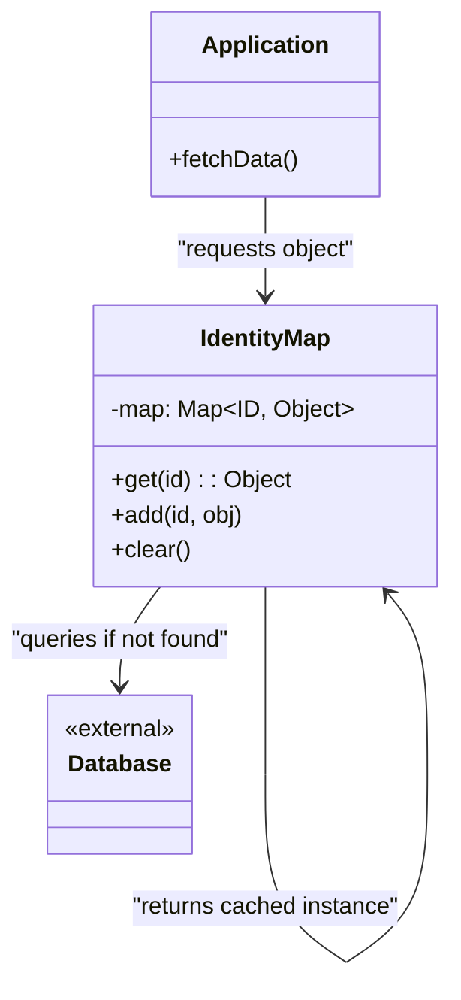

# Identity Map Pattern

<CoverImage src="/covers/architectural/identity-map.webp" alt="Cover">
  <h1>Identity Map</h1>
  <p>Stol ortida o'tirgan aqlli kutubxonachi robot; kitobxon kitob so'raganda, kutubxonachi chuqur javonlarga yugurishdan oldin kitob allaqachon shu yerda emasmikin, deb avval stol ustidagi kichik tartiblagichni (kesh) tekshiradi.</p>
</CoverImage>

## Umumiy ko'rinish (Overview)

**Identity Map** (Identifikatorlar xaritasi) patterni — bu ma'lumotlar bazasidan yuklangan har bir qator xotirada aynan **bitta** obyekt sifatida yaratilishini ta'minlaydigan muhim arxitektura patterni. U ichki kesh — xarita (map) vazifasini bajaradi: kalitlar ma'lumotlar bazasi ID'lari, qiymatlar esa xotiradagi obyekt instansiyalari.

**Asosiy afzallik**: U ilovaning ma'lumotlar bazasidagi aynan bir qatorni ifodalovchi ikkita alohida obyekt yaratishining oldini oladi va nomuvofiq ma'lumot o'zgarishlarini ("yo'qolgan yangilanishlar", lost updates) samarali bartaraf etadi.

**Zamonaviy nuqtai nazar**: Identity Map zamonaviy backend injiniringida ko'zga ko'rinmas zaruratdir. Agar og'ir ORM'dan (Hibernate, Entity Framework yoki TypeORM kabi) foydalansangiz, u obyektlarni kuzatish uchun o'zining Unit of Work/Session'i ichida Identity Map'dan foydalanadi. Bu patternni tushunish ORM nega ba'zan eskirgan ma'lumotlarni qaytarishini yoki nega bir xil foydalanuvchini ikki marta so'raganda ikkinchi marta ma'lumotlar bazasiga murojaat qilinmasligini debug qilish uchun zarur.

## Muammo (The Problem)

Ma'lumotlar bazasidan Identity Map'siz ma'lumot olganingizda, har bir so'rov xotirada butunlay yangi obyekt yaratadi.

```typescript
// ❌ Yomon: Bitta ma'lumotlar bazasi yozuvi uchun bir nechta obyekt
const userInstanceA = await userRepository.findById(1);
const userInstanceB = await userRepository.findById(1);

console.log(userInstanceA === userInstanceB); // false! Ular turli obyektlar.

// "Yo'qolgan yangilanish" (Lost Update) muammosi:
userInstanceA.name = "Alice";
userInstanceB.name = "Bob";

await userRepository.save(userInstanceA); // "Alice" ni DB'ga saqlaydi
await userRepository.save(userInstanceB); // "Bob" ni DB'ga saqlaydi va "Alice" ustidan yozadi!
```

Bu jiddiy muammolarni keltirib chiqaradi:

1. **Yo'qolgan yangilanishlar (Lost Updates)**: `userInstanceA` va `userInstanceB` bir-biridan bexabar bo'lgani uchun qaysi biri oxirida saqlansa, u boshqasini jimgina ustiga yozib yuboradi.
2. **Xotiraning shishishi (Memory Bloat)**: Agar 100 ta `Comment`ga ega `Post`ni yuklasangiz, har bir `Comment`ning `Author`i bo'lsa va bu izohlarning 80 tasi _bir xil_ Muallif tomonidan yozilgan bo'lsa, xotirada bitta o'rniga 80 ta bir xil `User` obyekti yaratasiz.
3. **Ma'lumotlar bazasiga ortiqcha yuk (Database Thrashing)**: Bir xil yozuvni bir necha marta so'rash ortiqcha, bir xil SQL so'rovlarini ishga tushiradi.

## Yechim (The Solution)

Identity Map Repository va Ma'lumotlar bazasi o'rtasiga joylashtiriladi. Yozuvni so'raganingizda avval xarita tekshiriladi. Agar obyekt mavjud bo'lsa, xotiradagi aynan o'sha havola (reference) qaytariladi. Agar mavjud bo'lmasa, ma'lumotlar bazasiga so'rov yuboriladi, obyekt yaratiladi va qaytarilishidan oldin xaritada saqlanadi.

```typescript
// ✅ Yaxshi: Identity Map faqat bitta obyekt mavjud bo'lishini ta'minlaydi
const map = new IdentityMap();

const userA = map.get(1) || (await db.query(1)); // DB'ga murojaat qiladi, Map'ga saqlaydi
const userB = map.get(1) || (await db.query(1)); // Map'dan oladi, DB'ga murojaat qilinmaydi

console.log(userA === userB); // true! Ular xotiradagi aynan bitta havolani bo'lishadi.

userA.name = "Alice";
console.log(userB.name); // "Alice". O'zgarishlar hamma joyda darhol sinxronlanadi.
```

## Tuzilma (Structure)



## Jarayon (Flow)

1. **So'rov**: Ilova obyektni uning birlamchi kaliti (masalan, ID: 123) bo'yicha so'raydi.
2. **Xaritani tekshirish**: Identity Map'da `123` kaliti tekshiriladi.
3. **Keshda topildi (Cache Hit)**: Agar topilsa, mavjud obyekt havolasi darhol qaytariladi. Hech qanday SQL bajarilmaydi.
4. **Keshda topilmadi (Cache Miss)**: Agar topilmasa, ma'lumotlar bazasiga so'rov yuboriladi. Natijaviy obyekt yaratiladi, Identity Map'ga `123` kaliti ostida qo'shiladi va keyin qaytariladi.

## Hayotiy o'xshatish (Real-World Analogy)

**Kasalxonadagi bemorlar reyestrini** tasavvur qiling.
Bemor John Doe kelganda, qabulxona xodimi markaziy reyestrni tekshiradi. Agar John allaqachon ro'yxatdan o'tgan va 4B xonasida bo'lsa, xodim shifokorni 4B xonasiga yo'naltiradi.

Bu reyestrsiz (Identity Map) kasalxona adashib John Doe'ni ikkinchi marta ro'yxatdan o'tkazishi, uni 7A xonasiga joylashtirishi mumkin va birdaniga ikki xil shifokor "John Doe"ning ikki xil nusxasini bir-biriga zid dorilar bilan davolay boshlaydi.

## Bosqichma-bosqich amalga oshirish (Step-by-Step Implementation)

1. **Xaritani yarating**: Ichki lug'at/hash map yarating.
2. **Get/Set metodlarini yarating**: Obyektlarni ularning noyob identifikatorlari bo'yicha olish va saqlash metodlarini amalga oshiring.
3. **Repository bilan integratsiya qiling**: Repository/Data Mapper'ingizni ma'lumotlar bazasiga so'rov yuborishdan oldin har doim Identity Map'ni tekshiradigan va so'rovdan keyin yangi obyektlarni har doim xaritaga qo'shadigan qilib o'zgartiring.
4. **Qamrov (Scoping)**: Identity Map to'g'ri qamrovga ega ekanligiga ishonch hosil qiling (odatda bitta HTTP so'roviga yoki Unit of Work'ga bog'langan), butun ilova bo'ylab global _emas_.

## Kod misollari (Code Examples)

::: code-group

```typescript [TypeScript]
// 1. Domen entity'si
class User {
  constructor(
    public id: number,
    public name: string,
  ) {}
}

// 2. Identity Map
class IdentityMap {
  // Kalit: Entity nomi + ID (masalan, "User:1"), Qiymat: Entity nusxasi
  private map: Map<string, any> = new Map();

  public get<T>(entityName: string, id: number): T | null {
    const key = `${entityName}:${id}`;
    return this.map.get(key) || null;
  }

  public add(entityName: string, id: number, entity: any): void {
    const key = `${entityName}:${id}`;
    this.map.set(key, entity);
  }

  public clear(): void {
    this.map.clear();
  }
}

// 3. Identity Map'ni o'z ichiga olgan repository
class UserRepository {
  constructor(private identityMap: IdentityMap) {}

  public async findById(id: number): Promise<User> {
    // Avval Identity Map'ni tekshirish
    const cachedUser = this.identityMap.get<User>("User", id);
    if (cachedUser) {
      console.log(
        `[Cache Hit] Returning existing memory reference for User ${id}`,
      );
      return cachedUser;
    }

    // DB so'rovini simulyatsiya qilish (Cache Miss)
    console.log(`[DB Query] SELECT * FROM users WHERE id = ${id}`);
    const userFromDb = new User(id, `User ${id}`);

    // Keyingi so'rovlar uchun Identity Map'ga saqlash
    this.identityMap.add("User", id, userFromDb);
    return userFromDb;
  }
}

// Mijoz kodi
async function run() {
  const map = new IdentityMap();
  const repo = new UserRepository(map);

  console.log("--- First Request ---");
  const user1 = await repo.findById(1);

  console.log("\n--- Second Request ---");
  const user2 = await repo.findById(1);

  console.log("\n--- Identity Check ---");
  console.log("Are they the exact same object?", user1 === user2); // true!

  // Birini o'zgartirish ikkinchisini ham o'zgartiradi
  user1.name = "Alice";
  console.log("user2 name is now:", user2.name); // Alice
}
run();
```

```python [Python]
from typing import Dict, Optional, Any

# 1. Domen entity'si
class User:
    def __init__(self, id_val: int, name: str):
        self.id = id_val
        self.name = name

# 2. Identity Map
class IdentityMap:
    def __init__(self):
        # Kalit: "EntityName:ID", Qiymat: Entity nusxasi
        self._map: Dict[str, Any] = {}

    def get(self, entity_name: str, id_val: int) -> Optional[Any]:
        key = f"{entity_name}:{id_val}"
        return self._map.get(key)

    def add(self, entity_name: str, id_val: int, entity: Any) -> None:
        key = f"{entity_name}:{id_val}"
        self._map[key] = entity

    def clear(self) -> None:
        self._map.clear()

# 3. Repository
class UserRepository:
    def __init__(self, identity_map: IdentityMap):
        self.identity_map = identity_map

    def find_by_id(self, id_val: int) -> User:
        # Avval Identity Map'ni tekshirish
        cached_user = self.identity_map.get("User", id_val)
        if cached_user:
            print(f"[Cache Hit] Returning existing memory reference for User {id_val}")
            return cached_user

        # DB so'rovini simulyatsiya qilish (Cache Miss)
        print(f"[DB Query] SELECT * FROM users WHERE id = {id_val}")
        user_from_db = User(id_val, f"User {id_val}")

        # Map'ga saqlash
        self.identity_map.add("User", id_val, user_from_db)
        return user_from_db

# Mijoz kodi
if __name__ == "__main__":
    imap = IdentityMap()
    repo = UserRepository(imap)

    print("--- First Request ---")
    u1 = repo.find_by_id(1)

    print("\n--- Second Request ---")
    u2 = repo.find_by_id(1)

    print("\n--- Identity Check ---")
    print(f"Are they the exact same object? {u1 is u2}") # True!

    # Birini o'zgartirish barcha havolalarga ta'sir qiladi
    u1.name = "Alice"
    print(f"u2 name is now: {u2.name}") # Alice
```

```java [Java]
import java.util.HashMap;
import java.util.Map;

// 1. Domen entity'si
class User {
    public int id;
    public String name;
    public User(int id, String name) { this.id = id; this.name = name; }
}

// 2. Identity Map
class IdentityMap {
    private Map<String, Object> map = new HashMap<>();

    public Object get(String entityName, int id) {
        return map.get(entityName + ":" + id);
    }

    public void add(String entityName, int id, Object entity) {
        map.put(entityName + ":" + id, entity);
    }

    public void clear() {
        map.clear();
    }
}

// 3. Repository
class UserRepository {
    private IdentityMap identityMap;

    public UserRepository(IdentityMap identityMap) {
        this.identityMap = identityMap;
    }

    public User findById(int id) {
        // Map'ni tekshirish
        User cached = (User) identityMap.get("User", id);
        if (cached != null) {
            System.out.println("[Cache Hit] Returning existing memory reference for User " + id);
            return cached;
        }

        // DB so'rovi
        System.out.println("[DB Query] SELECT * FROM users WHERE id = " + id);
        User user = new User(id, "User " + id);

        // Saqlash
        identityMap.add("User", id, user);
        return user;
    }
}

// Mijoz kodi
public class IdentityMapDemo {
    public static void main(String[] args) {
        IdentityMap imap = new IdentityMap();
        UserRepository repo = new UserRepository(imap);

        System.out.println("--- First Request ---");
        User u1 = repo.findById(1);

        System.out.println("\n--- Second Request ---");
        User u2 = repo.findById(1);

        System.out.println("\n--- Identity Check ---");
        System.out.println("Are they the exact same object? " + (u1 == u2)); // true!

        u1.name = "Alice";
        System.out.println("u2 name is now: " + u2.name); // Alice
    }
}
```

```go [Go]
package main

import (
	"fmt"
)

// 1. Domen entity'si
type User struct {
	ID   int
	Name string
}

// 2. Identity Map
type IdentityMap struct {
	// "Entity:ID" satr kalitlaridan pointer'larga map ishlatiladi
	m map[string]interface{}
}

func NewIdentityMap() *IdentityMap {
	return &IdentityMap{m: make(map[string]interface{})}
}

func (im *IdentityMap) Get(entityName string, id int) interface{} {
	key := fmt.Sprintf("%s:%d", entityName, id)
	if val, ok := im.m[key]; ok {
		return val
	}
	return nil
}

func (im *IdentityMap) Add(entityName string, id int, entity interface{}) {
	key := fmt.Sprintf("%s:%d", entityName, id)
	im.m[key] = entity
}

// 3. Repository
type UserRepository struct {
	identityMap *IdentityMap
}

func NewUserRepository(im *IdentityMap) *UserRepository {
	return &UserRepository{identityMap: im}
}

func (r *UserRepository) FindByID(id int) *User {
	// Map'ni tekshirish
	if cached := r.identityMap.Get("User", id); cached != nil {
		fmt.Printf("[Cache Hit] Returning existing memory reference for User %d\n", id)
		return cached.(*User) // Tip tasdiqlash (type assertion)
	}

	// Soxta DB so'rovi
	fmt.Printf("[DB Query] SELECT * FROM users WHERE id = %d\n", id)
	user := &User{ID: id, Name: fmt.Sprintf("User %d", id)}

	// Map'ga saqlash
	r.identityMap.Add("User", id, user)
	return user
}

// Mijoz kodi
func main() {
	imap := NewIdentityMap()
	repo := NewUserRepository(imap)

	fmt.Println("--- First Request ---")
	u1 := repo.FindByID(1)

	fmt.Println("\n--- Second Request ---")
	u2 := repo.FindByID(1)

	fmt.Println("\n--- Identity Check ---")
	// Go'da pointer'larni solishtirish
	fmt.Printf("Are they the exact same object pointer? %v\n", u1 == u2)

	u1.Name = "Alice"
	fmt.Printf("u2 name is now: %s\n", u2.Name)
}
```

```rust [Rust]
use std::cell::RefCell;
use std::collections::HashMap;
use std::rc::Rc;

// 1. Domen entity'si
#[derive(Debug)]
pub struct User {
    pub id: i32,
    pub name: String,
}

// 2. Identity Map
// Rust'da o'zgaruvchan egalikni bo'lishish uchun Rc va RefCell kerak
pub struct IdentityMap {
    map: HashMap<String, Rc<RefCell<User>>>,
}

impl IdentityMap {
    pub fn new() -> Self {
        Self { map: HashMap::new() }
    }

    pub fn get(&self, entity_name: &str, id: i32) -> Option<Rc<RefCell<User>>> {
        let key = format!("{}:{}", entity_name, id);
        self.map.get(&key).cloned()
    }

    pub fn add(&mut self, entity_name: &str, id: i32, entity: Rc<RefCell<User>>) {
        let key = format!("{}:{}", entity_name, id);
        self.map.insert(key, entity);
    }
}

// 3. Repository
pub struct UserRepository<'a> {
    // Repository map'ga o'zgaruvchan havolani saqlaydi
    identity_map: &'a mut IdentityMap,
}

impl<'a> UserRepository<'a> {
    pub fn new(identity_map: &'a mut IdentityMap) -> Self {
        Self { identity_map }
    }

    pub fn find_by_id(&mut self, id: i32) -> Rc<RefCell<User>> {
        if let Some(cached) = self.identity_map.get("User", id) {
            println!("[Cache Hit] Returning existing memory reference for User {}", id);
            return cached;
        }

        println!("[DB Query] SELECT * FROM users WHERE id = {}", id);
        let user = Rc::new(RefCell::new(User {
            id,
            name: format!("User {}", id),
        }));

        self.identity_map.add("User", id, Rc::clone(&user));
        user
    }
}

// Mijoz kodi
fn main() {
    let mut imap = IdentityMap::new();

    // O'zgaruvchan borrow doirasini boshqarish uchun blok
    {
        let mut repo = UserRepository::new(&mut imap);

        println!("--- First Request ---");
        let u1 = repo.find_by_id(1);

        println!("\n--- Second Request ---");
        let u2 = repo.find_by_id(1);

        println!("\n--- Identity Check ---");
        // Ikkala Rc pointer bitta joyga ishora qilishini tekshirish
        println!("Are they the exact same object? {}", Rc::ptr_eq(&u1, &u2));

        // Interior mutability orqali o'zgartirish
        u1.borrow_mut().name = "Alice".to_string();
        println!("u2 name is now: {}", u2.borrow().name);
    }
}
```

:::

## Afzalliklari va kamchiliklari (Pros and Cons)

### Afzalliklari (Advantages)

- **Kafolatlangan izchillik**: "Yo'qolgan yangilanish" xatolarini bartaraf etadi. Agar kodingizning A qismi obyektni o'zgartirsa, B qismi o'zgarishlarni darhol ko'radi.
- **Ishlash tezligini keskin yaxshilaydi**: Obyektlarni keshlash ma'lumotlar bazasiga qimmat va ortiqcha tarmoq chaqiruvlarining oldini oladi.
- **Aylanma havolalarni hal qiladi**: `Author`ga ega `Post`ni yuklaganda va `Author`da `Post`lar ro'yxati bo'lsa, Identity Map to'ldirish (hydration) paytida cheksiz rekursiya sikllarining oldini oladi.

### Kamchiliklari (Disadvantages)

- **Eskirgan ma'lumotlar muammosi (Stale Data)**: Agar boshqa server ma'lumotlar bazasidagi yozuvni o'zgartirsa, Identity Map buni bilmaydi. Ilova ma'lumotlar bazasiga so'rov yuborish o'rniga xotiradagi eskirgan obyektni berishda davom etadi.
- **Xotira sizishi (Memory Leaks)**: Agar Identity Map tasodifan mahalliy (masalan, har bir HTTP so'rovi uchun) emas, balki global (masalan, ilova ishga tushganda) yaratilsa, server Out Of Memory (OOM) xatosi bilan qulaguncha u yuklangan har bir obyektni keshlaydi.

## Qachon foydalanish kerak (When to Use)

- **Veb-so'rovlar**: Identity Map'ning hayot siklini bitta HTTP so'roviga bog'lang. Bu so'rov davomida xavfsizlik va keshlashni ta'minlaydi, lekin xotira shishishining oldini olish uchun oxirida uni tashlab yuboradi.
- **Murakkab domen modellari**: Ma'lumotlar bazasi jadvallaringiz o'rtasida kuchli munosabatlar (One-to-Many, Many-to-Many) bo'lgan har qanday holatda Identity Map grafni dublikatlar yaratmasdan hal qilish uchun juda muhim.
- **Unit of Work'dan foydalanganda**: Identity Map ishlaydigan Unit of Work uchun mutlaq shartdir.

## Qachon foydalanmaslik kerak (When NOT to Use)

- **Global ilova holati**: Veb-backend'da hech qachon Identity Map'ni barcha foydalanuvchilar/so'rovlar bo'ylab global ishlatmang. Eskirgan ma'lumotlarni berasiz va serveringizni qulatasiz.
- **Hisobotlar va tahlillar**: O'rtacha qiymatni hisoblash yoki CSV yaratish uchun 100 000 ta yozuvni olayotganingizda, ularni Identity Map'da keshlash RAM'ni halokatli darajada isrof qilishdir. Uni chetlab o'ting.

## Keng tarqalgan xatolar (Common Mistakes)

### 1. Global Identity Map (Xotira sizishi)

Node.js'da Identity Map'ni global o'zgaruvchida saqlash barcha HTTP so'rovlari bir xil xaritadan foydalanishini anglatadi. Bir necha daqiqa ichida xarita gigabaytlab hajmgacha o'sadi. _Yechim: Identity Map/Unit of Work'ni har doim kelayotgan aniq so'rov kontekstiga bog'lang (masalan, Node.js'da AsyncLocalStorage yoki scoped Dependency Injection)._

### 2. Chiqarib tashlashni unutish (Forgetting to Evict)

Agar ORM'ni chetlab o'tadigan xom SQL `UPDATE` buyrug'ini bajarsangiz, Identity Map hali ham eski qiymatlarni saqlab turadi. Keyingi so'rovlar yangi ma'lumotlarni olishi uchun Identity Map'ni qo'lda tozalashingiz/chiqarib tashlashingiz kerak.

## Aloqador patternlar (Related Patterns)

- **[Unit of Work](/uz/architectural/unit-of-work)**: Chambarchas bog'langan. Unit of Work hozirda qaysi obyektlarni boshqarayotganini kuzatish uchun Identity Map'dan foydalanadi.
- **[Data Mapper](/uz/architectural/data-mapper)**: SELECT buyrug'ini bajarish kerakmi yoki shunchaki keshlangan havolani qaytarish mumkinmi, buni tekshirish uchun Identity Map'dan foydalanadi.
- **[Repository](/uz/architectural/repository)**: Ko'pincha Identity Map implementatsiyasini biznes mantiq qatlamidan yashiradi.
