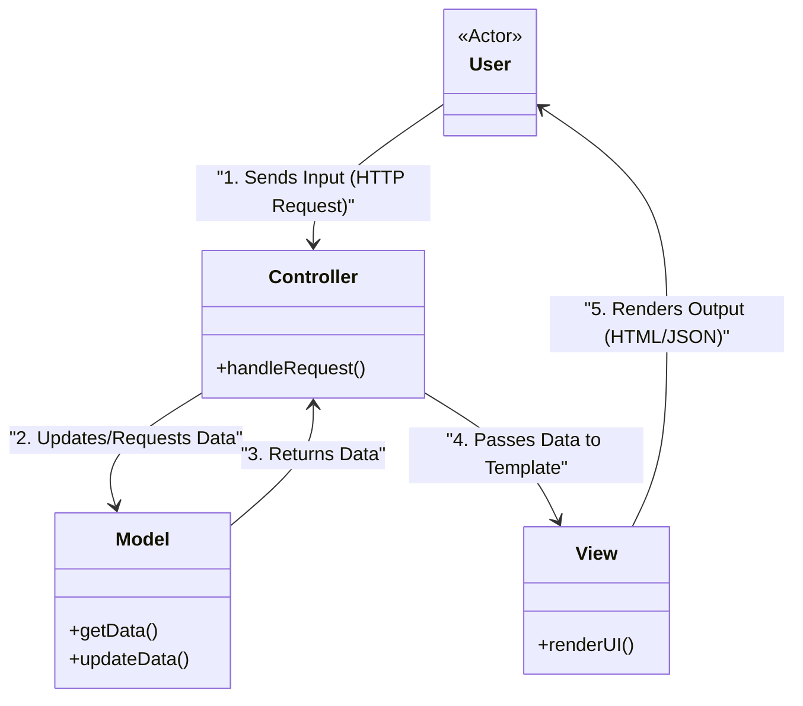

# MVC andozasi

<CoverImage src="/covers/architectural/mvc.webp" alt="Cover">
  <h1>MVC</h1>
  <p>Uch bekatli o'yin: tanga qabul qilayotgan yoqimtoy Controller robot og'ir Model robotni (qo'lida ma'lumotlar bazasi seyfini tutgan) boshqaradi, Model robot esa ma'lumotlarni View robotning rang-barang ekraniga proyeksiya qiladi.</p>
</CoverImage>

## Umumiy ko'rinish (Overview)

**Model-View-Controller (MVC)** andozasini dasturiy injiniringdagi eng mashhur arxitektura andozasi desak mubolag'a bo'lmaydi. U 1970-yillarda ilk grafik foydalanuvchi interfeyslari (Smalltalk) uchun yaratilgan va o'shandan beri backend veb freymvorklari (Ruby on Rails, Spring Boot, ASP.NET MVC, Laravel) uchun hukmron arxitekturaga aylangan.

U ilovani uchta alohida mas'uliyatga ajratadi:
- **Model**: Ma'lumotlar, biznes qoidalari va ma'lumotlar bazasi bilan o'zaro ishlashni boshqaradi.
- **View (Ko'rinish)**: Foydalanuvchiga taqdim etiladigan UI ni (HTML/JSON) generatsiya qiladi.
- **Controller (Boshqaruvchi)**: Foydalanuvchi kiritishlarini (HTTP so'rovlarini) tinglaydi, Model'ni boshqaradi va qaysi View'ni render qilishni tanlaydi.

**Zamonaviy nuqtai nazar**: Dastlab View va Model doimiy ravishda bir-biri bilan muloqot qiladigan desktop UI'lar uchun mo'ljallangan bo'lsa-da, zamonaviy veb ishlab chiqishda chiziqli "Request/Response" MVC ishlatiladi. Frontend (React/Vue) endi butunlay alohida, backend MVC'lar esa odatda shunchaki JSON qaytaradi, bu esa "View" chegarasini xiralashtiradi.

## Muammo (The Problem)

MVC dan oldin dasturchilar ma'lumotlar bazasi so'rovlari, biznes mantig'i va HTML markup bitta faylda aralashib ketgan "Spagetti kod" yozishgan (ilk PHP yoki Classic ASP kabi).

```php
<!-- ❌ Bad: Classic "Spaghetti" Code -->
<?php
  // Ma'lumotlar bazasi ulanishi HTML bilan aralashib ketgan
  $conn = new mysqli("localhost", "user", "pass", "db");
  $result = $conn->query("SELECT * FROM users");
?>
<html>
  <body>
    <h1>User List</h1>
    <?php while($row = $result->fetch_assoc()): ?>
      <!-- Logic mixed with markup -->
      <?php if($row['age'] >= 18): ?>
        <p><?= $row['name'] ?> (Adult)</p>
      <?php else: ?>
        <p><?= $row['name'] ?> (Minor)</p>
      <?php endif; ?>
    <?php endwhile; ?>
  </body>
</html>
```

Bu jiddiy muammolarni keltirib chiqaradi:
1. **Qo'llab-quvvatlab bo'lmaydi**: Ma'lumotlar bazasi sxemasini o'zgartirish HTML ni buzadi. CSS ni o'zgartirish esa tasodifan SQL so'rovni buzib qo'yishi mumkin.
2. **Test qilib bo'lmaydi**: Haqiqiy ma'lumotlar bazasini ishga tushirmasdan va HTML natijani tahlil qilmasdan "Voyaga yetgan va Voyaga yetmagan" mantig'ini tekshiradigan avtomatlashtirilgan test yozib bo'lmaydi.
3. **Hamkorlik imkonsiz**: Frontend dizayner va backend ma'lumotlar bazasi muhandisi bu fayl ustida bir vaqtda ishlay olmaydi.

## Yechim (The Solution)

MVC vazifalarni qat'iy ajratishga majbur qiladi.



**Jarayon (Flow):**
1. **Controller**: `/users` ga HTTP GET so'rovini qabul qiladi. U Model'dan barcha foydalanuvchilarni so'raydi.
2. **Model**: Ma'lumotlar bazasi so'rovini bajaradi, "Voyaga yetgan/Voyaga yetmagan" mantig'ini qo'llaydi va Controller'ga `User` obyektlarining toza massivini qaytaradi.
3. **Controller**: Foydalanuvchilar massivini olib, uni `UserListView` ga uzatadi.
4. **View**: Massiv bo'ylab yurib, faqat HTML ni render qiladi.

## Hayotiy o'xshatish (Real-World Analogy)

**Restoran**ni tasavvur qiling.
- **Mijoz (Foydalanuvchi)**: Menyuga qaraydi va buyurtma beradi.
- **Ofitsiant (Controller)**: Buyurtmani qabul qiladi, tekshiradi va oshxonaga olib boradi. Keyinroq tayyor taomni stolga olib keladi.
- **Oshpaz (Model)**: Retseptlarni (biznes mantig'ini) biladi, masalliqlarni muzlatgichdan (ma'lumotlar bazasidan) oladi va taomni pishiradi.
- **Taomni bezash / taqdimot (View)**: Taomning likopchadagi vizual joylashuvi.

Ofitsiant taom pishirmaydi. Oshpaz mijoz bilan gaplashmaydi. Mas'uliyatlar qat'iy ajratilgan.

## Bosqichma-bosqich amalga oshirish (Step-by-Step Implementation - Backend Web API)

Zamonaviy kontekstda biz "View" shunchaki JSON render qilishdan iborat bo'lgan backend API quramiz.

1. **Model**: Asosiy ma'lumotlar va biznes mantig'ini ifodalovchi klass yarating.
2. **Controller**: HTTP so'rovlarini qayta ishlaydigan metodlarga (endpoint'larga) ega klass yarating.
3. **View (API'lar uchun ixtiyoriy)**: API'larda freymvorkning JSON serializatori View vazifasini bajaradi. Eskiroq veb ilovalarda bu HTML shablon bo'lardi.

## Kod misollari (Code Examples)

::: code-group

```typescript [TypeScript (Express)]
import express, { Request, Response } from 'express';

// 1. Model: Ma'lumot va biznes mantiq bilan ishlaydi
class UserModel {
  private users = [
    { id: 1, name: "Alice", age: 25 },
    { id: 2, name: "Bob", age: 17 }
  ];

  public getAllAdults() {
    // Biznes mantiq controller'da emas, shu yerda turadi
    return this.users.filter(u => u.age >= 18);
  }

  public createUser(name: string, age: number) {
    if (age < 0) throw new Error("Age cannot be negative");
    const newUser = { id: Date.now(), name, age };
    this.users.push(newUser);
    return newUser;
  }
}

// 2. Controller: HTTP so'rovlarni qabul qiladi, Model bilan gaplashadi, View bilan javob beradi
class UserController {
  private model: UserModel;

  constructor() {
    this.model = new UserModel();
  }

  public getAdults = (req: Request, res: Response) => {
    try {
      const adults = this.model.getAllAdults();
      // 3. View: Framework ma'lumotni JSON'ga serializatsiya qiladi
      res.status(200).json({ success: true, data: adults });
    } catch (error) {
      res.status(500).json({ success: false, message: "Server error" });
    }
  }

  public create = (req: Request, res: Response) => {
    try {
      const { name, age } = req.body;
      const user = this.model.createUser(name, age);
      res.status(201).json({ success: true, data: user });
    } catch (error: any) {
      // Biznes mantiq xatolarini qayta ishlash
      res.status(400).json({ success: false, message: error.message });
    }
  }
}

// Router'ni ulash
const app = express();
app.use(express.json());
const controller = new UserController();

app.get('/users/adults', controller.getAdults);
app.post('/users', controller.create);
```

```java [Java (Spring Boot)]
import org.springframework.web.bind.annotation.*;
import java.util.ArrayList;
import java.util.List;
import java.util.stream.Collectors;

// 1. Model (Entity + Servis/Biznes mantiq)
class User {
    public int id;
    public String name;
    public int age;
    public User(int id, String name, int age) { this.id = id; this.name = name; this.age = age; }
}

@org.springframework.stereotype.Service
class UserService {
    private List<User> users = new ArrayList<>(List.of(
        new User(1, "Alice", 25),
        new User(2, "Bob", 17)
    ));

    public List<User> getAllAdults() {
        return users.stream()
            .filter(u -> u.age >= 18)
            .collect(Collectors.toList());
    }

    public User createUser(String name, int age) {
        if (age < 0) throw new IllegalArgumentException("Age cannot be negative");
        User user = new User((int)System.currentTimeMillis(), name, age);
        users.add(user);
        return user;
    }
}

// 2. Controller: HTTP marshrutlarini boshqaradi
@RestController
@RequestMapping("/users")
class UserController {
    
    private final UserService userService;

    // Model/Servisni bog'liqlik sifatida kiritish (Dependency Injection)
    public UserController(UserService userService) {
        this.userService = userService;
    }

    @GetMapping("/adults")
    public List<User> getAdults() {
        // 3. View: Spring bu List'ni avtomatik ravishda JSON javobga aylantiradi
        return userService.getAllAdults();
    }

    @PostMapping
    public User create(@RequestBody User request) {
        return userService.createUser(request.name, request.age);
    }
}
```

```python [Python (FastAPI)]
from fastapi import FastAPI, HTTPException
from pydantic import BaseModel
from typing import List

app = FastAPI()

# 1. Model (Ma'lumot shakli va biznes mantiq)
class User(BaseModel):
    id: int
    name: str
    age: int

class UserModel:
    def __init__(self):
        self.users = [
            User(id=1, name="Alice", age=25),
            User(id=2, name="Bob", age=17)
        ]

    def get_adults(self) -> List[User]:
        return [u for u in self.users if u.age >= 18]

    def create_user(self, name: str, age: int) -> User:
        if age < 0:
            raise ValueError("Age cannot be negative")
        new_user = User(id=len(self.users)+1, name=name, age=age)
        self.users.append(new_user)
        return new_user

db_model = UserModel()

# 2. Controller (Marshrut handler'lari)
@app.get("/users/adults", response_model=List[User])
def get_adults():
    # 3. View: FastAPI avtomatik ravishda JSON'ga serializatsiya qiladi
    return db_model.get_adults()

@app.post("/users", response_model=User)
def create_user(name: str, age: int):
    try:
        return db_model.create_user(name, age)
    except ValueError as e:
        raise HTTPException(status_code=400, detail=str(e))
```

```go [Go (Gin)]
package main

import (
	"errors"
	"net/http"
	"github.com/gin-gonic/gin"
)

// 1. Model
type User struct {
	ID   int    `json:"id"`
	Name string `json:"name"`
	Age  int    `json:"age"`
}

type UserModel struct {
	users []User
}

func NewUserModel() *UserModel {
	return &UserModel{
		users: []User{
			{ID: 1, Name: "Alice", Age: 25},
			{ID: 2, Name: "Bob", Age: 17},
		},
	}
}

func (m *UserModel) GetAdults() []User {
	var adults []User
	for _, u := range m.users {
		if u.Age >= 18 {
			adults = append(adults, u)
		}
	}
	return adults
}

func (m *UserModel) CreateUser(name string, age int) (User, error) {
	if age < 0 {
		return User{}, errors.New("Age cannot be negative")
	}
	user := User{ID: len(m.users) + 1, Name: name, Age: age}
	m.users = append(m.users, user)
	return user, nil
}

// 2. Controller
type UserController struct {
	model *UserModel
}

func (c *UserController) GetAdults(ctx *gin.Context) {
	adults := c.model.GetAdults()
	// 3. View: Gin map'ni JSON'ga serializatsiya qiladi
	ctx.JSON(http.StatusOK, gin.H{"data": adults})
}

func (c *UserController) Create(ctx *gin.Context) {
	var json struct {
		Name string `json:"name"`
		Age  int    `json:"age"`
	}
	if err := ctx.ShouldBindJSON(&json); err != nil {
		ctx.JSON(http.StatusBadRequest, gin.H{"error": err.Error()})
		return
	}

	user, err := c.model.CreateUser(json.Name, json.Age)
	if err != nil {
		ctx.JSON(http.StatusBadRequest, gin.H{"error": err.Error()})
		return
	}

	ctx.JSON(http.StatusCreated, gin.H{"data": user})
}

func main() {
	r := gin.Default()
	model := NewUserModel()
	controller := &UserController{model: model}

	r.GET("/users/adults", controller.GetAdults)
	r.POST("/users", controller.Create)
	r.Run(":8080")
}
```

:::

## Afzalliklari va kamchiliklari (Pros and Cons)

### Afzalliklari (Advantages)
- **Vazifalarni ajratish (Separation of Concerns)**: UI dizaynidagi o'zgarishlar ma'lumotlar bazasi mantig'ini o'zgartirishni talab qilmaydi.
- **Parallel ishlab chiqish**: Frontend dasturchilar View'lar ustida, Backend dasturchilar esa Model/Controller'lar ustida bir vaqtda ishlaydi.
- **Test qilinuvchanlik**: Model uchun unit testlarni Veb serverdan (Controller'dan) mustaqil ravishda yozishingiz mumkin.

### Kamchiliklari (Disadvantages)
- **Semiz Controller'lar (Fat Controllers)**: Vaqt o'tishi bilan dasturchilar erinib, biznes mantig'ini Model o'rniga Controller ichiga yoza boshlashadi. Bu andozani buzadi.
- **Kichik ilovalar uchun ortiqcha**: Agar siz shunchaki statik HTML sahifani taqdim etayotgan bo'lsangiz, uni MVC router va model qatlami orqali o'tkazishga majburlash ortiqcha.
- **Zamonaviy frontend uchun emas**: MVC yuqori interaktiv, reaktiv veb ilovalar (masalan, chat ilovasi) uchun juda yomon. Frontend olami MVC dan voz kechib, MVVM/Komponent arxitekturalarini (React, Vue) tanladi.

## Qachon foydalanish kerak (When to Use)

- **Backend Veb API'lar**: Deyarli har bir zamonaviy REST API freymvorki standart holda MVC (yoki MVC ga yaqin) tuzilmadan foydalanadi.
- **Serverda render qilinadigan veb-saytlar**: Server HTML ni render qiladigan an'anaviy ilovalar (Laravel, Rails, ASP.NET).

## Qachon foydalanmaslik kerak (When NOT to Use)

- **Single Page Applications (SPA)**: MVC ni React, Vue yoki Angular ga majburan tiqishtirishga urinmang. Ular Komponentga asoslangan arxitekturalar yoki MVVM dan foydalanadi.
- **Mikroservislar**: Faqat bitta fon vazifasini bajaradigan kichik mikroservisga odatda Controller yoki View'lar kerak emas.

## Keng tarqalgan xatolar (Common Mistakes)

### 1. Semiz Controller / Ozg'in Model (Fat Controller / Skinny Model)
Controller ichida xom SQL so'rovlar va murakkab validatsiya sikllarini yozish. *Yechim: Controller faqat HTTP mantig'ini (header'lar, status kodlari, JSON) boshqarishi kerak. Barcha ma'lumotlar qoidalari Model'ga (yoki Service qatlamiga) ko'chirilishi shart.*

### 2. View mantig'i (View Logic)
HTML shablonlar ichiga `if/else` operatorlari va ma'lumotlarni qayta ishlashni joylashtirish. *Yechim: Controller ma'lumotlarni View'ga uzatishdan oldin ularni yakuniy, ko'rsatishga tayyor holatga keltirishi kerak.*

## Aloqador andozalar (Related Patterns)

- **[MVVM (Model-View-ViewModel)](/uz/architectural/mvvm)**: Zamonaviy Frontend freymvorklari ishlatadigan MVC ning rivojlangan shakli bo'lib, unda Controller o'rnini ikki tomonlama ma'lumotlarni bog'lash (two-way data binding) egallaydi.
- **[MVP (Model-View-Presenter)](/uz/architectural/mvp)**: Asosan Android/Desktop ilovalarda ishlatiladi va to'liq passiv View'ga e'tibor qaratadi.
- **[MVT (Model-View-Template)](/uz/architectural/mvt)**: Django ning MVC ga xos o'ziga xos varianti.
