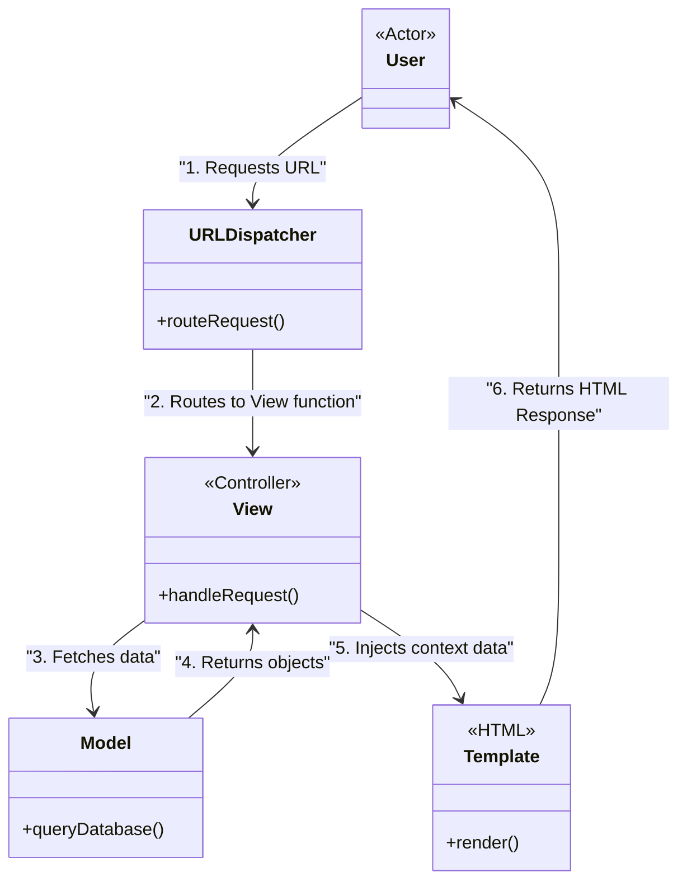

# MVT andozasi

<CoverImage src="/covers/architectural/mvt.webp" alt="Cover">
  <h1>MVT</h1>
  <p>Professional oshpaz robot (View) omborxonadan (Model) xom oziq-ovqat paketini olib, uni chiroyli yurak shaklidagi geometrik tort qolipida (Template) mukammal tarzda pishirmoqda.</p>
</CoverImage>

## Umumiy ko'rinish (Overview)

**Model-View-Template (MVT)** andozasi — Python'ning **Django** veb-freymvorki tomonidan ommalashtirilgan MVC andozasining o'ziga xos varianti. U Django yaratuvchilari "View" nima bo'lishi kerakligini biroz boshqacha falsafiy talqin qilganliklari uchun paydo bo'lgan.

An'anaviy MVC'da:
- **Controller** HTTP so'rovini qabul qiladi, mantiqni bajaradi va View'ni tanlaydi.
- **View** — foydalanuvchiga yuboriladigan HTML shablon.

MVT'da (Django arxitekturasi):
- **Model** ma'lumotlar va biznes mantiq bilan shug'ullanadi (MVC'dagi kabi).
- **View** — HTTP so'rovini qabul qiladigan, mantiqni bajaradigan va Template'ni tanlaydigan Python funksiyasi/klassi. (Amalda MVC'dagi **Controller**.)
- **Template** — foydalanuvchiga yuboriladigan HTML fayl. (Amalda MVC'dagi **View**.)
- **Freymvorkning o'zi** URL'larni View'larga moslashtiradigan asosiy Router/Controller vazifasini bajaradi.

**Zamonaviy nuqtai nazar**: MVT mohiyatan boshqacha nomlangan MVC xolos. MVC'ni tushunsangiz, MVT'ni ham tushunasiz. U asosan Python/Django dasturchilari uchun dolzarb.

## Muammo (The Problem)

MVC freymvorklaridan (Ruby on Rails yoki Laravel kabi) Django'ga o'tayotgan dasturchilar hujjatlarni ilk bor o'qiganlarida ko'pincha terminologiyadan chalkashib qolishadi. Ular "Controller" katalogini qidiradi va topa olmaydi. "Views" katalogini ko'rib, u yerda HTML fayllarni topishni kutishadi, ammo uning o'rniga Python mantiqini topishadi.

MVT Django'dagi vazifalarning ajratilishini aniqlashtirish uchun nomlash kelishuvi sifatida mavjud: u "Template" shunchaki "aqlsiz" taqdimot qatlami ekanligini, "View" esa _qanday_ ma'lumot taqdim etilishini hal qilishini ta'kidlaydi.

## Tuzilma va nomlarni taqqoslash (Structure and Naming Comparison)

| Komponent tushunchasi | An'anaviy MVC nomi | Django MVT nomi | Vazifasi |
| :--- | :--- | :--- | :--- |
| **Ma'lumotlar qatlami** | Model | **Model** | Ma'lumotlar bazasi sxemasi, ORM so'rovlari, asosiy biznes qoidalari. |
| **Mantiq qatlami** | Controller | **View** | HTTP so'rovini qabul qiladi, Model'ga so'rov yuboradi, ma'lumotlarni taqdimotga uzatadi. |
| **Taqdimot qatlami** | View | **Template** | Oddiy interpolyatsiya teglariga ega HTML fayllar (<code v-pre>{{ user.name }}</code>). |
| **Marshrutlash / Bog'lovchi** | Router / Front Controller | **URL Dispatcher** | `https://example.com/users` ni mantiq qatlamidagi aniq funksiyaga moslashtiradi. |



## Bosqichma-bosqich amalga oshirish (Django uslubida) (Step-by-Step Implementation)

Django ilovasida funksiya yaratish uchta aniq faylga tegishni talab qiladi: `models.py`, `views.py` va HTML shablon.

::: code-group

```python [Python (Django MVT)]
# 1. MODEL (models.py)
# Ma'lumotlar bazasi jadvaliga bog'lanadi va domen cheklovlarini belgilaydi
from django.db import models

class Article(models.Model):
    title = models.CharField(max_length=200)
    content = models.TextField()
    is_published = models.BooleanField(default=False)

    # Biznes mantiq Model ichida bo'ladi
    def publish(self):
        self.is_published = True
        self.save()

# 2. VIEW (views.py)
# Controller vazifasini bajaradi: HTTP so'rovni qabul qiladi, Model ma'lumotini oladi, Template'ni render qiladi
from django.shortcuts import render, get_object_or_404
from .models import Article

def article_detail(request, article_id):
    # Model'dan ma'lumot olish
    article = get_object_or_404(Article, id=article_id, is_published=True)
    
    # Template'ga uzatiladigan "context" lug'atini yaratish
    context = {
        'article': article,
        'user_is_authenticated': request.user.is_authenticated
    }
    
    # Render qilingan Template'ni HTTP javob sifatida qaytarish
    return render(request, 'blog/article_detail.html', context)

# 3. URL DISPATCHER (urls.py)
# URL'larni View'larga bog'laydigan framework kirish nuqtasi
from django.urls import path
from . import views

urlpatterns = [
    path('articles/<int:article_id>/', views.article_detail, name='article_detail'),
]
```

```html [HTML (Template)]
<!-- 4. TEMPLATE (article_detail.html) -->
<!-- Taqdimot (Presentation) qatlami vazifasini bajaradi. Sof HTML + template teglari -->
<!DOCTYPE html>
<html>
<head>
    <title>{{ article.title }}</title>
</head>
<body>
    <article>
        <!-- Qo'sh jingalak qavslar View kontekstidagi ma'lumotlarni joylaydi -->
        <h1>{{ article.title }}</h1>
        <div class="content">
            {{ article.content }}
        </div>
    </article>

    <!-- Oddiy taqdimot mantig'iga ruxsat beriladi -->
    
        <button>Edit Article</button>
    
        <p>Please log in to edit.</p>
    
</body>
</html>
```

:::

## Afzalliklari va kamchiliklari (Pros and Cons)

MVT **MVC** bilan aynan bir xil afzallik va kamchiliklarga ega, chunki funksional jihatdan ular bir xil arxitektura andozasidir.

### Afzalliklari (Advantages)
- **Juda tez ishlab chiqish**: MVT freymvorklari (Django kabi) Model ORM va Template dvigatelini tayyor holda taqdim etgani uchun CRUD ilovalarni qurish chaqmoqdek tez.
- **Aniq ajratish**: Ma'lumotlar bazasi muhandislari `models.py` ustida, backend mantiq dasturchilari `views.py` ustida va frontend dizaynerlari `.html` shablonlar ustida bir-birining ishiga xalal bermasdan ishlashi mumkin.

### Kamchiliklari (Disadvantages)
- **Semiz View'lar (Fat Views)**: MVC'dagi "Fat Controller" anti-andozasi kabi, dasturchilar ko'pincha dangasalik qilib, 500 qatorli murakkab biznes mantiqni `models.py` ga yoki alohida Service qatlamiga tushirish o'rniga `views.py` ichiga joylashtirib yuborishadi.
- **Monolitga moyillik**: MVT arxitekturalari serverda render qilinadigan monolitlarni qurishga kuchli undaydi. Keyinchalik React SPA yoki mobil ilova qurishingiz kerak bo'lsa, MVT shablonlaringiz befoyda bo'lib qoladi va View'laringizni JSON qaytaradigan qilib qayta yozishingiz (REST API yaratishingiz) kerak bo'ladi.

## Qachon foydalanish kerak (When to Use)

- **Django bilan ishlaganda**: Agar Django'dan foydalanayotgan bo'lsangiz, demak MVT'dan foydalanyapsiz. Freymvork kelishuvlariga amal qiling.
- **Kontentga boy veb-saytlar**: Server SEO maqsadlarida statik HTML yaratadigan bloglar, CMS platformalari va yangiliklar saytlari.

## Qachon foydalanmaslik kerak (When NOT to Use)

- **Bir sahifali ilovalar (SPA)**: Agar frontend'ingiz React/Vue bo'lsa, sizga Template'lar kerak emas. Backend'ingiz shunchaki JSON qaytaradigan API bo'lishi kerak, bu esa MVT'ni ahamiyatsiz qiladi.

## Aloqador andozalar (Related Patterns)

- **[MVC (Model-View-Controller)](/uz/architectural/mvc)**: Aynan bir xil arxitektura tushunchasi, faqat boshqa terminologiyadan foydalanadi.
- **[MVVM (Model-View-ViewModel)](/uz/architectural/mvvm)**: Frontend'dagi ekvivalenti. Agar MVT/Django shablonlaridan voz kechib, frontend'da Vue.js'dan foydalansangiz, MVVM'ga o'tayotgan bo'lasiz.
