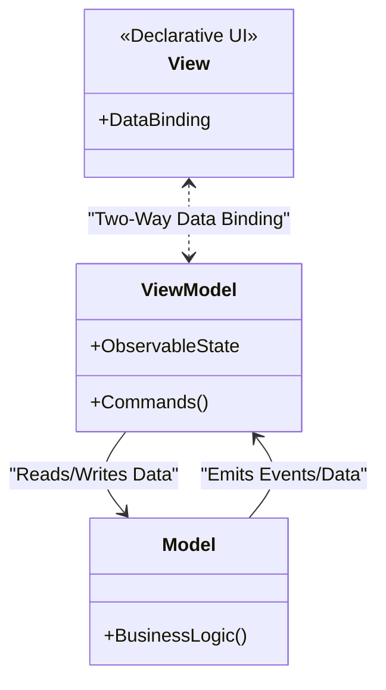

# MVVM andozasi

<CoverImage src="/covers/architectural/mvvm.webp" alt="Cover">
  <h1>MVVM</h1>
  <p>View ekrani va Model ma'lumotlar bazasi seyfi qiymatlarni real vaqtda avtomatik tortib va surib turadigan yorqin, nur sochuvchi neon iplar bilan bog'langan futuristik ish stantsiyasi.</p>
</CoverImage>

## Umumiy ko'rinish (Overview)

**Model-View-ViewModel (MVVM)** andozasi zamonaviy, reaktiv foydalanuvchi interfeyslari uchun arxitektura standartidir. U dastlab Microsoft tomonidan WPF (Windows Presentation Foundation) uchun yaratilgan, ammo o'shandan beri deyarli barcha zamonaviy frontend freymvorklari (Vue.js, Angular, SwiftUI, Jetpack Compose) ning asosiy falsafasiga aylangan.

U ilovani quyidagilarga ajratadi:

- **Model**: Domen ma'lumotlari va biznes mantig'ini o'z ichiga oladi.
- **View (Ko'rinish)**: Deklarativ UI maketi (HTML, XAML, JSX). Uning o'z mantig'i yo'q.
- **ViewModel**: View va Model o'rtasida joylashgan, holatni saqlovchi klass/obyekt. U "Observable" (kuzatiladigan) ma'lumotlar oqimlari va Command'larni taqdim etadi.

**MVVM ning sehri**: Controller/Presenter UI ga yangilanishlarni _qo'lda_ yuborishi kerak bo'lgan MVP yoki MVC dan farqli o'laroq (masalan, `textField.setText("Hello")`), MVVM **Data Binding** (ma'lumotlarni bog'lash) dan foydalanadi. View ViewModel'ni avtomatik tinglaydi. ViewModel holati o'zgarganda, View o'zini darhol va avtomatik yangilaydi.

## Muammo (The Problem)

MVC/MVP da UI ni ma'lumotlar bilan qo'lda sinxronlash uchun dasturchi mas'ul.

```javascript
// ❌ Yomon: DOM'ni qo'lda boshqarish (JQuery/Vanilla JS uslubi)
function updateUserName(newName) {
  user.name = newName; // Ma'lumotni yangilash
  // DOM elementini qo'lda topib, uni yangilash
  document.getElementById("name-display").innerText = newName;
  document.getElementById("name-input").value = newName;
}
```

Bu ko'plab xatolarga sabab bo'ladi:

1. **Nomuvofiqlik (Desync)**: Agar ma'lumotlarni yangilab, DOM elementini yangilashni unutsangiz, UI eskirgan ma'lumotlarni ko'rsatadi.
2. **Spagetti yangilanishlar**: Agar 5 xil tugma foydalanuvchi ismini o'zgartira olsa, DOM bilan ishlash kodini 5 marta takrorlab qo'yasiz.
3. **Shablon kod (Boilerplate)**: Input'lardan qo'lda o'qish va label'larga yozish UI kodining 80% ini tashkil qiladi.

## Yechim (The Solution)

MVVM **Binder** (bog'lovchi) ni joriy etadi (u Vue, Angular yoki React kabi freymvorklar tomonidan taqdim etiladi). View to'g'ridan-to'g'ri ViewModel xususiyatlariga _bog'lanadi_.

```html
<!-- ✅ Yaxshi: Deklarativ data binding (Vue.js uslubida) -->
<template>
  <!-- ViewModel.userName o'zgarganda View avtomatik yangilanadi -->
  <h1>{{ userName }}</h1>

  <!-- Ikki tomonlama binding: input'ga yozish ViewModel'ni avtomatik yangilaydi -->
  <input v-model="userName" />
</template>
```

Foydalanuvchi input'ga yozganda, ViewModel avtomatik yangilanadi. ViewModel yangilanganda esa `<h1>` avtomatik yangilanadi. DOM bilan qo'lda ishlash umuman talab qilinmaydi.

## Tuzilma (Structure)



## Jarayon (Flow)

1. **Foydalanuvchi harakati**: Foydalanuvchi matn maydoniga yozadi.
2. **Ikki tomonlama bog'lash (Two-Way Binding)**: Freymvorkning binder'i `ViewModel` ichidagi o'zgaruvchini avtomatik yangilaydi.
3. **Mantiqni bajarish**: Tugma bosiladi va `ViewModel` dagi Command ishga tushadi. `ViewModel` buyruqni qayta ishlaydi va `Model` ni yangilaydi.
4. **Holat o'zgarishi**: `ViewModel` o'zining Observable xususiyatlarini yangilaydi (masalan, `isLoading = false`).
5. **Avtomatik render**: Freymvork xususiyat o'zgarganini aniqlaydi va `View` ning aynan shu xususiyatga bog'langan qismlarini avtomatik qayta render qiladi.

## Hayotiy o'xshatish (Real-World Analogy)

**Elektron jadval (Excel kabi)** ni tasavvur qiling.

- **View**: Ekranda "50" sonini ko'rsatib turgan katak.
- **ViewModel**: Katak ortidagi `=A1+B1` formulasi.
- **Model**: A1 va B1 kataklaridagi haqiqiy ma'lumotlar.

Agar A1 katakni o'zgartirsangiz, jami katakni qayta chizishga buyruq beradigan skript yozishingiz shart emas. Jami katak formulaga _bog'langani_ uchun u avtomatik yangilanadi.

## Bosqichma-bosqich amalga oshirish (Step-by-Step Implementation)

MVVM asosan "Binder" mexanizmiga tayangani uchun, u kamdan-kam hollarda noldan quriladi. Odatda freymvorkdan (Vue, Angular, Knockout, WPF, SwiftUI) foydalaniladi. Shunga qaramay, u "parda ortida" qanday ishlashini tushunish uchun andozani zamonaviy proxy'lar yoki oddiy observable klasslar yordamida simulyatsiya qilishimiz mumkin.

## Kod misollari (Code Examples)

Biz oddiy hisoblagich (counter) ilovasini quramiz. MVVM qanday ishlashini ko'rsatish uchun barcha tillarda **Observable** mexanizmini (Kuzatuvchi andozasini) qo'lda amalga oshiramiz.

::: code-group

```typescript [TypeScript]
// 1. Model: Asosiy biznes qoidalari
class CounterModel {
  public value: number = 0;

  public increment() {
    this.value++;
  }
  public decrement() {
    this.value--;
  }
}

// Yordamchi: Oddiy Observable o'rami (Vue/React ichkarida aynan shuni qiladi)
class Observable<T> {
  private listeners: ((val: T) => void)[] = [];
  constructor(private _val: T) {}

  get value(): T {
    return this._val;
  }
  set value(v: T) {
    this._val = v;
    this.listeners.forEach((l) => l(v)); // Bog'langan barcha UI elementlarini xabardor qilish
  }

  bind(listener: (val: T) => void) {
    this.listeners.push(listener);
    listener(this._val); // Dastlabki sinxronlash
  }
}

// 2. ViewModel: Observable holat va buyruqlarni taqdim etadi
class CounterViewModel {
  // Holat Observable'larga o'ralgan
  public count = new Observable<number>(0);
  public isNegative = new Observable<boolean>(false);

  constructor(private model: CounterModel) {}

  // Buyruqlar (View tomonidan chaqiriladi)
  public onIncrement() {
    this.model.increment();
    this.syncState();
  }

  public onDecrement() {
    this.model.decrement();
    this.syncState();
  }

  private syncState() {
    // Observable'larni yangilash. View avtomatik reaksiya qiladi.
    this.count.value = this.model.value;
    this.isNegative.value = this.model.value < 0;
  }
}

// 3. View: ViewModel'ga bog'lanadigan sof UI
class CounterView {
  constructor(private viewModel: CounterViewModel) {
    // Deklarativ binding

    // "count" holatiga bog'lanish
    this.viewModel.count.bind((newVal) => {
      console.log(`UI Update: Counter text changed to -> ${newVal}`);
    });

    // "isNegative" holatiga bog'lanish
    this.viewModel.isNegative.bind((isNeg) => {
      if (isNeg) console.log("UI Update: Text turned RED");
      else console.log("UI Update: Text turned BLACK");
    });
  }

  // UI'da foydalanuvchi tugmalarni bosishini simulyatsiya qilish
  public simulateClickPlus() {
    this.viewModel.onIncrement();
  }
  public simulateClickMinus() {
    this.viewModel.onDecrement();
  }
}

// Ishga tushirish
const vm = new CounterViewModel(new CounterModel());
const view = new CounterView(vm);

console.log("\n--- User clicks plus ---");
view.simulateClickPlus();

console.log("\n--- User clicks minus twice ---");
view.simulateClickMinus();
view.simulateClickMinus();
```

```python [Python]
from typing import Callable, Generic, TypeVar

T = TypeVar('T')

# Yordamchi: Observable o'rami
class Observable(Generic[T]):
    def __init__(self, initial_value: T):
        self._value = initial_value
        self._listeners = []

    @property
    def value(self) -> T:
        return self._value

    @value.setter
    def value(self, new_val: T):
        self._value = new_val
        for listener in self._listeners:
            listener(new_val)

    def bind(self, listener: Callable[[T], None]):
        self._listeners.append(listener)
        listener(self._value) # dastlabki sinxronlash

# 1. Model
class CounterModel:
    def __init__(self):
        self.value = 0

    def increment(self):
        self.value += 1

    def decrement(self):
        self.value -= 1

# 2. ViewModel
class CounterViewModel:
    def __init__(self, model: CounterModel):
        self.model = model
        self.count = Observable(0)
        self.is_negative = Observable(False)

    def on_increment(self):
        self.model.increment()
        self._sync_state()

    def on_decrement(self):
        self.model.decrement()
        self._sync_state()

    def _sync_state(self):
        self.count.value = self.model.value
        self.is_negative.value = self.model.value < 0

# 3. View
class CounterView:
    def __init__(self, viewmodel: CounterViewModel):
        self.viewmodel = viewmodel

        # UI'ni ViewModel holatiga bog'lash
        self.viewmodel.count.bind(self.render_count)
        self.viewmodel.is_negative.bind(self.render_color)

    def render_count(self, new_val):
        print(f"UI Update: Counter text -> {new_val}")

    def render_color(self, is_neg):
        color = "RED" if is_neg else "BLACK"
        print(f"UI Update: Text turned {color}")

    def simulate_click_plus(self):
        self.viewmodel.on_increment()

    def simulate_click_minus(self):
        self.viewmodel.on_decrement()

if __name__ == "__main__":
    vm = CounterViewModel(CounterModel())
    view = CounterView(vm)
    print("\n--- User clicks plus ---")
    view.simulate_click_plus()
    print("\n--- User clicks minus twice ---")
    view.simulate_click_minus()
    view.simulate_click_minus()
```

```java [Java]
import java.util.ArrayList;
import java.util.List;
import java.util.function.Consumer;

// Yordamchi: Observable o'rami
class Observable<T> {
    private T value;
    private List<Consumer<T>> listeners = new ArrayList<>();

    public Observable(T initialValue) {
        this.value = initialValue;
    }

    public T getValue() { return value; }

    public void setValue(T value) {
        this.value = value;
        for (Consumer<T> listener : listeners) {
            listener.accept(value);
        }
    }

    public void bind(Consumer<T> listener) {
        listeners.add(listener);
        listener.accept(value); // Dastlabki sinxronlash
    }
}

// 1. Model
class CounterModel {
    public int value = 0;
    public void increment() { value++; }
    public void decrement() { value--; }
}

// 2. ViewModel
class CounterViewModel {
    private CounterModel model;

    public Observable<Integer> count = new Observable<>(0);
    public Observable<Boolean> isNegative = new Observable<>(false);

    public CounterViewModel(CounterModel model) {
        this.model = model;
    }

    public void onIncrement() {
        model.increment();
        syncState();
    }

    public void onDecrement() {
        model.decrement();
        syncState();
    }

    private void syncState() {
        count.setValue(model.value);
        isNegative.setValue(model.value < 0);
    }
}

// 3. View
class CounterView {
    private CounterViewModel viewModel;

    public CounterView(CounterViewModel viewModel) {
        this.viewModel = viewModel;

        // Data binding!
        viewModel.count.bind(val -> {
            System.out.println("UI Update: Counter text -> " + val);
        });

        viewModel.isNegative.bind(isNeg -> {
            System.out.println("UI Update: Text turned " + (isNeg ? "RED" : "BLACK"));
        });
    }

    public void simulateClickPlus() { viewModel.onIncrement(); }
    public void simulateClickMinus() { viewModel.onDecrement(); }
}

public class MVVMDemo {
    public static void main(String[] args) {
        CounterViewModel vm = new CounterViewModel(new CounterModel());
        CounterView view = new CounterView(vm);

        System.out.println("\n--- User clicks plus ---");
        view.simulateClickPlus();

        System.out.println("\n--- User clicks minus twice ---");
        view.simulateClickMinus();
        view.simulateClickMinus();
    }
}
```

```go [Go]
package main

import "fmt"

// Yordamchi: Observable
type Observer func(interface{})

type Observable struct {
	value     interface{}
	observers []Observer
}

func NewObservable(initVal interface{}) *Observable {
	return &Observable{value: initVal}
}

func (o *Observable) SetValue(val interface{}) {
	o.value = val
	for _, obs := range o.observers {
		obs(val)
	}
}

func (o *Observable) Bind(obs Observer) {
	o.observers = append(o.observers, obs)
	obs(o.value)
}

// 1. Model
type CounterModel struct {
	Value int
}

func (m *CounterModel) Increment() { m.Value++ }
func (m *CounterModel) Decrement() { m.Value-- }

// 2. ViewModel
type CounterViewModel struct {
	model      *CounterModel
	Count      *Observable
	IsNegative *Observable
}

func NewCounterViewModel(model *CounterModel) *CounterViewModel {
	return &CounterViewModel{
		model:      model,
		Count:      NewObservable(0),
		IsNegative: NewObservable(false),
	}
}

func (vm *CounterViewModel) OnIncrement() {
	vm.model.Increment()
	vm.syncState()
}

func (vm *CounterViewModel) OnDecrement() {
	vm.model.Decrement()
	vm.syncState()
}

func (vm *CounterViewModel) syncState() {
	vm.Count.SetValue(vm.model.Value)
	vm.IsNegative.SetValue(vm.model.Value < 0)
}

// 3. View
type CounterView struct {
	vm *CounterViewModel
}

func NewCounterView(vm *CounterViewModel) *CounterView {
	v := &CounterView{vm: vm}

	// Data Binding
	vm.Count.Bind(func(val interface{}) {
		fmt.Printf("UI Update: Counter text -> %v\n", val)
	})

	vm.IsNegative.Bind(func(val interface{}) {
		isNeg := val.(bool)
		if isNeg {
			fmt.Println("UI Update: Text turned RED")
		} else {
			fmt.Println("UI Update: Text turned BLACK")
		}
	})
	return v
}

func (v *CounterView) SimulateClickPlus()  { v.vm.OnIncrement() }
func (v *CounterView) SimulateClickMinus() { v.vm.OnDecrement() }

func main() {
	vm := NewCounterViewModel(&CounterModel{})
	view := NewCounterView(vm)

	fmt.Println("\n--- User clicks plus ---")
	view.SimulateClickPlus()

	fmt.Println("\n--- User clicks minus twice ---")
	view.SimulateClickMinus()
	view.SimulateClickMinus()
}
```

```rust [Rust]
use std::rc::Rc;
use std::cell::RefCell;

// Yordamchi: Observable
struct Observable<T> {
    value: T,
    listeners: Vec<Box<dyn Fn(&T)>>,
}

impl<T: Clone> Observable<T> {
    fn new(initial: T) -> Self {
        Observable { value: initial, listeners: Vec::new() }
    }

    fn set_value(&mut self, new_val: T) {
        self.value = new_val.clone();
        for listener in &self.listeners {
            listener(&self.value);
        }
    }

    fn bind<F>(&mut self, listener: F)
    where
        F: Fn(&T) + 'static,
    {
        listener(&self.value);
        self.listeners.push(Box::new(listener));
    }
}

// 1. Model
struct CounterModel {
    value: i32,
}

impl CounterModel {
    fn increment(&mut self) { self.value += 1; }
    fn decrement(&mut self) { self.value -= 1; }
}

// 2. ViewModel
struct CounterViewModel {
    model: CounterModel,
    pub count: Observable<i32>,
    pub is_negative: Observable<bool>,
}

impl CounterViewModel {
    fn new(model: CounterModel) -> Self {
        CounterViewModel {
            model,
            count: Observable::new(0),
            is_negative: Observable::new(false),
        }
    }

    fn on_increment(&mut self) {
        self.model.increment();
        self.sync_state();
    }

    fn on_decrement(&mut self) {
        self.model.decrement();
        self.sync_state();
    }

    fn sync_state(&mut self) {
        self.count.set_value(self.model.value);
        self.is_negative.set_value(self.model.value < 0);
    }
}

// 3. View
struct CounterView {
    // Rc/RefCell ishlatamiz, chunki View VM buyruqlarini chaqirish uchun o'zgaruvchan kirishga muhtoj,
    // shu bilan birga dastlabki binding'larni ham o'rnatishi kerak.
    vm: Rc<RefCell<CounterViewModel>>,
}

impl CounterView {
    fn new(vm: Rc<RefCell<CounterViewModel>>) -> Self {
        let view = CounterView { vm: Rc::clone(&vm) };

        // Data binding'larni o'rnatish
        let mut vm_mut = vm.borrow_mut();

        vm_mut.count.bind(|val| {
            println!("UI Update: Counter text -> {}", val);
        });

        vm_mut.is_negative.bind(|is_neg| {
            let color = if *is_neg { "RED" } else { "BLACK" };
            println!("UI Update: Text turned {}", color);
        });

        view
    }

    fn simulate_click_plus(&self) { self.vm.borrow_mut().on_increment(); }
    fn simulate_click_minus(&self) { self.vm.borrow_mut().on_decrement(); }
}

fn main() {
    let model = CounterModel { value: 0 };
    let vm = Rc::new(RefCell::new(CounterViewModel::new(model)));
    let view = CounterView::new(vm);

    println!("\n--- User clicks plus ---");
    view.simulate_click_plus();

    println!("\n--- User clicks minus twice ---");
    view.simulate_click_minus();
    view.simulate_click_minus();
}
```

:::

## Afzalliklari va kamchiliklari (Pros and Cons)

### Afzalliklari (Advantages)

- **DOM bilan qo'lda ishlash yo'q**: Dasturchilar endi `getElementById()` yozmaydi va qaysi UI elementlarini yangilash kerakligini kuzatib o'tirmaydi. Holat o'zgarishlari UI ga avtomatik tarqaladi.
- **Ajoyib test qilinuvchanlik**: ViewModel UI holati va mantig'ining 100% ini o'z ichiga oladi, lekin DOM/View ga mutlaqo hech qanday havolaga ega emas. React Hook yoki Vue composable'ni sof Node muhitida darhol test qilishingiz mumkin.
- **Dizayner/Dasturchi ajratilishi**: UX dizayner HTML/CSS (View) ni yozishi mumkin, dasturchi esa holat mantig'ini (ViewModel) yozadi va ular faqat bog'lanadigan o'zgaruvchi nomlarini kelishib olishadi.

### Kamchiliklari (Disadvantages)

- **Freymvorkka bog'liqlik**: MVVM ni freymvork mexanizmisiz (Vue/React/Angular/WPF) amalga oshirish juda charchatadigan ish va tonnalab shablon Observable klasslarni yozishni talab qiladi.
- **Xotira sizishi (Arvoh tinglovchilar - Ghost Listeners)**: Agar View yo'q qilinsa-yu, lekin ViewModel ma'lumotlar oqimlaridan obunani bekor qilishni unutsa, ViewModel View'ga havolani saqlab qoladi va Garbage Collection ga to'sqinlik qiladi.
- **Debugging sehri**: Ma'lumotlarni bog'lash freymvork orqali ko'rinmas tarzda sodir bo'lgani uchun, agar input to'satdan kutilmagan qiymatga o'zgarsa, kodning aynan _qaysi_ qismi bog'lash yangilanishini ishga tushirganini kuzatish qiyin bo'lishi mumkin.

## Qachon foydalanish kerak (When to Use)

- **Zamonaviy veb frontend**: Har safar Single Page Application (SPA) qurayotganingizda. React (Component State), Vue va Svelte - barchasi MVVM ning variantlari.
- **Zamonaviy mobil ilovalar**: Jetpack Compose (Android) va SwiftUI (iOS) MVVM prinsiplariga chuqur asoslangan.
- **Desktop ilovalar**: WPF, UWP va .NET MAUI.

## Qachon foydalanmaslik kerak (When NOT to Use)

- **Backend ishlab chiqish**: MVVM sof frontend/UI andozasi. Backend'lar MVC, qatlamli arxitekturalar (Layered Architectures) yoki DDD dan foydalanishi kerak.
- **Statik veb-saytlar**: Agar standart HTML/CSS yordamida oddiy landing sahifa yoki blog qurayotgan bo'lsangiz, faqat hamburger menyuni boshqarish uchun 100kb lik Vue/React mexanizmini yuklash haddan tashqari ortiqcha.

## Keng tarqalgan xatolar (Common Mistakes)

- **Semiz ViewModel'lar (Fat ViewModels)**: Tegishli Service/Repository klasslariga topshirish o'rniga ma'lumotlar bazasi ulanishlari va og'ir HTTP so'rovlarini bajaradigan ulkan ViewModel'lar yaratish.
- **To'g'ridan-to'g'ri Model'larga bog'lash**: Xom Model'ni ViewModel orqali moslashtirish o'rniga uni to'g'ridan-to'g'ri View'ga ochib berish. Bu UI ga xos hisoblanadigan xususiyatlarni (masalan, `isNegative = value < 0`) qo'shishga to'sqinlik qiladi.

## Aloqador andozalar (Related Patterns)

- **[MVC](/uz/architectural/mvc) / [MVP](/uz/architectural/mvp)**: O'tmishdoshlar. MVVM avtomatlashtirilgan Data Binding ni joriy qilish orqali ularning "View'ni qo'lda yangilash" muammosini hal qiladi.
- **[Kuzatuvchi andozasi](/uz/behavioral/observer)**: MVVM ning ishlashini ta'minlaydigan asosiy mexanik andoza. View ViewModel'ni _kuzatadi_.
- **[Buyruq andozasi](/uz/behavioral/command)**: MVVM da UI o'zaro ta'sirlarini (masalan, tugma bosishlarni) ViewModel UI hodisalari haqida bilmasdan qayta ishlay oladigan obyektlarga o'rash uchun ishlatiladi.
