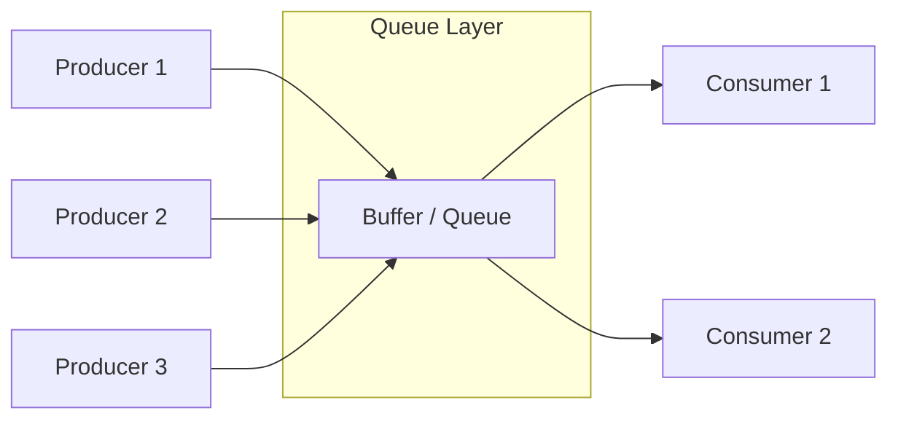

# Producer-Consumer Pattern

<CoverImage src="/covers/architectural/producer-consumer.webp" alt="Cover">
  <h1>Producer Consumer</h1>
  <p>Qiziqarli konveyer lentasi: uchta g'ayratli novvoy robot (Ishlab chiqaruvchilar) yangi pishgan donutlarni umumiy yog'och qutiga tashlamoqda, uchta och mijoz robot (Iste'molchilar) esa ularni narigi tomondan olib yemoqda.</p>
</CoverImage>

## Umumiy ko'rinish (Overview)

**Producer-Consumer** (Ishlab chiqaruvchi-Iste'molchi) patterni — fundamental parallellik (concurrency) va arxitektura dizayn patterni. U ma'lumot yaratadigan kodni (**Producer**) shu ma'lumotni qayta ishlaydigan koddan (**Consumer**) ular orasiga oraliq **Navbat (Queue)** yoki **Bufer** joylashtirish orqali ajratadi.

Bu ikkala tomonga butunlay turli tezliklarda, turli oqimlarda (thread) yoki hatto butunlay boshqa serverlarda ishlash imkonini beradi.

## Muammo (The Problem)

Sinxron arxitekturada ish birligini yaratadigan jarayon keyingi vazifaga o'tishdan oldin shu ish to'liq tugashini kutishi kerak.

```javascript
// ❌ Yomon: Sinxron, bloklovchi arxitektura
function handleImageUpload(image) {
    saveToDisk(image);          // 10ms oladi
    generateThumbnails(image);  // 5000ms oladi (BLOKLAYDI!)
    return "Upload Complete";   // Foydalanuvchi buni ko'rish uchun 5 soniya kutadi
}
```

Bu jiddiy tor joylarni (bottleneck) keltirib chiqaradi:
1. **Vaqt tugashi (Timeouts)**: Agar qayta ishlash juda uzoq davom etsa, kiruvchi HTTP so'rovining vaqti tugaydi.
2. **Zanjirli nosozliklar (Cascading Failures)**: Agar eskiz (thumbnail) generatori qulasa, rasm yuklash butunlay muvaffaqiyatsiz bo'ladi.
3. **Isrof qilingan resurslar**: Tez ishlovchi producer sekin consumer'ni kutib, bekor turishga majbur bo'ladi.
4. **Trafik keskin oshishi (Traffic Spikes)**: Agar 1 000 ta foydalanuvchi aynan bir soniyada rasm yuklasa, serveringiz bir vaqtning o'zida 1 000 ta eskizni qayta ishlashga urinadi va CPU qulaydi.

## Yechim (The Solution)

Ular orasiga Bufer (Navbat) kiriting.

1. **Producer** rasmni qabul qiladi, Navbatga xabar yozadi ("123-rasmni qayta ishlash") va foydalanuvchiga darhol muvaffaqiyat haqida javob qaytaradi.
2. **Consumer** (alohida oqim/serverda ishlaydi) Navbatni doimiy kuzatib turadi. U xabarlarni birma-bir olib, ularni o'z sur'atida qayta ishlaydi.



## Hayotiy o'xshatish (Real-World Analogy)

**Tezkor ovqatlanish restoranini** (Fast Food) tasavvur qiling.
- **Kassir (Producer)**: Mijozlardan buyurtmalarni juda tez qabul qiladi. U ovqat pishirmaydi. U shunchaki buyurtmani chekka yozib, uni tokchaga suradi.
- **Cheklar tokchasi (Bufer/Navbat)**: Buyurtmalarni navbatda saqlab turadi.
- **Oshpazlar (Consumers)**: Cheklarni tokchadan birma-bir olib, ovqat pishiradi. Ovqat pishirish uzoq vaqt oladi.

Agar 50 kishilik avtobus kelsa, kassir vahimaga tushmaydi. U shunchaki cheklar tokchasini to'ldiradi. Oshpazlar esa haddan tashqari yuklanmasdan maksimal tezlikda ishlashda davom etadi va oldingilarini tugatgan sari yangi cheklarni oladi.

## Bosqichma-bosqich amalga oshirish (Step-by-Step Implementation)

Mahalliy ilova parallelligi uchun buni oqimlar uchun xavfsiz (thread-safe) ma'lumot tuzilmalari (Channel'lar, BlockingQueue'lar) yordamida amalga oshirasiz. Taqsimlangan tizimlar uchun xabar brokerlaridan (Kafka, RabbitMQ, Redis, SQS) foydalanasiz.

1. **Bufer**: Oqimlar uchun xavfsiz Navbat yarating. Xotira tugab qolmasligi uchun unga ixtiyoriy ravishda maksimal sig'im bering (Bounded Buffer — chegaralangan bufer).
2. **Producer**: Elementlarni yaratib, ularni Navbatga qo'shadigan sikl yoki endpoint.
3. **Consumer**: Alohida oqim/jarayonda ishlaydigan, Navbatdan elementlarni olib, og'ir ishni bajaradigan sikl.

## Kod misollari (Code Examples)

Biz mahalliy ko'p oqimli (yoki asinxron) Producer-Consumer tizimini amalga oshiramiz. E'tibor bering, turli tillar o'ziga xos idiomatik primitivlardan foydalanadi: Go `channels`, Rust `mpsc`, Java `BlockingQueue`, JS esa asinxron massivlardan foydalanadi.

::: code-group

```typescript [TypeScript (Async/Await)]
// TypeScript bir oqimli, shuning uchun pattern'ni async/await bilan simulyatsiya qilamiz,
// bu event loop'ga bajarishni bo'shatib berish imkonini beradi.

class AsyncQueue<T> {
  private items: T[] = [];
  private resolvers: ((value: T) => void)[] = [];

  // Producer buni chaqiradi
  enqueue(item: T) {
    if (this.resolvers.length > 0) {
      const resolve = this.resolvers.shift()!;
      resolve(item); // Kutib turgan consumer'ga to'g'ridan-to'g'ri uzatish
    } else {
      this.items.push(item);
    }
  }

  // Consumer buni chaqiradi va kutadi
  async dequeue(): Promise<T> {
    if (this.items.length > 0) {
      return this.items.shift()!;
    }
    return new Promise<T>(resolve => {
      this.resolvers.push(resolve);
    });
  }
}

// 1. Sozlash
const queue = new AsyncQueue<string>();

// 2. Consumer sikli (fonda uzluksiz ishlaydi)
async function startConsumer(id: number) {
  while (true) {
    const job = await queue.dequeue();
    console.log(`Consumer ${id} processing: ${job}`);
    // Og'ir ishni simulyatsiya qilish
    await new Promise(r => setTimeout(r, 1000)); 
  }
}

// 3. Producer
function handleUpload(filename: string) {
  console.log(`Producer received: ${filename}`);
  queue.enqueue(filename);
}

// Ishga tushirish
startConsumer(1);
startConsumer(2);

// Tez ishlab chiqarish to'lqinlarini queue yutib oladi
handleUpload("img_01.jpg");
handleUpload("img_02.jpg");
handleUpload("img_03.jpg");
handleUpload("img_04.jpg");
```

```python [Python (Multithreading)]
import threading
import time
import queue

# 1. Maksimal sig'imi 5 bo'lgan thread-safe bufer
buffer = queue.Queue(maxsize=5)

def producer():
    for i in range(1, 6):
        job = f"Job_{i}"
        print(f"Producer creating {job}")
        
        # Queue to'la bo'lsa bloklanadi (Backpressure)
        buffer.put(job) 
        time.sleep(0.1) # Tez ishlab chiqaradi
        
    buffer.put(None) # Consumer'ni to'xtatish uchun "poison pill"

def consumer():
    while True:
        # Element paydo bo'lguncha bloklanadi
        job = buffer.get()
        if job is None:
            break # "Poison pill" qabul qilindi
            
        print(f"  Consumer processing {job}")
        time.sleep(1) # Sekin iste'mol qiladi (og'ir ish)
        buffer.task_done()

# Ishga tushirish
if __name__ == "__main__":
    t_producer = threading.Thread(target=producer)
    t_consumer = threading.Thread(target=consumer)

    t_consumer.start()
    t_producer.start()

    t_producer.join()
    t_consumer.join()
```

```java [Java (Concurrency Package)]
import java.util.concurrent.BlockingQueue;
import java.util.concurrent.LinkedBlockingQueue;

public class ProducerConsumerDemo {
    public static void main(String[] args) throws InterruptedException {
        // 1. Thread-safe chegaralangan bufer
        BlockingQueue<String> queue = new LinkedBlockingQueue<>(5);

        // 2. Producer thread
        Thread producer = new Thread(() -> {
            try {
                for (int i = 1; i <= 5; i++) {
                    String job = "Job_" + i;
                    System.out.println("Producer creating " + job);
                    
                    // Queue to'la bo'lsa bloklanadi
                    queue.put(job); 
                    Thread.sleep(100); // Tez
                }
                queue.put("EOF"); // "Poison pill"
            } catch (InterruptedException e) { Thread.currentThread().interrupt(); }
        });

        // 3. Consumer thread
        Thread consumer = new Thread(() -> {
            try {
                while (true) {
                    // Queue bo'sh bo'lsa bloklanadi
                    String job = queue.take();
                    if (job.equals("EOF")) break;
                    
                    System.out.println("  Consumer processing " + job);
                    Thread.sleep(1000); // Sekin
                }
            } catch (InterruptedException e) { Thread.currentThread().interrupt(); }
        });

        consumer.start();
        producer.start();

        producer.join();
        consumer.join();
    }
}
```

```go [Go (Channels)]
package main

import (
	"fmt"
	"time"
)

// Go'da Channel'lar o'rnatilgan idiomatik queue hisoblanadi
func producer(ch chan<- string) {
	for i := 1; i <= 5; i++ {
		job := fmt.Sprintf("Job_%d", i)
		fmt.Println("Producer creating", job)
		
		ch <- job // Channel buferi to'la bo'lsa bloklanadi
		time.Sleep(100 * time.Millisecond)
	}
	close(ch) // Consumer'larga to'xtash signalini xavfsiz beradi
}

func consumer(id int, ch <-chan string, done chan<- bool) {
	// Channel bo'ylab range u yopilganda avtomatik to'xtaydi
	for job := range ch {
		fmt.Printf("  Consumer %d processing %s\n", id, job)
		time.Sleep(1 * time.Second)
	}
	done <- true
}

func main() {
	// 1. Hajmi 3 bo'lgan chegaralangan bufer
	jobs := make(chan string, 3)
	done := make(chan bool)

	// Ikkita consumer'ni (worker) ishga tushirish
	go consumer(1, jobs, done)
	go consumer(2, jobs, done)

	// Producer'ni ishga tushirish
	go producer(jobs)

	// Ikkala consumer tugashini kutish
	<-done
	<-done
}
```

```rust [Rust (MPSC Channels)]
use std::sync::mpsc;
use std::thread;
use std::time::Duration;

fn main() {
    // 1. Multiple-Producer, Single-Consumer channel yaratish
    let (tx, rx) = mpsc::channel();

    // 2. Producer thread
    let producer = thread::spawn(move || {
        for i in 1..=5 {
            let job = format!("Job_{}", i);
            println!("Producer creating {}", job);
            
            tx.send(job).unwrap();
            thread::sleep(Duration::from_millis(100)); // Tez
        }
        // Channel (tx) shu yerda avtomatik drop bo'ladi va yopiladi
    });

    // 3. Consumer thread
    let consumer = thread::spawn(move || {
        // Iterator xavfsiz bloklanadi va tx drop bo'lganda tugaydi
        for job in rx {
            println!("  Consumer processing {}", job);
            thread::sleep(Duration::from_secs(1)); // Sekin
        }
    });

    producer.join().unwrap();
    consumer.join().unwrap();
}
```

:::

## Afzalliklari va kamchiliklari (Pros and Cons)

### Afzalliklari (Advantages)
- **Trafikni tekislash**: Agar ilovangiz trafikning keskin oshishiga duch kelsa (masalan, soniyasiga millionlab hodisalar), bufer bu sakrashni o'ziga yutadi va backend ma'lumotlar bazasini qulashdan himoya qiladi.
- **Mustaqil masshtablash**: Agar vazifalarni ishlab chiqarish tez, ularni iste'mol qilish esa sekin bo'lsa, har 1 ta Producer uchun 10 ta Consumer oqimi (yoki serveri) ishga tushirishingiz mumkin.
- **Nosozliklarga chidamlilik (Fault Tolerance)**: Agar consumer qulasa, xabarlar u qayta ishga tushguncha navbatda xavfsiz saqlanib turadi. Hech qanday ma'lumot yo'qolmaydi.

### Kamchiliklari (Disadvantages)
- **Yakuniy izchillik / Kechiktirilgan javob**: Producer foydalanuvchiga "Rasm yaratish natijangiz X" deb ayta olmaydi. U faqat "So'rovingiz navbatda" deya oladi.
- **Bufer to'lib ketishi (OOM)**: Agar Producer doimiy ravishda Consumer'dan tezroq bo'lsa, chegaralanmagan navbat server RAM'i tugab, qulaguncha cheksiz o'sib boradi.
- **Murakkablikning oshishi**: Kod mantiqi bo'linib ketadi, bu so'rovlarni kuzatish va xatolarni debug qilishni ancha qiyinlashtiradi.

## Qachon foydalanish kerak (When to Use)

- **Fon vazifalari (Background Jobs)**: Email yuborish, PDF yaratish, videolarni qayta ishlash yoki sekin uchinchi tomon API'larini chaqirish.
- **Hodisalarga asoslangan mikroservislar**: Xabar brokerlari (Kafka/RabbitMQ) orqali asinxron muloqot qiladigan servislar.
- **Loglarni yig'ish (Log Aggregation)**: Ilova loglari tez ishlab chiqariladi, lekin consumer tomonidan diskka/ElasticSearch'ga paketlab yoziladi.

## Qachon foydalanmaslik kerak (When NOT to Use)

- **Sinxron foydalanuvchi jarayonlari**: Agar foydalanuvchi keyingi ekranga o'tishidan oldin operatsiyaning yakuniy natijasini albatta ko'rishi shart bo'lsa.
- **Oddiy monolitlar**: Oddiy CRUD ilovaga xabar brokerini qo'shmang. RabbitMQ yoki Kafka'ni boshqarishning operatsion xarajatlari juda katta.

## Keng tarqalgan xatolar (Common Mistakes)

- **Chegaralanmagan navbatlar (Unbounded Queues)**: Cheksiz sig'imli navbat yaratish. Har doim **Chegaralangan navbatdan (Bounded Queue)** (maksimal hajmga ega navbat) foydalaning. Agar navbat to'lsa, Producer bloklanishi yoki xato qaytarishi kerak (Backpressure — teskari bosimni qo'llash).
- **Jim nosozliklar (Silent Failures)**: Agar consumer vazifani qayta ishlash paytida halokatli xatoga duch kelsa, u vazifani "Dead Letter Queue"ga qo'yishi yoki nosozlikni logga yozishi kerak. Vazifani shunchaki tashlab yuborish ma'lumot yo'qolishiga olib keladi.

## Aloqador patternlar (Related Patterns)

- **Message Broker**: Bu patternning taqsimlangan, infratuzilma darajasidagi versiyasi (masalan, Apache Kafka, RabbitMQ).
- **Thread Pool**: Odatda Producer-Consumer patternini ichki tarzda amalga oshiradi. Siz vazifalarni navbatga yuborasiz (ishlab chiqarasiz), ishchi oqimlar esa ularni bajaradi (iste'mol qiladi).
- **Pub-Sub**: Bitta ishlab chiqarilgan xabar nusxalanib, _bir nechta_ turli consumer'larga yetkaziladigan variant.
