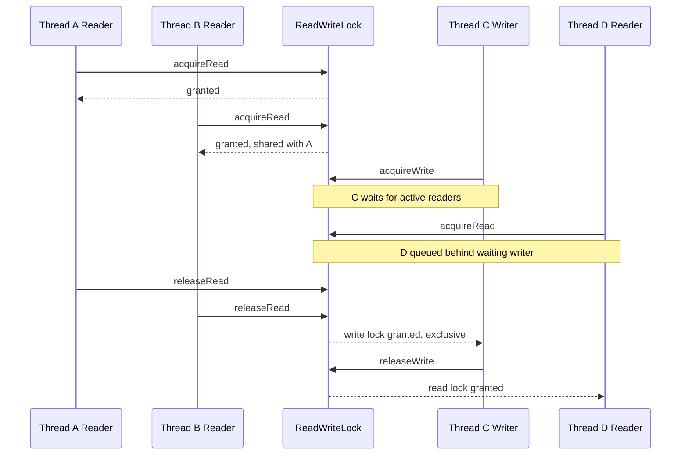

# Read-Write Lock Pattern

<CoverImage src="/covers/architectural/read-write-lock.webp" alt="Cover">
  <h1>Read Write Lock</h1>
  <p>Kitob ko'targan yigirmata olim-robotga bir vaqtda kirishga ruxsat beradigan, lekin mo'yqalam ushlagan birgina quruvchi-robot kirmoqchi bo'lganda gursillab yopilib, yorqin qizil rangga kiradigan qulfli ulkan kutubxona eshigi.</p>
</CoverImage>

## Umumiy ko'rinish (Overview)

**Read-Write Lock** (O'qish-yozish qulfi) patterni — ko'p oqimli (multi-threaded) muhitlarda umumiy resurslarga kirishni optimallashtiradigan fundamental parallellik (concurrency) dizayn patternidir. Barcha kirishlarni ketma-ketlashtiradigan (serialize) standart o'zaro istisno qulfidan (Mutex) farqli o'laroq, Read-Write Lock faqat o'qish operatsiyalarini va o'zgartiruvchi (yozish) operatsiyalarni bir-biridan farqlaydi. U bir nechta oqimga (thread) resursni bir vaqtning o'zida o'qishga ruxsat beradi, lekin yozish operatsiyasi mutlaq (exclusive) kirishni talab qilishini qat'iy ta'minlaydi.

Keshlash, konfiguratsiyani boshqarish va xotiradagi ma'lumotlar tarmoqlari (in-memory data grids) keng tarqalgan zamonaviy tizimlarda o'qish operatsiyalari odatda yozish operatsiyalaridan ko'p marta ko'p bo'ladi. Bunday stsenariylarda standart qulfdan foydalanish sun'iy "tor bo'g'iz" (bottleneck) hosil qiladi. Read-Write Lock o'qishlarni parallellashtirib, yozishlarni esa xavfsiz muvofiqlashtirib, o'tkazuvchanlikni (throughput) keskin oshiradi.

## Maqsad (Purpose)

- **Parallellikni maksimal darajaga chiqarish:** Ixtiyoriy sondagi o'quvchilarga (readers) umumiy ma'lumotlarga bir vaqtning o'zida kirish imkonini berish.
- **Ma'lumotlar yaxlitligini ta'minlash:** Yozuvchilarga (writers) mutlaq kirish berish orqali o'quvchilarning qisman yangilangan ma'lumotlarni ko'rishining oldini olish.
- **Poyga holatlarining (race conditions) oldini olish:** Bir nechta oqim bir xil resurs uchun raqobatlashganda oqim xavfsizligini (thread safety) kafolatlash.
- **O'qish ko'p bo'lgan ish yuklamalarini optimallashtirish:** O'qish yozishdan ancha tez-tez sodir bo'ladigan ilovalarda qulf uchun raqobatni (lock contention) sezilarli darajada kamaytirish.

## Muammo (Problem)

Foydalanuvchi profillarini xotirada keshlaydigan yuqori trafikli veb-serverni tasavvur qiling. Har soniyada minglab so'rovlar bu profillarni o'qishi kerak, fon vazifalari (background jobs) esa ularni faqat vaqti-vaqti bilan yangilaydi.

Agar keshni himoya qilish uchun oddiy Mutex'dan foydalansangiz, har bir o'qish operatsiyasi qulfni egallashi, agar uni boshqa oqim ushlab turgan bo'lsa kutishi va boshqa barcha kiruvchi o'qish so'rovlarini bloklashi kerak bo'ladi. Bu aslida ilovangizni so'rovlarni ketma-ket qayta ishlashga majbur qiladi, ko'p oqimlilikning afzalliklarini yo'qqa chiqaradi va unumdorlikni jiddiy pasaytiradi.

```typescript
// Read-Write Lock'siz - barcha kirishlar ketma-ket bajariladi
class SimpleCache {
  private data: Map<string, any> = new Map();
  // Oddiy boolean yoki mutex
  private locked = false;

  async get(key: string): Promise<any> {
    // ❌ YOMON: Hatto parallel o'qishlar ham bir-birini bloklaydi
    while (this.locked) await sleep(10);
    this.locked = true;
    try {
      return this.data.get(key);
    } finally {
      this.locked = false;
    }
  }

  // ...
}
```

## Yechim (Solution)

Read-Write Lock qulflash mexanizmini ikkita alohida rolga ajratadi:

1.  **O'qish qulfi (Read Lock / Shared Lock — umumiy qulf):** Hech bir oqim yozish qulfini ushlab turmagan yoki uni kutmayotgan ekan, bir vaqtning o'zida bir nechta oqim tomonidan egallanishi mumkin.
2.  **Yozish qulfi (Write Lock / Exclusive Lock — mutlaq qulf):** Faqat boshqa hech bir oqim o'qish qulfini _ham_, yozish qulfini _ham_ ushlab turmaganda bitta oqim tomonidan egallanishi mumkin.

**Yozuvchining och qolishi (Writer Starvation)** — yangi o'quvchilarning uzluksiz oqimi kutayotgan yozuvchining qulfni hech qachon egallay olmasligiga sabab bo'ladigan holat — oldini olish uchun production darajasidagi amalga oshirishlar ko'pincha adolatlilik siyosatlarini (fairness policies) yoki yozuvchiga ustunlik beruvchi navbatlarni (writer-preference queues) o'z ichiga oladi. Bu yozuvchi kirishni so'ragan zahoti, yozuvchi o'z vazifasini tugatmaguncha yangi o'quvchilar bloklanishini ta'minlaydi.

## Tuzilma / Ishlash oqimi (Structure / Flow)



- **O'qish qulfi** umumiy: hech bir yozuvchi faol bo'lmasa yoki kutmayotgan bo'lsa, uni istalgan sondagi o'quvchi ushlab turishi mumkin.
- **Yozish qulfi** mutlaq: yozuvchi barcha o'quvchilar qulfni bo'shatguncha kutadi va qulfni ushlab turgan paytda boshqa hammani bloklaydi.
- **Yozuvchiga ustunlik (Writer preference)**: yozuvchi navbatga qo'yilgan zahoti yangi o'quvchilar kutadi, bu yozuvchining och qolishining oldini oladi.

1.  **A oqimi (o'quvchi)** o'qish qulfini so'raydi. Hech bir yozuvchi faol bo'lmagani uchun unga ruxsat beriladi.
2.  **B oqimi (o'quvchi)** o'qish qulfini so'raydi. Unga A oqimi bilan bir vaqtda ruxsat beriladi.
3.  **C oqimi (yozuvchi)** yozish qulfini so'raydi. U bloklanadi va A hamda B oqimlari o'z o'qish qulflarini bo'shatishini kutadi.
4.  **D oqimi (o'quvchi)** o'qish qulfini so'raydi. C oqimini och qoldirmaslik uchun u bloklanadi (yozuvchiga ustunlik beruvchi amalga oshirishda).
5.  **A va B oqimlari** o'z qulflarini bo'shatadi.
6.  **C oqimi** yozish qulfini mutlaq egallaydi, ma'lumotlarni o'zgartiradi va qulfni bo'shatadi.
7.  **D oqimi** nihoyat o'zining o'qish qulfini egallaydi.

## Amalga oshirish (Implementation)

Zamonaviy tillar ko'pincha Read-Write qulflarning tilga o'rnatilgan, yuqori darajada optimallashtirilgan amalga oshirilishlarini taqdim etadi. Quyida ulardan korporativ (enterprise) muhitlarda idiomatik tarzda qanday foydalanishni ko'rsatuvchi misollar keltirilgan.

::: code-group

```typescript [TypeScript]
// Node.js/TypeScript'da parallellik muammolari odatda
// asinxron operatsiyalar (promise'lar) aralashib ketganda yuzaga keladi.
// Biz async'ni hisobga oladigan Read-Write Lock yaratamiz.

class AsyncReadWriteLock {
  private readersActive = 0;
  private writerActive = false;
  private readQueue: Array<() => void> = [];
  private writeQueue: Array<() => void> = [];

  async acquireRead(): Promise<void> {
    return new Promise((resolve) => {
      // Agar writer faol yoki kutayotgan bo'lsa, reader'ni navbatga qo'yish (Writer Preference)
      if (this.writerActive || this.writeQueue.length > 0) {
        this.readQueue.push(resolve);
      } else {
        this.readersActive++;
        resolve();
      }
    });
  }

  releaseRead(): void {
    if (this.readersActive === 0) throw new Error("No read locks to release");
    this.readersActive--;

    // Reader'lar qolmagan va writer kutayotgan bo'lsa, keyingi writer'ni uyg'otish
    if (this.readersActive === 0 && this.writeQueue.length > 0) {
      const nextWriter = this.writeQueue.shift();
      this.writerActive = true;
      if (nextWriter) nextWriter();
    }
  }

  async acquireWrite(): Promise<void> {
    return new Promise((resolve) => {
      // Kimdir o'qiyotgan yoki yozayotgan bo'lsa, writer'ni navbatga qo'yish
      if (this.readersActive > 0 || this.writerActive) {
        this.writeQueue.push(resolve);
      } else {
        this.writerActive = true;
        resolve();
      }
    });
  }

  releaseWrite(): void {
    if (!this.writerActive) throw new Error("No write lock to release");
    this.writerActive = false;

    // Kutayotgan barcha reader'larni yoki keyingi kutayotgan writer'ni uyg'otish
    if (this.readQueue.length > 0) {
      const readers = [...this.readQueue];
      this.readQueue = [];
      this.readersActive += readers.length;
      readers.forEach((resolve) => resolve());
    } else if (this.writeQueue.length > 0) {
      const nextWriter = this.writeQueue.shift();
      this.writerActive = true;
      if (nextWriter) nextWriter();
    }
  }
}

// Cache Service'da foydalanish
class ConfigCache {
  private config: Map<string, any> = new Map();
  private lock = new AsyncReadWriteLock();

  async getConfig(key: string): Promise<any> {
    await this.lock.acquireRead();
    try {
      // Asinxron o'qish operatsiyasini simulyatsiya qilish
      return this.config.get(key);
    } finally {
      this.lock.releaseRead();
    }
  }

  async updateConfig(key: string, value: any): Promise<void> {
    await this.lock.acquireWrite();
    try {
      // Asinxron yozish operatsiyasini simulyatsiya qilish
      this.config.set(key, value);
    } finally {
      this.lock.releaseWrite();
    }
  }
}
```

```python [Python]
# Python standart kutubxonasida o'rnatilgan read-write lock yo'q,
# lekin threading primitivlari yordamida thread-safe lock yozish mumkin
# yoki `fasteners` kabi tashqi kutubxonalardan foydalanish mumkin. Quyidagi implementatsiya
# ochlikning (starvation) oldini olish uchun writer'larga ustunlik beradi.

import threading
import time
from typing import Dict, Any

class ReadWriteLock:
    def __init__(self):
        self._read_ready = threading.Condition(threading.Lock())
        self._readers_active = 0
        self._writers_waiting = 0
        self._writer_active = False

    def acquire_read(self):
        with self._read_ready:
            # Writer faol YOKI kutayotgan bo'lsa kutish (writer preference)
            while self._writer_active or self._writers_waiting > 0:
                self._read_ready.wait()
            self._readers_active += 1

    def release_read(self):
        with self._read_ready:
            self._readers_active -= 1
            if self._readers_active == 0:
                # Kutayotgan writer'larga davom etishlari mumkinligini bildirish
                self._read_ready.notify_all()

    def acquire_write(self):
        with self._read_ready:
            self._writers_waiting += 1
            # Kimdir o'qiyotgan yoki yozayotgan bo'lsa kutish
            while self._readers_active > 0 or self._writer_active:
                self._read_ready.wait()
            self._writers_waiting -= 1
            self._writer_active = True

    def release_write(self):
        with self._read_ready:
            self._writer_active = False
            # Hammani uyg'otish (reader'lar va writer'lar)
            self._read_ready.notify_all()

# Toza sintaksis uchun Context Manager'dan foydalanish
class ReadLockManager:
    def __init__(self, rw_lock: ReadWriteLock):
        self.lock = rw_lock
    def __enter__(self):
        self.lock.acquire_read()
    def __exit__(self, exc_type, exc_val, exc_tb):
        self.lock.release_read()

class WriteLockManager:
    def __init__(self, rw_lock: ReadWriteLock):
        self.lock = rw_lock
    def __enter__(self):
        self.lock.acquire_write()
    def __exit__(self, exc_type, exc_val, exc_tb):
        self.lock.release_write()

# Foydalanish
class SharedDictionary:
    def __init__(self):
        self._data: Dict[str, Any] = {}
        self._lock = ReadWriteLock()

    def get(self, key: str) -> Any:
        with ReadLockManager(self._lock):
            return self._data.get(key)

    def set(self, key: str, value: Any) -> None:
        with WriteLockManager(self._lock):
            self._data[key] = value
```

```java [Java]
// Java java.util.concurrent.locks paketida yuqori darajada optimallashtirilgan
// ReentrantReadWriteLock'ni tayyor holda taqdim etadi.

import java.util.HashMap;
import java.util.Map;
import java.util.concurrent.locks.ReadWriteLock;
import java.util.concurrent.locks.ReentrantReadWriteLock;
import java.util.Optional;

public class ConcurrentConfigCache {
    private final Map<String, String> cache = new HashMap<>();
    // true writer ochligining oldini olish uchun adolat siyosatini yoqadi
    private final ReadWriteLock lock = new ReentrantReadWriteLock(true);

    public Optional<String> get(String key) {
        lock.readLock().lock();
        try {
            // Bir nechta thread buni bir vaqtda bajarishi mumkin
            return Optional.ofNullable(cache.get(key));
        } finally {
            // Lock'larni har doim finally blokida bo'shating!
            lock.readLock().unlock();
        }
    }

    public void put(String key, String value) {
        lock.writeLock().lock();
        try {
            // Buni bir vaqtda faqat BITTA thread bajara oladi.
            // Tugaguncha barcha reader'lar bloklanadi.
            cache.put(key, value);
        } finally {
            lock.writeLock().unlock();
        }
    }

    public void clear() {
        lock.writeLock().lock();
        try {
            cache.clear();
        } finally {
            lock.writeLock().unlock();
        }
    }
}
```

```go [Go]
// Go sync.RWMutex'ni tayyor holda taqdim etadi, u umumiy struct yoki map'larni
// himoya qilish uchun juda idiomatik va samarali.

package main

import (
	"fmt"
	"sync"
	"time"
)

// UserCache parallel o'qish va yozishlarni xavfsiz boshqaradi
type UserCache struct {
	mu    sync.RWMutex
	users map[string]string
}

func NewUserCache() *UserCache {
	return &UserCache{
		users: make(map[string]string),
	}
}

// Get read lock oladi. Bir nechta reader buni parallel bajarishi mumkin.
func (c *UserCache) Get(id string) (string, bool) {
	c.mu.RLock()
	defer c.mu.RUnlock() // Defer panic bo'lganda ham unlock bo'lishini kafolatlaydi

	user, exists := c.users[id]
	return user, exists
}

// Set write lock oladi. Eksklyuziv kirish kafolatlanadi.
func (c *UserCache) Set(id string, data string) {
	c.mu.Lock()
	defer c.mu.Unlock()

	c.users[id] = data
}

func main() {
	cache := NewUserCache()
	cache.Set("u1", "Alice")

	var wg sync.WaitGroup

	// 100 ta parallel reader'ni ishga tushirish
	for i := 0; i < 100; i++ {
		wg.Add(1)
		go func(readerID int) {
			defer wg.Done()
			if user, ok := cache.Get("u1"); ok {
				fmt.Printf("Reader %d saw: %s\n", readerID, user)
			}
		}(i)
	}

	// Parallel writer'ni ishga tushirish
	wg.Add(1)
	go func() {
		defer wg.Done()
		time.Sleep(10 * time.Millisecond) // Bir nechta o'qish bajarilishiga imkon berish
		cache.Set("u1", "Alice Updated")
	}()

	wg.Wait()
}
```

```rust [Rust]
// Rust standart kutubxonasi std::sync::RwLock'ni taqdim etadi.
// Rust'ning egalik modeli tufayli RwLock o'zi himoya qiladigan ma'lumotga egalik qiladi.
// Ma'lumotga lock qilmasdan kirib bo'lmaydi, bu esa race condition'larni kompilyatsiya vaqtidayoq imkonsiz qiladi!

use std::collections::HashMap;
use std::sync::{Arc, RwLock};
use std::thread;

// Thread'lar o'rtasida egalikni bo'lishish uchun Arc'dan foydalanish
type SharedCache = Arc<RwLock<HashMap<String, String>>>;

fn main() {
    let cache: SharedCache = Arc::new(RwLock::new(HashMap::new()));

    // Dastlabki yozish
    {
        let mut write_guard = cache.write().unwrap();
        write_guard.insert("config_a".to_string(), "value_a".to_string());
        // write_guard drop bo'lganda write lock avtomatik bo'shatiladi
    }

    let mut handles = vec![];

    // Parallel reader'larni ishga tushirish
    for i in 0..5 {
        let cache_clone = Arc::clone(&cache);
        let handle = thread::spawn(move || {
            // Read lock olish. Uni bir nechta thread bir vaqtda ushlab turishi mumkin.
            let read_guard = cache_clone.read().unwrap();

            if let Some(val) = read_guard.get("config_a") {
                println!("Reader {} saw: {}", i, val);
            }
        });
        handles.push(handle);
    }

    // Writer'ni ishga tushirish
    let cache_clone_write = Arc::clone(&cache);
    let write_handle = thread::spawn(move || {
        // Write lock olish. Barcha read_guard'lar drop bo'lguncha bloklanadi.
        let mut write_guard = cache_clone_write.write().unwrap();
        write_guard.insert("config_b".to_string(), "value_b".to_string());
        println!("Writer updated the cache.");
    });

    handles.push(write_handle);

    for handle in handles {
        handle.join().unwrap();
    }
}
```

:::

## Afzallik va kamchiliklar (Pros and Cons)

### Afzalliklari (Advantages)

- **Yuqori o'qish unumdorligi:** O'qishlar yozishlardan ko'p bo'lgan tizimlarda o'tkazuvchanlikni keskin oshiradi.
- **Ma'lumotlar izchilligi (Data Consistency):** Yozuvchilarni mutlaq qulflash orqali "iflos o'qish"lar (dirty reads) va holat buzilishining oldini oladi.
- **Kamroq kechikish (Latency):** O'quvchilar boshqa o'quvchilarni kutmaydi, bu keraksiz "tor bo'g'iz"larni yo'qotadi.
- **Kompilyatsiya vaqtidagi xavfsizlik (Rust/Go'da):** Zamonaviy tillar qulfni ma'lumotlarga bog'laydi, bu dasturchilarning qulfni chetlab o'tolmasligini ta'minlaydi.

### Kamchiliklari (Disadvantages)

- **Murakkablik va qo'shimcha xarajat (Overhead):** Ikki holatni (o'qish va yozish) boshqarish oddiy Mutex'ga qaraganda ko'proq CPU sikllari va xotira talab qiladi. Agar qulf uni egallash uchun ketadigan vaqtdan kamroq ushlab turilsa, standart Mutex tezroq bo'lishi mumkin.
- **Yozuvchining och qolishi (Writer Starvation):** Adolatlilik siyosatisiz uzluksiz o'qish so'rovlari yozuvchining qulfni hech qachon egallay olmasligiga olib kelishi mumkin.
- **Qulfni ko'tarish (Lock Upgrade) xavfli:** O'qish qulfini avval bo'shatmasdan uni yozish qulfiga ko'tarishga urinish ko'pincha o'zaro tiqilib qolishga (deadlock) olib keladi.

## Qachon foydalanish kerak (When to Use)

- **O'qish ko'p bo'lgan keshlar:** Har bir yozishga yuzlab o'qishlar to'g'ri keladigan xotiradagi keshlash qatlamlari (masalan, ilova darajasidagi konfiguratsiyalar yoki marshrutlash jadvallari).
- **Konfiguratsiyani boshqarish:** Doimiy so'raladigan, lekin kamdan-kam o'zgartiriladigan dinamik ilova sozlamalari.
- **Umumiy faqat o'qiladigan holat:** Katta, asosan statik ma'lumotlar to'plamlarini bir nechta ishchi oqimlarga (worker threads) taqdim etish.

## Qachon foydalanmaslik kerak (When NOT to Use)

- **Yozish ko'p bo'lgan ish yuklamalari:** Agar yozishlar o'qishlar kabi yoki ulardan ham tez-tez sodir bo'lsa, Read-Write qulf hech qanday foyda bermaydi va aslida standart Mutex'ga nisbatan qo'shimcha xarajat qo'shadi.
- **Juda tez kritik bo'limlar:** Agar kritik bo'lim (qulf ichidagi kod) bir necha nanosekundda bajarilsa (masalan, butun sonni oshirish), o'qish-yozish navbatlarini muvofiqlashtirish xarajati qulflash vaqtining o'zidan yuqori bo'ladi. Buning o'rniga atomik operatsiyalar yoki oddiy Mutex'dan foydalaning.
- **Bir oqimli kontekstlar:** Node.js (worker bo'lmagan kontekstlarda) bir oqimli. Haqiqiy ko'p oqimlilik muammolari mavjud emas, lekin asinxron operatsiyalarning aralashib ketishi (async interleaving) muammolari mavjud (ular asinxron qulflarni talab qiladi).

## Aloqador patternlar (Related Patterns)

- **Mutex (Mutual Exclusion — o'zaro istisno):** Oddiyroq muqobil. Yozish ko'p bo'lgan yoki juda qisqa qulflash stsenariylari uchun yaxshi.
- **[Producer-Consumer](/uz/architectural/producer-consumer):** Ko'pincha Read-Write qulflar bilan birgalikda ishlaydi; Consumer'lar o'qiydi, Producer'lar yozadi.
- **Double-Checked Locking:** Kechiktirilgan ishga tushirish (lazy initialization) paytida qulflash xarajatini kamaytirish uchun yana bir optimallashtirish patterni.
- **[CQRS](/uz/architectural/cqrs):** Arxitektura darajasida CQRS o'qish va yozish modellarini ajratadi — xuddi bu pattern o'qish va yozish qulflarini ajratganidek.
