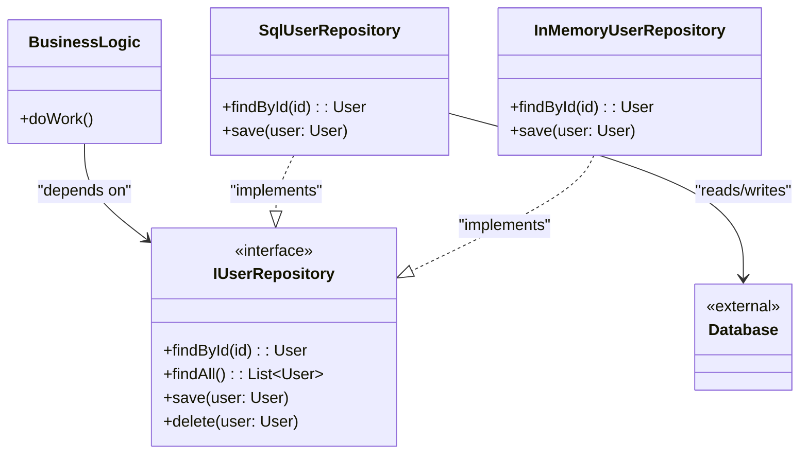

# Repozitoriy andozasi (Repository)

<CoverImage src="/covers/architectural/repository.webp" alt="Cover">
  <h1>Repozitoriy</h1>
  <p>"Data" deb yozilgan, toza katalog stoli bilan bezatilgan go'zal marmar ibodatxona kirishi; stol ortida ma'lumotlar bazasi so'rovlari maxluqi va API maxluqi ko'zdan butunlay yashirilgan.</p>
</CoverImage>

## Umumiy ko'rinish (Overview)

**Repozitoriy andozasi (Repository Pattern)** - bu domen/biznes mantig'i va ma'lumotlarni moslashtirish (data mapping) qatlami o'rtasida joylashadigan arxitektura andozasidir. U ma'lumotlarga kirishning mavhum ko'rinishini taqdim etadi va biznes mantig'iga ma'lumotlar bazasiga xuddi xotiradagi oddiy obyektlar to'plami (in-memory collection) kabi munosabatda bo'lish imkonini beradi.

**Asosiy afzalligi**: U biznes mantig'ini ma'lumotlarga kirish texnologiyasidan (SQL, NoSQL, tashqi API'lar) butunlay ajratadi, natijada ilova yuqori darajada test qilinadigan va infratuzilma o'zgarishlariga befarq bo'ladi.

**Zamonaviy nuqtai nazar**: Repozitoriy andozasi zamonaviy backend muhandisligida eng keng qo'llaniladigan arxitektura andozasi desak mubolag'a bo'lmaydi (ko'pincha Data Mapper yoki bog'liqliklarni kiritish (Dependency Injection) bilan birga ishlatiladi). U Clean Architecture, Hexagonal Architecture (Ports and Adapters) va Domain-Driven Design (DDD) ning asosiy toshidir.

## Muammo (The Problem)

Biznes mantig'i ma'lumotlar bazasiga to'g'ridan-to'g'ri so'rov yuborsa yoki ORM ning Active Record implementatsiyasiga bevosita tayansa, tizim aynan shu ma'lumotlar manbaiga chuqur bog'lanib qoladi.

```typescript
// ❌ Yomon: Biznes mantiq ma'lumotlar bazasi texnologiyasiga (masalan, SQL/ORM) bog'langan
class UserService {
  public async deactivateInactiveUsers() {
    // SQL sintaksisi biznes servisga sizib kiradi
    const users = await db.query("SELECT * FROM users WHERE last_login < ?", [
      thirtyDaysAgo,
    ]);

    for (const user of users) {
      user.is_active = false;
      await db.execute("UPDATE users SET is_active = false WHERE id = ?", [
        user.id,
      ]);
    }
  }
}
```

Bu bir nechta muammolarni keltirib chiqaradi:

1. **Test qilish qiyin**: `UserService` ni ishlab turgan ma'lumotlar bazasisiz yoki murakkab SQL mock'larsiz unit test qilib bo'lmaydi.
2. **Takrorlanish**: Aynan bir xil SQL so'rov `ReportService` va `AuthService` da ham yozilgan bo'lishi mumkin.
3. **Qattiqlik (Rigidity)**: Agar `users` ni tashqi mikroservisga yoki Redis keshiga ko'chirishga qaror qilsangiz, asosiy biznes mantig'ini qayta yozishingizga to'g'ri keladi.

## Yechim (The Solution)

Repozitoriy andozasi ma'lumotlarga kirishni interfeys (yoki bazaviy klass) ortiga yashirish orqali bu muammoni hal qiladi. Biznes mantig'i faqat interfeys bilan muloqot qiladi.

```typescript
// ✅ Yaxshi: Biznes mantiq Repository interfeysidan foydalanadi
class UserService {
  constructor(private userRepository: IUserRepository) {} // Bog'liqliklarni kiritish (Dependency Injection)

  public async deactivateInactiveUsers() {
    // Sof domen mantiqi, SQL umuman yo'q
    const users = await this.userRepository.findInactiveSince(thirtyDaysAgo);

    for (const user of users) {
      user.deactivate();
      await this.userRepository.save(user);
    }
  }
}
```

## Tuzilma (Structure)



## Jarayon (Flow)

1. **Ta'riflash**: `findById`, `save` va `delete` kabi metodlarga ega `IRepository` interfeysini aniqlang.
2. **Implementatsiya**: Interfeysni amalga oshiradigan konkret klasslarni yarating (masalan, `PostgresUserRepository`, `MongoUserRepository`, `MockUserRepository`).
3. **Inyeksiya (Injection)**: Konkret repozitoriyni bog'liqliklarni kiritish orqali biznes servisiga uzating.
4. **Bajarish**: Biznes servisi interfeys metodlarini chaqiradi. Konkret implementatsiya esa haqiqiy ma'lumotlarga kirish mantig'ini bajaradi.

## Hayotiy o'xshatish (Real-World Analogy)

**Kutubxonachi**ni tasavvur qiling.
Sizga ma'lum bir kitob kerak bo'lsa, arxivga kirib, Dyui o'nlik tizimini o'rganib, mexanik javonlarni o'zingiz boshqarmaysiz. Siz Kutubxonachiga (Repozitoriyga) borasiz va: "Menga Jorj Oruellning kitoblarini topib bering", deysiz.

Kutubxonachi kitobni jismoniy javonlardan qidirishi, tashqi omborni tekshirishi yoki elektron kitobni yuklab olishi mumkin. Siz (Biznes mantig'i) uchun kitob _qayerdan_ yoki _qanday_ olinganining farqi yo'q - asosiysi, Book obyektini qo'lga olsangiz bo'ldi.

## Bosqichma-bosqich amalga oshirish (Step-by-Step Implementation)

1. **Domen obyektini aniqlang**: Asosiy domen obyektini yarating (masalan, `User`).
2. **Interfeysni aniqlang**: Kerakli operatsiyalarni belgilaydigan `IUserRepository` interfeysini yarating.
3. **Konkret ma'lumotlar bazasi repozitoriysini yarating**: Interfeysni haqiqiy ma'lumotlar bazasi chaqiruvlari (SQL, ORM va h.k.) yordamida amalga oshiring.
4. **Konkret in-memory repozitoriy yarating**: Interfeysni massiv yoki Map yordamida amalga oshiring (tezkor unit testlar uchun juda muhim).
5. **Servislarga inyeksiya qiling**: Repozitoriyni use case'laringiz/servislaringizga uzating.

## Kod misollari (Code Examples)

::: code-group

```typescript [TypeScript]
// 1. Domen Entity
class User {
  constructor(
    public id: string,
    public name: string,
    public email: string,
  ) {}
}

// 2. Repository interfeysi
interface IUserRepository {
  findById(id: string): Promise<User | null>;
  findByEmail(email: string): Promise<User | null>;
  save(user: User): Promise<void>;
  delete(id: string): Promise<void>;
}

// 3. Konkret implementatsiya (test uchun In-Memory)
class InMemoryUserRepository implements IUserRepository {
  private users: Map<string, User> = new Map();

  async findById(id: string): Promise<User | null> {
    return this.users.get(id) || null;
  }

  async findByEmail(email: string): Promise<User | null> {
    for (const user of this.users.values()) {
      if (user.email === email) return user;
    }
    return null;
  }

  async save(user: User): Promise<void> {
    this.users.set(user.id, user);
    console.log(`[Mock DB] Saved user ${user.id}`);
  }

  async delete(id: string): Promise<void> {
    this.users.delete(id);
    console.log(`[Mock DB] Deleted user ${id}`);
  }
}

// 4. Konkret implementatsiya (PostgreSQL)
class PostgresUserRepository implements IUserRepository {
  // Haqiqatda bu haqiqiy DB ulanishi yoki ORM instansiyasi bo'ladi
  private db: any = { query: async () => [] };

  async findById(id: string): Promise<User | null> {
    console.log(
      `[Postgres DB] Executing: SELECT * FROM users WHERE id = ${id}`,
    );
    const rows = await this.db.query("SELECT * FROM users WHERE id = $1", [id]);
    return rows.length
      ? new User(rows[0].id, rows[0].name, rows[0].email)
      : null;
  }

  async findByEmail(email: string): Promise<User | null> {
    console.log(
      `[Postgres DB] Executing: SELECT * FROM users WHERE email = ${email}`,
    );
    return null; // Mock implementatsiya
  }

  async save(user: User): Promise<void> {
    console.log(`[Postgres DB] Executing: INSERT/UPDATE for user ${user.id}`);
  }

  async delete(id: string): Promise<void> {
    console.log(`[Postgres DB] Executing: DELETE for user ${id}`);
  }
}

// 5. Interfeysdan foydalanadigan biznes mantiq (Service)
class UserService {
  // Konkret klassga emas, INTERFEYSga bog'liq
  constructor(private repo: IUserRepository) {}

  async registerUser(id: string, name: string, email: string): Promise<User> {
    const existing = await this.repo.findByEmail(email);
    if (existing) throw new Error("Email already registered");

    const newUser = new User(id, name, email);
    await this.repo.save(newUser);
    return newUser;
  }
}

// Mijoz kodi
async function run() {
  // Test uchun Postgres repository'ni InMemory'ga osongina almashtira olamiz!
  const repo = new InMemoryUserRepository();
  const service = new UserService(repo);

  await service.registerUser("u1", "Alice", "alice@example.com");

  const user = await repo.findById("u1");
  console.log("Found:", user);
}
run();
```

```python [Python]
from abc import ABC, abstractmethod
from typing import Optional, Dict

# 1. Domen Entity
class User:
    def __init__(self, user_id: str, name: str, email: str):
        self.id = user_id
        self.name = name
        self.email = email

# 2. Repository interfeysi
class UserRepository(ABC):
    @abstractmethod
    def find_by_id(self, user_id: str) -> Optional[User]: pass

    @abstractmethod
    def find_by_email(self, email: str) -> Optional[User]: pass

    @abstractmethod
    def save(self, user: User) -> None: pass

    @abstractmethod
    def delete(self, user_id: str) -> None: pass

# 3. Konkret implementatsiya (test uchun In-Memory)
class InMemoryUserRepository(UserRepository):
    def __init__(self):
        self.users: Dict[str, User] = {}

    def find_by_id(self, user_id: str) -> Optional[User]:
        return self.users.get(user_id)

    def find_by_email(self, email: str) -> Optional[User]:
        for user in self.users.values():
            if user.email == email:
                return user
        return None

    def save(self, user: User) -> None:
        self.users[user.id] = user
        print(f"[Mock DB] Saved user {user.id}")

    def delete(self, user_id: str) -> None:
        if user_id in self.users:
            del self.users[user_id]
            print(f"[Mock DB] Deleted user {user_id}")

# 4. Konkret implementatsiya (SQL Database mock)
class SqlUserRepository(UserRepository):
    def find_by_id(self, user_id: str) -> Optional[User]:
        print(f"[SQL DB] Executing: SELECT * FROM users WHERE id = {user_id}")
        return None

    def find_by_email(self, email: str) -> Optional[User]:
        print(f"[SQL DB] Executing: SELECT * FROM users WHERE email = {email}")
        return None

    def save(self, user: User) -> None:
        print(f"[SQL DB] Executing: INSERT/UPDATE for user {user.id}")

    def delete(self, user_id: str) -> None:
        print(f"[SQL DB] Executing: DELETE for user {user_id}")

# 5. Biznes mantiq (Service)
class UserService:
    def __init__(self, repo: UserRepository):
        self.repo = repo

    def register_user(self, user_id: str, name: str, email: str) -> User:
        if self.repo.find_by_email(email):
            raise ValueError("Email already registered")

        new_user = User(user_id, name, email)
        self.repo.save(new_user)
        return new_user

# Mijoz kodi
if __name__ == "__main__":
    # SqlUserRepository'ni InMemoryUserRepository'ga bir zumda almashtirish
    repo = InMemoryUserRepository()
    service = UserService(repo)

    service.register_user("u1", "Alice", "alice@example.com")
    user = repo.find_by_id("u1")
    print(f"Found: {user.name}")
```

```java [Java]
import java.util.*;

// 1. Domen Entity
class User {
    private String id;
    private String name;
    private String email;

    public User(String id, String name, String email) {
        this.id = id; this.name = name; this.email = email;
    }
    public String getId() { return id; }
    public String getName() { return name; }
    public String getEmail() { return email; }
}

// 2. Repository interfeysi
interface UserRepository {
    Optional<User> findById(String id);
    Optional<User> findByEmail(String email);
    void save(User user);
    void delete(String id);
}

// 3. Konkret implementatsiya (In-Memory)
class InMemoryUserRepository implements UserRepository {
    private Map<String, User> users = new HashMap<>();

    @Override
    public Optional<User> findById(String id) {
        return Optional.ofNullable(users.get(id));
    }

    @Override
    public Optional<User> findByEmail(String email) {
        return users.values().stream()
                .filter(u -> u.getEmail().equals(email))
                .findFirst();
    }

    @Override
    public void save(User user) {
        users.put(user.getId(), user);
        System.out.println("[Mock DB] Saved user " + user.getId());
    }

    @Override
    public void delete(String id) {
        users.remove(id);
        System.out.println("[Mock DB] Deleted user " + id);
    }
}

// 4. Konkret implementatsiya (SQL)
class SqlUserRepository implements UserRepository {
    @Override
    public Optional<User> findById(String id) {
        System.out.println("[SQL DB] SELECT * FROM users WHERE id = " + id);
        return Optional.empty();
    }

    @Override
    public Optional<User> findByEmail(String email) {
        System.out.println("[SQL DB] SELECT * FROM users WHERE email = " + email);
        return Optional.empty();
    }

    @Override
    public void save(User user) {
        System.out.println("[SQL DB] INSERT/UPDATE user " + user.getId());
    }

    @Override
    public void delete(String id) {
        System.out.println("[SQL DB] DELETE user " + id);
    }
}

// 5. Biznes mantiq
class UserService {
    private final UserRepository repo;

    public UserService(UserRepository repo) {
        this.repo = repo;
    }

    public User registerUser(String id, String name, String email) {
        if (repo.findByEmail(email).isPresent()) {
            throw new IllegalArgumentException("Email already registered");
        }
        User newUser = new User(id, name, email);
        repo.save(newUser);
        return newUser;
    }
}

// Mijoz kodi
public class RepositoryDemo {
    public static void main(String[] args) {
        // SqlUserRepository yoki InMemoryUserRepository'dan istalganini inject qilishimiz mumkin
        UserRepository repo = new InMemoryUserRepository();
        UserService service = new UserService(repo);

        service.registerUser("u1", "Alice", "alice@example.com");
        repo.findById("u1").ifPresent(u -> System.out.println("Found: " + u.getName()));
    }
}
```

```go [Go]
package main

import (
	"errors"
	"fmt"
)

// 1. Domen Entity
type User struct {
	ID    string
	Name  string
	Email string
}

// 2. Repository interfeysi
type UserRepository interface {
	FindByID(id string) (*User, error)
	FindByEmail(email string) (*User, error)
	Save(user *User) error
	Delete(id string) error
}

// 3. Konkret implementatsiya (In-Memory)
type InMemoryUserRepository struct {
	users map[string]*User
}

func NewInMemoryUserRepository() *InMemoryUserRepository {
	return &InMemoryUserRepository{users: make(map[string]*User)}
}

func (r *InMemoryUserRepository) FindByID(id string) (*User, error) {
	if user, ok := r.users[id]; ok {
		return user, nil
	}
	return nil, nil // Topilmadi
}

func (r *InMemoryUserRepository) FindByEmail(email string) (*User, error) {
	for _, user := range r.users {
		if user.Email == email {
			return user, nil
		}
	}
	return nil, nil // Topilmadi
}

func (r *InMemoryUserRepository) Save(user *User) error {
	r.users[user.ID] = user
	fmt.Printf("[Mock DB] Saved user %s\n", user.ID)
	return nil
}

func (r *InMemoryUserRepository) Delete(id string) error {
	delete(r.users, id)
	fmt.Printf("[Mock DB] Deleted user %s\n", id)
	return nil
}

// 4. Biznes mantiq
type UserService struct {
	repo UserRepository
}

func NewUserService(repo UserRepository) *UserService {
	return &UserService{repo: repo}
}

func (s *UserService) RegisterUser(id, name, email string) (*User, error) {
	existing, _ := s.repo.FindByEmail(email)
	if existing != nil {
		return nil, errors.New("email already registered")
	}

	newUser := &User{ID: id, Name: name, Email: email}
	s.repo.Save(newUser)
	return newUser, nil
}

// Mijoz kodi
func main() {
	repo := NewInMemoryUserRepository()
	service := NewUserService(repo)

	service.RegisterUser("u1", "Alice", "alice@example.com")

	user, _ := repo.FindByID("u1")
	if user != nil {
		fmt.Printf("Found: %s\n", user.Name)
	}
}
```

```rust [Rust]
use std::collections::HashMap;

// 1. Domen Entity
#[derive(Clone)]
pub struct User {
    pub id: String,
    pub name: String,
    pub email: String,
}

// 2. Repository Trait (interfeys)
pub trait UserRepository {
    fn find_by_id(&self, id: &str) -> Option<User>;
    fn find_by_email(&self, email: &str) -> Option<User>;
    fn save(&mut self, user: User);
    fn delete(&mut self, id: &str);
}

// 3. Konkret implementatsiya (In-Memory)
pub struct InMemoryUserRepository {
    users: HashMap<String, User>,
}

impl InMemoryUserRepository {
    pub fn new() -> Self {
        Self { users: HashMap::new() }
    }
}

impl UserRepository for InMemoryUserRepository {
    fn find_by_id(&self, id: &str) -> Option<User> {
        self.users.get(id).cloned()
    }

    fn find_by_email(&self, email: &str) -> Option<User> {
        self.users.values().find(|u| u.email == email).cloned()
    }

    fn save(&mut self, user: User) {
        println!("[Mock DB] Saved user {}", user.id);
        self.users.insert(user.id.clone(), user);
    }

    fn delete(&mut self, id: &str) {
        println!("[Mock DB] Deleted user {}", id);
        self.users.remove(id);
    }
}

// 4. Biznes mantiq
pub struct UserService<T: UserRepository> {
    repo: T,
}

impl<T: UserRepository> UserService<T> {
    pub fn new(repo: T) -> Self {
        Self { repo }
    }

    pub fn register_user(&mut self, id: &str, name: &str, email: &str) -> Result<User, &'static str> {
        if self.repo.find_by_email(email).is_some() {
            return Err("Email already registered");
        }

        let new_user = User {
            id: id.to_string(),
            name: name.to_string(),
            email: email.to_string(),
        };

        self.repo.save(new_user.clone());
        Ok(new_user)
    }
}

// Mijoz kodi
fn main() {
    let repo = InMemoryUserRepository::new();
    let mut service = UserService::new(repo);

    let _ = service.register_user("u1", "Alice", "alice@example.com");

    if let Some(user) = service.repo.find_by_id("u1") {
        println!("Found: {}", user.name);
    }
}
```

:::

## Afzalliklari va kamchiliklari (Pros and Cons)

### Afzalliklari (Advantages)

- **Maksimal test qilinuvchanlik**: Repozitoriyni mock qilib, biznes mantig'ingizni haqiqiy ma'lumotlar bazasini ishga tushirmasdan chaqmoqdek tez unit test qilishingiz mumkin.
- **Ma'lumotlar manbaiga bog'liq emaslik**: MongoDB'dan PostgreSQL'ga osongina o'tishingiz mumkin. Yangi `PostgresRepository` `IRepository` interfeysiga mos kelar ekan, biznes mantig'i o'zgarmaydi.
- **Markazlashgan so'rov mantig'i**: Umumiy so'rovlar (masalan, `findActiveAdmins`) bitta joyda turadi, bu esa kod bazasi bo'ylab SQL satrlarining takrorlanishini kamaytiradi.
- **Clean Architecture poydevori**: U "Application Core" (ilova yadrosi) va "Infrastructure/Persistence" (infratuzilma/saqlash) qatlamlari o'rtasida qat'iy chegarani hosil qiladi.

### Kamchiliklari (Disadvantages)

- **Kichik ilovalar uchun ortiqcha murakkablik (Over-Engineering)**: Agar oddiy 3 sahifali CRUD ilova qurayotgan bo'lsangiz, interfeyslar, konkret repozitoriylar va Dependency Injector'larni yozish shunchaki Active Record ORM ishlatishga qaraganda haddan tashqari ko'p kod talab qiladi.
- **"Generic Repository" anti-andozasi**: Dasturchilar ba'zan barcha entity'lar uchun yagona `BaseRepository<T>` yaratishga urinishadi. Bu kodni tejasa-da, ko'pincha murakkab ORM so'rov obyektlarini (masalan, Entity Framework `IQueryable`) biznes mantig'iga sizdirib yuboradigan, shishib ketgan God Class'ga aylanadi.
- **N+1 ishlash muammolari**: Agar repozitoriy faqat yakka aggregate'larni qaytarsa, murakkab join'lar yoki ommaviy hisobotlarni bajarish samarasiz bo'lishi mumkin. (Repozitoriylar tranzaksion ma'lumotlar uchun mo'ljallangan, hisobot/analitika uchun emas).

## Qachon foydalanish kerak (When to Use)

- **Korporativ tizimlar (Enterprise Systems)**: Biznes mantig'i murakkab bo'lib, puxta unit test qilinishi kerak bo'lgan joylarda.
- **Domain-Driven Design (DDD)**: DDD da Domain Aggregate'larni yuklash va saqlash uchun Repozitoriylar majburiydir.
- **Mikroservislar**: Servisning ichki mantig'ini u qaysi ma'lumotlar omboridan foydalanishidan qat'i nazar izolyatsiya qilish uchun.
- **Bir nechta ma'lumotlar manbaini talab qiladigan ilovalar**: Ma'lumotlarni ma'lumotlar bazasidan shaffof tarzda olish, Redis keshiga qaytish (fallback) yoki tashqi REST API'ni chaqirish kerak bo'lganda.

## Qachon foydalanmaslik kerak (When NOT to Use)

- **Oddiy CRUD ilovalar**: Buning o'rniga Active Record'dan foydalaning.
- **Analitika / Hisobotlar / CQRS**: Agar siz shunchaki dashboard uchun katta hajmdagi ma'lumotlarni so'rayotgan bo'lsangiz, Repozitoriyni butunlay chetlab o'tib, optimallashtirilgan xom SQL ishlating. Repozitoriylar hisobot uchun emas, _tranzaksion_ biznes mantig'i uchun mo'ljallangan.

## Keng tarqalgan xatolar (Common Mistakes)

### 1. Infratuzilma tafsilotlarini sizdirish

Agar repozitoriy interfeysingiz quyidagicha ko'rinsa: `findById(id: string, includeRelations: boolean, transactionContext: PostgresTx)`, demak siz muvaffaqiyatsizlikka uchragansiz. Endi interfeys Postgres'ga bog'lanib qolgan. Interfeys ma'lumotlar bazasi tilida emas, Domen tilida gapirishi kerak.

### 2. God Repository

Bitta repozitoriyga yuzlab so'rov metodlarini joylashtirish (`findUserByAge`, `findUserByAgeAndName`, `findUserBy...`). _Yechim: Murakkab filtrlash uchun Specification andozasi yoki ishonchli Query Object'dan foydalaning._

## Aloqador andozalar (Related Patterns)

- **[Data Mapper](/uz/architectural/data-mapper)**: Repozitoriy andozasi ko'pincha SQL qatorlarini qaytarishdan oldin ularni Domen obyektlariga moslashtirish uchun ichkarida Data Mapper'dan foydalanadi.
- **[Ish birligi](/uz/architectural/unit-of-work)**: Repozitoriylar ko'pincha Ish birligi tomonidan muvofiqlashtiriladi; u bir nechta repozitoriylardagi o'zgarishlarni kuzatib boradi va ularni yagona ma'lumotlar bazasi tranzaksiyasida commit qiladi.
- **[Active Record](/uz/architectural/active-record)**: Repozitoriy/Data Mapper kombinatsiyasiga nisbatan soddaroq muqobil.

## Zamonaviy muqobillar (Modern Alternatives)

- **[CQRS (Command Query Responsibility Segregation)](/uz/architectural/cqrs)**: Zamonaviy yuqori yuklamali arxitekturalarda Repozitoriy ko'pincha _faqat_ yozish (Commands) uchun saqlab qolinadi. O'qish (Queries) uchun esa dasturchilar repozitoriyni butunlay chetlab o'tib, ishlashni optimallashtirish maqsadida ma'lumotlarni to'g'ridan-to'g'ri yengil Data Transfer Object'larga (DTO) moslashtiradigan yupqa Data Access Layer'dan (masalan, Dapper yoki xom SQL) foydalanishadi.
