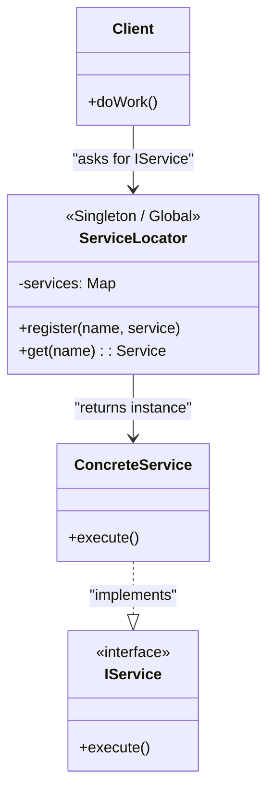

# Service Locator Pattern (Xizmat lokatori)

<CoverImage src="/covers/architectural/service-locator.webp" alt="Cover">
  <h1>Service Locator</h1>
  <p>Futuristik shahardagi yorqin sariq "Ma'lumot stoli" kioski; robotlar u yerga kelib: "Ma'lumotlar bazasi qayerda?" deb so'rashadi, lokator robot esa ularga nur sochib turgan kartochkani uzatadi.</p>
</CoverImage>

## Umumiy ko'rinish (Overview)

**Service Locator** patterni ilovaga kerak bo'lgan barcha servislarni qanday yaratish yoki olishni biladigan markazlashgan reyestr - "Lokator" ni joriy etadi. Klasslarga bog'liqliklar tashqaridan uzatilishi o'rniga (Dependency Injection dagi kabi), klasslarning o'zlari kerakli bog'liqliklarni Service Locator'dan faol ravishda so'rashadi.

**Zamonaviy nuqtai nazar**: Garchi u dastlabki korporativ dasturlarda (masalan, ilk J2EE da) mashhur bo'lgan bo'lsa-da, bugungi kunda Service Locator zamonaviy ilova ishlab chiqishda keng ko'lamda **anti-pattern** deb hisoblanadi. U klassning bog'liqliklarini yashiradi, natijada kodni test qilish va qo'llab-quvvatlash qiyinlashadi hamda runtime xatolariga moyil bo'ladi. Shunga qaramay, uni tushunish juda muhim, chunki u hali ham legacy tizimlarda, o'yin ishlab chiqish arxitekturalarida va ba'zan zamonaviy DI konteynerlarida zaxira yechim sifatida uchraydi.

## Muammo (The Problem)

Komponentlaringiz konkret klasslarga qattiq bog'lanib qolishini istamasangiz, bog'liqliklarni boshqarishni markazlashtirishga urinib ko'rishingiz mumkin.

```typescript
// ❌ Yomon: Konkret klasslarga qattiq bog'langan
class OrderService {
  private paymentGateway = new StripeGateway(); // Qattiq kodlangan bog'liqlik
  private logger = new ConsoleLogger();         // Qattiq kodlangan bog'liqlik

  public process() { /* ... */ }
}
```

Siz `OrderService` ni `StripeGateway` dan ajratmoqchisiz, lekin ehtimol to'liq Constructor Dependency Injection ni joriy qilish yuzlab fayllarni qayta yozishni talab qiladigan legacy kod bazasida ishlayotgandirsiz.

## Yechim (The Solution)

Siz global `ServiceLocator` yaratasiz. Servislaringizni bitta joyda ro'yxatdan o'tkazasiz va `OrderService` ularni Lokator'dan so'raydi.

```typescript
// ⚠️ Service Locator (Ko'pincha anti-pattern, lekin qattiq kodlash muammosini hal qiladi)
class OrderService {
  private paymentGateway: IPaymentGateway;
  private logger: ILogger;

  constructor() {
    // Bog'liqliklarni global registry'dan faol so'rash
    this.paymentGateway = ServiceLocator.get("PaymentGateway");
    this.logger = ServiceLocator.get("Logger");
  }
}
```

Endi `OrderService` `StripeGateway` yoki `ConsoleLogger` haqida hech narsa bilmaydi. U faqat `ServiceLocator` haqida biladi.

## Tuzilma (Structure)



## Jarayon (Flow)

1. **Ro'yxatdan o'tkazish bosqichi**: Ilova ishga tushganda konkret nusxalar yoki factory funksiyalarni Service Locator'da ro'yxatdan o'tkazasiz.
2. **Aniqlash (Resolution) bosqichi**: Bajarilish vaqtida mijoz klassga biror servis kerak bo'ladi. U `ServiceLocator.get('ServiceName')` ni chaqiradi.
3. **Bajarish bosqichi**: Lokator servisni topadi, kerak bo'lsa uning nusxasini yaratadi va mijozga qaytaradi.

## Hayotiy o'xshatish (Real-World Analogy)

**Mehmonxona konsyerji**ni tasavvur qiling.
Mehmonxonada turganingizda sizga taksi, restoranda joy band qilish yoki qo'shimcha sochiqlar kerak bo'lsa, taksi kompaniyasi yoki kir yuvish bo'limi bilan bevosita bog'lanmaysiz. Telefonni olib, Konsyerjga (Service Locator'ga) qo'ng'iroq qilasiz va kerakli narsani taqdim etishini so'raysiz. Konsyerj taksini qayerdan olishni va kir yuvish bilan kim shug'ullanishini biladi.

## Nega u anti-pattern hisoblanadi? (Why is it considered an Anti-Pattern?)

1. **Yashirin bog'liqliklar (Hidden Dependencies)**: `OrderService` ning API'siga qarasam, konstruktor _nol_ ta argument qabul qiladi. Go'yo shunchaki `new OrderService()` nusxasini yaratib, undan foydalanishim mumkindek _ko'rinadi_. Lekin ishga tushirsam, u qulaydi, chunki avval `Logger` ni global ro'yxatdan o'tkazishni unutganman. Dependency Injection da esa `constructor(logger: ILogger)` konstruktori meni bog'liqlikni taqdim etishga aniq majbur qiladi.
2. **Global holat (Global State)**: Service Locator deyarli har doim Singleton sifatida amalga oshiriladi. Bu testlarni parallel ishga tushirishni nihoyatda qiyinlashtiradi, chunki A testi B testiga kerak bo'lgan mock Logger'ni qayta yozib yuborishi mumkin.

## Bosqichma-bosqich amalga oshirish (Step-by-Step Implementation)

Agar uni amalga oshirishga _majbur_ bo'lsangiz (masalan, o'yin ishlab chiqishda yoki legacy kodda):

1. **Lokatorni yarating**: Singleton klass yoki global foydalanish mumkin bo'lgan obyekt yarating.
2. **Ro'yxatdan o'tkazishni qo'shing**: Obyekt yoki factory'ni ichki Dictionary/Map ga qo'shadigan metod yarating.
3. **Olishni qo'shing**: Dictionary'dan kalitni qidirib, obyektni qaytaradigan (yoki factory'ni chaqiradigan) metod yarating.
4. **Mijozlarda foydalaning**: Mijozlar `new` kalit so'zi o'rniga lokatorning olish metodini chaqirsin.

## Kod misollari (Code Examples)

::: code-group

```typescript [TypeScript]
// 1. Interfeyslar
interface ILogger {
  log(msg: string): void;
}
interface IDatabase {
  save(): void;
}

// 2. Konkret klasslar
class ConsoleLogger implements ILogger {
  log(msg: string) {
    console.log(`[LOG] ${msg}`);
  }
}
class PostgresDatabase implements IDatabase {
  save() {
    console.log(`[DB] Saving to Postgres`);
  }
}

// 3. Service Locator
class ServiceLocator {
  private static services = new Map<string, any>();

  // Instansiyani ro'yxatdan o'tkazish
  public static register<T>(name: string, service: T): void {
    this.services.set(name, service);
  }

  // Instansiyani olish
  public static get<T>(name: string): T {
    if (!this.services.has(name)) {
      throw new Error(`Service '${name}' not found in Locator!`);
    }
    return this.services.get(name) as T;
  }
}

// 4. Mijoz (Locator'dan foydalanadi)
class UserService {
  private logger: ILogger;
  private db: IDatabase;

  constructor() {
    // OGOHLANTIRISH: Yashirin bog'liqliklar!
    this.logger = ServiceLocator.get<ILogger>("Logger");
    this.db = ServiceLocator.get<IDatabase>("Database");
  }

  public registerUser(name: string) {
    this.logger.log(`Registering ${name}`);
    this.db.save();
  }
}

// Mijoz kodi
console.log("--- Application Startup ---");
ServiceLocator.register("Logger", new ConsoleLogger());
ServiceLocator.register("Database", new PostgresDatabase());

console.log("\n--- Application Runtime ---");
// Hech qanday bog'liqlik talab qilmaydigandek ko'rinadi, lekin global holatga tayanadi
const service = new UserService();
service.registerUser("Alice");
```

```python [Python]
from abc import ABC, abstractmethod
from typing import Dict, Any

# 1. Interfeyslar
class ILogger(ABC):
    @abstractmethod
    def log(self, msg: str) -> None: pass

class IDatabase(ABC):
    @abstractmethod
    def save(self) -> None: pass

# 2. Konkret klasslar
class ConsoleLogger(ILogger):
    def log(self, msg: str) -> None:
        print(f"[LOG] {msg}")

class PostgresDatabase(IDatabase):
    def save(self) -> None:
        print(f"[DB] Saving to Postgres")

# 3. Service Locator
class ServiceLocator:
    _services: Dict[str, Any] = {}

    @classmethod
    def register(cls, name: str, service: Any) -> None:
        cls._services[name] = service

    @classmethod
    def get(cls, name: str) -> Any:
        if name not in cls._services:
            raise Exception(f"Service '{name}' not found in Locator!")
        return cls._services[name]

# 4. Mijoz (Locator'dan foydalanadi)
class UserService:
    def __init__(self):
        # OGOHLANTIRISH: Yashirin bog'liqliklar!
        self.logger: ILogger = ServiceLocator.get("Logger")
        self.db: IDatabase = ServiceLocator.get("Database")

    def register_user(self, name: str) -> None:
        self.logger.log(f"Registering {name}")
        self.db.save()

# Mijoz kodi
if __name__ == "__main__":
    print("--- Application Startup ---")
    ServiceLocator.register("Logger", ConsoleLogger())
    ServiceLocator.register("Database", PostgresDatabase())

    print("\n--- Application Runtime ---")
    # Instansiya yaratish toza ko'rinadi, lekin global holat talabini yashiradi
    service = UserService()
    service.register_user("Alice")
```

```java [Java]
import java.util.HashMap;
import java.util.Map;

// 1. Interfeyslar
interface ILogger { void log(String msg); }
interface IDatabase { void save(); }

// 2. Konkret klasslar
class ConsoleLogger implements ILogger {
    public void log(String msg) { System.out.println("[LOG] " + msg); }
}
class PostgresDatabase implements IDatabase {
    public void save() { System.out.println("[DB] Saving to Postgres"); }
}

// 3. Service Locator
class ServiceLocator {
    private static Map<String, Object> services = new HashMap<>();

    public static void register(String name, Object service) {
        services.put(name, service);
    }

    public static Object get(String name) {
        if (!services.containsKey(name)) {
            throw new RuntimeException("Service '" + name + "' not found in Locator!");
        }
        return services.get(name);
    }
}

// 4. Mijoz (Locator'dan foydalanadi)
class UserService {
    private ILogger logger;
    private IDatabase db;

    public UserService() {
        // OGOHLANTIRISH: Yashirin bog'liqliklar!
        this.logger = (ILogger) ServiceLocator.get("Logger");
        this.db = (IDatabase) ServiceLocator.get("Database");
    }

    public void registerUser(String name) {
        logger.log("Registering " + name);
        db.save();
    }
}

// Mijoz kodi
public class ServiceLocatorDemo {
    public static void main(String[] args) {
        System.out.println("--- Application Startup ---");
        ServiceLocator.register("Logger", new ConsoleLogger());
        ServiceLocator.register("Database", new PostgresDatabase());

        System.out.println("\n--- Application Runtime ---");
        UserService service = new UserService();
        service.registerUser("Alice");
    }
}
```

```go [Go]
package main

import (
	"fmt"
)

// 1. Interfeyslar
type ILogger interface {
	Log(msg string)
}
type IDatabase interface {
	Save()
}

// 2. Konkret klasslar
type ConsoleLogger struct{}
func (l *ConsoleLogger) Log(msg string) { fmt.Printf("[LOG] %s\n", msg) }

type PostgresDatabase struct{}
func (d *PostgresDatabase) Save() { fmt.Printf("[DB] Saving to Postgres\n") }

// 3. Service Locator
var locatorRegistry = make(map[string]interface{})

type ServiceLocator struct{}

func (s *ServiceLocator) Register(name string, service interface{}) {
	locatorRegistry[name] = service
}

func (s *ServiceLocator) Get(name string) interface{} {
	if service, ok := locatorRegistry[name]; ok {
		return service
	}
	panic(fmt.Sprintf("Service '%s' not found in Locator!", name))
}

// Global instansiya
var Locator = &ServiceLocator{}

// 4. Mijoz (Locator'dan foydalanadi)
type UserService struct {
	logger ILogger
	db     IDatabase
}

func NewUserService() *UserService {
	// OGOHLANTIRISH: Yashirin bog'liqliklar!
	return &UserService{
		logger: Locator.Get("Logger").(ILogger),
		db:     Locator.Get("Database").(IDatabase),
	}
}

func (s *UserService) RegisterUser(name string) {
	s.logger.Log(fmt.Sprintf("Registering %s", name))
	s.db.Save()
}

// Mijoz kodi
func main() {
	fmt.Println("--- Application Startup ---")
	Locator.Register("Logger", &ConsoleLogger{})
	Locator.Register("Database", &PostgresDatabase{})

	fmt.Println("\n--- Application Runtime ---")
	service := NewUserService()
	service.RegisterUser("Alice")
}
```

```rust [Rust]
use std::any::{Any, TypeId};
use std::collections::HashMap;
use std::sync::{Arc, OnceLock, RwLock};

// 1. Interfeyslar (Trait'lar)
pub trait ILogger: Send + Sync {
    fn log(&self, msg: &str);
}
pub trait IDatabase: Send + Sync {
    fn save(&self);
}

// 2. Konkret klasslar
pub struct ConsoleLogger;
impl ILogger for ConsoleLogger {
    fn log(&self, msg: &str) { println!("[LOG] {}", msg); }
}

pub struct PostgresDatabase;
impl IDatabase for PostgresDatabase {
    fn save(&self) { println!("[DB] Saving to Postgres"); }
}

// 3. Service Locator (Rust'da global holatdan foydalanish ataylab qiyinlashtirilgan)
// Servislar o'zlarining *interfeys* turi (masalan, `Arc<dyn ILogger>`) bo'yicha saqlanadi, shuning uchun istalgan implementatsiyani almashtirish mumkin
type Registry = RwLock<HashMap<TypeId, Box<dyn Any + Send + Sync>>>;
static LOCATOR: OnceLock<Registry> = OnceLock::new();

pub struct ServiceLocator;

impl ServiceLocator {
    fn registry() -> &'static Registry {
        LOCATOR.get_or_init(|| RwLock::new(HashMap::new()))
    }

    pub fn register<T: ?Sized + 'static>(service: Arc<T>)
    where
        Arc<T>: Send + Sync,
    {
        Self::registry().write().unwrap().insert(TypeId::of::<Arc<T>>(), Box::new(service));
    }

    pub fn resolve<T: ?Sized + 'static>() -> Arc<T>
    where
        Arc<T>: Send + Sync,
    {
        Self::registry()
            .read()
            .unwrap()
            .get(&TypeId::of::<Arc<T>>())
            .and_then(|service| service.downcast_ref::<Arc<T>>())
            .cloned()
            .unwrap_or_else(|| panic!("Service not registered: {}", std::any::type_name::<T>()))
    }
}

// 4. Mijoz (Locator'dan foydalanadi)
pub struct UserService;

impl UserService {
    pub fn new() -> Self {
        // Bog'liqliklar butunlay yashirin
        Self
    }

    pub fn register_user(&self, name: &str) {
        let logger = ServiceLocator::resolve::<dyn ILogger>();
        let db = ServiceLocator::resolve::<dyn IDatabase>();

        logger.log(&format!("Registering {}", name));
        db.save();
    }
}

// Mijoz kodi
fn main() {
    println!("--- Application Startup ---");
    ServiceLocator::register::<dyn ILogger>(Arc::new(ConsoleLogger));
    ServiceLocator::register::<dyn IDatabase>(Arc::new(PostgresDatabase));

    println!("\n--- Application Runtime ---");
    let service = UserService::new();
    service.register_user("Alice");
}
```

:::

## Afzalliklari va kamchiliklari (Pros and Cons)

### Afzalliklari (Advantages)

- **Bog'liqlikni kamaytirish (Decoupling)**: Dependency Injection kabi u ham mijozni konkret implementatsiyalardan ajratadi. Ro'yxatdan o'tgan Logger'ni MockLogger'ga almashtirishingiz mumkin.
- **Legacy tizimlarda qulaylik**: Agar sizda chuqur komponentlar daraxti bo'lsa (masalan, A komponenti B ni, B esa C ni, C esa D ni yaratadi), faqat D foydalanishi uchun Logger'ni A, B va C konstruktorlari orqali uzatish zerikarli. Service Locator D ga Logger'ni bevosita olish imkonini beradi.

### Kamchiliklari (Disadvantages)

- **Yashirin bog'liqliklar (Yolg'onchi API)**: Klass API'si ishlashi uchun nima kerakligini aytmaydi. Unga ma'lumotlar bazasi kerakligini faqat u runtime exception tashlaganda bilib qolasiz.
- **Global holat**: U global Singleton'ni olib kiradi, bu esa test qilishni qiyinlashtiradi, parallel muhitlarda race condition'larga sabab bo'ladi va ilova holatini oldindan aytib bo'lmaydigan qiladi.
- **Qo'llab-quvvatlash dahshati**: Refaktoring xavfli. Agar lokatordan biror servisni olib tashlasangiz, kompilyator sizni ogohlantirmaydi. Ilova shunchaki biror klass uni olishga uringanda runtime'da qulaydi.

## Qachon foydalanish kerak (When to Use)

- **O'yin ishlab chiqish (Game Development)**: O'yin dvigatellari (masalan, Unity yoki Godot) ko'pincha Service Locator'lardan (masalan, `Locator.getAudioService()`) foydalanadi, chunki o'ta yuqori ishlash talablari va chuqur ichma-ich joylashgan sahna graflari standart Constructor Injection ni amaliy bo'lmagan holga keltiradi.
- **Legacy kodni refaktoring qilish**: Ulkan monolit ilovani bo'laklarga ajratishda, Dependency Injection ni to'liq joriy qilishdan oldin vaqtincha Service Locator kiritish to'g'ri oraliq qadam hisoblanadi.

## Qachon foydalanmaslik kerak (When NOT to Use)

- **Zamonaviy veb / korporativ ilovalar**: Buning o'rniga Dependency Injection dan foydalaning. Zamonaviy Java, C#, Python yoki TypeScript veb backend'larida Service Locator ishlatish uchun deyarli hech qanday sabab yo'q.
- **Kutubxonalar/Paketlar**: Agar ochiq kodli kutubxona yozayotgan bo'lsangiz, foydalanuvchilarni Service Locator ishlatishga majburlamang. Bog'liqliklarni konstruktorlar orqali talab qiling.

## Aloqador patternlar (Related Patterns)

- **[Dependency Injection (DI)](/uz/architectural/dependency-injection)**: Service Locator'ning "to'g'ri" zamonaviy muqobili. Klasslar bog'liqliklarni _so'rash_ o'rniga, freymvork ularni konstruktorlar orqali _beradi_.
- **[Singleton](/uz/creational/singleton)**: Service Locator'ning o'zi deyarli har doim Singleton sifatida amalga oshiriladi.
- **[Factory](/uz/creational/factory-method)**: Service Locator butun ilova uchun umumlashtirilgan Factory vazifasini bajaradi.
