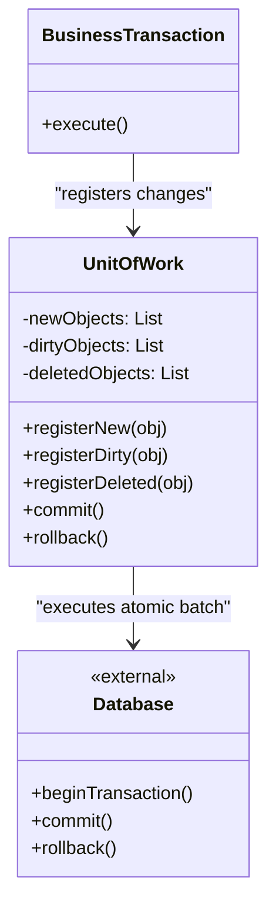

# Ish birligi andozasi (Unit of Work)

<CoverImage src="/covers/architectural/unit-of-work.webp" alt="Cover">
  <h1>Ish birligi</h1>
  <p>Tranzaksiyalarga to'la aravacha bilan yurgan kulgili bankir robot; u aravacha to'lguncha barcha tranzaksiyalarni ushlab turadi, so'ng hammasini birdaniga commit qilish uchun bitta ulkan dastakni tortadi.</p>
</CoverImage>

## Umumiy ko'rinish (Overview)

**Ish birligi (Unit of Work)** andozasi - biznes tranzaksiyasi davomida obyektlar to'plamiga kiritilgan barcha o'zgarishlarni kuzatib boradigan arxitektura andozasidir. Tranzaksiya oxirida u barcha o'zgarishlarni (insert, update va delete) ma'lumotlar bazasiga yagona, atomar paketda yozishni muvofiqlashtiradi.

**Asosiy afzalligi**: U ma'lumotlar yaxlitligini kafolatlaydi. Agar murakkab biznes jarayoni ma'lumotlar bazasidagi beshta turli jadvalni o'zgartirsa, Ish birligi beshala o'zgarish ham muvaffaqiyatli bo'lishini yoki beshalasi ham muvaffaqiyatsiz bo'lib, orqaga qaytarilishini (rollback) ta'minlaydi.

**Zamonaviy nuqtai nazar**: Agar siz Entity Framework (.NET), Hibernate/JPA (Java), SQLAlchemy (Python) yoki TypeORM/MikroORM (TypeScript) kabi zamonaviy korporativ ORM'lardan (Object-Relational Mapper) foydalangan bo'lsangiz, demak siz allaqachon "parda ortida" Ish birligi andozasidan foydalanayapsiz. Bu taqsimlangan yoki kuchli normallashtirilgan domen modellarida murakkab yozish operatsiyalarini boshqarish uchun ajralmas andozadir.

## Muammo (The Problem)

Elektron tijorat to'lov jarayonini ko'rib chiqaylik. Sizga quyidagilar kerak:

1. Yangi `Order` yaratish.
2. Har bir `OrderItem` uchun ombordagi qoldiqni kamaytirish.
3. `Customer` ning sodiqlik ballarini yangilash.
4. `Shipping` jadvaliga yozuv qo'shish.

Ish birligi bo'lmasa, quyidagicha kod yozishingiz mumkin:

```typescript
// ❌ Yomon: Tranzaksiyasiz, darhol ma'lumotlar bazasiga yozish
class CheckoutService {
  public async checkout(cart: Cart, customer: Customer) {
    const order = new Order(cart);
    await orderRepository.save(order); // DB yozuvi 1

    for (const item of cart.items) {
      const inventory = await inventoryRepo.get(item.productId);
      inventory.deduct(item.quantity);
      await inventoryRepo.save(inventory); // DB yozuvlari 2, 3, 4... (Biri muvaffaqiyatsiz bo'lsa-chi?)
    }

    customer.addLoyaltyPoints(100);
    await customerRepository.save(customer); // DB yozuvi N
  }
}
```

Bu jiddiy muammolarni keltirib chiqaradi:

1. **Qisman muvaffaqiyatsizliklar**: Agar tizim 2-DB yozuvidan keyin qulasa, mijozdan pul yechilgan, buyurtma mavjud, lekin ombor qoldig'i to'liq kamaytirilmagan va sodiqlik ballari qo'shilmagan bo'ladi. Endi ma'lumotlar bazasi buzilgan holatda.
2. **Ishlash tezligi ("Chatty" DB muammosi)**: Bitta to'lov uchun tarmoq orqali ma'lumotlar bazasiga 50 ta alohida borib-kelish chaqiruvini amalga oshirish nihoyatda sekin.

## Yechim (The Solution)

Ish birligi andozasi vositachini joriy etadi. To'g'ridan-to'g'ri ma'lumotlar bazasiga saqlash o'rniga, siz saqlash, yangilash yoki o'chirish niyatingizni Ish birligida ro'yxatdan o'tkazasiz. `.commit()` ni chaqirmaguningizcha ma'lumotlar bazasiga tegilmaydi.

```typescript
// ✅ Yaxshi: O'zgarishlarni xotirada ro'yxatga olish, atomar commit qilish
class CheckoutService {
  constructor(private uow: IUnitOfWork) {}

  public async checkout(cart: Cart, customer: Customer) {
    const order = new Order(cart);
    this.uow.registerNew(order); // Faqat xotirada

    for (const item of cart.items) {
      const inventory = await this.uow.inventoryRepo.get(item.productId);
      inventory.deduct(item.quantity);
      this.uow.registerDirty(inventory); // Faqat xotirada
    }

    customer.addLoyaltyPoints(100);
    this.uow.registerDirty(customer); // Faqat xotirada

    // Barcha SQL so'rovlarini yagona DB tranzaksiyasida atomar bajarish
    await this.uow.commit();
  }
}
```

## Tuzilma (Structure)



## Jarayon (Flow)

1. **Ishga tushirish (Initialization)**: Biznes tranzaksiyasi boshida (masalan, HTTP so'rov boshida) yangi Ish birligi yaratiladi.
2. **Ro'yxatdan o'tkazish (Registration)**: Biznes mantig'i ishlayotganda u obyektlarni yaratadi, o'zgartiradi yoki o'chiradi. Bu obyektlar Ish birligida ro'yxatdan o'tkaziladi (ko'pincha proxy'lar yoki Identifikatorlar xaritasi orqali avtomatik tarzda).
3. **Commit**: Biznes mantig'i yakunlanadi. Ilova Ish birligida `commit()` ni chaqiradi.
4. **Bajarish (Execution)**: Ish birligi ma'lumotlar bazasi tranzaksiyasini ochadi, kerakli SQL (INSERT, UPDATE, DELETE) larni generatsiya qiladi, ularni bajaradi va ma'lumotlar bazasi tranzaksiyasini commit qiladi.
5. **Rollback (xatolik yuz berganda)**: Agar biror SQL buyrug'i muvaffaqiyatsiz bo'lsa, ma'lumotlar bazasi tranzaksiyasi orqaga qaytariladi va xotiradagi holatlar ham tiklanishi mumkin.

## Hayotiy o'xshatish (Real-World Analogy)

**Supermarket kassasi**ni tasavvur qiling.
Rastalar orasida yurganingizda, sut uchun kassirga $3 berib, keyingi rastaga borib, tuxum olib, yana kassirga $4 bermaysiz. Bu tartibsiz va sekin bo'lardi.

Buning o'rniga xarid aravachangiz **Ish birligi** vazifasini bajaradi. Siz yangi mahsulotlarni yig'asiz (registerNew). Balki biror mahsulotni javonga qaytarib qo'yarsiz (registerDeleted). Nihoyat kassaga yetganingizda, barcha operatsiyalar (skanerlash, qadoqlash, to'lash) bitta uzluksiz, atomar paketda amalga oshadi (`commit()`). Agar kredit kartangiz rad etilsa (`rollback()`), uyga hech qanday mahsulot olib ketmaysiz.

## Bosqichma-bosqich amalga oshirish (Step-by-Step Implementation)

1. **Kuzatuvchilarni yarating**: `new`, `dirty` (o'zgartirilgan) va `deleted` obyektlarni saqlash uchun to'plamlar/ro'yxatlar yarating.
2. **Ro'yxatdan o'tkazish metodlarini yarating**: `registerNew()`, `registerDirty()` va `registerDeleted()` ni yarating.
3. **Commit metodini yarating**: `commit()` ichida ma'lumotlar bazasi tranzaksiyasini oching. `new` ro'yxati bo'ylab yurib, INSERT'larni bajaring. `dirty` bo'ylab yurib, UPDATE'larni bajaring. `deleted` bo'ylab yurib, DELETE'larni bajaring.
4. **Parallellikni boshqaring (ixtiyoriy)**: Bu orada qatorni boshqa hech kim o'zgartirmaganiga ishonch hosil qilish uchun obyekt versiya raqamlarini tekshiring.
5. **Tozalash**: Muvaffaqiyatli commit yoki rollback'dan keyin ro'yxatlarni tozalang.

## Kod misollari (Code Examples)

::: code-group

```typescript [TypeScript]
// 1. Domen Entity'lari
abstract class Entity {
  constructor(public id: string) {}
}

class User extends Entity {
  constructor(
    id: string,
    public name: string,
  ) {
    super(id);
  }
}

// 2. Unit of Work
class UnitOfWork {
  private newEntities: Set<Entity> = new Set();
  private dirtyEntities: Set<Entity> = new Set();
  private deletedEntities: Set<Entity> = new Set();

  public registerNew(entity: Entity): void {
    if (this.dirtyEntities.has(entity) || this.deletedEntities.has(entity)) {
      throw new Error("Invalid state: Entity already tracked");
    }
    this.newEntities.add(entity);
  }

  public registerDirty(entity: Entity): void {
    if (this.deletedEntities.has(entity)) {
      throw new Error("Cannot modify a deleted entity");
    }
    // Agar u allaqachon newEntities ichida bo'lsa, eng so'nggi ma'lumot bilan insert qilinadi,
    // shuning uchun uni dirtyEntities'ga qo'shish shart emas.
    if (!this.newEntities.has(entity)) {
      this.dirtyEntities.add(entity);
    }
  }

  public registerDeleted(entity: Entity): void {
    if (this.newEntities.has(entity)) {
      // Agar u bitta tranzaksiyada yaratilib, o'chirilgan bo'lsa, hech narsa qilmaymiz!
      this.newEntities.delete(entity);
      return;
    }
    this.dirtyEntities.delete(entity);
    this.deletedEntities.add(entity);
  }

  public async commit(): Promise<void> {
    console.log("--- 🏁 BEGIN DB TRANSACTION ---");

    try {
      // Barcha INSERT'larni bajarish
      for (const entity of this.newEntities) {
        console.log(`[SQL] INSERT INTO table VALUES ('${entity.id}')`);
      }

      // Barcha UPDATE'larni bajarish
      for (const entity of this.dirtyEntities) {
        console.log(`[SQL] UPDATE table SET ... WHERE id = '${entity.id}'`);
      }

      // Barcha DELETE'larni bajarish
      for (const entity of this.deletedEntities) {
        console.log(`[SQL] DELETE FROM table WHERE id = '${entity.id}'`);
      }

      console.log("--- ✅ COMMIT DB TRANSACTION ---");
    } catch (error) {
      console.log("--- ❌ ROLLBACK DB TRANSACTION ---");
      throw error;
    } finally {
      this.clear(); // Keyingi tranzaksiya uchun holatni tozalash
    }
  }

  private clear(): void {
    this.newEntities.clear();
    this.dirtyEntities.clear();
    this.deletedEntities.clear();
  }
}

// 3. Mijoz kodi (Biznes mantiq)
async function processBusinessTransaction() {
  const uow = new UnitOfWork();

  // Simulyatsiya qilingan domen mantiqi
  const user1 = new User("u1", "Alice");
  const user2 = new User("u2", "Bob"); // Bu DB'dan yuklangan deb faraz qilamiz

  // Niyatlarni ro'yxatga olish
  uow.registerNew(user1);

  user2.name = "Robert";
  uow.registerDirty(user2);

  // Hammasini DB'ga atomar yuborish
  await uow.commit();
}

processBusinessTransaction();
```

```python [Python]
from typing import Set

# 1. Domen Entity'lari
class Entity:
    def __init__(self, entity_id: str):
        self.id = entity_id

class User(Entity):
    def __init__(self, entity_id: str, name: str):
        super().__init__(entity_id)
        self.name = name

# 2. Unit of Work
class UnitOfWork:
    def __init__(self):
        self.new_entities: Set[Entity] = set()
        self.dirty_entities: Set[Entity] = set()
        self.deleted_entities: Set[Entity] = set()

    def register_new(self, entity: Entity) -> None:
        if entity in self.dirty_entities or entity in self.deleted_entities:
            raise ValueError("Invalid state: Entity already tracked")
        self.new_entities.add(entity)

    def register_dirty(self, entity: Entity) -> None:
        if entity in self.deleted_entities:
            raise ValueError("Cannot modify a deleted entity")
        if entity not in self.new_entities:
            self.dirty_entities.add(entity)

    def register_deleted(self, entity: Entity) -> None:
        if entity in self.new_entities:
            self.new_entities.remove(entity)
            return
        self.dirty_entities.discard(entity)
        self.deleted_entities.add(entity)

    def commit(self) -> None:
        print("--- 🏁 BEGIN DB TRANSACTION ---")
        try:
            for e in self.new_entities:
                print(f"[SQL] INSERT INTO table VALUES ('{e.id}')")

            for e in self.dirty_entities:
                print(f"[SQL] UPDATE table SET ... WHERE id = '{e.id}'")

            for e in self.deleted_entities:
                print(f"[SQL] DELETE FROM table WHERE id = '{e.id}'")

            print("--- ✅ COMMIT DB TRANSACTION ---")
        except Exception as err:
            print("--- ❌ ROLLBACK DB TRANSACTION ---")
            raise err
        finally:
            self._clear()

    def _clear(self) -> None:
        self.new_entities.clear()
        self.dirty_entities.clear()
        self.deleted_entities.clear()

# 3. Mijoz kodi
if __name__ == "__main__":
    uow = UnitOfWork()

    user1 = User("u1", "Alice")
    user2 = User("u2", "Bob")

    uow.register_new(user1)

    user2.name = "Robert"
    uow.register_dirty(user2)

    uow.commit()
```

```java [Java]
import java.util.HashSet;
import java.util.Set;

// 1. Domen Entity'lari
abstract class Entity {
    protected String id;
    public Entity(String id) { this.id = id; }
    public String getId() { return id; }
}

class User extends Entity {
    public String name;
    public User(String id, String name) { super(id); this.name = name; }
}

// 2. Unit of Work
class UnitOfWork {
    private Set<Entity> newEntities = new HashSet<>();
    private Set<Entity> dirtyEntities = new HashSet<>();
    private Set<Entity> deletedEntities = new HashSet<>();

    public void registerNew(Entity entity) {
        if (dirtyEntities.contains(entity) || deletedEntities.contains(entity)) {
            throw new IllegalStateException("Invalid state: Entity already tracked");
        }
        newEntities.add(entity);
    }

    public void registerDirty(Entity entity) {
        if (deletedEntities.contains(entity)) {
            throw new IllegalStateException("Cannot modify a deleted entity");
        }
        if (!newEntities.contains(entity)) {
            dirtyEntities.add(entity);
        }
    }

    public void registerDeleted(Entity entity) {
        if (newEntities.contains(entity)) {
            newEntities.remove(entity);
            return;
        }
        dirtyEntities.remove(entity);
        deletedEntities.add(entity);
    }

    public void commit() throws Exception {
        System.out.println("--- 🏁 BEGIN DB TRANSACTION ---");
        try {
            for (Entity e : newEntities) {
                System.out.println("[SQL] INSERT INTO table VALUES ('" + e.getId() + "')");
            }
            for (Entity e : dirtyEntities) {
                System.out.println("[SQL] UPDATE table SET ... WHERE id = '" + e.getId() + "'");
            }
            for (Entity e : deletedEntities) {
                System.out.println("[SQL] DELETE FROM table WHERE id = '" + e.getId() + "'");
            }
            System.out.println("--- ✅ COMMIT DB TRANSACTION ---");
        } catch (Exception err) {
            System.out.println("--- ❌ ROLLBACK DB TRANSACTION ---");
            throw err;
        } finally {
            clear();
        }
    }

    private void clear() {
        newEntities.clear();
        dirtyEntities.clear();
        deletedEntities.clear();
    }
}

// 3. Mijoz kodi
public class UnitOfWorkDemo {
    public static void main(String[] args) {
        UnitOfWork uow = new UnitOfWork();

        User user1 = new User("u1", "Alice");
        User user2 = new User("u2", "Bob");

        uow.registerNew(user1);

        user2.name = "Robert";
        uow.registerDirty(user2);

        try {
            uow.commit();
        } catch (Exception e) {
            e.printStackTrace();
        }
    }
}
```

```go [Go]
package main

import (
	"fmt"
)

// 1. Domen Entity'lari
type Entity interface {
	GetID() string
}

type User struct {
	ID   string
	Name string
}

func (u *User) GetID() string { return u.ID }

// 2. Unit of Work
type UnitOfWork struct {
	newEntities     map[Entity]bool
	dirtyEntities   map[Entity]bool
	deletedEntities map[Entity]bool
}

func NewUnitOfWork() *UnitOfWork {
	return &UnitOfWork{
		newEntities:     make(map[Entity]bool),
		dirtyEntities:   make(map[Entity]bool),
		deletedEntities: make(map[Entity]bool),
	}
}

func (uow *UnitOfWork) RegisterNew(entity Entity) error {
	if uow.dirtyEntities[entity] || uow.deletedEntities[entity] {
		return fmt.Errorf("invalid state: Entity already tracked")
	}
	uow.newEntities[entity] = true
	return nil
}

func (uow *UnitOfWork) RegisterDirty(entity Entity) error {
	if uow.deletedEntities[entity] {
		return fmt.Errorf("cannot modify a deleted entity")
	}
	if !uow.newEntities[entity] {
		uow.dirtyEntities[entity] = true
	}
	return nil
}

func (uow *UnitOfWork) RegisterDeleted(entity Entity) {
	if uow.newEntities[entity] {
		delete(uow.newEntities, entity)
		return
	}
	delete(uow.dirtyEntities, entity)
	uow.deletedEntities[entity] = true
}

func (uow *UnitOfWork) Commit() error {
	fmt.Println("--- 🏁 BEGIN DB TRANSACTION ---")

	// Go'da map iteratsiyasi tasodifiy, bu insert'lar update'lardan oldin
	// bajarilsa (yoki bu yerda tartib unchalik muhim bo'lmasa) muammo emas
	for e := range uow.newEntities {
		fmt.Printf("[SQL] INSERT INTO table VALUES ('%s')\n", e.GetID())
	}
	for e := range uow.dirtyEntities {
		fmt.Printf("[SQL] UPDATE table SET ... WHERE id = '%s'\n", e.GetID())
	}
	for e := range uow.deletedEntities {
		fmt.Printf("[SQL] DELETE FROM table WHERE id = '%s'\n", e.GetID())
	}

	fmt.Println("--- ✅ COMMIT DB TRANSACTION ---")
	uow.clear()
	return nil
}

func (uow *UnitOfWork) clear() {
	uow.newEntities = make(map[Entity]bool)
	uow.dirtyEntities = make(map[Entity]bool)
	uow.deletedEntities = make(map[Entity]bool)
}

// 3. Mijoz kodi
func main() {
	uow := NewUnitOfWork()

	user1 := &User{ID: "u1", Name: "Alice"}
	user2 := &User{ID: "u2", Name: "Bob"}

	uow.RegisterNew(user1)

	user2.Name = "Robert"
	uow.RegisterDirty(user2)

	uow.Commit()
}
```

```rust [Rust]
use std::collections::HashSet;
use std::hash::{Hash, Hasher};

// 1. Domen Entity'lari
#[derive(Clone, Debug)]
pub struct User {
    pub id: String,
    pub name: String,
}

// User'ni HashSet'da saqlash uchun Hash va PartialEq'ni implement qilish
impl Hash for User {
    fn hash<H: Hasher>(&self, state: &mut H) {
        self.id.hash(state);
    }
}
impl PartialEq for User {
    fn eq(&self, other: &Self) -> bool {
        self.id == other.id
    }
}
impl Eq for User {}

// 2. Unit of Work
pub struct UnitOfWork {
    new_entities: HashSet<User>,
    dirty_entities: HashSet<User>,
    deleted_entities: HashSet<User>,
}

impl UnitOfWork {
    pub fn new() -> Self {
        Self {
            new_entities: HashSet::new(),
            dirty_entities: HashSet::new(),
            deleted_entities: HashSet::new(),
        }
    }

    pub fn register_new(&mut self, entity: User) -> Result<(), &'static str> {
        if self.dirty_entities.contains(&entity) || self.deleted_entities.contains(&entity) {
            return Err("Invalid state: Entity already tracked");
        }
        self.new_entities.insert(entity);
        Ok(())
    }

    pub fn register_dirty(&mut self, entity: User) -> Result<(), &'static str> {
        if self.deleted_entities.contains(&entity) {
            return Err("Cannot modify a deleted entity");
        }
        if !self.new_entities.contains(&entity) {
            self.dirty_entities.insert(entity);
        }
        Ok(())
    }

    pub fn register_deleted(&mut self, entity: User) {
        if self.new_entities.contains(&entity) {
            self.new_entities.remove(&entity);
            return;
        }
        self.dirty_entities.remove(&entity);
        self.deleted_entities.insert(entity);
    }

    pub fn commit(&mut self) {
        println!("--- 🏁 BEGIN DB TRANSACTION ---");

        for e in &self.new_entities {
            println!("[SQL] INSERT INTO table VALUES ('{}')", e.id);
        }
        for e in &self.dirty_entities {
            println!("[SQL] UPDATE table SET ... WHERE id = '{}'", e.id);
        }
        for e in &self.deleted_entities {
            println!("[SQL] DELETE FROM table WHERE id = '{}'", e.id);
        }

        println!("--- ✅ COMMIT DB TRANSACTION ---");
        self.clear();
    }

    fn clear(&mut self) {
        self.new_entities.clear();
        self.dirty_entities.clear();
        self.deleted_entities.clear();
    }
}

// 3. Mijoz kodi
fn main() {
    let mut uow = UnitOfWork::new();

    let user1 = User { id: "u1".to_string(), name: "Alice".to_string() };
    let mut user2 = User { id: "u2".to_string(), name: "Bob".to_string() };

    uow.register_new(user1).unwrap();

    user2.name = "Robert".to_string();
    uow.register_dirty(user2).unwrap();

    uow.commit();
}
```

:::

## Afzalliklari va kamchiliklari (Pros and Cons)

### Afzalliklari (Advantages)

- **Atomar izchillik**: Yoki butun biznes tranzaksiyasi muvaffaqiyatli bo'ladi, yoki butun tranzaksiya muvaffaqiyatsiz bo'ladi. Ma'lumotlar bazasi hech qachon buzilgan "yarim saqlangan" holatda qolmaydi.
- **Maksimal ishlash tezligi**: Operatsiyalarni paketlab, ularni faqat oxirida bajarish orqali u ma'lumotlar bazasi ulanishlarini kamaytiradi, tarmoq kechikishi xarajatlarini qisqartiradi va jadvallarni bloklash vaqtini minimallashtiradi.
- **Rollback'ni soddalashtiradi**: U nima qilishni rejalashtirganini kuzatib borgani uchun, orqaga qaytarish teskari SQL buyruqlarini yuborish o'rniga shunchaki xotiradagi ro'yxatlarni tashlab yuborishdan iborat.

### Kamchiliklari (Disadvantages)

- **Og'ir abstraksiya**: Bu andozani noldan to'g'ri amalga oshirish qiyinligi bilan mashhur (ayniqsa ichma-ich joylashgan obyekt munosabatlarini kuzatishda).
- **Yuqori xotira sarfi**: Ish birligi tranzaksiya davomida har bir yuklangan, o'zgartirilgan va yaratilgan obyektni kuzatib borgani uchun, millionlab yozuvlardan iborat paketni qayta ishlayotgan bo'lsangiz, u juda katta hajmdagi xotirani egallashi mumkin.
- **Eskirgan ma'lumotlar xavfi**: Agar tranzaksiya yakunlanishi uchun 5 daqiqa ketsa, Ish birligi xotirasidagi ma'lumotlar haqiqiy ma'lumotlar bazasi bilan umidsiz darajada nomuvofiq bo'lib qolishi mumkin.

## Qachon foydalanish kerak (When to Use)

- **Murakkab domen o'zgarishlari**: Foydalanuvchining bitta harakati bir nechta domen aggregate'lari/jadvallariga ta'sir qiladigan har qanday korporativ ilova.
- **Repozitoriylardan foydalanganda**: Odatda Repozitoriylar ma'lumotlar bazasiga darhol `save()` qilmaydi. Ular obyektni Ish birligiga qo'shadi, Ish birligi esa Repozitoriylarga yoki Service qatlamiga inyeksiya qilinadi.

## Qachon foydalanmaslik kerak (When NOT to Use)

- **Oddiy CRUD ilovalar**: Agar har bir veb so'rov faqat bitta jadvalni yangilasa, Ish birligi haddan tashqari ortiqcha. Oddiy Active Record `.save()` yetarli.
- **Ulkan paketli qayta ishlash (Massive Batch Processing)**: Agar 10GB lik CSV faylni tahlil qilib, ma'lumotlar bazasiga kiritayotgan bo'lsangiz, 10GB obyektlarni Ish birligiga yuklash serveringizni qulatadi (OOM Error). Buning o'rniga xom SQL Bulk Insert'lardan foydalanishingiz kerak.

## Keng tarqalgan xatolar (Common Mistakes)

### 1. Proxy'lar o'rniga qo'lda kuzatish

Yuqoridagi kod misollarida mijoz `uow.registerDirty()` ni aniq chaqirdi. Haqiqiy zamonaviy implementatsiyada (masalan, Entity Framework da) ORM xususiyat qachon o'zgarganini avtomatik aniqlash uchun Proxy klasslar yoki Identifikatorlar xaritasidan foydalanadi. Dasturchilarni `registerDirty()` ni qo'lda chaqirishga majburlash ko'pincha o'zgarishlar unutilib qoladigan xatolarga olib keladi.

### 2. Yashash muddati juda uzun

Ish birligi qisqa muddatli bo'lishi kerak. Veb ilovada u faqat bitta HTTP so'rov davomida yashashi kerak. Ish birligini bir nechta so'rovlar davomida (masalan, foydalanuvchi sessiyalarida) tirik saqlash dahshatli xotira sizishlari va eskirgan ma'lumotlar bilan bog'liq parallellik xatolariga olib keladi.

## Aloqador andozalar (Related Patterns)

- **[Identifikatorlar xaritasi](/uz/architectural/identity-map)**: Ish birligi hozirda _qaysi_ obyekt nusxalari yuklangan va kuzatilayotganini bilish uchun deyarli har doim Identifikatorlar xaritasiga tayanadi.
- **[Repozitoriy](/uz/architectural/repository)**: Obyektlarni Ish birligiga olib keladigan to'plam interfeysi vazifasini bajaradi va ko'pincha ularni oxir-oqibat saqlash uchun Ish birligiga tayanadi.
- **[Data Mapper](/uz/architectural/data-mapper)**: Ish birligining `commit()` metodi chaqirilganda ma'lumotlar bazasiga yakuniy SQL buyruqlarini amalda bajaradi.
