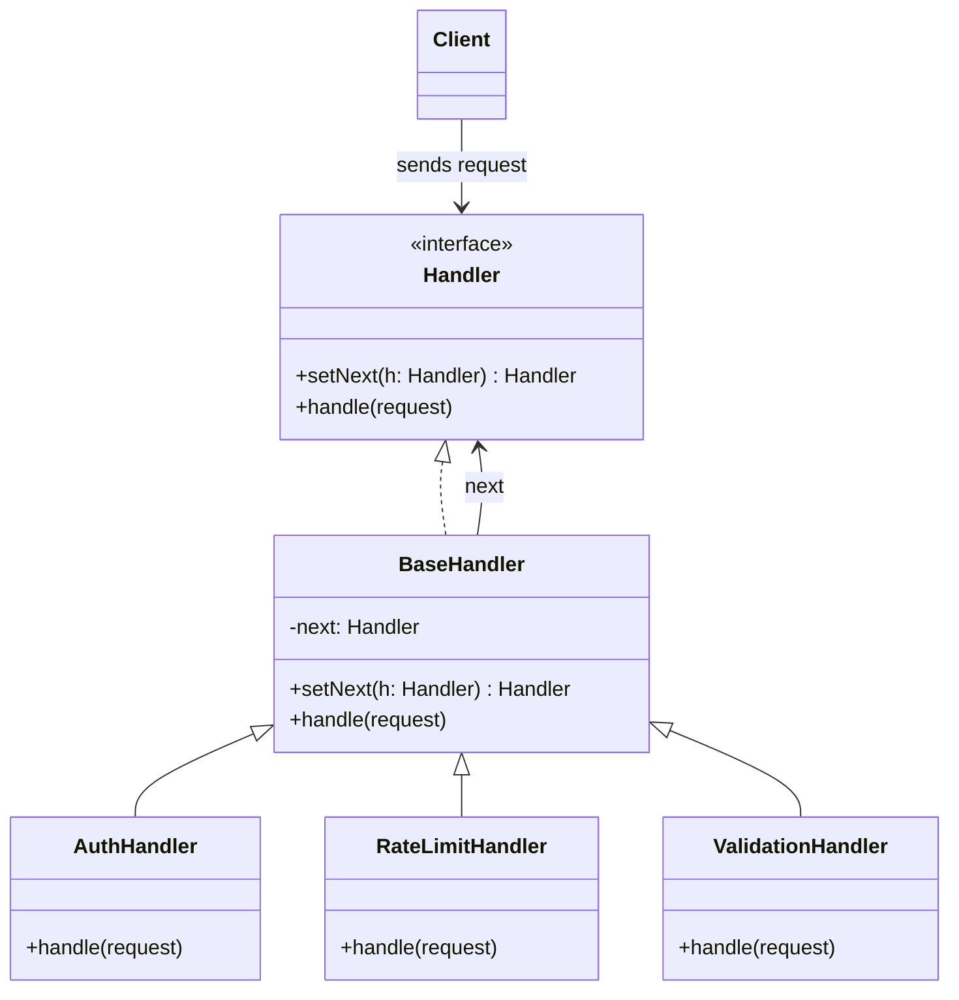

# Mas'uliyatlar zanjiri andozasi (Chain of Responsibility)

<CoverImage src="/covers/behavioral/chain-of-responsibility.webp" alt="Cover">
  <h1>Mas'uliyatlar zanjiri</h1>
  <p>Stollarda o'tirgan bir qator yoqimtoy ofis robotlari; ulkan, murakkab quti qator bo'ylab uzatiladi — har bir robot yelka qisib, uni keyingisiga beradi, oxirgi robot esa uni xursandchilik bilan hal qiladi.</p>
</CoverImage>

## Umumiy ko'rinish (Overview)

**Mas'uliyatlar zanjiri** (Chain of Responsibility) andozasi — bu so'rovlarni ishlovchilar (handler) zanjiri bo'ylab uzatish imkonini beruvchi xulq-atvor (behavioral) loyihalash andozasidir. So'rovni qabul qilgan har bir ishlovchi uni o'zi qayta ishlashni yoki zanjirdagi keyingi ishlovchiga uzatishni hal qiladi.

**Asosiy afzalligi**: So'rov yuboruvchi uni qaysi ishlovchi qayta ishlashini bilishi shart emas, ishlovchilar esa yuboruvchi yoki butun zanjir haqida bilishi shart emas. Bu bo'sh bog'liqlikni (loose coupling) ta'minlaydi.

**Zamonaviy nuqtai nazar**: Mas'uliyatlar zanjiri zamonaviy dasturiy ta'minot muhandisligida hamma joyda uchraydi. U middleware steklarida (masalan, Express.js yoki ASP.NET Core), validatsiya quvurlarida (pipeline), logging freymvorklarida, UI hodisalarining ko'tarilishida (DOM event bubbling) va hodisalarni qayta ishlash tizimlarida tabiiy ravishda mavjud.

## Muammo (The Problem)

Tasavvur qiling, siz onlayn buyurtma tizimini yaratyapsiz. Siz tizimga kirishni cheklamoqchisiz — faqat autentifikatsiyadan o'tgan foydalanuvchilar buyurtma yarata olishi kerak. Bundan tashqari, buyurtma yakuniy qayta ishlanishidan oldin yana bir nechta tekshiruvlarni qo'llashingiz kerak:

1. **Autentifikatsiya**: Foydalanuvchi tizimga kirganmi?
2. **Avtorizatsiya**: Foydalanuvchida aynan shu buyurtmani berishga ruxsat bormi?
3. **Validatsiya**: So'rov ma'lumotlari (payload) formati to'g'rimi?
4. **Rate Limiting (so'rovlar chastotasini cheklash)**: Foydalanuvchi yaqinda juda ko'p buyurtma bermadimi?
5. **Keshlash**: Javobni keshdan berish mumkinmi?

Agar bu mantiqning barchasini to'g'ridan-to'g'ri controller yoki biznes servis ichiga joylashtirsangiz, ulkan va qo'llab-quvvatlash qiyin bo'lgan `if/else` blokiga ega bo'lasiz:

```typescript
// ❌ Yomon: Qattiq bog'langan monolit mantiq
function processOrder(request: Request): void {
  if (!isAuthenticated(request)) {
    throw new Error("Unauthenticated");
  }

  if (!hasPermission(request.user)) {
    throw new Error("Forbidden");
  }

  if (rateLimitExceeded(request.ip)) {
    throw new Error("Rate limited");
  }

  if (!isValid(request.body)) {
    throw new Error("Invalid payload");
  }

  // Haqiqiy biznes mantiq...
  console.log("Order processed");
}
```

Bu Yagona mas'uliyat tamoyilini (Single Responsibility Principle) buzadi. Bunday monolitni testlash — dahshat, yangi tekshiruv qo'shish (masalan, IP filtrlash) esa asosiy biznes mantiqni o'zgartirishni talab qiladi.

## Yechim (The Solution)

Mas'uliyatlar zanjiri andozasi bu xatti-harakatlarni zanjirga bog'lashni taklif qiladi. Har bir tekshiruv **Handler** (ishlovchi) deb ataladigan alohida klassga ajratiladi.

1. **Ketma-ket oqim**: So'rov birinchi ishlovchiga kiradi. Agar u tekshiruvdan o'tsa, ishlovchi uni zanjirdagi keyingi ishlovchiga uzatadi.
2. **Qisqa tutashuv (Short-circuiting)**: Agar ishlovchi so'rovni yaroqsiz deb topsa (masalan, so'rovlar chegarasi oshib ketgan bo'lsa), u darhol xato qaytarishi va zanjirning qolgan qismi bajarilishini to'xtatishi mumkin.
3. **Dinamik kompozitsiya**: Asosiy mantiqni o'zgartirmasdan, ish vaqtida (runtime) ishlovchilarning tartibini o'zgartirish, ularni qo'shish yoki olib tashlash mumkin.

## Tuzilma (Structure)



## Oqim (Flow)

1. **Client** zanjirni sozlaydi (yoki u Dependency Injection orqali sozlanadi) va so'rovni birinchi ishlovchiga uzatadi.
2. **AuthHandler** so'rovni qabul qiladi. Agar foydalanuvchi autentifikatsiyadan o'tmagan bo'lsa, xato tashlaydi. Aks holda `next.handle()` ni chaqiradi.
3. **RateLimitHandler** uni qabul qiladi. Agar so'rovlar chegarasi oshib ketgan bo'lsa, zanjirni qisqa tutashtiradi. Aks holda uzatadi.
4. **ValidationHandler** so'rov ma'lumotlarini (payload) tekshiradi.
5. Nihoyat, agar barcha ishlovchilar so'rovni o'tkazib yuborsa, yakuniy amal bajariladi.

## Hayotiy o'xshatish (Real-World Analogy)

Telefon orqali **mijozlarni qo'llab-quvvatlash xizmatini** tasavvur qiling.
Siz muammo bilan kompaniyaga qo'ng'iroq qilasiz. Avval avtomatlashtirilgan ovozli yordamchi (1-ishlovchi) keng tarqalgan savollarga javob berishga harakat qiladi. Agar muammoingiz murakkab bo'lsa, u sizni 1-darajali qo'llab-quvvatlash xodimiga (2-ishlovchi) yo'naltiradi. Agar ular hal qila olmasa, sizni 2-darajali texnikka (3-ishlovchi), va nihoyat, ixtisoslashgan muhandisga (4-ishlovchi) yo'naltirishadi. Zanjirdagi har bir kishi so'rovni yo to'liq hal qiladi, yo keyingisiga uzatadi.

## Bosqichma-bosqich amalga oshirish (Step-by-Step Implementation)

1. **Handler interfeysini e'lon qiling**: So'rovlarni qayta ishlash uchun bitta metod va keyingi ishlovchini o'rnatish uchun yana bitta metodga ega interfeys yarating.
2. **Abstrakt bazaviy ishlovchi yarating**: `setNext` mantiqini barcha konkret ishlovchilarda takrorlamaslik uchun shu yerda amalga oshiring. Bazaviy klassdagi `handle` metodi, agar keyingi ishlovchi mavjud bo'lsa, so'rovni shunchaki unga uzatishi kerak.
3. **Konkret ishlovchilarni yarating**: Bazaviy ishlovchidan voris klasslar yarating. `handle` metodida o'ziga xos mantiqni bajaring. So'rovni qayta ishlash, rad etish yoki `super.handle()` orqali uzatishni hal qiling.
4. **Zanjirni quring**: Client yoki ilovani sozlash kodida ishlovchilarning nusxalarini yarating va ularni bir-biriga bog'lang (`h1.setNext(h2).setNext(h3)`).
5. **Bajaring**: So'rovni zanjirdagi birinchi ishlovchiga yuboring.

## Kod misollari (Code Examples)

::: code-group

```typescript [TypeScript]
// 1. So'rov ma'lumotlarini tashuvchi context obyekti
interface RequestContext {
  userId?: string;
  ip: string;
  body: string;
  flags: string[];
}

// 2. Handler interfeysi
interface RequestHandler {
  setNext(handler: RequestHandler): RequestHandler;
  handle(request: RequestContext): void;
}

// 3. Zanjirni boshqaruvchi abstrakt bazaviy Handler
abstract class BaseRequestHandler implements RequestHandler {
  private nextHandler: RequestHandler | null = null;

  setNext(handler: RequestHandler): RequestHandler {
    this.nextHandler = handler;
    // Zanjir qurish uchun handlerni qaytaramiz: h1.setNext(h2).setNext(h3)
    return handler;
  }

  handle(request: RequestContext): void {
    if (this.nextHandler) {
      this.nextHandler.handle(request);
    }
  }
}

// 4. Konkret Handlerlar
class AuthenticationHandler extends BaseRequestHandler {
  handle(request: RequestContext): void {
    if (!request.userId) {
      console.error(
        "AuthenticationHandler: Unauthenticated request from",
        request.ip,
      );
      return; // Zanjirni to'xtatish
    }
    console.log("AuthenticationHandler: User verified. Passing to next.");
    super.handle(request); // Keyingi handlerga uzatish
  }
}

class RateLimitHandler extends BaseRequestHandler {
  handle(request: RequestContext): void {
    if (request.flags.includes("rate_limited")) {
      console.error("RateLimitHandler: Too many requests from", request.ip);
      return; // To'xtatish
    }
    console.log("RateLimitHandler: Rate limit OK. Passing to next.");
    super.handle(request);
  }
}

class ModerationHandler extends BaseRequestHandler {
  handle(request: RequestContext): void {
    if (request.body.includes("spam")) {
      console.error("ModerationHandler: Blocked content detected.");
      return; // To'xtatish
    }
    console.log("ModerationHandler: Content clean. Passing to next.");
    super.handle(request);
  }
}

class FinalProcessingHandler extends BaseRequestHandler {
  handle(request: RequestContext): void {
    // Odatda bu yakuniy (terminal) tugun
    console.log(
      `FinalProcessingHandler: Successfully processed request for ${request.userId}: ${request.body}`,
    );
  }
}

// 5. Client kodi
const auth = new AuthenticationHandler();
const rateLimit = new RateLimitHandler();
const moderation = new ModerationHandler();
const processor = new FinalProcessingHandler();

// Zanjirni yig'ish
auth.setNext(rateLimit).setNext(moderation).setNext(processor);

console.log("--- Request 1 (Valid) ---");
auth.handle({
  userId: "user_42",
  ip: "203.0.113.10",
  body: "Hello, this is a clean message.",
  flags: [],
});

console.log("\n--- Request 2 (Spam) ---");
auth.handle({
  userId: "user_42",
  ip: "203.0.113.10",
  body: "Buy this spam product now!",
  flags: [],
});

console.log("\n--- Request 3 (Unauthenticated) ---");
auth.handle({
  ip: "192.168.1.1",
  body: "Valid message, but no user.",
  flags: [],
});
```

```python [Python]
from abc import ABC, abstractmethod
from typing import Optional, List

# 1. So'rov konteksti
class RequestContext:
    def __init__(self, user_id: Optional[str], ip: str, body: str, flags: List[str]):
        self.user_id = user_id
        self.ip = ip
        self.body = body
        self.flags = flags

# 2. Handler interfeysi
class RequestHandler(ABC):
    @abstractmethod
    def set_next(self, handler: 'RequestHandler') -> 'RequestHandler':
        pass

    @abstractmethod
    def handle(self, request: RequestContext) -> None:
        pass

# 3. Bazaviy Handler
class BaseRequestHandler(RequestHandler):
    def __init__(self):
        self._next_handler: Optional[RequestHandler] = None

    def set_next(self, handler: RequestHandler) -> RequestHandler:
        self._next_handler = handler
        return handler

    def handle(self, request: RequestContext) -> None:
        if self._next_handler:
            self._next_handler.handle(request)

# 4. Konkret Handlerlar
class AuthenticationHandler(BaseRequestHandler):
    def handle(self, request: RequestContext) -> None:
        if not request.user_id:
            print(f"AuthHandler: Unauthenticated request from {request.ip}")
            return
        print("AuthHandler: Verified. Passing.")
        super().handle(request)

class RateLimitHandler(BaseRequestHandler):
    def handle(self, request: RequestContext) -> None:
        if "rate_limited" in request.flags:
            print(f"RateLimitHandler: Blocked {request.ip}")
            return
        print("RateLimitHandler: OK. Passing.")
        super().handle(request)

class ModerationHandler(BaseRequestHandler):
    def handle(self, request: RequestContext) -> None:
        if "spam" in request.body.lower():
            print("ModerationHandler: Spam detected.")
            return
        print("ModerationHandler: Content clean. Passing.")
        super().handle(request)

class TerminalHandler(BaseRequestHandler):
    def handle(self, request: RequestContext) -> None:
        print(f"TerminalHandler: Processing request for {request.user_id}")

# 5. Client kodi
if __name__ == "__main__":
    auth = AuthenticationHandler()
    rate = RateLimitHandler()
    mod = ModerationHandler()
    terminal = TerminalHandler()

    # Zanjirni bog'lash
    auth.set_next(rate).set_next(mod).set_next(terminal)

    print("--- Request 1 ---")
    req1 = RequestContext("u1", "127.0.0.1", "Good message", [])
    auth.handle(req1)

    print("\n--- Request 2 ---")
    req2 = RequestContext("u2", "127.0.0.1", "Buy SPAM today", [])
    auth.handle(req2)
```

```java [Java]
import java.util.List;

// 1. So'rov konteksti
record RequestContext(String userId, String ip, String body, List<String> flags) {}

// 2. Bazaviy Handler (interfeys + baza vazifasidagi abstrakt klass)
abstract class RequestHandler {
    private RequestHandler next;

    public RequestHandler setNext(RequestHandler next) {
        this.next = next;
        return next;
    }

    public void handle(RequestContext request) {
        if (next != null) {
            next.handle(request);
        }
    }
}

// 3. Konkret Handlerlar
class AuthHandler extends RequestHandler {
    @Override
    public void handle(RequestContext request) {
        if (request.userId() == null || request.userId().isEmpty()) {
            System.out.println("AuthHandler: Unauthenticated from " + request.ip());
            return;
        }
        System.out.println("AuthHandler: Passed");
        super.handle(request);
    }
}

class RateLimitHandler extends RequestHandler {
    @Override
    public void handle(RequestContext request) {
        if (request.flags().contains("rate_limited")) {
            System.out.println("RateLimitHandler: Blocked " + request.ip());
            return;
        }
        System.out.println("RateLimitHandler: Passed");
        super.handle(request);
    }
}

class ModerationHandler extends RequestHandler {
    @Override
    public void handle(RequestContext request) {
        if (request.body().toLowerCase().contains("spam")) {
            System.out.println("ModerationHandler: Spam detected");
            return;
        }
        System.out.println("ModerationHandler: Passed");
        super.handle(request);
    }
}

class TerminalHandler extends RequestHandler {
    @Override
    public void handle(RequestContext request) {
        System.out.println("TerminalHandler: Request processed successfully!");
    }
}

// 4. Client kodi
public class ChainDemo {
    public static void main(String[] args) {
        RequestHandler chain = new AuthHandler();
        chain.setNext(new RateLimitHandler())
             .setNext(new ModerationHandler())
             .setNext(new TerminalHandler());

        System.out.println("--- Request 1 ---");
        chain.handle(new RequestContext("u1", "10.0.0.1", "Hello world", List.of()));

        System.out.println("\n--- Request 2 ---");
        chain.handle(new RequestContext(null, "10.0.0.2", "Hello", List.of()));
    }
}
```

```go [Go]
package main

import (
	"fmt"
	"strings"
)

// 1. So'rov konteksti
type RequestContext struct {
	UserID string
	IP     string
	Body   string
	Flags  []string
}

// 2. Handler interfeysi
type Handler interface {
	SetNext(Handler) Handler
	Handle(*RequestContext)
}

// 3. Bazaviy Handler
type BaseHandler struct {
	next Handler
}

func (h *BaseHandler) SetNext(next Handler) Handler {
	h.next = next
	return next
}

func (h *BaseHandler) Handle(req *RequestContext) {
	if h.next != nil {
		h.next.Handle(req)
	}
}

// 4. Konkret Handlerlar
// BaseHandler'ni embed qilib, SetNext va Handle'ni meros olamiz, lekin Handle'ni qayta yozamiz.
type AuthHandler struct {
	BaseHandler
}

func (h *AuthHandler) Handle(req *RequestContext) {
	if req.UserID == "" {
		fmt.Printf("AuthHandler: Unauthenticated %s\n", req.IP)
		return
	}
	fmt.Println("AuthHandler: Passed")
	h.BaseHandler.Handle(req) // Uzatish uchun ota metodni chaqiramiz
}

type RateLimitHandler struct {
	BaseHandler
}

func (h *RateLimitHandler) Handle(req *RequestContext) {
	for _, flag := range req.Flags {
		if flag == "rate_limited" {
			fmt.Printf("RateLimitHandler: Blocked %s\n", req.IP)
			return
		}
	}
	fmt.Println("RateLimitHandler: Passed")
	h.BaseHandler.Handle(req)
}

type ModerationHandler struct {
	BaseHandler
}

func (h *ModerationHandler) Handle(req *RequestContext) {
	if strings.Contains(strings.ToLower(req.Body), "spam") {
		fmt.Println("ModerationHandler: Spam detected")
		return
	}
	fmt.Println("ModerationHandler: Passed")
	h.BaseHandler.Handle(req)
}

type TerminalHandler struct {
	BaseHandler
}

func (h *TerminalHandler) Handle(req *RequestContext) {
	fmt.Printf("TerminalHandler: Request processed for %s\n", req.UserID)
}

// 5. Client kodi
func main() {
	auth := &AuthHandler{}
	rate := &RateLimitHandler{}
	mod := &ModerationHandler{}
	term := &TerminalHandler{}

	auth.SetNext(rate).SetNext(mod).SetNext(term)

	fmt.Println("--- Request 1 ---")
	req1 := &RequestContext{UserID: "u1", IP: "10.0.0.1", Body: "Hello"}
	auth.Handle(req1)

	fmt.Println("\n--- Request 2 ---")
	req2 := &RequestContext{UserID: "u2", IP: "10.0.0.2", Body: "Buy spam now", Flags: []string{}}
	auth.Handle(req2)
}
```

```rust [Rust]
// 1. So'rov konteksti
#[derive(Debug)]
struct RequestContext {
    user_id: Option<String>,
    ip: String,
    body: String,
    flags: Vec<String>,
}

// 2. Handler trait
// Rust zanjirlarda dinamik dispatch uchun Box<dyn Trait> ishlatadi
trait RequestHandler {
    fn handle(&self, request: &RequestContext) -> Result<(), String>;
}

// 3. Konkret Handlerlar (Rust'da zanjirlar uchun kompozitsiya merosdan ko'ra tozaroq)
struct AuthHandler {
    next: Option<Box<dyn RequestHandler>>,
}

impl RequestHandler for AuthHandler {
    fn handle(&self, request: &RequestContext) -> Result<(), String> {
        if request.user_id.is_none() {
            return Err(format!("AuthHandler: Unauthenticated IP {}", request.ip));
        }
        println!("AuthHandler: Passed");
        if let Some(next_handler) = &self.next {
            next_handler.handle(request)
        } else {
            Ok(())
        }
    }
}

struct RateLimitHandler {
    next: Option<Box<dyn RequestHandler>>,
}

impl RequestHandler for RateLimitHandler {
    fn handle(&self, request: &RequestContext) -> Result<(), String> {
        if request.flags.contains(&"rate_limited".to_string()) {
            return Err(format!("RateLimitHandler: Blocked IP {}", request.ip));
        }
        println!("RateLimitHandler: Passed");
        if let Some(next_handler) = &self.next {
            next_handler.handle(request)
        } else {
            Ok(())
        }
    }
}

struct TerminalHandler;

impl RequestHandler for TerminalHandler {
    fn handle(&self, request: &RequestContext) -> Result<(), String> {
        println!("TerminalHandler: Processed successfully for IP {}", request.ip);
        Ok(())
    }
}

// 4. Client kodi
fn main() {
    // Ownership/Box mexanikasi sababli Rust'da zanjirni teskari tartibda quramiz
    let terminal = Box::new(TerminalHandler);
    let rate = Box::new(RateLimitHandler { next: Some(terminal) });
    let auth = Box::new(AuthHandler { next: Some(rate) });

    let req1 = RequestContext {
        user_id: Some("u1".into()),
        ip: "10.0.0.1".into(),
        body: "Hello".into(),
        flags: vec![],
    };

    println!("--- Request 1 ---");
    match auth.handle(&req1) {
        Ok(_) => println!("Chain completed successfully"),
        Err(e) => println!("Chain aborted: {}", e),
    }

    let req2 = RequestContext {
        user_id: None,
        ip: "10.0.0.2".into(),
        body: "Hello".into(),
        flags: vec![],
    };

    println!("\n--- Request 2 ---");
    match auth.handle(&req2) {
        Ok(_) => println!("Chain completed successfully"),
        Err(e) => println!("Chain aborted: {}", e),
    }
}
```

:::

## Afzalliklari va kamchiliklari (Pros and Cons)

### Afzalliklari (Advantages)

- **Yagona mas'uliyat tamoyili (Single Responsibility Principle)**: Har bir ishlovchi aynan bitta shart uchun javobgar.
- **Ochiq/yopiqlik tamoyili (Open/Closed Principle)**: Mavjud client kodini buzmasdan ishlovchilarni qo'shish yoki olib tashlash mumkin.
- **Bo'sh bog'liqlik (Loose Coupling)**: So'rov yuborayotgan client zanjir qanday tuzilganini yoki so'rovni oxir-oqibat kim qayta ishlashini bilishi shart emas.
- **Dinamik zanjirlar**: Ishlovchilarni ish vaqtida dinamik ravishda qayta tartiblash mumkin.

### Kamchiliklari (Disadvantages)

- **Kafolat yo'qligi**: Agar so'rovni hech kim qayta ishlamasa, u zanjir oxiridan tushib qoladi — ya'ni qayta ishlanmagan so'rov jimgina yo'qolib ketishi mumkin (agar yakuniy zaxira ishlovchi bo'lmasa).
- **Kuzatish qiyin**: Uzun zanjirni debug qilish qiyin bo'lishi mumkin. Stack trace'lar, ayniqsa asinxron zanjirlarda, chuqur va chalkash bo'lib ketishi mumkin.
- **Unumdorlik xarajati**: Unumdorlikka juda sezgir joylarda obyektlarning chuqur zanjiri bo'ylab o'tish keraksiz bilvositalikni (indirection) qo'shishi mumkin.

## Qachon foydalanish kerak (When to Use) ✅

- **Middleware quvurlari**: Veb-freymvorklarda HTTP so'rovlarni qayta ishlashda (autentifikatsiya, siqish, parsing).
- **Hodisalarni qayta ishlash**: Bir nechta tinglovchi (listener) bo'lsa-yu, lekin mantiqan hodisani faqat bittasi iste'mol qilishi kerak bo'lganda.
- **Sozlanadigan ish oqimlari**: Validatsiyalar yoki transformatsiyalar ketma-ketligi foydalanuvchi sozlamalari yoki ish vaqtidagi qoidalarga qarab o'zgarganda.

## Qachon foydalanmaslik kerak (When NOT to Use) ❌

- **To'g'ridan-to'g'ri metod chaqiruvlari yetarli bo'lsa**: Agar mantiq oddiy bo'lsa, o'zgarmasa va qat'iy chegaralangan modulda joylashgan bo'lsa, oddiy funksiya chaqiruvi yoki `if/else` ancha tezroq va o'qish osonroq.
- **Tranzaksiyalar talab qilinsa**: Agar keyingi qadam muvaffaqiyatsiz bo'lganda oldingi qadamlarni orqaga qaytarish (rollback) kerak bo'lsa, **Saga** yoki [Buyruq](/uz/behavioral/command) andozasidan foydalanish kerak. Mas'uliyatlar zanjiri odatda ikki tomonlama (undo) operatsiyalarni oson qo'llab-quvvatlamaydi.

## Keng tarqalgan xatolar (Common Mistakes)

### 1. Zanjirni yakunlashni unutish

Agar so'rov albatta qayta ishlanishi kerak bo'lsa, standart/yakuniy ishlovchini taqdim etmaslik so'rovning bo'shliqqa tushib ketishiga olib keladi.

```typescript
// ❌ Yomon: Hech kim qayta ishlamasa, so'rov jimgina yo'qoladi
const chain = new CacheHandler();
chain.handle(request); // Hech narsa bo'lmaydi, xato ham tashlanmaydi

// ✅ Yaxshi: Yakuniy ishlovchi taqdim eting yoki qayta ishlanmagan holatda bazaviy klassda xato tashlang
class FallbackHandler extends BaseRequestHandler {
  handle(request: RequestContext): void {
    throw new Error("Unhandled request");
  }
}
chain.setNext(new FallbackHandler());
```

### 2. Ishlovchilarning juda ko'p ish bajarishi

Agar bitta ishlovchi autentifikatsiya, avtorizatsiya va rate limiting'ni tekshirsa, andozaning mazmuni yo'qoladi.

```typescript
// ❌ Yomon: "Xudo-ishlovchi" (God-handler)
class SecurityHandler extends BaseRequestHandler {
  handle(req) {
    if (!req.user) return;
    if (!req.user.isAdmin) return;
    if (req.isBanned) return;
    super.handle(req);
  }
}
```

### 3. So'rov holatini oldindan aytib bo'lmaydigan tarzda o'zgartirish

Agar ishlovchilar so'rov ma'lumotlarini kutilmagan tarzda o'zgartirsa (mutatsiya qilsa), keyingi ishlovchilarni debug qilish qiyinlashadi. O'zgarmaslikni (immutability) yoki aniq belgilangan kontekst o'zgarishlarini afzal ko'ring (masalan, autentifikatsiyadan so'ng `Context` obyektiga `userId` qo'shish).

## Aloqador andozalar (Related Patterns)

- **[Dekorator](/uz/structural/decorator)**: U ham obyektlarni o'rashni o'z ichiga oladi, lekin Dekorator obyektga xatti-harakat qo'shadi, Mas'uliyatlar zanjiri esa so'rovni biror ishlovchi qayta ishlamaguncha yoki zanjir qisqa tutashmaguncha uzatadi.
- **[Buyruq](/uz/behavioral/command)**: Ko'pincha birga ishlatiladi. Buyruq obyektini Mas'uliyatlar zanjiri bo'ylab uzatish mumkin.
- **Interceptor/Middleware**: HTTP serverlar va gRPC clientlarda qo'llaniladigan ushbu andozaning aniq arxitekturaviy ko'rinishlari.

## Intervyu uchun maslahatlar (Interview Insights)

- **Savol**: "Mas'uliyatlar zanjiri Dekoratordan nimasi bilan farq qiladi?"
  - **Javob**: "Dekorator o'z xatti-harakatini bajaradi va funksionallikni jamlash uchun _har doim_ o'ralgan obyektga vakolat beradi (delegate). Mas'uliyatlar zanjiri esa biror shart bajarilsa, zanjirni _qisqa tutashtirib_, uning bajarilishini butunlay to'xtatishi mumkin."
- **Savol**: "Agar zanjirdagi hech bir ishlovchi so'rovni qayta ishlamasa nima bo'ladi?"
  - **Javob**: "So'rov zanjir oxiridan jimgina tushib qoladi. Buning oldini olish uchun zanjir oxirida istisno (exception) tashlaydigan yoki standart javob qaytaradigan 'hammasini ushlovchi' (catch-all) yoki yakuniy ishlovchini amalga oshirish eng yaxshi amaliyot hisoblanadi."

## Zamonaviy muqobillar (Modern Alternatives)

- **Express/Koa/Fastify Middleware**: Zamonaviy veb-freymvorklar bu andozani og'ir OOP klasslar o'rniga funksiyalarga asoslangan middleware massivlari `(req, res, next) => { ... }` ko'rinishida standartlashtirgan.
- **Quvurlar / Compose funksiyalari**: Funksional dasturlashda `f(g(h(x)))` kabi funksiyalarni kompozitsiya qilish xuddi shu natijaga o'zgarmas (immutable) tarzda erishadi.
- **Event Bus / PubSub**: Agar bir nechta ishlovchi bir-birini qisqa tutashtirmasdan reaksiya qilishi kerak bo'lsa, Event Bus afzalroq.
