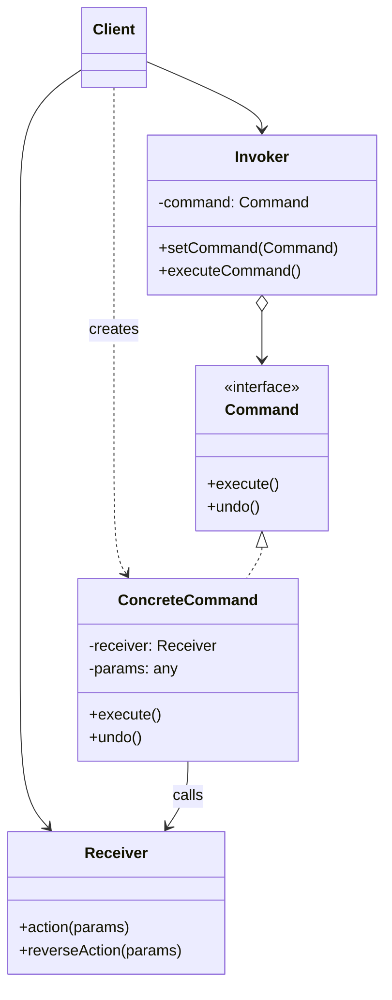

# Buyruq andozasi (Command)

<CoverImage src="/covers/behavioral/command.webp" alt="Cover">
  <h1>Buyruq</h1>
  <p>Kulgili "Missiyani boshqarish markazi" paneli: kichkina general robot tugmani bosadi va "JUMP" yozuvli porlab turgan kartrij paydo bo'ladi, u oddiy ishchi robotga yuklanadi.</p>
</CoverImage>

## Umumiy ko'rinish (Overview)

**Buyruq** (Command) andozasi — bu so'rov yoki amalni mustaqil obyektga aylantiruvchi xulq-atvor (behavioral) loyihalash andozasidir. Bunday o'zgartirish metodlarni turli so'rovlar bilan parametrlash, so'rov bajarilishini kechiktirish yoki navbatga qo'yish hamda bekor qilinadigan (undo) operatsiyalarni qo'llab-quvvatlash imkonini beradi.

**Asosiy afzalligi**: U operatsiyani _chaqiruvchi_ obyektni operatsiyani _bajaruvchi_ obyektdan ajratadi.

**Zamonaviy nuqtai nazar**: Buyruq andozasi zamonaviy GUI ilovalarida (undo/redo steklari), vazifalar navbatlarida (Redis/Celery workerlari), tranzaksion tizimlarda (taqsimlangan arxitekturalardagi kompensatsion tranzaksiyalar) va CQRS'da (Command Query Responsibility Segregation) keng qo'llaniladi.

## Muammo (The Problem)

Tasavvur qiling, siz zamonaviy matn muharriri yaratyapsiz. Siz `Copy`, `Paste`, `Undo` va `Save` kabi operatsiyalar uchun tugmalarga ega asboblar panelini (toolbar) qilmoqchisiz.

Dastlab siz har bir tugma uchun `Document` obyektining metodlarini to'g'ridan-to'g'ri chaqiradigan hodisa tinglovchilarini (event listener) yozishingiz mumkin:

```typescript
// ❌ Yomon: UI biznes mantiqqa qattiq bog'langan
class SaveButton {
  constructor(private document: Document) {}

  onClick() {
    this.document.saveToFile();
  }
}
```

Bu yaxshidek ko'rinadi, toki quyidagilarni tushunib yetmaguningizcha:

1. Hujjatni saqlash uchun klaviatura yorlig'i (Ctrl+S) ham kerak. Endi saqlash mantiqini takrorlashingiz yoki yorliqni tugmaga noqulay tarzda bog'lashingiz kerak.
2. Siz "Undo" (bekor qilish) funksiyasini amalga oshirmoqchisiz. Lekin `onClick` darhol bajariladi va hech qanday iz qoldirmaydi. Nima o'zgarganini qanday eslab qolasiz?
3. Siz makrolarni qo'llab-quvvatlashni qo'shmoqchisiz (amallar ketma-ketligini yozib olish va qayta ijro etish).

UI'ni biznes mantiqqa to'g'ridan-to'g'ri bog'lash amallarni ma'lumot sifatida ko'radigan murakkab funksiyalarni yaratishni imkonsiz qiladi.

## Yechim (The Solution)

Buyruq andozasi UI komponentlari biznes mantiqni to'g'ridan-to'g'ri chaqirish o'rniga, so'rov tafsilotlarini alohida **Command** obyektiga ajratishni taklif qiladi.

1. UI komponenti (**Invoker** — chaqiruvchi) Command interfeysida shunchaki `execute()` ni chaqiradi.
2. **Command** obyekti **Receiver** (qabul qiluvchi — biznes mantiq obyekti)da aynan qaysi metodni chaqirishni biladi.
3. Command obyekt bo'lgani uchun uni massivda saqlash (tarix/undo uchun), serializatsiya qilish yoki tarmoq orqali yuborish mumkin.

## Tuzilma (Structure)



## Oqim (Flow)

1. **Client** **Invoker**ni (masalan, tugmani) aniq bir **ConcreteCommand** (masalan, `SaveCommand`) bilan sozlaydi.
2. Foydalanuvchi tugmani bosadi va **Invoker** `command.execute()` ni chaqiradi.
3. **ConcreteCommand** **Receiver**dagi haqiqiy biznes mantiqni chaqiradi (masalan, `document.save()`).
4. (Ixtiyoriy) **ConcreteCommand** bajarilishdan oldin o'z holatini saqlaydi, bu keyinchalik `command.undo()` chaqirilganda operatsiyani orqaga qaytarish imkonini beradi.

## Hayotiy o'xshatish (Real-World Analogy)

**Restoranda** ovqat buyurtma qilishni tasavvur qiling.

1. Siz (**Client**) ofitsiantga nima xohlayotganingizni aytasiz.
2. Ofitsiant (**Invoker**) so'rovingizni buyurtma varaqasiga (**Command**) yozadi.
3. Ofitsiant varaqani oshxona peshtaxtasiga qo'yadi. U ovqat pishirmaydi, faqat varaqani uzatadi.
4. Oshpaz (**Receiver**) varaqani oladi va ovqat tayyorlash uchun ko'rsatmalarni o'qiydi.

Buyurtma varaqasi so'rovning barcha tafsilotlarini o'z ichiga oladi. Uni navbatga qo'yish, bekor qilish (undo) yoki hisob-kitob uchun qayd etish mumkin.

## Bosqichma-bosqich amalga oshirish (Step-by-Step Implementation)

1. **Command interfeysini e'lon qiling**: Kamida `execute()` metodini aniqlang. Agar bekor qilish funksiyasi kerak bo'lsa, `undo()` ni qo'shing.
2. **Konkret buyruqlarni yarating**: Interfeysni amalga oshiring. Bu klasslar konstruktor orqali Receiver obyektini va kerakli parametrlarni qabul qilishi kerak.
3. **Receiver'ni amalga oshiring**: Bu ishni haqiqatda bajaradigan asosiy biznes mantiq klassi.
4. **Invoker'ni yarating**: Buyruqni ishga tushiradigan klass. U Command'ga havolani saqlashi va unda `execute()` ni chaqirishi kerak (masalan, undo/redo uchun tarix steki).

## Kod misollari (Code Examples)

Quyida Undo/Redo funksiyasi bilan formatlash buyruqlarini qo'llab-quvvatlaydigan oddiy matn muharririning to'liq amalga oshirilishi keltirilgan.

::: code-group

```typescript [TypeScript]
// 1. Receiver
class TextDocument {
  private content: string = "";

  getContent(): string {
    return this.content;
  }

  insert(position: number, text: string): void {
    this.content =
      this.content.slice(0, position) + text + this.content.slice(position);
  }

  delete(position: number, length: number): string {
    const deleted = this.content.slice(position, position + length);
    this.content =
      this.content.slice(0, position) + this.content.slice(position + length);
    return deleted;
  }
}

// 2. Command interfeysi
interface Command {
  execute(): void;
  undo(): void;
}

// 3. Konkret Commandlar
class InsertTextCommand implements Command {
  constructor(
    private doc: TextDocument,
    private position: number,
    private text: string,
  ) {}

  execute(): void {
    this.doc.insert(this.position, this.text);
  }

  undo(): void {
    // Insert'ning teskarisi delete
    this.doc.delete(this.position, this.text.length);
  }
}

class DeleteTextCommand implements Command {
  private deletedText: string = "";

  constructor(
    private doc: TextDocument,
    private position: number,
    private length: number,
  ) {}

  execute(): void {
    // O'chirilgan matnni keyinroq undo qilish uchun saqlaymiz
    this.deletedText = this.doc.delete(this.position, this.length);
  }

  undo(): void {
    // Delete'ning teskarisi insert
    this.doc.insert(this.position, this.deletedText);
  }
}

// 4. Invoker (tarix menejeri)
class CommandHistory {
  private history: Command[] = [];
  private redoStack: Command[] = [];

  execute(cmd: Command): void {
    cmd.execute();
    this.history.push(cmd);
    this.redoStack = []; // Yangi amalda redo stekini tozalash
  }

  undo(): void {
    const cmd = this.history.pop();
    if (cmd) {
      cmd.undo();
      this.redoStack.push(cmd);
    }
  }

  redo(): void {
    const cmd = this.redoStack.pop();
    if (cmd) {
      cmd.execute();
      this.history.push(cmd);
    }
  }
}

// 5. Client
const doc = new TextDocument();
const history = new CommandHistory();

// Biroz matn "yozamiz"
history.execute(new InsertTextCommand(doc, 0, "Hello World"));
console.log(doc.getContent()); // Natija: Hello World

// Yana matn qo'shamiz
history.execute(new InsertTextCommand(doc, 5, " Beautiful"));
console.log(doc.getContent()); // Natija: Hello Beautiful World

// Oxirgi qo'shishni bekor qilamiz
history.undo();
console.log(doc.getContent()); // Natija: Hello World

// Uni qayta bajaramiz
history.redo();
console.log(doc.getContent()); // Natija: Hello Beautiful World

// " Beautiful"ni o'chiramiz
history.execute(new DeleteTextCommand(doc, 5, 10));
console.log(doc.getContent()); // Natija: Hello World
```

```python [Python]
from abc import ABC, abstractmethod
from typing import List

# 1. Receiver
class TextDocument:
    def __init__(self):
        self._content = ""

    def get_content(self) -> str:
        return self._content

    def insert(self, position: int, text: str):
        self._content = self._content[:position] + text + self._content[position:]

    def delete(self, position: int, length: int) -> str:
        deleted = self._content[position:position + length]
        self._content = self._content[:position] + self._content[position + length:]
        return deleted

# 2. Command interfeysi
class Command(ABC):
    @abstractmethod
    def execute(self):
        pass

    @abstractmethod
    def undo(self):
        pass

# 3. Konkret Commandlar
class InsertTextCommand(Command):
    def __init__(self, doc: TextDocument, position: int, text: str):
        self.doc = doc
        self.position = position
        self.text = text

    def execute(self):
        self.doc.insert(self.position, self.text)

    def undo(self):
        self.doc.delete(self.position, len(self.text))

class DeleteTextCommand(Command):
    def __init__(self, doc: TextDocument, position: int, length: int):
        self.doc = doc
        self.position = position
        self.length = length
        self.deleted_text = ""

    def execute(self):
        self.deleted_text = self.doc.delete(self.position, self.length)

    def undo(self):
        self.doc.insert(self.position, self.deleted_text)

# 4. Invoker
class CommandHistory:
    def __init__(self):
        self.history: List[Command] = []
        self.redo_stack: List[Command] = []

    def execute(self, cmd: Command):
        cmd.execute()
        self.history.append(cmd)
        self.redo_stack.clear()

    def undo(self):
        if self.history:
            cmd = self.history.pop()
            cmd.undo()
            self.redo_stack.append(cmd)

    def redo(self):
        if self.redo_stack:
            cmd = self.redo_stack.pop()
            cmd.execute()
            self.history.append(cmd)

# 5. Client
if __name__ == "__main__":
    doc = TextDocument()
    invoker = CommandHistory()

    invoker.execute(InsertTextCommand(doc, 0, "Hello World"))
    print(doc.get_content())  # Hello World

    invoker.execute(InsertTextCommand(doc, 5, " Beautiful"))
    print(doc.get_content())  # Hello Beautiful World

    invoker.undo()
    print(doc.get_content())  # Hello World

    invoker.redo()
    print(doc.get_content())  # Hello Beautiful World
```

```java [Java]
import java.util.Stack;

// 1. Receiver
class TextDocument {
    private StringBuilder content = new StringBuilder();

    public String getContent() {
        return content.toString();
    }

    public void insert(int position, String text) {
        content.insert(position, text);
    }

    public String delete(int position, int length) {
        String deleted = content.substring(position, position + length);
        content.delete(position, position + length);
        return deleted;
    }
}

// 2. Command interfeysi
interface Command {
    void execute();
    void undo();
}

// 3. Konkret Commandlar
class InsertTextCommand implements Command {
    private TextDocument doc;
    private int position;
    private String text;

    public InsertTextCommand(TextDocument doc, int position, String text) {
        this.doc = doc;
        this.position = position;
        this.text = text;
    }

    @Override
    public void execute() {
        doc.insert(position, text);
    }

    @Override
    public void undo() {
        doc.delete(position, text.length());
    }
}

class DeleteTextCommand implements Command {
    private TextDocument doc;
    private int position;
    private int length;
    private String deletedText;

    public DeleteTextCommand(TextDocument doc, int position, int length) {
        this.doc = doc;
        this.position = position;
        this.length = length;
    }

    @Override
    public void execute() {
        deletedText = doc.delete(position, length);
    }

    @Override
    public void undo() {
        doc.insert(position, deletedText);
    }
}

// 4. Invoker
class CommandHistory {
    private Stack<Command> history = new Stack<>();
    private Stack<Command> redoStack = new Stack<>();

    public void execute(Command cmd) {
        cmd.execute();
        history.push(cmd);
        redoStack.clear();
    }

    public void undo() {
        if (!history.isEmpty()) {
            Command cmd = history.pop();
            cmd.undo();
            redoStack.push(cmd);
        }
    }

    public void redo() {
        if (!redoStack.isEmpty()) {
            Command cmd = redoStack.pop();
            cmd.execute();
            history.push(cmd);
        }
    }
}

// 5. Client
public class CommandDemo {
    public static void main(String[] args) {
        TextDocument doc = new TextDocument();
        CommandHistory invoker = new CommandHistory();

        invoker.execute(new InsertTextCommand(doc, 0, "Hello World"));
        System.out.println(doc.getContent()); // Hello World

        invoker.execute(new InsertTextCommand(doc, 5, " Beautiful"));
        System.out.println(doc.getContent()); // Hello Beautiful World

        invoker.undo();
        System.out.println(doc.getContent()); // Hello World

        invoker.redo();
        System.out.println(doc.getContent()); // Hello Beautiful World
    }
}
```

```go [Go]
package main

import "fmt"

// 1. Receiver
type TextDocument struct {
	content string
}

func (d *TextDocument) Insert(position int, text string) {
	d.content = d.content[:position] + text + d.content[position:]
}

func (d *TextDocument) Delete(position int, length int) string {
	deleted := d.content[position : position+length]
	d.content = d.content[:position] + d.content[position+length:]
	return deleted
}

// 2. Command interfeysi
type Command interface {
	Execute()
	Undo()
}

// 3. Konkret Commandlar
type InsertTextCommand struct {
	doc      *TextDocument
	position int
	text     string
}

func (c *InsertTextCommand) Execute() {
	c.doc.Insert(c.position, c.text)
}

func (c *InsertTextCommand) Undo() {
	c.doc.Delete(c.position, len(c.text))
}

type DeleteTextCommand struct {
	doc         *TextDocument
	position    int
	length      int
	deletedText string
}

func (c *DeleteTextCommand) Execute() {
	c.deletedText = c.doc.Delete(c.position, c.length)
}

func (c *DeleteTextCommand) Undo() {
	c.doc.Insert(c.position, c.deletedText)
}

// 4. Invoker
type CommandHistory struct {
	history   []Command
	redoStack []Command
}

func (h *CommandHistory) Execute(cmd Command) {
	cmd.Execute()
	h.history = append(h.history, cmd)
	h.redoStack = []Command{} // redo stekini tozalash
}

func (h *CommandHistory) Undo() {
	if len(h.history) > 0 {
		lastIdx := len(h.history) - 1
		cmd := h.history[lastIdx]
		h.history = h.history[:lastIdx] // pop qilish

		cmd.Undo()
		h.redoStack = append(h.redoStack, cmd)
	}
}

func (h *CommandHistory) Redo() {
	if len(h.redoStack) > 0 {
		lastIdx := len(h.redoStack) - 1
		cmd := h.redoStack[lastIdx]
		h.redoStack = h.redoStack[:lastIdx] // pop qilish

		cmd.Execute()
		h.history = append(h.history, cmd)
	}
}

// 5. Client
func main() {
	doc := &TextDocument{}
	invoker := &CommandHistory{}

	invoker.Execute(&InsertTextCommand{doc, 0, "Hello World"})
	fmt.Println(doc.content) // Hello World

	invoker.Execute(&InsertTextCommand{doc, 5, " Beautiful"})
	fmt.Println(doc.content) // Hello Beautiful World

	invoker.Undo()
	fmt.Println(doc.content) // Hello World

	invoker.Redo()
	fmt.Println(doc.content) // Hello Beautiful World
}
```

```rust [Rust]
// 1. Receiver
struct TextDocument {
    content: String,
}

impl TextDocument {
    fn new() -> Self {
        Self { content: String::new() }
    }

    fn insert(&mut self, position: usize, text: &str) {
        self.content.insert_str(position, text);
    }

    fn delete(&mut self, position: usize, length: usize) -> String {
        let deleted: String = self.content.chars().skip(position).take(length).collect();
        // Rust'da bayt oralig'ini o'chirish belgi chegaralariga e'tibor talab qiladi,
        // bu yerda namoyish uchun ASCII deb soddalashtirilgan
        self.content.drain(position..position + length);
        deleted
    }
}

// 2. Command trait
trait Command {
    fn execute(&mut self, doc: &mut TextDocument);
    fn undo(&mut self, doc: &mut TextDocument);
}

// 3. Konkret Commandlar
struct InsertTextCommand {
    position: usize,
    text: String,
}

impl Command for InsertTextCommand {
    fn execute(&mut self, doc: &mut TextDocument) {
        doc.insert(self.position, &self.text);
    }

    fn undo(&mut self, doc: &mut TextDocument) {
        doc.delete(self.position, self.text.len());
    }
}

struct DeleteTextCommand {
    position: usize,
    length: usize,
    deleted_text: String,
}

impl Command for DeleteTextCommand {
    fn execute(&mut self, doc: &mut TextDocument) {
        self.deleted_text = doc.delete(self.position, self.length);
    }

    fn undo(&mut self, doc: &mut TextDocument) {
        doc.insert(self.position, &self.deleted_text);
    }
}

// 4. Invoker
struct CommandHistory {
    history: Vec<Box<dyn Command>>,
    redo_stack: Vec<Box<dyn Command>>,
}

impl CommandHistory {
    fn new() -> Self {
        Self {
            history: Vec::new(),
            redo_stack: Vec::new(),
        }
    }

    fn execute(&mut self, mut cmd: Box<dyn Command>, doc: &mut TextDocument) {
        cmd.execute(doc);
        self.history.push(cmd);
        self.redo_stack.clear();
    }

    fn undo(&mut self, doc: &mut TextDocument) {
        if let Some(mut cmd) = self.history.pop() {
            cmd.undo(doc);
            self.redo_stack.push(cmd);
        }
    }

    fn redo(&mut self, doc: &mut TextDocument) {
        if let Some(mut cmd) = self.redo_stack.pop() {
            cmd.execute(doc);
            self.history.push(cmd);
        }
    }
}

// 5. Client
fn main() {
    let mut doc = TextDocument::new();
    let mut invoker = CommandHistory::new();

    invoker.execute(Box::new(InsertTextCommand { position: 0, text: "Hello World".to_string() }), &mut doc);
    println!("{}", doc.content);

    invoker.execute(Box::new(InsertTextCommand { position: 5, text: " Beautiful".to_string() }), &mut doc);
    println!("{}", doc.content);

    invoker.undo(&mut doc);
    println!("{}", doc.content);

    invoker.redo(&mut doc);
    println!("{}", doc.content);
}
```

:::

## Afzalliklari va kamchiliklari (Pros and Cons)

### Afzalliklari (Advantages)

- **Yagona mas'uliyat tamoyili (Single Responsibility Principle)**: Operatsiyalarni chaqiruvchi klasslarni ularni bajaruvchi klasslardan ajratadi.
- **Ochiq/yopiqlik tamoyili (Open/Closed Principle)**: Mavjud client kodini buzmasdan yangi buyruqlarni kiritish mumkin.
- **Undo/Redo**: Buyruqlarni saqlash orqali tarix bo'ylab oldinga va orqaga harakatlanishni tabiiy ravishda qo'llab-quvvatlaysiz.
- **Kechiktirilgan bajarish**: Buyruqlarni keyinroq bajarish uchun navbatga qo'yish, rejalashtirish yoki serializatsiya qilish mumkin (vazifalar navbatlari uchun ideal).
- **Makro buyruqlar**: Oddiy buyruqlardan murakkab makro buyruqlarni yig'ish mumkin (masalan, Kompozit andozasi Buyruq bilan birgalikda).

### Kamchiliklari (Disadvantages)

- **Klasslar portlashi**: Har bir mumkin bo'lgan amal uchun yangi konkret buyruq klassi yaratasiz. Bu kod bazasini jiddiy shishirib yuborishi mumkin.
- **Qo'shimcha murakkablik**: Oddiy funksiya chaqiruvi o'rniga butunlay yangi bilvositalik qatlamini kiritasiz (Invoker -> Command -> Receiver).
- **Xotira xarajati**: Holatga ega obyektlarning uzun tarixini saqlash (undo/redo uchun) sezilarli RAM sarflashi mumkin.

## Qachon foydalanish kerak (When to Use) ✅

- **Undo/Redo funksiyasi**: Foydalanuvchilar o'z amallarini bekor qilishni kutadigan ilovalarni yaratishda (matn muharrirlari, grafik dasturlar, CAD tizimlari).
- **Vazifalar navbatlari / Vazifalarni rejalashtirish**: Obyektni amal bilan parametrlash, uni ma'lumotlar bazasi/Redis'ga serializatsiya qilish va keyinroq worker oqimi ichida bajarish kerak bo'lganda.
- **GUI tugmalari va yorliqlari**: Bir nechta UI elementlari (menyu bandi, tugma, yorliq) mantiqni takrorlamasdan aynan bir xil amalni ishga tushirishini xohlaganingizda.
- **Tranzaksiyalar / Sagalar**: C qadamdagi muvaffaqiyatsizlik B va A qadamlar uchun kompensatsion tranzaksiyalarni bajarishni talab qiladigan taqsimlangan tizimlarni yaratishda. (Buyruqlarda `.undo()` ni chaqirasiz).

## Qachon foydalanmaslik kerak (When NOT to Use) ❌

- **Oddiy CRUD ilovalari**: Agar operatsiya ma'lumotlar bazasiga oddiy yozish bo'lsa va uni hech qachon bekor qilish yoki rejalashtirish kerak bo'lmasa, buyruq obyektlarini yaratish — haddan tashqari ortiqcha ish. To'g'ridan-to'g'ri metod chaqiruvlari yaxshiroq.
- **Yuqori unumdorlikdagi sikllar**: Tig'iz sikl yoki real vaqtdagi simulyatsiya (masalan, o'yin fizikasi) ichida buyruq obyektlarini yaratish garbage collection sakrashlariga sabab bo'lishi mumkin.

## Keng tarqalgan xatolar (Common Mistakes)

### 1. Biznes mantiqni Command ichiga joylashtirish

Buyruqlar og'ir ishni o'zlari bajarmasligi, balki Receiver'ga _vakolat berishi_ (delegate) kerak.

```typescript
// ❌ Yomon: Command ma'lumotlar bazasiga yozish, validatsiya va email yuborishni bajaradi
class ProcessOrderCommand implements Command {
  execute() {
    // Bu yerda 100 qator murakkab biznes mantiq...
  }
}

// ✅ Yaxshi: Command shunchaki OrderService'ni chaqiradi
class ProcessOrderCommand implements Command {
  constructor(private orderService: OrderService) {}
  execute() {
    this.orderService.process();
  }
}
```

### 2. Undo uchun holatni saqlashni unutish

`undo()` metodi `execute()` dan oldingi holatni aynan tiklashi kerak. Agar `execute()` vaqtida ustiga yozilgan holatni Command obyekti ichida saqlamasangiz, bekor qilish imkonsiz bo'lib qoladi.

## Aloqador andozalar (Related Patterns)

- **[Memento](/uz/behavioral/memento)**: Ko'pincha Buyruq _bilan birga_ ishlatiladi. Agar buyruq juda katta obyektni o'zgartirsa, teskari operatsiyani o'ylab topish o'rniga buyruq bajarilishdan oldin obyektning Memento'sini (snapshot — surat) saqlaydi va undo vaqtida shu Memento'ni tiklaydi.
- **[Kompozit](/uz/structural/composite)**: Bir nechta buyruqni o'zi ham Command interfeysini amalga oshiradigan `MacroCommand` ga birlashtirish mumkin.
- **[Strategiya](/uz/behavioral/strategy)**: Ikkalasi ham obyektni xatti-harakat bilan parametrlashi jihatidan o'xshash. Lekin Strategiya biror ishni _qanday_ bajarishni (algoritm) belgilaydi, Buyruq esa _nima_ qilishni (amal) belgilaydi.

## Intervyu uchun maslahatlar (Interview Insights)

- **Savol**: "Buyruq andozasi yordamida Undo funksiyasini qanday amalga oshirasiz?"
  - **Javob**: "Bajarilgan Command obyektlarining stekini saqlaysiz. Har bir buyruq `undo()` metodini amalga oshiradi. Foydalanuvchi Undo'ni bosganda, stekning yuqorisidagi buyruqni olib (pop), uning `undo()` metodini chaqirasiz va ixtiyoriy ravishda uni Redo stekiga qo'shasiz."
- **Savol**: "CQRS nima va u Buyruq andozasi bilan qanday bog'liq?"
  - **Javob**: "CQRS (Command Query Responsibility Segregation) o'qish operatsiyalarini (Query) yozish operatsiyalaridan (Command) ajratadi. Ular nomlanishi va falsafasi jihatidan bog'liq bo'lsa-da — ikkalasi ham yozishni alohida niyat obyektlari sifatida ko'radi — CQRS ma'lumotlar bazalari va mikroservislarni masshtablash uchun arxitektura andozasi, Buyruq loyihalash andozasi esa obyektga yo'naltirilgan xotira tuzilmalari uchun xulq-atvor andozasidir."

## Zamonaviy muqobillar (Modern Alternatives)

- **Funksional closure'lar**: Birinchi darajali funksiyalarga ega tillarda (JS/TS, Python, Go, Rust) butun bir `Command` interfeysi shart emas. Oddiy callback yoki closure `() => { ... }` amalni inkapsulyatsiya qilishi mumkin, uning closure doirasi esa saqlangan parametrlar vazifasini bajaradi. (Garchi closure'lar bilan undo/redo'ni obyektlarga qaraganda standartlashtirish qiyinroq bo'lsa ham).
- **Redux / Flux arxitekturasi**: Frontend freymvorklarda "Action"lar va "Reducer"lar Buyruq andozasi bilan aynan bir xil maqsadga xizmat qiladi. Action — bu buyruq ma'lumoti (payload), Dispatcher — Invoker, Reducer esa Receiver.
