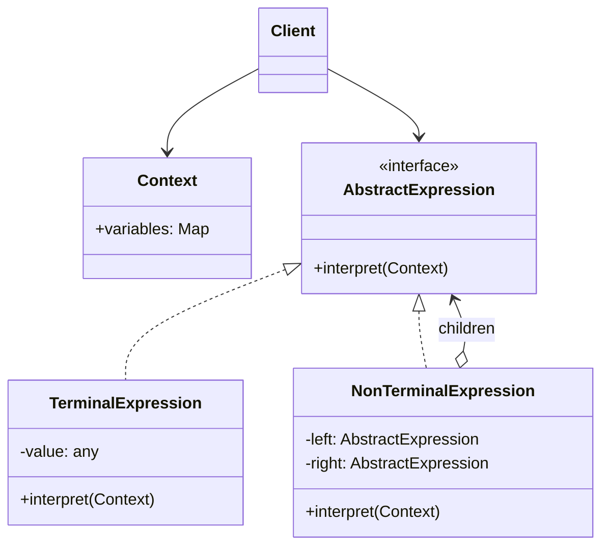

# Interpretator andozasi (Interpreter)

<CoverImage src="/covers/behavioral/interpreter.webp" alt="Cover">
  <h1>Interpretator</h1>
  <p>Yulduz shaklidagi nutq pufakchalarida gapirayotgan o'zga sayyoralik bilan inson o'rtasida o'tirgan yoqimtoy tarjimon robot — u yulduzli pufakchalarni doskadagi oddiy geometrik matematik tenglamalarga tarjima qiladi.</p>
</CoverImage>

## Umumiy ko'rinish (Overview)

**Interpretator** (Interpreter) andozasi — bu til uchun grammatik ifodalanishni belgilaydigan va ushbu grammatika bilan ishlash uchun interpretator taqdim etadigan xulq-atvor (behavioral) loyihalash andozasidir. U asosan tildagi gaplar yoki ifodalarni Abstrakt sintaksis daraxti (AST — Abstract Syntax Tree) ko'rinishida ifodalab, ularni baholash uchun ishlatiladi.

**Asosiy afzalligi**: U sohaga xos tillarni (DSL — domain-specific language) yoki murakkab qoidalar, konfiguratsiyalar va matematik ifodalarni baholashning tuzilmali usulini taqdim etadi.

**Zamonaviy nuqtai nazar**: Klassik Interpretator andozasi to'laqonli umumiy maqsadli dasturlash tillarini yaratishda kamdan-kam qo'llansa-da (bu yerda ANTLR yoki LLVM kabi kompilyator generatorlari afzal ko'riladi), u yengil DSL'lar, konfiguratsiyani baholash, qoidalar dvigatellari (rule engine), SQL builder'lar va dinamik qidiruv so'rovlari parserlari uchun hamon juda dolzarb.

## Muammo (The Problem)

Tasavvur qiling, siz foydalanuvchilarga maxsus so'rovlar tili yordamida mahsulotlarni filtrlash imkonini beradigan tizim yaratyapsiz. Foydalanuvchi quyidagini yozadi:

`"price < 100 AND (category = 'electronics' OR category = 'books')"`

Agar bu satrni sof protsedurali kod va ulkan regex yoki `if/else` bloklari yordamida tahlil qilib, baholashga harakat qilsangiz, kod tezda qo'llab-quvvatlab bo'lmaydigan holatga keladi:

```typescript
// ❌ Yomon: Protsedurali satr tahlili mo'rt va murakkab
function evaluate(query: string, product: Product): boolean {
  if (query.includes("AND")) {
    const parts = query.split(" AND ");
    return evaluate(parts[0], product) && evaluate(parts[1], product);
  }
  // Qavslar, OR'lar, <, >, = bilan bu tezda dahshatga aylanadi
}
```

Satr ko'rinishi tekis (flat), lekin baholash mantiqi tabiatan ierarxik. Tekis satrni bajariladigan daraxt tuzilmasiga aylantirish usuli kerak.

## Yechim (The Solution)

Interpretator andozasi grammatik qoidalarni obyektlarga moslashtirish orqali bu muammoni hal qiladi.

1. **Context (Kontekst)**: Interpretatorlarga uzatiladigan umumiy holat (masalan, `Product` obyekti).
2. **AbstractExpression**: `interpret(context)` metodiga ega interfeys.
3. **TerminalExpression**: Daraxtdagi barg tugun (masalan, doimiy qiymat, aniq maydon nomi).
4. **NonTerminalExpression**: Boshqa ifodalarni birlashtiradigan daraxtning ichki tuguni (masalan, `AndExpression`, `OrExpression`, `LessThanExpression`).

Parser tekis satrni shu ifoda obyektlaridan iborat Abstrakt sintaksis daraxtiga (AST) aylantiradi. Shundan so'ng qoidani baholash `tree.interpret(context)` ni chaqirishdek oson bo'ladi — u rekursiv ravishda barglargacha baholaydi.

## Tuzilma (Structure)



## Oqim (Flow)

1. **Client** **Context**ni ma'lumotlar bilan ishga tushiradi (masalan, aniq foydalanuvchi, hujjat yoki muhit o'zgaruvchilari xaritasi).
2. Parser (yoki to'g'ridan-to'g'ri client) **Terminal** va **NonTerminal** ifodalardan iborat AST'ni quradi.
3. **Client** AST ildizida `interpret(context)` ni chaqiradi.
4. Ildiz ifoda o'zining bolalarini baholaydi.
5. **Terminal** ifodalar **Context**dan aniq qiymatlarni qaytaradi.
6. Yakuniy natija yuqoriga, **Client**gacha ko'tariladi.

## Hayotiy o'xshatish (Real-World Analogy)

**Gapni tarjima qilishni** tasavvur qiling.
Agar siz `"El gato bebe leche"` gapini o'qisangiz, miyangiz uni grammatik daraxtga moslashtiradi:

- Ega: "El gato" (Terminal)
- Harakat: "bebe" (Terminal)
- To'ldiruvchi: "leche" (Terminal)
- Gap: Ega + Harakat + To'ldiruvchi (NonTerminal)

Siz butun gapni kichikroq grammatik qismlarni rekursiv ravishda tarjima qilish va baholash orqali talqin qilasiz.

## Bosqichma-bosqich amalga oshirish (Step-by-Step Implementation)

1. **Kontekstni aniqlang**: Interpretatsiya davomida global holatni saqlaydigan klass yoki ma'lumotlar tuzilmasini yarating.
2. **Ifoda interfeysini aniqlang**: `interpret(context)` metodiga ega interfeys yarating.
3. **Terminal ifodalarni yarating**: Asosiy qurilish bloklarini (sonlar, satrlar, o'zgaruvchilarni qidirish) ifodalovchi ifodalarni amalga oshiring.
4. **NonTerminal ifodalarni yarating**: Boshqalarni birlashtiradigan ifodalarni amalga oshiring (Add, Subtract, And, Or).
5. _(Ixtiyoriy, lekin odatda zarur)_ **Parser yarating**: Satrni Expression'lar daraxtiga aylantiradigan mantiqni yozing.

## Kod misollari (Code Examples)

Biz o'zgaruvchilarning dinamik to'plamiga asoslangan mantiqiy (boolean) ifodalarni baholay oladigan oddiy mantiq baholovchisini yaratamiz (masalan, `(A AND B) OR C`).

::: code-group

```typescript [TypeScript]
// 1. Kontekst
class Context {
  private variables = new Map<string, boolean>();

  set(name: string, value: boolean) {
    this.variables.set(name, value);
  }

  get(name: string): boolean {
    if (!this.variables.has(name)) {
      throw new Error(`Variable ${name} not found`);
    }
    return this.variables.get(name)!;
  }
}

// 2. Abstrakt Expression
interface Expression {
  interpret(context: Context): boolean;
}

// 3. Terminal Expression
class VariableExpression implements Expression {
  constructor(private name: string) {}

  interpret(context: Context): boolean {
    return context.get(this.name);
  }
}

// 4. Non-Terminal Expressionlar
class AndExpression implements Expression {
  constructor(
    private left: Expression,
    private right: Expression,
  ) {}

  interpret(context: Context): boolean {
    return this.left.interpret(context) && this.right.interpret(context);
  }
}

class OrExpression implements Expression {
  constructor(
    private left: Expression,
    private right: Expression,
  ) {}

  interpret(context: Context): boolean {
    return this.left.interpret(context) || this.right.interpret(context);
  }
}

class NotExpression implements Expression {
  constructor(private expr: Expression) {}

  interpret(context: Context): boolean {
    return !this.expr.interpret(context);
  }
}

// 5. Client'da foydalanish
const context = new Context();
context.set("isPremium", true);
context.set("isAdmin", false);
context.set("isActive", true);

// (isPremium AND isActive) OR isAdmin uchun AST
const isPremium = new VariableExpression("isPremium");
const isActive = new VariableExpression("isActive");
const isAdmin = new VariableExpression("isAdmin");

const premiumAndActive = new AndExpression(isPremium, isActive);
const finalExpression = new OrExpression(premiumAndActive, isAdmin);

console.log("Evaluation Result:", finalExpression.interpret(context)); // Natija: true
```

```python [Python]
from abc import ABC, abstractmethod
from typing import Dict

# 1. Kontekst
class Context:
    def __init__(self):
        self._variables: Dict[str, bool] = {}

    def set(self, name: str, value: bool):
        self._variables[name] = value

    def get(self, name: str) -> bool:
        if name not in self._variables:
            raise ValueError(f"Variable {name} not found")
        return self._variables[name]

# 2. Abstrakt Expression
class Expression(ABC):
    @abstractmethod
    def interpret(self, context: Context) -> bool:
        pass

# 3. Terminal Expression
class VariableExpression(Expression):
    def __init__(self, name: str):
        self.name = name

    def interpret(self, context: Context) -> bool:
        return context.get(self.name)

# 4. Non-Terminal Expressionlar
class AndExpression(Expression):
    def __init__(self, left: Expression, right: Expression):
        self.left = left
        self.right = right

    def interpret(self, context: Context) -> bool:
        return self.left.interpret(context) and self.right.interpret(context)

class OrExpression(Expression):
    def __init__(self, left: Expression, right: Expression):
        self.left = left
        self.right = right

    def interpret(self, context: Context) -> bool:
        return self.left.interpret(context) or self.right.interpret(context)

class NotExpression(Expression):
    def __init__(self, expr: Expression):
        self.expr = expr

    def interpret(self, context: Context) -> bool:
        return not self.expr.interpret(context)

# 5. Client'da foydalanish
if __name__ == "__main__":
    context = Context()
    context.set("isPremium", True)
    context.set("isAdmin", False)
    context.set("isActive", True)

    # AST: (isPremium AND isActive) OR isAdmin
    is_premium = VariableExpression("isPremium")
    is_active = VariableExpression("isActive")
    is_admin = VariableExpression("isAdmin")

    premium_and_active = AndExpression(is_premium, is_active)
    final_expression = OrExpression(premium_and_active, is_admin)

    print(f"Evaluation Result: {final_expression.interpret(context)}") # True
```

```java [Java]
import java.util.HashMap;
import java.util.Map;

// 1. Kontekst
class Context {
    private Map<String, Boolean> variables = new HashMap<>();

    public void set(String name, boolean value) {
        variables.put(name, value);
    }

    public boolean get(String name) {
        if (!variables.containsKey(name)) {
            throw new IllegalArgumentException("Variable " + name + " not found");
        }
        return variables.get(name);
    }
}

// 2. Abstrakt Expression
interface Expression {
    boolean interpret(Context context);
}

// 3. Terminal Expression
class VariableExpression implements Expression {
    private String name;

    public VariableExpression(String name) {
        this.name = name;
    }

    @Override
    public boolean interpret(Context context) {
        return context.get(name);
    }
}

// 4. Non-Terminal Expressionlar
class AndExpression implements Expression {
    private Expression left;
    private Expression right;

    public AndExpression(Expression left, Expression right) {
        this.left = left;
        this.right = right;
    }

    @Override
    public boolean interpret(Context context) {
        return left.interpret(context) && right.interpret(context);
    }
}

class OrExpression implements Expression {
    private Expression left;
    private Expression right;

    public OrExpression(Expression left, Expression right) {
        this.left = left;
        this.right = right;
    }

    @Override
    public boolean interpret(Context context) {
        return left.interpret(context) || right.interpret(context);
    }
}

class NotExpression implements Expression {
    private Expression expr;

    public NotExpression(Expression expr) {
        this.expr = expr;
    }

    @Override
    public boolean interpret(Context context) {
        return !expr.interpret(context);
    }
}

// 5. Client
public class InterpreterDemo {
    public static void main(String[] args) {
        Context context = new Context();
        context.set("isPremium", true);
        context.set("isAdmin", false);
        context.set("isActive", true);

        // AST: (isPremium AND isActive) OR isAdmin
        Expression isPremium = new VariableExpression("isPremium");
        Expression isActive = new VariableExpression("isActive");
        Expression isAdmin = new VariableExpression("isAdmin");

        Expression premiumAndActive = new AndExpression(isPremium, isActive);
        Expression finalExpr = new OrExpression(premiumAndActive, isAdmin);

        System.out.println("Result: " + finalExpr.interpret(context)); // Natija: true
    }
}
```

```go [Go]
package main

import "fmt"

// 1. Kontekst
type Context struct {
	variables map[string]bool
}

func NewContext() *Context {
	return &Context{variables: make(map[string]bool)}
}

func (c *Context) Set(name string, value bool) {
	c.variables[name] = value
}

func (c *Context) Get(name string) bool {
	if val, ok := c.variables[name]; ok {
		return val
	}
	panic(fmt.Sprintf("Variable %s not found", name))
}

// 2. Expression interfeysi
type Expression interface {
	Interpret(ctx *Context) bool
}

// 3. Terminal Expression
type VariableExpression struct {
	name string
}

func (v *VariableExpression) Interpret(ctx *Context) bool {
	return ctx.Get(v.name)
}

// 4. Non-Terminal Expressionlar
type AndExpression struct {
	left  Expression
	right Expression
}

func (a *AndExpression) Interpret(ctx *Context) bool {
	return a.left.Interpret(ctx) && a.right.Interpret(ctx)
}

type OrExpression struct {
	left  Expression
	right Expression
}

func (o *OrExpression) Interpret(ctx *Context) bool {
	return o.left.Interpret(ctx) || o.right.Interpret(ctx)
}

// 5. Client
func main() {
	ctx := NewContext()
	ctx.Set("isPremium", true)
	ctx.Set("isAdmin", false)
	ctx.Set("isActive", true)

	// AST: (isPremium AND isActive) OR isAdmin
	isPremium := &VariableExpression{"isPremium"}
	isActive := &VariableExpression{"isActive"}
	isAdmin := &VariableExpression{"isAdmin"}

	premiumAndActive := &AndExpression{isPremium, isActive}
	finalExpr := &OrExpression{premiumAndActive, isAdmin}

	fmt.Printf("Result: %v\n", finalExpr.Interpret(ctx)) // true
}
```

```rust [Rust]
use std::collections::HashMap;

// 1. Kontekst
struct Context {
    variables: HashMap<String, bool>,
}

impl Context {
    fn new() -> Self {
        Self {
            variables: HashMap::new(),
        }
    }

    fn set(&mut self, name: &str, value: bool) {
        self.variables.insert(name.to_string(), value);
    }

    fn get(&self, name: &str) -> bool {
        *self.variables.get(name).expect("Variable not found")
    }
}

// 2. Abstrakt Expression
trait Expression {
    fn interpret(&self, context: &Context) -> bool;
}

// 3. Terminal Expression
struct VariableExpression {
    name: String,
}

impl Expression for VariableExpression {
    fn interpret(&self, context: &Context) -> bool {
        context.get(&self.name)
    }
}

// 4. Non-Terminal Expressionlar
struct AndExpression {
    left: Box<dyn Expression>,
    right: Box<dyn Expression>,
}

impl Expression for AndExpression {
    fn interpret(&self, context: &Context) -> bool {
        self.left.interpret(context) && self.right.interpret(context)
    }
}

struct OrExpression {
    left: Box<dyn Expression>,
    right: Box<dyn Expression>,
}

impl Expression for OrExpression {
    fn interpret(&self, context: &Context) -> bool {
        self.left.interpret(context) || self.right.interpret(context)
    }
}

// 5. Client
fn main() {
    let mut context = Context::new();
    context.set("isPremium", true);
    context.set("isAdmin", false);
    context.set("isActive", true);

    // AST: (isPremium AND isActive) OR isAdmin
    let is_premium = Box::new(VariableExpression { name: "isPremium".to_string() });
    let is_active = Box::new(VariableExpression { name: "isActive".to_string() });
    let is_admin = Box::new(VariableExpression { name: "isAdmin".to_string() });

    let premium_and_active = Box::new(AndExpression {
        left: is_premium,
        right: is_active,
    });

    let final_expr = OrExpression {
        left: premium_and_active,
        right: is_admin,
    };

    println!("Result: {}", final_expr.interpret(&context)); // Natija: true
}
```

:::

## Afzalliklari va kamchiliklari (Pros and Cons)

### Afzalliklari (Advantages)

- **Kengaytiriluvchanlik**: Grammatikani o'zgartirish yoki kengaytirish juda oson. Shunchaki yangi `Expression` klassini yaratasiz.
- **Mas'uliyatlarni ajratish (Separation of Concerns)**: Turli grammatik qoidalar uchun baholash mantiqi alohida klasslarga tartibli ajratilgan.
- **Grammatikani obyektlar sifatida amalga oshirish**: AST bo'ylab o'tish, uni formatlash yoki optimallashtirishni nisbatan sodda qiladi (ko'pincha Tashrifchi (Visitor) andozasi bilan birga ishlatiladi).

### Kamchiliklari (Disadvantages)

- **Klasslar portlashi**: Murakkab grammatikalar yuzlab mayda klasslarni talab qiladi.
- **Qo'llab-quvvatlash**: Katta yoki o'zgaruvchan tillar uchun qo'llab-quvvatlash nihoyatda qiyin.
- **Unumdorlik**: Rekursiv interpretatsiya tabiatan sekin. AST'ni bytecode yoki mashina kodiga kompilyatsiya qilish ish vaqtida obyekt daraxtlari bo'ylab o'tishdan ancha tezroq.
- **Parser yo'qligi**: Andoza AST qanday qurilishini hal _qilmaydi_. Xom matnni obyektlarga aylantirish uchun baribir satr parserini (Lexer/Parser) yozishingiz kerak.

## Qachon foydalanish kerak (When to Use) ✅

- **Sohaga xos tillar (DSL)**: Qoidalar dvigatellari, konfiguratsiya baholovchilari yoki matematik tenglamalarni yechuvchilarni yaratishda.
- **Dinamik so'rovlar**: Foydalanuvchi UI'dagi so'rov filtrlarini SQL yoki NoSQL ma'lumotlar bazasi so'rovlariga aylantirishda (masalan, MongoDB query builder'lari).
- **Oddiy grammatikalar**: Grammatika oddiy bo'lsa va samaradorlik moslashuvchanlikdan kamroq muhim bo'lsa.

## Qachon foydalanmaslik kerak (When NOT to Use) ❌

- **Unumdorlik muhim bo'lgan kod**: Agar ifoda tig'iz siklda minglab marta baholansa, interpretator xarajati tor joyga (bottleneck) aylanadi. Uning o'rniga kompilyator yoki JIT'ni ko'rib chiqing.
- **Murakkab tillar**: Agar siz Python yoki Java'ni amalga oshirmoqchi bo'lsangiz, yuzlab klasslar yozmang. ANTLR, Bison yoki LLVM kabi rasmiy vositalardan foydalaning.

## Keng tarqalgan xatolar (Common Mistakes)

### 1. Parserni Interpretator ichiga qattiq kodlash

Interpretator andozasi daraxtni _baholash_ uchun, uni _qurish_ uchun emas. Satrlarni tahlil qilish (Lexing/Parsing) `Expression` AST'ini chiqaradigan butunlay alohida modul bo'lishi kerak.

### 2. Kontekstni noto'g'ri o'zgartirish

Agar non-terminal tugun `interpret()` vaqtida kontekstni kutilmaganda o'zgartirsa, bu keyingi qoidalarni baholashni oldindan aytib bo'lmaydigan qiladigan yon ta'sirlarni (side-effect) yaratadi. Imkon qadar interpretatsiya davomida kontekstni faqat o'qish uchun (read-only) deb hisoblang.

## Aloqador andozalar (Related Patterns)

- **[Kompozit](/uz/structural/composite)**: AST asosan Kompozit andozasidir — unda Non-Terminal'lar kompozitlar, Terminal'lar esa barglar.
- **[Tashrifchi](/uz/behavioral/visitor)**: Ko'pincha `Expression` klasslarini o'zgartirmasdan yangi xatti-harakatlar (formatlash, optimallashtirish yoki turlarni tekshirish kabi) qo'shish uchun Interpretator bilan birga ishlatiladi.
- **[Iterator](/uz/behavioral/iterator)**: AST bo'ylab o'tish uchun ishlatilishi mumkin.
- **[Buyruq](/uz/behavioral/command)**: Tuzilishi jihatidan o'xshash, lekin Buyruq amallarni bajaradi, Interpretator esa qiymatlarni grammatikaga ko'ra baholaydi.

## Intervyu uchun maslahatlar (Interview Insights)

- **Savol**: "Interpretator andozasi va Kompozit andozasi o'rtasida qanday farq bor?"
  - **Javob**: "Tuzilmaviy amalga oshirilishi deyarli bir xil — ikkalasi ham barglar va kompozitlardan iborat obyektlar daraxtidan foydalanadi. Farq niyatda. Kompozit qism-butun ierarxiyalarini ifodalash uchun mo'ljallangan. Interpretator esa bu ierarxiyani aynan lingvistik grammatika yoki matematik ifodani baholash uchun qo'llaydi."
- **Savol**: "Daraxtni aslida qanday qurasiz?"
  - **Javob**: "Andozaning o'zi buni belgilamaydi. Haqiqiy hayotda AST'ni Parser (masalan, Recursive Descent) yoki parser generator vositasi yordamida qurasiz, u baholash uchun Interpretator daraxtini chiqaradi."

## Zamonaviy muqobillar (Modern Alternatives)

- **Kompilyator kompilyatorlari (ANTLR, Bison, Yacc)**: Matnni tahlil qilish va sintaksis daraxtlarini tabiiy ravishda generatsiya qilish uchun sanoat darajasidagi vositalar.
- **Funksional kombinatorlar**: Haskell, Scala yoki F# kabi tillarda (yoki `fp-ts` kabi TS kutubxonalarida) parser va interpretatorlarni yaratishda OOP klass ierarxiyalari o'rniga Parser Combinator'lar afzal ko'riladi.
- **`eval()`**: Juda oddiy holatlar uchun tabiiy `eval` funksiyalari satrlarni baholay oladi, ammo foydalanuvchi kiritgan ma'lumotlar bilan ishlaganda ular jiddiy xavfsizlik xatarlarini keltirib chiqaradi.
