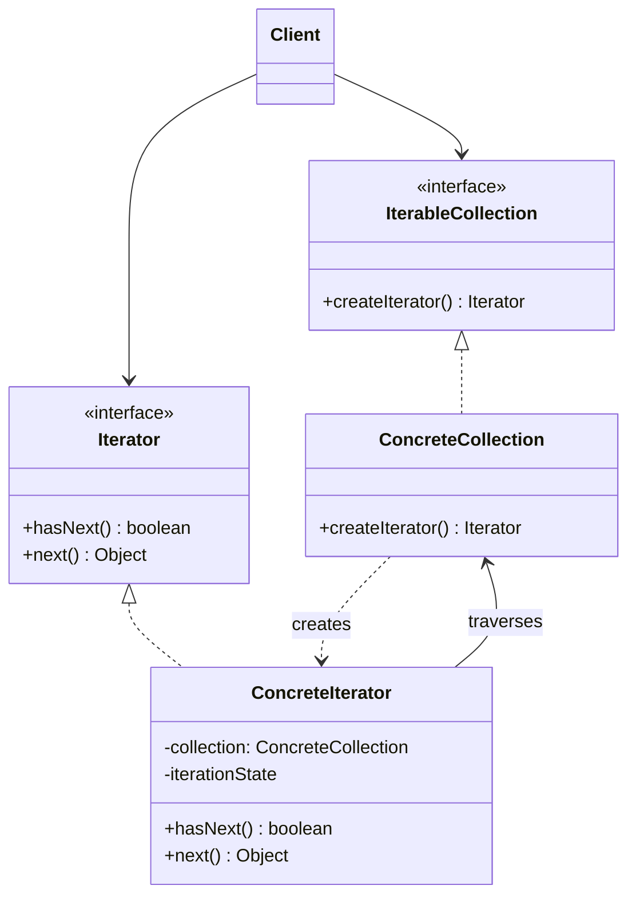

# Iterator andozasi

<CoverImage src="/covers/behavioral/iterator.webp" alt="Cover">
  <h1>Iterator</h1>
  <p>O'yinqaroq konveyer lentasi: skaner qo'li turli xil donutlar qutisini (dumaloq, kvadrat, sepilgan) birma-bir tartib bilan tekshiradi va ular qanday pishirilgani bilan qiziqmaydi.</p>
</CoverImage>

## Umumiy ko'rinish (Overview)

**Iterator** andozasi — bu to'plam elementlarini uning ichki ko'rinishini (masalan, ro'yxat, stek, daraxt, graf) oshkor qilmasdan aylanib chiqish imkonini beruvchi xulq-atvor (behavioral) loyihalash andozasidir.

**Asosiy afzalligi**: U to'plamni aylanib chiqish xatti-harakatini iterator deb ataladigan alohida obyektga ajratadi.

**Zamonaviy nuqtai nazar**: Iterator andozasi deyarli barcha zamonaviy dasturlash tillariga tabiiy ravishda o'rnatilgan (`for...of` sikllari, `IEnumerable`, `Iterable` protokollari). Bugungi kunda maxsus iteratorlarni noldan yozish kamroq uchrasa-da, andozani tushunish oqimlar (stream), generatorlar, asinxron ma'lumotlar va funksional dasturlash konstruksiyalari bilan ishlash uchun juda muhim.

## Muammo (The Problem)

To'plamlar obyektlar guruhlarini saqlaydi. Massiv eng keng tarqalgan to'plam bo'lsa-da, boshqalariga daraxtlar, graflar, ro'yxatlar va hash map'lar kiradi.

To'plam qanday tuzilganidan qat'i nazar, u client kodiga o'z elementlariga ketma-ket murojaat qilish usulini taqdim etishi kerak.

```typescript
// ❌ Yomon: Client har bir to'plamning ichki tuzilishini bilishi kerak
class SocialGraph {
  public users: Map<string, User> = new Map();
  // Uni aylanib chiqish uchun client bu Map ekanini bilishi kerak
}

class LinkedList {
  public head: Node | null;
  // Client bog'langan ro'yxatni qanday aylanib chiqishni bilishi kerak
}
```

Agar client kodi Massiv, Bog'langan ro'yxat (Linked List) va Ikkilik daraxtni (Binary Tree) aylanib chiqishi kerak bo'lsa, har biri uchun aylanib chiqish mantiqi tubdan farq qiladi. Bu clientni ma'lumotlar tuzilmasiga qattiq bog'lanishga majbur qiladi. Agar ichki ma'lumotlar ko'rinishini o'zgartirsangiz, uni aylanib chiqadigan barcha client kodi buziladi.

## Yechim (The Solution)

Iterator andozasi aylanib chiqish mantiqini alohida obyektga inkapsulyatsiya qilishni taklif qiladi.

1. **Iterator interfeysi**: To'plamni aylanib chiqish uchun `next()`, `hasNext()` va ba'zan `current()` kabi operatsiyalarni belgilaydi.
2. **To'plam (Collection) interfeysi**: Iterator yaratish uchun fabrika metodini belgilaydi (masalan, `createIterator()`).

Barcha iteratorlar bir xil interfeysni amalga oshirgani uchun client kodi _istalgan_ to'plamni — u massivmi, daraxtmi yoki masofaviy API kursorimi, bilmagan holda — aynan bir xil usulda aylanib chiqa oladi.

## Tuzilma (Structure)



## Oqim (Flow)

1. **Client** `createIterator()` ni chaqirib, **IterableCollection**dan **Iterator** so'raydi.
2. **ConcreteCollection** o'ziga havolani uzatib, **ConcreteIterator** nusxasini yaratadi.
3. **Client** aylanib chiqish uchun `while (iterator.hasNext())` siklidan foydalanadi.
4. Har bir `iterator.next()` chaqiruvida iterator keyingi elementni qaytaradi va ichki holatini yangilaydi.

## Hayotiy o'xshatish (Real-World Analogy)

**Yangi shaharni kashf qilishni** tasavvur qiling.
Siz oddiy xaritani olib, har bir ko'chani o'zingiz aylanib chiqishga harakat qilishingiz mumkin (to'plamga to'g'ridan-to'g'ri murojaat).
Yoki **gid** (Iterator) yollashingiz mumkin.
Gid murakkab navigatsiyani o'z zimmasiga oladi. Siz unga shunchaki: "Meni keyingi diqqatga sazovor joyga olib boring", deysiz. Siz optimal yo'lni, ko'chalarni yoki avtobus yo'nalishlarini bilishingiz shart emas — gid barcha aylanib chiqish mantiqini o'zida jamlaydi. Turli gidlar shaharni turlicha aylantirishi mumkin (masalan, Gastronomik tur, Tarixiy tur), xuddi turli iteratorlar bir xil daraxtni turlicha aylanib chiqa olgani kabi (masalan, Depth-First — chuqurlik bo'yicha, Breadth-First — kenglik bo'yicha).

## Bosqichma-bosqich amalga oshirish (Step-by-Step Implementation)

1. **Iterator interfeysini aniqlang**: `hasNext(): boolean` va `next(): T` metodlariga ega interfeys yarating.
2. **Iterable to'plam interfeysini aniqlang**: `createIterator(): Iterator<T>` ga ega interfeys yarating.
3. **Konkret iteratorlarni amalga oshiring**: O'zingizning ma'lumotlar tuzilmangiz uchun Iterator interfeysini amalga oshiradigan klasslar yarating. Ular joriy aylanib chiqish holatini (masalan, indeks yoki ko'rsatkich) kuzatib borishi kerak.
4. **Konkret to'plamlarni amalga oshiring**: Tegishli iteratorlarni qaytarish uchun ma'lumotlar tuzilmalaringizda Iterable interfeysini amalga oshiring.

## Kod misollari (Code Examples)

Biz maxsus `SocialNetwork` (Graf) ni amalga oshiramiz va ikki xil iterator taqdim etamiz: biri do'stlarni to'g'ridan-to'g'ri aylanib chiqish uchun, ikkinchisi esa butun hamjamiyat bo'ylab iteratsiya qilish uchun.

_Eslatma: Zamonaviy tillarda alohida interfeyslar yaratish o'rniga ko'pincha tilning tabiiy Iterable protokolini amalga oshirasiz. Bu yerda biz avval klassik OOP yondashuvini, so'ng idiomatik foydalanishni ko'rsatamiz._

::: code-group

```typescript [TypeScript]
// 1. Iterator interfeysi
interface MyIterator<T> {
  hasNext(): boolean;
  next(): T;
}

// 2. Iterable interfeysi
interface IterableCollection<T> {
  createIterator(): MyIterator<T>;
}

// 3. Konkret Collection
class UserNode {
  constructor(
    public id: string,
    public name: string,
  ) {}
}

class UserCollection implements IterableCollection<UserNode> {
  private users: UserNode[] = [];

  addUser(user: UserNode) {
    this.users.push(user);
  }

  getUsers(): UserNode[] {
    return this.users;
  }

  // Factory method
  createIterator(): MyIterator<UserNode> {
    return new AlphabeticalIterator(this);
  }
}

// 4. Konkret Iterator
class AlphabeticalIterator implements MyIterator<UserNode> {
  private collection: UserCollection;
  private position: number = 0;
  private sortedCache: UserNode[] | null = null;

  constructor(collection: UserCollection) {
    this.collection = collection;
  }

  private lazyInit() {
    if (this.sortedCache === null) {
      // Saralangan nusxa yaratamiz
      this.sortedCache = [...this.collection.getUsers()].sort((a, b) =>
        a.name.localeCompare(b.name),
      );
    }
  }

  hasNext(): boolean {
    this.lazyInit();
    return this.position < this.sortedCache!.length;
  }

  next(): UserNode {
    this.lazyInit();
    if (!this.hasNext()) {
      throw new Error("Out of bounds");
    }
    const result = this.sortedCache![this.position];
    this.position++;
    return result;
  }
}

// 5. Client
const network = new UserCollection();
network.addUser(new UserNode("1", "Charlie"));
network.addUser(new UserNode("2", "Alice"));
network.addUser(new UserNode("3", "Bob"));

const iterator = network.createIterator();
while (iterator.hasNext()) {
  console.log(iterator.next().name);
}
// Natija: Alice, Bob, Charlie

// --- ZAMONAVIY TYPESCRIPT EKVIVALENTI (Generatorlar/Iterable'lar) ---
class ModernCollection {
  private users = ["Charlie", "Alice", "Bob"];

  // JS Symbol.iterator'ni implementatsiya qilish
  *[Symbol.iterator]() {
    const sorted = [...this.users].sort();
    for (const user of sorted) {
      yield user;
    }
  }
}

const modern = new ModernCollection();
for (const user of modern) {
  console.log(user); // Natija: Alice, Bob, Charlie
}
```

```python [Python]
from typing import List, Iterator, Iterable

# Python'da custom Iterator interfeyslarini kamdan-kam quramiz, chunki
# standart kutubxona __iter__ va __next__ magic metodlarini taqdim etadi.

class UserNode:
    def __init__(self, uid: str, name: str):
        self.uid = uid
        self.name = name

# 1. Konkret Collection
class UserCollection(Iterable):
    def __init__(self):
        self._users: List[UserNode] = []

    def add_user(self, user: UserNode):
        self._users.append(user)

    def get_users(self) -> List[UserNode]:
        return self._users

    # O'zimizning custom iteratorni qaytaramiz
    def __iter__(self) -> Iterator[UserNode]:
        return AlphabeticalIterator(self)

# 2. Konkret Iterator
class AlphabeticalIterator(Iterator):
    def __init__(self, collection: UserCollection):
        self._collection = collection
        self._position = 0
        self._sorted_cache: List[UserNode] = None

    def _lazy_init(self):
        if self._sorted_cache is None:
            self._sorted_cache = sorted(self._collection.get_users(), key=lambda u: u.name)

    def __next__(self) -> UserNode:
        self._lazy_init()
        if self._position >= len(self._sorted_cache):
            raise StopIteration()

        result = self._sorted_cache[self._position]
        self._position += 1
        return result

# 3. Client
if __name__ == "__main__":
    network = UserCollection()
    network.add_user(UserNode("1", "Charlie"))
    network.add_user(UserNode("2", "Alice"))
    network.add_user(UserNode("3", "Bob"))

    # __iter__ va __next__ ni implementatsiya qilganimiz uchun Python for-sikli to'g'ridan-to'g'ri ishlaydi!
    for user in network:
        print(user.name)
    # Natija: Alice, Bob, Charlie

# --- ZAMONAVIY PYTHON EKVIVALENTI (Generatorlar) ---
class ModernCollection:
    def __init__(self):
        self.users = ["Charlie", "Alice", "Bob"]

    def __iter__(self):
        # Generator funksiya avtomatik ravishda iterator qaytaradi
        for user in sorted(self.users):
            yield user

modern = ModernCollection()
for user in modern:
    print(user) # Natija: Alice, Bob, Charlie
```

```java [Java]
import java.util.ArrayList;
import java.util.Collections;
import java.util.Comparator;
import java.util.List;
import java.util.Iterator;

class UserNode {
    String id;
    String name;

    public UserNode(String id, String name) {
        this.id = id;
        this.name = name;
    }
}

// 1. java.lang.Iterable'ni implementatsiya qiluvchi Konkret Collection
class UserCollection implements Iterable<UserNode> {
    private List<UserNode> users = new ArrayList<>();

    public void addUser(UserNode user) {
        users.add(user);
    }

    public List<UserNode> getUsers() {
        return users;
    }

    @Override
    public Iterator<UserNode> iterator() {
        return new AlphabeticalIterator(this);
    }
}

// 2. java.util.Iterator'ni implementatsiya qiluvchi Konkret Iterator
class AlphabeticalIterator implements Iterator<UserNode> {
    private UserCollection collection;
    private int position = 0;
    private List<UserNode> sortedCache = null;

    public AlphabeticalIterator(UserCollection collection) {
        this.collection = collection;
    }

    private void lazyInit() {
        if (sortedCache == null) {
            sortedCache = new ArrayList<>(collection.getUsers());
            sortedCache.sort(Comparator.comparing(u -> u.name));
        }
    }

    @Override
    public boolean hasNext() {
        lazyInit();
        return position < sortedCache.size();
    }

    @Override
    public UserNode next() {
        lazyInit();
        if (!hasNext()) {
            throw new java.util.NoSuchElementException();
        }
        UserNode result = sortedCache.get(position);
        position++;
        return result;
    }
}

// 3. Client
public class IteratorDemo {
    public static void main(String[] args) {
        UserCollection network = new UserCollection();
        network.addUser(new UserNode("1", "Charlie"));
        network.addUser(new UserNode("2", "Alice"));
        network.addUser(new UserNode("3", "Bob"));

        // Iterable tufayli kengaytirilgan for-siklidan foydalana olamiz!
        for (UserNode user : network) {
            System.out.println(user.name);
        }
        // Natija: Alice, Bob, Charlie
    }
}
```

```go [Go]
package main

import (
	"fmt"
	"sort"
)

// 1. Domen obyekti
type UserNode struct {
	ID   string
	Name string
}

// 2. Interfeyslar
type Iterator interface {
	HasNext() bool
	Next() *UserNode
}

type IterableCollection interface {
	CreateIterator() Iterator
}

// 3. Konkret Collection
type UserCollection struct {
	users []*UserNode
}

func (c *UserCollection) AddUser(user *UserNode) {
	c.users = append(c.users, user)
}

func (c *UserCollection) CreateIterator() Iterator {
	return &AlphabeticalIterator{
		collection: c,
	}
}

// 4. Konkret Iterator
type AlphabeticalIterator struct {
	collection  *UserCollection
	position    int
	sortedCache []*UserNode
}

func (i *AlphabeticalIterator) lazyInit() {
	if i.sortedCache == nil {
		// Nusxalash va saralash
		i.sortedCache = make([]*UserNode, len(i.collection.users))
		copy(i.sortedCache, i.collection.users)
		sort.Slice(i.sortedCache, func(a, b int) bool {
			return i.sortedCache[a].Name < i.sortedCache[b].Name
		})
	}
}

func (i *AlphabeticalIterator) HasNext() bool {
	i.lazyInit()
	return i.position < len(i.sortedCache)
}

func (i *AlphabeticalIterator) Next() *UserNode {
	i.lazyInit()
	if !i.HasNext() {
		return nil
	}
	result := i.sortedCache[i.position]
	i.position++
	return result
}

// 5. Client
func main() {
	network := &UserCollection{}
	network.AddUser(&UserNode{"1", "Charlie"})
	network.AddUser(&UserNode{"2", "Alice"})
	network.AddUser(&UserNode{"3", "Bob"})

	iterator := network.CreateIterator()
	for iterator.HasNext() {
		user := iterator.Next()
		fmt.Println(user.Name)
	}
	// Natija: Alice, Bob, Charlie
}
```

```rust [Rust]
// Rust Iteratorlarni chuqur native qo'llab-quvvatlaydi. Custom iteratorlar qurish
// odatda standart `std::iter::Iterator` traitini implementatsiya qilishni anglatadi.

#[derive(Clone, Debug)]
struct UserNode {
    id: String,
    name: String,
}

// 1. Konkret Collection
struct UserCollection {
    users: Vec<UserNode>,
}

impl UserCollection {
    fn new() -> Self {
        Self { users: Vec::new() }
    }

    fn add_user(&mut self, user: UserNode) {
        self.users.push(user);
    }
}

// Standart Rust yondashuvi: `IntoIterator`ni implementatsiya qilish
impl IntoIterator for UserCollection {
    type Item = UserNode;
    type IntoIter = std::vec::IntoIter<Self::Item>;

    fn into_iter(self) -> Self::IntoIter {
        // Agar iteratorda alifbo bo'yicha saralash kerak bo'lsa:
        let mut sorted_users = self.users;
        sorted_users.sort_by(|a, b| a.name.cmp(&b.name));
        sorted_users.into_iter()
    }
}

// Muqobil: qarz oluvchi iterator (iste'mol qilish o'rniga havolalar qaytaradi)
struct UserCollectionRefIterator<'a> {
    sorted_cache: Vec<&'a UserNode>,
    position: usize,
}

impl<'a> Iterator for UserCollectionRefIterator<'a> {
    type Item = &'a UserNode;

    fn next(&mut self) -> Option<Self::Item> {
        if self.position < self.sorted_cache.len() {
            let result = self.sorted_cache[self.position];
            self.position += 1;
            Some(result)
        } else {
            None
        }
    }
}

impl UserCollection {
    // Qarz oluvchi iterator uchun factory
    fn iter(&self) -> UserCollectionRefIterator {
        let mut cache: Vec<&UserNode> = self.users.iter().collect();
        cache.sort_by(|a, b| a.name.cmp(&b.name));

        UserCollectionRefIterator {
            sorted_cache: cache,
            position: 0,
        }
    }
}

// Client
fn main() {
    let mut network = UserCollection::new();
    network.add_user(UserNode { id: "1".into(), name: "Charlie".into() });
    network.add_user(UserNode { id: "2".into(), name: "Alice".into() });
    network.add_user(UserNode { id: "3".into(), name: "Bob".into() });

    // O'zimizning qarz oluvchi iteratorimizdan foydalanish
    for user in network.iter() {
        println!("{}", user.name);
    }
    // Natija: Alice, Bob, Charlie

    // Iste'mol qiluvchi IntoIterator'dan foydalanish
    for user in network {
        println!("{}", user.name);
    }
}
```

:::

## Afzalliklari va kamchiliklari (Pros and Cons)

### Afzalliklari (Advantages)

- **Yagona mas'uliyat tamoyili (Single Responsibility Principle)**: Hajmli aylanib chiqish algoritmlarini alohida klasslarga ajratib, client kodi va to'plamlarni tozalashingiz mumkin.
- **Ochiq/yopiqlik tamoyili (Open/Closed Principle)**: Yangi turdagi to'plamlar va iteratorlarni amalga oshirib, ularni hech narsani buzmasdan mavjud kodga uzatishingiz mumkin.
- **Bir nechta iteratsiya**: Bir xil to'plamni parallel ravishda aylanib chiqishingiz mumkin, chunki har bir iterator obyekti o'zining iteratsiya holatini saqlaydi.
- **Turli aylanib chiqish usullari**: Bitta daraxt to'plami bir vaqtning o'zida Depth-First, Breadth-First va filtrlangan iteratorlarni taklif qila oladi.

### Kamchiliklari (Disadvantages)

- **Ortiqcha xarajat**: Andozani juda oddiy to'plamlarga (oddiy massivlar kabi) qo'llash — ortiqcha ish.
- **Samarasizlik**: Maxsus iteratorlar ba'zan elementlarni to'g'ridan-to'g'ri aylanib chiqishdan kamroq samarali bo'lishi mumkin, ayniqsa xotira lokalizatsiyasi (CPU keshlash) hisobga olinganda.
- **Bir vaqtda o'zgartirish (Concurrent Modification)**: Iterator to'plamni aylanib chiqayotgan paytda uni o'zgartirish halokatli xatolarga olib kelishi mumkin. Bir vaqtda o'zgartirishni boshqarish (masalan, Java'da `ConcurrentModificationException` tashlash) murakkablik qo'shadi.

## Qachon foydalanish kerak (When to Use) ✅

- **Murakkab ma'lumotlar tuzilmalari**: To'plamingiz ichida murakkab ma'lumotlar tuzilmasi bo'lsa (masalan, Daraxt yoki Graf), lekin uning murakkabligini clientlardan yashirmoqchi bo'lsangiz.
- **Bir nechta aylanib chiqish algoritmlari**: To'plamni aylanib chiqishning bir nechta usulini taqdim etmoqchi bo'lsangiz (masalan, xronologik va ustuvorlikka asoslangan).
- **Umumiy (generic) algoritmlar**: Ro'yxatlar, to'plamlar (set), oqimlar yoki daraxtlardagi ma'lumotlarni bir-birining o'rnida qayta ishlay oladigan yagona umumiy funksiya yozmoqchi bo'lsangiz.

## Qachon foydalanmaslik kerak (When NOT to Use) ❌

- **Oddiy ma'lumotlar**: Agar shunchaki oddiy massiv bo'ylab sikl qilayotgan bo'lsangiz, oddiy `for` sikli tezroq, aniqroq va idiomatik.
- **Unumdorlik muhim bo'lgan sikllar**: Yuqori unumdorlikdagi tizimlarda (o'yin dvigatellari yoki yuqori chastotali savdo kabi) Iterator obyektlarini yaratish va virtual metodlarni (`next()`) chaqirish keraksiz heap ajratishlari va ko'rsatkich bilvositaliklarini qo'shadi. Bu yerda massiv indekslash afzalroq.

## Keng tarqalgan xatolar (Common Mistakes)

### 1. G'ildirakni qayta ixtiro qilish

Ko'pchilik zamonaviy tillarda mustahkam, standartlashtirilgan Iterator interfeyslari mavjud (`java.util.Iterator`, TS `Iterable`, Python `__iter__`, Rust `std::iter::Iterator`). Maxsus `MyIterator` interfeyslarini yaratish o'rniga har doim tilning tabiiy interfeysini amalga oshiring. Bu sizning maxsus to'plamlaringizga tilning tabiiy `for...in` / `for...of` sikllari va standart kutubxona vositalari bilan ishlash imkonini beradi.

### 2. Iteratsiya davomida to'plamlarni o'zgartirish

Agar Iterator aylanib chiqayotgan paytda asosiy to'plam o'zgarsa (element o'chirilsa), Iteratorning ichki `index` yoki `pointer` qiymati yaroqsiz bo'lib qolishi mumkin, bu esa chegaradan chiqish xatolariga yoki elementlarni o'tkazib yuborishga olib keladi.
**Yechim**: Iterator yo ma'lumotlarning surati (snapshot) ustida ishlashi kerak, yoki to'plam "o'zgartirishlar sonini" kuzatib borishi va o'zgartirish yuz berganda iteratorni darhol xato bilan to'xtatishi (fail-fast) kerak.

## Aloqador andozalar (Related Patterns)

- **[Kompozit](/uz/structural/composite)**: Iteratorlar ko'pincha Kompozit daraxtlarini aylanib chiqish uchun ishlatiladi.
- **[Fabrika metodi](/uz/creational/factory-method)**: To'plam to'g'ri Iteratorni yaratish uchun Fabrika metodidan (`createIterator()`) foydalanadi.
- **[Memento](/uz/behavioral/memento)**: Iteratsiyaning joriy holatini saqlab qolish va kerak bo'lsa uni orqaga qaytarish uchun Memento'ni Iterator bilan birga ishlatishingiz mumkin.
- **[Tashrifchi](/uz/behavioral/visitor)**: Murakkab to'plamdagi har bir element ustida operatsiya bajarish uchun Tashrifchini Iterator bilan birga ishlatishingiz mumkin.

## Intervyu uchun maslahatlar (Interview Insights)

- **Savol**: "Iterator va Generator o'rtasida qanday farq bor?"
  - **Javob**: "Iterator — bu ma'lum bir interfeysni (`next()`) amalga oshiradigan obyekt. Generator esa siz uchun Iteratorni _avtomatik ravishda yaratadigan_ maxsus til imkoniyati (Python/JS'dagi `yield` kabi). Generatorlar — ichki holatni qo'lda boshqarmasdan Iterator yozish uchun sintaktik shakar (syntactic sugar)."
- **Savol**: "Cheksiz aylantiriladigan (infinite scrolling) ulkan API endpoint'ini aylanib chiqishni qanday hal qilasiz?"
  - **Javob**: "Maxsus Iterator bilan. Massivni xotiradan o'qish o'rniga `next()` metodi ma'lumotlarning keyingi sahifasini olish uchun HTTP so'rov yuboradi va sahifalash (pagination) mantiqini clientdan butunlay yashiradi."

## Zamonaviy muqobillar (Modern Alternatives)

- **Generatorlar (`yield`)**: JavaScript, Python, C# va PHP'da `yield` funksiya holatini avtomatik ravishda to'xtatib turish va davom ettirish orqali iterator yozishni juda oson qiladi.
- **Streams / LINQ**: Funksional dasturlash quvurlari (Java Streams yoki C# LINQ kabi) deklarativ aylanib chiqishni (`.map()`, `.filter()`) ta'minlash uchun ko'pincha Iteratorlarni o'rab oladi.
- **Asinxron iteratorlar**: Zamonaviy JS va Python asinxron ma'lumotlar oqimlarini (WebSocket'lar yoki ma'lumotlar bazasi kursorlari kabi) aylanib chiqish uchun `for await...of` ni qo'llab-quvvatlaydi.
