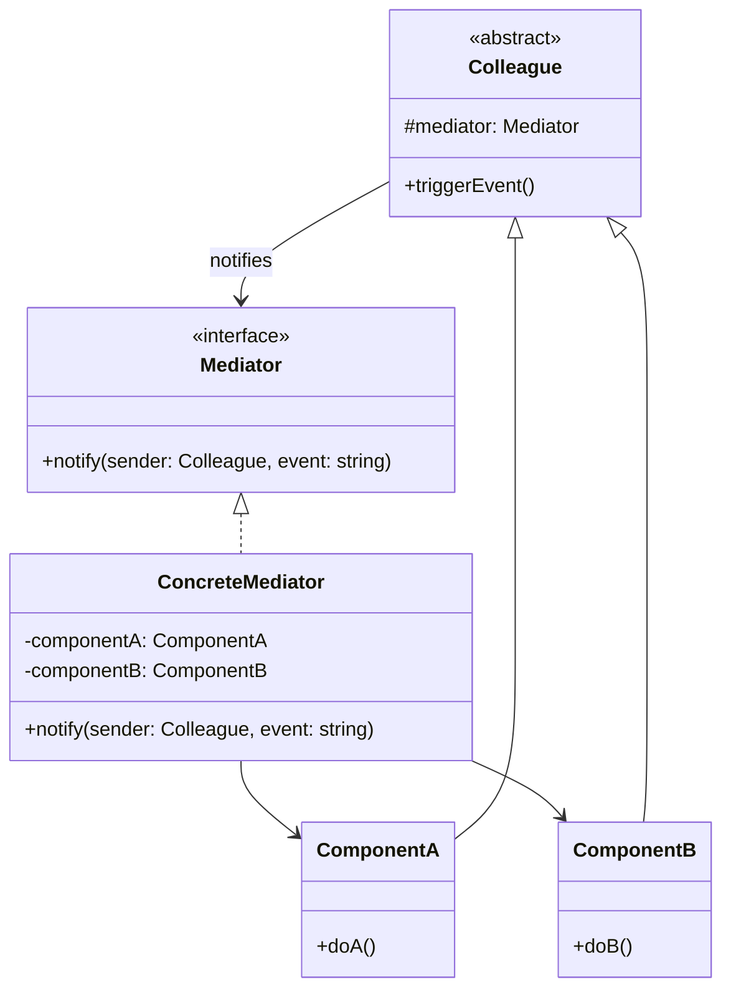

# Mediator Patterni

<CoverImage src="/covers/behavioral/mediator.webp" alt="Cover">
  <h1>Mediator</h1>
  <p>Dumaloq stol markazida hakam ko'ylagini kiygan xotirjam vositachi robot o'tiribdi — u qizil va yashil rangda porlab turgan yo'laklar yordamida stol atrofidagi beshta tartibsiz, baqirayotgan robot o'rtasidagi muloqotni muvofiqlashtiradi.</p>
</CoverImage>

## Umumiy ko'rinish (Overview)

**Mediator** (Vositachi) patterni — bu obyektlar o'rtasidagi tartibsiz bog'liqliklarni kamaytiruvchi xulq-atvor (behavioral) dizayn patternidir. U obyektlar o'rtasidagi to'g'ridan-to'g'ri muloqotni cheklaydi va ularni faqat markaziy vositachi obyekt orqali hamkorlik qilishga majbur qiladi.

**Asosiy afzalligi**: U "ko'pdan-ko'pga" (many-to-many) muloqot to'rini "birdan-ko'pga" (one-to-many) yulduzsimon topologiya bilan almashtiradi va tizim komponentlari o'rtasidagi bog'liqlikni keskin kamaytiradi.

**Zamonaviy nuqtai nazar**: Mediator patterni zamonaviy UI freymvorklariga (bu yerda Controller yoki ViewModel view'lar va modellar o'rtasida vositachilik qiladi), Event Bus'larga, API Gateway'larga va CQRS amalga oshirishlariga (masalan, C#'dagi mashhur MediatR kutubxonasi) chuqur singdirilgan.

## Muammo (The Problem)

Aviachiptalarni bron qilish tizimi uchun murakkab foydalanuvchi interfeysini yaratayotganingizni tasavvur qiling. Sizda turli UI komponentlari bor:

- Jo'nab ketish sanasini tanlash uchun ochiladigan ro'yxat (dropdown).
- "Moslashuvchan sanalar" (Flexible Dates) uchun belgilash katakchasi (checkbox).
- Qaytish sanasi uchun matn maydoni.
- "Qidirish" (Search) tugmasi.

Foydalanuvchi "Moslashuvchan sanalar" katakchasini belgilaganda, qaytish sanasi matn maydoni o'chirilishi (disable) kerak. Jo'nab ketish sanasi tozalanganda esa "Qidirish" tugmasi o'chirilishi shart.

```typescript
// ❌ Yomon: Komponentlar bir-biriga to'g'ridan-to'g'ri bog'liq
class Checkbox {
  constructor(private returnDateField: TextField) {}

  onCheck() {
    this.returnDateField.disable();
  }
}

class DateDropdown {
  constructor(private searchButton: Button) {}

  onChange() {
    if (this.isEmpty()) this.searchButton.disable();
  }
}
```

Agar holat o'zgarishlarini ishga tushirish uchun har bir komponent boshqa har bir komponentga to'g'ridan-to'g'ri havolaga muhtoj bo'lsa, oxir-oqibat "spagetti kod"ga ega bo'lasiz. `Checkbox` yoki `TextField` ni boshqa formada qayta ishlatish imkonsiz, chunki ular aynan shu formaning elementlariga qattiq bog'langan.

## Yechim (The Solution)

Mediator patterni komponentlar (**Colleague** — hamkasblar deb ataladi) bir-biri bilan to'g'ridan-to'g'ri muloqot qilmasligini taklif qiladi. Buning o'rniga ular hodisalar yoki xabarlarni **Mediator** obyektiga yuborishi kerak.

1. **Mediator** barcha komponentlar haqida biladi.
2. **Colleague'lar** faqat Mediator haqida biladi.
3. Colleague'ning holati o'zgarganda, u Mediator'ni xabardor qiladi. Mediator qaysi _boshqa_ Colleague'larni yangilash kerakligini hal qiluvchi biznes mantiqni o'z ichiga oladi.

O'zaro ta'sir mantiqini yagona klassga ajratish orqali siz komponentlarni mustaqil, qayta ishlatiladigan va testlash ancha oson qilasiz.

## Tuzilma (Structure)



## Oqim (Flow)

1. **Komponent** (Colleague) biror amalni bajaradi (masalan, foydalanuvchi katakchani bosadi).
2. **Komponent** `this.mediator.notify(this, "checkbox_clicked")` ni chaqiradi.
3. **Mediator** xabarnomani qabul qiladi.
4. **Mediator** tegishli biznes mantiqni bajaradi va boshqa komponentlarning metodlarini to'g'ridan-to'g'ri chaqiradi (masalan, `componentB.disable()`).

## Hayotiy o'xshatish (Real-World Analogy)

Gavjum aeroportdagi **havo harakati dispetcherini** tasavvur qiling.
Samolyotlar (Colleague'lar) keyingi kim qo'nishini hal qilish uchun bir-biri bilan to'g'ridan-to'g'ri gaplashmaydi. Agar shunday qilishganida, tartibsizlik bo'lardi. Buning o'rniga barcha samolyotlar faqat havo harakati dispetcheri (Mediator) bilan muloqot qiladi. Dispetcher aeroportning umumiy holatini, uchish-qo'nish yo'lagining bandligini va ob-havoni biladi. Dispetcher A samolyotiga qo'nishni, B samolyotiga esa aeroport atrofida aylanishni aytadi.

## Bosqichma-bosqich amalga oshirish (Step-by-Step Implementation)

1. **Mediator interfeysini aniqlang**: Xabardor qilish metodiga ega interfeys yarating (masalan, `notify(sender, event)`).
2. **Colleague bazaviy klassini aniqlang**: Mediator'ga havolani saqlaydigan komponentlar uchun bazaviy klass yoki interfeys yarating.
3. **Konkret Colleague'larni amalga oshiring**: Mustaqil komponentlaringizni yarating. Ular boshqalarga ta'sir qiladigan biror ish qilganda, mediator'ning `notify` metodini chaqiring.
4. **Konkret Mediator'ni amalga oshiring**: Mediator interfeysini amalga oshiradigan klassni yarating. U barcha konkret colleague'larga havolalarni saqlashi kerak. `sender` va `event` ga qarab mantiqni yo'naltiradigan `notify` metodini amalga oshiring.

## Kod misollari (Code Examples)

Biz **Insidentlarga javob berish xonasini** (Incident Response Room) amalga oshiramiz. Turli servislar (Alert Monitor, Commander, Status Page) nosozlik (outage) vaqtida harakatlarni muvofiqlashtirishi kerak, lekin ular bir-biriga to'g'ridan-to'g'ri bog'liq bo'lmasligi kerak.

::: code-group

```typescript [TypeScript]
// 1. Mediator interfeysi
interface IncidentMediator {
  notify(sender: Colleague, event: string, payload?: any): void;
}

// 2. Colleague bazaviy klassi
abstract class Colleague {
  constructor(
    protected mediator: IncidentMediator,
    public readonly name: string,
  ) {}
}

// 3. Konkret Colleague'lar
class AlertMonitor extends Colleague {
  detectIssue(serviceName: string): void {
    console.log(`[${this.name}] detected issue in: ${serviceName}`);
    this.mediator.notify(this, "issue_detected", serviceName);
  }
}

class IncidentCommander extends Colleague {
  acknowledge(): void {
    console.log(`[${this.name}] acknowledged the incident.`);
    this.mediator.notify(this, "incident_acknowledged");
  }

  declareResolved(): void {
    console.log(`[${this.name}] declared the incident resolved.`);
    this.mediator.notify(this, "incident_resolved");
  }
}

class StatusPageUpdater extends Colleague {
  updateStatus(message: string): void {
    console.log(`[${this.name}] Status Page Updated: ${message}`);
  }
}

class PagerService extends Colleague {
  pageEngineer(team: string): void {
    console.log(`[${this.name}] Paging on-call engineer for ${team}...`);
  }
}

// 4. Konkret Mediator
class IncidentRoom implements IncidentMediator {
  private monitor!: AlertMonitor;
  private commander!: IncidentCommander;
  private statusPage!: StatusPageUpdater;
  private pager!: PagerService;

  // Ro'yxatdan o'tkazish
  register(
    monitor: AlertMonitor,
    commander: IncidentCommander,
    status: StatusPageUpdater,
    pager: PagerService,
  ) {
    this.monitor = monitor;
    this.commander = commander;
    this.statusPage = status;
    this.pager = pager;
  }

  notify(sender: Colleague, event: string, payload?: any): void {
    if (event === "issue_detected") {
      this.statusPage.updateStatus(`Investigating issues with ${payload}`);
      this.pager.pageEngineer("BackendOps");
    } else if (event === "incident_acknowledged") {
      this.statusPage.updateStatus(
        "Engineers are currently investigating the issue.",
      );
    } else if (event === "incident_resolved") {
      this.statusPage.updateStatus("All systems operational.");
    }
  }
}

// 5. Client
const room = new IncidentRoom();

const monitor = new AlertMonitor(room, "Datadog");
const commander = new IncidentCommander(room, "Alice");
const statusPage = new StatusPageUpdater(room, "StatusIO");
const pager = new PagerService(room, "PagerDuty");

room.register(monitor, commander, statusPage, pager);

// Monitor muammoni aniqlaydi. U PagerDuty yoki StatusIO haqida HECH NARSA bilmaydi.
monitor.detectIssue("Payments API");
console.log("---");
commander.acknowledge();
console.log("---");
commander.declareResolved();
```

```python [Python]
from abc import ABC, abstractmethod

# 1. Mediator interfeysi
class IncidentMediator(ABC):
    @abstractmethod
    def notify(self, sender: 'Colleague', event: str, payload: str = None) -> None:
        pass

# 2. Colleague bazaviy klassi
class Colleague(ABC):
    def __init__(self, mediator: IncidentMediator, name: str):
        self.mediator = mediator
        self.name = name

# 3. Konkret Colleague'lar
class AlertMonitor(Colleague):
    def detect_issue(self, service_name: str) -> None:
        print(f"[{self.name}] detected issue in: {service_name}")
        self.mediator.notify(self, "issue_detected", service_name)

class IncidentCommander(Colleague):
    def acknowledge(self) -> None:
        print(f"[{self.name}] acknowledged the incident.")
        self.mediator.notify(self, "incident_acknowledged")

    def declare_resolved(self) -> None:
        print(f"[{self.name}] declared the incident resolved.")
        self.mediator.notify(self, "incident_resolved")

class StatusPageUpdater(Colleague):
    def update_status(self, message: str) -> None:
        print(f"[{self.name}] Status Page Updated: {message}")

class PagerService(Colleague):
    def page_engineer(self, team: str) -> None:
        print(f"[{self.name}] Paging on-call engineer for {team}...")

# 4. Konkret Mediator
class IncidentRoom(IncidentMediator):
    def __init__(self):
        self.monitor = None
        self.commander = None
        self.status_page = None
        self.pager = None

    def register(self, monitor, commander, status_page, pager) -> None:
        self.monitor = monitor
        self.commander = commander
        self.status_page = status_page
        self.pager = pager

    def notify(self, sender: Colleague, event: str, payload: str = None) -> None:
        if event == "issue_detected":
            self.status_page.update_status(f"Investigating issues with {payload}")
            self.pager.page_engineer("BackendOps")
        elif event == "incident_acknowledged":
            self.status_page.update_status("Engineers are currently investigating the issue.")
        elif event == "incident_resolved":
            self.status_page.update_status("All systems operational.")

# 5. Client
if __name__ == "__main__":
    room = IncidentRoom()

    monitor = AlertMonitor(room, "Datadog")
    commander = IncidentCommander(room, "Alice")
    status_page = StatusPageUpdater(room, "StatusIO")
    pager = PagerService(room, "PagerDuty")

    room.register(monitor, commander, status_page, pager)

    monitor.detect_issue("Payments API")
    print("---")
    commander.acknowledge()
    print("---")
    commander.declare_resolved()
```

```java [Java]
// 1. Mediator interfeysi
interface IncidentMediator {
    void notify(Colleague sender, String event, String payload);
}

// 2. Colleague bazaviy klassi
abstract class Colleague {
    protected IncidentMediator mediator;
    protected String name;

    public Colleague(IncidentMediator mediator, String name) {
        this.mediator = mediator;
        this.name = name;
    }
    public String getName() { return name; }
}

// 3. Konkret Colleague'lar
class AlertMonitor extends Colleague {
    public AlertMonitor(IncidentMediator mediator, String name) { super(mediator, name); }
    public void detectIssue(String serviceName) {
        System.out.println("[" + name + "] detected issue in: " + serviceName);
        mediator.notify(this, "issue_detected", serviceName);
    }
}

class IncidentCommander extends Colleague {
    public IncidentCommander(IncidentMediator mediator, String name) { super(mediator, name); }
    public void acknowledge() {
        System.out.println("[" + name + "] acknowledged the incident.");
        mediator.notify(this, "incident_acknowledged", null);
    }
    public void declareResolved() {
        System.out.println("[" + name + "] declared the incident resolved.");
        mediator.notify(this, "incident_resolved", null);
    }
}

class StatusPageUpdater extends Colleague {
    public StatusPageUpdater(IncidentMediator mediator, String name) { super(mediator, name); }
    public void updateStatus(String message) {
        System.out.println("[" + name + "] Status Page Updated: " + message);
    }
}

class PagerService extends Colleague {
    public PagerService(IncidentMediator mediator, String name) { super(mediator, name); }
    public void pageEngineer(String team) {
        System.out.println("[" + name + "] Paging on-call engineer for " + team + "...");
    }
}

// 4. Konkret Mediator
class IncidentRoom implements IncidentMediator {
    private AlertMonitor monitor;
    private IncidentCommander commander;
    private StatusPageUpdater statusPage;
    private PagerService pager;

    public void register(AlertMonitor m, IncidentCommander c, StatusPageUpdater s, PagerService p) {
        this.monitor = m;
        this.commander = c;
        this.statusPage = s;
        this.pager = p;
    }

    @Override
    public void notify(Colleague sender, String event, String payload) {
        if ("issue_detected".equals(event)) {
            statusPage.updateStatus("Investigating issues with " + payload);
            pager.pageEngineer("BackendOps");
        } else if ("incident_acknowledged".equals(event)) {
            statusPage.updateStatus("Engineers are currently investigating the issue.");
        } else if ("incident_resolved".equals(event)) {
            statusPage.updateStatus("All systems operational.");
        }
    }
}

// 5. Client
public class MediatorDemo {
    public static void main(String[] args) {
        IncidentRoom room = new IncidentRoom();

        AlertMonitor monitor = new AlertMonitor(room, "Datadog");
        IncidentCommander commander = new IncidentCommander(room, "Alice");
        StatusPageUpdater statusPage = new StatusPageUpdater(room, "StatusIO");
        PagerService pager = new PagerService(room, "PagerDuty");

        room.register(monitor, commander, statusPage, pager);

        monitor.detectIssue("Payments API");
        System.out.println("---");
        commander.acknowledge();
        System.out.println("---");
        commander.declareResolved();
    }
}
```

```go [Go]
package main

import "fmt"

// 1. Mediator interfeysi
type IncidentMediator interface {
	Notify(sender string, event string, payload string)
}

// 2. Konkret Colleague'lar
type AlertMonitor struct {
	mediator IncidentMediator
	name     string
}

func (m *AlertMonitor) DetectIssue(serviceName string) {
	fmt.Printf("[%s] detected issue in: %s\n", m.name, serviceName)
	m.mediator.Notify(m.name, "issue_detected", serviceName)
}

type IncidentCommander struct {
	mediator IncidentMediator
	name     string
}

func (c *IncidentCommander) Acknowledge() {
	fmt.Printf("[%s] acknowledged the incident.\n", c.name)
	c.mediator.Notify(c.name, "incident_acknowledged", "")
}

func (c *IncidentCommander) DeclareResolved() {
	fmt.Printf("[%s] declared the incident resolved.\n", c.name)
	c.mediator.Notify(c.name, "incident_resolved", "")
}

type StatusPageUpdater struct {
	name string
}

func (s *StatusPageUpdater) UpdateStatus(message string) {
	fmt.Printf("[%s] Status Page Updated: %s\n", s.name, message)
}

type PagerService struct {
	name string
}

func (p *PagerService) PageEngineer(team string) {
	fmt.Printf("[%s] Paging on-call engineer for %s...\n", p.name, team)
}

// 3. Konkret Mediator
type IncidentRoom struct {
	statusPage *StatusPageUpdater
	pager      *PagerService
}

func (r *IncidentRoom) Notify(sender string, event string, payload string) {
	switch event {
	case "issue_detected":
		r.statusPage.UpdateStatus("Investigating issues with " + payload)
		r.pager.PageEngineer("BackendOps")
	case "incident_acknowledged":
		r.statusPage.UpdateStatus("Engineers are currently investigating the issue.")
	case "incident_resolved":
		r.statusPage.UpdateStatus("All systems operational.")
	}
}

// 4. Client
func main() {
	statusPage := &StatusPageUpdater{name: "StatusIO"}
	pager := &PagerService{name: "PagerDuty"}

	room := &IncidentRoom{statusPage: statusPage, pager: pager}

	monitor := &AlertMonitor{mediator: room, name: "Datadog"}
	commander := &IncidentCommander{mediator: room, name: "Alice"}

	monitor.DetectIssue("Payments API")
	fmt.Println("---")
	commander.Acknowledge()
	fmt.Println("---")
	commander.DeclareResolved()
}
```

```rust [Rust]
use std::cell::RefCell;
use std::rc::Rc;

// 1. Mediator trait
trait IncidentMediator {
    fn notify(&self, sender: &str, event: &str, payload: &str);
}

// 2. Konkret Colleague'lar
struct StatusPageUpdater {
    name: String,
}

impl StatusPageUpdater {
    fn update_status(&self, message: &str) {
        println!("[{}] Status Page Updated: {}", self.name, message);
    }
}

struct PagerService {
    name: String,
}

impl PagerService {
    fn page_engineer(&self, team: &str) {
        println!("[{}] Paging on-call engineer for {}...", self.name, team);
    }
}

// 3. Konkret Mediator
// Rust'da mediator o'zgaruvchan/umumiy holatni saqlagani uchun Rc va RefCell ishlatamiz
struct IncidentRoom {
    status_page: Rc<RefCell<StatusPageUpdater>>,
    pager: Rc<RefCell<PagerService>>,
}

impl IncidentMediator for IncidentRoom {
    fn notify(&self, _sender: &str, event: &str, payload: &str) {
        match event {
            "issue_detected" => {
                let msg = format!("Investigating issues with {}", payload);
                self.status_page.borrow().update_status(&msg);
                self.pager.borrow().page_engineer("BackendOps");
            }
            "incident_acknowledged" => {
                self.status_page.borrow().update_status("Engineers are currently investigating the issue.");
            }
            "incident_resolved" => {
                self.status_page.borrow().update_status("All systems operational.");
            }
            _ => {}
        }
    }
}

// Colleague'lar uchun mediatorga Weak havola
struct AlertMonitor {
    mediator: Rc<dyn IncidentMediator>,
    name: String,
}

impl AlertMonitor {
    fn detect_issue(&self, service_name: &str) {
        println!("[{}] detected issue in: {}", self.name, service_name);
        self.mediator.notify(&self.name, "issue_detected", service_name);
    }
}

struct IncidentCommander {
    mediator: Rc<dyn IncidentMediator>,
    name: String,
}

impl IncidentCommander {
    fn acknowledge(&self) {
        println!("[{}] acknowledged the incident.", self.name);
        self.mediator.notify(&self.name, "incident_acknowledged", "");
    }

    fn declare_resolved(&self) {
        println!("[{}] declared the incident resolved.", self.name);
        self.mediator.notify(&self.name, "incident_resolved", "");
    }
}

// 4. Client
fn main() {
    let status_page = Rc::new(RefCell::new(StatusPageUpdater { name: "StatusIO".into() }));
    let pager = Rc::new(RefCell::new(PagerService { name: "PagerDuty".into() }));

    let room = Rc::new(IncidentRoom {
        status_page: Rc::clone(&status_page),
        pager: Rc::clone(&pager),
    });

    let monitor = AlertMonitor {
        mediator: Rc::clone(&room) as Rc<dyn IncidentMediator>,
        name: "Datadog".into(),
    };

    let commander = IncidentCommander {
        mediator: Rc::clone(&room) as Rc<dyn IncidentMediator>,
        name: "Alice".into(),
    };

    monitor.detect_issue("Payments API");
    println!("---");
    commander.acknowledge();
    println!("---");
    commander.declare_resolved();
}
```

:::

## Afzalliklari va kamchiliklari (Pros and Cons)

### Afzalliklari (Advantages)

- **Yagona mas'uliyat tamoyili (Single Responsibility Principle)**: Muloqot mantiqini bir joyga ajratishingiz mumkin, bu uni tushunish va qo'llab-quvvatlashni osonlashtiradi.
- **Ochiq/yopiqlik tamoyili (Open/Closed Principle)**: Haqiqiy komponentlarni o'zgartirmasdan yangi mediator yoki colleague'larni kiritishingiz mumkin.
- **Bo'sh bog'liqlik (Loose Coupling)**: Turli komponentlar o'rtasidagi bog'liqlikni keskin kamaytiradi. Komponentlarni ilovaning turli qismlarida qayta ishlatish mumkin.
- **Markazlashgan boshqaruv**: Murakkab tizimning umumiy ish oqimini o'nlab klasslarga tarqatib yubormasdan, bitta klassda ko'rinadigan qiladi.

### Kamchiliklari (Disadvantages)

- **God Object xavfi**: Agar Mediator'ga juda ko'p biznes mantiq tiqib yuborsangiz, u osonlikcha "God Object"ga (hamma narsani biladigan ulkan klass) aylanib qolishi mumkin.
- **Unumdorlikdagi tor joy**: Agar mediator yuqori chastotali hodisalarni qayta ishlasa, u unumdorlik bo'yicha tor joyga (bottleneck) aylanishi mumkin.
- **Kuzatish qiyin**: Hodisalarga asoslangan og'ir tizimlarda holat o'zgarishining manbasini mediator orqali orqaga kuzatib borish qiyin bo'lishi mumkin.

## Qachon foydalanish kerak (When to Use) ✅

- **Murakkab UI'lar**: UI komponentlari bir-birining holat o'zgarishlariga reaksiya qilishi kerak bo'lsa-yu, lekin qattiq bog'lanmasligi kerak bo'lganda.
- **Orkestratsiya qatlamlari**: Yagona "Saga" yoki "Workflow" koordinatori kerak bo'lgan bir nechta mikroservis yoki ichki tizimlarni integratsiya qilishda.
- **CQRS**: [CQRS](/uz/architectural/cqrs) (Command Query Responsibility Segregation) patternida Mediator (masalan, MediatR) buyruqlarni o'z ishlovchilariga yo'naltiruvchi markaziy tugun vazifasini bajaradi.

## Qachon foydalanmaslik kerak (When NOT to Use) ❌

- **Oddiy o'zaro ta'sirlar**: Agar faqat ikki obyekt bir-biri bilan gaplashishi kerak bo'lsa, to'g'ridan-to'g'ri havola yoki oddiy callback ancha aniqroq.
- **Quvurli qayta ishlash (Pipeline Processing)**: Agar ma'lumotlar shunchaki A -> B -> C qadamlar bo'ylab ketma-ket oqsa, **[Chain of Responsibility](/uz/behavioral/chain-of-responsibility)** yoki **Pipes and Filters** patterni ko'proq mos keladi.

## Keng tarqalgan xatolar (Common Mistakes)

### 1. Ma'lumotlar mantiqini Mediator'ga joylashtirish

Mediator xatti-harakatni _muvofiqlashtirishi_ kerak, asosiy biznes holatini _saqlashi_ emas.

```typescript
// ❌ Yomon: Mediator ma'lumotlar bazasi mantiqiga egalik qiladi
class BadMediator {
  notify(sender, event) {
    if (event === "save") {
      db.query("INSERT INTO..."); // Mediator ma'lumotlar qatlami ishini bajaryapti
    }
  }
}
```

### 2. God Object yaratish

Agar Mediator'ingiz 3000 qatorlik bo'lsa va loyihangizdagi har bir faylni import qilsa, siz haddan oshib ketgansiz. Mediator'ni kichikroq, sohaga xos koordinatorlarga bo'ling.

## Aloqador patternlar (Related Patterns)

- **[Observer](/uz/behavioral/observer)**: Mediator va Observer ko'pincha bir-birining o'rnida ishlatiladi. Observer'da obyekt hodisalarni tarqatadi va kim tinglayotgani bilan qiziqmaydi. Mediator'da esa markaziy obyekt aynan kim javob berishi kerakligini biladi. (Mediator'lar ko'pincha ichida Observer patternidan foydalanadi).
- **[Facade](/uz/structural/facade)**: Facade klasslar quyi tizimiga soddalashtirilgan interfeys taqdim etadi. Facade qat'iy bir tomonlama ishlaydi (Client -> Facade -> Subsystem). Mediator esa komponentlar o'rtasidagi ko'p yo'nalishli muloqotni boshqaradi.
- **[Command](/uz/behavioral/command)**: Ko'pincha Mediator haqiqiy ishni Command'larga topshiradi.

## Intervyu uchun maslahatlar (Interview Insights)

- **Savol**: "Mediator va Observer o'rtasida qanday farq bor?"
  - **Javob**: "Observer — bu tarqatish mexanizmi (Pub/Sub). Nashr qiluvchi (publisher) obunachilar kimligini bilmaydi. Mediator esa markazlashgan koordinator. Mediator o'zi muvofiqlashtirayotgan komponentlar haqida aniq biladi va ularning muayyan ish oqimlarini boshqaradi (orkestratsiya qiladi)."
- **Savol**: "Mediator xotira sizib chiqishiga (memory leak) sabab bo'lishi mumkinmi?"
  - **Javob**: "Ha. Mediator barcha Colleague'larga havolalarni saqlagani, Colleague'lar esa Mediator'ga havola saqlagani uchun osonlikcha aylana havolalar (circular references) yaratish mumkin. Xotirasi avtomatik boshqariladigan tillarda garbage collection ishlashi uchun ko'pincha komponentlar yo'q qilinganda ularni ro'yxatdan chiqarish kerak bo'ladi."

## Zamonaviy muqobillar (Modern Alternatives)

- **Pub/Sub (Event Bus)**: Kafka, RabbitMQ yoki oddiy Node.js `EventEmitter` kabi vositalar qat'iy Mediator'larga nisbatan ajratilgan (decoupled), sof reaktiv muqobillardir.
- **Redux / Holatni boshqarish (State Management)**: Frontend muhandisligida global holat omborlari (Redux, Vuex yoki Zustand kabi) Mediator vazifasini bajaradi. Komponentlar action'larni yuboradi (dispatch), Store esa yangilanadi va qayta renderlashni ishga tushiradi.
- **MediatR (C#)**: HTTP Controller'larni biznes mantiq Handler'laridan ajratish uchun Mediator patternini amalga oshiradigan juda mashhur kutubxona.
