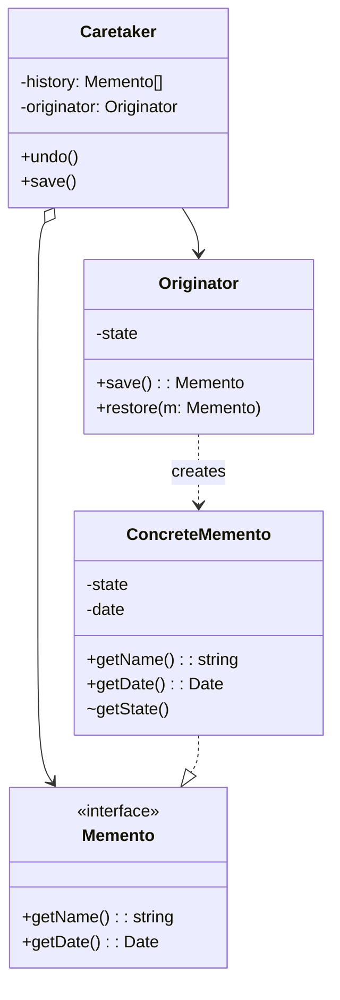

# Memento Patterni

<CoverImage src="/covers/behavioral/memento.webp" alt="Cover">
  <h1>Memento</h1>
  <p>Yoqimtoy kichkina retro fotoapparat qum qasrini suratga olmoqda; uning yonida qum qasri vayron bo'lgan, lekin robotda surat bor va u qasrni hech qiynalmasdan aynan suratdagidek qilib qayta quryapti.</p>
</CoverImage>

## Umumiy ko'rinish (Overview)

**Memento** (Esdalik) patterni — bu obyektning ichki holatini keyinchalik tiklash uchun saqlab olish imkonini beruvchi xulq-atvor (behavioral) dizayn patternidir. Eng muhimi, u buni obyektning _inkapsulyatsiyasini buzmasdan_ amalga oshiradi.

**Asosiy afzalligi**: Murakkab obyektning xususiy (private) maydonlari yoki ichki tuzilishini ilovaning qolgan qismiga oshkor qilmasdan, uning holatining suratlarini (snapshot) yaratishingiz mumkin.

**Zamonaviy nuqtai nazar**: Memento "Undo/Redo" steklari, o'yinni saqlash fayllari, brauzer tarixi va vaqt bo'ylab sayohat qiluvchi debug vositalarining (Redux DevTools kabi) arxitekturaviy asosidir. Zamonaviy funksional dasturlashda o'zgarmaslik (immutability) klassik OOP Memento'lariga bo'lgan ehtiyojni asosan almashtiradi, chunki holat suratlari tabiiy ravishda hosil bo'ladi.

## Muammo (The Problem)

Tasavvur qiling, siz zamonaviy matn muharriri yoki grafik kanvas yaratyapsiz. Tabiiyki, sizga "Undo" (bekor qilish) funksiyasi kerak.

Undo'ni amalga oshirish uchun o'zgartirish kiritishdan oldin muharrir holatini yozib olishingiz kerak.

```typescript
// ❌ Yomon: Holatni saqlash uchun inkapsulyatsiyani buzish
class Editor {
  private text: string = "";
  private cursorX: number = 0;
  private cursorY: number = 0;
  private selectionWidth: number = 0;

  // Tarix menejeri bu ma'lumotlarni saqlashi kerak.
  // Bu maydonlarni public qilishimiz kerakmi?
}
```

Agar barcha ichki maydonlarni `public` qilsangiz, istalgan boshqa klass muharrir holatini kutilmaganda o'zgartirishi mumkin, bu esa OOP tamoyillarini buzadi. Bundan tashqari, agar keyinroq `Editor` ni boshqa ma'lumotlar tuzilmasidan (masalan, `String` o'rniga `Rope`) foydalanadigan qilib refaktoring qilsangiz, eski maydonlarga tayanadigan tarix menejeri buziladi.

Holat _qanday_ tuzilganini oshkor qilmasdan, uni xavfsiz saqlash usuli kerak.

## Yechim (The Solution)

Memento patterni holat suratlarini yaratishni obyektning o'ziga (**Originator** — yaratuvchi) topshiradi, chunki obyekt o'zining xususiy maydonlariga to'liq kirish huquqiga ega.

1. **Originator**: Holatini saqlash kerak bo'lgan obyekt (masalan, `Editor`).
2. **Memento**: Originator holatining surati vazifasini bajaradigan qiymat obyekti (value object). U qat'iy faqat o'qish uchun va o'zgarmas (immutable).
3. **Caretaker** (Qarovchi): Saqlash/tiklashning "qachon" va "nima uchun"ini boshqaradigan obyekt (masalan, `HistoryManager`). U Memento'lar ro'yxatini saqlaydi, lekin ularning ichidagini _hech qachon_ tekshirmaydi.

Caretaker holatni saqlashi kerak bo'lganda, u Originator'dan Memento so'raydi. Bekor qilish kerak bo'lganda esa, o'sha Memento'ni Originator'ga qaytarib beradi.

## Tuzilma (Structure)



## Oqim (Flow)

1. **Caretaker** holatni saqlash vaqti kelganini hal qiladi (masalan, foydalanuvchi buyrug'ini bajarishdan oldin).
2. **Caretaker** `originator.save()` ni chaqiradi.
3. **Originator** o'z ichki holatining chuqur nusxasini (deep copy) o'z ichiga olgan **ConcreteMemento** yaratadi va uni qaytaradi.
4. **Caretaker** Memento'ni stekka qo'shadi. U Memento bilan faqat cheklangan interfeys (masalan, `getName()`) orqali ishlaydi.
5. "Undo" bajarilganda **Caretaker** Memento'ni stekdan oladi va `originator.restore(memento)` ni chaqiradi.

## Hayotiy o'xshatish (Real-World Analogy)

**Video o'yinni saqlash faylini** tasavvur qiling.
Siz RPG o'ynayapsiz (**Originator**). Siz boss xonasiga kirasiz va o'yinni qo'lda saqlaysiz. O'yin sizning sog'lig'ingiz, inventaringiz va joylashuvingizni saqlash fayliga (**Memento**) serializatsiya qiladi.

Qattiq disk yoki operatsion tizim (**Caretaker**) bu saqlash fayllarini boshqaradi. U ular qachon yaratilganini va qanday nomlanganini biladi, lekin RPG inventaringizning ichki ikkilik formatini tushunmaydi. Agar siz halok bo'lsangiz, OT saqlash faylini o'yinga qaytarib beradi va o'yin o'zining ichki holatini aynan siz turgan joyga tiklaydi.

## Bosqichma-bosqich amalga oshirish (Step-by-Step Implementation)

1. **Memento interfeysini yarating**: U faqat metama'lumotlarni (masalan, `getTimestamp()` yoki `getName()`) oshkor qilishi kerak. Haqiqiy holat ma'lumotlarini aniq yashirishi kerak.
2. **Konkret Memento'ni yarating**: Interfeysni amalga oshiring. Bu klass haqiqiy holat ma'lumotlarini saqlaydi. Ko'p tillarda uni ichki (nested) yoki paket ichida yopiq (package-private) klass qilish mumkin, shunda xom holatga faqat Originator kira oladi.
3. **Originator'ni amalga oshiring**: `save(): Memento` (holatni yangi ConcreteMemento'ga joylaydi) va `restore(memento: Memento)` (holatni ochib, uni qo'llaydi) metodlarini qo'shing.
4. **Caretaker'ni amalga oshiring**: Bu klass Memento'lar massivi/stekini saqlaydi va saqlash/bekor qilish jarayonini muvofiqlashtiradi.

## Kod misollari (Code Examples)

Biz `History` menejeriga ega oddiy `GameEditor` ni yaratamiz. Memento o'yinchining joylashuvi va sog'lig'ini xavfsiz saqlaydi.

::: code-group

```typescript [TypeScript]
// 1. Memento interfeysi (Caretaker uchun cheklangan interfeys)
interface Memento {
  getName(): string;
  getDate(): string;
}

// 2. Konkret Memento (maxfiy holatni saqlaydi)
// TypeScript'da metodlarga kirishni to'liq cheklay olmaymiz, lekin kelishuv orqali qilsa bo'ladi.
class ConcreteMemento implements Memento {
  private readonly date: string;

  constructor(
    private readonly state: string,
    private readonly health: number,
    private readonly position: { x: number; y: number },
  ) {
    this.date = new Date().toISOString();
  }

  // Bu metodlardan Originator foydalanadi, Caretaker esa foydalanmasligi kerak.
  getState(): string {
    return this.state;
  }
  getHealth(): number {
    return this.health;
  }
  getPosition(): { x: number; y: number } {
    return this.position;
  }

  // Interfeys metodlari
  getName(): string {
    return `${this.date} / State: ${this.state}`;
  }

  getDate(): string {
    return this.date;
  }
}

// 3. Originator
class GameEditor {
  private state: string = "Idle";
  private health: number = 100;
  private position: { x: number; y: number } = { x: 0, y: 0 };

  // O'zgartiruvchi metodlar
  play(action: string, healthChange: number, x: number, y: number) {
    this.state = action;
    this.health += healthChange;
    this.position = { x, y };
    console.log(
      `GameEditor: Changed state to [${this.state}] HP: ${this.health}`,
    );
  }

  // Holatni Memento ichiga saqlaydi
  save(): Memento {
    console.log("GameEditor: Saving state...");
    return new ConcreteMemento(this.state, this.health, { ...this.position });
  }

  // Holatni Memento'dan tiklaydi
  restore(m: Memento): void {
    if (!(m instanceof ConcreteMemento)) {
      throw new Error("Unknown memento class");
    }
    console.log("GameEditor: Restoring state...");
    this.state = m.getState();
    this.health = m.getHealth();
    this.position = { ...m.getPosition() };
    console.log(`GameEditor: Restored to [${this.state}] HP: ${this.health}`);
  }
}

// 4. Caretaker
class HistoryManager {
  private mementos: Memento[] = [];

  constructor(private originator: GameEditor) {}

  backup(): void {
    console.log("History: Performing backup...");
    this.mementos.push(this.originator.save());
  }

  undo(): void {
    if (!this.mementos.length) return;

    const memento = this.mementos.pop();
    console.log(`History: Restoring memento: ${memento?.getName()}`);
    this.originator.restore(memento!);
  }

  showHistory(): void {
    console.log("History: Here's the list of mementos:");
    for (const m of this.mementos) {
      console.log(m.getName());
    }
  }
}

// 5. Client
const game = new GameEditor();
const history = new HistoryManager(game);

history.backup();
game.play("Running", -10, 10, 0);

history.backup();
game.play("Fighting Boss", -50, 10, 20);

history.showHistory();

console.log("\nClient: Now, let's rollback!");
history.undo();

console.log("\nClient: Rollback again!");
history.undo();
```

```python [Python]
from __future__ import annotations
from abc import ABC, abstractmethod
from datetime import datetime
import copy

# 1. Memento interfeysi
class Memento(ABC):
    @abstractmethod
    def get_name(self) -> str:
        pass

    @abstractmethod
    def get_date(self) -> str:
        pass

# 2. Konkret Memento
class ConcreteMemento(Memento):
    def __init__(self, state: str, health: int, position: dict):
        # O'zgarmaslikni ta'minlash uchun deepcopy qilamiz
        self._state = state
        self._health = health
        self._position = copy.deepcopy(position)
        self._date = str(datetime.now())

    # Originator metodlari
    def get_state(self) -> str:
        return self._state

    def get_health(self) -> int:
        return self._health

    def get_position(self) -> dict:
        return self._position

    # Interfeys metodlari
    def get_name(self) -> str:
        return f"{self._date} / State: {self._state}"

    def get_date(self) -> str:
        return self._date

# 3. Originator
class GameEditor:
    def __init__(self):
        self._state = "Idle"
        self._health = 100
        self._position = {"x": 0, "y": 0}

    def play(self, action: str, health_change: int, x: int, y: int):
        self._state = action
        self._health += health_change
        self._position = {"x": x, "y": y}
        print(f"GameEditor: Changed state to [{self._state}] HP: {self._health}")

    def save(self) -> Memento:
        print("GameEditor: Saving state...")
        return ConcreteMemento(self._state, self._health, self._position)

    def restore(self, memento: Memento):
        # Python'da duck typing yoki isinstance'ga tayanamiz
        if not isinstance(memento, ConcreteMemento):
            return

        print("GameEditor: Restoring state...")
        self._state = memento.get_state()
        self._health = memento.get_health()
        self._position = copy.deepcopy(memento.get_position())
        print(f"GameEditor: Restored to [{self._state}] HP: {self._health}")

# 4. Caretaker
class HistoryManager:
    def __init__(self, originator: GameEditor):
        self._mementos = []
        self._originator = originator

    def backup(self) -> None:
        print("History: Performing backup...")
        self._mementos.append(self._originator.save())

    def undo(self) -> None:
        if not len(self._mementos):
            return

        memento = self._mementos.pop()
        print(f"History: Restoring memento: {memento.get_name()}")
        self._originator.restore(memento)

    def show_history(self) -> None:
        print("History: Here's the list of mementos:")
        for m in self._mementos:
            print(m.get_name())

# 5. Client
if __name__ == "__main__":
    game = GameEditor()
    history = HistoryManager(game)

    history.backup()
    game.play("Running", -10, 10, 0)

    history.backup()
    game.play("Fighting Boss", -50, 10, 20)

    history.show_history()

    print("\nClient: Now, let's rollback!")
    history.undo()

    print("\nClient: Rollback again!")
    history.undo()
```

```java [Java]
import java.util.Stack;

// 1. Memento interfeysi
interface Memento {
    String getName();
}

// 3. Originator (Java ichki klasslarga ruxsat beradi, bu Memento uchun ayni muddao!)
class GameEditor {
    private String state = "Idle";
    private int health = 100;

    public void play(String action, int healthChange) {
        this.state = action;
        this.health += healthChange;
        System.out.println("GameEditor: Changed state to [" + state + "] HP: " + health);
    }

    public Memento save() {
        System.out.println("GameEditor: Saving state...");
        return new ConcreteMemento(this.state, this.health);
    }

    public void restore(Memento m) {
        // ConcreteMemento GameEditor uchun private bo'lgani sababli,
        // faqat GameEditor uni cast qilib, maydonlarini o'qiy oladi.
        ConcreteMemento memento = (ConcreteMemento) m;
        this.state = memento.savedState;
        this.health = memento.savedHealth;
        System.out.println("GameEditor: Restored to [" + state + "] HP: " + health);
    }

    // 2. Konkret Memento (ichki klass maydonlarni Caretaker'dan yashiradi)
    private static class ConcreteMemento implements Memento {
        private final String savedState;
        private final int savedHealth;

        private ConcreteMemento(String state, int health) {
            this.savedState = state;
            this.savedHealth = health;
        }

        @Override
        public String getName() {
            return "State: " + savedState;
        }
    }
}

// 4. Caretaker
class HistoryManager {
    private Stack<Memento> mementos = new Stack<>();
    private GameEditor originator;

    public HistoryManager(GameEditor originator) {
        this.originator = originator;
    }

    public void backup() {
        System.out.println("History: Performing backup...");
        mementos.push(originator.save());
    }

    public void undo() {
        if (!mementos.isEmpty()) {
            Memento m = mementos.pop();
            System.out.println("History: Restoring memento: " + m.getName());
            originator.restore(m);
        }
    }
}

// 5. Client
public class MementoDemo {
    public static void main(String[] args) {
        GameEditor game = new GameEditor();
        HistoryManager history = new HistoryManager(game);

        history.backup();
        game.play("Running", -10);

        history.backup();
        game.play("Fighting Boss", -50);

        System.out.println("\nClient: Now, let's rollback!");
        history.undo();

        System.out.println("\nClient: Rollback again!");
        history.undo();
    }
}
```

```go [Go]
package main

import "fmt"

// 1. Memento interfeysi
type Memento interface {
	GetName() string
}

// 2. Konkret Memento
// Go'da kichik harfli maydonlar paketdan tashqariga eksport qilinmaydi.
// Agar Caretaker boshqa paketda bo'lsa, u bu maydonlarga tega olmaydi!
type concreteMemento struct {
	state  string
	health int
}

func (m *concreteMemento) GetName() string {
	return fmt.Sprintf("State: %s", m.state)
}

// 3. Originator
type GameEditor struct {
	state  string
	health int
}

func (g *GameEditor) Play(action string, healthChange int) {
	g.state = action
	g.health += healthChange
	fmt.Printf("GameEditor: Changed state to [%s] HP: %d\n", g.state, g.health)
}

func (g *GameEditor) Save() Memento {
	fmt.Println("GameEditor: Saving state...")
	return &concreteMemento{
		state:  g.state,
		health: g.health,
	}
}

func (g *GameEditor) Restore(m Memento) {
	cm, ok := m.(*concreteMemento)
	if !ok {
		return
	}
	fmt.Println("GameEditor: Restoring state...")
	g.state = cm.state
	g.health = cm.health
	fmt.Printf("GameEditor: Restored to [%s] HP: %d\n", g.state, g.health)
}

// 4. Caretaker
type HistoryManager struct {
	mementos   []Memento
	originator *GameEditor
}

func (h *HistoryManager) Backup() {
	fmt.Println("History: Performing backup...")
	h.mementos = append(h.mementos, h.originator.Save())
}

func (h *HistoryManager) Undo() {
	if len(h.mementos) == 0 {
		return
	}
	// Pop qilish
	lastIdx := len(h.mementos) - 1
	m := h.mementos[lastIdx]
	h.mementos = h.mementos[:lastIdx]

	fmt.Printf("History: Restoring memento: %s\n", m.GetName())
	h.originator.Restore(m)
}

// 5. Client
func main() {
	game := &GameEditor{state: "Idle", health: 100}
	history := &HistoryManager{originator: game}

	history.Backup()
	game.Play("Running", -10)

	history.Backup()
	game.Play("Fighting Boss", -50)

	fmt.Println("\nClient: Now, let's rollback!")
	history.Undo()

	fmt.Println("\nClient: Rollback again!")
	history.Undo()
}
```

```rust [Rust]
// 1. Memento trait
trait Memento {
    fn get_name(&self) -> String;
}

// 2. Konkret Memento
// Rust'da struct maydonlari standart holatda modul uchun private bo'ladi
#[derive(Clone)]
struct ConcreteMemento {
    state: String,
    health: i32,
}

impl Memento for ConcreteMemento {
    fn get_name(&self) -> String {
        format!("State: {}", self.state)
    }
}

// 3. Originator
struct GameEditor {
    state: String,
    health: i32,
}

impl GameEditor {
    fn new() -> Self {
        Self {
            state: "Idle".to_string(),
            health: 100,
        }
    }

    fn play(&mut self, action: &str, health_change: i32) {
        self.state = action.to_string();
        self.health += health_change;
        println!("GameEditor: Changed state to [{}] HP: {}", self.state, self.health);
    }

    fn save(&self) -> Box<dyn Memento> {
        println!("GameEditor: Saving state...");
        Box::new(ConcreteMemento {
            state: self.state.clone(),
            health: self.health,
        })
    }

    fn restore(&mut self, memento: &Box<dyn Memento>) {
        // Any orqali downcast qilamiz yoki aniq struct yondashuvi bilan soddaroq qilamiz.
        // Rust enum holatlar yoki aniq generic'larni afzal ko'radi. OOP'ni taqlid qilish uchun downcast qilamiz:
        // *Lekin soddalik uchun*, konkret structni qaytaramiz deb faraz qilaylik,
        // agar Caretaker va Originator turli modullarda bo'lsa.
        // Quyida idiomatik Rust yechimi.
    }
}

// Idiomatik Rust Memento implementatsiyasi (Box<dyn> downcasting xarajatisiz)
struct RustConcreteMemento {
    state: String,
    health: i32,
}

impl GameEditor {
    fn save_idiomatic(&self) -> RustConcreteMemento {
        println!("GameEditor: Saving state...");
        RustConcreteMemento {
            state: self.state.clone(),
            health: self.health,
        }
    }

    fn restore_idiomatic(&mut self, memento: &RustConcreteMemento) {
        println!("GameEditor: Restoring state...");
        self.state = memento.state.clone();
        self.health = memento.health;
        println!("GameEditor: Restored to [{}] HP: {}", self.state, self.health);
    }
}

// 4. Caretaker
struct HistoryManager {
    mementos: Vec<RustConcreteMemento>,
}

impl HistoryManager {
    fn new() -> Self {
        Self {
            mementos: Vec::new(),
        }
    }

    fn backup(&mut self, originator: &GameEditor) {
        println!("History: Performing backup...");
        self.mementos.push(originator.save_idiomatic());
    }

    fn undo(&mut self, originator: &mut GameEditor) {
        if let Some(m) = self.mementos.pop() {
            println!("History: Restoring memento: {}", m.state);
            originator.restore_idiomatic(&m);
        }
    }
}

// 5. Client
fn main() {
    let mut game = GameEditor::new();
    let mut history = HistoryManager::new();

    history.backup(&game);
    game.play("Running", -10);

    history.backup(&game);
    game.play("Fighting Boss", -50);

    println!("\nClient: Now, let's rollback!");
    history.undo(&mut game);

    println!("\nClient: Rollback again!");
    history.undo(&mut game);
}
```

:::

## Afzalliklari va kamchiliklari (Pros and Cons)

### Afzalliklari (Advantages)

- **Inkapsulyatsiya**: Obyektning maydonlari yoki ichki amalga oshirilishini ilovaning qolgan qismiga oshkor qilmasdan, uning ichki holatini saqlashingiz mumkin.
- **Yagona mas'uliyat tamoyili (Single Responsibility Principle)**: Holat tarixini boshqarish mantiqini Originator'dan ajratib, Caretaker'ga joylashtirasiz.
- **Oson nazorat nuqtalari (checkpoint)**: Qoralamalar, saqlash nuqtalari yoki ishdan chiqqandan keyin tiklash kabi funksiyalar uchun juda foydali.

### Kamchiliklari (Disadvantages)

- **Xotira sarfi**: Agar Originator holati juda katta bo'lsa (masalan, katta kanvas tasviri) va siz har soniyada Memento yaratsangiz, RAM tezda tugaydi.
- **Unumdorlik xarajati**: Memento yaratish uchun murakkab obyekt graflarini chuqur nusxalash CPU vaqtini oladi.
- **Garbage Collection bosimi**: Memento obyektlarini doimiy yaratish va yo'q qilish Java, C# yoki JS kabi tillarda Garbage Collector'ga og'ir yuk tushiradi.

## Qachon foydalanish kerak (When to Use) ✅

- **Undo/Redo funksiyasi**: Klassik foydalanish holati.
- **Ma'lumotlar bazasi tranzaksiyalari**: Ma'lumotlar bazasi tranzaksiyasi muvaffaqiyatsiz bo'lsa, xotiradagi obyekt grafini orqaga qaytarmoqchi bo'lganingizda.
- **Wizard'lar va ko'p bosqichli formalar**: Agar foydalanuvchi murakkab UI wizard'ida "Orqaga" tugmasini bossa, Memento'ni tiklash UI holat o'zgarishlarini qo'lda bekor qilishdan ancha oson.

## Qachon foydalanmaslik kerak (When NOT to Use) ❌

- **Juda katta xotira hajmi**: Agar obyekt holati gigabaytlab ma'lumotlarni o'z ichiga olsa, klassik Memento'lardan foydalana olmaysiz. "Diff"lar yoki "delta"lardan (faqat o'zgargan narsani saqlash) foydalanishingiz kerak.
- **O'zgarmas (immutable) arxitekturalar**: Agar arxitekturangiz tabiiy ravishda o'zgarmas ma'lumotlar tuzilmalariga (Redux yoki Clojure kabi) tayansa, har bir holat o'tishi tabiiy ravishda yangi mustaqil holat obyektini hosil qiladi. Memento patterni o'z-o'zidan bajarilgan bo'ladi.

## Keng tarqalgan xatolar (Common Mistakes)

### 1. Sayoz nusxalash (Shallow Copying)

Agar obyekt holatingiz massivlar yoki obyektlarga havolalarni o'z ichiga olsa va siz ularni Memento'ga faqat sayoz nusxalasangiz, asl obyektni o'zgartirish Memento'ni ham o'zgartiradi! Holatni _albatta_ chuqur klonlashingiz (deep clone) kerak.

```typescript
// ❌ Yomon: Sayoz nusxa
save() { return new Memento(this.itemsArray); }

// ✅ Yaxshi: Chuqur nusxa
save() { return new Memento(structuredClone(this.itemsArray)); }
```

### 2. Caretaker'da inkapsulyatsiyani buzish

Caretaker HECH QACHON Memento ichidagi holatni o'qimasligi yoki o'zgartirmasligi kerak. U Memento'ni shaffof bo'lmagan "qora quti" sifatida ko'rishi kerak.

## Aloqador patternlar (Related Patterns)

- **[Command](/uz/behavioral/command)**: Deyarli har doim birga ishlatiladi. Command amalni ifodalaydi va amal bajarilishidan _oldingi_ holatni ifodalovchi Memento'ni saqlaydi. `command.undo()` ni chaqirish Memento'ni tiklaydi.
- **[Iterator](/uz/behavioral/iterator)**: Caretaker'da saqlangan Memento'lar tarixini aylanib chiqish uchun Iterator'lardan foydalanishingiz mumkin.
- **[Prototype](/uz/creational/prototype)**: Ko'pincha Memento uchun zarur bo'lgan chuqur nusxa suratini yaratishda ichkarida ishlatiladi.

## Intervyu uchun maslahatlar (Interview Insights)

- **Savol**: "Agar Memento'lar juda ko'p RAM egallasa, Undo tizimini qanday optimallashtirish mumkin?"
  - **Javob**: "To'liq holat suratlarini (Memento'larni) saqlash o'rniga _teskari Command'ni_ (delta) saqlaysiz. Agar foydalanuvchi 'A' ni yozsa, '1 ta belgini o'chirish' buyrug'ini saqlaysiz. Bu ancha kam xotira ishlatadi, lekin kodni ancha murakkablashtiradi."
- **Savol**: "Java Memento'ning 'cheklangan interfeysi'ni qanday ta'minlaydi?"
  - **Javob**: "Java ichki (nested) klasslarga ruxsat beradi. `ConcreteMemento` ni `Originator` ichidagi xususiy ichki klass qilib, uning maydonlariga faqat Originator kira oladigan qilinadi. Caretaker'ga esa hech narsani oshkor qilmaydigan ochiq `Memento` interfeysi beriladi."

## Zamonaviy muqobillar (Modern Alternatives)

- **O'zgarmaslik (Redux / [Event Sourcing](/uz/architectural/event-sourcing))**: Agar ilova holati to'liq o'zgarmas bo'lsa, har bir o'zgartirish butunlay yangi State daraxtini yaratadi. "Memento" — bu shunchaki oldingi o'zgarmas daraxtga havola. Nusxalashga hojat yo'q.
- **JSON serializatsiyasi**: JS/Python'da Memento'ni amalga oshirishning juda tez va oddiy usuli — obyektni JSON satriga serializatsiya qilib saqlash, so'ng tiklash uchun uni parse qilish. Bu chuqur nusxani va inkapsulyatsiyaning mutlaqo sizib chiqmasligini kafolatlaydi.
