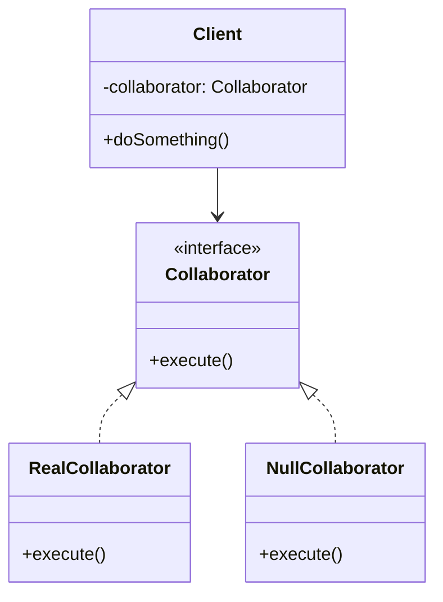

# Null Object Pattern

<CoverImage src="/covers/behavioral/null-object.webp" alt="Cover">
  <h1>Null Object</h1>
  <p>Asboblar qutisi: undagi uyalardan birida shaffof "Null bolg'a" (qattiq plastikdan yasalgan tiniq blok) turibdi — u urilganda mutlaqo hech narsa qilmaydi, lekin uyaga juda mos tushadi va tizimni ishdan chiqarmaydi.</p>
</CoverImage>

## Umumiy ko'rinish (Overview)

**Null Object** — bu yo'q bo'lgan hamkor (collaborator) obyekt o'rniga xavfsiz, hech narsa qilmaydigan (no-op, "no operation") o'rinbosarni taqdim etuvchi xulq-atvor (behavioral) dizayn patternidir. `null` yoki `nil` qiymatlariga tayanib, butun kod bazasi bo'ylab `if (object != null)` kabi himoya tekshiruvlarini tarqatib yuborish o'rniga, siz haqiqiy obyekt bilan aynan bir xil interfeysni amalga oshiradigan, lekin hech narsa qilmaydigan Null Object'ni uzatasiz (inject qilasiz).

**Asosiy afzalligi**: U `null` havola xatolarini butunlay yo'q qiladi va obyektning yo'qligini shunchaki yana bir to'g'ri xulq-atvor sifatida ko'rib, biznes mantig'ini soddalashtiradi.

**Zamonaviy nuqtai nazar**: Hali ham foydali bo'lsa-da, qat'iy null-xavfsizlikka ega zamonaviy tillar (Kotlin, Rust va `strictNullChecks` yoqilgan TypeScript kabi) yoki tabiiy `Option`/`Maybe` monadalari Null Object patterniga bo'lgan mutlaq ehtiyojni kamaytirdi. Biroq dependency injection uchun (masalan, soxta Logger yoki Analytics yuboruvchi) u eng toza arxitektura tanlovi bo'lib qolmoqda.

## Muammo (The Problem)

Turli hodisalarni log qiladigan mustahkam ilovani tasavvur qiling. Ba'zan, mahalliy ishlab chiqish jarayonida yoki test muhitida, siz log yozishni o'chirib qo'ymoqchi bo'lishingiz mumkin.

```typescript
// ❌ Yomon: Tarqoq null tekshiruvlari
class OrderService {
  constructor(private logger: Logger | null) {}

  completeOrder(orderId: string) {
    // Asosiy biznes mantiq
    database.save(orderId);

    // Himoya tekshiruvi
    if (this.logger !== null) {
      this.logger.info(`Order ${orderId} completed.`);
    }

    // Yana mantiq...
    if (this.logger !== null) {
      this.logger.debug("Routing to shipping subsystem.");
    }
  }
}
```

Endi biznes mantig'i `if` operatorlari bilan ifloslangan. Agar bitta `if (logger != null)` tekshiruvini unutib qo'ysangiz ham, ilovangiz `NullReferenceException` bilan ishdan chiqadi.

Bundan tashqari, `OrderService`'ni test qilish uchun mock logger uzatish, mock'ni sozlash va tekshirish yoki ataylab `null` uzatib, xato chiqmasligiga umid qilish kerak bo'ladi.

## Yechim (The Solution)

`null` uzatish o'rniga, biz `Logger` interfeysini amalga oshiradigan, lekin metodlari bo'sh bo'lgan `NullLogger` klassini yaratamiz.

1. **Mijoz (Client)** `Logger` interfeysini amalga oshiruvchi obyektni kutadi.
2. **Mijoz** `null` qabul qilmaydi.
3. Xulq-atvorni o'chirmoqchi bo'lganimizda **Null Object** uzatamiz.

```typescript
// ✅ Yaxshi: null tekshiruvlari yo'q
class OrderService {
  // Bu albatta Logger bo'ladi, hech qachon null emas
  constructor(private logger: Logger) {}

  completeOrder(orderId: string) {
    database.save(orderId);

    // Chaqirish doim xavfsiz
    this.logger.info(`Order ${orderId} completed.`);
    this.logger.debug("Routing to shipping subsystem.");
  }
}
```

## Tuzilma (Structure)



## Ishlash oqimi (Flow)

1. **Mijoz (Client)** **Hamkor (Collaborator)** bilan ishga tushiriladi (Dependency Injection orqali).
2. Uzatilgan bog'liqlik yo **RealCollaborator**, yoki **NullCollaborator** bo'ladi.
3. **Mijoz** `collaborator.execute()` ni chaqiradi.
4. Agar bu **RealCollaborator** bo'lsa, haqiqiy ish bajariladi (masalan, faylga yozish).
5. Agar bu **NullCollaborator** bo'lsa, metod bajariladi va darhol qaytadi — mutlaqo hech narsa qilmaydi, xavfsiz tarzda.

## Hayotiy o'xshatish (Real-World Analogy)

Televizordagi **ovozni o'chirish (Mute) tugmasini** tasavvur qiling.
Mute tugmasini bosganingizda televizor karnaylarni uzib qo'ymaydi yoki audio oqimi yo'qligi sababli xato bera boshlamaydi. Aksincha, u ovozni "Null karnay"ga (yoki nol balandlikdagi kuchaytirgichga) yo'naltiradi. Televizorning ichki tizimlari audio trekni avvalgidek dekodlash va "ijro etish"ni davom ettiradi, lekin chiqish amalda hech narsa bo'lmaydi. Televizor tizimiga har bir audio qayta ishlash bosqichida "agar ovoz o'chirilmagan bo'lsa" tekshiruvlari kerak emas.

## Bosqichma-bosqich amalga oshirish (Step-by-Step Implementation)

1. **Ixtiyoriy bog'liqlikni aniqlang**: Tez-tez `null` ga tekshiriladigan interfeysni toping (masalan, `Metrics`, `Logger`, `Cache`).
2. **Null klassni yarating**: Ushbu interfeysni amalga oshiradigan klass yarating.
3. **No-op metodlarni amalga oshiring**: `void` qaytaradigan metodlarda hech narsa qilmang. Son qaytaradigan metodlar `0` qaytarsin. Ro'yxat qaytaradiganlar bo'sh ro'yxat qaytarsin. Boolean qiymatlar uchun `false` qaytaring (yoki semantik jihatdan xavfsiz standart qiymat bo'lgan boshqa narsani).
4. **Singleton'dan foydalaning**: Null obyektlar hech qanday holat (state) saqlamaydi. Xotirani tejash uchun Null Object'ni Singleton sifatida yarating.
5. **Null bo'lmaslikni majburlang**: Mijoz konstruktorini `null` qiymatlarni aniq rad etadigan qilib yangilang.

## Kod misollari (Code Examples)

Keling, Analytics kuzatuv tizimini amalga oshiramiz. Foydalanuvchilar analitikadan voz kechishlari (opt out) mumkin. Har joyda `if (user.analyticsAllowed())` tekshiruvini yozish o'rniga, biz Null Object uzatamiz.

::: code-group

```typescript [TypeScript]
// 1. Collaborator interfeysi
interface AnalyticsTracker {
  trackEvent(eventName: string, properties?: Record<string, any>): void;
  trackPageView(pageUrl: string): void;
}

// 2. Haqiqiy Collaborator
class MixpanelTracker implements AnalyticsTracker {
  trackEvent(eventName: string, properties?: Record<string, any>): void {
    console.log(`[Mixpanel] Tracking Event: ${eventName}`, properties || "");
  }

  trackPageView(pageUrl: string): void {
    console.log(`[Mixpanel] Page View: ${pageUrl}`);
  }
}

// 3. Null Collaborator (Singleton sifatida)
class NullTracker implements AnalyticsTracker {
  private static instance: NullTracker = new NullTracker();

  private constructor() {} // Qo'lda yaratishning oldini oladi

  static getInstance(): NullTracker {
    return this.instance;
  }

  // Mutlaqo hech narsa qilmaydi
  trackEvent(eventName: string, properties?: Record<string, any>): void {}
  trackPageView(pageUrl: string): void {}
}

// 4. Mijoz
class CheckoutFlow {
  // TypeScript'ning strict rejimi bu yerda tracker null bo'lmasligini kafolatlaydi
  constructor(private tracker: AnalyticsTracker) {}

  processPayment(amount: number) {
    console.log(`Processing payment of $${amount}...`);
    // null tekshiruvlari yo'q!
    this.tracker.trackEvent("Payment Processed", { amount });
  }
}

// 5. Foydalanish / Composition Root
const userOptedOut = true;

// Qaysi bog'liqlikni uzatishni composition root'da hal qiling
const tracker = userOptedOut
  ? NullTracker.getInstance()
  : new MixpanelTracker();

const flow = new CheckoutFlow(tracker);
flow.processPayment(50.0);
// Natija: Processing payment of $50.00...
// (Mixpanel loglari chiqmaydi va hech qanday xato yuzaga kelmaydi!)
```

```python [Python]
from typing import Protocol, Dict, Optional

# 1. Collaborator interfeysi (Protocol)
class AnalyticsTracker(Protocol):
    def track_event(self, event_name: str, properties: Optional[Dict] = None) -> None:
        pass

    def track_page_view(self, page_url: str) -> None:
        pass

# 2. Haqiqiy Collaborator
class MixpanelTracker:
    def track_event(self, event_name: str, properties: Optional[Dict] = None) -> None:
        props = properties or {}
        print(f"[Mixpanel] Tracking Event: {event_name} {props}")

    def track_page_view(self, page_url: str) -> None:
        print(f"[Mixpanel] Page View: {page_url}")

# 3. Null Collaborator
class NullTracker:
    # Python'da Singleton pattern modul darajasidagi instance yoki Borg orqali,
    # lekin holati yo'qligi sababli oddiy klass ko'pincha yetarli.
    def track_event(self, event_name: str, properties: Optional[Dict] = None) -> None:
        pass

    def track_page_view(self, page_url: str) -> None:
        pass

# Global Singleton instance
NULL_TRACKER = NullTracker()

# 4. Mijoz
class CheckoutFlow:
    def __init__(self, tracker: AnalyticsTracker):
        self.tracker = tracker

    def process_payment(self, amount: float) -> None:
        print(f"Processing payment of ${amount}...")
        # 'if self.tracker is not None:' tekshiruvlari yo'q!
        self.tracker.track_event("Payment Processed", {"amount": amount})

# 5. Foydalanish
user_opted_out = True

tracker = NULL_TRACKER if user_opted_out else MixpanelTracker()

flow = CheckoutFlow(tracker)
flow.process_payment(50.00)
```

```java [Java]
import java.util.Map;

// 1. Collaborator interfeysi
interface AnalyticsTracker {
    void trackEvent(String eventName, Map<String, Object> properties);
    void trackPageView(String pageUrl);
}

// 2. Haqiqiy Collaborator
class MixpanelTracker implements AnalyticsTracker {
    @Override
    public void trackEvent(String eventName, Map<String, Object> properties) {
        System.out.println("[Mixpanel] Tracking Event: " + eventName + " " + properties);
    }

    @Override
    public void trackPageView(String pageUrl) {
        System.out.println("[Mixpanel] Page View: " + pageUrl);
    }
}

// 3. Null Collaborator (Java'da Enum Singleton sifatida qilish eng yaxshisi)
enum NullTracker implements AnalyticsTracker {
    INSTANCE;

    @Override
    public void trackEvent(String eventName, Map<String, Object> properties) {
        // No-op (hech narsa qilmaydi)
    }

    @Override
    public void trackPageView(String pageUrl) {
        // No-op (hech narsa qilmaydi)
    }
}

// 4. Mijoz
class CheckoutFlow {
    private final AnalyticsTracker tracker;

    public CheckoutFlow(AnalyticsTracker tracker) {
        // Kimdir haqiqatan oddiy null uzatsa, darhol xato beradi
        if (tracker == null) throw new IllegalArgumentException("Tracker cannot be null");
        this.tracker = tracker;
    }

    public void processPayment(double amount) {
        System.out.println("Processing payment of $" + amount + "...");
        tracker.trackEvent("Payment Processed", Map.of("amount", amount));
    }
}

// 5. Foydalanish
public class NullObjectDemo {
    public static void main(String[] args) {
        boolean userOptedOut = true;

        AnalyticsTracker tracker = userOptedOut ? NullTracker.INSTANCE : new MixpanelTracker();

        CheckoutFlow flow = new CheckoutFlow(tracker);
        flow.processPayment(50.00);
    }
}
```

```go [Go]
package main

import "fmt"

// 1. Collaborator interfeysi
type AnalyticsTracker interface {
	TrackEvent(eventName string, properties map[string]interface{})
	TrackPageView(pageUrl string)
}

// 2. Haqiqiy Collaborator
type MixpanelTracker struct{}

func (m *MixpanelTracker) TrackEvent(eventName string, properties map[string]interface{}) {
	fmt.Printf("[Mixpanel] Tracking Event: %s %v\n", eventName, properties)
}

func (m *MixpanelTracker) TrackPageView(pageUrl string) {
	fmt.Printf("[Mixpanel] Page View: %s\n", pageUrl)
}

// 3. Null Collaborator
// Nol o'lchamli struct, xotira sarflamaydi
type NullTracker struct{}

func (n NullTracker) TrackEvent(eventName string, properties map[string]interface{}) {}
func (n NullTracker) TrackPageView(pageUrl string)                                 {}

// 4. Mijoz
type CheckoutFlow struct {
	tracker AnalyticsTracker
}

func (c *CheckoutFlow) ProcessPayment(amount float64) {
	fmt.Printf("Processing payment of $%.2f...\n", amount)
	c.tracker.TrackEvent("Payment Processed", map[string]interface{}{"amount": amount})
}

// 5. Foydalanish
func main() {
	userOptedOut := true

	var tracker AnalyticsTracker
	if userOptedOut {
		tracker = NullTracker{} // Xarajatsiz Null Object'ni uzatamiz
	} else {
		tracker = &MixpanelTracker{}
	}

	flow := &CheckoutFlow{tracker: tracker}
	flow.ProcessPayment(50.00)
}
```

```rust [Rust]
use std::collections::HashMap;

// 1. Collaborator trait
trait AnalyticsTracker {
    fn track_event(&self, event_name: &str, properties: Option<&HashMap<String, String>>);
    fn track_page_view(&self, page_url: &str);
}

// 2. Haqiqiy Collaborator
struct MixpanelTracker;

impl AnalyticsTracker for MixpanelTracker {
    fn track_event(&self, event_name: &str, _properties: Option<&HashMap<String, String>>) {
        println!("[Mixpanel] Tracking Event: {}", event_name);
    }

    fn track_page_view(&self, page_url: &str) {
        println!("[Mixpanel] Page View: {}", page_url);
    }
}

// 3. Null Collaborator
struct NullTracker;

impl AnalyticsTracker for NullTracker {
    fn track_event(&self, _event_name: &str, _properties: Option<&HashMap<String, String>>) {}
    fn track_page_view(&self, _page_url: &str) {}
}

// 4. Mijoz
// Amalga oshirishlarni almashtirish uchun dynamic dispatch (Box<dyn>) ishlatiladi
struct CheckoutFlow {
    tracker: Box<dyn AnalyticsTracker>,
}

impl CheckoutFlow {
    fn new(tracker: Box<dyn AnalyticsTracker>) -> Self {
        Self { tracker }
    }

    fn process_payment(&self, amount: f64) {
        println!("Processing payment of ${}...", amount);
        self.tracker.track_event("Payment Processed", None);
    }
}

// 5. Foydalanish
fn main() {
    let user_opted_out = true;

    let tracker: Box<dyn AnalyticsTracker> = if user_opted_out {
        Box::new(NullTracker)
    } else {
        Box::new(MixpanelTracker)
    };

    let flow = CheckoutFlow::new(tracker);
    flow.process_payment(50.00);
}
```

:::

## Afzallik va kamchiliklar (Pros and Cons)

### Afzalliklari (Advantages)

- **Toza kod**: Ilova bo'ylab takrorlanuvchi `null` tekshiruvlarini yo'q qiladi.
- **Xavfsizlik (Fail-Safe)**: `NullReferenceException` xatolarining oldini oladi.
- **Testlashni soddalashtiradi**: Unit testda konstruktorga `NullObject` uzatish ko'pincha metod chaqiruvlarini e'tiborsiz qoldiradigan mocking freymvorkini sozlashdan ancha osonroq.
- **Ochiq/Yopiqlik tamoyili (Open/Closed Principle)**: Agar xulq-atvorni o'chirishga qaror qilsangiz, mijozni o'zgartirish shart emas.

### Kamchiliklari (Disadvantages)

- **Xatolarni yashirishi mumkin**: Agar obyekt _bo'lishi shart_ bo'lsa, Null Object uzatish xatoni jimgina yutib yuboradi va ma'lumotlar nega saqlanmayotganini aniqlashni juda qiyinlashtiradi.
- **Qaytariladigan qiymat muammolari**: Null Object'da `void` metodlarni amalga oshirish oson. Ammo interfeys ma'lumot qaytarishni talab qilsa (masalan, `getUser()`), Null Object ham o'sha ma'lumotlarning "Null" variantlarini qaytarishi kerak bo'ladi va bu Null Object'lar zanjiriga olib keladi.
- **Kod hajmining oshishi**: Null bo'lishi mumkin bo'lgan har bir interfeys uchun butunlay yangi klass yaratishni talab qiladi.

## Qachon foydalanish kerak (When to Use)

- **Ixtiyoriy xulq-atvorlar**: "Hech narsa qilmaslik" mutlaqo to'g'ri arxitektura qarori bo'lgan logging, metrikalar, keshlash yoki analitika uchun juda mos.
- **Dependency Injection**: Ixtiyoriy modul o'rnatilmaganida DI konteyneringiz xato bermasligi uchun xavfsiz standart hamkorni taqdim etmoqchi bo'lganingizda.

## Qachon foydalanmaslik kerak (When NOT to Use)

- **Yo'qlik xato bo'lganda**: Agar `DatabaseConnection` yo'q bo'lsa, siz ilovaning ishdan chiqishini _xohlaysiz_. Ma'lumotlarni jimgina tashlab yuboradigan `NullDatabaseConnection` falokat bo'lardi.
- **Zamonaviy monadalardan foydalanganda**: Agar tilingiz mustahkam `Option<T>` yoki `Result<T>` turlarini qo'llab-quvvatlasa (Rust yoki Scala kabi), til yo'qlikni tabiiy ravishda aniq va xavfsiz boshqaradi, bu esa Null Object'larni ortiqcha qiladi.

## Keng tarqalgan xatolar (Common Mistakes)

### 1. Murakkab Null Object'lar

Null obyekt _hech narsa_ qilmasligi kerak.

```typescript
// ❌ Yomon: Aqlli bo'lishga urinayotgan Null Object
class NullLogger {
  log(msg) {
    if (env.DEBUG) console.log(msg); // Yo'q! Null — bu NULL degani.
  }
}
```

### 2. Null Object'dan null qaytarish

Agar Null Object'ingiz biror narsa qaytarishi kerak bo'lsa, u mantiqiy standart qiymatlarni (bo'sh massivlar, `0`, bo'sh satrlar) qaytarishi kerak. Agar u `null` qaytarsa, siz `NullReferenceException`'ni shunchaki mijozga qaytarib, keyinga surgan bo'lasiz!

## Aloqador patternlar (Related Patterns)

- **[Strategy](/uz/behavioral/strategy)**: Null Object amalda tanlangan strategiyasi "Hech narsa qilmaslik" bo'lgan Strategy patternidir.
- **[Singleton](/uz/creational/singleton)**: Null obyektlar mutlaqo holatsiz (stateless). Ularni bir necha marta yaratishga hech qanday sabab yo'q. Ular deyarli har doim Singleton sifatida amalga oshiriladi.
- **[Proxy](/uz/structural/proxy)**: Proxy haqiqiy subyektga kirishni nazorat qiladi; Null Object esa haqiqiy subyekt umuman mavjud bo'lmagan Proxy kabi ishlaydi.

## Intervyu uchun maslahatlar (Interview Insights)

- **Savol**: "Qat'iy null tekshiruvlariga ega Kotlin yoki TypeScript kabi tillarda Null Object Pattern eskirganmi?"
  - **Javob**: "Xotira xavfsizligi uchun u unchalik muhim emas, lekin arxitektura nuqtai nazaridan hali ham juda qimmatli. Qat'iy null tekshiruvlari bilan ham `Optional` yoki nullable turni boshqarish `if (tracker != null)` yozishni yoki `tracker?.track()` kabi xavfsiz chaqiruvlardan foydalanishni talab qiladi. Null Object patterni bu shartlarga bo'lgan ehtiyojni butunlay yo'qotadi va qarorni composition root'ga ko'chiradi."
- **Savol**: "Agar metod ro'yxat kutsa, Null Object nima qaytarishi kerak?"
  - **Javob**: "U `null` emas, bo'sh ro'yxat (`[]`) qaytarishi kerak. Patternning mohiyati — mijoz o'zini himoya qilishi shart bo'lmagan, oldindan aytib bo'ladigan va xavfsiz kontraktni saqlashdir."

## Zamonaviy muqobillar (Modern Alternatives)

- **Optional Chaining**: JS/TS, C# va Kotlin'da `logger?.log()` — bu bir qatorda "agar null bo'lsa, hech narsa qilma"ni bajaradigan tabiiy til imkoniyati. Bu Null Object patterniga bo'lgan ehtiyojni sezilarli darajada kamaytiradi.
- **Option / Maybe monadalari**: Funksional dasturlash tillari `Option` o'ramini qaytaradi. Siz option ustida map qilasiz va agar u `None` bo'lsa, amal tabiiy ravishda hech narsa qilmaydi.
