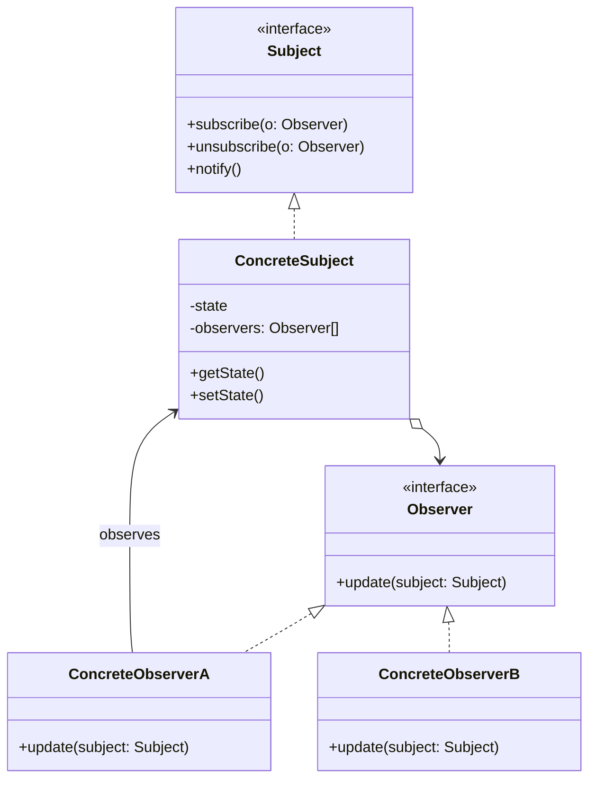

# Observer Pattern

<CoverImage src="/covers/behavioral/observer.webp" alt="Cover">
  <h1>Observer</h1>
  <p>Qizil gilam bo'ylab yurib kelayotgan superyulduz robot, uning atrofida esa ulkan kameralarga ega o'nlab kichkina paparatsi-robot kuzatuvchilar chaqnab, harakatlarini mukammal muvofiqlikda sinxronlashtirmoqda.</p>
</CoverImage>

## Umumiy ko'rinish (Overview)

**Observer** — bu obyektlar o'rtasida birga-ko'p (one-to-many) obuna mexanizmini o'rnatuvchi xulq-atvor (behavioral) dizayn patternidir. Kuzatilayotgan obyekt (**Subject** yoki Publisher — nashr qiluvchi) o'z holatini o'zgartirganda, u ro'yxatdan o'tgan barcha bog'liq obyektlarni (**Observer**'lar yoki Subscriber'lar — obunachilar) avtomatik ravishda xabardor qiladi.

**Asosiy afzalligi**: U dinamik, bo'sh bog'lanishni (loose coupling) ta'minlaydi. Subject o'zini kuzatayotgan klasslar haqida hech narsa bilishi shart emas, bu esa asosiy mantiqni o'zgartirmasdan ish vaqtida (runtime) tinglovchilarni qo'shish yoki olib tashlash imkonini beradi.

**Zamonaviy nuqtai nazar**: Observer patterni zamonaviy reaktiv dasturlash, UI freymvorklari (React, Vue, SwiftUI), Event Bus'lar, WebSocket'lar va Pub/Sub xabar almashish tizimlarining (Kafka, RabbitMQ) shubhasiz asosidir.

## Muammo (The Problem)

Tasavvur qiling, siz fond bozori ilovasini yaratyapsiz. Sizda Apple (AAPL) aksiyasi narxini ifodalovchi `Stock` obyekti bor.
Shuningdek, sizda bir nechta UI komponentlari mavjud: Portfel paneli (Portfolio Dashboard), Chiziqli grafik (Line Chart) va Email ogohlantirish tizimi.

UI komponentlari aksiya narxi o'zgarganini qanday biladi?

```typescript
// ❌ Yomon: Qattiq bog'langan, polling va hardcode qilingan
class LineChart {
  constructor(private stock: Stock) {
    // Samarasiz polling: har soniyada tekshirish
    setInterval(() => {
      this.draw(stock.getPrice());
    }, 1000);
  }
}

class Stock {
  private price: number;
  // Ma'lumotni push qilmoqchi bo'lsak, aniq klasslarga qattiq bog'lanamiz
  constructor(
    private chart: LineChart,
    private emailer: EmailAlert,
  ) {}

  updatePrice(newPrice: number) {
    this.price = newPrice;
    this.chart.draw(this.price); // Hardcode qilingan!
    this.emailer.send(this.price); // Hardcode qilingan!
    // Har safar yangi funksiya qo'shganda Stock klassini o'zgartirishimiz kerak.
  }
}
```

Agar so'rov (polling) usulidan foydalansak, CPU sikllarini behuda sarflaymiz. Agar yangilanishlarni `Stock` klassiga qattiq yozib qo'ysak (hardcode), Ochiq/Yopiqlik tamoyilini (Open/Closed Principle) buzamiz. `Stock` klassi UI chizish va email'lar bilan emas, moliyaviy ma'lumotlar bilan shug'ullanishi kerak.

## Yechim (The Solution)

Observer patterni Subject Observer'lar ro'yxatini saqlashi va `subscribe` (obuna bo'lish) hamda `unsubscribe` (obunani bekor qilish) metodlarini taqdim etishi kerakligini belgilaydi.

1. **Subject** umumiy `Observer` interfeysini amalga oshiruvchi obyektlarga havolalar massivini saqlaydi.
2. Subject holati o'zgargan har safar, u ushbu massiv bo'ylab aylanib chiqadi va har bir Observer'da ma'lum bir xabardor qilish metodini (masalan, `update()`) chaqiradi.
3. **Observer'lar** o'zgarishga qanday javob berish kerakligi haqidagi haqiqiy biznes mantig'ini o'z ichiga oladi.

## Tuzilma (Structure)



## Ishlash oqimi (Flow)

1. **ConcreteObserver** o'zini **ConcreteSubject**'da `subject.subscribe(this)` orqali ro'yxatdan o'tkazadi.
2. Qandaydir ichki yoki tashqi hodisa **ConcreteSubject** holatining o'zgarishiga sabab bo'ladi.
3. **ConcreteSubject** o'zining `notify()` metodini chaqiradi.
4. `notify()` metodi ro'yxatdan o'tgan kuzatuvchilar ro'yxati bo'ylab aylanib, `observer.update(this)` ni chaqiradi.
5. **ConcreteObserver** subject'dan yangi holatni oladi va shunga mos ravishda javob beradi.

## Hayotiy o'xshatish (Real-World Analogy)

**YouTube kanaliga obuna bo'lishni** tasavvur qiling.
Kontent yaratuvchi (**Subject**) yangi video yuklaganida, u har bir tomoshabinga qo'lda shaxsiy email yubormaydi. Buning o'rniga tomoshabinlar (**Observer**'lar) "Obuna bo'lish" (Subscribe) tugmasini bosadilar.
YouTube obunachilar ro'yxatini yuritadi. Yangi video chop etilganda, tizim ushbu ro'yxatdagi hammaga avtomatik ravishda bildirishnoma yuboradi. Tomoshabinlar yangilanishlarni olishni xohlamasalar, istalgan vaqtda obunani bekor qilishlari mumkin.

## Bosqichma-bosqich amalga oshirish (Step-by-Step Implementation)

1. **Observer interfeysini aniqlang**: Odatda `update(context)` kabi bitta metodni o'z ichiga oladi.
2. **Subject interfeysini aniqlang**: Kuzatuvchilarni qo'shish, olib tashlash va xabardor qilish metodlarini o'z ichiga oladi.
3. **Concrete Subject'ni amalga oshiring**: Kuzatuvchilarni saqlash uchun ro'yxat va kuzatiladigan holat kerak. Holat o'zgarganda ro'yxat bo'ylab aylanib, `update` ni chaqiring.
4. **Concrete Observer'larni amalga oshiring**: Kerakli javob harakatini bajarish uchun `update` metodini amalga oshiring.

## Kod misollari (Code Examples)

Biz oddiy `Newsletter` (axborot byulleteni) nashr qiluvchisini yaratamiz. Turli obunachilar (oddiy foydalanuvchi va korporativ arxivlovchi) yangi maqolalarni tinglaydi.

::: code-group

```typescript [TypeScript]
// 1. Observer interfeysi
interface Subscriber {
  update(publisher: Newsletter): void;
}

// 2. Subject interfeysi
interface Publisher {
  subscribe(s: Subscriber): void;
  unsubscribe(s: Subscriber): void;
  notifySubscribers(): void;
}

// 3. Konkret Subject
class Newsletter implements Publisher {
  private subscribers: Subscriber[] = [];
  private latestArticle: string = "";

  subscribe(s: Subscriber): void {
    if (!this.subscribers.includes(s)) {
      this.subscribers.push(s);
    }
  }

  unsubscribe(s: Subscriber): void {
    const index = this.subscribers.indexOf(s);
    if (index > -1) {
      this.subscribers.splice(index, 1);
    }
  }

  notifySubscribers(): void {
    for (const sub of this.subscribers) {
      sub.update(this);
    }
  }

  // Biznes mantiq
  publishArticle(title: string): void {
    console.log(`\n📰 Newsletter: Publishing new article - "${title}"`);
    this.latestArticle = title;
    this.notifySubscribers();
  }

  getLatestArticle(): string {
    return this.latestArticle;
  }
}

// 4. Konkret Observer'lar
class EmailSubscriber implements Subscriber {
  constructor(private email: string) {}

  update(publisher: Newsletter): void {
    console.log(
      `[Email to ${this.email}]: Read our new article "${publisher.getLatestArticle()}"`,
    );
  }
}

class CorporateArchive implements Subscriber {
  update(publisher: Newsletter): void {
    console.log(
      `[Archive System]: Saving "${publisher.getLatestArticle()}" to database.`,
    );
  }
}

// 5. Mijoz
const techNewsletter = new Newsletter();

const alice = new EmailSubscriber("alice@example.com");
const bob = new EmailSubscriber("bob@example.com");
const archiver = new CorporateArchive();

techNewsletter.subscribe(alice);
techNewsletter.subscribe(bob);
techNewsletter.subscribe(archiver);

// Yangilanishlarni ishga tushirish
techNewsletter.publishArticle("The Future of AI");

console.log("\n(Bob unsubscribes)\n");
techNewsletter.unsubscribe(bob);

techNewsletter.publishArticle("TypeScript 6.0 Released");
```

```python [Python]
from abc import ABC, abstractmethod
from typing import List

# 1. Observer interfeysi
class Subscriber(ABC):
    @abstractmethod
    def update(self, publisher: 'Newsletter') -> None:
        pass

# 2. Subject interfeysi
class Publisher(ABC):
    @abstractmethod
    def subscribe(self, s: Subscriber) -> None:
        pass

    @abstractmethod
    def unsubscribe(self, s: Subscriber) -> None:
        pass

    @abstractmethod
    def notify_subscribers(self) -> None:
        pass

# 3. Konkret Subject
class Newsletter(Publisher):
    def __init__(self):
        self._subscribers: List[Subscriber] = []
        self._latest_article: str = ""

    def subscribe(self, s: Subscriber) -> None:
        if s not in self._subscribers:
            self._subscribers.append(s)

    def unsubscribe(self, s: Subscriber) -> None:
        if s in self._subscribers:
            self._subscribers.remove(s)

    def notify_subscribers(self) -> None:
        for sub in self._subscribers:
            sub.update(self)

    # Biznes mantiq
    def publish_article(self, title: str) -> None:
        print(f"\n📰 Newsletter: Publishing new article - \"{title}\"")
        self._latest_article = title
        self.notify_subscribers()

    def get_latest_article(self) -> str:
        return self._latest_article

# 4. Konkret Observer'lar
class EmailSubscriber(Subscriber):
    def __init__(self, email: str):
        self.email = email

    def update(self, publisher: Newsletter) -> None:
        print(f"[Email to {self.email}]: Read our new article \"{publisher.get_latest_article()}\"")

class CorporateArchive(Subscriber):
    def update(self, publisher: Newsletter) -> None:
        print(f"[Archive System]: Saving \"{publisher.get_latest_article()}\" to database.")

# 5. Mijoz
if __name__ == "__main__":
    tech_newsletter = Newsletter()

    alice = EmailSubscriber("alice@example.com")
    bob = EmailSubscriber("bob@example.com")
    archiver = CorporateArchive()

    tech_newsletter.subscribe(alice)
    tech_newsletter.subscribe(bob)
    tech_newsletter.subscribe(archiver)

    tech_newsletter.publish_article("The Future of AI")

    print("\n(Bob unsubscribes)\n")
    tech_newsletter.unsubscribe(bob)

    tech_newsletter.publish_article("Python 4.0 Released")
```

```java [Java]
import java.util.ArrayList;
import java.util.List;

// 1. Observer interfeysi
interface Subscriber {
    void update(Newsletter publisher);
}

// 2. Subject interfeysi
interface Publisher {
    void subscribe(Subscriber s);
    void unsubscribe(Subscriber s);
    void notifySubscribers();
}

// 3. Konkret Subject
class Newsletter implements Publisher {
    private List<Subscriber> subscribers = new ArrayList<>();
    private String latestArticle = "";

    @Override
    public void subscribe(Subscriber s) {
        if (!subscribers.contains(s)) {
            subscribers.add(s);
        }
    }

    @Override
    public void unsubscribe(Subscriber s) {
        subscribers.remove(s);
    }

    @Override
    public void notifySubscribers() {
        // Iteratsiya paytida kimdir obunani bekor qilsa, ConcurrentModificationException bo'lmasligi uchun nusxa olamiz
        List<Subscriber> copy = new ArrayList<>(subscribers);
        for (Subscriber sub : copy) {
            sub.update(this);
        }
    }

    public void publishArticle(String title) {
        System.out.println("\n📰 Newsletter: Publishing new article - \"" + title + "\"");
        this.latestArticle = title;
        notifySubscribers();
    }

    public String getLatestArticle() {
        return latestArticle;
    }
}

// 4. Konkret Observer'lar
class EmailSubscriber implements Subscriber {
    private String email;

    public EmailSubscriber(String email) {
        this.email = email;
    }

    @Override
    public void update(Newsletter publisher) {
        System.out.println("[Email to " + email + "]: Read our new article \"" + publisher.getLatestArticle() + "\"");
    }
}

class CorporateArchive implements Subscriber {
    @Override
    public void update(Newsletter publisher) {
        System.out.println("[Archive System]: Saving \"" + publisher.getLatestArticle() + "\" to database.");
    }
}

// 5. Mijoz
public class ObserverDemo {
    public static void main(String[] args) {
        Newsletter techNewsletter = new Newsletter();

        Subscriber alice = new EmailSubscriber("alice@example.com");
        Subscriber bob = new EmailSubscriber("bob@example.com");
        Subscriber archiver = new CorporateArchive();

        techNewsletter.subscribe(alice);
        techNewsletter.subscribe(bob);
        techNewsletter.subscribe(archiver);

        techNewsletter.publishArticle("The Future of AI");

        System.out.println("\n(Bob unsubscribes)\n");
        techNewsletter.unsubscribe(bob);

        techNewsletter.publishArticle("Java 25 Released");
    }
}
```

```go [Go]
package main

import "fmt"

// 1. Observer interfeysi
type Subscriber interface {
	Update(publisher *Newsletter)
}

// 2. Konkret Subject
type Newsletter struct {
	subscribers   []Subscriber
	latestArticle string
}

func (n *Newsletter) Subscribe(s Subscriber) {
	n.subscribers = append(n.subscribers, s)
}

func (n *Newsletter) Unsubscribe(s Subscriber) {
	for i, sub := range n.subscribers {
		if sub == s {
			n.subscribers = append(n.subscribers[:i], n.subscribers[i+1:]...)
			break
		}
	}
}

func (n *Newsletter) NotifySubscribers() {
	for _, sub := range n.subscribers {
		sub.Update(n)
	}
}

func (n *Newsletter) PublishArticle(title string) {
	fmt.Printf("\n📰 Newsletter: Publishing new article - \"%s\"\n", title)
	n.latestArticle = title
	n.NotifySubscribers()
}

func (n *Newsletter) GetLatestArticle() string {
	return n.latestArticle
}

// 3. Konkret Observer'lar
type EmailSubscriber struct {
	email string
}

func (e *EmailSubscriber) Update(publisher *Newsletter) {
	fmt.Printf("[Email to %s]: Read our new article \"%s\"\n", e.email, publisher.GetLatestArticle())
}

type CorporateArchive struct{}

func (c *CorporateArchive) Update(publisher *Newsletter) {
	fmt.Printf("[Archive System]: Saving \"%s\" to database.\n", publisher.GetLatestArticle())
}

// 4. Mijoz
func main() {
	techNewsletter := &Newsletter{}

	alice := &EmailSubscriber{email: "alice@example.com"}
	bob := &EmailSubscriber{email: "bob@example.com"}
	archiver := &CorporateArchive{}

	techNewsletter.Subscribe(alice)
	techNewsletter.Subscribe(bob)
	techNewsletter.Subscribe(archiver)

	techNewsletter.PublishArticle("The Future of AI")

	fmt.Println("\n(Bob unsubscribes)")
	techNewsletter.Unsubscribe(bob)

	techNewsletter.PublishArticle("Go 1.30 Released")
}
```

```rust [Rust]
use std::cell::RefCell;
use std::rc::Rc;

// 1. Observer trait
trait Subscriber {
    fn update(&self, latest_article: &str);
}

// 2. Konkret Subject
struct Newsletter {
    // Observer'larga havolalarni saqlash uchun Rc ishlatamiz.
    // Ko'p oqimli Rust'da Arc<Mutex<dyn Subscriber + Send + Sync>> ishlatiladi
    subscribers: Vec<Rc<dyn Subscriber>>,
    latest_article: String,
}

impl Newsletter {
    fn new() -> Self {
        Self {
            subscribers: Vec::new(),
            latest_article: String::new(),
        }
    }

    fn subscribe(&mut self, s: Rc<dyn Subscriber>) {
        self.subscribers.push(s);
    }

    // Rust'da pointerlar orqali obunani bekor qilish noyob ID yoki Rc::ptr_eq talab qiladi
    // Soddalik uchun bu oddiy trait sozlamasida unsubscribe'ni tashlab ketamiz,
    // lekin production'da obuna ID'larini berish kerak bo'ladi.

    fn notify_subscribers(&self) {
        for sub in &self.subscribers {
            // Eslatma: Borrowing muammolarining oldini olish uchun holatni to'g'ridan-to'g'ri uzatamiz (Push modeli)
            sub.update(&self.latest_article);
        }
    }

    fn publish_article(&mut self, title: &str) {
        println!("\n📰 Newsletter: Publishing new article - \"{}\"", title);
        self.latest_article = title.to_string();
        self.notify_subscribers();
    }
}

// 3. Konkret Observer'lar
struct EmailSubscriber {
    email: String,
}

impl Subscriber for EmailSubscriber {
    fn update(&self, latest_article: &str) {
        println!("[Email to {}]: Read our new article \"{}\"", self.email, latest_article);
    }
}

struct CorporateArchive;

impl Subscriber for CorporateArchive {
    fn update(&self, latest_article: &str) {
        println!("[Archive System]: Saving \"{}\" to database.", latest_article);
    }
}

// 4. Mijoz
fn main() {
    let mut tech_newsletter = Newsletter::new();

    let alice = Rc::new(EmailSubscriber { email: "alice@example.com".into() });
    let bob = Rc::new(EmailSubscriber { email: "bob@example.com".into() });
    let archiver = Rc::new(CorporateArchive);

    tech_newsletter.subscribe(alice);
    tech_newsletter.subscribe(bob);
    tech_newsletter.subscribe(archiver);

    tech_newsletter.publish_article("The Future of AI");
    tech_newsletter.publish_article("Rust 2.0 Released");
}
```

:::

## Afzallik va kamchiliklar (Pros and Cons)

### Afzalliklari (Advantages)

- **Ochiq/Yopiqlik tamoyili (Open/Closed Principle)**: Nashr qiluvchi kodini o'zgartirmasdan yangi obunachi klasslarini qo'shishingiz mumkin.
- **Bo'sh bog'lanish (Loose Coupling)**: Nashr qiluvchi faqat kuzatuvchi ma'lum bir interfeysni amalga oshirishini biladi. U aniq (concrete) klassni bilmaydi.
- **Dinamik obunalar**: Obyektlar o'rtasidagi aloqalarni ish vaqtida (runtime) o'rnatishingiz mumkin.

### Kamchiliklari (Disadvantages)

- **Xotira sizishi (The Lapsed Listener Problem — "unutilgan tinglovchi" muammosi)**: Agar kuzatuvchi obuna bo'lsa-yu, hech qachon obunani bekor qilmasa, nashr qiluvchi unga kuchli havolani saqlab qoladi va bu garbage collection'ga to'sqinlik qiladi. Bu Java/C#/UI dasturlashda xotira sizishining mashhur sababidir.
- **Oldindan aytib bo'lmaydigan tartib**: Kuzatuvchilar tasodifiy/ketma-ket tartibda xabardor qilinadi. Agar kuzatuvchilar bir-biriga bog'liq bo'lsa, bu tartibsizlikka olib keladi.
- **Zanjirli yangilanishlar (Cascade Updates)**: Agar kuzatuvchi yangilanishga javoban subject'ni yangilasa, osongina bildirishnomalarning cheksiz siklini keltirib chiqarishingiz mumkin.

## Qachon foydalanish kerak (When to Use)

- **Hodisaga asoslangan arxitekturalar (Event-Driven Architectures)**: Bir obyekt holatining o'zgarishi boshqa obyektlarni o'zgartirishni talab qilishi mumkin bo'lganda va obyektlarning haqiqiy to'plami oldindan noma'lum bo'lganda yoki dinamik ravishda o'zgarganda.
- **UI ma'lumotlarini bog'lash (Data Binding)**: Model'ni View'ga bog'lashda View Model'ni kuzatishi va Model o'zgarganda qayta chizilishi kerak.
- **Pub/Sub xabar almashish**: Ilovaning bir nechta qismlariga bir vaqtning o'zida xabar tarqatish kerak bo'lganda.

## Qachon foydalanmaslik kerak (When NOT to Use)

- **Ketma-ket ma'lumotlar quvurlari (Sequential Data Pipelines)**: Agar sizga bajarilish tartibi ustidan qat'iy nazorat kerak bo'lsa (A qadam -> B qadam -> C qadam), **[Chain of Responsibility](/uz/behavioral/chain-of-responsibility)** yoki maxsus ish oqimi (workflow) dvigatelidan foydalaning.
- **Murakkab muvofiqlashtirish**: Agar bir nechta nashr qiluvchilar va obunachilar chigallashib ketayotgan bo'lsa, mantiqni markazlashtirish uchun **[Mediator](/uz/behavioral/mediator)** patterniga o'tishingiz kerak.

## Keng tarqalgan xatolar (Common Mistakes)

### 1. "Unutilgan tinglovchi" muammosi (The Lapsed Listener Problem — xotira sizishi)

Kuzatuvchi yo'q qilinganda uning obunasini bekor qilmaslik.
**Yechim**: Kuzatuvchilarni saqlash uchun kuchsiz havolalardan (Weak References — Java'da `WeakReference` yoki JS'da `WeakMap`/`WeakRef` kabi) foydalaning yoki komponentlar o'zlarining teardown/destructor hayot sikli metodlarida obunani aniq bekor qilishiga ishonch hosil qiling (masalan, React'dagi `useEffect` cleanup).

### 2. Juda ko'p (yoki juda kam) ma'lumot uzatish

- **Push modeli**: Subject o'zining barcha ma'lumotlarini kuzatuvchiga uzatadi (`update(data)`). Bu kuzatuvchini aniq ma'lumotlar tuzilmasiga bog'lab qo'yadi.
- **Pull modeli**: Subject o'ziga havolani uzatadi (`update(this)`) va kuzatuvchi o'ziga kerakli narsani so'raydi. Odatda bu afzalroq, lekin subject'dan ochiq (public) getter metodlarni taqdim etishni talab qiladi.

## Aloqador patternlar (Related Patterns)

- **[Mediator](/uz/behavioral/mediator)**: Aloqani markazlashtiradi. Obyektlar bir-birini to'g'ridan-to'g'ri kuzatish o'rniga Mediator'ni kuzatadi.
- **[Singleton](/uz/creational/singleton)**: Ko'pincha Subject (masalan, Event Bus) global ravishda foydalanish mumkin bo'lishi uchun Singleton sifatida amalga oshiriladi.
- **[Command](/uz/behavioral/command)**: Kuzatuvchilar ko'pincha bildirishnoma olishga javoban Command'larni bajaradi.

## Intervyu uchun maslahatlar (Interview Insights)

- **Savol**: "Observer va Pub/Sub o'rtasidagi farq nima?"
  - **Javob**: "Klassik Observer patternida Subject va Observer bir-biridan xabardor (Subject Observer'lar ro'yxatini saqlaydi). Publish/Subscribe'da esa uchinchi komponent bor — Event Bus yoki Message Broker. Nashr qiluvchilar Broker'ga yuboradi, obunachilar esa Broker'dan oladi. Ular bir-biridan butunlay ajratilgan."
- **Savol**: "Observer patternida xotira sizishining oldini qanday olasiz?"
  - **Javob**: "Kuzatuvchi yo'q qilinganda `unsubscribe()` metodi chaqirilishiga ishonch hosil qiling yoki Garbage Collector o'lik kuzatuvchilarni tozalay olishi uchun Subject'ning kuzatuvchilar ro'yxatida kuchsiz havolalardan (Weak References) foydalaning."

## Zamonaviy muqobillar (Modern Alternatives)

- **Reactive Extensions (RxJS, RxJava)**: Hodisalar oqimlarini filtrlash, map qilish va birlashtirish imkonini beruvchi Observer patternining ilg'or, kompozitsiyalanadigan amalga oshirilishlari.
- **Event Emitter'lar / Event Target'lar**: Node.js (`EventEmitter`) va brauzer DOM'iga (`EventTarget`) o'rnatilgan, yuqori darajada optimallashtirilgan tabiiy amalga oshirilishlar.
- **Signals / Observables (Vue, SolidJS, Angular, MobX)**: Zamonaviy frontend freymvorklari o'qilganda obunalarni avtomatik kuzatadigan reaktiv primitivlardan (Signals) foydalanadi, bu esa qo'lda `subscribe`/`unsubscribe` chaqiruvlariga bo'lgan ehtiyojni butunlay yo'qotadi.
