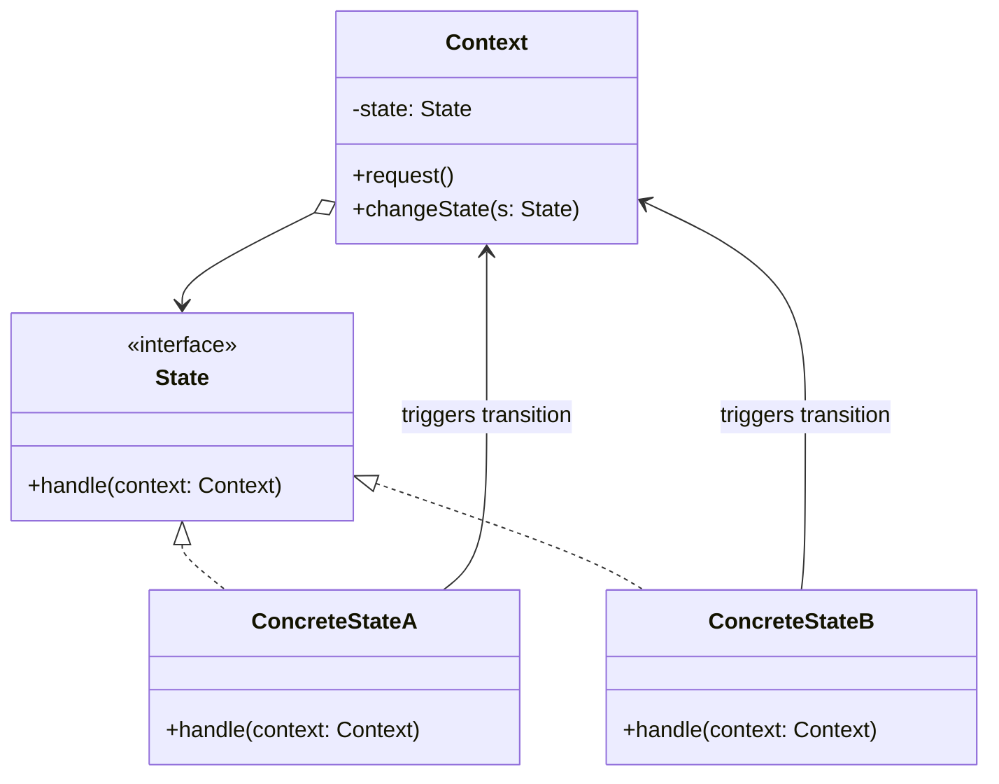

# Holat andozasi (State)

<CoverImage src="/covers/behavioral/state.webp" alt="Cover">
  <h1>Holat</h1>
  <p>Yuz ekrani va tana rangi dinamik ravishda o'zgaradigan g'alati robot: unga "batareya" berilsa, u sariq rangga kiradi (xursand), "singan tishli g'ildirak" berilsa, qizil rangga kiradi (jahldor), bekor qoldirilsa esa ko'k rangga kiradi (uxlayotgan).</p>
</CoverImage>

## Umumiy ko'rinish (Overview)

**Holat** (State) — bu obyektga ichki holati (state) o'zgarganda o'z xulq-atvorini o'zgartirish imkonini beruvchi xulq-atvor (behavioral) loyihalash andozasidir. Go'yo obyekt o'z klassini o'zgartirgandek ko'rinadi.

**Asosiy afzalligi**: U holatga xos xulq-atvorlarni ulkan `switch/case` yoki `if/else` shartlaridan alohida, maxsus State klasslariga ajratib chiqaradi.

**Zamonaviy nuqtai nazar**: Klassik obyektga yo'naltirilgan Holat andozasi chekli holatlar mashinasining (Finite State Machine, FSM) amalga oshirilishidir. UI freymvorklari (React yoki Vue kabi) ko'pincha funksional yoki deklarativ holat boshqaruvidan (masalan, XState, Redux) foydalansa-da, asosiy g'oya — obyektning hodisaga javobi qat'iy ravishda uning joriy holatiga bog'liq ekanligi — hamma joyda qo'llanilishicha qolmoqda.

## Muammo (The Problem)

Tasavvur qiling, siz **savdo avtomati (Vending Machine)** uchun dasturiy ta'minot yaratyapsiz.

Savdo avtomatining aniq holatlari bor: `Idle` (kutish), `HasCoin` (tanga solingan), `Dispensing` (mahsulot berilmoqda) va `OutOfStock` (mahsulot tugagan).
Foydalanuvchi "Berish" (Dispense) tugmasini bosganda, avtomatning xulq-atvori butunlay uning holatiga bog'liq:

- Agar `Idle` bo'lsa: "Iltimos, tanga soling."
- Agar `HasCoin` bo'lsa: "Mahsulotingiz berilmoqda."
- Agar `Dispensing` bo'lsa: "Iltimos, kuting, mahsulot allaqachon berilmoqda."
- Agar `OutOfStock` bo'lsa: "Berib bo'lmaydi, mahsulot tugagan."

```typescript
// ❌ Yomon: Hamma joyda ulkan switch operatorlari
class VendingMachine {
  private state = "IDLE";

  insertCoin() {
    switch (this.state) {
      case "IDLE":
        this.state = "HAS_COIN";
        break;
      case "HAS_COIN":
        console.log("Coin already inserted.");
        break;
      // ... yana case'lar ...
    }
  }

  dispense() {
    switch (this.state) {
      case "IDLE":
        console.log("Insert coin first.");
        break;
      case "HAS_COIN":
        this.state = "DISPENSING";
        // berish mantig'i
        break;
      // ... yana case'lar ...
    }
  }
}
```

Bu kod mo'rt. Agar yangi holat qo'shsangiz (masalan, `MaintenanceMode` — texnik xizmat rejimi), `VendingMachine` klassidagi har bir `switch` operatorini qidirib topib, yangi `case` qo'shishingiz kerak. Bu Ochiq/Yopiqlik tamoyilini (Open/Closed Principle) buzadi.

## Yechim (The Solution)

Holat andozasi obyektning barcha mumkin bo'lgan holatlari uchun yangi klasslar yaratishni va holatga xos barcha xulq-atvorlarni ushbu klasslarga ajratib chiqarishni taklif qiladi.

1. **Context (Kontekst)**: Asl obyekt (`VendingMachine`). U `State` obyektiga havolani saqlaydi.
2. **State interfeysi**: Har bir aniq holat amalga oshirishi kerak bo'lgan metodlarni belgilaydi (masalan, `insertCoin()`, `dispense()`).
3. **Concrete State'lar (Aniq holatlar)**: Har bir holatni ifodalovchi klasslar (`IdleState`, `HasCoinState` va h.k.). Ular o'sha holatga xos xulq-atvorni amalga oshiradi.

`Context` so'rov olganda, ishni o'zining joriy `State` obyektiga topshiradi (delegate qiladi).

## Tuzilma (Structure)



## Ishlash oqimi (Flow)

1. **Context** boshlang'ich **ConcreteState** bilan ishga tushiriladi.
2. Mijoz **Context**'dagi metodni chaqiradi (masalan, `vendingMachine.dispense()`).
3. **Context** buni joriy holatga topshiradi: `this.state.dispense(this)`.
4. **ConcreteState** amalni bajaradi.
5. Agar holatga o'tish talab qilinsa, **ConcreteState** `context.changeState(new NextState())` ni chaqiradi.

## Hayotiy o'xshatish (Real-World Analogy)

**Smartfonni** tasavvur qiling.
Agar telefoningiz **Qulfdan chiqarilgan (Unlocked)** holatda bo'lsa, Home tugmasini bosish bosh ekranga olib boradi.
Agar telefoningiz **Qulflangan (Locked)** holatda bo'lsa, Home tugmasini bosish ekranni uyg'otib, qulfdan chiqarish oynasini ko'rsatadi.
Agar telefoningiz **Kamera (Camera)** holatida bo'lsa, Home tugmasini bosish kameradan chiqaradi.
Apparat tugmasi (harakat) aynan bir xil, lekin xulq-atvor operatsion tizimning ichki holatiga qarab butunlay o'zgaradi.

## Bosqichma-bosqich amalga oshirish (Step-by-Step Implementation)

1. **State interfeysini aniqlang**: Context'ning holatga bog'liq metodlarini aks ettiring.
2. **Concrete State klasslarini yarating**: Har bir aniq holat uchun interfeysni amalga oshiring.
3. **Context'ni o'zgartiring**: Joriy State'ni saqlash uchun private maydon qo'shing. `changeState(State)` metodini qo'shing.
4. **State'ga topshiring**: Context metodlarida bajarishni `this.state.method(this)` ga topshiring.
5. **O'tishlarni amalga oshiring**: O'tishlarni Context yoki Concrete State'lar boshlashini hal qiling. Odatda Concrete State'lar `context.changeState()` ni chaqirish orqali o'tishlarni boshqaradi.

## Kod misollari (Code Examples)

Keling, **Hujjatni nashr qilish ish oqimini (Document Publishing Workflow)** amalga oshiramiz. Hujjat `Draft` (qoralama), `Moderation` (moderatsiya) yoki `Published` (nashr qilingan) holatida bo'lishi mumkin. Faqat adminlar to'g'ridan-to'g'ri nashr qila oladi; mualliflar esa moderatsiyadan o'tishi kerak.

::: code-group

```typescript [TypeScript]
// 1. Context (Kontekst)
class Document {
  private state!: State;
  public currentUserRole: string;

  constructor(role: string) {
    this.currentUserRole = role;
    this.changeState(new DraftState());
  }

  changeState(state: State): void {
    this.state = state;
    this.state.setContext(this);
  }

  // Topshirish (delegation)
  publish(): void {
    this.state.publish();
  }

  reject(): void {
    this.state.reject();
  }
}

// 2. State asosi / interfeysi
abstract class State {
  protected context!: Document;

  setContext(context: Document) {
    this.context = context;
  }

  abstract publish(): void;
  abstract reject(): void;
}

// 3. Konkret State'lar
class DraftState extends State {
  publish(): void {
    if (this.context.currentUserRole === "admin") {
      console.log("Draft -> Published (Admin override)");
      this.context.changeState(new PublishedState());
    } else {
      console.log("Draft -> Moderation");
      this.context.changeState(new ModerationState());
    }
  }

  reject(): void {
    console.log("Drafts cannot be rejected.");
  }
}

class ModerationState extends State {
  publish(): void {
    if (this.context.currentUserRole === "admin") {
      console.log("Moderation -> Published");
      this.context.changeState(new PublishedState());
    } else {
      console.log("Only admins can approve documents in moderation.");
    }
  }

  reject(): void {
    if (this.context.currentUserRole === "admin") {
      console.log("Moderation -> Draft (Rejected by admin)");
      this.context.changeState(new DraftState());
    } else {
      console.log("Only admins can reject documents.");
    }
  }
}

class PublishedState extends State {
  publish(): void {
    console.log("Document is already published.");
  }

  reject(): void {
    console.log("Published -> Draft (Retracted)");
    this.context.changeState(new DraftState());
  }
}

// 4. Mijoz
const doc = new Document("author");

console.log("\n--- Author Actions ---");
doc.publish(); // Draft -> Moderation
doc.publish(); // Xato: Faqat adminlar tasdiqlay oladi

doc.currentUserRole = "admin";
console.log("\n--- Admin Actions ---");
doc.reject(); // Moderation -> Draft
doc.publish(); // Draft -> Published (Admin huquqi bilan)
```

```python [Python]
from __future__ import annotations
from abc import ABC, abstractmethod

# 1. State interfeysi
class State(ABC):
    @property
    def context(self) -> Document:
        return self._context

    @context.setter
    def context(self, context: Document) -> None:
        self._context = context

    @abstractmethod
    def publish(self) -> None:
        pass

    @abstractmethod
    def reject(self) -> None:
        pass

# 2. Context (Kontekst)
class Document:
    def __init__(self, role: str):
        self.current_user_role = role
        # Boshlang'ich holatni o'rnatish
        self.change_state(DraftState())

    def change_state(self, state: State) -> None:
        self._state = state
        self._state.context = self

    def publish(self) -> None:
        self._state.publish()

    def reject(self) -> None:
        self._state.reject()

# 3. Konkret State'lar
class DraftState(State):
    def publish(self) -> None:
        if self.context.current_user_role == "admin":
            print("Draft -> Published (Admin override)")
            self.context.change_state(PublishedState())
        else:
            print("Draft -> Moderation")
            self.context.change_state(ModerationState())

    def reject(self) -> None:
        print("Drafts cannot be rejected.")

class ModerationState(State):
    def publish(self) -> None:
        if self.context.current_user_role == "admin":
            print("Moderation -> Published")
            self.context.change_state(PublishedState())
        else:
            print("Only admins can approve documents in moderation.")

    def reject(self) -> None:
        if self.context.current_user_role == "admin":
            print("Moderation -> Draft (Rejected by admin)")
            self.context.change_state(DraftState())
        else:
            print("Only admins can reject documents.")

class PublishedState(State):
    def publish(self) -> None:
        print("Document is already published.")

    def reject(self) -> None:
        print("Published -> Draft (Retracted)")
        self.context.change_state(DraftState())

# 4. Mijoz
if __name__ == "__main__":
    doc = Document("author")

    print("\n--- Author Actions ---")
    doc.publish() # Draft -> Moderation
    doc.publish() # Xato

    doc.current_user_role = "admin"
    print("\n--- Admin Actions ---")
    doc.reject()  # Moderation -> Draft
    doc.publish() # Draft -> Published
```

```java [Java]
// 1. Context (Kontekst)
class Document {
    private State state;
    private String currentUserRole;

    public Document(String role) {
        this.currentUserRole = role;
        changeState(new DraftState());
    }

    public void changeState(State state) {
        this.state = state;
        this.state.setContext(this);
    }

    public String getCurrentUserRole() { return currentUserRole; }
    public void setCurrentUserRole(String role) { this.currentUserRole = role; }

    public void publish() { state.publish(); }
    public void reject() { state.reject(); }
}

// 2. State asosi
abstract class State {
    protected Document context;

    public void setContext(Document context) {
        this.context = context;
    }

    public abstract void publish();
    public abstract void reject();
}

// 3. Konkret State'lar
class DraftState extends State {
    @Override
    public void publish() {
        if ("admin".equals(context.getCurrentUserRole())) {
            System.out.println("Draft -> Published (Admin override)");
            context.changeState(new PublishedState());
        } else {
            System.out.println("Draft -> Moderation");
            context.changeState(new ModerationState());
        }
    }

    @Override
    public void reject() {
        System.out.println("Drafts cannot be rejected.");
    }
}

class ModerationState extends State {
    @Override
    public void publish() {
        if ("admin".equals(context.getCurrentUserRole())) {
            System.out.println("Moderation -> Published");
            context.changeState(new PublishedState());
        } else {
            System.out.println("Only admins can approve documents in moderation.");
        }
    }

    @Override
    public void reject() {
        if ("admin".equals(context.getCurrentUserRole())) {
            System.out.println("Moderation -> Draft (Rejected by admin)");
            context.changeState(new DraftState());
        } else {
            System.out.println("Only admins can reject documents.");
        }
    }
}

class PublishedState extends State {
    @Override
    public void publish() {
        System.out.println("Document is already published.");
    }

    @Override
    public void reject() {
        System.out.println("Published -> Draft (Retracted)");
        context.changeState(new DraftState());
    }
}

// 4. Mijoz
public class StateDemo {
    public static void main(String[] args) {
        Document doc = new Document("author");

        System.out.println("\n--- Author Actions ---");
        doc.publish(); // Draft -> Moderation
        doc.publish(); // Xato

        doc.setCurrentUserRole("admin");
        System.out.println("\n--- Admin Actions ---");
        doc.reject();  // Moderation -> Draft
        doc.publish(); // Draft -> Published
    }
}
```

```go [Go]
package main

import "fmt"

// 1. State interfeysi
type State interface {
	Publish(doc *Document)
	Reject(doc *Document)
}

// 2. Context (Kontekst)
type Document struct {
	state           State
	CurrentUserRole string
}

func NewDocument(role string) *Document {
	doc := &Document{
		CurrentUserRole: role,
	}
	// Boshlang'ich holat
	doc.SetState(&DraftState{})
	return doc
}

func (d *Document) SetState(s State) {
	d.state = s
}

func (d *Document) Publish() {
	d.state.Publish(d)
}

func (d *Document) Reject() {
	d.state.Reject(d)
}

// 3. Konkret State'lar
type DraftState struct{}

func (s *DraftState) Publish(doc *Document) {
	if doc.CurrentUserRole == "admin" {
		fmt.Println("Draft -> Published (Admin override)")
		doc.SetState(&PublishedState{})
	} else {
		fmt.Println("Draft -> Moderation")
		doc.SetState(&ModerationState{})
	}
}

func (s *DraftState) Reject(doc *Document) {
	fmt.Println("Drafts cannot be rejected.")
}

type ModerationState struct{}

func (s *ModerationState) Publish(doc *Document) {
	if doc.CurrentUserRole == "admin" {
		fmt.Println("Moderation -> Published")
		doc.SetState(&PublishedState{})
	} else {
		fmt.Println("Only admins can approve documents in moderation.")
	}
}

func (s *ModerationState) Reject(doc *Document) {
	if doc.CurrentUserRole == "admin" {
		fmt.Println("Moderation -> Draft (Rejected by admin)")
		doc.SetState(&DraftState{})
	} else {
		fmt.Println("Only admins can reject documents.")
	}
}

type PublishedState struct{}

func (s *PublishedState) Publish(doc *Document) {
	fmt.Println("Document is already published.")
}

func (s *PublishedState) Reject(doc *Document) {
	fmt.Println("Published -> Draft (Retracted)")
	doc.SetState(&DraftState{})
}

// 4. Mijoz
func main() {
	doc := NewDocument("author")

	fmt.Println("\n--- Author Actions ---")
	doc.Publish() // Draft -> Moderation
	doc.Publish() // Xato

	doc.CurrentUserRole = "admin"
	fmt.Println("\n--- Admin Actions ---")
	doc.Reject()  // Moderation -> Draft
	doc.Publish() // Draft -> Published
}
```

```rust [Rust]
// 1. State trait
// Rust'da Option<Box<dyn State>> o'tish paytida State egaligini olib,
// uni Context'dan chiqarib olish imkonini beradi.
trait State {
    fn publish(self: Box<Self>, doc: &mut Document) -> Box<dyn State>;
    fn reject(self: Box<Self>, doc: &mut Document) -> Box<dyn State>;
}

// 2. Context (Kontekst)
struct Document {
    state: Option<Box<dyn State>>,
    pub current_user_role: String,
}

impl Document {
    fn new(role: &str) -> Self {
        Self {
            state: Some(Box::new(DraftState)),
            current_user_role: role.to_string(),
        }
    }

    fn publish(&mut self) {
        if let Some(state) = self.state.take() {
            self.state = Some(state.publish(self));
        }
    }

    fn reject(&mut self) {
        if let Some(state) = self.state.take() {
            self.state = Some(state.reject(self));
        }
    }
}

// 3. Konkret State'lar
struct DraftState;

impl State for DraftState {
    fn publish(self: Box<Self>, doc: &mut Document) -> Box<dyn State> {
        if doc.current_user_role == "admin" {
            println!("Draft -> Published (Admin override)");
            Box::new(PublishedState)
        } else {
            println!("Draft -> Moderation");
            Box::new(ModerationState)
        }
    }

    fn reject(self: Box<Self>, _doc: &mut Document) -> Box<dyn State> {
        println!("Drafts cannot be rejected.");
        self // DraftState'da qolamiz
    }
}

struct ModerationState;

impl State for ModerationState {
    fn publish(self: Box<Self>, doc: &mut Document) -> Box<dyn State> {
        if doc.current_user_role == "admin" {
            println!("Moderation -> Published");
            Box::new(PublishedState)
        } else {
            println!("Only admins can approve documents in moderation.");
            self // ModerationState'da qolamiz
        }
    }

    fn reject(self: Box<Self>, doc: &mut Document) -> Box<dyn State> {
        if doc.current_user_role == "admin" {
            println!("Moderation -> Draft (Rejected by admin)");
            Box::new(DraftState)
        } else {
            println!("Only admins can reject documents.");
            self // ModerationState'da qolamiz
        }
    }
}

struct PublishedState;

impl State for PublishedState {
    fn publish(self: Box<Self>, _doc: &mut Document) -> Box<dyn State> {
        println!("Document is already published.");
        self // PublishedState'da qolamiz
    }

    fn reject(self: Box<Self>, _doc: &mut Document) -> Box<dyn State> {
        println!("Published -> Draft (Retracted)");
        Box::new(DraftState)
    }
}

// 4. Mijoz
fn main() {
    let mut doc = Document::new("author");

    println!("\n--- Author Actions ---");
    doc.publish(); // Draft -> Moderation
    doc.publish(); // Xato

    doc.current_user_role = "admin".into();
    println!("\n--- Admin Actions ---");
    doc.reject();  // Moderation -> Draft
    doc.publish(); // Draft -> Published
}
```

:::

## Afzallik va kamchiliklar (Pros and Cons)

### Afzalliklari (Advantages)

- **Yagona javobgarlik tamoyili (Single Responsibility Principle)**: Muayyan holatlarga oid kodni alohida klasslarga ajratib tartibga soladi.
- **Ochiq/Yopiqlik tamoyili (Open/Closed Principle)**: Mavjud holat klasslarini yoki kontekstni o'zgartirmasdan yangi holatlarni qo'shing.
- **Context'ni soddalashtiradi**: Context klassidagi ulkan `switch/case` yoki `if/else` shart mantig'ini yo'q qiladi.

### Kamchiliklari (Disadvantages)

- **Klasslar portlashi (Class Explosion)**: Agar sizda kamdan-kam o'zgaradigan ikkitagina oddiy holat bo'lsa, to'liq State ierarxiyasini yaratish jiddiy ortiqcha murakkablashtirish (overengineering) bo'ladi.
- **Holat o'tish mantig'i**: Holat o'tishlari _qayerda_ sodir bo'lishini (Context'dami yoki State klasslaridami) hal qilish, agar State klasslari bir-biri haqida bilishga majbur bo'lsa, ularning qattiq bog'lanishiga olib kelishi mumkin.

## Qachon foydalanish kerak (When to Use)

- **Obyekt xulq-atvori holatga qarab o'zgarganda**: Obyekt joriy holatiga qarab turlicha ishlaydi, holatlar soni ko'p va holatga xos kod tez-tez o'zgaradi.
- **Ulkan shartlar**: Klass maydonlari qiymatlariga qarab uning xulq-atvorini o'zgartiradigan ulkan shartlar bilan to'ldirilgan klassingiz bo'lganda.

## Qachon foydalanmaslik kerak (When NOT to Use)

- **Oddiy holatlar**: Agar sizda faqat ikki yoki uchta oddiy holat bo'lsa (masalan, `isOn` true/false), oddiy boolean bayroqlardan foydalaning.
- **Qat'iy chiziqli ish oqimlari**: Agar o'tishlar qat'iy chiziqli bo'lsa va ma'lumotlarni bosqichma-bosqich qayta ishlasa, **[Mas'uliyatlar zanjiri](/uz/behavioral/chain-of-responsibility)** (Chain of Responsibility) yoki **Pipes and Filters** andozasi mosroq bo'lishi mumkin.

## Keng tarqalgan xatolar (Common Mistakes)

### 1. O'tishlarni Context'ga qattiq yozib qo'yish

Agar keyingi holatni Context (shartlar yordamida) aniqlasa, siz andozadan to'liq foydalanmagan bo'lasiz. O'tishlarni odatda Concrete State'larning o'zlari boshqargani ma'qul.

### 2. State nusxalarini qayta-qayta yaratish

Agar holat obyektlarining maydonlari bo'lmasa (ular ma'lumotlar uchun butunlay Context'ga tayansa), o'tishlar paytida ortiqcha xotira ajratilishining oldini olish uchun ularni Singleton yoki statik nusxalar sifatida amalga oshirish mumkin. (Eslatma: Rust misolimiz xotira ajratishdan butunlay qochish uchun holatlarni ko'chiradi (move qiladi)).

## Aloqador andozalar (Related Patterns)

- **[Strategiya](/uz/behavioral/strategy)** (Strategy): Strategiya va Holat andozalari bir xil klass tuzilmasiga ega. Farq maqsadda: Strategiya _bir xil_ ishni bajarishning butunlay turli usullarini taqdim etadi, Holat esa obyektga o'z holatiga qarab _turli_ ishlarni bajarish imkonini beradi. Strategiyalar odatda bir-birini bilmaydi; holat obyektlari esa o'tish uchun ko'pincha boshqa holatlarning nusxalarini yaratadi.
- **[Singleton](/uz/creational/singleton)**: Concrete state'lar nusxa ma'lumotlarini saqlamasa, ko'pincha Singleton sifatida amalga oshiriladi.
- **State Machine (Holatlar mashinasi)**: Holat andozasi chekli holatlar mashinasini (FSM) amalga oshirishning obyektga yo'naltirilgan usulidir.

## Intervyu uchun maslahatlar (Interview Insights)

- **Savol**: "Strategiya va Holat andozalari o'rtasidagi tuzilmaviy farq nima?"
  - **Javob**: "Tuzilma jihatidan ular bir xil (Context ishni interfeysga topshiradi). Semantik jihatdan esa ular qarama-qarshi. Strategiyalar mustaqil va bir-biridan bexabar. State'lar esa obyektning hayot siklini ifodalaydi va bir-biri haqida yaxshi biladi, doimiy ravishda bir State'dan keyingisiga o'tishlarni ishga tushiradi."
- **Savol**: "Holat ma'lumotlarini qanday boshqarasiz?"
  - **Javob**: "Holat ma'lumotlari Context obyektida qolishi kerak. State klasslari ideal holda holatsiz (stateless) xulq-atvor o'ramlari bo'lishi kerak. Ular ma'lumotlarni o'qish yoki o'zgartirish uchun Context'ni argument sifatida qabul qiladi."

## Zamonaviy muqobillar (Modern Alternatives)

- **Funksional holatlar mashinalari (XState)**: Zamonaviy frontend ekotizimida (JavaScript/TypeScript) Holat andozasining obyektga yo'naltirilgan amalga oshirilishlari ko'pincha XState kabi maxsus State Machine kutubxonalari bilan almashtiriladi. Ular o'tishlar, himoya shartlari (guards) va amallarni sof, funksional JSON konfiguratsiyasida e'lon qiladi.
- **Union turlari / Algebraik ma'lumot turlari (ADT)**: Rust, TypeScript va Swift kabi tillarda holatlarni Enum yoki Union turi sifatida ifodalash va polimorfizm o'rniga to'liq Pattern Matching'dan (`match` yoki `switch`) foydalanish mumkin. Ko'plab jamoalar uchun bu o'nlab klasslarni yaratishdan ko'ra tozaroq.
