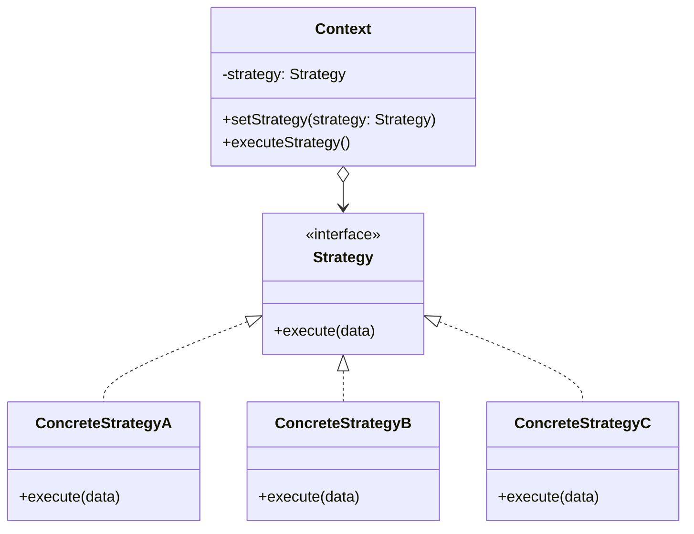

# Strategiya andozasi (Strategy)

<CoverImage src="/covers/behavioral/strategy.webp" alt="Cover">
  <h1>Strategiya</h1>
  <p>Multfilmdagidek ryukzak va uning yonida uchta almashtiriladigan quvvat yadrosi: reaktiv ranets yadrosi, burg'u yadrosi va parrak yadrosi — foydalanuvchi ularni joy relyefiga qarab almashtirishi mumkin.</p>
</CoverImage>

## Umumiy ko'rinish (Overview)

**Strategiya** (Strategy) — bu algoritmlar oilasini belgilash, ularning har birini alohida klassga joylashtirish va ularning obyektlarini o'zaro almashtiriladigan qilish imkonini beruvchi xulq-atvor (behavioral) loyihalash andozasidir.

**Asosiy afzalligi**: U klassning biznes mantig'ini o'sha mantiq kontekstida unchalik muhim bo'lmagan algoritmlarning amalga oshirish tafsilotlaridan ajratib qo'yadi.

**Zamonaviy nuqtai nazar**: Strategiya andozasi nihoyatda keng tarqalgan. Zamonaviy funksional tillarda strategiya ko'pincha to'liq klasslar o'rniga shunchaki "birinchi darajali funksiyalarni" (First-Class Functions — callback/closure'lar) uzatish orqali soddalashtiriladi. Biroq murakkab korporativ (enterprise) arxitekturalarda strategiyalarni klasslarga inkapsulyatsiya qilish zarur tuzilma, bog'liqliklarni kiritish (dependency injection) imkoniyatlari va test qilish qulayligini ta'minlaydi.

## Muammo (The Problem)

Tasavvur qiling, siz navigatsiya ilovasini yaratyapsiz. Dastlab u faqat avtomobillar uchun marshrut tuzadi. U a'lo ishlaydi.

Keyin siz piyoda yurish marshrutlarini qo'shishga qaror qilasiz. Kod kattalashadi.
Keyin jamoat transportini qo'shasiz. Kod yanada kattalashadi.
Keyin velosiped marshrutlarini qo'shasiz.

```typescript
// ❌ Yomon: Ulkan shartli mantiq
class Navigator {
  buildRoute(start: Point, end: Point, transportType: string) {
    if (transportType === "car") {
      // Avtomobil marshruti uchun 500 qatorlik murakkab mantiq
    } else if (transportType === "walking") {
      // Piyoda yurish uchun 400 qatorlik mantiq
    } else if (transportType === "transit") {
      // Jamoat transporti uchun 600 qatorlik mantiq
    } else if (transportType === "cycling") {
      // Velosiped uchun 300 qatorlik mantiq
    }
  }
}
```

Har safar yangi marshrutlash algoritmini qo'shganingizda `Navigator` klassi hajmi ikki baravar oshadi. Merge konfliktlari kundalik dahshatga aylanadi. Faqat xaritani chizish va UI'ni boshqarish uchun javobgar bo'lishi kerak bo'lgan `Navigator` klassi mavjud bo'lgan har bir matematik marshrutlash algoritmi mantig'ini o'zida saqlovchi, texnik xizmat ko'rsatib bo'lmaydigan "Xudo obyekti"ga (God Object) aylanadi.

## Yechim (The Solution)

Strategiya andozasi biror aniq ishni ko'plab turli usullarda bajaradigan klassni olib, ushbu algoritmlarning barchasini **Strategiyalar (Strategies)** deb ataladigan alohida klasslarga ajratib chiqarishni taklif qiladi.

1. **Context (Kontekst)**: Asl klass (`Navigator`). Unda strategiyalardan biriga havolani saqlash uchun maydon bo'lishi kerak.
2. **Strategy interfeysi**: Barcha marshrutlash algoritmlari amalga oshirishi kerak bo'lgan umumiy interfeys.
3. **Concrete Strategy'lar (Aniq strategiyalar)**: Muayyan marshrutlash mantig'ini amalga oshiradigan mustaqil klasslar (`CarStrategy`, `WalkStrategy` va h.k.).

`Context` ishni o'zi bajarish o'rniga bog'langan strategiya obyektiga topshiradi. Context mos algoritmni tanlash uchun javobgar emas — kerakli strategiyani Context'ga mijoz uzatadi.

## Tuzilma (Structure)



## Ishlash oqimi (Flow)

1. Mijoz muayyan **ConcreteStrategy** yaratadi.
2. Mijoz ushbu strategiyani **Context**'ga uzatadi (konstruktor yoki setter orqali).
3. Mijoz **Context**'dagi biznes metodini chaqiradi.
4. **Context** ishni `strategy.execute()` ga topshiradi.

## Hayotiy o'xshatish (Real-World Analogy)

**Aeroportga borishni** tasavvur qiling.
Siz aeroportga yetib borishingiz kerak (Context). U yerga borish uchun sizda bir nechta strategiya bor:

1. O'z mashinangizni haydab borish.
2. Taksi / Uber chaqirish.
3. Shahar avtobusida borish.

Natija bir xil (siz aeroportga yetib kelasiz), lekin bajarilishi, narxi va vaqti keskin farq qiladi. Joriy cheklovlaringizga (byudjet yoki vaqt) qarab, siz eng mos strategiyani dinamik ravishda tanlaysiz.

## Bosqichma-bosqich amalga oshirish (Step-by-Step Implementation)

1. **Algoritmlar oilasini aniqlang**: Ilovangizda algoritm variantlariga qarab tez-tez o'zgaradigan kodni toping (masalan, saralash, to'lovlarni qayta ishlash, fayllarni siqish, marshrutlash).
2. **Strategy interfeysini e'lon qiling**: Barcha variantlarni o'zaro almashtiriladigan qiladigan interfeys yarating.
3. **Algoritmlarni ajratib chiqaring**: Mantiqni interfeysni amalga oshiruvchi alohida klasslarga ko'chiring.
4. **Context'ni o'zgartiring**: Strategiyaga havolani saqlash uchun maydon qo'shing. Strategiyani dinamik almashtirish uchun setter qo'shing.
5. **Mijoz konfiguratsiyasi**: Mijoz kodi Context'ni kerakli strategiya bilan bog'laydi.

## Kod misollari (Code Examples)

Biz **elektron tijorat to'lov tizimini (E-Commerce Checkout System)** yaratamiz. Chegirmalarni hisoblashimiz kerak, lekin bizda turli chegirma strategiyalari bor (chegirmasiz, foizli chegirma, belgilangan miqdordagi chegirma).

::: code-group

```typescript [TypeScript]
// 1. Strategy interfeysi
interface DiscountStrategy {
  calculateDiscount(amount: number): number;
}

// 2. Konkret strategiyalar
class NoDiscount implements DiscountStrategy {
  calculateDiscount(amount: number): number {
    return 0;
  }
}

class PercentageDiscount implements DiscountStrategy {
  constructor(private percentage: number) {} // masalan, 20% uchun 20

  calculateDiscount(amount: number): number {
    return amount * (this.percentage / 100);
  }
}

class FixedDiscount implements DiscountStrategy {
  constructor(private discountAmount: number) {}

  calculateDiscount(amount: number): number {
    return Math.min(amount, this.discountAmount); // Umumiy summadan ko'p chegirma bo'lmaydi
  }
}

// 3. Context (Kontekst)
class ShoppingCart {
  private items: { name: string; price: number }[] = [];

  // Context Strategy'ga havolani saqlaydi
  constructor(private discountStrategy: DiscountStrategy = new NoDiscount()) {}

  // Ish vaqtida strategiyani almashtirish imkonini beradi!
  setDiscountStrategy(strategy: DiscountStrategy): void {
    this.discountStrategy = strategy;
  }

  addItem(name: string, price: number): void {
    this.items.push({ name, price });
  }

  checkout(): void {
    const subtotal = this.items.reduce((sum, item) => sum + item.price, 0);

    // Context murakkab hisobni Strategy'ga topshiradi
    const discount = this.discountStrategy.calculateDiscount(subtotal);

    const total = subtotal - discount;

    console.log(`Subtotal: $${subtotal.toFixed(2)}`);
    console.log(`Discount: -$${discount.toFixed(2)}`);
    console.log(`Total:    $${total.toFixed(2)}\n`);
  }
}

// 4. Mijoz
const cart = new ShoppingCart();
cart.addItem("Mechanical Keyboard", 120.0);
cart.addItem("Mousepad", 30.0);

console.log("--- Normal Checkout ---");
cart.checkout();

console.log("--- Black Friday (20% off) ---");
cart.setDiscountStrategy(new PercentageDiscount(20));
cart.checkout();

console.log("--- Loyalty Voucher ($50 off) ---");
cart.setDiscountStrategy(new FixedDiscount(50));
cart.checkout();
```

```python [Python]
from abc import ABC, abstractmethod
from typing import List, Dict

# 1. Strategy interfeysi
class DiscountStrategy(ABC):
    @abstractmethod
    def calculate_discount(self, amount: float) -> float:
        pass

# 2. Konkret strategiyalar
class NoDiscount(DiscountStrategy):
    def calculate_discount(self, amount: float) -> float:
        return 0.0

class PercentageDiscount(DiscountStrategy):
    def __init__(self, percentage: float):
        self.percentage = percentage

    def calculate_discount(self, amount: float) -> float:
        return amount * (self.percentage / 100)

class FixedDiscount(DiscountStrategy):
    def __init__(self, discount_amount: float):
        self.discount_amount = discount_amount

    def calculate_discount(self, amount: float) -> float:
        return min(amount, self.discount_amount)

# 3. Context (Kontekst)
class ShoppingCart:
    def __init__(self, discount_strategy: DiscountStrategy = NoDiscount()):
        self._items: List[Dict[str, float]] = []
        self._discount_strategy = discount_strategy

    def set_discount_strategy(self, strategy: DiscountStrategy) -> None:
        self._discount_strategy = strategy

    def add_item(self, name: str, price: float) -> None:
        self._items.append({"name": name, "price": price})

    def checkout(self) -> None:
        subtotal = sum(item["price"] for item in self._items)
        discount = self._discount_strategy.calculate_discount(subtotal)
        total = subtotal - discount

        print(f"Subtotal: ${subtotal:.2f}")
        print(f"Discount: -${discount:.2f}")
        print(f"Total:    ${total:.2f}\n")

# 4. Mijoz
if __name__ == "__main__":
    cart = ShoppingCart()
    cart.add_item("Mechanical Keyboard", 120.00)
    cart.add_item("Mousepad", 30.00)

    print("--- Normal Checkout ---")
    cart.checkout()

    print("--- Black Friday (20% off) ---")
    cart.set_discount_strategy(PercentageDiscount(20))
    cart.checkout()

    print("--- Loyalty Voucher ($50 off) ---")
    cart.set_discount_strategy(FixedDiscount(50))
    cart.checkout()
```

```java [Java]
import java.util.ArrayList;
import java.util.List;

// 1. Strategy interfeysi
interface DiscountStrategy {
    double calculateDiscount(double amount);
}

// 2. Konkret strategiyalar
class NoDiscount implements DiscountStrategy {
    public double calculateDiscount(double amount) {
        return 0.0;
    }
}

class PercentageDiscount implements DiscountStrategy {
    private double percentage;

    public PercentageDiscount(double percentage) {
        this.percentage = percentage;
    }

    public double calculateDiscount(double amount) {
        return amount * (percentage / 100.0);
    }
}

class FixedDiscount implements DiscountStrategy {
    private double discountAmount;

    public FixedDiscount(double discountAmount) {
        this.discountAmount = discountAmount;
    }

    public double calculateDiscount(double amount) {
        return Math.min(amount, discountAmount);
    }
}

// Item yordamchi klassi
class Item {
    String name;
    double price;
    Item(String name, double price) { this.name = name; this.price = price; }
}

// 3. Context (Kontekst)
class ShoppingCart {
    private List<Item> items = new ArrayList<>();
    private DiscountStrategy discountStrategy;

    public ShoppingCart() {
        this.discountStrategy = new NoDiscount();
    }

    public void setDiscountStrategy(DiscountStrategy strategy) {
        this.discountStrategy = strategy;
    }

    public void addItem(String name, double price) {
        items.add(new Item(name, price));
    }

    public void checkout() {
        double subtotal = items.stream().mapToDouble(i -> i.price).sum();
        double discount = discountStrategy.calculateDiscount(subtotal);
        double total = subtotal - discount;

        System.out.printf("Subtotal: $%.2f%n", subtotal);
        System.out.printf("Discount: -$%.2f%n", discount);
        System.out.printf("Total:    $%.2f%n%n", total);
    }
}

// 4. Mijoz
public class StrategyDemo {
    public static void main(String[] args) {
        ShoppingCart cart = new ShoppingCart();
        cart.addItem("Mechanical Keyboard", 120.00);
        cart.addItem("Mousepad", 30.00);

        System.out.println("--- Normal Checkout ---");
        cart.checkout();

        System.out.println("--- Black Friday (20% off) ---");
        cart.setDiscountStrategy(new PercentageDiscount(20));
        cart.checkout();

        System.out.println("--- Loyalty Voucher ($50 off) ---");
        cart.setDiscountStrategy(new FixedDiscount(50));
        cart.checkout();
    }
}
```

```go [Go]
package main

import (
	"fmt"
	"math"
)

// 1. Strategy interfeysi
type DiscountStrategy interface {
	CalculateDiscount(amount float64) float64
}

// 2. Konkret strategiyalar
type NoDiscount struct{}

func (s *NoDiscount) CalculateDiscount(amount float64) float64 {
	return 0.0
}

type PercentageDiscount struct {
	percentage float64
}

func (s *PercentageDiscount) CalculateDiscount(amount float64) float64 {
	return amount * (s.percentage / 100.0)
}

type FixedDiscount struct {
	discountAmount float64
}

func (s *FixedDiscount) CalculateDiscount(amount float64) float64 {
	return math.Min(amount, s.discountAmount)
}

// 3. Context (Kontekst)
type Item struct {
	name  string
	price float64
}

type ShoppingCart struct {
	items            []Item
	discountStrategy DiscountStrategy
}

func NewShoppingCart() *ShoppingCart {
	return &ShoppingCart{
		discountStrategy: &NoDiscount{},
	}
}

func (c *ShoppingCart) SetDiscountStrategy(strategy DiscountStrategy) {
	c.discountStrategy = strategy
}

func (c *ShoppingCart) AddItem(name string, price float64) {
	c.items = append(c.items, Item{name, price})
}

func (c *ShoppingCart) Checkout() {
	var subtotal float64
	for _, item := range c.items {
		subtotal += item.price
	}

	discount := c.discountStrategy.CalculateDiscount(subtotal)
	total := subtotal - discount

	fmt.Printf("Subtotal: $%.2f\n", subtotal)
	fmt.Printf("Discount: -$%.2f\n", discount)
	fmt.Printf("Total:    $%.2f\n\n", total)
}

// 4. Mijoz
func main() {
	cart := NewShoppingCart()
	cart.AddItem("Mechanical Keyboard", 120.00)
	cart.AddItem("Mousepad", 30.00)

	fmt.Println("--- Normal Checkout ---")
	cart.Checkout()

	fmt.Println("--- Black Friday (20% off) ---")
	cart.SetDiscountStrategy(&PercentageDiscount{percentage: 20})
	cart.Checkout()

	fmt.Println("--- Loyalty Voucher ($50 off) ---")
	cart.SetDiscountStrategy(&FixedDiscount{discountAmount: 50})
	cart.Checkout()
}
```

```rust [Rust]
// 1. Strategy trait
trait DiscountStrategy {
    fn calculate_discount(&self, amount: f64) -> f64;
}

// 2. Konkret strategiyalar
struct NoDiscount;
impl DiscountStrategy for NoDiscount {
    fn calculate_discount(&self, _amount: f64) -> f64 {
        0.0
    }
}

struct PercentageDiscount {
    percentage: f64,
}
impl DiscountStrategy for PercentageDiscount {
    fn calculate_discount(&self, amount: f64) -> f64 {
        amount * (self.percentage / 100.0)
    }
}

struct FixedDiscount {
    discount_amount: f64,
}
impl DiscountStrategy for FixedDiscount {
    fn calculate_discount(&self, amount: f64) -> f64 {
        amount.min(self.discount_amount)
    }
}

// 3. Context (Kontekst)
struct Item {
    _name: String,
    price: f64,
}

// Dynamic dispatch uchun Box<dyn Trait> ishlatamiz (ish vaqtida algoritmlarni almashtirish)
struct ShoppingCart {
    items: Vec<Item>,
    discount_strategy: Box<dyn DiscountStrategy>,
}

impl ShoppingCart {
    fn new() -> Self {
        Self {
            items: Vec::new(),
            discount_strategy: Box::new(NoDiscount),
        }
    }

    fn set_discount_strategy(&mut self, strategy: Box<dyn DiscountStrategy>) {
        self.discount_strategy = strategy;
    }

    fn add_item(&mut self, name: &str, price: f64) {
        self.items.push(Item {
            _name: name.to_string(),
            price,
        });
    }

    fn checkout(&self) {
        let subtotal: f64 = self.items.iter().map(|i| i.price).sum();
        let discount = self.discount_strategy.calculate_discount(subtotal);
        let total = subtotal - discount;

        println!("Subtotal: ${:.2}", subtotal);
        println!("Discount: -${:.2}", discount);
        println!("Total:    ${:.2}\n", total);
    }
}

// 4. Mijoz
fn main() {
    let mut cart = ShoppingCart::new();
    cart.add_item("Mechanical Keyboard", 120.00);
    cart.add_item("Mousepad", 30.00);

    println!("--- Normal Checkout ---");
    cart.checkout();

    println!("--- Black Friday (20% off) ---");
    cart.set_discount_strategy(Box::new(PercentageDiscount { percentage: 20.0 }));
    cart.checkout();

    println!("--- Loyalty Voucher ($50 off) ---");
    cart.set_discount_strategy(Box::new(FixedDiscount { discount_amount: 50.0 }));
    cart.checkout();
}
```

:::

## Afzallik va kamchiliklar (Pros and Cons)

### Afzalliklari (Advantages)

- **Ochiq/Yopiqlik tamoyili (Open/Closed Principle)**: Context klassini o'zgartirmasdan yangi strategiyalarni qo'shishingiz mumkin.
- **Algoritm ichki tuzilishini ajratadi**: Algoritmning murakkab matematikasi/mantig'i Context'dan yashirilgan.
- **Algoritmlarni ish vaqtida almashtirish**: Strategiyani foydalanuvchi kiritgan ma'lumot yoki muhit sharoitlariga qarab ish vaqtida (runtime) osongina o'zgartirish mumkin.
- **Merosxo'rlikdan ko'ra kompozitsiya (Composition over Inheritance)**: Qattiq merosxo'rlik ierarxiyalarini moslashuvchan obyekt kompozitsiyasi bilan almashtiradi.

### Kamchiliklari (Disadvantages)

- **Mijoz strategiyalardan xabardor bo'lishi kerak**: Mijoz kodi to'g'risini tanlay olishi uchun strategiyalar o'rtasidagi farqlarni tushunishi kerak.
- **Obyektlar sonining ortishi**: Kod bazasiga ko'plab yangi klasslar/interfeyslarni qo'shadi. Agar algoritmlar oddiy bo'lsa, bu ortiqcha.
- **Ma'lumot uzatish**: Context Strategy'ga yo ko'p ma'lumot uzatishi, yoki o'ziga havolani uzatishi kerak. Agar Context o'zini uzatsa, Strategy birdaniga Context interfeysiga qattiq bog'lanib qoladi.

## Qachon foydalanish kerak (When to Use)

- **Algoritmning bir nechta varianti**: Saralash (QuickSort va MergeSort), marshrutlash (piyoda va avtomobilda), to'lov (CreditCard va PayPal), tasvirni siqish (PNG va JPEG).
- **Ulkan shartlar**: Faqat bir xil xulq-atvorning turli variantlari o'rtasida almashish uchun ulkan `if/else` operatorlari bilan to'ldirilgan klassingiz bo'lganda.

## Qachon foydalanmaslik kerak (When NOT to Use)

- **Faqat bir nechta, statik algoritmlar**: Agar sizda faqat ikkita algoritm bo'lsa va ular kamdan-kam o'zgarsa, ularni bitta klassga alohida metodlar sifatida yoki oddiy boolean ortiga joylashtirish ko'pincha o'qilishi osonroq bo'ladi.
- **Funksional kontekstlar**: Birinchi darajali funksiyalarga ega tillarda to'liq Strategy klasslaridan foydalanish ko'pincha anti-andoza hisoblanadi. Shunchaki anonim funksiya/closure uzatishingiz mumkin.

## Funksional Strategiya yondashuvi (Functional Strategy Approach)

Zamonaviy TypeScript/JavaScript, Python yoki Go'da, agar sizga bog'liqliklarni kiritish (Dependency Injection) kerak bo'lmasa, funksiya uzatish odatda to'liq Strategy klasslari tuzilmasini yaratishdan ustunroq.

```typescript
// Zamonaviy TypeScript (Funksional Strategiya)
type DiscountStrategy = (amount: number) => number;

const noDiscount: DiscountStrategy = () => 0;
const percentDiscount =
  (pct: number): DiscountStrategy =>
  (amt) =>
    amt * (pct / 100);

class ShoppingCart {
  constructor(private discountFn: DiscountStrategy = noDiscount) {}

  setDiscount(fn: DiscountStrategy) {
    this.discountFn = fn;
  }

  checkout(subtotal: number) {
    const total = subtotal - this.discountFn(subtotal);
  }
}

const cart = new ShoppingCart();
cart.setDiscount(percentDiscount(20)); // Juda toza
```

## Aloqador andozalar (Related Patterns)

- **[Holat](/uz/behavioral/state)** (State): Strategiyaning egizagi. Tuzilmasi bir xil. Maqsadi boshqacha. Strategiya _bir xil_ ishni bajarishning butunlay turli usullarini boshqaradi. Holat esa obyektning hayot sikliga qarab butunlay _turli_ xulq-atvorlarni boshqaradi.
- **[Shablon metod](/uz/behavioral/template-method)** (Template Method): Strategiya kompozitsiyaga asoslangan (butun algoritm obyektini almashtirish). Shablon metod esa merosxo'rlikka asoslangan (asosiy algoritmning muayyan qadamlarini qayta belgilash — override qilish).
- **[Buyruq](/uz/behavioral/command)** (Command): Strategiya amal _qanday_ bajarilishini ta'minlaydi. Buyruq esa _amalning o'zini_ (nima, kim, qachon) inkapsulyatsiya qiladi.

## Intervyu uchun maslahatlar (Interview Insights)

- **Savol**: "Strategiya va Shablon metod andozalari o'rtasidagi farq nima?"
  - **Javob**: "Strategiya kompozitsiyaga tayanadi. Siz algoritmni alohida obyektga ajratib, uni Context'ga uzatasiz. Shablon metod merosxo'rlikka tayanadi. Siz asosiy klassda algoritm skeletini belgilaysiz, voris klasslar esa muayyan qadamlarni qayta belgilaydi. Strategiya butun algoritmni o'zgartiradi; Shablon metod esa uning qismlarini o'zgartiradi."
- **Savol**: "Strategiya andozasi Interfeyslarni ajratish tamoyilini (Interface Segregation Principle) buzishi mumkinmi?"
  - **Javob**: "Ha, agar Strategy interfeysi ba'zi aniq strategiyalarga kerak bo'lmagan ma'lumotlarni talab qilsa. Agar Context o'zining butun holatini ko'r-ko'rona Strategy'ga uzatsa, siz ularni qattiq bog'lab qo'yasiz. Faqat kerakli aniq ma'lumotlarni metod argumentlari sifatida uzatish yaxshiroq."
