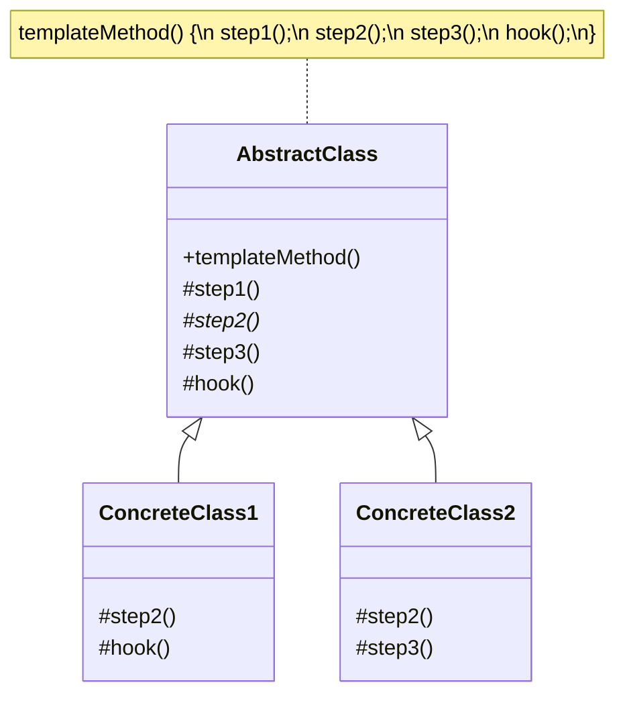

# Shablon metod andozasi (Template Method)

<CoverImage src="/covers/behavioral/template-method.webp" alt="Cover">
  <h1>Shablon metod</h1>
  <p>Qattiq yurak shaklidagi qoliplarga ega pechenye pishirish patnisi; oshpaz robot qoliplarga turli xil xamir (shokoladli, vanilli, qulupnayli) quymoqda — bu o'zgarmas tuzilma va moslashtiriladigan qadamlarni ko'rsatadi.</p>
</CoverImage>

## Umumiy ko'rinish (Overview)

**Shablon metod** (Template Method) — bu asosiy (base) klassda algoritm skeletini belgilaydigan, lekin voris klasslarga (subclass) uning umumiy tuzilmasini o'zgartirmasdan algoritmning muayyan qadamlarini qayta belgilash (override qilish) imkonini beruvchi xulq-atvor (behavioral) loyihalash andozasidir.

**Asosiy afzalligi**: U algoritmning o'zgarmas qismlarini asosiy klassga chiqarib, o'zgaruvchan qismlarini voris klasslar tomonidan moslashtirishga imkon berish orqali kod takrorlanishini yo'q qiladi.

**Zamonaviy nuqtai nazar**: Shablon metod andozasi tarixan og'ir klass merosxo'rligiga asoslangan bo'lsa-da, uning asosiy g'oyasi hamon muhim. Zamonaviy funksional dasturlashda bunga ko'pincha "shablon funksiya"ga yuqori tartibli funksiyalarni (callback'larni) uzatish orqali erishiladi. OOP'da u hali ham freymvorklarda keng qo'llaniladi (masalan, Angular'dagi `ngOnInit` yoki eski React'dagi `componentDidMount` kabi komponent hayot sikli metodlari), bu yerda freymvork _qachon_ ni (shablonni) belgilaydi, dasturchi esa _nima_ ni (qayta belgilangan qadamni) aniqlaydi.

## Muammo (The Problem)

Tasavvur qiling, siz turli hujjat formatlaridan — PDF, DOC va CSV — ma'lumotlarni qazib oluvchi (data mining) ilova yaratyapsiz.

Har bir format uchun ma'lumotlarni qazib olishning umumiy jarayoni bir xil:

1. Faylni ochish.
2. Xom ma'lumotlarni ajratib olish.
3. Ma'lumotlarni standart formatga tahlil qilish (parse qilish).
4. Tahlil qilingan ma'lumotlarni o'rganish (analiz qilish).
5. Tahlil hisobotini yuborish.
6. Faylni yopish.

```typescript
// ❌ Yomon: Ish jarayoni oqimi bir nechta klassda takrorlangan
class PDFDataMiner {
  mine(path: string) {
    const file = this.openFile(path);
    const rawData = this.extractData(file); // Faqat PDF uchun
    const data = this.parseData(rawData); // Faqat PDF uchun
    this.analyzeData(data); // Hammasi uchun bir xil
    this.sendReport(data); // Hammasi uchun bir xil
    this.closeFile(file); // Hammasi uchun bir xil
  }
  // ... metodlar ...
}

class CSVDataMiner {
  mine(path: string) {
    const file = this.openFile(path);
    const rawData = this.extractData(file); // Faqat CSV uchun
    const data = this.parseData(rawData); // Faqat CSV uchun
    this.analyzeData(data); // Hammasi uchun bir xil
    this.sendReport(data); // Hammasi uchun bir xil
    this.closeFile(file); // Hammasi uchun bir xil
  }
  // ... metodlar ...
}
```

Agar yangi qadam qo'shishingiz kerak bo'lsa (masalan, "yuborishdan oldin hisobotni siqish"), siz `mine()` metodini _har bir miner klassida_ qo'lda yangilashingiz kerak bo'ladi.

## Yechim (The Solution)

Shablon metod andozasi algoritmni asosiy klass ichida qadamlar ketma-ketligi sifatida e'lon qilishni taklif qiladi.

1. **Abstrakt asosiy klass (Abstract Base Class)**: Algoritmni tashkil etuvchi metod chaqiruvlari ketma-ketligini o'z ichiga olgan "shablon metod"ni (masalan, `mine()`) belgilaydi.
2. **Qadamlar (Steps)**: Shablon metod tomonidan chaqiriladigan metodlar.
   - _Abstrakt qadamlar_: Har bir voris klass tomonidan amalga oshirilishi shart.
   - _Ixtiyoriy qadamlar (Hook'lar)_: Asosiy klassda standart amalga oshirilishga ega, lekin qayta belgilanishi mumkin.
   - _Aniq (concrete) qadamlar_: Asosiy klassda to'liq amalga oshirilgan va barcha voris klasslar uchun umumiy.
3. **Aniq klasslar (Concrete Classes)**: Asosiy klassdan meros oladigan va abstrakt qadamlarni amalga oshiradigan voris klasslar.

Shablon metodni `final` (yoki faqat o'qish uchun) qilib, siz algoritm tuzilmasini majburiy qilasiz va hech bir voris klass bajarilish tartibini tasodifan o'zgartira olmasligini ta'minlaysiz.

## Tuzilma (Structure)



## Ishlash oqimi (Flow)

1. Mijoz **ConcreteClass** nusxasini yaratadi.
2. Mijoz o'sha nusxada `templateMethod()` ni chaqiradi.
3. Asosiy klassning `templateMethod()` metodi bajariladi.
4. Asosiy klass metodi abstrakt qadamga yoki qayta belgilangan hook'ga yetganda, dinamik dispetcherlik (dynamic dispatch) chaqiruvni voris klassning amalga oshirilishiga yo'naltiradi.

## Hayotiy o'xshatish (Real-World Analogy)

**Ommaviy ishlab chiqariladigan uy qurilishini** tasavvur qiling.
Qurilish kompaniyasining qat'iy ketma-ketligi bor (shablon metod):

1. Poydevor qo'yish.
2. Karkas qurish.
3. Tom yopish.
4. Santexnika o'rnatish.
5. Pardozlash ishlarini bajarish.

Siz poydevordan oldin tomni qura olmaysiz. _Tartib_ o'zgarmas. Biroq muayyan qadamlarning _tafsilotlari_ siz sotib olgan uy modeliga qarab farq qilishi mumkin (masalan, yog'och karkas yoki po'lat karkas, shifer tom yoki cherepitsa tom).

## Bosqichma-bosqich amalga oshirish (Step-by-Step Implementation)

1. **Algoritmni aniqlang**: Bir nechta klasslarda faqat kichik farqlar bilan takrorlanadigan algoritmni toping.
2. **Asosiy klassni yarating**: Algoritmni abstrakt asosiy klassdagi yagona shablon metodga ko'chiring.
3. **Qadamlarni belgilang**: Algoritmni yordamchi metodlarga bo'ling.
4. **O'zgaruvchanlarni aniqlang**: Farq qiladigan metodlarni `abstract` qiling.
5. **Umumiy mantiqni aniqlang**: Umumiy metodlarni asosiy klassda amalga oshiring.
6. **Hook'lar qo'shing (ixtiyoriy)**: Voris klasslar kerak bo'lganda jarayonga "ulanishi" (hook qilishi) uchun algoritmning muhim nuqtalariga bo'sh yoki standart xulq-atvorli metodlar qo'shing.

## Kod misollari (Code Examples)

Keling, **CI/CD Build Pipeline**'ni amalga oshiramiz. Har bir loyiha (Node.js, Rust, Go) bir xil bosqichlardan o'tishi kerak: Checkout (kodni olish), bog'liqliklarni o'rnatish, Build (yig'ish), Test va Deploy (joylashtirish). Biroq bog'liqliklarni o'rnatish yoki yig'ish uchun aniq buyruqlar tillar o'rtasida keskin farq qiladi.

::: code-group

```typescript [TypeScript]
// 1. Abstrakt asosiy klass
abstract class BuildPipeline {
  // Shablon metod. U aniq ketma-ketlikni belgilaydi.
  // Qayta belgilanmasligi uchun `readonly` ishlatamiz yoki uni shartli ravishda final deb hisoblaymiz.
  public buildProject(): void {
    this.checkout();
    this.installDependencies();
    this.compile();
    this.test();

    // Hook: Faqat voris klass ruxsat bersa deploy qilinadi
    if (this.shouldDeploy()) {
      this.deploy();
    }

    this.notifySuccess();
  }

  // Umumiy qadamlar (aniq)
  private checkout(): void {
    console.log("-> Checking out code from Git repository...");
  }

  private notifySuccess(): void {
    console.log("-> Build pipeline completed successfully!\n");
  }

  // Abstrakt qadamlar (voris klasslar amalga oshirishi shart)
  protected abstract installDependencies(): void;
  protected abstract compile(): void;
  protected abstract test(): void;
  protected abstract deploy(): void;

  // Hook metod (qayta belgilash ixtiyoriy)
  protected shouldDeploy(): boolean {
    return true; // Standart xulq-atvor
  }
}

// 2. Konkret klasslar
class NodeBuildPipeline extends BuildPipeline {
  protected installDependencies(): void {
    console.log("Node: Running 'npm install'...");
  }

  protected compile(): void {
    console.log("Node: Running 'npm run build' (tsc)...");
  }

  protected test(): void {
    console.log("Node: Running 'npm run test' (Jest)...");
  }

  protected deploy(): void {
    console.log("Node: Deploying to Vercel...");
  }
}

class RustBuildPipeline extends BuildPipeline {
  protected installDependencies(): void {
    console.log("Rust: Fetching crates via 'cargo fetch'...");
  }

  protected compile(): void {
    console.log("Rust: Running 'cargo build --release'...");
  }

  protected test(): void {
    console.log("Rust: Running 'cargo test'...");
  }

  protected deploy(): void {
    console.log("Rust: Uploading binary to AWS S3...");
  }

  // Hook'ni qayta belgilash
  protected shouldDeploy(): boolean {
    // Tasavvur qiling, bu yerda muhit o'zgaruvchisini tekshiramiz
    console.log("Rust: Skipping deployment for this branch.");
    return false;
  }
}

// 3. Mijoz kodi
console.log("=== Running Node.js Pipeline ===");
const nodePipeline = new NodeBuildPipeline();
nodePipeline.buildProject();

console.log("=== Running Rust Pipeline ===");
const rustPipeline = new RustBuildPipeline();
rustPipeline.buildProject();
```

```python [Python]
from abc import ABC, abstractmethod

# 1. Abstrakt asosiy klass
class BuildPipeline(ABC):
    # Shablon metod
    def build_project(self) -> None:
        self._checkout()
        self._install_dependencies()
        self._compile()
        self._test()

        if self._should_deploy():
            self._deploy()

        self._notify_success()

    # Umumiy qadamlar
    def _checkout(self) -> None:
        print("-> Checking out code from Git repository...")

    def _notify_success(self) -> None:
        print("-> Build pipeline completed successfully!\n")

    # Abstrakt qadamlar
    @abstractmethod
    def _install_dependencies(self) -> None:
        pass

    @abstractmethod
    def _compile(self) -> None:
        pass

    @abstractmethod
    def _test(self) -> None:
        pass

    @abstractmethod
    def _deploy(self) -> None:
        pass

    # Hook metod
    def _should_deploy(self) -> bool:
        return True

# 2. Konkret klasslar
class PythonBuildPipeline(BuildPipeline):
    def _install_dependencies(self) -> None:
        print("Python: Running 'pip install -r requirements.txt'...")

    def _compile(self) -> None:
        print("Python: Skipping compilation (interpreted language)...")

    def _test(self) -> None:
        print("Python: Running 'pytest'...")

    def _deploy(self) -> None:
        print("Python: Deploying to Heroku...")

class RustBuildPipeline(BuildPipeline):
    def _install_dependencies(self) -> None:
        print("Rust: Fetching crates via 'cargo fetch'...")

    def _compile(self) -> None:
        print("Rust: Running 'cargo build --release'...")

    def _test(self) -> None:
        print("Rust: Running 'cargo test'...")

    def _deploy(self) -> None:
        print("Rust: Uploading binary to AWS S3...")

    # Hook'ni qayta belgilash
    def _should_deploy(self) -> bool:
        print("Rust: Skipping deployment for this branch.")
        return False

# 3. Mijoz kodi
if __name__ == "__main__":
    print("=== Running Python Pipeline ===")
    py_pipeline = PythonBuildPipeline()
    py_pipeline.build_project()

    print("=== Running Rust Pipeline ===")
    rust_pipeline = RustBuildPipeline()
    rust_pipeline.build_project()
```

```java [Java]
// 1. Abstrakt asosiy klass
abstract class BuildPipeline {

    // Voris klasslar ketma-ketlikni o'zgartira olmasligi uchun shablon metod final qilingan
    public final void buildProject() {
        checkout();
        installDependencies();
        compile();
        test();

        if (shouldDeploy()) {
            deploy();
        }

        notifySuccess();
    }

    private void checkout() {
        System.out.println("-> Checking out code from Git repository...");
    }

    private void notifySuccess() {
        System.out.println("-> Build pipeline completed successfully!\n");
    }

    // Abstrakt qadamlar
    protected abstract void installDependencies();
    protected abstract void compile();
    protected abstract void test();
    protected abstract void deploy();

    // Hook
    protected boolean shouldDeploy() {
        return true;
    }
}

// 2. Konkret klasslar
class JavaBuildPipeline extends BuildPipeline {
    @Override
    protected void installDependencies() {
        System.out.println("Java: Running 'mvn clean install' (downloads dependencies)...");
    }

    @Override
    protected void compile() {
        System.out.println("Java: Compiling via Maven...");
    }

    @Override
    protected void test() {
        System.out.println("Java: Running JUnit tests...");
    }

    @Override
    protected void deploy() {
        System.out.println("Java: Publishing JAR to Nexus Repository...");
    }
}

class RustBuildPipeline extends BuildPipeline {
    @Override
    protected void installDependencies() {
        System.out.println("Rust: Fetching crates via 'cargo fetch'...");
    }

    @Override
    protected void compile() {
        System.out.println("Rust: Running 'cargo build --release'...");
    }

    @Override
    protected void test() {
        System.out.println("Rust: Running 'cargo test'...");
    }

    @Override
    protected void deploy() {
        System.out.println("Rust: Uploading binary to AWS S3...");
    }

    @Override
    protected boolean shouldDeploy() {
        System.out.println("Rust: Skipping deployment for this branch.");
        return false;
    }
}

// 3. Mijoz kodi
public class TemplateMethodDemo {
    public static void main(String[] args) {
        System.out.println("=== Running Java Pipeline ===");
        BuildPipeline javaPipeline = new JavaBuildPipeline();
        javaPipeline.buildProject();

        System.out.println("=== Running Rust Pipeline ===");
        BuildPipeline rustPipeline = new RustBuildPipeline();
        rustPipeline.buildProject();
    }
}
```

```go [Go]
package main

import "fmt"

// Go'da klasslar va an'anaviy merosxo'rlik yo'q.
// Shablon metod andozasi uchun kompozitsiya va o'zgaruvchan qadamlar uchun interfeys ishlatamiz.

// 1. O'zgaruvchan qadamlar uchun interfeys
type PipelineSteps interface {
	InstallDependencies()
	Compile()
	Test()
	Deploy()
	ShouldDeploy() bool
}

// 2. Asosiy "klass" (shablon)
type BuildPipeline struct {
	steps PipelineSteps // Interfeysni joylashtiramiz
}

// Shablon metod
func (b *BuildPipeline) BuildProject() {
	b.checkout()
	b.steps.InstallDependencies()
	b.steps.Compile()
	b.steps.Test()

	if b.steps.ShouldDeploy() {
		b.steps.Deploy()
	}

	b.notifySuccess()
}

func (b *BuildPipeline) checkout() {
	fmt.Println("-> Checking out code from Git repository...")
}

func (b *BuildPipeline) notifySuccess() {
	fmt.Println("-> Build pipeline completed successfully!\n")
}

// 3. Konkret amalga oshirish: Go
type GoPipeline struct{}

func (g *GoPipeline) InstallDependencies() {
	fmt.Println("Go: Running 'go mod download'...")
}

func (g *GoPipeline) Compile() {
	fmt.Println("Go: Running 'go build'...")
}

func (g *GoPipeline) Test() {
	fmt.Println("Go: Running 'go test ./...'...")
}

func (g *GoPipeline) Deploy() {
	fmt.Println("Go: Deploying binary to Server...")
}

func (g *GoPipeline) ShouldDeploy() bool {
	return true
}

// 4. Konkret amalga oshirish: Rust
type RustPipeline struct{}

func (r *RustPipeline) InstallDependencies() {
	fmt.Println("Rust: Fetching crates via 'cargo fetch'...")
}

func (r *RustPipeline) Compile() {
	fmt.Println("Rust: Running 'cargo build --release'...")
}

func (r *RustPipeline) Test() {
	fmt.Println("Rust: Running 'cargo test'...")
}

func (r *RustPipeline) Deploy() {
	fmt.Println("Rust: Uploading binary to AWS S3...")
}

func (r *RustPipeline) ShouldDeploy() bool {
	fmt.Println("Rust: Skipping deployment for this branch.")
	return false
}

// Konstruktor yordamchisi
func NewBuildPipeline(steps PipelineSteps) *BuildPipeline {
	return &BuildPipeline{steps: steps}
}

// 5. Mijoz
func main() {
	fmt.Println("=== Running Go Pipeline ===")
	goPipeline := NewBuildPipeline(&GoPipeline{})
	goPipeline.BuildProject()

	fmt.Println("=== Running Rust Pipeline ===")
	rustPipeline := NewBuildPipeline(&RustPipeline{})
	rustPipeline.BuildProject()
}
```

```rust [Rust]
// Rust merosxo'rlikdan ko'ra trait'lar va kompozitsiyani afzal ko'radi.
// Shablon metod andozasini tayyor metodli trait yordamida amalga oshirish mumkin.

// 1. Trait (asosiy shablon + abstrakt qadamlar)
trait BuildPipeline {
    // Shablon metod (tayyor amalga oshirish)
    fn build_project(&self) {
        self.checkout();
        self.install_dependencies();
        self.compile();
        self.test();

        if self.should_deploy() {
            self.deploy();
        }

        self.notify_success();
    }

    // Konkret qadamlar (tayyor amalga oshirishlar)
    fn checkout(&self) {
        println!("-> Checking out code from Git repository...");
    }

    fn notify_success(&self) {
        println!("-> Build pipeline completed successfully!\n");
    }

    // Abstrakt qadamlar (struct'lar amalga oshirishi shart)
    fn install_dependencies(&self);
    fn compile(&self);
    fn test(&self);
    fn deploy(&self);

    // Hook (qayta belgilanishi mumkin bo'lgan standart amalga oshirish)
    fn should_deploy(&self) -> bool {
        true
    }
}

// 2. Konkret amalga oshirish: Rust
struct RustBuildPipeline;

impl BuildPipeline for RustBuildPipeline {
    fn install_dependencies(&self) {
        println!("Rust: Fetching crates via 'cargo fetch'...");
    }

    fn compile(&self) {
        println!("Rust: Running 'cargo build --release'...");
    }

    fn test(&self) {
        println!("Rust: Running 'cargo test'...");
    }

    fn deploy(&self) {
        println!("Rust: Uploading binary to AWS S3...");
    }

    fn should_deploy(&self) -> bool {
        println!("Rust: Skipping deployment for this branch.");
        false
    }
}

// 3. Konkret amalga oshirish: Node
struct NodeBuildPipeline;

impl BuildPipeline for NodeBuildPipeline {
    fn install_dependencies(&self) {
        println!("Node: Running 'npm install'...");
    }

    fn compile(&self) {
        println!("Node: Running 'npm run build' (tsc)...");
    }

    fn test(&self) {
        println!("Node: Running 'npm run test' (Jest)...");
    }

    fn deploy(&self) {
        println!("Node: Deploying to Vercel...");
    }
}

// 4. Mijoz
fn main() {
    println!("=== Running Node Pipeline ===");
    let node_pipeline = NodeBuildPipeline;
    node_pipeline.build_project();

    println!("=== Running Rust Pipeline ===");
    let rust_pipeline = RustBuildPipeline;
    rust_pipeline.build_project();
}
```

:::

## Afzallik va kamchiliklar (Pros and Cons)

### Afzalliklari (Advantages)

- **Kod takrorlanishini kamaytiradi**: Bir xil mantiqni (ish oqimi nazoratini) superklassga chiqaradi.
- **Algoritm tuzilmasini majburiy qiladi**: Voris klasslar amallarning muhim ketma-ketligini buzmasligini ta'minlaydi.
- **Gollivud tamoyili (The Hollywood Principle)**: "Bizga qo'ng'iroq qilmang, biz sizga qo'ng'iroq qilamiz." Asosiy klass oqimni nazorat qiladi va kerak bo'lganda voris klass metodlarini chaqiradi, an'anaviy bog'liqlik tuzilmalarini teskari aylantiradi.
- **Hook'larni taqdim etadi**: Voris klasslarga algoritmning muayyan, xavfsiz nuqtalariga o'zlarini qo'shish imkonini beradi.

### Kamchiliklari (Disadvantages)

- **Qattiq tuzilma**: Voris klasslar taqdim etilgan skeletga bog'langan. Agar voris klass oqimni sezilarli darajada o'zgartirishi kerak bo'lsa, andoza ishlamay qoladi.
- **Liskov almashtirish tamoyili (Liskov Substitution Principle) xavflari**: Voris klasslar standart qadamni bo'sh metod bilan qayta belgilab, uni bostirishi mumkin, bu esa kutilgan xulq-atvorni buzishi mumkin.
- **Texnik xizmat ko'rsatish qiyin**: Juda ko'p qadam yoki hook'larga ega shablonlarni o'qish va qo'llab-quvvatlash nihoyatda qiyinlashadi.

## Qachon foydalanish kerak (When to Use)

- **Kichik farqlarga ega umumiy algoritm**: Sizda faqat muayyan qadamlarda kichik farqlar bilan deyarli bir xil algoritmlarni amalga oshiradigan bir nechta klasslar bo'lganda.
- **Freymvork ishlab chiqish**: Freymvork yoki kutubxona yaratayotganda, foydalanuvchilarga hook'lar orqali o'z kodlarini kiritish imkonini bergan holda asosiy bajarish siklini taqdim etmoqchi bo'lsangiz (masalan, React'ning klassga asoslangan komponentlari yoki Angular direktivalari).

## Qachon foydalanmaslik kerak (When NOT to Use)

- **Yuqori o'zgaruvchanlik**: Agar qadamlar ketma-ketligi tez-tez o'zgarsa, uni asosiy klassda qotirib qo'yish katta bosh og'rig'iga sabab bo'ladi. Buning o'rniga **[Strategiya](/uz/behavioral/strategy)** (Strategy) andozasidan foydalaning.
- **Kam variantlar**: Agar sizda faqat bitta yoki ikkita variant bo'lsa, abstrakt klasslar va voris klasslar yaratish xarajatlari bunga arzimasligi mumkin.
- **Kompozitsiyaga asoslangan kod bazalari**: Agar arxitekturangiz merosxo'rlikdan qat'iy qochsa (masalan, Go, zamonaviy React, Rust), odatda buni klassik merosxo'rlik o'rniga yuqori tartibli funksiyalar (Higher-Order Functions) yoki interfeys inyeksiyasi orqali amalga oshirasiz.

## Keng tarqalgan xatolar (Common Mistakes)

### 1. Shablon metodni final qilishni unutish

Java yoki C# kabi tillarda, agar shablon metodni aniq `final` / `sealed` deb belgilamasangiz, voris klass shablon metodning o'zini qayta belgilashi mumkin va bu andozaning maqsadini butunlay yo'q qiladi.

### 2. "Xudo shabloni" (God Template) yaratish

Agar shablon metodingiz 15 xil abstrakt qadamni chaqirsa, voris klass yaratish dahshatga aylanadi, chunki dasturchi 15 ta bir-biriga bog'lanmagan metodni amalga oshirishi kerak bo'ladi. Qadamlarni o'zaro bog'liq (cohesive) va minimal saqlang.

## Aloqador andozalar (Related Patterns)

- **[Strategiya](/uz/behavioral/strategy)**: Shablon metodning eng katta raqibi. Strategiya obyekt kompozitsiyasi orqali _butun_ algoritmni o'zgartiradi. Shablon metod esa merosxo'rlik orqali algoritmning _qismlarini_ o'zgartiradi.
- **[Fabrika metodi](/uz/creational/factory-method)** (Factory Method): Fabrika metodi ko'pincha algoritm uchun kerakli obyektlarni yaratish maqsadida shablon metod ichidan chaqiriladi.
- **[Quruvchi](/uz/creational/builder)** (Builder): Ikkalasi ham qadamlarni belgilaydi, lekin Quruvchi murakkab obyektni qadamma-qadam yaratishga e'tibor qaratadi, Shablon metod esa xulq-atvor algoritmini qadamma-qadam bajaradi.

## Intervyu uchun maslahatlar (Interview Insights)

- **Savol**: "'Gollivud tamoyili' nima va u Shablon metod andozasi bilan qanday bog'liq?"
  - **Javob**: "Gollivud tamoyili — 'Bizga qo'ng'iroq qilmang, biz sizga qo'ng'iroq qilamiz.' Shablon metod andozasida voris klass keyin nima qilish kerakligini bilish uchun asosiy klassni chaqirmaydi. Aksincha, asosiy klass ish oqimini belgilaydi va voris klassning qayta belgilangan metodlarini to'g'ri vaqtda chaqiradi."
- **Savol**: "Shablon metod andozasida 'Hook' nima?"
  - **Javob**: "Hook — abstrakt klassdagi bo'sh yoki standart amalga oshirilishga ega metod. U _albatta_ qayta belgilanishi shart bo'lgan abstrakt metodlardan farqli o'laroq, voris klasslar uchun ixtiyoriy kengaytirish nuqtasini taqdim etadi."

## Zamonaviy muqobillar (Modern Alternatives)

- **Yuqori tartibli funksiyalar (Higher-Order Functions)**: TypeScript, Python va zamonaviy tillarda qattiq klass merosxo'rligi ierarxiyasini yaratishdan ko'ra umumiy pipeline funksiyasiga callback funksiyalarini uzatish ko'pincha afzal ko'riladi.
- **Middleware zanjirlari (Middleware Chains)**: Veb freymvorklarda (Express, ASP.NET Core) so'rov quvurlari (request pipelines) yagona qotirilgan shablon klass o'rniga middleware zanjirlari sifatida belgilanadi. Bu algoritm qadamlarini ish vaqtida dinamik ravishda tuzish imkonini beradi.
