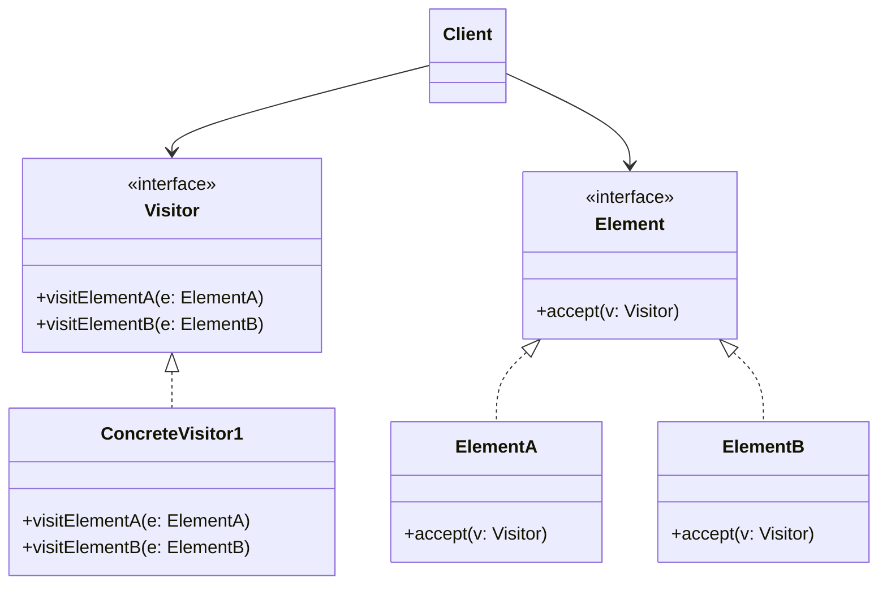

# Tashrifchi andozasi (Visitor)

<CoverImage src="/covers/behavioral/visitor.webp" alt="Cover">
  <h1>Tashrifchi</h1>
  <p>Kulgili muzey galereyasi: yoqimtoy turist robot ("Visitor" — tashrifchi) aylanib yurib, turli geometrik haykallar (Doira, Kvadrat) bilan muloqot qiladi va ularning tuzilmasini o'zgartirmasdan ularga yangi xulq-atvorlar qo'shadi.</p>
</CoverImage>

## Umumiy ko'rinish (Overview)

**Tashrifchi** (Visitor) — bu mavjud klasslarni o'zgartirmasdan ularga yangi amallar qo'shish imkonini beruvchi xulq-atvor (behavioral) loyihalash andozasidir. U bunga algoritmni u ishlaydigan obyekt tuzilmasidan ajratish orqali erishadi.

**Asosiy afzalligi**: U "ikki tomonlama dispetcherlik"ni (Double Dispatch) amalga oshiradi, ya'ni dasturga qabul qiluvchining (receiver) turiga _va_ argumentning turiga qarab turli mantiqni bajarish imkonini beradi.

**Zamonaviy nuqtai nazar**: Tashrifchi andozasi eski obyektga yo'naltirilgan tillarga (Java, C++, C#) xos muammoni hal qilish uchun yaratilgan: ular faqat _yagona dispetcherlikni_ (Single Dispatch — faqat metod chaqirilayotgan obyektga asoslangan polimorfizm) qo'llab-quvvatlaydi. **Pattern Matching**'ni (Rust, Scala, Swift, zamonaviy C#, zamonaviy Java) yoki Union turlarini (TypeScript) qo'llab-quvvatlaydigan zamonaviy tillarda klassik Tashrifchi andozasi asosan eskirgan va haddan tashqari ko'p so'zli hisoblanadi. Biroq uni tushunish eski (legacy) tizimlar, kompilyatorlarni loyihalash (AST bo'ylab yurish) va rivojlangan pattern matching'ga ega bo'lmagan tillar uchun juda muhim.

## Muammo (The Problem)

Tasavvur qiling, siz turli tugunlardan — `City` (shahar), `Industry` (sanoat) va `Sightseeing` (diqqatga sazovor joy) — iborat murakkab grafdan tashkil topgan geografik xarita bilan ishlaydigan ilova yaratyapsiz.

Rahbaringiz sizdan xarita ma'lumotlarini XML formatiga eksport qilishni so'raydi.

```typescript
// ❌ Yomon: Single Responsibility va Open/Closed tamoyillarini buzadi
class City implements MapNode {
  exportToXML() {
    /* ... XML mantig'i ... */
  }
}

class Industry implements MapNode {
  exportToXML() {
    /* ... XML mantig'i ... */
  }
}

class Sightseeing implements MapNode {
  exportToXML() {
    /* ... XML mantig'i ... */
  }
}
```

Dastlab bu yaxshi ko'rinadi. Lekin keyingi hafta rahbar JSON eksportini so'rasa nima bo'ladi? CSV eksporti-chi?
Har safar yangi amal kerak bo'lganda, siz _har bir tugun klassini_ o'zgartirishingiz kerak. Bu klasslar tahlil qilish (parsing), formatlash yoki eksport qilish bilan emas, geografik ma'lumotlarni ifodalash bilan shug'ullanishi kerak.

Agar mantiqni klasslardan tashqariga, `Exporter` klassiga ko'chirishga harakat qilsangiz, muammoga duch kelasiz:

```typescript
class Exporter {
  export(node: MapNode) {
    // ❌ Yomon: Ulkan instanceof zanjirlari (Code Smell)
    if (node instanceof City) {
      // shaharni eksport qilish
    } else if (node instanceof Industry) {
      // sanoatni eksport qilish
    }
  }
}
```

## Yechim (The Solution)

Tashrifchi andozasi yangi xulq-atvorni mavjud klasslarga qo'shish o'rniga `Visitor` deb ataladigan alohida klassga joylashtirishni taklif qiladi.

Buni `instanceof` tekshiruvlarisiz ishlatishning siri — **ikki tomonlama dispetcherlik (Double Dispatch)**.

1. Biz `Visitor`'dan amalni bajarishni so'raymiz, lekin Visitor qaysi tugun bilan ishlayotganini qanday biladi?
2. Biz `MapNode` interfeysiga yagona `accept(visitor)` metodini qo'shamiz.
3. Har bir aniq tugun `accept(visitor)` ni shunchaki `visitor.visit(this)` ni chaqirish orqali amalga oshiradi.

Kod aniq tugun (masalan, `City`) _ichida_ bajarilgani sababli, `this` ning turi `City` ekanligi aniq ma'lum. Kompilyator chaqiruvni Visitor'dagi to'g'ri qayta yuklangan (overloaded) metodga bog'laydi.

## Tuzilma (Structure)



## Ishlash oqimi (Flow)

1. Mijoz `ConcreteVisitor` obyektini yaratadi.
2. Mijoz murakkab obyekt tuzilmasi (masalan, `Element`'lar massivi) bo'ylab aylanib chiqadi.
3. Mijoz har bir elementda `element.accept(visitor)` ni chaqiradi.
4. `accept` ichida aniq `Element` visitor'ga qaytib murojaat qiladi: `visitor.visitElementA(this)`.
5. `Visitor` `ElementA` ga xos mantiqni bajaradi.

## Hayotiy o'xshatish (Real-World Analogy)

Mijozlarga tashrif buyuradigan **sug'urta agentini** tasavvur qiling.
Agent (Visitor) turar-joy binosi, bank va qahvaxonaga (Element'lar) tashrif buyuradi.
Qaysi binoga tashrif buyurishiga qarab, agent turli amalni bajaradi:

- Turar-joy binosida u tibbiy sug'urtani taklif qiladi.
- Bankda u o'g'irlikdan sug'urtani taklif qiladi.
- Qahvaxonada u yong'indan sug'urtani taklif qiladi.
  Binolarni sug'urta _qanday_ hisoblanishi qiziqtirmaydi; ular shunchaki agentni o'z binosiga "qabul qiladi" (accept) va agent tegishli ishni bajaradi.

## Bosqichma-bosqich amalga oshirish (Step-by-Step Implementation)

1. **Visitor interfeysini e'lon qiling**: Har bir aniq element klassi uchun bittadan "tashrif" (visiting) metodlari to'plamiga ega interfeys yarating.
2. **Element interfeysini e'lon qiling**: Element ierarxiyangizning asosiy interfeysiga `accept(visitor)` metodini qo'shing.
3. **Qabul qilishni amalga oshiring**: Har bir aniq elementda `accept(visitor)` ni element klassiga mos keladigan visitor metodini chaqirish orqali amalga oshiring.
4. **Concrete Visitor'larni yarating**: Visitor interfeysini amalga oshiruvchi klasslar yarating. Har bir visitor alohida amalni ifodalaydi (eksport, render qilish, validatsiya va h.k.).
5. **Mijoz tomonidan bajarish**: Mijoz visitor obyektlarini yaratadi va ularni `accept` metodi orqali elementlarga uzatadi.

## Kod misollari (Code Examples)

Keling, kompilyatorda ishlatiladigan **abstrakt sintaksis daraxti (Abstract Syntax Tree, AST)** uchun tizimni amalga oshiramiz. Bizda turli tugun turlari bor (`NumberNode`, `AdditionNode`). Biz AST'ni kompilyatsiya qilish, hisoblash va chop etish imkoniyatiga ega bo'lishni xohlaymiz — bularning barcha mantig'ini tugunlarning o'ziga tiqishtirmasdan.

::: code-group

```typescript [TypeScript]
// 1. Visitor interfeysi
interface ASTVisitor {
  visitNumber(node: NumberNode): void;
  visitAddition(node: AdditionNode): void;
}

// 2. Element interfeysi
interface ASTNode {
  accept(visitor: ASTVisitor): void;
}

// 3. Konkret elementlar
class NumberNode implements ASTNode {
  constructor(public value: number) {}

  accept(visitor: ASTVisitor): void {
    // Double dispatch: 'this'ni (NumberNode turi) visitor'ga qaytarib uzatamiz
    visitor.visitNumber(this);
  }
}

class AdditionNode implements ASTNode {
  constructor(
    public left: ASTNode,
    public right: ASTNode,
  ) {}

  accept(visitor: ASTVisitor): void {
    // Double dispatch (ikki tomonlama dispetcherlik)
    visitor.visitAddition(this);
  }
}

// 4. Konkret Visitor'lar
class EvaluateVisitor implements ASTVisitor {
  public result: number = 0;

  visitNumber(node: NumberNode): void {
    this.result = node.value;
  }

  visitAddition(node: AdditionNode): void {
    // Chap tomonni hisoblash
    node.left.accept(this);
    const leftVal = this.result;

    // O'ng tomonni hisoblash
    node.right.accept(this);
    const rightVal = this.result;

    this.result = leftVal + rightVal;
  }
}

class PrintVisitor implements ASTVisitor {
  public output: string = "";

  visitNumber(node: NumberNode): void {
    this.output += node.value.toString();
  }

  visitAddition(node: AdditionNode): void {
    this.output += "(";
    node.left.accept(this);
    this.output += " + ";
    node.right.accept(this);
    this.output += ")";
  }
}

// 5. Mijoz kodi
const tree = new AdditionNode(
  new NumberNode(5),
  new AdditionNode(new NumberNode(2), new NumberNode(3)),
);

console.log("=== Printing AST ===");
const printer = new PrintVisitor();
tree.accept(printer);
console.log(printer.output); // Natija: (5 + (2 + 3))

console.log("=== Evaluating AST ===");
const evaluator = new EvaluateVisitor();
tree.accept(evaluator);
console.log(evaluator.result); // Natija: 10
```

```python [Python]
from abc import ABC, abstractmethod

# 1. Visitor interfeysi
class ASTVisitor(ABC):
    @abstractmethod
    def visit_number(self, node: 'NumberNode') -> None:
        pass

    @abstractmethod
    def visit_addition(self, node: 'AdditionNode') -> None:
        pass

# 2. Element interfeysi
class ASTNode(ABC):
    @abstractmethod
    def accept(self, visitor: ASTVisitor) -> None:
        pass

# 3. Konkret elementlar
class NumberNode(ASTNode):
    def __init__(self, value: float):
        self.value = value

    def accept(self, visitor: ASTVisitor) -> None:
        visitor.visit_number(self)

class AdditionNode(ASTNode):
    def __init__(self, left: ASTNode, right: ASTNode):
        self.left = left
        self.right = right

    def accept(self, visitor: ASTVisitor) -> None:
        visitor.visit_addition(self)

# 4. Konkret Visitor'lar
class EvaluateVisitor(ASTVisitor):
    def __init__(self):
        self.result: float = 0

    def visit_number(self, node: NumberNode) -> None:
        self.result = node.value

    def visit_addition(self, node: AdditionNode) -> None:
        node.left.accept(self)
        left_val = self.result

        node.right.accept(self)
        right_val = self.result

        self.result = left_val + right_val

class PrintVisitor(ASTVisitor):
    def __init__(self):
        self.output: str = ""

    def visit_number(self, node: NumberNode) -> None:
        self.output += str(node.value)

    def visit_addition(self, node: AdditionNode) -> None:
        self.output += "("
        node.left.accept(self)
        self.output += " + "
        node.right.accept(self)
        self.output += ")"

# 5. Mijoz kodi
if __name__ == "__main__":
    # AST: 5 + (2 + 3)
    tree = AdditionNode(
        NumberNode(5),
        AdditionNode(NumberNode(2), NumberNode(3))
    )

    print("=== Printing AST ===")
    printer = PrintVisitor()
    tree.accept(printer)
    print(printer.output)

    print("=== Evaluating AST ===")
    evaluator = EvaluateVisitor()
    tree.accept(evaluator)
    print(evaluator.result)
```

```java [Java]
// 1. Visitor interfeysi
interface ASTVisitor {
    void visit(NumberNode node);
    void visit(AdditionNode node);
}

// 2. Element interfeysi
interface ASTNode {
    void accept(ASTVisitor visitor);
}

// 3. Konkret elementlar
class NumberNode implements ASTNode {
    final double value;

    NumberNode(double value) { this.value = value; }

    @Override
    public void accept(ASTVisitor visitor) {
        visitor.visit(this); // visit(NumberNode) chaqiriladi
    }
}

class AdditionNode implements ASTNode {
    final ASTNode left;
    final ASTNode right;

    AdditionNode(ASTNode left, ASTNode right) {
        this.left = left;
        this.right = right;
    }

    @Override
    public void accept(ASTVisitor visitor) {
        visitor.visit(this); // visit(AdditionNode) chaqiriladi
    }
}

// 4. Konkret Visitor'lar
class EvaluateVisitor implements ASTVisitor {
    private double result = 0;

    public double getResult() { return result; }

    @Override
    public void visit(NumberNode node) {
        this.result = node.value;
    }

    @Override
    public void visit(AdditionNode node) {
        node.left.accept(this);
        double leftVal = this.result;

        node.right.accept(this);
        double rightVal = this.result;

        this.result = leftVal + rightVal;
    }
}

class PrintVisitor implements ASTVisitor {
    private StringBuilder output = new StringBuilder();

    public String getOutput() { return output.toString(); }

    @Override
    public void visit(NumberNode node) {
        output.append(node.value);
    }

    @Override
    public void visit(AdditionNode node) {
        output.append("(");
        node.left.accept(this);
        output.append(" + ");
        node.right.accept(this);
        output.append(")");
    }
}

// 5. Mijoz kodi
public class VisitorDemo {
    public static void main(String[] args) {
        ASTNode tree = new AdditionNode(
            new NumberNode(5),
            new AdditionNode(new NumberNode(2), new NumberNode(3))
        );

        System.out.println("=== Printing AST ===");
        PrintVisitor printer = new PrintVisitor();
        tree.accept(printer);
        System.out.println(printer.getOutput());

        System.out.println("=== Evaluating AST ===");
        EvaluateVisitor evaluator = new EvaluateVisitor();
        tree.accept(evaluator);
        System.out.println(evaluator.getResult());
    }
}
```

```go [Go]
package main

import (
	"fmt"
	"strconv"
)

// 1. Visitor interfeysi
type ASTVisitor interface {
	VisitNumber(node *NumberNode)
	VisitAddition(node *AdditionNode)
}

// 2. Element interfeysi
type ASTNode interface {
	Accept(visitor ASTVisitor)
}

// 3. Konkret elementlar
type NumberNode struct {
	Value float64
}

func (n *NumberNode) Accept(visitor ASTVisitor) {
	visitor.VisitNumber(n)
}

type AdditionNode struct {
	Left  ASTNode
	Right ASTNode
}

func (a *AdditionNode) Accept(visitor ASTVisitor) {
	visitor.VisitAddition(a)
}

// 4. Konkret Visitor'lar
type EvaluateVisitor struct {
	Result float64
}

func (v *EvaluateVisitor) VisitNumber(node *NumberNode) {
	v.Result = node.Value
}

func (v *EvaluateVisitor) VisitAddition(node *AdditionNode) {
	node.Left.Accept(v)
	leftVal := v.Result

	node.Right.Accept(v)
	rightVal := v.Result

	v.Result = leftVal + rightVal
}

type PrintVisitor struct {
	Output string
}

func (v *PrintVisitor) VisitNumber(node *NumberNode) {
	v.Output += strconv.FormatFloat(node.Value, 'f', -1, 64)
}

func (v *PrintVisitor) VisitAddition(node *AdditionNode) {
	v.Output += "("
	node.Left.Accept(v)
	v.Output += " + "
	node.Right.Accept(v)
	v.Output += ")"
}

// 5. Mijoz
func main() {
	tree := &AdditionNode{
		Left: &NumberNode{Value: 5},
		Right: &AdditionNode{
			Left:  &NumberNode{Value: 2},
			Right: &NumberNode{Value: 3},
		},
	}

	fmt.Println("=== Printing AST ===")
	printer := &PrintVisitor{}
	tree.Accept(printer)
	fmt.Println(printer.Output)

	fmt.Println("=== Evaluating AST ===")
	evaluator := &EvaluateVisitor{}
	tree.Accept(evaluator)
	fmt.Println(evaluator.Result)
}
```

```rust [Rust]
// Rust'da Pattern Matching klassik OOP Tashrifchi andozasini to'liq almashtiradi.
// Interfeyslar va Double Dispatch yaratish o'rniga, tugun turlarini
// ifodalovchi Enum belgilaymiz va `match` bloklaridan foydalanamiz.
// Tashrifchi andozasi OOP'da aynan shuni taqlid qilishga urinadi (va qiynaladi).

// 1. "Elementlar" (Algebraik ma'lumot turi / Enum)
enum ASTNode {
    Number(f64),
    Addition(Box<ASTNode>, Box<ASTNode>),
}

// 2. "Visitor'lar" (Pattern Matching ishlatadigan oddiy funksiyalar)

// "Print Visitor" ekvivalenti
fn print_ast(node: &ASTNode) -> String {
    match node {
        ASTNode::Number(val) => val.to_string(),
        ASTNode::Addition(left, right) => {
            format!("({} + {})", print_ast(left), print_ast(right))
        }
    }
}

// "Evaluate Visitor" ekvivalenti
fn evaluate_ast(node: &ASTNode) -> f64 {
    match node {
        ASTNode::Number(val) => *val,
        ASTNode::Addition(left, right) => evaluate_ast(left) + evaluate_ast(right),
    }
}

// 3. Mijoz kodi
fn main() {
    // AST: 5 + (2 + 3)
    let tree = ASTNode::Addition(
        Box::new(ASTNode::Number(5.0)),
        Box::new(ASTNode::Addition(
            Box::new(ASTNode::Number(2.0)),
            Box::new(ASTNode::Number(3.0)),
        )),
    );

    println!("=== Printing AST ===");
    println!("{}", print_ast(&tree));

    println!("=== Evaluating AST ===");
    println!("{}", evaluate_ast(&tree));
}
```

:::

## Afzallik va kamchiliklar (Pros and Cons)

### Afzalliklari (Advantages)

- **Ochiq/Yopiqlik tamoyili (Open/Closed Principle)**: Turli klasslar obyektlari bilan ishlay oladigan yangi xulq-atvorni o'sha klasslarni o'zgartirmasdan qo'shishingiz mumkin.
- **Yagona javobgarlik tamoyili (Single Responsibility Principle)**: Bir xil xulq-atvorning bir nechta versiyalarini bitta klassga to'plashingiz mumkin.
- **Tur xavfsizligi (Type Safety)**: Ulkan `if (node instanceof City)` bloklaridan farqli o'laroq, ikki tomonlama dispetcherlik har bir element turi qayta ishlanishini kompilyatsiya vaqtida kafolatlaydi.
- **Holatni to'plash (State Accumulation)**: Visitor turli obyektlar bo'ylab yurganda holatni to'plashi mumkin (jami summalarni hisoblash yoki hisobotlar yaratish uchun foydali).

### Kamchiliklari (Disadvantages)

- **Mo'rt asosiy klass ierarxiyasi**: Tashrifchi andozasining eng katta kamchiligi shundaki, agar Element ierarxiyasiga yangi klass qo'shilsa (masalan, `SubtractionNode`), siz `Visitor` interfeysini va HAR BIR aniq visitor klassini ALBATTA yangilashingiz kerak.
- **Inkapsulyatsiyaning buzilishi**: Visitor'lar odatda o'zlari tashrif buyuradigan elementlarning private yoki protected maydonlariga kirishga muhtoj. Bu sizni ichki holatni ochiq (public) getter'lar orqali oshkor qilishga majbur qiladi.
- **Murakkablik**: Ikki tomonlama dispetcherlik mexanizmi (`accept` ma'lumotlar ustida ishlaydigan `visit` ni chaqiradi) yangi boshlovchi (junior) dasturchilar uchun tushunish mashhur darajada qiyin bo'lgan aqliy siklni yaratadi.

## Qachon foydalanish kerak (When to Use)

- **Barqaror ierarxiya, beqaror amallar**: Sizda klasslari kamdan-kam o'zgaradigan murakkab obyekt tuzilmasi (masalan, abstrakt sintaksis daraxti yoki Document Object Model) bor, lekin ular ustida tez-tez yangi va bir-biriga bog'liq bo'lmagan amallarni bajarishingiz kerak.
- **Biznes mantig'ini tozalash**: Yagona javobgarlik tamoyiliga rioya qilish uchun yordamchi xulq-atvorlarni (eksport qilish, chop etish yoki render qilish kabi) asosiy domen klasslaridan ajratib chiqarmoqchi bo'lganingizda.

## Qachon foydalanmaslik kerak (When NOT to Use)

- **O'zgaruvchan ierarxiyalar**: Agar obyekt tuzilmasini tashkil etuvchi klasslar tez-tez o'zgarsa (yangi tugun turlari qo'shilsa), Tashrifchi andozasi cheksiz texnik xizmat ko'rsatish muammolariga sabab bo'ladi.
- **Pattern Matching'ga ega tillar**: Agar siz Rust, Scala, F# yoki hatto Discriminated Union'larga ega zamonaviy C#/TypeScript'dan foydalanayotgan bo'lsangiz, Tashrifchi andozasidan foydalanmang. Tabiiy pattern matching'dan foydalaning.

## Keng tarqalgan xatolar (Common Mistakes)

### 1. `visit()` dan qiymatlarni to'g'ridan-to'g'ri qaytarishga urinish

Qat'iy turlangan tillarda barcha visitor'lar uchun `visit()` ning qaytarish turini standartlashtirish qiyin (ba'zi visitor'lar `int`, boshqalari `string` qaytarishni xohlashi mumkin). Odatda Visitor interfeysi `void` qaytaradi va aniq visitor natijani keyinroq so'raladigan lokal maydonda to'playdi (TS/Java misollarimizda ko'rsatilganidek).

### 2. Tashrifchini Iterator bilan adashtirish

Iterator shunchaki kolleksiya bo'ylab yuradi. Tashrifchi esa elementlar ustida amallarni bajaradi. Biroq tashrifchi murakkab graflar (masalan, daraxtlar) bo'ylab o'zi qanday yurishni _bilmaydi_. Aylanib chiqish mantig'i yo tashrifchi ichida bo'lishi (AST misolimizda `visitAddition` bolalarida `accept` ni chaqirganidek), yoki tashqi Iterator/Object Structure klassi tomonidan boshqarilishi kerak.

## Aloqador andozalar (Related Patterns)

- **[Kompozit](/uz/structural/composite)** (Composite): Tashrifchi deyarli har doim Kompozit bilan birgalikda ishlatiladi. Kompozit andozasi daraxtni quradi, Tashrifchi esa amallarni bajarish uchun u bo'ylab yuradi.
- **[Iterator](/uz/behavioral/iterator)**: Tashrifchi mantiqni qo'llayotganda ma'lumotlar tuzilmasi bo'ylab yurish uchun Tashrifchi bilan birga ishlatilishi mumkin.
- **[Buyruq](/uz/behavioral/command)** (Command): Tashrifchini turli turdagi qabul qiluvchilarda o'zini qanday bajarishni biladigan kuchli Buyruq andozasi sifatida ko'rish mumkin.

## Intervyu uchun maslahatlar (Interview Insights)

- **Savol**: "Double Dispatch (ikki tomonlama dispetcherlik) nima?"
  - **Javob**: "Ikki tomonlama dispetcherlik — bu funksiya chaqiruvini chaqiruvda ishtirok etuvchi IKKI obyektning (qabul qiluvchi va argument) ish vaqtidagi turlariga qarab turli aniq funksiyalarga yo'naltiruvchi mexanizm. Tashrifchi andozasi buni faqat yagona dispetcherlikni qo'llab-quvvatlaydigan tillarda `element.accept(visitor)` (1-dispetcherlik) orqali simulyatsiya qiladi, u esa darhol `visitor.visit(this)` (2-dispetcherlik) ni chaqiradi."
- **Savol**: "Tashrifchi andozasining eng katta kamchiligi nima?"
  - **Javob**: "Yangi element turini qo'shish. Agar daraxtimga yangi tugun qo'shsam, Visitor interfeysini va kod bazamdagi har bir Visitor amalga oshirilishini yangi tugunni qayta ishlash uchun yangilashim kerak. Tashrifchi andozasi faqat element ierarxiyasi muzlatilgan (o'zgarmas) bo'lsagina yaxshi."

## Zamonaviy muqobillar (Modern Alternatives)

- **Pattern Matching**: Tashrifchi andozasining yakuniy o'rinbosari. Rust, Scala, Swift, F# tillarida mavjud va C# hamda Java'da (switch ifodalari va record patternlari orqali) tobora ko'proq uchraydi. U asl klasslarga tegmasdan, yagona, o'qilishi oson kod blokida aniq tur bo'yicha moslashtirish va qiymatlarni ajratib olish imkonini beradi.
- **Discriminated Unions**: TypeScript'da interfeyslarning union turini (har biri noyob `type` literal satriga ega) belgilab, `switch` operatoridan foydalanishingiz mumkin. TS to'liqlik tekshiruvini (exhaustiveness checking) majburiy qiladi va ikki tomonlama dispetcherlikning ortiqcha shablon kodisiz (boilerplate) kompilyatsiya vaqtidagi xavfsizlikni beradi.
