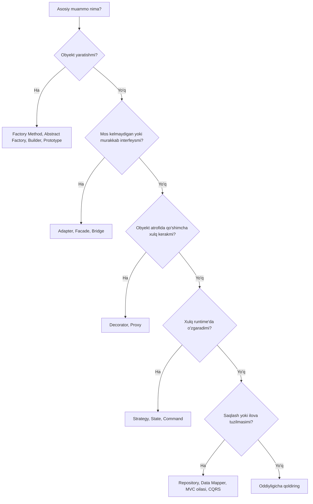

# Andozani tanlash

Andozalar kataloglari _toifalar_ bo'yicha tuzilgan (yaratuvchi, tuzilmaviy, xulq-atvor). Real ish esa _muammo_ bo'yicha tuziladi. Bu sahifa sizdagi muammodan boshlaydi va ko'rib chiqishga arziydigan nomzodlarni har biri uchun bir qatorlik sabab bilan ko'rsatadi.

::: tip Eng oddiy yechimdan boshlang
Andoza o'zi olib keladigan qo'shimcha bilvositalikka faqat u hal qiladigan muammo haqiqatan mavjud bo'lganda arziydi. Agar oddiy funksiya, closure yoki bitta `if` muammoni aniq hal qilsa, shu yerda to'xtang. Andozaga ikkinchi yoki uchinchi variatsiya paydo bo'lganda murojaat qiling, uni oldindan kutib emas.
:::

## Tezkor qaror sxemasi

Sxema faqat birinchi taxmin. Quyidagi bo'limlar bir daraja chuqurroq kiradi.

## Obyektlarni yaratish

### "Konkret klasslarga bog'lanmasdan obyektlar yaratishim kerak"

| Nomzod                                                                             | Nima uchun                                                                                   |
| ---------------------------------------------------------------------------------- | -------------------------------------------------------------------------------------------- |
| [Fabrika metodi](/uz/creational/factory-method) (Factory Method)                   | Bitta mahsulot; qaysi konkret klassni qurishni subklasslar (yoki creator hook'i) hal qiladi. |
| [Abstrakt fabrika](/uz/creational/abstract-factory) (Abstract Factory)             | Birga, izchil oila sifatida ishlatilishi shart bo'lgan bir nechta bog'liq mahsulotlar.       |
| [Bog'liqliklarni kiritish](/uz/architectural/dependency-injection) (Dependency Injection) | Ko'pincha haqiqiy javob shu: obyektni composition root tanlasin va uzatsin.           |

Shuningdek qarang: [Fabrika metodi va Abstrakt fabrika](/uz/comparisons/factory-method-vs-abstract-factory).

### "Qurish murakkab, ko'plab ixtiyoriy qismlar bor"

| Nomzod                                            | Nima uchun                                                                        |
| ------------------------------------------------- | --------------------------------------------------------------------------------- |
| [Quruvchi](/uz/creational/builder) (Builder)      | Bosqichma-bosqich qurish, `build()` da validatsiya, o'qilishi oson fluent API.    |
| [Prototip](/uz/creational/prototype) (Prototype)  | Konfiguratsiyani takrorlash o'rniga oldindan sozlangan nusxadan nusxa olish.      |

### "Obyektlarni yaratish qimmat yoki ular aniq bitta bo'lishi kerak"

| Nomzod                                                       | Nima uchun                                                                                     |
| ------------------------------------------------------------ | ---------------------------------------------------------------------------------------------- |
| [Obyektlar havzasi](/uz/creational/object-pool) (Object Pool) | Qimmat nusxalarni (ulanishlar, buferlar) yaratib-tashlash o'rniga qayta ishlatish.            |
| [Yengilvazn](/uz/structural/flyweight) (Flyweight)           | O'zgarmas ichki holatni minglab mayda obyektlar o'rtasida ulashish.                           |
| [Singleton](/uz/creational/singleton)                        | Haqiqiy yagonalik talabi. Singleton scope'li DI registratsiyasini afzal ko'ring.              |

## Integratsiya va soddalashtirish

### "Interfeysi mos kelmaydigan klassdan foydalanishim kerak"

| Nomzod                                  | Nima uchun                                                                                   |
| --------------------------------------- | -------------------------------------------------------------------------------------------- |
| [Adapter](/uz/structural/adapter)       | Mavjud interfeysni mijoz kutayotgan interfeysga o'girish.                                   |
| [Fasad](/uz/structural/facade) (Facade) | Keng tarmoqlangan quyi tizimga bitta sodda, vazifaga yo'naltirilgan kirish nuqtasini berish. |

### "Ikki o'lchov o'zgaradi va klass ierarxiyam portlab ketyapti"

| Nomzod                                   | Nima uchun                                                                                 |
| ---------------------------------------- | ------------------------------------------------------------------------------------------ |
| [Ko'prik](/uz/structural/bridge) (Bridge) | Abstraksiya va implementatsiyani kompozitsiya orqali bog'langan ikki ierarxiyaga ajratish. |

Shuningdek qarang: [Adapter, Fasad va Ko'prik](/uz/comparisons/adapter-vs-facade-vs-bridge).

### "Yakka elementlar va guruhlarga bir xil munosabatda bo'lishim kerak"

| Nomzod                                            | Nima uchun                                                                              |
| ------------------------------------------------- | --------------------------------------------------------------------------------------- |
| [Kompozit](/uz/structural/composite) (Composite)  | Barglar va konteynerlar bitta interfeysga ega, mijoz esa ko'r-ko'rona rekursiya qiladi. |
| [Iterator](/uz/behavioral/iterator)               | Har qanday tuzilmani u qanday saqlanishini oshkor qilmasdan aylanib chiqish.            |
| [Tashrifchi](/uz/behavioral/visitor) (Visitor)    | Barqaror tugun turlari ustiga ularni tahrirlamasdan yangi amallar qo'shish.             |

## Xulq qo'shish

### "Subklass yaratmasdan xulq qo'shishim kerak"

| Nomzod                                                                                     | Nima uchun                                                                                            |
| ------------------------------------------------------------------------------------------ | ----------------------------------------------------------------------------------------------------- |
| [Dekorator](/uz/structural/decorator) (Decorator)                                          | Obyekt atrofiga runtime'da mas'uliyatlarni (logging, keshlash, qayta urinish) qatlam-qatlam qo'shish. |
| [O'rinbosar](/uz/structural/proxy) (Proxy)                                                 | Obyektga kirishni boshqarish: kechiktirish, masofaviy kirish, ruxsat tekshiruvi, keshlash.            |
| [Mas'uliyatlar zanjiri](/uz/behavioral/chain-of-responsibility) (Chain of Responsibility) | So'rovni uni qayta ishlashi yoki uzatishi mumkin bo'lgan tartibli handlerlar orqali o'tkazish.        |
| [Strategiya](/uz/behavioral/strategy) (Strategy)                                           | O'zgaruvchan algoritmni override qilish o'rniga inject qilish.                                        |

Shuningdek qarang: [Dekorator va O'rinbosar](/uz/comparisons/decorator-vs-proxy).

### "Algoritmni o'zgartirib turishim kerak"

| Nomzod                                                              | Nima uchun                                                                            |
| ------------------------------------------------------------------- | ------------------------------------------------------------------------------------- |
| [Strategiya](/uz/behavioral/strategy)                               | Mijoz (yoki konfiguratsiya) bir nechta almashtiriladigan algoritmdan birini tanlaydi. |
| [Shablon metod](/uz/behavioral/template-method) (Template Method)   | Skelet qat'iy; aniq qadamlarni subklasslar to'ldiradi.                                |
| [Interpretator](/uz/behavioral/interpreter) (Interpreter)           | "Algoritm" — foydalanuvchilar qoida yoki ifodalar yozadigan kichik til.               |

### "Xulq obyekt qaysi holatda ekanligiga bog'liq"

| Nomzod                                                   | Nima uchun                                                                                 |
| -------------------------------------------------------- | ------------------------------------------------------------------------------------------ |
| [Holat](/uz/behavioral/state) (State)                    | Har bir holat — obyekt; o'tishlar tarqoq `switch (status)` bloklarining o'rnini egallaydi. |
| [Bo'sh obyekt](/uz/behavioral/null-object) (Null Object) | `null` tekshiruvlarini olib tashlaydigan "hech narsa qilmaydigan" holat yoki hamkor.       |

Shuningdek qarang: [Strategiya va Holat](/uz/comparisons/strategy-vs-state).

## So'rovlar, hodisalar va muloqot

### "Holat o'zgarishlariga javob berishim kerak"

| Nomzod                                             | Nima uchun                                                                            |
| -------------------------------------------------- | ------------------------------------------------------------------------------------- |
| [Kuzatuvchi](/uz/behavioral/observer) (Observer)   | Subyekt obunachilarni ular kimligini bilmasdan xabardor qiladi.                       |
| [Vositachi](/uz/behavioral/mediator) (Mediator)    | Ko'p komponentlar bir-biriga javob beradi; bog'lanishlarni bir joyga to'plang.        |
| [Event Sourcing](/uz/architectural/event-sourcing) | O'zgarishlarning o'zi haqiqat manbai va ularni qayta o'ynatish mumkin bo'lishi kerak. |

### "Amallarni navbatga qo'yish, loglash yoki bekor qilish kerak"

| Nomzod                                       | Nima uchun                                                                                       |
| -------------------------------------------- | ------------------------------------------------------------------------------------------------ |
| [Buyruq](/uz/behavioral/command) (Command)   | So'rov obyektga aylanadi: uni navbatga qo'yish, loglash, qayta urinish yoki bekor qilish mumkin. |
| [Memento](/uz/behavioral/memento)            | Inkapsulyatsiyani buzmasdan holat snapshot'ini olib, keyin tiklash.                              |

### "Ish iste'mol qilinganidan tezroq yoki sekinroq ishlab chiqariladi"

| Nomzod                                                                                         | Nima uchun                                                                             |
| ---------------------------------------------------------------------------------------------- | -------------------------------------------------------------------------------------- |
| [Ishlab chiqaruvchi–iste'molchi](/uz/architectural/producer-consumer) (Producer-Consumer)      | Cheklangan navbat ishlab chiqaruvchi va iste'molchini ajratadi, backpressure qo'shadi. |
| [Rejalashtiruvchi](/uz/architectural/scheduler) (Scheduler)                                    | Vazifalar umumiy resurslarga qachon va qanday tartibda kirishini hal qilish.           |
| [O'qish-yozish qulfi](/uz/architectural/read-write-lock) (Read-Write Lock)                     | Ko'p parallel o'quvchilar, eksklyuziv yozuvchilar.                                     |

## Ma'lumotlar va saqlash (persistence)

### "Domenni ma'lumotlar bazasidan mustaqil saqlashim kerak"

| Nomzod                                                                  | Nima uchun                                                                                              |
| ----------------------------------------------------------------------- | ------------------------------------------------------------------------------------------------------- |
| [Repozitoriy](/uz/architectural/repository) (Repository)                | Agregatlar uchun to'plamga o'xshash interfeys; domen SQL'ni umuman ko'rmaydi.                           |
| [Data Mapper](/uz/architectural/data-mapper)                            | Alohida qatlam ma'lumotlarni obyektlar va jadvallar o'rtasida ko'chiradi; obyektlar saqlashdan bexabar. |
| [Active Record](/uz/architectural/active-record)                        | Teskari murosa: qator va xulq bitta klassda. Oddiy CRUD uchun tez.                                      |
| [Ish birligi](/uz/architectural/unit-of-work) (Unit of Work)            | Biznes tranzaksiyasidagi o'zgarishlarni kuzatib, ularni atomar tarzda commit qilish.                    |
| [Identifikatorlar xaritasi](/uz/architectural/identity-map) (Identity Map) | Har bir yozuvni sessiyada bir marta yuklash, shunda har bir qator uchun xotirada bitta obyekt bo'ladi. |

Shuningdek qarang: [Repozitoriy, Data Mapper va Active Record](/uz/comparisons/repository-vs-data-mapper-vs-active-record).

### "O'qish va yozishni ajratishim kerak"

| Nomzod                                                   | Nima uchun                                                                                    |
| -------------------------------------------------------- | --------------------------------------------------------------------------------------------- |
| [CQRS](/uz/architectural/cqrs)                           | Buyruqlar va so'rovlar uchun alohida modellar, har biri o'z vazifasiga optimallashgan.        |
| [Event Sourcing](/uz/architectural/event-sourcing)       | Yozuvlar hodisalarni qo'shadi; o'qishlar proyeksiyalardan olinadi. CQRS bilan tabiiy juftlik. |
| [O'qish-yozish qulfi](/uz/architectural/read-write-lock) | Xuddi shu g'oyaning jarayon ichidagi, parallellik darajasidagi ko'rinishi.                    |

## Ilovani tuzish

### "UI'ni mantiqdan ajratishim kerak"

| Nomzod                         | Nima uchun                                                                         |
| ------------------------------ | ---------------------------------------------------------------------------------- |
| [MVC](/uz/architectural/mvc)   | Controller kiritishni qayta ishlaydi, model holatni saqlaydi, view chizadi.        |
| [MVP](/uz/architectural/mvp)   | Interfeys ortidagi passiv view; presenter — oddiy, test qilinadigan kod.           |
| [MVVM](/uz/architectural/mvvm) | View kuzatiladigan view model'ga deklarativ tarzda bog'lanadi (binding).           |
| [MVT](/uz/architectural/mvt)   | Xuddi shu ajratishning Django'dagi nomi; controller vazifasini freymvork bajaradi. |

Shuningdek qarang: [MVC, MVP va MVVM](/uz/comparisons/mvc-vs-mvp-vs-mvvm).

### "Bog'liqliklarni hardcode qilmasdan ulashim kerak"

| Nomzod                                                              | Nima uchun                                                                                                          |
| ------------------------------------------------------------------- | ------------------------------------------------------------------------------------------------------------------- |
| [Bog'liqliklarni kiritish](/uz/architectural/dependency-injection)  | Bog'liqliklar aniq konstruktor parametrlari; standart tanlov.                                                       |
| [Servis lokatori](/uz/architectural/service-locator) (Service Locator) | Obyektlar runtime'da murojaat qiladigan markaziy reyestr. Bog'liqliklarni yashiradi; ehtiyotkorlik bilan ishlating. |

## Andozaga ishora qiluvchi belgilar (code smells)

| Koddagi belgi                                                      | Ehtimoliy nomzod             |
| ------------------------------------------------------------------ | ---------------------------- |
| Obyekt yaratadigan va bir necha joyda takrorlangan `switch (type)` | Fabrika metodi               |
| Har bir metodda takrorlanadigan `switch (status)`                  | Holat                        |
| Algoritm tanlaydigan `if (strategy === "x")`                       | Strategiya                   |
| Sakkizta ixtiyoriy parametrli konstruktor                          | Quruvchi                     |
| `LoggingCachingRetryingClient` kabi subklasslar                    | Dekorator                    |
| Hamma joyda `if (user != null)`                                    | Bo'sh obyekt                 |
| Boshqa barcha komponentlarga havola saqlaydigan komponentlar       | Vositachi                    |
| Biznes servislar ichidagi SQL satrlari                             | Repozitoriy / Data Mapper    |
| Yozish modelini qiyshaytirib yuboradigan o'qish so'rovlari         | CQRS                         |

## Ko'p chalkashtiriladigan juftliklar

- [Strategiya va Holat](/uz/comparisons/strategy-vs-state)
- [Dekorator va O'rinbosar](/uz/comparisons/decorator-vs-proxy)
- [Fabrika metodi va Abstrakt fabrika](/uz/comparisons/factory-method-vs-abstract-factory)
- [Adapter, Fasad va Ko'prik](/uz/comparisons/adapter-vs-facade-vs-bridge)
- [MVC, MVP va MVVM](/uz/comparisons/mvc-vs-mvp-vs-mvvm)
- [Repozitoriy, Data Mapper va Active Record](/uz/comparisons/repository-vs-data-mapper-vs-active-record)

::: warning Andozalar maqsad emas
Klassga `PaymentStrategyFactoryProvider` deb nom berish — loyihalash emas. Ko'z oldingizdagi aniq takrorlanish yoki bog'liqlikni yo'qotadigan andozani tanlang va variatsiya hech qachon paydo bo'lmasa, uni o'chirishga tayyor turing.
:::

Barcha andozalarning ixcham sharhi uchun [Tezkor ma'lumotnoma](/uz/quick-reference) sahifasiga qarang.
