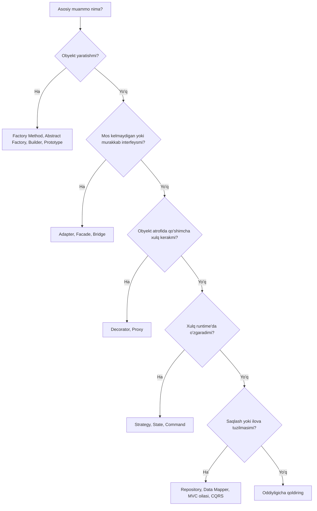

# Patternni tanlash

Pattern kataloglari _toifalar_ bo'yicha tuzilgan (yaratuvchi, tuzilmaviy, xulq-atvor). Real ish esa _muammo_ bo'yicha tuziladi. Bu sahifa sizdagi muammodan boshlaydi va ko'rib chiqishga arziydigan nomzodlarni har biri uchun bir qatorlik sabab bilan ko'rsatadi.

::: tip Eng oddiy yechimdan boshlang
Pattern o'zi olib keladigan qo'shimcha bilvositalikka faqat u hal qiladigan muammo haqiqatan mavjud bo'lganda arziydi. Agar oddiy funksiya, closure yoki bitta `if` muammoni aniq hal qilsa, shu yerda to'xtang. Patternga ikkinchi yoki uchinchi variatsiya paydo bo'lganda murojaat qiling, uni oldindan kutib emas.
:::

## Tezkor qaror sxemasi

Sxema faqat birinchi taxmin. Quyidagi bo'limlar bir daraja chuqurroq kiradi.

## Obyektlarni yaratish

### "Konkret klasslarga bog'lanmasdan obyektlar yaratishim kerak"

| Nomzod                                                     | Nima uchun                                                                                   |
| ---------------------------------------------------------- | -------------------------------------------------------------------------------------------- |
| [Factory Method](/uz/creational/factory-method)            | Bitta mahsulot; qaysi konkret klassni qurishni subklasslar (yoki creator hook'i) hal qiladi. |
| [Abstract Factory](/uz/creational/abstract-factory)        | Birga, izchil oila sifatida ishlatilishi shart bo'lgan bir nechta bog'liq mahsulotlar.       |
| [Dependency Injection](/uz/architectural/dependency-injection) | Ko'pincha haqiqiy javob shu: obyektni composition root tanlasin va uzatsin.              |

Shuningdek qarang: [Factory Method va Abstract Factory](/uz/comparisons/factory-method-vs-abstract-factory).

### "Qurish murakkab, ko'plab ixtiyoriy qismlar bor"

| Nomzod                              | Nima uchun                                                                        |
| ----------------------------------- | --------------------------------------------------------------------------------- |
| [Builder](/uz/creational/builder)   | Bosqichma-bosqich qurish, `build()` da validatsiya, o'qilishi oson fluent API.    |
| [Prototype](/uz/creational/prototype) | Konfiguratsiyani takrorlash o'rniga oldindan sozlangan nusxadan nusxa olish.    |

### "Obyektlarni yaratish qimmat yoki ular aniq bitta bo'lishi kerak"

| Nomzod                                    | Nima uchun                                                                                     |
| ----------------------------------------- | ---------------------------------------------------------------------------------------------- |
| [Object Pool](/uz/creational/object-pool) | Qimmat nusxalarni (ulanishlar, buferlar) yaratib-tashlash o'rniga qayta ishlatish.            |
| [Flyweight](/uz/structural/flyweight)     | O'zgarmas ichki holatni minglab mayda obyektlar o'rtasida ulashish.                           |
| [Singleton](/uz/creational/singleton)     | Haqiqiy yagonalik talabi. Singleton scope'li DI registratsiyasini afzal ko'ring.              |

## Integratsiya va soddalashtirish

### "Interfeysi mos kelmaydigan klassdan foydalanishim kerak"

| Nomzod                            | Nima uchun                                                                |
| --------------------------------- | ------------------------------------------------------------------------- |
| [Adapter](/uz/structural/adapter) | Mavjud interfeysni mijoz kutayotgan interfeysga o'girish.                |
| [Facade](/uz/structural/facade)   | Keng tarmoqlangan quyi tizimga bitta sodda, vazifaga yo'naltirilgan kirish nuqtasini berish. |

### "Ikki o'lchov o'zgaradi va klass ierarxiyam portlab ketyapti"

| Nomzod                          | Nima uchun                                                                              |
| ------------------------------- | --------------------------------------------------------------------------------------- |
| [Bridge](/uz/structural/bridge) | Abstraksiya va implementatsiyani kompozitsiya orqali bog'langan ikki ierarxiyaga ajratish. |

Shuningdek qarang: [Adapter, Facade va Bridge](/uz/comparisons/adapter-vs-facade-vs-bridge).

### "Yakka elementlar va guruhlarga bir xil munosabatda bo'lishim kerak"

| Nomzod                                | Nima uchun                                                                       |
| ------------------------------------- | -------------------------------------------------------------------------------- |
| [Composite](/uz/structural/composite) | Barglar va konteynerlar bitta interfeysga ega, mijoz esa ko'r-ko'rona rekursiya qiladi. |
| [Iterator](/uz/behavioral/iterator)   | Har qanday tuzilmani u qanday saqlanishini oshkor qilmasdan aylanib chiqish.     |
| [Visitor](/uz/behavioral/visitor)     | Barqaror tugun turlari ustiga ularni tahrirlamasdan yangi amallar qo'shish.     |

## Xulq qo'shish

### "Subklass yaratmasdan xulq qo'shishim kerak"

| Nomzod                                                           | Nima uchun                                                                              |
| ---------------------------------------------------------------- | --------------------------------------------------------------------------------------- |
| [Decorator](/uz/structural/decorator)                            | Obyekt atrofiga runtime'da mas'uliyatlarni (logging, keshlash, qayta urinish) qatlam-qatlam qo'shish. |
| [Proxy](/uz/structural/proxy)                                    | Obyektga kirishni boshqarish: kechiktirish, masofaviy kirish, ruxsat tekshiruvi, keshlash. |
| [Chain of Responsibility](/uz/behavioral/chain-of-responsibility) | So'rovni uni qayta ishlashi yoki uzatishi mumkin bo'lgan tartibli handlerlar orqali o'tkazish. |
| [Strategy](/uz/behavioral/strategy)                              | O'zgaruvchan algoritmni override qilish o'rniga inject qilish.                         |

Shuningdek qarang: [Decorator va Proxy](/uz/comparisons/decorator-vs-proxy).

### "Algoritmni o'zgartirib turishim kerak"

| Nomzod                                            | Nima uchun                                                                         |
| ------------------------------------------------- | ---------------------------------------------------------------------------------- |
| [Strategy](/uz/behavioral/strategy)               | Mijoz (yoki konfiguratsiya) bir nechta almashtiriladigan algoritmdan birini tanlaydi. |
| [Template Method](/uz/behavioral/template-method) | Skelet qat'iy; aniq qadamlarni subklasslar to'ldiradi.                             |
| [Interpreter](/uz/behavioral/interpreter)         | "Algoritm" — foydalanuvchilar qoida yoki ifodalar yozadigan kichik til.            |

### "Xulq obyekt qaysi holatda ekanligiga bog'liq"

| Nomzod                                    | Nima uchun                                                                              |
| ----------------------------------------- | --------------------------------------------------------------------------------------- |
| [State](/uz/behavioral/state)             | Har bir holat — obyekt; o'tishlar tarqoq `switch (status)` bloklarining o'rnini egallaydi. |
| [Null Object](/uz/behavioral/null-object) | `null` tekshiruvlarini olib tashlaydigan "hech narsa qilmaydigan" holat yoki hamkor.     |

Shuningdek qarang: [Strategy va State](/uz/comparisons/strategy-vs-state).

## So'rovlar, hodisalar va muloqot

### "Holat o'zgarishlariga javob berishim kerak"

| Nomzod                                             | Nima uchun                                                                       |
| -------------------------------------------------- | -------------------------------------------------------------------------------- |
| [Observer](/uz/behavioral/observer)                | Subyekt obunachilarni ular kimligini bilmasdan xabardor qiladi.                 |
| [Mediator](/uz/behavioral/mediator)                | Ko'p komponentlar bir-biriga javob beradi; bog'lanishlarni bir joyga to'plang.  |
| [Event Sourcing](/uz/architectural/event-sourcing) | O'zgarishlarning o'zi haqiqat manbai va ularni qayta o'ynatish mumkin bo'lishi kerak. |

### "Amallarni navbatga qo'yish, loglash yoki bekor qilish kerak"

| Nomzod                            | Nima uchun                                                                                |
| --------------------------------- | ----------------------------------------------------------------------------------------- |
| [Command](/uz/behavioral/command) | So'rov obyektga aylanadi: uni navbatga qo'yish, loglash, qayta urinish yoki bekor qilish mumkin. |
| [Memento](/uz/behavioral/memento) | Inkapsulyatsiyani buzmasdan holat snapshot'ini olib, keyin tiklash.                       |

### "Ish iste'mol qilinganidan tezroq yoki sekinroq ishlab chiqariladi"

| Nomzod                                                    | Nima uchun                                                                      |
| --------------------------------------------------------- | ------------------------------------------------------------------------------- |
| [Producer-Consumer](/uz/architectural/producer-consumer)  | Cheklangan navbat ishlab chiqaruvchi va iste'molchini ajratadi, backpressure qo'shadi. |
| [Scheduler](/uz/architectural/scheduler)                  | Vazifalar umumiy resurslarga qachon va qanday tartibda kirishini hal qilish.    |
| [Read-Write Lock](/uz/architectural/read-write-lock)      | Ko'p parallel o'quvchilar, eksklyuziv yozuvchilar.                              |

## Ma'lumotlar va saqlash (persistence)

### "Domenni ma'lumotlar bazasidan mustaqil saqlashim kerak"

| Nomzod                                           | Nima uchun                                                                                       |
| ------------------------------------------------ | ------------------------------------------------------------------------------------------------ |
| [Repository](/uz/architectural/repository)       | Agregatlar uchun to'plamga o'xshash interfeys; domen SQL'ni umuman ko'rmaydi.                   |
| [Data Mapper](/uz/architectural/data-mapper)     | Alohida qatlam ma'lumotlarni obyektlar va jadvallar o'rtasida ko'chiradi; obyektlar saqlashdan bexabar. |
| [Active Record](/uz/architectural/active-record) | Teskari murosa: qator va xulq bitta klassda. Oddiy CRUD uchun tez.                              |
| [Unit of Work](/uz/architectural/unit-of-work)   | Biznes tranzaksiyasidagi o'zgarishlarni kuzatib, ularni atomar tarzda commit qilish.           |
| [Identity Map](/uz/architectural/identity-map)   | Har bir yozuvni sessiyada bir marta yuklash, shunda har bir qator uchun xotirada bitta obyekt bo'ladi. |

Shuningdek qarang: [Repository, Data Mapper va Active Record](/uz/comparisons/repository-vs-data-mapper-vs-active-record).

### "O'qish va yozishni ajratishim kerak"

| Nomzod                                               | Nima uchun                                                                        |
| ---------------------------------------------------- | --------------------------------------------------------------------------------- |
| [CQRS](/uz/architectural/cqrs)                       | Buyruqlar va so'rovlar uchun alohida modellar, har biri o'z vazifasiga optimallashgan. |
| [Event Sourcing](/uz/architectural/event-sourcing)   | Yozuvlar hodisalarni qo'shadi; o'qishlar proyeksiyalardan olinadi. CQRS bilan tabiiy juftlik. |
| [Read-Write Lock](/uz/architectural/read-write-lock) | Xuddi shu g'oyaning jarayon ichidagi, parallellik darajasidagi ko'rinishi.        |

## Ilovani tuzish

### "UI'ni mantiqdan ajratishim kerak"

| Nomzod                         | Nima uchun                                                                       |
| ------------------------------ | -------------------------------------------------------------------------------- |
| [MVC](/uz/architectural/mvc)   | Controller kiritishni qayta ishlaydi, model holatni saqlaydi, view chizadi.     |
| [MVP](/uz/architectural/mvp)   | Interfeys ortidagi passiv view; presenter — oddiy, test qilinadigan kod.         |
| [MVVM](/uz/architectural/mvvm) | View kuzatiladigan view model'ga deklarativ tarzda bog'lanadi (binding).         |
| [MVT](/uz/architectural/mvt)   | Xuddi shu ajratishning Django'dagi nomi; controller vazifasini freymvork bajaradi. |

Shuningdek qarang: [MVC, MVP va MVVM](/uz/comparisons/mvc-vs-mvp-vs-mvvm).

### "Bog'liqliklarni hardcode qilmasdan ulashim kerak"

| Nomzod                                                         | Nima uchun                                                                          |
| -------------------------------------------------------------- | ----------------------------------------------------------------------------------- |
| [Dependency Injection](/uz/architectural/dependency-injection) | Bog'liqliklar aniq konstruktor parametrlari; standart tanlov.                      |
| [Service Locator](/uz/architectural/service-locator)           | Obyektlar runtime'da murojaat qiladigan markaziy reyestr. Bog'liqliklarni yashiradi; ehtiyotkorlik bilan ishlating. |

## Patternga ishora qiluvchi belgilar (code smells)

| Koddagi belgi                                                   | Ehtimoliy nomzod              |
| --------------------------------------------------------------- | ----------------------------- |
| Obyekt yaratadigan va bir necha joyda takrorlangan `switch (type)` | Factory Method             |
| Har bir metodda takrorlanadigan `switch (status)`               | State                         |
| Algoritm tanlaydigan `if (strategy === "x")`                    | Strategy                      |
| Sakkizta ixtiyoriy parametrli konstruktor                       | Builder                       |
| `LoggingCachingRetryingClient` kabi subklasslar                 | Decorator                     |
| Hamma joyda `if (user != null)`                                 | Null Object                   |
| Boshqa barcha komponentlarga havola saqlaydigan komponentlar    | Mediator                      |
| Biznes servislar ichidagi SQL satrlari                          | Repository / Data Mapper      |
| Yozish modelini qiyshaytirib yuboradigan o'qish so'rovlari      | CQRS                          |

## Ko'p chalkashtiriladigan juftliklar

- [Strategy va State](/uz/comparisons/strategy-vs-state)
- [Decorator va Proxy](/uz/comparisons/decorator-vs-proxy)
- [Factory Method va Abstract Factory](/uz/comparisons/factory-method-vs-abstract-factory)
- [Adapter, Facade va Bridge](/uz/comparisons/adapter-vs-facade-vs-bridge)
- [MVC, MVP va MVVM](/uz/comparisons/mvc-vs-mvp-vs-mvvm)
- [Repository, Data Mapper va Active Record](/uz/comparisons/repository-vs-data-mapper-vs-active-record)

::: warning Patternlar maqsad emas
Klassga `PaymentStrategyFactoryProvider` deb nom berish — dizayn emas. Ko'z oldingizdagi aniq takrorlanish yoki bog'liqlikni yo'qotadigan patternni tanlang va variatsiya hech qachon paydo bo'lmasa, uni o'chirishga tayyor turing.
:::

Barcha patternlarning ixcham sharhi uchun [Tezkor ma'lumotnoma](/uz/quick-reference) sahifasiga qarang.
