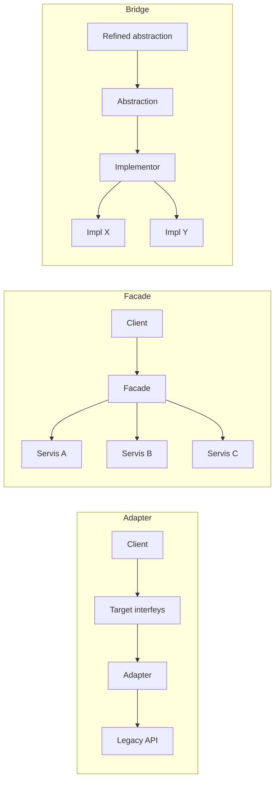

# Adapter, Facade va Bridge

[Adapter](/uz/structural/adapter), [Facade](/uz/structural/facade) va [Bridge](/uz/structural/bridge) — uchalasi ham mijoz kodi va qandaydir implementatsiya o'rtasiga interfeys qo'yadi va uchalasi ham oddiy kompozitsiya bilan quriladi. Ularning klass diagrammalari shu qadar o'xshashki, jamoalar ko'pincha har qanday o'ramni "adapter" deb ataydi.

Ular **qaysi muammoga javob berishi va dizaynning qaysi bosqichida paydo bo'lishi** bilan farqlanadi:

- **Adapter** — _mavjud_ interfeysni _boshqa_ interfeys kutilayotgan joyda ishlatiladigan qiladi. Bu keyinchalik moslashtirish: ikkala tomon allaqachon mavjud va ularni o'zgartira olmaysiz (yoki o'zgartirmasligingiz kerak).
- **Facade** — _butun quyi tizim_ ustidan _yangi, soddaroq_ interfeys belgilaydi. U bir interfeysni boshqasiga tarjima qilmaydi; ko'plab obyektlarni bir nechta vazifaga yo'naltirilgan metodlar ortiga yashiradi.
- **Bridge** — abstraksiyani implementatsiyadan _oldindan_ ajratadi, shunda ikkalasini mustaqil kengaytirish mumkin. Bu keyingi moslashtirish emas, dizayn bosqichidagi qaror.

## Bir qarashda tuzilma



## Yonma-yon taqqoslash

| Jihat                           | Adapter                                                  | Facade                                                      | Bridge                                                            |
| ------------------------------- | -------------------------------------------------------- | ----------------------------------------------------------- | ----------------------------------------------------------------- |
| **Maqsad (GoF)**                | Interfeysni mijozlar kutgan interfeysga o'girish         | Quyi tizimga yagona, yuqoriroq darajadagi interfeys berish  | Abstraksiyani implementatsiyadan ajratish, shunda ikkalasi mustaqil o'zgara oladi |
| **Nimani o'raydi**              | Bitta obyekt (yoki klass)                                | Quyi tizimdagi ko'plab obyektlar                            | Ataylab — implementor ierarxiyasini                               |
| **Taqdim etadigan interfeysi**  | Allaqachon mavjud interfeys (target)                     | O'zi belgilaydigan yangi, soddaroq interfeys                | Implementorlarga delegatsiya qiladigan abstraksiya ierarxiyasi    |
| **Qachon paydo bo'ladi**        | Keyinchalik — siz boshqarmaydigan kodni integratsiya qilishda | Quyi tizim chaqiruvchilar uchun juda murakkab bo'lganda | Oldindan — ikki mustaqil o'zgarish o'qini ko'zlaganda             |
| **Kim nimani boshqaradi**       | Target'ga mijoz egalik qiladi; adaptee o'zgarishsiz qoladi | Workflow'ga Facade egalik qiladi; quyi tizimdan to'g'ridan-to'g'ri ham foydalanish mumkin | Yuqori darajadagi mantiq abstraksiyada; platforma tafsilotlari implementorda |
| **Odatiy qo'llanilishi**        | Uchinchi tomon SDK'lari, legacy API'lar, vendor kodi uchun test double'lar | SDK o'ramlari, inventar + to'lov + yetkazib berish ustidan "buyurtma berish" | Shakllar × rendererlar, bildirishnomalar × kanallar, drayverlar |
| **Xatarlar**                    | Xatolar va semantikaning tarjimasi "oqib" chiqadi        | Hamma narsa bog'liq bo'lgan god object'ga aylanish          | Faqat bitta o'q o'zgarganda bevaqt abstraksiya                    |

## Koddagi hal qiluvchi farq

::: code-group

```typescript [Adapter]
// Kodimiz allaqachon bog'liq bo'lgan interfeys.
interface PaymentGateway {
  charge(amountCents: number, token: string): Promise<{ id: string }>;
}

// O'zgartira olmaydigan, shakli boshqacha vendor SDK.
declare class AcmePay {
  createPayment(req: { value: string; currency: "USD"; card: string }): Promise<{ paymentRef: string }>;
}

class AcmePayAdapter implements PaymentGateway {
  constructor(private acme: AcmePay) {}

  async charge(amountCents: number, token: string) {
    const res = await this.acme.createPayment({
      value: (amountCents / 100).toFixed(2), // birliklarni tarjima qilish
      currency: "USD",
      card: token,
    });
    return { id: res.paymentRef }; // natijani tarjima qilish
  }
}
```

```typescript [Facade]
declare const inventory: { reserve(sku: string, qty: number): Promise<void> };
declare const payments: { charge(cents: number, token: string): Promise<{ id: string }> };
declare const shipping: { schedule(orderId: string, address: string): Promise<void> };
declare const email: { sendConfirmation(to: string, orderId: string): Promise<void> };

// Bir nechta hamkor servis ustidan yangi, soddaroq interfeys.
class CheckoutFacade {
  async placeOrder(o: { sku: string; qty: number; cents: number; token: string; address: string; email: string }) {
    await inventory.reserve(o.sku, o.qty);
    const { id } = await payments.charge(o.cents, o.token);
    await shipping.schedule(id, o.address);
    await email.sendConfirmation(o.email, id);
    return id;
  }
}
```

```typescript [Bridge]
// Implementor ierarxiyasi: xabar QANDAY yetkaziladi.
interface Channel {
  deliver(to: string, text: string): void;
}
const emailChannel: Channel = { deliver: (to, t) => console.log(`email ${to}: ${t}`) };
const smsChannel: Channel = { deliver: (to, t) => console.log(`sms ${to}: ${t}`) };

// Abstraksiya ierarxiyasi: bu QANDAY turdagi bildirishnoma.
abstract class Notification {
  constructor(protected channel: Channel) {}
  abstract send(to: string): void;
}

class PasswordReset extends Notification {
  send(to: string) { this.channel.deliver(to, "Your reset code is 1234"); }
}

class WeeklyDigest extends Notification {
  send(to: string) { this.channel.deliver(to, "Here is your weekly summary"); }
}

// 2 tur x 2 kanal, 4 ta klasssiz.
new PasswordReset(smsChannel).send("+998901234567");
new WeeklyDigest(emailChannel).send("a@b.uz");
```

:::

Adapter hech qanday yangi imkoniyat qo'shmaydi; u faqat `AcmePay` ni `PaymentGateway` shakliga keltiradi. Facade esa `placeOrder` ni — hech bir alohida servis taklif qilmaydigan metodni — o'ylab topadi. Bridge esa umuman begona narsani o'ramaydi — bildirishnoma kodi turlar va kanallar mustaqil o'sishi uchun aynan shunday _loyihalangan_.

::: tip Foydali test

- Mijozga kerakli interfeys **allaqachon mavjudmi** va siz nomuvofiqlikni bartaraf etyapsizmi? → **Adapter**.
- Chaqiruvchilar ko'plab obyektlarni boshqarishni to'xtatishi uchun kichikroq interfeys **o'ylab topyapsizmi**? → **Facade**.
- N × M kombinatsiya N × M klassga aylanmasligi uchun ikki ierarxiyani **loyihalayapsizmi**? → **Bridge**.

:::

## Qo'shni patternlar

- [Decorator](/uz/structural/decorator) va [Proxy](/uz/structural/proxy) ham o'raydi, lekin ular _bir xil_ interfeysni saqlaydi. Adapter uni o'zgartiradi. Qarang: [Decorator va Proxy](/uz/comparisons/decorator-vs-proxy).
- [Mediator](/uz/behavioral/mediator) Facade'ga o'xshaydi, ammo quyi tizim obyektlari mediator haqida _biladi_ va u orqali muloqot qiladi; Facade'da esa quyi tizim undan bexabar va muloqot bir yo'nalishli.
- [Abstract Factory](/uz/creational/abstract-factory) ko'pincha Bridge uchun konkret implementorni tanlashda ishlatiladi.

## Qaysi birini qachon tanlash kerak

**Adapter'ni tanlang, agar:**

- Interfeysi siznikiga mos kelmaydigan kutubxona, legacy modul yoki tashqi API'ni integratsiya qilayotgan bo'lsangiz.
- Vendor turlari domeningizga "oqib" kirishini to'xtatmoqchi bo'lsangiz (anti-corruption layer — adapterlar to'plami).
- Testlarda uchinchi tomon bog'liqligini almashtirish uchun "seam" kerak bo'lsa.

**Facade'ni tanlang, agar:**

- Chaqiruvchilar bir nechta servis bo'ylab bir xil ko'p bosqichli orkestratsiyani takrorlayotgan bo'lsa.
- Qatlam yoki modulga kichik ommaviy sirt berib, ichki qismlarni murakkab holatlar uchun ochiq qoldirmoqchi bo'lsangiz.
- Quyi tizimni o'rganish juda ko'p klasslarni bilishni talab qilsa.

**Bridge'ni tanlang, agar:**

- Ikki o'lchov mustaqil o'zgarsa va meros klasslarni ko'paytirib yuborsa.
- Yuqori darajadagi mantiqqa tegmasdan implementatsiyalarni (renderer, drayver, kanal) runtime'da almashtirmoqchi bo'lsangiz.
- Abstraksiya ham, implementatsiya ham yangi subklasslarga ega bo'lishi kutilsa.

::: warning Bridge'ni haddan tashqari qo'llamang
Agar haqiqatan faqat bitta o'lchov o'zgarsa, bitta interfeys va [Strategy](/uz/behavioral/strategy) yoki DI yetarli. Bridge ikkala tomonda o'sish bo'lganda yoki u ishonchli kutilganda o'zini oqlaydi.
:::

## Tegishli sahifalar

- [Adapter](/uz/structural/adapter)
- [Facade](/uz/structural/facade)
- [Bridge](/uz/structural/bridge)
- [Patternni tanlash](/uz/choosing-a-pattern)
