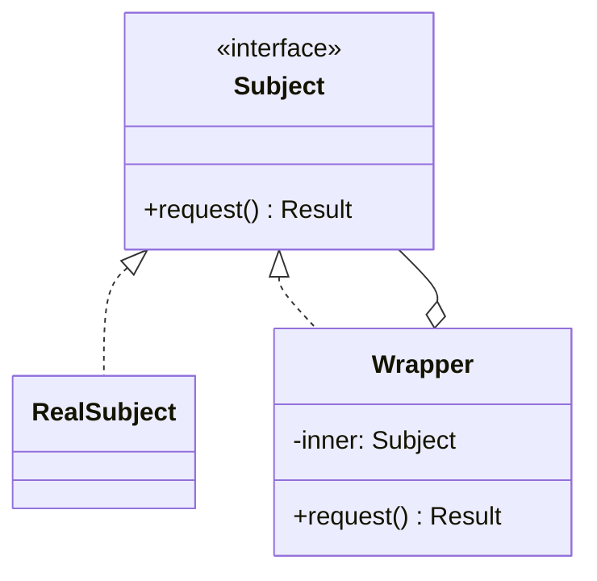

# Dekorator va O'rinbosar

[Dekorator](/uz/structural/decorator) (Decorator) va [O'rinbosar](/uz/structural/proxy) (Proxy) kodda deyarli bir xil ko'rinadi: klass boshqa obyekt bilan bir xil interfeysni implementatsiya qiladi, unga havola saqlaydi va chaqiruvlarni uzatadi. Ikkalasi ham mijoz uchun shaffof. Ikkalasi bilan ham keshlash yoki logging qo'shish mumkin. Ularning chalkashtirilishi ajablanarli emas.

GoF farqi **maqsad va hayot sikli** haqida:

- **Dekorator** obyektga dinamik ravishda _mas'uliyatlar qo'shadi_. Dekoratorlar ustma-ust qo'yish uchun mo'ljallangan va bu stekni mijoz (yoki composition root) o'zida allaqachon bor obyekt atrofida yig'adi.
- **O'rinbosar** obyektga _kirishni boshqaradi_. O'rinbosar odatda aniq bitta subyekt o'rnida turadi, ko'pincha o'sha subyektning hayot siklini boshqaradi (uni kechiktirib yaratadi, masofadan ulanadi) va ustma-ust qo'yish uchun mo'ljallanmagan.

## Umumiy tuzilma



Shakl bir xil. Farq `Wrapper` uzatilgan chaqiruv atrofida nima qilishida va `inner` ni kim yaratganida.

## Yonma-yon taqqoslash

| Jihat                              | Dekorator                                                        | O'rinbosar                                                                  |
| ---------------------------------- | ---------------------------------------------------------------- | --------------------------------------------------------------------------- |
| **Maqsad (GoF)**                   | Obyektga qo'shimcha mas'uliyatlarni dinamik biriktirish          | Boshqa obyektga kirishni boshqarish uchun o'rinbosar taqdim etish           |
| **Ichki obyektni kim yaratadi**    | Mijoz mavjud obyektni uzatadi                                    | Ko'pincha o'rinbosarning o'zi (kechiktirilgan yaratish, masofaviy handle)   |
| **Ustma-ust qo'yish**              | Shunga mo'ljallangan: `new Retry(new Log(new Http()))`           | Odatda har bir subyekt uchun bitta o'rinbosar                               |
| **Har doim uzatadimi?**            | Ha; u boyitadi, rad etmaydi                                      | Shart emas; chaqiruvni bloklashi, kechiktirishi yoki qisqa tutashtirishi mumkin |
| **Mijozning xabardorligi**         | Qaysi dekoratorlarni qo'llashni mijoz tanlaydi                   | Mijoz odatda o'rinbosar borligini bilmaydi                                  |
| **Odatiy qo'llanilishi**           | Logging, metrikalar, qayta urinish, siqish, middleware qatlamlari | Lazy loading, masofaviy kirish, ruxsat nazorati, keshlash, ORM lazy bog'lanishlari |
| **Xatarlar**                       | Tartibga bog'liq steklar; identity tekshiruvlari buziladi; chuqur o'ram zanjirlari | Yashirin kechikish (remote/lazy); "oddiy" chaqiruv ortidagi kutilmagan xatolar |

### GoF bo'yicha O'rinbosar turlari

| Tur                                        | Nimani boshqaradi                                              |
| ------------------------------------------ | -------------------------------------------------------------- |
| **Virtual o'rinbosar** (virtual proxy)     | Qimmat subyekt qachon yaratilishini (lazy loading)             |
| **Masofaviy o'rinbosar** (remote proxy)    | Subyekt qayerda joylashganini (boshqa jarayon yoki mashina)    |
| **Himoya o'rinbosari** (protection proxy)  | Uni kim chaqirishi mumkinligini                                |
| **Aqlli havola** (smart reference)         | Qo'shimcha hisob-kitob: havolalarni sanash, qulflash, keshlash |

Bularning har biri subyektga _kirish_ haqida, unga yangi imkoniyat qo'shish haqida emas.

## Koddagi hal qiluvchi farq

::: code-group

```typescript [Dekorator]
interface HttpClient {
  get(url: string): Promise<string>;
}

class FetchClient implements HttpClient {
  async get(url: string) {
    return (await fetch(url)).text();
  }
}

// Mas'uliyat qo'shadi; har doim delegatsiya qiladi.
class LoggingClient implements HttpClient {
  constructor(private inner: HttpClient) {}
  async get(url: string) {
    console.log(`GET ${url}`);
    return this.inner.get(url);
  }
}

class RetryClient implements HttpClient {
  constructor(private inner: HttpClient, private attempts = 3) {}
  async get(url: string) {
    for (let i = 1; ; i++) {
      try { return await this.inner.get(url); }
      catch (e) { if (i >= this.attempts) throw e; }
    }
  }
}

// Mijoz stekni mavjud obyekt atrofida yig'adi.
const client = new RetryClient(new LoggingClient(new FetchClient()));
```

```typescript [O'rinbosar]
interface ImageSource {
  render(): string;
}

class HighResImage implements ImageSource {
  constructor(private path: string) {
    console.log(`Loading ${path} from disk...`); // qimmat
  }
  render() { return ``; }
}

// Kirishni boshqaradi: subyektni o'zi yaratadi va umuman yaratmasligi ham mumkin.
class LazyImage implements ImageSource {
  private real?: HighResImage;
  constructor(private path: string, private canView: () => boolean) {}

  render() {
    if (!this.canView()) return "<span>Restricted</span>"; // qisqa tutashtirish
    this.real ??= new HighResImage(this.path);             // kechiktirilgan yaratish
    return this.real.render();
  }
}

const img: ImageSource = new LazyImage("/photos/raw.tiff", () => user.isAdmin);
```

:::

Dekoratorlar allaqachon qurilgan `HttpClient` ni oladi va har doim chaqiruvni uzatadi. `LazyImage` esa o'z subyektini o'zi yaratadi, uni umuman yaratmasligi mumkin va chaqiruvni rad etishi ham mumkin.

::: tip Foydali test
"Buni turli variantlar bilan ikki marta o'rash mantiqqa to'g'ri keladimi?" deb so'rang. Ha bo'lsa — bu Dekorator. "Bu o'ram haqiqiy ish _bajarilish-bajarilmasligini_, _qachon_ yoki _qayerda_ bajarilishini hal qiladimi?" deb so'rang. Ha bo'lsa — bu O'rinbosar.
:::

## Kulrang hududlar

- **Keshlash** ikkalasiga ham mos keladi. Middleware stekiga qo'shilgan keshlovchi dekorator — Dekorator; tarmoqni yashirib, masofaviy servis oldida turgan keshlovchi o'rinbosar — O'rinbosar. Unga loyihangizda bajaradigan roliga qarab nom bering.
- **JavaScript `Proxy`** — xususiyatlarga kirishni ushlab qolish uchun til imkoniyati. U har ikki andozani ham amalga oshirishi mumkin; nom maqsadni belgilamaydi.
- **Adapter** ham o'raydi, lekin u interfeysni _o'zgartiradi_. Dekorator va O'rinbosar uni _saqlab qoladi_. Qarang: [Adapter, Fasad va Ko'prik](/uz/comparisons/adapter-vs-facade-vs-bridge).

## Qaysi birini qachon tanlash kerak

**Dekoratorni tanlang, agar:**

- Sizga ixtiyoriy, birlashtiriladigan imkoniyatlar kerak bo'lsa (logging, metrikalar, qayta urinish, siqish).
- Turli chaqiruv joylariga bu imkoniyatlarning turli kombinatsiyalari kerak bo'lsa.
- Subklass yaratish `LoggingRetryingClient` kabi kombinatorik klasslarni keltirib chiqarsa.

**O'rinbosarni tanlang, agar:**

- Haqiqiy obyekt qimmat bo'lib, faqat birinchi foydalanishda yaratilishi kerak bo'lsa.
- Haqiqiy obyekt boshqa joyda yashasa va sizga mahalliy o'rinbosar kerak bo'lsa.
- Chaqiruvlar subyektga yetib borishidan oldin avtorizatsiya qilinishi, cheklanishi yoki audit qilinishi kerak bo'lsa.
- Subyektning hayot siklini mijozga sezdirmasdan boshqarishingiz kerak bo'lsa.

::: warning Identity va tartibga e'tibor bering
Ikkala andoza ham ichki obyektga nisbatan `===` tekshiruvlarini buzadi. Dekorator steklari bundan tashqari tartibga sezgir: logging'dan tashqaridagi retry har bir urinishni loglaydi, retry'dan tashqaridagi logging esa bir marta loglaydi. Tartibni composition root'da aniq ko'rsating.
:::

## Tegishli sahifalar

- [Dekorator](/uz/structural/decorator)
- [O'rinbosar](/uz/structural/proxy)
- [Mas'uliyatlar zanjiri](/uz/behavioral/chain-of-responsibility) (Chain of Responsibility) — zanjir to'xtashi mumkin; dekorator har doim uzatadi
- [Andozani tanlash](/uz/choosing-a-pattern)
