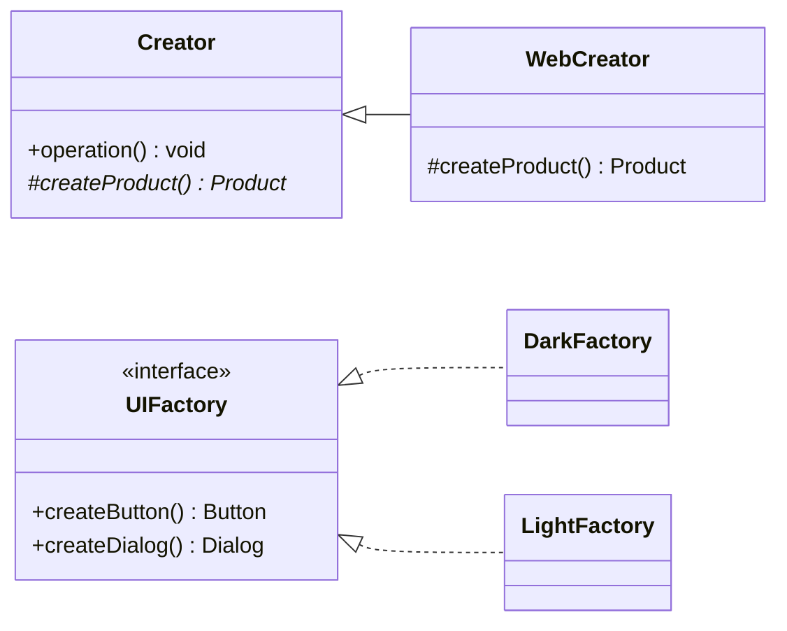

# Fabrika metodi va Abstrakt fabrika

[Fabrika metodi](/uz/creational/factory-method) (Factory Method) ham, [Abstrakt fabrika](/uz/creational/abstract-factory) (Abstract Factory) ham mijoz kodini `new ConcreteClass()` ni to'g'ridan-to'g'ri chaqirishdan saqlaydi. Ikkalasi ham interfeys turidagi mahsulotlarni qaytaradi. Amalda esa Abstrakt fabrika odatda fabrika metodlari _yordamida_ implementatsiya qilinadi, bu esa chegarani yanada xiralashtiradi.

GoF farqi **ko'lam va mexanizm** haqida:

- **Fabrika metodi** — _bitta metod_ _bir turdagi_ mahsulotni yaratadi. Variatsiya o'sha metodni subklassda override qilishdan (meros) keladi. Creator klassning odatda boshqa mas'uliyatlari bor va u faqat bitta yaratish qadamini kechiktiradi.
- **Abstrakt fabrika** — butun vazifasi bog'liq mahsulotlar _oilasini_ yaratish bo'lgan _obyekt_. Variatsiya boshqa fabrika obyektini uzatishdan (kompozitsiya) keladi. Uning asosiy va'dasi — u qaytaradigan mahsulotlar bir-biriga mos keladi.

## Tuzilma



Chapda: Fabrika metodi — boshqa ish ham bajaradigan klass ichidagi hook. O'ngda: Abstrakt fabrika — oiladagi har bir mahsulot uchun bittadan yaratish metodiga ega maxsus obyekt.

## Yonma-yon taqqoslash

| Jihat                            | Fabrika metodi                                                  | Abstrakt fabrika                                                         |
| -------------------------------- | --------------------------------------------------------------- | ------------------------------------------------------------------------ |
| **Maqsad (GoF)**                 | Qaysi klassni yaratishni subklasslar hal qilishiga imkon berish | Konkret klasslarni nomlamasdan bog'liq obyektlar oilalarini yaratish     |
| **Mahsulotlar soni**             | Bitta mahsulot turi                                             | Birga ishlatiladigan bir nechta mahsulot turi                            |
| **Mexanizm**                     | Meros: metodni override qilish                                  | Kompozitsiya: fabrika obyektini inject qilish                            |
| **Variatsiyani kim boshqaradi**  | Creator'ning subklassi                                          | Qaysi fabrika uzatilishini tanlaydigan tomon                             |
| **Creator'ning boshqa ishi**     | Ha — creator'da mahsulotdan foydalanadigan biznes mantiq bor    | Yo'q — yaratish fabrikaning yagona mas'uliyati                           |
| **Moslik kafolati**              | Mahsulotlar o'rtasida yo'q                                      | Bitta fabrikadan chiqqan mahsulotlar birga ishlashga mo'ljallangan      |
| **Odatiy qo'llanilishi**         | Freymvork hook'lari, hujjat/parser yaratish, plagin nuqtalari   | UI mavzulari, kross-platforma vidjetlar, DB drayverlar oilalari          |
| **Xatarlar**                     | Bitta metodni override qilish uchun har bir mahsulotga subklass | Yangi mahsulot turini qo'shish har bir fabrikani o'zgartiradi            |

## Koddagi hal qiluvchi farq

::: code-group

```typescript [Fabrika metodi]
interface Notifier {
  send(to: string, msg: string): void;
}

abstract class AlertService {
  // O'zi qurmaydigan mahsulotdan foydalanadigan biznes mantiq.
  alert(user: string, event: string): void {
    const notifier = this.createNotifier(); // fabrika metodi
    notifier.send(user, `Alert: ${event}`);
  }

  protected abstract createNotifier(): Notifier;
}

class EmailAlertService extends AlertService {
  protected createNotifier(): Notifier {
    return { send: (to, m) => console.log(`email ${to}: ${m}`) };
  }
}

class SmsAlertService extends AlertService {
  protected createNotifier(): Notifier {
    return { send: (to, m) => console.log(`sms ${to}: ${m}`) };
  }
}
```

```typescript [Abstrakt fabrika]
interface Button { render(): string; }
interface Dialog { open(content: string): string; }

// Bitta obyekt — mos mahsulotlarning butun oilasi.
interface UIFactory {
  createButton(label: string): Button;
  createDialog(): Dialog;
}

const darkTheme: UIFactory = {
  createButton: (l) => ({ render: () => `<button class="dark">${l}</button>` }),
  createDialog: () => ({ open: (c) => `<dialog class="dark">${c}</dialog>` }),
};

const lightTheme: UIFactory = {
  createButton: (l) => ({ render: () => `<button class="light">${l}</button>` }),
  createDialog: () => ({ open: (c) => `<dialog class="light">${c}</dialog>` }),
};

// Mijoz fabrikani qabul qiladi; u hech qachon dark va light vidjetlarni aralashtira olmaydi.
function renderSettings(ui: UIFactory): string {
  return ui.createDialog().open(ui.createButton("Save").render());
}

renderSettings(darkTheme);
```

:::

`AlertService` fabrika emas — bu bitta yaratish hook'iga ega servis. `UIFactory` esa faqat narsalarni yaratish uchun mavjud va uning qadri shundaki, `createButton` va `createDialog` mavzu bo'yicha doimo mos keladi.

::: tip Foydali test
Mahsulotlarni sanang va variatsiya qanday berilishini so'rang. Bitta mahsulot, subklass orqali tanlanadi → Fabrika metodi. Bir-biriga mos kelishi kerak bo'lgan bir nechta mahsulot, obyekt uzatish orqali tanlanadi → Abstrakt fabrika.
:::

## Ular qanday bog'liq

- Abstrakt fabrikadagi har bir metod tuzilmaviy jihatdan fabrika metodidir. GoF konkret fabrikalar ko'pincha fabrika metodlari yoki [Prototip](/uz/creational/prototype) (Prototype) yordamida implementatsiya qilinishini ta'kidlaydi.
- Konkret fabrikalar ko'pincha har bir oila uchun yagona nusxa bo'ladi, shuning uchun Abstrakt fabrika yonida [Singleton](/uz/creational/singleton) uchraydi — garchi bunga erishishning yaxshiroq yo'li odatda DI registratsiyasi bo'lsa ham.
- "Oddiy fabrika" (simple factory — ichida `switch` bo'lgan statik `create(type)` funksiyasi) GoF ma'nosida bu ikkisining hech biri emas. Bu foydali idioma, lekin unda polimorf creator yo'q.

## Kengaytirish o'qlari

| Kerakli o'zgarish                       | Fabrika metodi                         | Abstrakt fabrika                                    |
| --------------------------------------- | -------------------------------------- | --------------------------------------------------- |
| Yangi variant qo'shish (masalan, Push)  | Bitta subklass qo'shish                | Har bir metodni implementatsiya qiluvchi bitta fabrika qo'shish |
| Yangi mahsulot turi qo'shish (masalan, Toast) | Kerakli joyga yangi fabrika metodi qo'shish | Interfeysni va har bir fabrikani o'zgartirish |

Abstrakt fabrika _oilalar_ qo'shishni oson, _mahsulot turlari_ qo'shishni esa qimmat qiladi. Mahsulot turlari to'plami barqaror bo'lganda uni tanlang.

## Qaysi birini qachon tanlash kerak

**Fabrika metodini tanlang, agar:**

- Klass foydali ish bajarsa, lekin unga kerak bo'lgan bitta obyektni subklasslar yoki freymvork hook'i hal qilishi kerak bo'lsa.
- Faqat bitta mahsulot turi ishtirok etsa.
- Siz foydalanuvchilar kengaytiradigan freymvork yoki bazaviy klass yozayotgan bo'lsangiz.

**Abstrakt fabrikani tanlang, agar:**

- Bir nechta mahsulot birga ishlatilishi kerak bo'lsa va variantlarni aralashtirish xato bo'lsa.
- Butun oilani (mavzu, platforma, vendor) konfiguratsiya orqali birdaniga almashtirmoqchi bo'lsangiz.
- Mahsulot turlari to'plami barqaror, oilalar soni esa o'sishi mumkin bo'lsa.

::: warning Ko'pincha ikkalasi ham kerak emas
Agar konkret klass ishga tushishda bir marta tanlansa, mahsulotning o'zini oddiy [Bog'liqliklarni kiritish](/uz/architectural/dependency-injection) (Dependency Injection) orqali uzatish ikkala andozadan ham soddaroq. Fabrikadan yaratish _keyinroq_, _takroran_ yoki _har bir so'rov uchun_ bo'lishi kerak bo'lganda foydalaning.
:::

## Tegishli sahifalar

- [Fabrika metodi](/uz/creational/factory-method)
- [Abstrakt fabrika](/uz/creational/abstract-factory)
- [Quruvchi](/uz/creational/builder) (Builder) — bosqichma-bosqich quriladigan bitta murakkab mahsulot uchun
- [Andozani tanlash](/uz/choosing-a-pattern)
