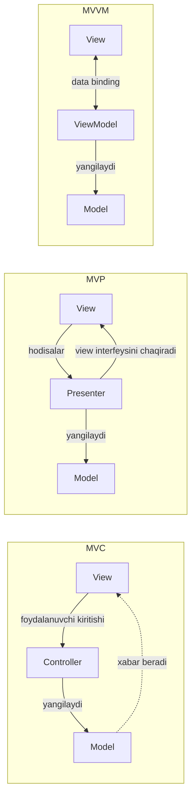

# MVC, MVP va MVVM

[MVC](/uz/architectural/mvc), [MVP](/uz/architectural/mvp) va [MVVM](/uz/architectural/mvvm) — uchalasi ham interaktiv ilovani **model** (domen holati va qoidalari), **view** (foydalanuvchi ko'radigan narsa) va ular orasidagi biror narsaga ajratadi. Ular chalkashtiriladi, chunki uchalasida ham model va view deyarli bir xil, freymvorklar bu nomlarni erkin ishlatadi, server tomonidagi "MVC" esa asl Smalltalk MVC'dan boshqa narsani anglatadi.

Farqlar o'rta qatlamda va strelkalarda:

- **MVC** — _controller_ kiritishni talqin qiladi va modelni yangilaydi; _view_ modelni kuzatadi (yoki server tomonidagi MVC'da controller uni model ma'lumotlari bilan render qiladi).
- **MVP** — _presenter_ passiv view'dan har bir hodisani interfeys orqali qabul qiladi, model bilan ishlaydi va formatlangan ma'lumotni view'ga qaytarib uzatadi. View model haqida hech narsa bilmaydi.
- **MVVM** — _view model_ kuzatiladigan holat va buyruqlarni taqdim etadi; view ularga deklarativ tarzda **bog'lanadi** (binding). View model'da view'ga umuman havola yo'q.

## Strelkalar



## Yonma-yon taqqoslash

| Jihat                                  | MVC                                                        | MVP                                                     | MVVM                                                        |
| -------------------------------------- | ---------------------------------------------------------- | ------------------------------------------------------- | ----------------------------------------------------------- |
| **O'rta qatlam**                       | Controller                                                 | Presenter                                               | ViewModel                                                   |
| **Foydalanuvchi kiritishini kim oladi** | Controller (to'g'ridan-to'g'ri yoki view orqali)          | View, u har bir hodisani presenter'ga uzatadi           | View, u view model'dagi bog'langan buyruqlarni chaqiradi    |
| **View'ni kim yangilaydi**             | View modelni kuzatadi yoki controller uni render qiladi    | Presenter view interfeysidagi metodlarni chaqiradi      | View model o'zgarishlariga javob beradigan binding mexanizmi |
| **O'rta qatlam view'ni biladimi?**     | Odatda ha (uni tanlaydi yoki render qiladi)                | Ha, interfeys orqali (`LoginView`)                      | Yo'q — u faqat holatni taqdim etadi                         |
| **View modelni biladimi?**             | Ko'pincha ha                                               | Yo'q                                                    | Yo'q; u faqat view model'ni biladi                          |
| **Munosabat**                          | Controller va view'lar ko'pincha 1:N                       | Odatda presenter va view 1:1                            | 1:N mumkin; bir nechta view bitta view model'ga bog'lanishi mumkin |
| **O'rta qatlamning test qilinishi**    | O'rtacha; freymvorkning so'rov turlariga bog'lanib qoladi  | Yuqori; view interfeysini mock qiling                   | Yuqori; view'siz view model holatini tekshiring             |
| **Odatiy qo'llanilishi**               | Server'da render qilinadigan veb-ilovalar (Rails, Spring MVC, ASP.NET MVC) | Android (klassik), WinForms, GWT, binding'siz UI | WPF, Angular, Vue, Knockout, SwiftUI, Jetpack Compose |
| **Xatarlar**                           | "Massive controller"; modelni o'qiydigan semiz view'lar   | Ko'p boilerplate view interfeyslari; presenter kattalashadi | Binding "sehri" oqimni yashiradi; view model axlatxonaga aylanadi |

::: tip Server MVC va klassik MVC
Smalltalk-80 MVC'da view'lar modellarni kuzatgan va har bir vidjetning o'z controller'i bo'lgan. Veb-freymvorklarda esa so'rov controller'ga tushadi, u modellarni yuklaydi va shablonni tanlaydi. Bu ko'proq [Front Controller](https://martinfowler.com/eaaCatalog/frontController.html) va template view'ga yaqin; [MVT](/uz/architectural/mvt) — Django'da xuddi shu tuzilmaning nomi.
:::

## Koddagi hal qiluvchi farq

Bir xil funksiya — "Clicked N times" ni ko'rsatadigan, oshirish tugmasiga ega hisoblagich.

::: code-group

```typescript [MVC]
class CounterModel {
  private listeners: Array<() => void> = [];
  count = 0;
  increment() { this.count++; this.listeners.forEach((l) => l()); }
  subscribe(l: () => void) { this.listeners.push(l); }
}

// View modelni kuzatadi va uni to'g'ridan-to'g'ri o'qiydi.
class CounterView {
  constructor(private model: CounterModel, private el: HTMLElement) {
    model.subscribe(() => this.render());
  }
  render() { this.el.textContent = `Clicked ${this.model.count} times`; }
}

// Controller kiritishni model amallariga aylantiradi.
class CounterController {
  constructor(private model: CounterModel) {}
  onClick() { this.model.increment(); }
}
```

```typescript [MVP]
// View passiv va interfeys ortiga yashiringan.
interface CounterView {
  showLabel(text: string): void;
  onIncrement(handler: () => void): void;
}

class CounterPresenter {
  private count = 0; // yoki model obyekti
  constructor(private view: CounterView) {
    view.onIncrement(() => this.increment());
    this.view.showLabel(this.label());
  }
  private increment() {
    this.count++;
    this.view.showLabel(this.label()); // presenter view'ga uzatadi
  }
  private label() { return `Clicked ${this.count} times`; }
}

// Test: soxta CounterView uzating va showLabel chaqiruvlarini tekshiring.
```

```typescript [MVVM]
import { ref, computed } from "vue";

// View model hech qanday view haqida bilmaydi.
export function useCounterViewModel() {
  const count = ref(0);
  const label = computed(() => `Clicked ${count.value} times`);
  const increment = () => { count.value++; };
  return { label, increment };
}

// View deklarativ tarzda bog'lanadi:
// <button @click="vm.increment">+</button>
// <span>{{ vm.label }}</span>
```

:::

Yangilanish yo'lini kuzating. MVC'da view xabarnomadan keyin modeldan ma'lumotni o'zi tortib oladi. MVP'da presenter aniq `view.showLabel(...)` ni chaqiradi. MVVM'da view'ni hech kim chaqirmaydi; `label` o'zgarganini binding mexanizmi sezadi.

## Qaysi birini qachon tanlash kerak

**MVC'ni tanlang, agar:**

- So'rov/javob asosidagi veb-ilova qurayotgan bo'lsangiz va freymvorkingiz allaqachon MVC shaklida bo'lsa.
- View'lar asosan shablonlar bo'lib, o'zaro ta'sir modeli oddiy bo'lsa.

**MVP'ni tanlang, agar:**

- UI toolkit'ida data binding bo'lmasa va taqdimot mantig'ini to'liq unit test qilmoqchi bo'lsangiz.
- Bitta interfeys ortida view implementatsiyalarini (desktop, veb, test fake) almashtirmoqchi bo'lsangiz.
- Reaktiv "sehr"dan ko'ra aniq chaqiruvlarni afzal ko'rsangiz.

**MVVM'ni tanlang, agar:**

- Platformangizda yetuk binding yoki reaktivlik tizimi bo'lsa (WPF, Angular, Vue, SwiftUI, Compose).
- Bir nechta view bir xil holatni ko'rsatsa yoki holat boy va o'zaro bog'liq bo'lsa.
- Taqdimot qatlamini sof holat o'tishlari sifatida test qilmoqchi bo'lsangiz.

::: warning Hech biri domen arxitekturasi emas
Uchalasi ham _taqdimot_ qatlamini tartibga soladi. Biznes qoidalari controller, presenter yoki view model'larda emas, model va uning ortidagi servislarda bo'lishi kerak. Ma'lumotlarni saqlash — alohida masala; qarang: [Repozitoriy, Data Mapper va Active Record](/uz/comparisons/repository-vs-data-mapper-vs-active-record).
:::

## Tegishli sahifalar

- [MVC](/uz/architectural/mvc)
- [MVP](/uz/architectural/mvp)
- [MVVM](/uz/architectural/mvvm)
- [MVT](/uz/architectural/mvt)
- [Kuzatuvchi](/uz/behavioral/observer) (Observer) — MVC xabarnomalari va MVVM binding'lari ortidagi mexanizm
- [Andozani tanlash](/uz/choosing-a-pattern)
