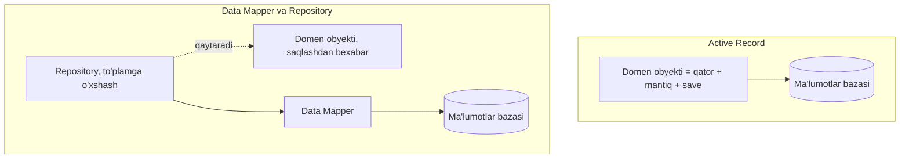

# Repozitoriy, Data Mapper va Active Record

[Repozitoriy](/uz/architectural/repository) (Repository), [Data Mapper](/uz/architectural/data-mapper) va [Active Record](/uz/architectural/active-record) — uchalasi ham Martin Fowler'ning _Patterns of Enterprise Application Architecture_ (PoEAA) kitobidan. Ular chalkashtiriladi, chunki ORM'lar ularni xiralashtiradi: ORM'dagi "repozitoriy" aslida yupqa data mapper bo'lishi mumkin, Active Record freymvorklari esa ko'pincha repozitoriy uslubidagi so'rov metodlarini qo'shadi.

Ular turli savollarga javob beradi:

- **Active Record** — _obyekt qatorni o'raydi_ va o'zida ham domen mantig'ini, ham o'zini saqlashni olib yuradi (`user.save()`). Klass va jadval birga-bir mos keladi.
- **Data Mapper** — xotiradagi obyektlar va ma'lumotlar bazasi o'rtasida ma'lumotlarni ko'chiradigan va ularni bir-biridan mustaqil saqlaydigan _alohida qatlam_. Domen obyektlari ma'lumotlar bazasi borligini bilmaydi.
- **Repozitoriy** — domen obyektlarini (odatda agregatlarni) olish va saqlash uchun domen atamalarida ifodalangan _to'plamga o'xshash interfeys_. U mapping qatlami **ustida** turadi va so'rovlarni qurishni domendan yashiradi.

Active Record va Data Mapper — muqobillar. Repozitoriy esa ularga uchinchi muqobil emas — bu odatda Data Mapper ustiga (ba'zan Active Record ustiga) qo'yiladigan abstraksiya.

## Qatlamlar



## Yonma-yon taqqoslash

| Jihat                                 | Active Record                                         | Data Mapper                                                  | Repozitoriy                                                         |
| ------------------------------------- | ----------------------------------------------------- | ------------------------------------------------------------ | ------------------------------------------------------------------- |
| **Ta'rif (PoEAA)**                    | Qatorni o'raydigan, DB'ga kirishni inkapsulyatsiya qiladigan va domen mantig'ini qo'shadigan obyekt | Obyektlar va DB o'rtasida ma'lumot ko'chirib, ularni mustaqil saqlaydigan mapperlar qatlami | To'plamga o'xshash interfeys orqali domen va mapping qatlamlari o'rtasida vositachilik qiladi |
| **SQL / so'rovlar qayerda**           | Domen klassida (yoki uning freymvork bazaviy klassida) | Mapper klasslarida                                          | Repozitoriy ortida; mapperlar yoki query obyektlari orqali quriladi  |
| **Domen DB haqida biladimi?**         | Ha — saqlashni meros qilib oladi                      | Yo'q                                                         | Yo'q — faqat `findById`, `add` va domen nomli so'rovlarni ko'radi   |
| **Obyekt va jadval shakli**           | Taxminan har jadvalga bitta klass, har ustunga bitta maydon | Erkin: meros, value object'lar, agregatlar             | Domen modeliga nima kerak bo'lsa; ko'pincha har bir aggregate root uchun |
| **Saqlashni kim boshqaradi**          | Obyektning o'zi (`order.save()`)                      | Mapper (`mapper.insert(order)`)                              | Ilova servisi, odatda [Ish birligi](/uz/architectural/unit-of-work) (Unit of Work) bilan |
| **Odatiy qo'llanilishi**              | CRUD'ga boy ilovalar, Rails, Laravel Eloquent, oddiy domenlar | Boy domen modellari, legacy sxemalar, Hibernate, Doctrine, TypeORM data-mapper rejimi | DDD agregatlari, test qilinadigan ilova servislari, saqlash joyini almashtirish |
| **Xatarlar**                          | Domen mantig'i sxemaga bog'lanadi; unit test qilish qiyin; semiz modellar | Ko'proq kod va mapping konfiguratsiyasi; CRUD uchun ortiqcha marosimdek tuyuladi | ORM'ni shunchaki qayta ochib beradigan "oqadigan" generic repozitoriylar |

## Koddagi hal qiluvchi farq

::: code-group

```typescript [Active Record]
declare const db: { query(sql: string, params: unknown[]): Promise<any[]> };

// Qator + domen mantig'i + saqlash bitta klassda.
class Account {
  constructor(public id: string, public balance: number) {}

  withdraw(amount: number) {
    if (amount > this.balance) throw new Error("Insufficient funds");
    this.balance -= amount;
  }

  async save() {
    await db.query("UPDATE accounts SET balance = $1 WHERE id = $2", [this.balance, this.id]);
  }

  static async find(id: string) {
    const [row] = await db.query("SELECT * FROM accounts WHERE id = $1", [id]);
    return new Account(row.id, Number(row.balance));
  }
}

const acc = await Account.find("a-1");
acc.withdraw(50);
await acc.save();
```

```typescript [Data Mapper]
declare const db: { query(sql: string, params: unknown[]): Promise<any[]> };

// Sof domen obyekti: saqlash qatlamidan hech qanday import yo'q.
class Account {
  constructor(readonly id: string, private balanceCents: number) {}
  withdraw(cents: number) {
    if (cents > this.balanceCents) throw new Error("Insufficient funds");
    this.balanceCents -= cents;
  }
  get balance() { return this.balanceCents; }
}

// Ikki yo'nalishdagi tarjimaga mapper egalik qiladi.
class AccountMapper {
  async findById(id: string): Promise<Account> {
    const [row] = await db.query("SELECT id, balance_cents FROM accounts WHERE id = $1", [id]);
    return new Account(row.id, Number(row.balance_cents));
  }
  async update(a: Account): Promise<void> {
    await db.query("UPDATE accounts SET balance_cents = $1 WHERE id = $2", [a.balance, a.id]);
  }
}
```

```typescript [Repozitoriy]
// Domen tilida ifodalangan, domenga qaragan shartnoma.
interface AccountRepository {
  byId(id: string): Promise<Account | undefined>;
  overdrawnSince(date: Date): Promise<Account[]>;
  save(account: Account): Promise<void>;
}

// Implementatsiya mapperga delegatsiya qiladi; testlar xotiradagi versiyadan foydalanadi.
// (AccountMapper — Data Mapper tabidagidek, qo'shimcha findOverdrawn so'rovi bilan.)
class SqlAccountRepository implements AccountRepository {
  constructor(private mapper: AccountMapper) {}
  byId(id: string) { return this.mapper.findById(id); }
  overdrawnSince(date: Date) { return this.mapper.findOverdrawn(date); }
  save(a: Account) { return this.mapper.update(a); }
}

// Ilova servisi SQL'ni ham, mapperni ham hech qachon ko'rmaydi.
async function withdraw(repo: AccountRepository, id: string, cents: number) {
  const account = await repo.byId(id);
  if (!account) throw new Error("Not found");
  account.withdraw(cents);
  await repo.save(account);
}
```

:::

Active Record'da `Account` ni yaqin atrofda ma'lumotlar bazasi bo'lmasa yaratib ham, test qilib ham bo'lmaydi. Data Mapper bilan `Account` — oddiy TypeScript, ustun nomlarini esa faqat mapper biladi. Repozitoriy domen shaklidagi API'ni (`overdrawnSince`) va testlarda ma'lumotlar bazasini xotiradagi implementatsiya bilan almashtirish mumkin bo'lgan "seam"ni qo'shadi.

::: tip Foydali test
Domen klassining importlari va metodlariga qarang. Entity'da `save()` yoki DB importi bo'lsa → Active Record. Ustun nomlari yozilgan alohida klass bo'lsa → Data Mapper. Domen qatlamida biznes savollari nomi bilan atalgan metodlarga ega interfeys bo'lsa → Repozitoriy.
:::

## Yordamchi andozalar

- [Ish birligi](/uz/architectural/unit-of-work) (Unit of Work) qaysi obyektlar o'zgarganini kuzatadi va ularni bitta tranzaksiyada commit qiladi — Data Mapper bir amalda bittadan ortiq obyekt bilan ishlay boshlaganda zarur.
- [Identifikatorlar xaritasi](/uz/architectural/identity-map) (Identity Map) har bir qator sessiyada bir marta yuklanishini ta'minlaydi, shunda ikkita qidiruv bir xil obyektni qaytaradi.
- To'liq imkoniyatli ORM'lar (Hibernate, Doctrine, EF Core, TypeORM) Data Mapper, Ish birligi va Identifikatorlar xaritasini birga taqdim etadi; ularning "repozitoriy"lari ko'pincha shunchaki generic data mapper'lardir.

## Qaysi birini qachon tanlash kerak

**Active Record'ni tanlang, agar:**

- Domen asosan CRUD bo'lsa va obyekt modeli jadvallarni aks ettirsa.
- Domen mantig'ini sxemadan ajratishdan ko'ra yetkazib berish tezligi muhimroq bo'lsa.
- Freymvorkingiz (Rails, Laravel) unga asoslangan bo'lsa — unga qarshi kurashish foydasidan ko'ra qimmatroqqa tushadi.

**Data Mapper'ni tanlang, agar:**

- Domen obyektlarida ma'lumotlar bazasisiz test qilinishi kerak bo'lgan real xulq va invariantlar bo'lsa.
- Obyekt modeli va sxema bir-biridan farq qilsa (value object'lar, meros, legacy jadvallar).
- Sxema va domen modelini mustaqil rivojlantirishingiz kerak bo'lsa.

**Repozitoriy qo'shing, agar:**

- Agregatlarni modellashtirsangiz va domen ORM'ga emas, interfeysga bog'liq bo'lishini istasangiz.
- So'rovlar tarqoq ad-hoc ORM chaqiruvlari emas, domen tilida nomlanib, qayta ishlatilishi kerak bo'lsa.
- Xotiradagi implementatsiya bilan tez ishlaydigan ilova servisi testlarini istasangiz.

::: warning Generic repozitoriy tuzog'idan saqlaning
`findAll`, `findBy(criteria)` va `update(T)` ga ega `Repository<T>` odatda ORM'ni yomonroq API bilan qayta ochib beradi. Repozitoriylar ma'lum bir agregatga xos bo'lib, domen tilida gapirganda o'zini oqlaydi. O'qishga boy ekranlar uchun ularni chetlab o'tib, maxsus query modellardan foydalanishni ko'rib chiqing — qarang: [CQRS](/uz/architectural/cqrs).
:::

## Tegishli sahifalar

- [Active Record](/uz/architectural/active-record)
- [Data Mapper](/uz/architectural/data-mapper)
- [Repozitoriy](/uz/architectural/repository)
- [Ish birligi](/uz/architectural/unit-of-work)
- [Identifikatorlar xaritasi](/uz/architectural/identity-map)
- [Andozani tanlash](/uz/choosing-a-pattern)
