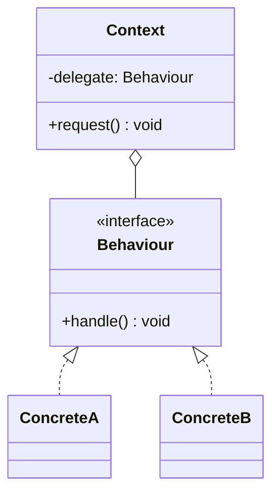

# Strategiya va Holat

[Strategiya](/uz/behavioral/strategy) (Strategy) va [Holat](/uz/behavioral/state) (State) — tuzilmasi bir xil, ammo maqsadi har xil bo'lgan andozalarning darslikdagi namunasi. Ikkalasida ham kontekst obyekti interfeysga havola saqlaydi va ishni hozir ulangan konkret implementatsiyaga topshiradi (delegatsiya qiladi). UML chizsangiz, ularni farqlay olmaysiz.

Farq **delegatni kim va nima uchun almashtirishida**:

- **Strategiya** — algoritmni _mijoz_ tanlaydi. Strategiyalar bir xil ishni bajarishning mustaqil, almashtiriladigan usullari bo'lib, odatda bir-biri haqida bilmaydi.
- **Holat** — ichki holati o'zgargani sari _obyektning o'zi_ xulqini o'zgartiradi. Holatlar o'tishlar haqida biladi va ko'pincha ularni o'zlari ishga tushiradi.

## Umumiy tuzilma



Strelkalarni "Strategiya" deb o'qisangiz, `delegate` ni mijoz o'rnatadi. "Holat" deb o'qisangiz, `ConcreteA` o'zini `ConcreteB` bilan almashtiradi.

## Yonma-yon taqqoslash

| Jihat                           | Strategiya                                                        | Holat                                                                       |
| ------------------------------- | ----------------------------------------------------------------- | --------------------------------------------------------------------------- |
| **Maqsad (GoF)**                | Algoritmlar oilasini aniqlash va ularni almashtiriladigan qilish  | Ichki holati o'zgarganda obyektga xulqini o'zgartirishga imkon berish       |
| **Obyektni kim tanlaydi**       | Tashqaridan — mijoz yoki konfiguratsiya                           | Ichkaridan — kontekst yoki joriy holat                                      |
| **Qo'shnilardan xabardorlik**   | Yo'q — strategiyalar mustaqil                                     | Holatlar qaysi holatlarga o'tish mumkinligini biladi                        |
| **Qanchalik tez-tez o'zgaradi** | Kamdan-kam; odatda har bir amal yoki konfiguratsiya uchun bir marta | Tez-tez, kontekstga qilingan chaqiruvlarning bevosita natijasi sifatida   |
| **Interfeys shakli**            | Odatda bitta metod (`compress`, `calculate`, `sort`)              | Odatda kontekst qabul qiladigan har bir hodisa uchun bitta metod (`pay`, `ship`, `cancel`) |
| **Nimaning o'rnini bosadi**     | `if (algorithm === "x")` kabi tanlash mantig'ini                  | Ko'p metodlarda takrorlanadigan `switch (this.status)` ni                   |
| **Odatiy qo'llanilishi**        | Narx qoidalari, siqish, saralash, auth provayderlar, qayta urinish siyosatlari | Buyurtma hayot sikli, TCP ulanishlar, hujjat workflow'lari, UI rejimlari |
| **Xatarlar**                    | Har bir arzimas variatsiya uchun klass; ko'pincha funksiya yetarli | O'tishlar holatlar bo'ylab tarqalib ketadi; butun mashinani ko'rish qiyin |

## Koddagi hal qiluvchi farq

::: code-group

```typescript [Strategiya]
interface ShippingCost {
  calculate(weightKg: number): number;
}

const standard: ShippingCost = { calculate: (w) => 5 + w * 1.2 };
const express: ShippingCost = { calculate: (w) => 15 + w * 2.5 };

class Checkout {
  constructor(private shipping: ShippingCost) {}

  // MIJOZ hal qiladi; Checkout uni hech qachon o'zi almashtirmaydi.
  setShipping(shipping: ShippingCost): void {
    this.shipping = shipping;
  }

  total(subtotal: number, weightKg: number): number {
    return subtotal + this.shipping.calculate(weightKg);
  }
}

const checkout = new Checkout(standard);
checkout.setShipping(express); // foydalanuvchi UI'da express'ni tanladi
```

```typescript [Holat]
interface OrderState {
  pay(order: Order): void;
  ship(order: Order): void;
}

class Order {
  // Joriy holat BUYURTMAga tegishli; mijozlar uni hech qachon o'rnatmaydi.
  constructor(public state: OrderState = new Pending()) {}
  pay() { this.state.pay(this); }
  ship() { this.state.ship(this); }
}

class Pending implements OrderState {
  pay(order: Order) { order.state = new Paid(); } // ichkaridan o'tish
  ship() { throw new Error("Cannot ship an unpaid order"); }
}

class Paid implements OrderState {
  pay() { throw new Error("Already paid"); }
  ship(order: Order) { order.state = new Shipped(); }
}

class Shipped implements OrderState {
  pay() { throw new Error("Already paid"); }
  ship() { throw new Error("Already shipped"); }
}

const order = new Order();
order.pay();  // Pending -> Paid
order.ship(); // Paid -> Shipped
```

:::

Ikki belgiga e'tibor bering. Strategiya andozasida har bir implementatsiya bitta savolga turlicha javob beradi. Holat andozasida esa _bir xil_ chaqiruv (`ship()`) bir holatda ruxsat etilgan, boshqasida xato, va implementatsiyalarning o'zi kontekstni oldinga siljitadi.

## O'tishlar qayerda yashaydi

Holat andozasida o'tish mantig'iga kim egalik qilishini hal qilishingiz kerak:

| Variant                                  | Murosa                                                                              |
| ---------------------------------------- | ----------------------------------------------------------------------------------- |
| Holatlar o'tishni ishga tushiradi        | Klassik GoF; har bir holat mustaqil, ammo to'liq graf tarqalib ketadi.             |
| Kontekst o'tishni ishga tushiradi        | Butun mashina bir joyda ko'rinadi; holatlar soddalashib, strategiyaga o'xshab qoladi. |
| O'tishlar jadvali / state machine kutubxonasi | Holat va hodisalar ko'p bo'lganda eng yaxshisi; graf ma'lumotga aylanadi.      |

::: tip Foydali test
Agar implementatsiyalar orasida strelkalar bilan holat diagrammasini chiza olsangiz — bu Holat. Agar implementatsiyalar shunchaki ochiluvchi ro'yxatdagi variantlar bo'lib, ular orasida strelka bo'lmasa — bu Strategiya.
:::

## Qaysi birini qachon tanlash kerak

**Strategiyani tanlang, agar:**

- Variatsiya — chaqiruvchi, foydalanuvchi yoki konfiguratsiya tanlaydigan siyosat yoki algoritm bo'lsa.
- Implementatsiyalar almashtiriladigan va holatsiz bo'lsa (yoki faqat o'z konfiguratsiyasini saqlasa).
- Har bir algoritmni alohida unit test qilib, kontekstga inject qilmoqchi bo'lsangiz.
- Ko'pincha oddiy funksiya turi (`(w: number) => number`) yetarli bo'ladi.

**Holat andozasini tanlang, agar:**

- Bir xil metod hayot sikli bosqichiga qarab turlicha ishlashi kerak bo'lsa.
- Bir xil `switch (status)` bir nechta metodda takrorlanayotgan bo'lsa.
- Har bir bosqichdagi ruxsat etilmagan amallar aniq ko'rsatilishi va majburiy bo'lishi kerak bo'lsa.
- O'tishlar domenning bir qismi bo'lib, flaglar ichiga ko'milmasdan modellashtirilishga arzisa.

::: warning Ikki holatli flaglarga Holat andozasini majburlamang
Ikki xil xulqqa ega `isOpen` boolean'i uchun uchta klass shart emas. Holat andozasi bir nechta holat, bir nechta hodisa va qaysi o'tishlar ruxsat etilganligi haqida real qoidalar bo'lganda o'zini oqlaydi.
:::

## Ular yaxshi birlashadi

Holat strategiyadan _foydalanishi_ mumkin: `Paid` buyurtma holati qaytarish (refund) summasini hisoblashni mijoz darajasiga qarab tanlangan `RefundPolicy` strategiyasiga topshirishi mumkin. Kontekstning hayot sikli (Holat) va bitta qadam uchun siyosat (Strategiya) mustaqil o'qlar bo'yicha o'zgaradi.

## Tegishli sahifalar

- [Strategiya](/uz/behavioral/strategy)
- [Holat](/uz/behavioral/state)
- [Shablon metod](/uz/behavioral/template-method) (Template Method) — Strategiyaning merosga asoslangan muqobili
- [Andozani tanlash](/uz/choosing-a-pattern)
