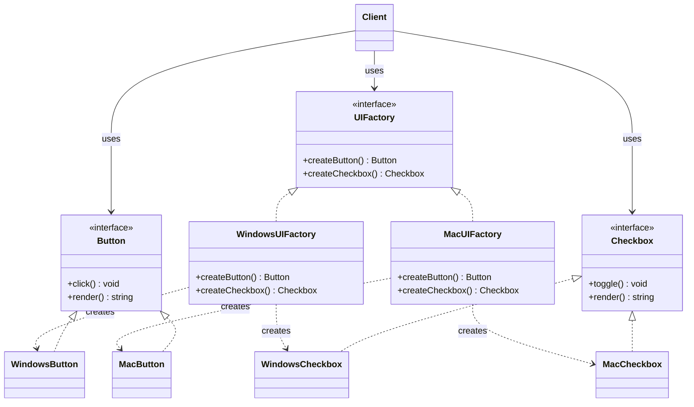

# Abstract Factory patterni

<CoverImage src="/covers/creational/abstract-factory.webp" alt="Cover">
  <h1>Abstract Factory</h1>
  <p>Ikki xil yig'uv liniyasiga ega yuqori texnologiyali mega-zavod: biri "yoqimli pastel pushti kiber-tishli g'ildiraklar va tugmalar"ni, ikkinchisi esa "silliq qorong'i kiberpank tishli g'ildiraklar va tugmalar"ni ishlab chiqaradi — bu bog'liq mahsulotlar oilalarini tasvirlaydi.</p>
</CoverImage>

## Umumiy ko'rinish (Overview)

**Abstract Factory** patterni — bu yaratuvchi (creational) dizayn patterni bo'lib, u o'zaro bog'liq yoki bir-biriga tobe obyektlar oilalarini ularning konkret klasslarini ko'rsatmasdan yaratish imkonini beradi. U bog'liq obyektlar to'plami uchun abstrakt interfeyslarni belgilaydi, so'ngra har bir oila uchun konkret fabrikalar yaratadi.

**Factory Method**dan farqli o'laroq (u bitta turdagi obyektni yaratadi), Abstract Factory bir nechta bog'liq turlarni birgalikda yaratadi. Uni "fabrikalar fabrikasi" deb tasavvur qiling.

**Asosiy farq**: O'zgaruvchan bitta mahsulot turini yaratish kerak bo'lsa, Factory Method dan foydalaning. Birgalikda ishlashi shart bo'lgan mahsulotlar oilalarini yaratish kerak bo'lsa, Abstract Factory dan foydalaning.

**Zamonaviy nuqtai nazar**: Abstract Factory kross-platforma UI freymvorklari, ma'lumotlar bazasi abstraksiya qatlamlari va mavzu (theme) tizimlari uchun hamon dolzarb. Biroq zamonaviy kodda uni ko'pincha dependency injection va kompozitsiya almashtiradi.

## Hayotiy o'xshatish (Real-World Analogy)

To'liq mehmonxona mebel to'plamlarini ishlab chiqaradigan **mebel ishlab chiqaruvchisini** tasavvur qiling. Ishlab chiqaruvchida bir nechta uslub bor: Zamonaviy (Modern), Viktoriya (Victorian) va Rustik (Rustic). Har bir uslub bir-biriga mos ravishda loyihalangan stullar, stollar va divanlarni o'z ichiga oladi.

Siz "bitta stul" so'ramaysiz — siz "zamonaviy mehmonxona to'plami"ni so'raysiz va u sizga bir-biriga mos keladigan zamonaviy stul, zamonaviy stol va zamonaviy divanni beradi. Keyinchalik sizga Viktoriya uslubidagi to'plam kerak bo'lsa, siz bir-biriga mos qismlardan iborat butunlay boshqa oilani olasiz.

Xuddi shunday, ilovaga turli operatsion tizimlar uchun UI komponentlarining to'liq to'plami (tugmalar, checkboxlar, scrollbarlar) kerak bo'lishi mumkin. Siz Windows tugmalarini macOS checkboxlari bilan aralashtirmaysiz; maqsadli OT uchun mos oiladan foydalanasiz.

## Tuzilma (Structure)



- **`UIFactory`** (Abstract Factory) har bir mahsulot turi uchun bitta yaratish metodini e'lon qiladi; `Scrollbar` ham xuddi shu shaklga ega va qisqalik uchun tushirib qoldirilgan.
- **`WindowsUIFactory` / `MacUIFactory`** (Concrete Factories — konkret fabrikalar) har biri bir-biriga mos mahsulotlarning to'liq oilasini ishlab chiqaradi.
- **`Button` / `Checkbox`** (Abstract Products — abstrakt mahsulotlar) mijoz ishlaydigan interfeyslardir; `WindowsButton`, `MacCheckbox` va boshqalar esa konkret mahsulotlardir.
- **`Client`** faqat abstrakt fabrika va mahsulot interfeyslariga bog'liq bo'ladi, hech qachon konkret oilaga bog'lanmaydi.

## Muammo (Problem)

Tizim bog'liq obyektlarning bir nechta oilasi bilan ishlashi kerak bo'lganda, kod qattiq bog'langan (tightly coupled) va kengaytirish qiyin bo'lib qoladi:

### Stsenariy: Kross-platforma UI

```typescript
// ❌ Muammo: Turli oilalarga mansub komponentlarni aralashtirish
class Application {
  createUI() {
    if (this.os === "windows") {
      const button = new WindowsButton();
      const checkbox = new WindowsCheckbox();
      const scrollbar = new MacScrollbar(); // Noto'g'ri oila!
    }
  }
}
```

**Muammolar:**

- Turli oilalardagi komponentlar bir-biri bilan to'g'ri muvofiqlashmaydi
- Yangi OT qo'shish bir nechta joyni o'zgartirishni talab qiladi
- Oila ichida UI izchilligini ta'minlash qiyin

### Stsenariy: Ma'lumotlar bazasi abstraksiyasi

```typescript
// ❌ Muammo: Turli ma'lumotlar bazalaridagi ulanish, so'rov va tranzaksiya obyektlarini aralashtirish
const connection = new MySQLConnection();
const queryBuilder = new PostgreSQLQueryBuilder(); // Mos emas!
const transaction = new MongoDBTransaction();

// Bu obyektlar birgalikda ishlash uchun loyihalanmagan
connection.execute(queryBuilder.build());
```

## Yechim (Solution)

Abstract Factory bu muammoni quyidagicha hal qiladi:

1. Har bir mahsulot oilasi uchun **abstrakt interfeyslarni belgilash** (Button, Checkbox, Scrollbar).
2. Har bir oila uchun **konkret fabrikalar yaratish** (WindowsUIFactory, MacUIFactory).
3. **Mijoz kodi fabrika interfeysiga bog'liq bo'ladi**, konkret implementatsiyalarga emas.
4. **Butun oilalar muvofiqlashgan holda qoladi**, chunki ular bitta fabrikadan keladi.

```typescript
// ✅ Yechim: Muvofiqlashgan obyektlar oilalari
const factory: UIFactory = getFactory(currentOS); // Mos fabrikani qaytaradi
const button = factory.createButton(); // Windows yoki Mac tugmasi
const checkbox = factory.createCheckbox(); // Mos checkbox
const scrollbar = factory.createScrollbar(); // Mos scrollbar

// Barcha komponentlar bitta oiladan va birgalikda ishlaydi
```

**Asosiy tamoyil**: Fabrika tanlash mantig'ini inkapsulyatsiya qiladi. Mijoz kodi qaysi konkret implementatsiyalardan foydalanayotganini bilmaydi va bu unga ahamiyatsiz.

## Amalga oshirish (Implementation)

::: code-group

```typescript [TypeScript]
/**
 * Mahsulot interfeyslari: Har bir komponent turi nimani qo'llab-quvvatlashini belgilaydi.
 */
interface Button {
  click(): void;
  render(): string;
}

interface Checkbox {
  toggle(): void;
  render(): string;
}

interface Scrollbar {
  scroll(delta: number): void;
  render(): string;
}

/**
 * Windows oilasi: Barcha komponentlar Windows uslubida.
 */
class WindowsButton implements Button {
  click(): void {
    console.log("Windows button clicked");
  }
  render(): string {
    return '<button style="windows">Click me</button>';
  }
}

class WindowsCheckbox implements Checkbox {
  toggle(): void {
    console.log("Windows checkbox toggled");
  }
  render(): string {
    return '<input type="checkbox" style="windows">';
  }
}

class WindowsScrollbar implements Scrollbar {
  scroll(delta: number): void {
    console.log(`Windows scrollbar scrolled by ${delta}`);
  }
  render(): string {
    return '<scrollbar style="windows"></scrollbar>';
  }
}

/**
 * macOS oilasi: Barcha komponentlar macOS uslubida.
 */
class MacButton implements Button {
  click(): void {
    console.log("Mac button clicked");
  }
  render(): string {
    return '<button style="mac">Click me</button>';
  }
}

class MacCheckbox implements Checkbox {
  toggle(): void {
    console.log("Mac checkbox toggled");
  }
  render(): string {
    return '<input type="checkbox" style="mac">';
  }
}

class MacScrollbar implements Scrollbar {
  scroll(delta: number): void {
    console.log(`Mac scrollbar scrolled by ${delta}`);
  }
  render(): string {
    return '<scrollbar style="mac"></scrollbar>';
  }
}

/**
 * Abstract factory: Mahsulot oilalarini yaratish interfeysini belgilaydi.
 */
interface UIFactory {
  createButton(): Button;
  createCheckbox(): Checkbox;
  createScrollbar(): Scrollbar;
}

/**
 * Konkret fabrikalar: Har biri to'liq oilani yaratadi.
 */
class WindowsUIFactory implements UIFactory {
  createButton(): Button {
    return new WindowsButton();
  }
  createCheckbox(): Checkbox {
    return new WindowsCheckbox();
  }
  createScrollbar(): Scrollbar {
    return new WindowsScrollbar();
  }
}

class MacUIFactory implements UIFactory {
  createButton(): Button {
    return new MacButton();
  }
  createCheckbox(): Checkbox {
    return new MacCheckbox();
  }
  createScrollbar(): Scrollbar {
    return new MacScrollbar();
  }
}

/**
 * Mijoz: Konkret klasslar bilan emas, fabrikalar bilan ishlaydi.
 */
class Application {
  private factory: UIFactory;

  constructor(factory: UIFactory) {
    this.factory = factory;
  }

  render(): string {
    const button = this.factory.createButton();
    const checkbox = this.factory.createCheckbox();
    const scrollbar = this.factory.createScrollbar();

    return `${button.render()}\n${checkbox.render()}\n${scrollbar.render()}`;
  }
}

// Foydalanish
const osType = "mac";
const factory: UIFactory =
  osType === "windows" ? new WindowsUIFactory() : new MacUIFactory();
const app = new Application(factory);
console.log(app.render());
```

```python [Python]
from abc import ABC, abstractmethod

class Button(ABC):
    @abstractmethod
    def click(self) -> None:
        pass

    @abstractmethod
    def render(self) -> str:
        pass

class Checkbox(ABC):
    @abstractmethod
    def toggle(self) -> None:
        pass

    @abstractmethod
    def render(self) -> str:
        pass

class Scrollbar(ABC):
    @abstractmethod
    def scroll(self, delta: int) -> None:
        pass

    @abstractmethod
    def render(self) -> str:
        pass

class WindowsButton(Button):
    def click(self) -> None:
        print("Windows button clicked")

    def render(self) -> str:
        return '<button style="windows">Click me</button>'

class WindowsCheckbox(Checkbox):
    def toggle(self) -> None:
        print("Windows checkbox toggled")

    def render(self) -> str:
        return '<input type="checkbox" style="windows">'

class WindowsScrollbar(Scrollbar):
    def scroll(self, delta: int) -> None:
        print(f"Windows scrollbar scrolled by {delta}")

    def render(self) -> str:
        return '<scrollbar style="windows"></scrollbar>'

class MacButton(Button):
    def click(self) -> None:
        print("Mac button clicked")

    def render(self) -> str:
        return '<button style="mac">Click me</button>'

class MacCheckbox(Checkbox):
    def toggle(self) -> None:
        print("Mac checkbox toggled")

    def render(self) -> str:
        return '<input type="checkbox" style="mac">'

class MacScrollbar(Scrollbar):
    def scroll(self, delta: int) -> None:
        print(f"Mac scrollbar scrolled by {delta}")

    def render(self) -> str:
        return '<scrollbar style="mac"></scrollbar>'

class UIFactory(ABC):
    @abstractmethod
    def create_button(self) -> Button:
        pass

    @abstractmethod
    def create_checkbox(self) -> Checkbox:
        pass

    @abstractmethod
    def create_scrollbar(self) -> Scrollbar:
        pass

class WindowsUIFactory(UIFactory):
    def create_button(self) -> Button:
        return WindowsButton()

    def create_checkbox(self) -> Checkbox:
        return WindowsCheckbox()

    def create_scrollbar(self) -> Scrollbar:
        return WindowsScrollbar()

class MacUIFactory(UIFactory):
    def create_button(self) -> Button:
        return MacButton()

    def create_checkbox(self) -> Checkbox:
        return MacCheckbox()

    def create_scrollbar(self) -> Scrollbar:
        return MacScrollbar()

class Application:
    def __init__(self, factory: UIFactory) -> None:
        self.factory = factory

    def render(self) -> str:
        button = self.factory.create_button()
        checkbox = self.factory.create_checkbox()
        scrollbar = self.factory.create_scrollbar()

        return f"{button.render()}\n{checkbox.render()}\n{scrollbar.render()}"

if __name__ == "__main__":
    os_type = "mac"
    factory = MacUIFactory() if os_type == "mac" else WindowsUIFactory()
    app = Application(factory)
    print(app.render())
```

```java [Java]
interface Button {
    void click();
    String render();
}

interface Checkbox {
    void toggle();
    String render();
}

interface Scrollbar {
    void scroll(int delta);
    String render();
}

class WindowsButton implements Button {
    @Override
    public void click() {
        System.out.println("Windows button clicked");
    }

    @Override
    public String render() {
        return "<button style=\"windows\">Click me</button>";
    }
}

class WindowsCheckbox implements Checkbox {
    @Override
    public void toggle() {
        System.out.println("Windows checkbox toggled");
    }

    @Override
    public String render() {
        return "<input type=\"checkbox\" style=\"windows\">";
    }
}

class WindowsScrollbar implements Scrollbar {
    @Override
    public void scroll(int delta) {
        System.out.println("Windows scrollbar scrolled by " + delta);
    }

    @Override
    public String render() {
        return "<scrollbar style=\"windows\"></scrollbar>";
    }
}

class MacButton implements Button {
    @Override
    public void click() {
        System.out.println("Mac button clicked");
    }

    @Override
    public String render() {
        return "<button style=\"mac\">Click me</button>";
    }
}

class MacCheckbox implements Checkbox {
    @Override
    public void toggle() {
        System.out.println("Mac checkbox toggled");
    }

    @Override
    public String render() {
        return "<input type=\"checkbox\" style=\"mac\">";
    }
}

class MacScrollbar implements Scrollbar {
    @Override
    public void scroll(int delta) {
        System.out.println("Mac scrollbar scrolled by " + delta);
    }

    @Override
    public String render() {
        return "<scrollbar style=\"mac\"></scrollbar>";
    }
}

interface UIFactory {
    Button createButton();
    Checkbox createCheckbox();
    Scrollbar createScrollbar();
}

class WindowsUIFactory implements UIFactory {
    @Override
    public Button createButton() {
        return new WindowsButton();
    }

    @Override
    public Checkbox createCheckbox() {
        return new WindowsCheckbox();
    }

    @Override
    public Scrollbar createScrollbar() {
        return new WindowsScrollbar();
    }
}

class MacUIFactory implements UIFactory {
    @Override
    public Button createButton() {
        return new MacButton();
    }

    @Override
    public Checkbox createCheckbox() {
        return new MacCheckbox();
    }

    @Override
    public Scrollbar createScrollbar() {
        return new MacScrollbar();
    }
}

class Application {
    private UIFactory factory;

    public Application(UIFactory factory) {
        this.factory = factory;
    }

    public String render() {
        Button button = factory.createButton();
        Checkbox checkbox = factory.createCheckbox();
        Scrollbar scrollbar = factory.createScrollbar();

        return button.render() + "\n" + checkbox.render() + "\n" + scrollbar.render();
    }
}

public class Main {
    public static void main(String[] args) {
        UIFactory factory = new MacUIFactory();
        Application app = new Application(factory);
        System.out.println(app.render());
    }
}
```

```go [Go]
package main

import "fmt"

type Button interface {
    Click()
    Render() string
}

type Checkbox interface {
    Toggle()
    Render() string
}

type Scrollbar interface {
    Scroll(delta int)
    Render() string
}

type WindowsButton struct{}

func (b *WindowsButton) Click() {
    fmt.Println("Windows button clicked")
}

func (b *WindowsButton) Render() string {
    return `<button style="windows">Click me</button>`
}

type WindowsCheckbox struct{}

func (c *WindowsCheckbox) Toggle() {
    fmt.Println("Windows checkbox toggled")
}

func (c *WindowsCheckbox) Render() string {
    return `<input type="checkbox" style="windows">`
}

type WindowsScrollbar struct{}

func (s *WindowsScrollbar) Scroll(delta int) {
    fmt.Printf("Windows scrollbar scrolled by %d\n", delta)
}

func (s *WindowsScrollbar) Render() string {
    return `<scrollbar style="windows"></scrollbar>`
}

type MacButton struct{}

func (b *MacButton) Click() {
    fmt.Println("Mac button clicked")
}

func (b *MacButton) Render() string {
    return `<button style="mac">Click me</button>`
}

type MacCheckbox struct{}

func (c *MacCheckbox) Toggle() {
    fmt.Println("Mac checkbox toggled")
}

func (c *MacCheckbox) Render() string {
    return `<input type="checkbox" style="mac">`
}

type MacScrollbar struct{}

func (s *MacScrollbar) Scroll(delta int) {
    fmt.Printf("Mac scrollbar scrolled by %d\n", delta)
}

func (s *MacScrollbar) Render() string {
    return `<scrollbar style="mac"></scrollbar>`
}

type UIFactory interface {
    CreateButton() Button
    CreateCheckbox() Checkbox
    CreateScrollbar() Scrollbar
}

type WindowsFactory struct{}

func (f *WindowsFactory) CreateButton() Button {
    return &WindowsButton{}
}

func (f *WindowsFactory) CreateCheckbox() Checkbox {
    return &WindowsCheckbox{}
}

func (f *WindowsFactory) CreateScrollbar() Scrollbar {
    return &WindowsScrollbar{}
}

type MacFactory struct{}

func (f *MacFactory) CreateButton() Button {
    return &MacButton{}
}

func (f *MacFactory) CreateCheckbox() Checkbox {
    return &MacCheckbox{}
}

func (f *MacFactory) CreateScrollbar() Scrollbar {
    return &MacScrollbar{}
}

type Application struct {
    factory UIFactory
}

func NewApplication(factory UIFactory) *Application {
    return &Application{factory: factory}
}

func (a *Application) Render() string {
    button := a.factory.CreateButton()
    checkbox := a.factory.CreateCheckbox()
    scrollbar := a.factory.CreateScrollbar()

    return fmt.Sprintf("%s\n%s\n%s",
        button.Render(),
        checkbox.Render(),
        scrollbar.Render())
}

func main() {
    var factory UIFactory = &MacFactory{}
    app := NewApplication(factory)
    fmt.Println(app.Render())
}
```

```rust [Rust]
pub trait Button {
    fn click(&self);
    fn render(&self) -> String;
}

pub trait Checkbox {
    fn toggle(&self);
    fn render(&self) -> String;
}

pub trait Scrollbar {
    fn scroll(&self, delta: i32);
    fn render(&self) -> String;
}

pub struct WindowsButton;

impl Button for WindowsButton {
    fn click(&self) {
        println!("Windows button clicked");
    }

    fn render(&self) -> String {
        r#"<button style="windows">Click me</button>"#.to_string()
    }
}

pub struct WindowsCheckbox;

impl Checkbox for WindowsCheckbox {
    fn toggle(&self) {
        println!("Windows checkbox toggled");
    }

    fn render(&self) -> String {
        r#"<input type="checkbox" style="windows">"#.to_string()
    }
}

pub struct WindowsScrollbar;

impl Scrollbar for WindowsScrollbar {
    fn scroll(&self, delta: i32) {
        println!("Windows scrollbar scrolled by {}", delta);
    }

    fn render(&self) -> String {
        r#"<scrollbar style="windows"></scrollbar>"#.to_string()
    }
}

pub struct MacButton;

impl Button for MacButton {
    fn click(&self) {
        println!("Mac button clicked");
    }

    fn render(&self) -> String {
        r#"<button style="mac">Click me</button>"#.to_string()
    }
}

pub struct MacCheckbox;

impl Checkbox for MacCheckbox {
    fn toggle(&self) {
        println!("Mac checkbox toggled");
    }

    fn render(&self) -> String {
        r#"<input type="checkbox" style="mac">"#.to_string()
    }
}

pub struct MacScrollbar;

impl Scrollbar for MacScrollbar {
    fn scroll(&self, delta: i32) {
        println!("Mac scrollbar scrolled by {}", delta);
    }

    fn render(&self) -> String {
        r#"<scrollbar style="mac"></scrollbar>"#.to_string()
    }
}

pub trait UIFactory {
    fn create_button(&self) -> Box<dyn Button>;
    fn create_checkbox(&self) -> Box<dyn Checkbox>;
    fn create_scrollbar(&self) -> Box<dyn Scrollbar>;
}

pub struct WindowsUIFactory;

impl UIFactory for WindowsUIFactory {
    fn create_button(&self) -> Box<dyn Button> {
        Box::new(WindowsButton)
    }

    fn create_checkbox(&self) -> Box<dyn Checkbox> {
        Box::new(WindowsCheckbox)
    }

    fn create_scrollbar(&self) -> Box<dyn Scrollbar> {
        Box::new(WindowsScrollbar)
    }
}

pub struct MacUIFactory;

impl UIFactory for MacUIFactory {
    fn create_button(&self) -> Box<dyn Button> {
        Box::new(MacButton)
    }

    fn create_checkbox(&self) -> Box<dyn Checkbox> {
        Box::new(MacCheckbox)
    }

    fn create_scrollbar(&self) -> Box<dyn Scrollbar> {
        Box::new(MacScrollbar)
    }
}

pub struct Application {
    factory: Box<dyn UIFactory>,
}

impl Application {
    pub fn new(factory: Box<dyn UIFactory>) -> Self {
        Application { factory }
    }

    pub fn render(&self) -> String {
        let button = self.factory.create_button();
        let checkbox = self.factory.create_checkbox();
        let scrollbar = self.factory.create_scrollbar();

        format!(
            "{}\n{}\n{}",
            button.render(),
            checkbox.render(),
            scrollbar.render()
        )
    }
}

fn main() {
    let factory: Box<dyn UIFactory> = Box::new(MacUIFactory);
    let app = Application::new(factory);
    println!("{}", app.render());
}
```

:::

### TypeScript: Klassik Abstract Factory

TypeScript mahsulot shartnomalarini (`Button`, `Checkbox`, `Scrollbar`) ham, fabrika shartnomasini (`UIFactory`) ham belgilash uchun `interface` e'lonlaridan foydalanadi. `WindowsUIFactory` va `MacUIFactory` kabi konkret fabrikalar fabrika interfeysini amalga oshiradi va kompilyator har bir fabrika metodi to'g'ri mahsulot turini qaytarishini statik ravishda tekshiradi. Mijoz `UIFactory` havolasini oladi va hech qachon konkret klasslarga tegmaydi — oilalarni almashtirish inyeksiya nuqtasidagi bir qatorlik o'zgarishdir.

### Python: Duck Typing va Protokollardan foydalanish

Python fabrika va mahsulot shartnomalarini klass aniqlanayotgan paytda majburiy qilish uchun `ABC` (Abstract Base Class) dan foydalanadi. `@abstractmethod` bilan bezatilgan har bir abstrakt metod to'liq bo'lmagan fabrikalarning instansiyasini yaratishga yo'l qo'ymaydi. Bu rasmiy tuzilmaga qaramay, Python'ning duck typing xususiyati tufayli mijoz kodi (`Application`) uchun faqat fabrikada `create_button()`, `create_checkbox()` va `create_scrollbar()` metodlari _mavjudligi_ muhim — ish vaqtida (runtime) tur annotatsiyasi qat'iy talab qilinmaydi. `if __name__ == "__main__"` himoyasi ulash (wiring) mantig'ini toza va test qilinadigan holda saqlaydi.

### Java: Tur xavfsizligi uchun Generics

Java shartnomani kompilyatsiya vaqtida mustahkamlash uchun `interface` e'lonlari va `@Override` annotatsiyalariga tayanadi. Har bir konkret mahsulot klassi o'z mahsulot interfeysini aniq amalga oshiradi va har bir konkret fabrika `UIFactory` ni amalga oshiradi. `@Override` annotatsiyasi imlo xatolari va signatura nomuvofiqliklarini erta aniqlaydi. Java'ning qat'iy nominal tiplashtirishi `WindowsUIFactory` hech qachon tasodifan `MacButton` qaytara olmasligini kafolatlaydi — kompilyator buni kod ishga tushishidan oldin rad etadi.

### Go: Funksiyalar bilan Struct kompozitsiyasi

Go'da klasslar yoki meros yo'q — buning o'rniga mahsulot shartnomalari interfeyslar (`Button`, `Checkbox`, `Scrollbar`) sifatida belgilanadi va mos metodlarga ega har qanday struct ularni yashirin (implicit) tarzda qanoatlantiradi. Konkret fabrikalar — metodlari interfeys turlarini qaytaradigan oddiy structlardir. Bu yashirin interfeys qanoatlantirish tufayli siz hech qachon `implements` yozmaysiz; metodlar mos kelsa, tur talabga javob beradi. `Application` structi `UIFactory` interfeysini saqlaydi va asosiy turni bilmagan holda uning metodlarini chaqiradi — bu strukturaviy tiplashtirish orqali to'liq ajratishga (decoupling) erishadi.

### Rust: Dinamik dispatch bilan Trait obyektlari

Rust mahsulot va fabrika shartnomalarini `trait` e'lonlari sifatida belgilaydi. Konkret turlar (`WindowsButton`, `MacButton` va boshqalar) bu traitlarni `impl Trait for Type` orqali aniq amalga oshiradi. Fabrika `Box<dyn Trait>` qaytaradi — bu ish vaqtida dinamik dispatchni ta'minlaydigan heap'da joylashgan trait obyektlaridir. Mijoz `Box<dyn UIFactory>` ni saqlaydi va fabrika metodlarini vtable vositachiligi orqali chaqiradi. Rust'ning egalik (ownership) tizimi garbage collector'siz xotira xavfsizligini kafolatlaydi, `dyn` kalit so'zi esa ish vaqtidagi polimorfizmni aniq va ongli qiladi.

## Real hayotdagi qo'llanilishi: Ma'lumotlar bazasi abstraksiya qatlami

Real tizim bir nechta ma'lumotlar bazalari (MySQL, PostgreSQL, MongoDB) bilan ishlashi kerak, ammo ularning har biri ulanish, so'rov qurish va tranzaksiyalarni boshqarishni turlicha talab qiladi:

```typescript
/**
 * Ma'lumotlar bazasi oilalari uchun mahsulot interfeyslari.
 */
interface Connection {
  connect(): Promise<void>;
  execute(sql: string): Promise<any[]>;
  close(): Promise<void>;
}

interface QueryBuilder {
  select(...columns: string[]): QueryBuilder;
  from(table: string): QueryBuilder;
  where(condition: string): QueryBuilder;
  build(): string;
}

interface Transaction {
  begin(): Promise<void>;
  commit(): Promise<void>;
  rollback(): Promise<void>;
}

/**
 * MySQL oilasi
 */
class MySQLConnection implements Connection {
  async connect(): Promise<void> {
    console.log("Connecting to MySQL...");
  }
  async execute(sql: string): Promise<any[]> {
    console.log(`MySQL executing: ${sql}`);
    return [];
  }
  async close(): Promise<void> {
    console.log("Closing MySQL connection");
  }
}

class MySQLQueryBuilder implements QueryBuilder {
  private sql: string = "";
  select(...columns: string[]): QueryBuilder {
    this.sql = `SELECT ${columns.join(", ")}`;
    return this;
  }
  from(table: string): QueryBuilder {
    this.sql += ` FROM ${table}`;
    return this;
  }
  where(condition: string): QueryBuilder {
    this.sql += ` WHERE ${condition}`;
    return this;
  }
  build(): string {
    return this.sql;
  }
}

class MySQLTransaction implements Transaction {
  async begin(): Promise<void> {
    console.log("MySQL: BEGIN TRANSACTION");
  }
  async commit(): Promise<void> {
    console.log("MySQL: COMMIT");
  }
  async rollback(): Promise<void> {
    console.log("MySQL: ROLLBACK");
  }
}

/**
 * PostgreSQL oilasi
 */
class PostgreSQLConnection implements Connection {
  async connect(): Promise<void> {
    console.log("Connecting to PostgreSQL...");
  }
  async execute(sql: string): Promise<any[]> {
    console.log(`PostgreSQL executing: ${sql}`);
    return [];
  }
  async close(): Promise<void> {
    console.log("Closing PostgreSQL connection");
  }
}

class PostgreSQLQueryBuilder implements QueryBuilder {
  private sql: string = "";
  select(...columns: string[]): QueryBuilder {
    this.sql = `SELECT ${columns.join(", ")}`;
    return this;
  }
  from(table: string): QueryBuilder {
    this.sql += ` FROM ${table}`;
    return this;
  }
  where(condition: string): QueryBuilder {
    this.sql += ` WHERE ${condition}`;
    return this;
  }
  build(): string {
    return this.sql;
  }
}

class PostgreSQLTransaction implements Transaction {
  async begin(): Promise<void> {
    console.log("PostgreSQL: BEGIN");
  }
  async commit(): Promise<void> {
    console.log("PostgreSQL: COMMIT");
  }
  async rollback(): Promise<void> {
    console.log("PostgreSQL: ROLLBACK");
  }
}

/**
 * Abstract factory
 */
interface DatabaseFactory {
  createConnection(): Connection;
  createQueryBuilder(): QueryBuilder;
  createTransaction(): Transaction;
}

class MySQLFactory implements DatabaseFactory {
  createConnection(): Connection {
    return new MySQLConnection();
  }
  createQueryBuilder(): QueryBuilder {
    return new MySQLQueryBuilder();
  }
  createTransaction(): Transaction {
    return new MySQLTransaction();
  }
}

class PostgreSQLFactory implements DatabaseFactory {
  createConnection(): Connection {
    return new PostgreSQLConnection();
  }
  createQueryBuilder(): QueryBuilder {
    return new PostgreSQLQueryBuilder();
  }
  createTransaction(): Transaction {
    return new PostgreSQLTransaction();
  }
}

/**
 * Mijoz: Ma'lumotlar bazasi oilasi bilan ishlash uchun fabrikadan foydalanadi.
 */
class Repository {
  private factory: DatabaseFactory;

  constructor(factory: DatabaseFactory) {
    this.factory = factory;
  }

  async findAll(table: string) {
    const connection = this.factory.createConnection();
    const query = this.factory.createQueryBuilder();
    const transaction = this.factory.createTransaction();

    await connection.connect();
    await transaction.begin();

    try {
      const sql = query.select("*").from(table).build();
      const results = await connection.execute(sql);
      await transaction.commit();
      return results;
    } catch (error) {
      await transaction.rollback();
      throw error;
    } finally {
      await connection.close();
    }
  }
}

// Foydalanish
const dbType = process.env.DB_TYPE || "mysql";
const factory: DatabaseFactory =
  dbType === "postgres" ? new PostgreSQLFactory() : new MySQLFactory();

const repo = new Repository(factory);
repo.findAll("users").then((users) => console.log(users));
```

## Afzalliklari va kamchiliklari

### ✅ Afzalliklari

- **Oila izchilligini ta'minlaydi**: Barcha bog'liq obyektlar bitta oiladan keladi va birgalikda ishlashi kafolatlanadi.
- **Konkret klasslarni izolyatsiya qiladi**: Mijoz kodi implementatsiyalarga emas, interfeyslarga bog'liq.
- **Oilalarni almashtirish oson**: Windows UI dan Mac UI ga o'tish uchun faqat fabrikani o'zgartirish kifoya.
- **Cheklovlarni majburiy qiladi**: Fabrika interfeysi barcha kerakli mahsulotlar yaratilishini ta'minlaydi.
- **Yangi oilalarga kengayadi**: Yangi OT yoki ma'lumotlar bazasini qo'shish uchun faqat yangi fabrika klassini yaratish kerak.

### ❌ Kamchiliklari

- **Murakkablik ortadi**: Oddiyroq yondashuvlarga qaraganda ko'proq klass va interfeyslar.
- **Kichik oilalar uchun ortiqcha**: 2-3 ta bog'liq obyekt uchun Abstract Factory qo'shimcha yuk keltiradi.
- **Yangi mahsulotlarni qo'shish qiyin**: Agar yangi mahsulot turi (masalan, menyu paneli) qo'shish kerak bo'lsa, barcha fabrikalarni yangilashingiz shart.
- **Ish vaqtida fabrika tanlash**: Qaysi fabrikadan foydalanishni aniqlash uchun baribir mantiq kerak.
- **Bog'liqliklarni yashirishi mumkin**: Fabrika siz aslida qaysi mahsulotlardan foydalanayotganingizni abstraksiya ortiga yashiradi.

## Qachon ishlatish kerak

::: tip QUYIDAGI HOLLARDA ISHLATING...

- **Sizda birgalikda ishlashi kerak bo'lgan bog'liq obyektlar oilalari bor** (turli OT'lardagi UI komponentlari, ma'lumotlar bazasi komponentlari va h.k.).
- **Oilalar ichida izchillikni ta'minlamoqchisiz** va mos kelmaydigan obyektlarning aralashib ketishining oldini olmoqchisiz.
- **Yangi oilalar qo'shilishini kutyapsiz**, lekin yangi mahsulot turlari tez-tez qo'shilmaydi.
- **Mijoz kodi oilaning hech bir a'zosining konkret klasslariga bog'liq bo'lmasligi kerak**.
- **Siz bir nechta implementatsiyani qo'llab-quvvatlashi kerak bo'lgan freymvork yoki kutubxona yaratyapsiz**.

:::

::: warning QUYIDAGI HOLLARDA ISHLATMANG...

- **Sizda faqat bitta oila bor** yoki oilalarning ko'payishi ehtimoldan yiroq.
- **Yangi mahsulot turlari tez-tez qo'shiladi**, lekin yangi oilalar qo'shilmaydi.
- **Mahsulot oilalari bir-biri bilan zaif bog'langan** yoki muvofiqlashgan xatti-harakatga muhtoj emas.
- **Oddiy shartli operatorlar yoki qidiruv jadvallari** yetarli bo'ladi (ortiqcha muhandislik — over-engineering xavfi).
- **Dependency Injection dan foydalanib**, alohida mahsulotlarni to'g'ridan-to'g'ri uzatishingiz mumkin.

:::

## Keng tarqalgan xatolar (Common Mistakes)

### ❌ Xato 1: Abstract Factory ni Factory Method bilan adashtirish

```typescript
// ❌ Xato: Bu Factory Method, Abstract Factory emas
abstract class DocumentFactory {
  abstract createDocument(): Document; // BITTA turni yaratadi
}

// ✅ Abstract Factory BIR NECHTA bog'liq turlarni yaratadi
interface UIFactory {
  createButton(): Button;
  createCheckbox(): Checkbox;
  createScrollbar(): Scrollbar;
}
```

### ❌ Xato 2: Barcha fabrikalarni yangilamasdan yangi mahsulot turlarini qo'shish

```typescript
// ❌ Muammo: Menu qo'shish har bir fabrikani yangilashni talab qiladi
interface UIFactory {
  createButton(): Button;
  createCheckbox(): Checkbox;
  createMenu(): Menu; // Yangi mahsulot turi
}

// Barcha mavjud fabrikalar createMenu() ni amalga oshirishi shart
class WindowsUIFactory implements UIFactory {
  createButton(): Button {
    /* ... */
  }
  createCheckbox(): Checkbox {
    /* ... */
  }
  createMenu(): Menu {
    /* ... */
  }
}

// ✅ Muqobil: Kompozitsiyadan foydalaning
interface UIFactory {
  createButton(): Button;
  createCheckbox(): Checkbox;
}
```

### ❌ Xato 3: Ish vaqtida fabrika tanlash mantig'i haddan tashqari murakkab

```typescript
// ❌ Muammo: Mantiq hamma joyga tarqalib ketgan
if (os === "windows") {
  const factory = new WindowsUIFactory();
} else if (os === "mac") {
  const factory = new MacUIFactory();
}

// ✅ Yechim: Markazlashtiring
const factoryRegistry = {
  windows: WindowsUIFactory,
  mac: MacUIFactory,
};
const factory = new factoryRegistry[os]();
```

## Bog'liq patternlar (Related Patterns)

- **Factory Method**: Ko'pincha har bir konkret fabrika ichida alohida mahsulotlarni yaratish uchun ishlatiladi.
- **Singleton**: Fabrikalar ko'pincha singleton sifatida amalga oshiriladi.
- **Strategy**: Tuzilishi o'xshash, lekin Strategy algoritmlar uchun, Abstract Factory esa obyektlar oilalari uchun.
- **Composite**: Obyektlarning ierarxik oilalarini yaratish uchun ko'pincha birgalikda ishlatiladi.

## Zamonaviy muqobillar

### Konfiguratsiyaga asoslangan fabrika reyestri (Configuration-Based Factory Registry)

```typescript
const factories: Record<string, UIFactory> = {
  windows: new WindowsUIFactory(),
  mac: new MacUIFactory(),
};

const factory = factories[currentOS];
```

### Dependency Injection konteyneri

```typescript
container.register("UIFactory", () => {
  return currentOS === "mac" ? new MacUIFactory() : new WindowsUIFactory();
});

const factory = container.resolve("UIFactory");
```

## Intervyu savollari (Interview Insights)

**S: Abstract Factory va Factory Method o'rtasidagi farq nima?**

J: Factory Method meros orqali bitta mahsulot turini yaratadi. Abstract Factory esa bog'liq mahsulotlar oilalarini yaratadi. Oddiy holatlar uchun Factory Method dan foydalaning; muvofiqlashgan oilalar kerak bo'lganda Abstract Factory dan foydalaning.

**S: Abstract Factory ga yangi mahsulot turini qanday qo'shasiz?**

J: Fabrika interfeysini va barcha konkret fabrikalarni yangilashingiz kerak. Bu uning kamchiligi. Agar yangi mahsulot turlari tez-tez qo'shilsa, Abstract Factory bilan ishlash og'irlashadi.

**S: Abstract Factory va Factory Method birgalikda ishlay oladimi?**

J: Ha. Konkret fabrikalar alohida mahsulotlarni yaratish uchun ko'pincha ichki tomondan Factory Method dan foydalanadi.

**S: Abstract Factory Dependency Injection bilan qanday bog'liq?**

J: Ikkalasi ham kodni konkret klasslardan ajratish muammosini hal qiladi. DI ko'pincha oddiyroq va moslashuvchanroq.

## Manbalar (References)

- Gang of Four: "Design Patterns: Elements of Reusable Object-Oriented Software"
- Refactoring.Guru: Abstract Factory patterni bo'yicha qo'llanma
- Dependency Injection freymvorklari: Spring (Java), .NET Core DI, Angular (TypeScript)
