# Quruvchi andozasi (Builder)

<CoverImage src="/covers/creational/builder.webp" alt="Cover">
  <h1>Quruvchi</h1>
  <p>Kichkina mexanik oshpaz robot batafsil arxitektura chizmasiga qarab ulkan, premium ko'p qavatli gamburger ingredientlarini bosqichma-bosqich ehtiyotkorlik bilan taxlamoqda.</p>
</CoverImage>

## Umumiy ko'rinish (Overview)

**Quruvchi (Builder)** andozasi murakkab obyektlarni bosqichma-bosqich qurish imkonini beruvchi yaratuvchi (creational) loyihalash andozasidir. U qurish jarayonini obyektning ko'rinishidan (representation) ajratadi, shu tufayli bitta qurish mantig'i turli ko'rinishlarni hosil qilishi mumkin.

**Asosiy afzalligi**: Konstruktorning uzun parametrlar ro'yxatini yo'q qiladi va metodlar zanjiri (method chaining) orqali kodning o'qilishini yaxshilaydi.

**Zamonaviy nuqtai nazar**: Ko'plab zamonaviy tillarda Quruvchi o'rnini quyidagilar egallamoqda:

- Nomlangan parametrlar (Python, C#)
- O'zgarmas record turlari (Rust, Java records)
- Dataclass standart qiymatlari (Python)
- Konfiguratsiya obyektlari/map'lar

Shunga qaramay, Quruvchi validatsiyasi ko'p bo'lgan qurish, ko'p bosqichli qurish va bitta obyektning turli ko'rinishlarini yaratish uchun qimmatli bo'lib qolmoqda.

## Hayotiy o'xshatish (Real-World Analogy)

**Maxsus pitsa buyurtma qilishni** tasavvur qiling. Siz `Pizza("Margherita", true, false, true, false, "extra cheese")` kabi konstruktor bilan buyurtma bermaysiz. Aksincha, shunday deysiz:

- Katta xamir asosdan boshlang
- Pomidor sousi qo'shing
- Motsarella pishlog'i qo'shing
- Pepperoni qo'shing
- Qo'shimcha sarimsoq qo'shing
- Tayyor

Har bir qadam aniq, ixtiyoriy qadamlar ko'rinib turadi va yakuniy pitsa aynan siz xohlagandek bo'ladi.

## Tuzilma (Structure)

```mermaid
classDiagram
    class Client
    class ConfigDirector {
        +buildDevelopmentConfig() AppConfig
        +buildProductionConfig(hosts) AppConfig
    }
    class AppConfigBuilder {
        -_environment: string
        -_timeout: number
        +environment(env) AppConfigBuilder
        +enableLogging(enable) AppConfigBuilder
        +timeout(ms) AppConfigBuilder
        +build() AppConfig
    }
    class AppConfig {
        +environment: string
        +enableLogging: boolean
        +timeout: number
    }

    Client --> AppConfigBuilder : configures step by step
    Client ..> ConfigDirector : optional
    ConfigDirector ..> AppConfigBuilder : creates and drives
    AppConfigBuilder ..> AppConfig : builds
```



- **`AppConfigBuilder`** (Builder) qurish holatini saqlaydi, kiruvchi ma'lumotni tekshiradigan zanjirli setter metodlarni taqdim etadi va har bir qadamdan `this` qaytaradi.
- **`build()`** yakuniy, o'zgarmas (immutable) **`AppConfig`** (Product) obyektini yig'ib qaytaradi.
- **`ConfigDirector`** (Director, ixtiyoriy) production konfiguratsiyasi kabi qayta ishlatiladigan retseptlarni o'z ichiga oladi, quyidagi Director variatsiyasida ko'rsatilganidek.
- **`Client`** builder'ni o'zi to'g'ridan-to'g'ri boshqaradi yoki ishni director'ga topshiradi.

## Muammo (Problem)

Konstruktor parametrlari ko'p bo'lgan murakkab obyektlar mo'rt va tushunish qiyin kodga olib keladi:

### Stsenariy: Murakkab konfiguratsiya

```typescript
// ❌ Muammo: ko'p parametrli konstruktor
const config = new AppConfig(
  "production", // environment
  true, // enableLogging
  false, // enableCaching
  3600, // timeout
  ["192.168.1.1"], // allowedHosts
  true, // enableSSL
  "TLS1.3", // tlsVersion
  "/var/logs", // logPath
  5432, // dbPort
  undefined, // ixtiyoriy imkoniyat
  undefined, // yana bir ixtiyoriy
  true, // va yana bittasi...
);

// Muammolar:
// - Qaysi parametrlar majburiy?
// - O'qish va maqsadni tushunish qiyin
// - Parametrlar tartibi noto'g'ri bo'lsa, hammasi buziladi
// - Yangi parametr qo'shish barcha chaqiruvchilarni yangilashni talab qiladi
```

### Stsenariy: Bir nechta ko'rinishlar

```typescript
// ❌ Muammo: turli ko'rinishlar uchun bir nechta konstruktorlar
const pdfReport = new Report(
  "pdf", // format
  "compact", // layout
);

const htmlReport = new Report("html", "detailed");

const csvReport = new Report("csv", "raw");

// Ko'plab kombinatsiyalar bilan qo'llab-quvvatlash dahshatga aylanadi
```

## Yechim (Solution)

Quruvchi andozasi buni quyidagicha hal qiladi:

1. Qurish holatini saqlaydigan **builder klassini yaratish**
2. Har bir xususiyat uchun **zanjirli metodlarni taqdim etish**
3. Yakuniy o'zgarmas obyektni yaratish uchun **build() ni chaqirish**
4. Cheklovlarni product'da emas, qurish jarayonida **tekshirish (validatsiya)**

```typescript
// ✅ Yechim: aniq, o'qiladigan, zanjirli qurish
const config = new AppConfigBuilder()
  .environment("production")
  .enableLogging(true)
  .enableCaching(false)
  .timeout(3600)
  .allowedHosts(["192.168.1.1"])
  .enableSSL(true)
  .tlsVersion("TLS1.3")
  .logPath("/var/logs")
  .dbPort(5432)
  .build();

// Maqsad aniq, ixtiyoriy parametrlar ko'rinib turadi, kengaytirish oson
```

## Amalga oshirish (Implementation)

::: code-group

```typescript [TypeScript]
// O'zgarmas konfiguratsiya obyekti
interface AppConfig {
  environment: string;
  enableLogging: boolean;
  timeout: number;
  allowedHosts: string[];
  tlsVersion: string;
}

// Validatsiyali builder
class AppConfigBuilder {
  private _environment: string = "development";
  private _enableLogging: boolean = true;
  private _timeout: number = 5000;
  private _allowedHosts: string[] = ["localhost"];
  private _tlsVersion: string = "TLS1.2";

  environment(env: string): AppConfigBuilder {
    if (!["development", "staging", "production"].includes(env)) {
      throw new Error(`Invalid environment: ${env}`);
    }
    this._environment = env;
    return this;
  }

  enableLogging(enable: boolean): AppConfigBuilder {
    this._enableLogging = enable;
    return this;
  }

  timeout(ms: number): AppConfigBuilder {
    if (ms <= 0) throw new Error("Timeout must be positive");
    this._timeout = ms;
    return this;
  }

  allowedHosts(hosts: string[]): AppConfigBuilder {
    if (hosts.length === 0) throw new Error("Must have at least one host");
    this._allowedHosts = hosts;
    return this;
  }

  tlsVersion(version: string): AppConfigBuilder {
    if (!["TLS1.2", "TLS1.3"].includes(version)) {
      throw new Error(`Invalid TLS version: ${version}`);
    }
    this._tlsVersion = version;
    return this;
  }

  build(): AppConfig {
    return {
      environment: this._environment,
      enableLogging: this._enableLogging,
      timeout: this._timeout,
      allowedHosts: this._allowedHosts,
      tlsVersion: this._tlsVersion,
    };
  }
}

// Foydalanish
const prodConfig = new AppConfigBuilder()
  .environment("production")
  .enableLogging(true)
  .timeout(10000)
  .allowedHosts(["api.example.com", "app.example.com"])
  .tlsVersion("TLS1.3")
  .build();

console.log(prodConfig);
```

```python [Python]
from typing import List
from dataclasses import dataclass
from enum import Enum

class Environment(Enum):
    DEVELOPMENT = "development"
    STAGING = "staging"
    PRODUCTION = "production"

@dataclass(frozen=True)
class AppConfig:
    environment: Environment
    enable_logging: bool
    timeout: int
    allowed_hosts: List[str]
    tls_version: str

class AppConfigBuilder:
    def __init__(self):
        self._environment: Environment = Environment.DEVELOPMENT
        self._enable_logging: bool = True
        self._timeout: int = 5000
        self._allowed_hosts: List[str] = ["localhost"]
        self._tls_version: str = "TLS1.2"

    def environment(self, env: Environment) -> "AppConfigBuilder":
        self._environment = env
        return self

    def enable_logging(self, enable: bool) -> "AppConfigBuilder":
        self._enable_logging = enable
        return self

    def timeout(self, ms: int) -> "AppConfigBuilder":
        if ms <= 0:
            raise ValueError("Timeout must be positive")
        self._timeout = ms
        return self

    def allowed_hosts(self, hosts: List[str]) -> "AppConfigBuilder":
        if not hosts:
            raise ValueError("Must have at least one host")
        self._allowed_hosts = hosts
        return self

    def tls_version(self, version: str) -> "AppConfigBuilder":
        if version not in ["TLS1.2", "TLS1.3"]:
            raise ValueError(f"Invalid TLS version: {version}")
        self._tls_version = version
        return self

    def build(self) -> AppConfig:
        return AppConfig(
            environment=self._environment,
            enable_logging=self._enable_logging,
            timeout=self._timeout,
            allowed_hosts=self._allowed_hosts.copy(),
            tls_version=self._tls_version,
        )

# Foydalanish
config = (AppConfigBuilder()
    .environment(Environment.PRODUCTION)
    .enable_logging(True)
    .timeout(10000)
    .allowed_hosts(["api.example.com", "app.example.com"])
    .tls_version("TLS1.3")
    .build())

print(f"Config: {config}")
```

```java [Java]
import java.util.*;

public class AppConfig {
    private final String environment;
    private final boolean enableLogging;
    private final int timeout;
    private final List<String> allowedHosts;
    private final String tlsVersion;

    private AppConfig(Builder builder) {
        this.environment = builder.environment;
        this.enableLogging = builder.enableLogging;
        this.timeout = builder.timeout;
        this.allowedHosts = Collections.unmodifiableList(
            new ArrayList<>(builder.allowedHosts)
        );
        this.tlsVersion = builder.tlsVersion;
    }

    public static class Builder {
        private String environment = "development";
        private boolean enableLogging = true;
        private int timeout = 5000;
        private List<String> allowedHosts = new ArrayList<>(
            Arrays.asList("localhost")
        );
        private String tlsVersion = "TLS1.2";

        public Builder environment(String env) {
            if (!Arrays.asList("development", "staging", "production")
                    .contains(env)) {
                throw new IllegalArgumentException("Invalid environment: " + env);
            }
            this.environment = env;
            return this;
        }

        public Builder enableLogging(boolean enable) {
            this.enableLogging = enable;
            return this;
        }

        public Builder timeout(int ms) {
            if (ms <= 0) throw new IllegalArgumentException(
                "Timeout must be positive"
            );
            this.timeout = ms;
            return this;
        }

        public Builder allowedHosts(List<String> hosts) {
            if (hosts.isEmpty()) throw new IllegalArgumentException(
                "Must have at least one host"
            );
            this.allowedHosts = hosts;
            return this;
        }

        public Builder tlsVersion(String version) {
            if (!Arrays.asList("TLS1.2", "TLS1.3").contains(version)) {
                throw new IllegalArgumentException("Invalid TLS: " + version);
            }
            this.tlsVersion = version;
            return this;
        }

        public AppConfig build() {
            return new AppConfig(this);
        }
    }

    @Override
    public String toString() {
        return "AppConfig{" +
            "environment='" + environment + '\'' +
            ", timeout=" + timeout +
            ", allowedHosts=" + allowedHosts +
            '}';
    }
}

// Foydalanish
AppConfig config = new AppConfig.Builder()
    .environment("production")
    .enableLogging(true)
    .timeout(10000)
    .allowedHosts(Arrays.asList("api.example.com"))
    .tlsVersion("TLS1.3")
    .build();
```

```go [Go]
package main

type AppConfig struct {
    Environment   string
    EnableLogging bool
    Timeout       int
    AllowedHosts  []string
    TLSVersion    string
}

type AppConfigBuilder struct {
    environment   string
    enableLogging bool
    timeout       int
    allowedHosts  []string
    tlsVersion    string
}

func NewAppConfigBuilder() *AppConfigBuilder {
    return &AppConfigBuilder{
        environment:   "development",
        enableLogging: true,
        timeout:       5000,
        allowedHosts:  []string{"localhost"},
        tlsVersion:    "TLS1.2",
    }
}

func (b *AppConfigBuilder) Environment(env string) *AppConfigBuilder {
    validEnvs := map[string]bool{
        "development": true,
        "staging":     true,
        "production":  true,
    }
    if !validEnvs[env] {
        panic("Invalid environment: " + env)
    }
    b.environment = env
    return b
}

func (b *AppConfigBuilder) EnableLogging(enable bool) *AppConfigBuilder {
    b.enableLogging = enable
    return b
}

func (b *AppConfigBuilder) Timeout(ms int) *AppConfigBuilder {
    if ms <= 0 {
        panic("Timeout must be positive")
    }
    b.timeout = ms
    return b
}

func (b *AppConfigBuilder) AllowedHosts(hosts []string) *AppConfigBuilder {
    if len(hosts) == 0 {
        panic("Must have at least one host")
    }
    b.allowedHosts = make([]string, len(hosts))
    copy(b.allowedHosts, hosts)
    return b
}

func (b *AppConfigBuilder) TLSVersion(version string) *AppConfigBuilder {
    validVersions := map[string]bool{
        "TLS1.2": true,
        "TLS1.3": true,
    }
    if !validVersions[version] {
        panic("Invalid TLS version: " + version)
    }
    b.tlsVersion = version
    return b
}

func (b *AppConfigBuilder) Build() *AppConfig {
    return &AppConfig{
        Environment:   b.environment,
        EnableLogging: b.enableLogging,
        Timeout:       b.timeout,
        AllowedHosts:  b.allowedHosts,
        TLSVersion:    b.tlsVersion,
    }
}
```

```rust [Rust]
#[derive(Debug, Clone)]
pub struct AppConfig {
    pub environment: String,
    pub enable_logging: bool,
    pub timeout: u32,
    pub allowed_hosts: Vec<String>,
    pub tls_version: String,
}

pub struct AppConfigBuilder {
    environment: String,
    enable_logging: bool,
    timeout: u32,
    allowed_hosts: Vec<String>,
    tls_version: String,
}

impl Default for AppConfigBuilder {
    fn default() -> Self {
        Self::new()
    }
}

impl AppConfigBuilder {
    pub fn new() -> Self {
        AppConfigBuilder {
            environment: "development".to_string(),
            enable_logging: true,
            timeout: 5000,
            allowed_hosts: vec!["localhost".to_string()],
            tls_version: "TLS1.2".to_string(),
        }
    }

    pub fn environment(mut self, env: &str) -> Self {
        match env {
            "development" | "staging" | "production" => {
                self.environment = env.to_string();
                self
            }
            _ => panic!("Invalid environment: {}", env),
        }
    }

    pub fn enable_logging(mut self, enable: bool) -> Self {
        self.enable_logging = enable;
        self
    }

    pub fn timeout(mut self, ms: u32) -> Self {
        if ms == 0 {
            panic!("Timeout must be positive");
        }
        self.timeout = ms;
        self
    }

    pub fn allowed_hosts(mut self, hosts: Vec<String>) -> Self {
        if hosts.is_empty() {
            panic!("Must have at least one host");
        }
        self.allowed_hosts = hosts;
        self
    }

    pub fn tls_version(mut self, version: &str) -> Self {
        match version {
            "TLS1.2" | "TLS1.3" => {
                self.tls_version = version.to_string();
                self
            }
            _ => panic!("Invalid TLS version: {}", version),
        }
    }

    pub fn build(self) -> AppConfig {
        AppConfig {
            environment: self.environment,
            enable_logging: self.enable_logging,
            timeout: self.timeout,
            allowed_hosts: self.allowed_hosts,
            tls_version: self.tls_version,
        }
    }
}

fn main() {
    let config = AppConfigBuilder::new()
        .environment("production")
        .enable_logging(true)
        .timeout(10000)
        .allowed_hosts(vec![
            "api.example.com".to_string(),
            "app.example.com".to_string(),
        ])
        .tls_version("TLS1.3")
        .build();

    println!("{:?}", config);
}
```

:::

## Real hayotdagi misol: SQL Query Builder

Query builder SQL so'rovlarini qurishda ravon (fluent) yondashuvni qo'llaydi va murakkab so'rovlarni o'qiladigan qiladi:

```typescript
class QueryBuilder {
  private select: string[] = [];
  private from: string = "";
  private joins: string[] = [];
  private where: string[] = [];
  private orderBy: string[] = [];
  private limit: number | null = null;
  private offset: number | null = null;

  select(...columns: string[]): QueryBuilder {
    this.select.push(...columns);
    return this;
  }

  from(table: string): QueryBuilder {
    this.from = table;
    return this;
  }

  join(
    table: string,
    condition: string,
    type: "INNER" | "LEFT" | "RIGHT" = "INNER",
  ): QueryBuilder {
    this.joins.push(`${type} JOIN ${table} ON ${condition}`);
    return this;
  }

  where(condition: string, operator: "AND" | "OR" = "AND"): QueryBuilder {
    this.where.push(condition);
    return this;
  }

  orderBy(column: string, direction: "ASC" | "DESC" = "ASC"): QueryBuilder {
    this.orderBy.push(`${column} ${direction}`);
    return this;
  }

  limit(count: number): QueryBuilder {
    this.limit = count;
    return this;
  }

  offset(count: number): QueryBuilder {
    this.offset = count;
    return this;
  }

  build(): string {
    if (this.select.length === 0 || !this.from) {
      throw new Error("SELECT and FROM are required");
    }

    let query = `SELECT ${this.select.join(", ")} FROM ${this.from}`;

    if (this.joins.length > 0) {
      query += ` ${this.joins.join(" ")}`;
    }

    if (this.where.length > 0) {
      query += ` WHERE ${this.where.join(" AND ")}`;
    }

    if (this.orderBy.length > 0) {
      query += ` ORDER BY ${this.orderBy.join(", ")}`;
    }

    if (this.limit !== null) {
      query += ` LIMIT ${this.limit}`;
    }

    if (this.offset !== null) {
      query += ` OFFSET ${this.offset}`;
    }

    return query;
  }
}

// Foydalanish - murakkab so'rov o'qiladigan bo'ladi
const query = new QueryBuilder()
  .select("u.id", "u.name", "u.email", "o.order_id", "o.total")
  .from("users u")
  .join("orders o", "u.id = o.user_id")
  .where("u.age > 18")
  .where("o.status = 'completed'", "AND")
  .orderBy("o.created_at", "DESC")
  .limit(20)
  .offset(0)
  .build();

console.log(query);
// SELECT u.id, u.name, u.email, o.order_id, o.total
// FROM users u
// INNER JOIN orders o ON u.id = o.user_id
// WHERE u.age > 18 AND o.status = 'completed'
// ORDER BY o.created_at DESC
// LIMIT 20 OFFSET 0
```

## Afzalliklari va kamchiliklari

### ✅ Afzalliklari

- **O'qilishi oson**: Aniq, zanjirli metod chaqiruvlari maqsadni o'zi hujjatlashtiradi
- **Moslashuvchanlik**: Ixtiyoriy parametrlarni qo'shish/olib tashlash oson
- **O'zgarmaslik (immutability)**: Yakuniy obyektni o'zgarmas qilish mumkin
- **Validatsiya**: Cheklovlarni qurishdan keyin emas, qurish jarayonida tekshirish mumkin
- **Ajratish**: Qurish mantig'ini product mantig'idan ajratadi
- **Testlanuvchanlik**: Turli konfiguratsiyalarni test qilish oson

### ❌ Kamchiliklari

- **Ko'p so'zlilik**: Oddiy konstruktorlarga qaraganda ko'proq kod talab qiladi
- **Murakkablik**: Parametrlari kam bo'lgan oddiy obyektlar uchun ortiqcha
- **Xotira sarfi**: Quruvchi instansiyasi xotirada saqlanib turadi
- **O'rganish qiyinligi**: To'g'ridan-to'g'ri instansiya yaratishdan murakkabroq
- **O'zgaruvchanlik (mutability)**: Quruvchining o'zi o'zgaruvchan (garchi yakuniy product o'zgarmas bo'lishi mumkin bo'lsa ham)
- **Thread safety**: Quruvchi sukut bo'yicha thread-safe emas

## Variatsiyalar (Variations)

### 1. Director andozasi

Qurish algoritmlarini alohida Director klassiga joylashtiradi:

```typescript
// Xuddi shu AppConfigBuilder ustida qayta ishlatiladigan qurish retseptlari
class ConfigDirector {
  constructor(private newBuilder = () => new AppConfigBuilder()) {}

  buildDevelopmentConfig(): AppConfig {
    return this.newBuilder()
      .environment("development")
      .enableLogging(true)
      .timeout(30000)
      .build();
  }

  buildProductionConfig(hosts: string[]): AppConfig {
    return this.newBuilder()
      .environment("production")
      .enableLogging(false)
      .timeout(10000)
      .allowedHosts(hosts)
      .tlsVersion("TLS1.3")
      .build();
  }
}

// Foydalanish: chaqiruvchilar alohida qadamlarni bilmasdan to'g'ri konfiguratsiya oladi
const director = new ConfigDirector();
const prodConfig = director.buildProductionConfig(["api.example.com", "app.example.com"]);
```

Director bitta builder obyekti o'rniga builder *yaratuvchi funksiya*ni qabul qiladi: builder'lar holatga ega, shuning uchun har bir retsept yangi builder'dan boshlanadi va sozlamalar retseptlar o'rtasida aralashib ketmaydi.

### 2. Fluent Interface (metodlar zanjiri)

Zanjir hosil qilish uchun builder'ning o'zini qaytaradi (misollarda ko'rsatilganidek).

### 3. Bosqichli quruvchi (Step Builder)

Turli builder klasslari orqali qurish qadamlari tartibini majburiy qiladi:

```typescript
class StepBuilder {
  static begin(): StepOneBuilder {
    return new StepOneBuilder();
  }
}

class StepOneBuilder {
  setEnvironment(env: string): StepTwoBuilder {
    return new StepTwoBuilder(env);
  }
}

class StepTwoBuilder {
  private environment: string;

  constructor(env: string) {
    this.environment = env;
  }

  setTimeout(ms: number): StepThreeBuilder {
    return new StepThreeBuilder(this.environment, ms);
  }
}

// Foydalanish tartibni majburiy qiladi
const config = StepBuilder.begin()
  .setEnvironment("production")
  .setTimeout(10000)
  .build();
```

## Qachon ishlatish kerak

- Ko'plab ixtiyoriy parametrlarga ega murakkab obyektlar
- Bitta ma'lumotning bir nechta ko'rinishlari
- Bosqichma-bosqich qurish mantig'i
- Qurish vaqtida validatsiya kerak bo'lganda
- Konstruktorni parametrlar bilan to'ldirib yubormaslik kerak bo'lganda
- O'zgarmas obyektlar yaratishda

## Qachon ishlatmaslik kerak

- 1-3 ta parametrli oddiy obyektlar
- Unumdorlik o'ta muhim bo'lganda
- Xotira cheklovlari juda qattiq bo'lganda
- Standart qiymatli oddiy dataclass'lar yetarli bo'lganda
- Tilda nomlangan parametrlar mavjud bo'lganda

## Keng tarqalgan xatolar (Common Mistakes)

### ❌ Xato 1: Validatsiyaning yo'qligi

```typescript
// ❌ Yomon: validatsiya yo'q
class ConfigBuilder {
  timeout: number = 0; // 0 bo'lishi mumkin!

  build() {
    return { timeout: this.timeout };
  }
}

// ✅ Yaxshi: qurishdan oldin tekshirish
class ConfigBuilder {
  private timeout: number = 5000;

  setTimeout(ms: number): ConfigBuilder {
    if (ms <= 0) throw new Error("Timeout must be positive");
    this.timeout = ms;
    return this;
  }

  build() {
    return { timeout: this.timeout };
  }
}
```

### ❌ Xato 2: Yakuniy obyektning o'zgaruvchanligi

```typescript
// ❌ Yomon: yakuniy obyekt o'zgaruvchan
class ConfigBuilder {
  build() {
    return {
      timeout: this.timeout, // Keyin o'zgartirilishi mumkin!
    };
  }
}

config.timeout = -1; // Voy!

// ✅ Yaxshi: yakuniy obyektni o'zgarmas qilish
class ConfigBuilder {
  build(): Readonly<AppConfig> {
    return Object.freeze({
      timeout: this.timeout,
    });
  }
}
```

### ❌ Xato 3: Majburiy maydonlarning yo'qligi

```typescript
// ❌ Yomon: to'liq bo'lmagan obyektlarni qurish mumkin
class ConfigBuilder {
  private url: string = ""; // Bo'sh!

  build() {
    return { url: this.url };
  }
}

// ✅ Yaxshi: majburiy maydonlarni talab qilish
class ConfigBuilder {
  private url: string | null = null;

  setUrl(url: string): ConfigBuilder {
    this.url = url;
    return this;
  }

  build() {
    if (!this.url) throw new Error("URL is required");
    return { url: this.url };
  }
}
```

### ❌ Xato 4: Oddiy obyektlar uchun haddan tashqari ishlatish

```typescript
// ❌ Yomon: ortiqcha murakkablashtirilgan
const point = new PointBuilder().x(10).y(20).build(); // 4 ta parametr kerak!

// ✅ Yaxshi: oddiy konstruktordan foydalaning
const point = new Point(10, 20);

// ✅ Murakkab holatlar uchun Quruvchi
const chart = new ChartBuilder()
  .title("Sales")
  .type("bar")
  .animate(true)
  .colors(["red", "blue"])
  .dimensions(800, 600)
  .build();
```

### ❌ Xato 5: Thread-safe bo'lmagan builder'lar

```typescript
// ❌ Yomon: thread-safe emas
class ConfigBuilder {
  private config: any = {};

  setValue(key: string, value: any) {
    this.config[key] = value;
    return this;
  }

  build() {
    return this.config;
  }
}

// ✅ Yaxshi: thread-safe (o'zgarmas holat)
class ConfigBuilder {
  readonly config: Readonly<Record<string, any>>;

  constructor(config: Record<string, any> = {}) {
    this.config = Object.freeze({ ...config });
  }

  setValue(key: string, value: any) {
    return new ConfigBuilder({ ...this.config, [key]: value });
  }

  build() {
    return this.config;
  }
}
```

## Bog'liq andozalar (Related Patterns)

- **Abstrakt fabrika (Abstract Factory)**: Obyektlar oilalarini yaratish uchun Quruvchi bilan birga ishlashi mumkin
- **Kompozit (Composite)**: Quruvchi kompozit daraxt tuzilmalarini qurish uchun foydali
- **Shablon metod (Template Method)**: Subklasslar amalga oshiradigan qurish qadamlarini belgilashi mumkin
- **Singleton**: O'zgarmas konfiguratsiya Singleton'lari uchun Quruvchi andozasidan foydalanish mumkin
- **Prototip (Prototype)**: Quruvchi va Prototip - Quruvchi bosqichma-bosqich qurish uchun, Prototip nusxalash (cloning) uchun

## Zamonaviy muqobillar

### Til imkoniyatlari

- **Python**: Standart qiymatli nomlangan parametrlar Quruvchi o'rnini bosadi:
  ```python
  config = AppConfig(environment="prod", timeout=10000)
  ```
- **Kotlin**: Standart parametrli data klasslar
- **C# / C++**: Nomlangan va standart parametrlar
- **JavaScript/TypeScript**: Standart qiymatli obyekt literallari
  ```typescript
  const config = { ...defaultConfig, timeout: 10000 };
  ```

### Freymvorklar

- **Spring Boot**: Property fayllari bilan `@ConfigurationProperties`
- **Lombok**: `@Builder` annotatsiyasi (Java)
- **Dataclasses**: Python 3.7+ da `@dataclass`

### Funksional yondashuvlar

- O'zgarmas map/dictionary ko'rinishidagi konfiguratsiya
- Bog'liqliklarni kiritish (dependency injection) konteynerlari
- Konfiguratsiyani boshqarish freymvorklari

## Intervyu savollari (Interview Insights)

**S1: Qachon oddiy konstruktor parametrlari o'rniga Quruvchi ishlatgan bo'lardingiz?**

J: Obyektda 3-4 tadan ortiq parametr bo'lsa yoki ko'plab parametrlar ixtiyoriy bo'lsa. Quruvchi kodni o'qiladigan qiladi (`config.timeout(1000)`), chalkash variantga (`new Config(..., 1000, ...)`) qaraganda. Shuningdek, u qurish jarayonida validatsiya qilish imkonini beradi.

**S2: Quruvchi Fasaddan (Facade) nimasi bilan farq qiladi?**

J: Fasad murakkab quyi tizim (subsystem) interfeysini soddalashtiradi. Quruvchi esa bitta murakkab obyektni bosqichma-bosqich quradi. Fasad soddalashtirish haqida; Quruvchi qurish haqida.

**S3: Yakuniy obyekt o'zgaruvchan bo'lishi kerakmi yoki o'zgarmas?**

J: Odatda o'zgarmas. Quruvchi o'zgaruvchan (holatni saqlaydi), lekin `build()` o'zgarmas obyekt qaytaradi. Bu ikkala afzallikni beradi: oson qurish + xavfsiz yakuniy obyekt.

**S4: Quruvchida aylanma bog'liqliklarni (circular dependencies) qanday hal qilasiz?**

J: Havolalarni `build()` tugaganidan keyin o'rnating yoki alohida `finalize()` metodidan foydalaning. Yoki tuzilmani aylanma bog'liqliklar yuzaga kelmaydigan qilib quring (kompozitsiyani afzal ko'ring).

**S5: Nega shunchaki standart qiymatli konstruktorlardan foydalanmaslik kerak?**

J: Standart qiymatlar yaxshi kengaymaydi. 6 ta parametrdan 4 tasi ixtiyoriy bo'lsa, sizga 4 ta konstruktor overload kerak bo'ladi. Quruvchi bitta aniq interfeys taqdim etadi va majburiy maydonlar yetishmasa, bu yaqqol ko'rinib turadi.

**S6: Quruvchi andozasini o'zgarmas obyektlar bilan ishlatish mumkinmi?**

J: Ha, va bu ideal kombinatsiya. Quruvchi qurish vaqtida o'zgaruvchan bo'ladi, keyin o'zgarmas yakuniy obyektni qaytaradi. Bu qurishni moslashuvchan saqlagan holda tasodifiy o'zgartirishlarning oldini oladi.

**S7: Quruvchi fluent interfeyslar tamoyili bilan qanday bog'liq?**

J: Fluent interfeyslar (metodlar zanjiri) Quruvchini o'qiladigan qiluvchi mexanizmdir. Har bir metod `this` qaytaradi, bu esa `.method1().method2().build()` zanjirlarini hosil qilish imkonini beradi.
