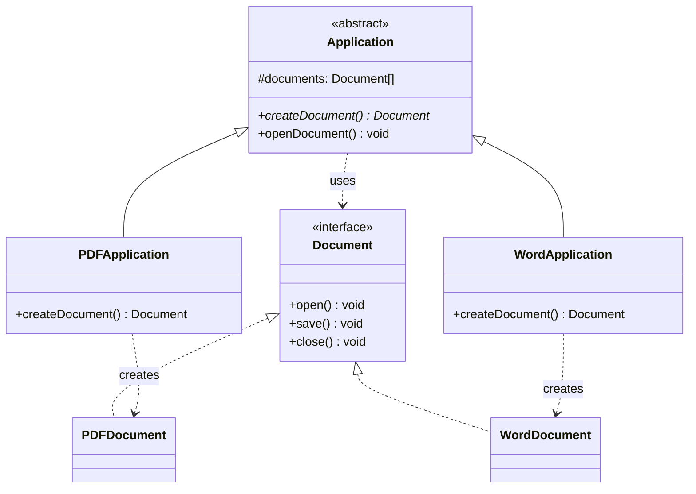

# Fabrika metodi andozasi (Factory Method)

<CoverImage src="/covers/creational/factory-method.webp" alt="Cover">
  <h1>Fabrika metodi</h1>
  <p>Qiziq yig'uv liniyasi: unga qaysi chizma kartasi berilishiga qarab, yagona mexanik qo'l turli shakldagi kichik o'yinchoq mashinalarni (sedan, yuk mashinasi) tamg'alab chiqaradi.</p>
</CoverImage>

## Umumiy ko'rinish (Overview)

**Fabrika metodi (Factory Method)** andozasi yaratuvchi (creational) loyihalash andozasi bo'lib, obyektlarni yaratish uchun interfeys belgilaydi, ammo qaysi konkret klassning instansiyasini yaratishni subklasslarga hal qilishga imkon beradi. Bu andoza kod yaratayotgan obyektlarning aniq klasslarini ko'rsatish zaruratini yo'qotib, bo'sh bog'liqlikni (loose coupling) rag'batlantiradi.

`new ConcreteProduct()` ni to'g'ridan-to'g'ri chaqirish (qattiq bog'liqlik) o'rniga, siz umumiy interfeysni amalga oshiruvchi obyektni qaytaradigan factory metodini chaqirasiz. Haqiqiy tur factory metodini amalga oshiruvchi subklass tomonidan aniqlanadi.

**Zamonaviy nuqtai nazar**: Funksiyalar birinchi darajali (first-class) obyekt bo'lgan funksional va dinamik tillarda Fabrika metodi unchalik ko'zga tashlanmaydi. Biroq u tiplashtirilgan tillarda (Java, TypeScript) hamon muhim bo'lib qolmoqda va ko'pincha bog'liqliklarni kiritish (dependency injection) freymvorklari bilan birgalikda qo'llaniladi.

## Hayotiy o'xshatish (Real-World Analogy)

**Logistika kompaniyasini** tasavvur qiling. Yukni yuk mashinasida, kemada yoki samolyotda jo'natasizmi — kompaniya yagona jo'natish interfeysini taqdim etadi. Aniq transport usuli mijoz kodida qattiq yozilmaydi, balki masofa, og'irlik va narx kabi mezonlar asosida ish vaqtida (runtime) aniqlanadi.

Xuddi shunday, kodda turli ma'lumotlar bazasi adapterlari (MySQL, PostgreSQL, MongoDB) bo'lishi mumkin, ammo mijoz kodi qaysi implementatsiya qaytarilishini bilmasdan va bunga e'tibor bermasdan shunchaki factory metodini chaqiradi.

## Tuzilma (Structure)



- **`Application`** (Creator — yaratuvchi) abstrakt factory metodi `createDocument()` ni e'lon qiladi va faqat `Document` interfeysi bilan ishlaydigan biznes mantig'ini (`openDocument()`) o'z ichiga oladi.
- **`PDFApplication` / `WordApplication`** (Concrete Creators — konkret yaratuvchilar) qaysi konkret mahsulot instansiyasini yaratishni hal qilish uchun factory metodini qayta aniqlaydi (override).
- **`Document`** (Product — mahsulot) umumiy interfeys; **`PDFDocument` / `WordDocument`** esa konkret mahsulotlar. `ExcelApplication` + `ExcelDocument` qo'shish mavjud kodga hech qanday o'zgartirish kiritishni talab qilmaydi.

## Muammo (Problem)

Kod konkret klasslarning instansiyasini to'g'ridan-to'g'ri yaratganda, u qattiq bog'langan va kengaytirish qiyin bo'lib qoladi:

### Stsenariy: Bir nechta hujjat turlari

```typescript
// ❌ Muammo: Konkret klasslarga qattiq bog'liqlik
function createDocument(type: string): Document {
  if (type === "pdf") {
    return new PDFDocument(); // To'g'ridan-to'g'ri instansiya yaratish
  } else if (type === "word") {
    return new WordDocument();
  } else if (type === "excel") {
    return new ExcelDocument();
  }
  throw new Error("Unknown type");
}

// Yangi hujjat turini qo'shish bu funksiyani o'zgartirishni talab qiladi (Open/Closed tamoyilini buzadi)
```

**Muammolar:**

- Yangi hujjat turini qo'shish factory funksiyasini o'zgartirishni talab qiladi.
- Funksiya barcha konkret implementatsiyalar haqida biladi.
- Testlash qiyin; mock implementatsiyalarni osongina almashtirib bo'lmaydi.
- Mantiq tarqoq; jamoaviy ishlab chiqish uchun kengaytiriladigan emas.

### Stsenariy: To'lovlarni qayta ishlash

```typescript
// ❌ Muammo: To'lov usullarini qo'shish og'riqli
class OrderProcessor {
  processPayment(method: string, amount: number) {
    if (method === "credit_card") {
      const processor = new CreditCardProcessor();
      processor.charge(amount);
    } else if (method === "paypal") {
      const processor = new PayPalProcessor();
      processor.charge(amount);
    } else if (method === "apple_pay") {
      const processor = new ApplePayProcessor();
      processor.charge(amount);
    }
    // Har bir yangi to'lov usuli bu klassni o'zgartirishni talab qiladi!
  }
}
```

## Yechim (Solution)

Fabrika metodi andozasi buni quyidagicha hal qiladi:

1. Barcha mahsulotlar uchun **umumiy interfeys belgilash** (abstrakt klass yoki interfeys).
2. Abstrakt yaratuvchi klassda interfeys turini qaytaradigan **factory metodini yaratish**.
3. **Subklasslar factory metodini qayta aniqlaydi** va o'zlarining konkret turini qaytaradi.
4. Mijoz kodi konkret implementatsiyalarga emas, **interfeysga bog'liq** bo'ladi.

```typescript
// ✅ Yechim: Implementatsiyalarga emas, interfeyslarga bog'laning
abstract class DocumentHandler {
  abstract createDocument(): Document;

  openDocument(): void {
    const doc = this.createDocument(); // Factory metodi
    doc.open(); // Interfeysdan foydalanish
  }
}

class PDFHandler extends DocumentHandler {
  createDocument(): Document {
    return new PDFDocument(); // Turni subklass hal qiladi
  }
}

class WordHandler extends DocumentHandler {
  createDocument(): Document {
    return new WordDocument();
  }
}

// Yangi hujjat turini qo'shish:
class ExcelHandler extends DocumentHandler {
  createDocument(): Document {
    return new ExcelDocument(); // Mavjud kod o'zgartirilmadi!
  }
}
```

**Asosiy tamoyil**: Factory metodi mavjud mijoz kodini o'zgartirmasdan yangi konkret mahsulotlarni qo'shish imkonini beradi — bu **Open/Closed tamoyili** (Open/Closed Principle).

## Amalga oshirish (Implementation)

::: code-group

```typescript [TypeScript]
/**
 * Mahsulot interfeysi: Barcha hujjatlar buni amalga oshirishi kerak.
 */
interface Document {
  open(): void;
  save(): void;
  close(): void;
}

/**
 * Konkret mahsulotlar: Muayyan hujjat implementatsiyalari.
 */
class PDFDocument implements Document {
  open(): void {
    console.log("Opening PDF document...");
  }
  save(): void {
    console.log("Saving as PDF...");
  }
  close(): void {
    console.log("Closing PDF document");
  }
}

class WordDocument implements Document {
  open(): void {
    console.log("Opening Word document...");
  }
  save(): void {
    console.log("Saving as Word...");
  }
  close(): void {
    console.log("Closing Word document");
  }
}

class ExcelDocument implements Document {
  open(): void {
    console.log("Opening Excel document...");
  }
  save(): void {
    console.log("Saving as Excel...");
  }
  close(): void {
    console.log("Closing Excel document");
  }
}

/**
 * Yaratuvchi abstrakt klass: Factory metodini belgilaydi.
 * Subklasslar muayyan turlarni qaytarish uchun createDocument() ni amalga oshiradi.
 */
abstract class Application {
  protected documents: Document[] = [];

  /**
   * Factory metodi: Subklasslar o'z mahsulot turini qaytarish uchun buni qayta aniqlaydi.
   */
  abstract createDocument(): Document;

  /**
   * Biznes mantig'i: Konkret turlardan emas, mahsulot interfeysidan foydalanadi.
   */
  openDocument(): void {
    const doc = this.createDocument();
    doc.open();
    this.documents.push(doc);
  }

  listDocuments(): void {
    console.log(`Total documents: ${this.documents.length}`);
  }
}

/**
 * Konkret yaratuvchilar: Har biri qaysi mahsulotni yaratishni aniqlaydi.
 */
class PDFApplication extends Application {
  createDocument(): Document {
    return new PDFDocument();
  }
}

class WordApplication extends Application {
  createDocument(): Document {
    return new WordDocument();
  }
}

class ExcelApplication extends Application {
  createDocument(): Document {
    return new ExcelDocument();
  }
}

// Foydalanish
function main() {
  const apps: Application[] = [
    new PDFApplication(),
    new WordApplication(),
    new ExcelApplication(),
  ];

  apps.forEach((app) => {
    app.openDocument();
    app.listDocuments();
  });
}

main();
```

```python [Python]
from abc import ABC, abstractmethod

class Document(ABC):
    """Mahsulot interfeysi: Barcha hujjatlar buni amalga oshiradi."""

    @abstractmethod
    def open(self) -> None:
        pass

    @abstractmethod
    def save(self) -> None:
        pass

    @abstractmethod
    def close(self) -> None:
        pass

class PDFDocument(Document):
    """Konkret mahsulot: PDF hujjat."""

    def open(self) -> None:
        print("Opening PDF document...")

    def save(self) -> None:
        print("Saving as PDF...")

    def close(self) -> None:
        print("Closing PDF document")

class WordDocument(Document):
    """Konkret mahsulot: Word hujjat."""

    def open(self) -> None:
        print("Opening Word document...")

    def save(self) -> None:
        print("Saving as Word...")

    def close(self) -> None:
        print("Closing Word document")

class ExcelDocument(Document):
    """Konkret mahsulot: Excel hujjat."""

    def open(self) -> None:
        print("Opening Excel document...")

    def save(self) -> None:
        print("Saving as Excel...")

    def close(self) -> None:
        print("Closing Excel document")

class Application(ABC):
    """Yaratuvchi: Factory metodini belgilaydigan abstrakt bazaviy klass."""

    def __init__(self) -> None:
        self.documents: list[Document] = []

    @abstractmethod
    def create_document(self) -> Document:
        """Factory metodi: Subklasslar buni qayta aniqlaydi."""
        pass

    def open_document(self) -> None:
        """Biznes mantig'i: Mahsulot interfeysidan foydalanadi."""
        doc = self.create_document()
        doc.open()
        self.documents.append(doc)

    def list_documents(self) -> None:
        print(f"Total documents: {len(self.documents)}")

class PDFApplication(Application):
    """Konkret yaratuvchi: PDF hujjatlarni yaratadi."""

    def create_document(self) -> Document:
        return PDFDocument()

class WordApplication(Application):
    """Konkret yaratuvchi: Word hujjatlarni yaratadi."""

    def create_document(self) -> Document:
        return WordDocument()

# Foydalanish
if __name__ == "__main__":
    apps: list[Application] = [
        PDFApplication(),
        WordApplication(),
        ExcelApplication(),
    ]

    for app in apps:
        app.open_document()
        app.list_documents()
```

```java [Java]
import java.util.*;

/**
 * Mahsulot interfeysi: Barcha hujjatlar buni amalga oshiradi.
 */
interface Document {
    void open();
    void save();
    void close();
}

/**
 * Konkret mahsulotlar.
 */
class PDFDocument implements Document {
    @Override
    public void open() {
        System.out.println("Opening PDF document...");
    }

    @Override
    public void save() {
        System.out.println("Saving as PDF...");
    }

    @Override
    public void close() {
        System.out.println("Closing PDF document");
    }
}

class WordDocument implements Document {
    @Override
    public void open() {
        System.out.println("Opening Word document...");
    }

    @Override
    public void save() {
        System.out.println("Saving as Word...");
    }

    @Override
    public void close() {
        System.out.println("Closing Word document");
    }
}

/**
 * Yaratuvchi abstrakt klass: Factory metodini belgilaydi.
 */
abstract class Application {
    protected List<Document> documents = new ArrayList<>();

    /**
     * Factory metodi: Subklasslar buni qayta aniqlaydi.
     */
    abstract Document createDocument();

    /**
     * Biznes mantig'i: Mahsulot interfeysidan foydalanadi.
     */
    public void openDocument() {
        Document doc = createDocument();
        doc.open();
        documents.add(doc);
    }

    public void listDocuments() {
        System.out.println("Total documents: " + documents.size());
    }
}

/**
 * Konkret yaratuvchilar.
 */
class PDFApplication extends Application {
    @Override
    Document createDocument() {
        return new PDFDocument();
    }
}

class WordApplication extends Application {
    @Override
    Document createDocument() {
        return new WordDocument();
    }
}

// Foydalanish
public class Main {
    public static void main(String[] args) {
        Application[] apps = {
            new PDFApplication(),
            new WordApplication(),
        };

        for (Application app : apps) {
            app.openDocument();
            app.listDocuments();
        }
    }
}
```

```go [Go]
package main

import "fmt"

// Document interfeysi: Barcha hujjatlar buni amalga oshiradi.
type Document interface {
    Open()
    Save()
    Close()
}

// Konkret mahsulotlar.
type PDFDocument struct{}

func (d *PDFDocument) Open() {
    fmt.Println("Opening PDF document...")
}

func (d *PDFDocument) Save() {
    fmt.Println("Saving as PDF...")
}

func (d *PDFDocument) Close() {
    fmt.Println("Closing PDF document")
}

type WordDocument struct{}

func (d *WordDocument) Open() {
    fmt.Println("Opening Word document...")
}

func (d *WordDocument) Save() {
    fmt.Println("Saving as Word...")
}

func (d *WordDocument) Close() {
    fmt.Println("Closing Word document")
}

// Application: Fabrika metodi andozasidan foydalanadi.
type Application struct {
    documents []Document
    factory   DocumentFactory
}

// DocumentFactory: Hujjatlarni yaratish uchun funksiya turi.
type DocumentFactory func() Document

// NewApplication: Factoryni qabul qiluvchi konstruktor.
func NewApplication(factory DocumentFactory) *Application {
    return &Application{
        documents: []Document{},
        factory:   factory,
    }
}

// OpenDocument: Factory metodidan foydalanadi.
func (a *Application) OpenDocument() {
    doc := a.factory()
    doc.Open()
    a.documents = append(a.documents, doc)
}

func (a *Application) ListDocuments() {
    fmt.Printf("Total documents: %d\n", len(a.documents))
}

// Factory funksiyalari: Aynan shular factory metodlaridir.
func CreatePDFDocument() Document {
    return &PDFDocument{}
}

func CreateWordDocument() Document {
    return &WordDocument{}
}

// Foydalanish
func main() {
    apps := []*Application{
        NewApplication(CreatePDFDocument),
        NewApplication(CreateWordDocument),
    }

    for _, app := range apps {
        app.OpenDocument()
        app.ListDocuments()
    }
}
```

```rust [Rust]
// Mahsulot traiti: Barcha hujjatlar buni amalga oshiradi.
trait Document {
    fn open(&self);
    fn save(&self);
    fn close(&self);
}

// Konkret mahsulotlar.
struct PDFDocument;

impl Document for PDFDocument {
    fn open(&self) {
        println!("Opening PDF document...");
    }

    fn save(&self) {
        println!("Saving as PDF...");
    }

    fn close(&self) {
        println!("Closing PDF document");
    }
}

struct WordDocument;

impl Document for WordDocument {
    fn open(&self) {
        println!("Opening Word document...");
    }

    fn save(&self) {
        println!("Saving as Word...");
    }

    fn close(&self) {
        println!("Closing Word document");
    }
}

// DocumentType enum: Qaysi factorydan foydalanishni aniqlaydi.
enum DocumentType {
    PDF,
    Word,
}

// Factory funksiyasi: Trait obyektini qaytaradi.
fn create_document(doc_type: DocumentType) -> Box<dyn Document> {
    match doc_type {
        DocumentType::PDF => Box::new(PDFDocument),
        DocumentType::Word => Box::new(WordDocument),
    }
}

// Application: Factorydan foydalanadi.
struct Application {
    documents: Vec<Box<dyn Document>>,
    document_type: DocumentType,
}

impl Application {
    fn new(document_type: DocumentType) -> Self {
        Application {
            documents: Vec::new(),
            document_type,
        }
    }

    fn open_document(&mut self) {
        let doc = create_document(self.document_type.clone());
        doc.open();
        self.documents.push(doc);
    }

    fn list_documents(&self) {
        println!("Total documents: {}", self.documents.len());
    }
}

// Foydalanish (DocumentType uchun Clone talab qilinadi)
#[derive(Clone)]
enum DocumentType {
    PDF,
    Word,
}

fn main() {
    let mut pdf_app = Application::new(DocumentType::PDF);
    pdf_app.open_document();
    pdf_app.list_documents();

    let mut word_app = Application::new(DocumentType::Word);
    word_app.open_document();
    word_app.list_documents();
}
```

:::

### TypeScript: Klassik Fabrika metodi

**TypeScript yondashuvining afzalliklari:**

- TypeScript interfeyslari orqali aniq interfeys shartnomalari (contracts).
- Subklasslar factory metodini aniq qayta aniqlaydi.
- Mavjud kodni o'zgartirmasdan yangi turlarni qo'shish oson.

### Python: Subklasslar va abstrakt bazaviy klasslardan foydalanish

**Python yondashuvining afzalliklari:**

- Aniq shartnomalar uchun `@abstractmethod` dekoratoridan foydalanadi.
- Tip izohlari (type hints) bilan Python uslubidagi (Pythonic) sintaksis.
- Subklassda qayta aniqlash usuli Python uchun tabiiy (idiomatic).

### Java: Generiklar bilan Fabrika metodi

**Java yondashuvining afzalliklari:**

- Abstrakt va konkret klasslarning aniq ajratilishi.
- Interfeyslar shartnomalarni aniq belgilaydi.
- Korporativ (enterprise) kod bazalarida yaxshi ishlaydi.

### Go: Funksiyalardan factory sifatida foydalanish

**Go yondashuvining afzalliklari:**

- Birinchi darajali qiymat sifatidagi funksiyalar subklasslash zaruratini almashtiradi.
- Vorislikdan ko'ra kompozitsiya: ilovalar factorylar bilan tuziladi.
- Go uslubiga mos (idiomatic): soddaroq, ko'proq funksional yondashuv.

### Rust: Trait obyektlari va enum dispatch'dan foydalanish

**Rust yondashuvining afzalliklari:**

- Trait obyektlari polimorfizmni xavfsiz ta'minlaydi.
- Enum dispatch tip jihatdan xavfsiz va samarali.
- Factoryni tanlash uchun Rust'ning pattern matching'i tilga xos (idiomatic) usul.

## Real hayotdagi qo'llanilishi: To'lov protsessori (Payment Processor)

To'lov tizimi bir nechta to'lov usullarini qo'llab-quvvatlashi kerak. Fabrika metodi yordamida yangi usul qo'shish mavjud kodni o'zgartirishni talab qilmaydi:

```typescript
// Mahsulot interfeysi
interface PaymentProcessor {
  validate(data: any): boolean;
  charge(amount: number): Promise<boolean>;
  refund(transactionId: string): Promise<boolean>;
}

// Konkret protsessorlar
class CreditCardProcessor implements PaymentProcessor {
  validate(data: any): boolean {
    return data.cardNumber && data.cvv && data.expiry;
  }

  async charge(amount: number): Promise<boolean> {
    console.log(`Charging credit card: $${amount}`);
    return true;
  }

  async refund(transactionId: string): Promise<boolean> {
    console.log(`Refunding credit card transaction: ${transactionId}`);
    return true;
  }
}

class PayPalProcessor implements PaymentProcessor {
  validate(data: any): boolean {
    return data.email && data.password;
  }

  async charge(amount: number): Promise<boolean> {
    console.log(`Charging PayPal account: $${amount}`);
    return true;
  }

  async refund(transactionId: string): Promise<boolean> {
    console.log(`Refunding PayPal transaction: ${transactionId}`);
    return true;
  }
}

class ApplePayProcessor implements PaymentProcessor {
  validate(data: any): boolean {
    return data.token;
  }

  async charge(amount: number): Promise<boolean> {
    console.log(`Charging via Apple Pay: $${amount}`);
    return true;
  }

  async refund(transactionId: string): Promise<boolean> {
    console.log(`Refunding Apple Pay transaction: ${transactionId}`);
    return true;
  }
}

// Yaratuvchi: To'lov shlyuzi
abstract class PaymentGateway {
  abstract createProcessor(): PaymentProcessor;

  async processPayment(amount: number, data: any): Promise<boolean> {
    const processor = this.createProcessor();

    if (!processor.validate(data)) {
      console.error("Invalid payment data");
      return false;
    }

    return await processor.charge(amount);
  }
}

class CreditCardGateway extends PaymentGateway {
  createProcessor(): PaymentProcessor {
    return new CreditCardProcessor();
  }
}

class PayPalGateway extends PaymentGateway {
  createProcessor(): PaymentProcessor {
    return new PayPalProcessor();
  }
}

class ApplePayGateway extends PaymentGateway {
  createProcessor(): PaymentProcessor {
    return new ApplePayProcessor();
  }
}

// Foydalanish
async function handleCheckout(method: string, amount: number, data: any) {
  let gateway: PaymentGateway;

  switch (method) {
    case "credit-card":
      gateway = new CreditCardGateway();
      break;
    case "paypal":
      gateway = new PayPalGateway();
      break;
    case "apple-pay":
      gateway = new ApplePayGateway();
      break;
    default:
      throw new Error("Unknown payment method");
  }

  const success = await gateway.processPayment(amount, data);
  console.log(`Payment ${success ? "successful" : "failed"}`);
}

// Yangi to'lov usulini (masalan, Stripe) qo'shish uchun faqat quyidagilar kerak:
// 1. StripeProcessor yaratish
// 2. StripeGateway yaratish
// Mavjud kod o'zgartirilmaydi!
```

## Afzalliklari va kamchiliklari

### ✅ Afzalliklari

- **To'g'ridan-to'g'ri klass bog'liqliklarini yo'qotadi**: Kod konkret implementatsiyalarga emas, interfeyslarga bog'liq bo'ladi.
- **Open/Closed tamoyiliga amal qiladi**: Mavjud kodni o'zgartirmasdan yangi mahsulotlar qo'shish mumkin.
- **Testlanuvchanlikni oshiradi**: Testlash uchun mock implementatsiyalarni yaratish oson.
- **Ish vaqtida qaror qabul qilish imkonini beradi**: Mahsulot turi shartlarga qarab ish vaqtida aniqlanishi mumkin.
- **Plagin arxitekturalarini qo'llab-quvvatlaydi**: Yangi factorylarni dinamik ravishda yuklash mumkin.

### ❌ Kamchiliklari

- **Kod murakkabligi ortadi**: Hatto oddiy holatlar uchun ham abstrakt klasslar va subklasslar yaratishni talab qiladi.
- **Ko'proq fayl va klasslar**: Oddiy obyekt yaratish endi factory klassi va mahsulot interfeysini talab qiladi.
- **Kichik loyihalar uchun ortiqcha yuk**: Mahsulot turlari kam bo'lgan ilovalar uchun haddan tashqari murakkablashtirilgandek (over-engineered) tuyulishi mumkin.
- **O'rganish qiyinligi**: Junior dasturchilar bilvositalikni (indirection) chalkash deb topishi mumkin.
- **Unumdorlik**: Virtual metod chaqiruvlaridan biroz qo'shimcha xarajat (amalda ahamiyatsiz).

## Variatsiyalar (Variations)

### Simple Factory (anti-andoza)

Ba'zi kod bazalari subklasslash o'rniga statik `SimpleFactory` klassidan foydalanadi:

```typescript
class DocumentFactory {
  static create(type: string): Document {
    switch (type) {
      case "pdf":
        return new PDFDocument();
      case "word":
        return new WordDocument();
      default:
        throw new Error("Unknown type");
    }
  }
}

const doc = DocumentFactory.create("pdf");
```

**Eslatma**: Bu Open/Closed tamoyilini buzadi — yangi tur qo'shish factory metodini o'zgartirishni talab qiladi. Buning o'rniga haqiqiy Fabrika metodidan (subklasslash bilan) foydalaning.

## Qachon ishlatish kerak

::: tip QUYIDAGI HOLLARDA ISHLATING...

- **Bir nechta o'zaro bog'liq mahsulot turlari** mavjud va kelajakda yana qo'shilishi mumkin.
- **Mijoz kodi konkret mahsulot klasslariga bog'liq bo'lmasligi kerak**.
- **Aniq mahsulot turi ish vaqtida** shartlarga qarab aniqlanadi.
- **Yangi mahsulotlar dinamik yuklanadigan plagin arxitekturasini qo'llab-quvvatlamoqchisiz**.
- **Open/Closed tamoyiliga amal qilmoqchisiz** (kengaytirish uchun ochiq, o'zgartirish uchun yopiq).

:::

::: warning QUYIDAGI HOLLARDA SAQLANING...

- **Faqat bir yoki ikkita mahsulot turi bor** va boshqa qo'shilmaydi; oddiy konstruktsiya yetarli.
- **Mahsulot mantig'i juda oddiy** yoki bilvositalik keraksiz murakkablik qo'shadi.
- **Funksional yondashuv** (factory funksiyalarini uzatish) sizning tilingizda soddaroq.
- **Bog'liqliklarni kiritishdan (dependency injection) foydalanib**, mahsulotni factorysiz to'g'ridan-to'g'ri uzatishingiz mumkin.

:::

## Keng tarqalgan xatolar (Common Mistakes)

### ❌ Xato 1: Fabrika metodi o'rniga Simple Factory'dan foydalanish

```typescript
// ❌ Anti-andoza: Yangi tur qo'shish factoryni o'zgartirishni talab qiladi
class DocumentFactory {
  static create(type: string): Document {
    if (type === "pdf") return new PDFDocument();
    if (type === "word") return new WordDocument();
    if (type === "excel") return new ExcelDocument(); // O'zgartirish talab qilinadi!
    throw new Error("Unknown type");
  }
}

// ✅ Yaxshiroq: Subklasslar bilan Fabrika metodi andozasidan foydalaning
abstract class Application {
  abstract createDocument(): Document; // Subklasslar qayta aniqlaydi
}

class ExcelApplication extends Application {
  createDocument(): Document {
    return new ExcelDocument(); // Mavjud kod o'zgartirilmadi
  }
}
```

### ❌ Xato 2: Factory metodidan noto'g'ri turni qaytarish

```typescript
// ❌ Factory metodi konkret turni emas, interfeysni qaytarishi kerak
abstract class Application {
  abstract createDocument(): WordDocument; // Noto'g'ri!
}

// ✅ Interfeysni qaytaring
abstract class Application {
  abstract createDocument(): Document; // To'g'ri!
}
```

### ❌ Xato 3: Biznes mantig'ini factory mantig'i bilan aralashtirish

```typescript
// ❌ Factory metodi haddan tashqari ko'p ish qilmoqda
class PaymentGateway {
  private processor: PaymentProcessor;

  processPayment(method: string, amount: number) {
    if (method === "card") {
      this.processor = new CreditCardProcessor();
    } else {
      this.processor = new PayPalProcessor();
    }
    // ... 100 qator validatsiya, loglash, xatolarni qayta ishlash
  }
}

// ✅ Vazifalarni ajrating
abstract class PaymentGateway {
  abstract createProcessor(): PaymentProcessor;

  async processPayment(amount: number, data: any): Promise<boolean> {
    const processor = this.createProcessor();
    return await processor.charge(amount);
  }
}
```

## Bog'liq andozalar (Related Patterns)

- **Abstrakt fabrika (Abstract Factory)**: Mahsulot oilalarini yaratish uchun ko'pincha Fabrika metodidan foydalanadi.
- **Shablon metod (Template Method)**: Obyektlarni yaratish uchun Fabrika metodi ko'pincha Shablon metod tomonidan chaqiriladi.
- **Singleton**: Mahsulotlar singleton bo'lishini ta'minlash uchun Fabrika metodi bilan birlashtirilishi mumkin.
- **Strategiya (Strategy)**: Niyati o'xshash, ammo maqsadi boshqa; Strategiya algoritmlarni tanlaydi, Fabrika metodi esa obyektlarni yaratadi.
- **Bog'liqliklarni kiritish (Dependency Injection)**: Zamonaviy muqobil; bog'liqliklarni ichkarida yaratish o'rniga ularni tashqaridan uzatish.

## Zamonaviy muqobillar

### Konfiguratsiyaga asoslangan factory (deklarativ)

```typescript
// Subklasslash o'rniga factorylarni sozlang:
const factoryConfig = {
  pdf: () => new PDFDocument(),
  word: () => new WordDocument(),
  excel: () => new ExcelDocument(),
};

function createDocument(type: keyof typeof factoryConfig): Document {
  return factoryConfig[type]();
}
```

### Bog'liqliklarni kiritish konteyneri (DI container)

```typescript
const container = new Container();
container.register("pdf", PDFDocument);
container.register("word", WordDocument);

const doc = container.resolve("pdf");
```

Bu yondashuv an'anaviy Fabrika metodiga qaraganda moslashuvchanroq va testlash osonroq.

## Intervyu savollari (Interview Insights)

**S: Fabrika metodi va Abstrakt fabrika o'rtasidagi farq nima?**

J: Fabrika metodi vorislik orqali bitta mahsulot turini yaratadi. Abstrakt fabrika kompozitsiya orqali o'zaro bog'liq mahsulotlar oilalarini yaratadi. Bitta tur ierarxiyasi bo'lsa Fabrika metodidan, bir nechta o'zaro bog'liq ierarxiyalar bo'lsa (masalan, turli operatsion tizimlar uchun UI elementlari) Abstrakt fabrikadan foydalaning.

**S: Nega Simple Factory o'rniga Fabrika metodidan foydalanish kerak?**

J: Simple Factory Open/Closed tamoyilini buzadi — yangi tur qo'shish mavjud kodni o'zgartirishni talab qiladi. Fabrika metodi subklasslashdan foydalanadi, shuning uchun yangi turlarni mavjud kodni o'zgartirmasdan qo'shish mumkin.

**S: Fabrika metodi bog'liqliklarni kiritish (Dependency Injection) bilan qanday bog'liq?**

J: Ikkalasi ham kodni konkret implementatsiyalardan ajratish muammosini hal qiladi. Fabrika metodi vorislikdan foydalanadi; bog'liqliklarni kiritish esa bog'liqliklarni uzatadi. Zamonaviy kodda DI odatda afzalroq, chunki u moslashuvchanroq va testlash osonroq.

**S: Python kabi dinamik tilda Fabrika metodidan qachon foydalanasiz?**

J: Hatto dinamik tillarda ham, shartnomani (interfeysni) majburlash va obyekt yaratishni nazorat qilish kerak bo'lganda Fabrika metodi foydali. Biroq birinchi darajali obyekt sifatidagi funksiyalar ba'zan aniq factorylar zaruratini almashtiradi.

**S: Fabrika metodini Singleton bilan birlashtirish mumkinmi?**

J: Ha. Har bir factory metodi singleton instansiya yaratishi mumkin, bu esa har bir turdan faqat bitta mahsulot mavjud bo'lishini ta'minlaydi.

## Manbalar (References)

- Gang of Four: "Design Patterns: Elements of Reusable Object-Oriented Software"
- Refactoring.Guru: Fabrika metodi (Factory Method) andozasi bo'yicha qo'llanma
- Bog'liqliklarni kiritish (Dependency Injection) freymvorklari: Spring (Java), Angular (TypeScript), Django (Python)
