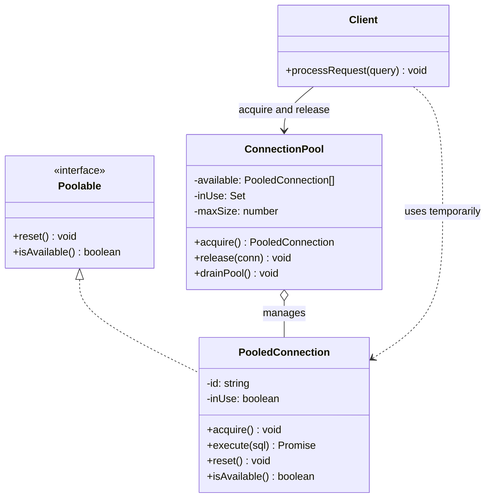

# Object Pool patterni

<CoverImage src="/covers/creational/object-pool.webp" alt="Cover">
  <h1>Object Pool</h1>
  <p>Hashamatli suzish havzasi: charchagan, yoqimtoy kichik robot-ishchilar suzgich halqalarda dam olmoqda, chetda esa qo'lida planshet tutgan menejer-robot turibdi — u bittasini ishga jo'natib, boshqasini dam olishga qaytarib kutib olmoqda.</p>
</CoverImage>

## Umumiy ko'rinish (Overview)

**Object Pool** patterni yaratuvchi (creational) dizayn patterni bo'lib, talab bo'yicha yangi instansiyalar yaratib, ularni yo'q qilish o'rniga qayta ishlatiladigan obyektlar pulini (pool) boshqaradi. Oldindan initsializatsiya qilingan obyektlar pulda saqlanadi, kerak bo'lganda qayta ishlatiladi va keyin pulga qaytariladi.

**Asosiy afzalligi**: Qimmat initsializatsiya va garbage collection (axlat yig'ish) xarajatlarini yo'qotish orqali resurslari cheklangan yoki yuqori o'tkazuvchanlikdagi (high-throughput) holatlarda unumdorlikni keskin oshiradi.

**Zamonaviy nuqtai nazar**: Ko'pincha quyidagilar bilan almashtiriladi:

- Async/await va freymvorklarga o'rnatilgan connection pooling
- Cloud-native resurslarni boshqarish (konteynerlar, auto-scaling)
- Til darajasidagi obyekt pooling (Java'dagi `ObjectPool`)
- O'rnatilgan pooling'ga ega oqimli ishlov berish (stream processing) freymvorklari

Shunga qaramay, Object Pool quyidagilar uchun hamon muhim:

- Ma'lumotlar bazasi ulanishlarini boshqarish
- Thread pool executor'lar
- Xotirasi cheklangan embedded tizimlar
- Kechikishi (latency) oldindan aytib bo'ladigan real-time tizimlar

## Hayotiy o'xshatish (Real-World Analogy)

**Avtomobil ijarasi xizmatini** tasavvur qiling:

- Avtomobillarni (obyektlarni) ishlab chiqarish qimmat
- Har bir mijoz uchun yangi mashina yasash o'rniga, avtoparkni saqlab turiladi
- Mijoz mavjud puldan mashinani "oladi" (acquire)
- Ishi tugagach, mijoz uni pulga qaytaradi
- Pul mashinani "tiklaydi" (reset) — yoqilg'i quyadi, tozalaydi, tekshiradi
- Keyingi mijoz foydalanishga tayyor mashinani oladi

Bu ishlab chiqarish xarajatlaridan qochish imkonini beradi va resurslardan foydalanish samaradorligini oshiradi.

## Tuzilma (Structure)



- **`Poolable`** har bir puldagi obyekt bajarishi kerak bo'lgan shartnomani (contract) belgilaydi, eng muhimi — qayta ishlatishdan oldin holatni tozalaydigan `reset()`.
- **`PooledConnection`** (Reusable) — bir marta yaratilib, ko'p marta beriladigan qimmat obyekt.
- **`ConnectionPool`** (Pool) obyektlarni oldindan yaratadi, mavjud va band instansiyalarni kuzatib boradi hamda `maxSize` chegarasini ta'minlaydi.
- **`Client`** `acquire()` orqali obyektni vaqtincha oladi va uni har doim `release()` orqali qaytarishi shart.

## Muammo (Problem)

Obyektlarni qayta-qayta yaratish va yo'q qilish bir qancha muammolarga olib keladi:

### Ssenariy: Ma'lumotlar bazasiga ulanish xarajatlari

```typescript
// ❌ Muammo: Ulanishlarni yaratish qimmat
class Application {
  async processRequest(query: string): Promise<void> {
    // Har safar yangi ulanish yaratish QIMMAT:
    // - TCP handshake (10ms)
    // - Autentifikatsiya (50ms)
    // - Dastlabki sozlash (30ms)
    // - Jami: har bir so'rov uchun ~90ms

    const conn = new DatabaseConnection();
    await conn.connect("postgres://db.example.com");
    const result = await conn.query(query);
    await conn.close(); // Tozalash xarajati: ~20ms

    // 1000 so'rov/sek uchun = 90ms * 1000 = faqat ulanishga 90 soniya ketadi!
  }
}
```

### Ssenariy: Thread yaratishdagi tor joy (bottleneck)

```typescript
// ❌ Muammo: Oqimlarni yaratish qimmat
class WebServer {
  handleRequest(request: Request): void {
    // Har bir so'rov uchun yangi oqim yaratish qimmat:
    // - Oqim ajratish (50-100KB xotira)
    // - Stekni initsializatsiya qilish
    // - Kontekst almashtirish xarajati

    // Natija: sekin ishga tushish, ko'p xotira, cheklangan masshtablanish
    const worker = new Thread(() => {
      processRequest(request);
    });
    worker.start();
  }
}
```

## Yechim (Solution)

Object Pool patterni bu muammoni quyidagicha hal qiladi:

1. **Qimmat obyektlarni oldindan initsializatsiya qilish** — ishga tushish vaqtida bir marta
2. **Foydalanishga tayyor obyektlar pulini saqlash**
3. **Obyektlarni yaratish o'rniga puldan olish**
4. **Pulga qaytarishdan oldin obyektlarni tiklash (reset)**
5. **Obyektlarni qayta ishlatish uchun pulga qaytarish**

```typescript
// ✅ Yechim: Pool'dan qayta foydalanish
class Application {
  private connectionPool: ConnectionPool;

  constructor() {
    // Bir martalik qimmat initsializatsiya
    this.connectionPool = new ConnectionPool(10);
  }

  async processRequest(query: string): Promise<void> {
    // Olish O(1) - shunchaki pool'dan olinadi (~0.1ms)
    const conn = this.connectionPool.acquire();

    try {
      const result = await conn.query(query); // Mavjud ulanishdan qayta foydalanish
    } finally {
      this.connectionPool.release(conn); // Qayta foydalanish uchun pool'ga qaytarish
    }

    // 1000 so'rov/sek uchun = 0.1ms * 1000 = jami 100ms (pool'siz 90 soniya)
  }
}
```

## Amalga oshirish (Implementation)

::: code-group

```typescript [TypeScript]
// Poolable interfeysi
interface Poolable {
  reset(): void;
  isAvailable(): boolean;
}

// Qayta ishlatiladigan ulanish obyekti
class PooledConnection implements Poolable {
  private id: string;
  private connection: any;
  private inUse: boolean = false;
  private createdAt: number = Date.now();

  constructor(id: string) {
    this.id = id;
    this.connection = this.initializeConnection();
  }

  private initializeConnection(): any {
    // Qimmat ulanish sozlanishini simulyatsiya qilish
    return {
      url: "postgres://localhost:5432",
      authenticated: true,
      queryCount: 0,
    };
  }

  acquire(): void {
    if (this.inUse) {
      throw new Error(`Connection ${this.id} already in use`);
    }
    this.inUse = true;
  }

  isAvailable(): boolean {
    return !this.inUse;
  }

  async execute(sql: string): Promise<any[]> {
    if (!this.inUse) {
      throw new Error("Connection not acquired from pool");
    }
    this.connection.queryCount++;
    // So'rov bajarilishini simulyatsiya qilish
    return [];
  }

  reset(): void {
    this.inUse = false;
    this.connection.queryCount = 0;
    // Prepared statement'lar, natija to'plamlari va h.k.ni tozalash
  }

  getId(): string {
    return this.id;
  }

  getAge(): number {
    return Date.now() - this.createdAt;
  }
}

// Object pool implementatsiyasi
class ConnectionPool {
  private available: PooledConnection[] = [];
  private inUse: Set<PooledConnection> = new Set();
  private maxSize: number;
  private connectionCounter: number = 0;
  private acquireWaiters: Array<(conn: PooledConnection) => void> = [];

  constructor(maxSize: number = 10) {
    this.maxSize = maxSize;
    this.initializePool();
  }

  private initializePool(): void {
    for (let i = 0; i < this.maxSize; i++) {
      const conn = new PooledConnection(`conn-${++this.connectionCounter}`);
      this.available.push(conn);
    }
    console.log(`ConnectionPool: Initialized with ${this.maxSize} connections`);
  }

  acquire(): PooledConnection {
    if (this.available.length > 0) {
      const conn = this.available.pop()!;
      conn.acquire();
      this.inUse.add(conn);
      return conn;
    }

    if (this.inUse.size < this.maxSize) {
      const conn = new PooledConnection(`conn-${++this.connectionCounter}`);
      conn.acquire();
      this.inUse.add(conn);
      return conn;
    }

    throw new Error(
      `Pool exhausted: ${this.inUse.size}/${this.maxSize} connections in use`,
    );
  }

  release(conn: PooledConnection): void {
    if (!this.inUse.has(conn)) {
      throw new Error("Connection not from this pool");
    }
    this.inUse.delete(conn);
    conn.reset();

    // Eskirgan ulanishlarni tekshirish
    if (conn.getAge() > 3600000) {
      // 1 soat
      console.log(`Discarding aged connection: ${conn.getId()}`);
      return;
    }

    this.available.push(conn);

    // Kutayotgan oqimlar bo'lsa, xabardor qilish
    if (this.acquireWaiters.length > 0) {
      const waiter = this.acquireWaiters.shift();
      if (waiter) waiter(conn);
    }
  }

  getStatus(): {
    available: number;
    inUse: number;
    total: number;
  } {
    return {
      available: this.available.length,
      inUse: this.inUse.size,
      total: this.available.length + this.inUse.size,
    };
  }

  async acquireAsync(timeout: number = 5000): Promise<PooledConnection> {
    try {
      return this.acquire();
    } catch (e) {
      return new Promise((resolve, reject) => {
        const timer = setTimeout(() => {
          reject(new Error("Pool acquire timeout"));
        }, timeout);

        this.acquireWaiters.push((conn) => {
          clearTimeout(timer);
          resolve(conn);
        });
      });
    }
  }

  drainPool(): void {
    this.available = [];
    this.inUse.clear();
    console.log("ConnectionPool: Drained");
  }
}

// Foydalanish
const pool = new ConnectionPool(5);

try {
  const conn1 = pool.acquire();
  const conn2 = pool.acquire();

  console.log(pool.getStatus()); // { available: 3, inUse: 2, total: 5 }

  pool.release(conn1);
  console.log(pool.getStatus()); // { available: 4, inUse: 1, total: 5 }

  pool.release(conn2);
  console.log(pool.getStatus()); // { available: 5, inUse: 0, total: 5 }
} catch (error) {
  console.error(error);
}
```

```python [Python]
from abc import ABC, abstractmethod
from threading import Lock, Event
from time import time
from typing import List, Optional

class Poolable(ABC):
    @abstractmethod
    def reset(self) -> None:
        pass

    @abstractmethod
    def is_available(self) -> bool:
        pass

class PooledConnection(Poolable):
    def __init__(self, connection_id: str):
        self.id = connection_id
        self.connection = self._initialize_connection()
        self.in_use = False
        self.created_at = time()

    def _initialize_connection(self) -> dict:
        # Qimmat ulanish sozlanishini simulyatsiya qilish
        return {
            "url": "postgres://localhost:5432",
            "authenticated": True,
            "query_count": 0,
        }

    def acquire(self) -> None:
        if self.in_use:
            raise RuntimeError(f"Connection {self.id} already in use")
        self.in_use = True

    def is_available(self) -> bool:
        return not self.in_use

    def execute(self, sql: str) -> list:
        if not self.in_use:
            raise RuntimeError("Connection not acquired from pool")
        self.connection["query_count"] += 1
        return []

    def reset(self) -> None:
        self.in_use = False
        self.connection["query_count"] = 0

    def get_id(self) -> str:
        return self.id

    def get_age(self) -> float:
        return time() - self.created_at

class ConnectionPool:
    def __init__(self, max_size: int = 10):
        self.available: List[PooledConnection] = []
        self.in_use: set = set()
        self.max_size = max_size
        self.connection_counter = 0
        self.lock = Lock()
        self.available_event = Event()
        self._initialize_pool()

    def _initialize_pool(self) -> None:
        for _ in range(self.max_size):
            conn = PooledConnection(f"conn-{self.connection_counter}")
            self.connection_counter += 1
            self.available.append(conn)
        print(f"ConnectionPool: Initialized with {self.max_size} connections")

    def acquire(self, timeout: Optional[float] = None) -> PooledConnection:
        with self.lock:
            if self.available:
                conn = self.available.pop()
                conn.acquire()
                self.in_use.add(conn)
                return conn

            if len(self.in_use) < self.max_size:
                conn = PooledConnection(f"conn-{self.connection_counter}")
                self.connection_counter += 1
                conn.acquire()
                self.in_use.add(conn)
                return conn

        raise RuntimeError(
            f"Pool exhausted: {len(self.in_use)}/{self.max_size} in use"
        )

    def release(self, conn: PooledConnection) -> None:
        with self.lock:
            if conn not in self.in_use:
                raise RuntimeError("Connection not from this pool")
            self.in_use.remove(conn)

            # Eskirgan ulanishlarni tekshirish
            if conn.get_age() > 3600:  # 1 soat
                print(f"Discarding aged connection: {conn.get_id()}")
                return

            conn.reset()
            self.available.append(conn)
            self.available_event.set()

    def get_status(self) -> dict:
        with self.lock:
            return {
                "available": len(self.available),
                "in_use": len(self.in_use),
                "total": len(self.available) + len(self.in_use),
            }

    def drain_pool(self) -> None:
        with self.lock:
            self.available.clear()
            self.in_use.clear()
        print("ConnectionPool: Drained")

# Foydalanish
pool = ConnectionPool(5)
conn1 = pool.acquire()
conn2 = pool.acquire()
print(pool.get_status())  # {'available': 3, 'in_use': 2, 'total': 5}

pool.release(conn1)
pool.release(conn2)
print(pool.get_status())  # {'available': 5, 'in_use': 0, 'total': 5}
```

```java [Java]
import java.util.*;
import java.util.concurrent.*;

interface Poolable {
    void reset();
    boolean isAvailable();
}

class PooledConnection implements Poolable {
    private final String id;
    private final Map<String, Object> connection;
    private boolean inUse = false;
    private long createdAt = System.currentTimeMillis();

    public PooledConnection(String id) {
        this.id = id;
        this.connection = initializeConnection();
    }

    private Map<String, Object> initializeConnection() {
        Map<String, Object> conn = new HashMap<>();
        conn.put("url", "postgres://localhost:5432");
        conn.put("authenticated", true);
        conn.put("queryCount", 0);
        return conn;
    }

    public void acquire() {
        if (inUse) throw new RuntimeException("Connection already in use");
        inUse = true;
    }

    @Override
    public boolean isAvailable() {
        return !inUse;
    }

    public List<Object> execute(String sql) {
        if (!inUse) throw new RuntimeException("Connection not acquired from pool");
        Integer count = (Integer) connection.get("queryCount");
        connection.put("queryCount", count + 1);
        return new ArrayList<>();
    }

    @Override
    public void reset() {
        inUse = false;
        connection.put("queryCount", 0);
    }

    public String getId() {
        return id;
    }

    public long getAge() {
        return System.currentTimeMillis() - createdAt;
    }
}

class ConnectionPool {
    private final Queue<PooledConnection> available = new LinkedList<>();
    private final Set<PooledConnection> inUse = Collections.synchronizedSet(
        new HashSet<>()
    );
    private final int maxSize;
    private int connectionCounter = 0;
    private final Object lock = new Object();

    public ConnectionPool(int maxSize) {
        this.maxSize = maxSize;
        initializePool();
    }

    private void initializePool() {
        for (int i = 0; i < maxSize; i++) {
            available.offer(
                new PooledConnection("conn-" + (++connectionCounter))
            );
        }
        System.out.println(
            "ConnectionPool: Initialized with " + maxSize + " connections"
        );
    }

    public PooledConnection acquire() {
        synchronized (lock) {
            PooledConnection conn = available.poll();
            if (conn != null) {
                conn.acquire();
                inUse.add(conn);
                return conn;
            }

            if (inUse.size() < maxSize) {
                conn = new PooledConnection("conn-" + (++connectionCounter));
                conn.acquire();
                inUse.add(conn);
                return conn;
            }
        }
        throw new RuntimeException("Pool exhausted");
    }

    public void release(PooledConnection conn) {
        synchronized (lock) {
            if (!inUse.remove(conn)) {
                throw new RuntimeException("Connection not from this pool");
            }

            if (conn.getAge() > 3600000) { // 1 soat
                System.out.println(
                    "Discarding aged connection: " + conn.getId()
                );
                return;
            }

            conn.reset();
            available.offer(conn);
        }
    }

    public Map<String, Integer> getStatus() {
        synchronized (lock) {
            Map<String, Integer> status = new HashMap<>();
            status.put("available", available.size());
            status.put("inUse", inUse.size());
            status.put("total", available.size() + inUse.size());
            return status;
        }
    }
}
```

```go [Go]
package main

import (
    "sync"
    "time"
)

type Poolable interface {
    Reset()
    IsAvailable() bool
}

type PooledConnection struct {
    ID        string
    inUse     bool
    createdAt time.Time
    conn      map[string]interface{}
    mu        sync.Mutex
}

func NewPooledConnection(id string) *PooledConnection {
    return &PooledConnection{
        ID:        id,
        inUse:     false,
        createdAt: time.Now(),
        conn: map[string]interface{}{
            "url":        "postgres://localhost:5432",
            "query_count": 0,
        },
    }
}

func (pc *PooledConnection) Acquire() {
    pc.mu.Lock()
    defer pc.mu.Unlock()
    if pc.inUse {
        panic("Connection already in use")
    }
    pc.inUse = true
}

func (pc *PooledConnection) IsAvailable() bool {
    pc.mu.Lock()
    defer pc.mu.Unlock()
    return !pc.inUse
}

func (pc *PooledConnection) Execute(sql string) []interface{} {
    pc.mu.Lock()
    defer pc.mu.Unlock()
    if !pc.inUse {
        panic("Connection not acquired from pool")
    }
    count := pc.conn["query_count"].(int)
    pc.conn["query_count"] = count + 1
    return []interface{}{}
}

func (pc *PooledConnection) Reset() {
    pc.mu.Lock()
    defer pc.mu.Unlock()
    pc.inUse = false
    pc.conn["query_count"] = 0
}

func (pc *PooledConnection) GetAge() time.Duration {
    return time.Since(pc.createdAt)
}

type ConnectionPool struct {
    available chan *PooledConnection
    inUse    *sync.Map
    maxSize  int
    mu       sync.Mutex
}

func NewConnectionPool(maxSize int) *ConnectionPool {
    pool := &ConnectionPool{
        available: make(chan *PooledConnection, maxSize),
        inUse:     &sync.Map{},
        maxSize:   maxSize,
    }
    pool.initializePool()
    return pool
}

func (cp *ConnectionPool) initializePool() {
    for i := 0; i < cp.maxSize; i++ {
        cp.available <- NewPooledConnection(
            "conn-" + string(rune(i)),
        )
    }
}

func (cp *ConnectionPool) Acquire() *PooledConnection {
    select {
    case conn := <-cp.available:
        conn.Acquire()
        cp.inUse.Store(conn.ID, conn)
        return conn
    default:
        panic("Pool exhausted")
    }
}

func (cp *ConnectionPool) Release(conn *PooledConnection) {
    if _, ok := cp.inUse.LoadAndDelete(conn.ID); !ok {
        panic("Connection not from this pool")
    }

    if conn.GetAge() > time.Hour {
        return
    }

    conn.Reset()
    cp.available <- conn
}
```

```rust [Rust]
use std::sync::{Arc, Mutex, mpsc};
use std::time::{SystemTime, UNIX_EPOCH};
use std::collections::VecDeque;

trait Poolable {
    fn reset(&mut self);
    fn is_available(&self) -> bool;
}

#[derive(Clone)]
pub struct PooledConnection {
    id: String,
    in_use: bool,
    created_at: u64,
}

impl Poolable for PooledConnection {
    fn reset(&mut self) {
        self.in_use = false;
    }

    fn is_available(&self) -> bool {
        !self.in_use
    }
}

impl PooledConnection {
    pub fn new(id: String) -> Self {
        PooledConnection {
            id,
            in_use: false,
            created_at: SystemTime::now()
                .duration_since(UNIX_EPOCH)
                .unwrap()
                .as_secs(),
        }
    }

    pub fn acquire(&mut self) {
        if self.in_use {
            panic!("Connection already in use");
        }
        self.in_use = true;
    }

    pub fn get_age(&self) -> u64 {
        let now = SystemTime::now()
            .duration_since(UNIX_EPOCH)
            .unwrap()
            .as_secs();
        now - self.created_at
    }
}

pub struct ConnectionPool {
    available: Arc<Mutex<VecDeque<PooledConnection>>>,
    max_size: usize,
    counter: Arc<Mutex<usize>>,
}

impl ConnectionPool {
    pub fn new(max_size: usize) -> Self {
        let mut available = VecDeque::new();
        for i in 0..max_size {
            available.push_back(PooledConnection::new(
                format!("conn-{}", i),
            ));
        }

        ConnectionPool {
            available: Arc::new(Mutex::new(available)),
            max_size,
            counter: Arc::new(Mutex::new(max_size)),
        }
    }

    pub fn acquire(&self) -> PooledConnection {
        let mut pool = self.available.lock().unwrap();
        if let Some(mut conn) = pool.pop_front() {
            conn.acquire();
            conn
        } else {
            panic!("Pool exhausted");
        }
    }

    pub fn release(&self, conn: PooledConnection) {
        let mut pool = self.available.lock().unwrap();
        if conn.get_age() > 3600 {
            // 1 soat
            return; // Eskirgan ulanishlarni tashlab yuborish
        }
        pool.push_back(conn);
    }
}

fn main() {
    let pool = ConnectionPool::new(5);
    let mut conn1 = pool.acquire();
    let mut conn2 = pool.acquire();

    conn1.reset();
    pool.release(conn1);

    conn2.reset();
    pool.release(conn2);
}
```

:::

## Real hayotdagi misol: Ma'lumotlar bazasi ulanishlari puli (Database Connection Pool)

Monitoring va dinamik o'lchamga ega production darajasidagi ma'lumotlar bazasi ulanishlari puli:

```typescript
class MonitoredConnectionPool {
  private available: PooledConnection[] = [];
  private inUse: Map<string, PooledConnection> = new Map();
  private minSize: number;
  private maxSize: number;
  private currentSize: number;
  private stats = {
    totalAcquired: 0,
    totalReleased: 0,
    peakConnections: 0,
    failedAcquisitions: 0,
  };

  constructor(minSize: number = 5, maxSize: number = 20) {
    this.minSize = minSize;
    this.maxSize = maxSize;
    this.currentSize = 0;
    this.ensureMinConnections();
  }

  private ensureMinConnections(): void {
    while (this.currentSize < this.minSize) {
      this.createConnection();
    }
  }

  private createConnection(): PooledConnection {
    const id = `conn-${Date.now()}-${Math.random()}`;
    const conn = new PooledConnection(id);
    this.available.push(conn);
    this.currentSize++;
    return conn;
  }

  acquire(timeout: number = 5000): Promise<PooledConnection> {
    return new Promise((resolve, reject) => {
      // Darhol olishga urinish
      if (this.available.length > 0) {
        const conn = this.available.pop()!;
        conn.acquire();
        this.inUse.set(conn.getId(), conn);
        this.stats.totalAcquired++;
        this.updatePeak();
        resolve(conn);
        return;
      }

      // Limitdan oshmagan bo'lsa, yangi ulanish yaratishga urinish
      if (this.currentSize < this.maxSize) {
        const conn = this.createConnection();
        conn.acquire();
        this.inUse.set(conn.getId(), conn);
        this.stats.totalAcquired++;
        this.updatePeak();
        resolve(conn);
        return;
      }

      // Bo'sh ulanishni navbatda kutish
      const startWait = Date.now();
      const checkInterval = setInterval(() => {
        if (this.available.length > 0) {
          clearInterval(checkInterval);
          const conn = this.available.pop()!;
          conn.acquire();
          this.inUse.set(conn.getId(), conn);
          this.stats.totalAcquired++;
          resolve(conn);
          return;
        }

        if (Date.now() - startWait > timeout) {
          clearInterval(checkInterval);
          this.stats.failedAcquisitions++;
          reject(new Error("Connection pool timeout"));
        }
      }, 50);
    });
  }

  release(conn: PooledConnection): void {
    if (!this.inUse.has(conn.getId())) {
      throw new Error("Connection not from this pool");
    }

    this.inUse.delete(conn.getId());
    conn.reset();
    this.stats.totalReleased++;

    // Minimumdan ko'p bo'lsa va ulanish eskirgan bo'lsa, pool'ni kichraytirish
    if (
      this.available.length + this.inUse.size > this.minSize &&
      conn.getAge() > 600000
    ) {
      this.currentSize--;
      return;
    }

    this.available.push(conn);
  }

  private updatePeak(): void {
    const current = this.inUse.size + this.available.length;
    this.stats.peakConnections = Math.max(this.stats.peakConnections, current);
  }

  getStatistics() {
    return {
      ...this.stats,
      available: this.available.length,
      inUse: this.inUse.size,
      currentSize: this.currentSize,
      utilizationPercent: ((this.inUse.size / this.currentSize) * 100).toFixed(
        2,
      ),
    };
  }
}

// Foydalanish
const pool = new MonitoredConnectionPool(5, 20);

async function handleDatabaseRequests() {
  for (let i = 0; i < 100; i++) {
    try {
      const conn = await pool.acquire(5000);
      try {
        await conn.execute("SELECT * FROM users");
      } finally {
        pool.release(conn);
      }
    } catch (e) {
      console.error("Database error:", e);
    }
  }

  console.log("Pool statistics:", pool.getStatistics());
  // Natija:
  // {
  //   totalAcquired: 100,
  //   totalReleased: 100,
  //   peakConnections: 20,
  //   failedAcquisitions: 0,
  //   available: 5,
  //   inUse: 0,
  //   currentSize: 20,
  //   utilizationPercent: 0.00
  // }
}
```

## Pulning hayotiy sikli va holatlari (Pool Lifecycle and States)

Puldagi obyektlarning holatlarini tushunish juda muhim:

```
[Not Created]
    ↓ (create)
[Available] ← [In Use] ← [Acquire]
    ↓         ↑
  [Reset] ← [Release]
    ↓
  [Discarded]
```

Asosiy holatlar:

- **Available (Mavjud)**: Olishga tayyor, tiklangan va toza
- **In Use (Band)**: Puldan olingan, ish bajarmoqda
- **Reset (Tiklash)**: Available holatiga qaytish jarayoni (tozalash)
- **Discarded (Tashlab yuborilgan)**: Puldan olib tashlangan (eskirgan, ishdan chiqqan va h.k.)

## Afzalliklari va kamchiliklari

### ✅ Afzalliklari

- **Unumdorlik**: Har bir foydalanishdagi qimmat initsializatsiyani yo'q qiladi
- **Masshtablanuvchanlik**: Resurslardan foydalanish oldindan ma'lum, yuqori o'tkazuvchanlikni ko'tara oladi
- **Bashorat qilinuvchanlik**: Kechikish barqaror (GC kutilmagan to'xtashlarisiz)
- **Resurslarni boshqarish**: Resurslarning tugab qolishining oldini oladi
- **Xotira aylanmasining kamayishi (reduced memory churn)**: GC boshqaradigan obyektlar soni kamroq
- **Connection pooling**: Ma'lumotlar bazasi va tarmoq operatsiyalari uchun zarur

### ❌ Kamchiliklari

- **Murakkablik**: Holatni ehtiyotkorlik bilan boshqarish va sinxronizatsiyani talab qiladi
- **Xotira xarajati**: Barcha obyektlar ishlatilmasa ham xotira ajratilgan bo'ladi
- **Holatning ifloslanishi (state pollution)**: To'liq bo'lmagan reset bilan xato kiritish oson
- **Debug qilish qiyinligi**: Qayta ishlatilgan obyektlar bo'ylab muammolarni kuzatish qiyin
- **Eskirgan ma'lumot xavfi**: Noto'g'ri reset obyektlarda maxfiy ma'lumotlarni qoldirishi mumkin
- **Thread safety**: Parallel (concurrent) muhitlarda sinxronizatsiya talab qilinadi

## Variantlar (Variations)

### 1. Dinamik o'lchamli pul (Dynamic Sizing Pool)

Talabga qarab avtomatik kattalashadi yoki kichrayadi:

```typescript
class DynamicPool {
  private minSize: number;
  private maxSize: number;

  acquireWithGrowth(): PooledConnection {
    if (this.available.length === 0 && this.currentSize < this.maxSize) {
      return this.createConnection();
    }
    if (this.available.length === 0) {
      throw new Error("Pool exhausted");
    }
    return this.available.pop()!;
  }

  releaseWithShrink(conn: PooledConnection): void {
    if (this.available.length > this.minSize) {
      // Ortiqcha ulanishlarni tashlab yuborish
      this.currentSize--;
      return;
    }
    this.available.push(conn);
  }
}
```

### 2. Timeout'li bloklovchi pul (Blocking Pool with Timeout)

Xato tashlash o'rniga bo'sh ulanish paydo bo'lishini kutadi:

```typescript
async acquireAsync(timeout: number): Promise<PooledConnection> {
  const startTime = Date.now();
  while (true) {
    if (this.available.length > 0) {
      return this.available.pop()!;
    }
    if (Date.now() - startTime > timeout) {
      throw new Error("Acquire timeout");
    }
    await new Promise((r) => setTimeout(r, 10));
  }
}
```

## Thread xavfsizligi (Thread Safety)

Ko'p oqimli (multi-threaded) muhitlarda to'g'ri sinxronizatsiyani ta'minlang:

```typescript
class ThreadSafePool {
  private mutex = new Mutex();

  async acquire(): Promise<PooledConnection> {
    return this.mutex.lock(async () => {
      if (this.available.length > 0) {
        const conn = this.available.pop()!;
        conn.acquire();
        this.inUse.add(conn);
        return conn;
      }
      throw new Error("Pool exhausted");
    });
  }

  async release(conn: PooledConnection): Promise<void> {
    return this.mutex.lock(async () => {
      this.inUse.delete(conn);
      conn.reset();
      this.available.push(conn);
    });
  }
}
```

## Qachon ishlatish kerak

- Obyektni yaratish/initsializatsiya qilish qimmat bo'lsa
- Ko'plab vaqtinchalik obyektlar bilan yuqori o'tkazuvchanlikdagi holatlarda
- Resurslar cheklangan bo'lsa (ulanishlar, portlar, xotira)
- Unumdorlik muhim bo'lgan real-time tizimlarda
- Ma'lumotlar bazasi/tarmoq ulanishlarini boshqarishda
- Thread pool'larni amalga oshirishda

## Qachon ishlatmaslik kerak

- Obyekt yaratish arzon bo'lsa
- Xotira juda cheklangan bo'lsa
- Obyektlar murakkab, tiklash qiyin bo'lgan holatga ega bo'lsa
- Bir martalik obyektlar uchun
- Uzoq yashaydigan, holatga ega (stateful) obyektlar uchun

## Keng tarqalgan xatolar (Common Mistakes)

### ❌ 1-xato: Holatni to'liq tiklamaslik

```typescript
// ❌ Yomon: Maxfiy ma'lumotlarni tiklash unutilgan
class PooledUser implements Poolable {
  public userId: string = "";
  public authToken: string = "";

  reset(): void {
    // Voy, maxfiy ma'lumotlarni tozalash unutildi!
    this.userId = "";
    // authToken hali ham eski qiymatda - xavfsizlik teshigi!
  }
}

// ✅ Yaxshi: To'liq tiklash
class PooledUser implements Poolable {
  public userId: string = "";
  public authToken: string = "";

  reset(): void {
    this.userId = "";
    this.authToken = ""; // Maxfiy maydonlarni unutmang
  }
}
```

### ❌ 2-xato: Olishdagi muvaffaqiyatsizliklarni qayta ishlamaslik

```typescript
// ❌ Yomon: Zaxira yo'l yo'q
const conn = pool.acquire(); // Xato tashlaydi, ilova qulaydi

// ✅ Yaxshi: Xatoni ehtiyotkorlik bilan qayta ishlash
try {
  const conn = await pool.acquireAsync(5000);
  // Ulanishdan foydalanish
} catch (e) {
  console.error("Pool exhausted, using fallback");
  // Sekinroq to'g'ridan-to'g'ri ulanish yoki so'rovni navbatga qo'yish
}
```

### ❌ 3-xato: Obyektlarni qaytarishni unutish

```typescript
// ❌ Yomon: Ulanish sizib chiqishi
function processRequest(pool: ConnectionPool) {
  const conn = pool.acquire();
  if (someCondition) {
    return; // Bo'shatish unutildi!
  }
  pool.release(conn);
}

// ✅ Yaxshi: Kafolatlangan bo'shatish
function processRequest(pool: ConnectionPool) {
  const conn = pool.acquire();
  try {
    // Ulanishdan foydalanish
  } finally {
    pool.release(conn); // Har doim bo'shatadi
  }
}
```

### ❌ 4-xato: Pul o'lchamini noto'g'ri sozlash

```typescript
// ❌ Yomon: Juda kichik
const pool = new ConnectionPool(1); // Tor joy!

// ❌ Yomon: Juda katta
const pool = new ConnectionPool(1000); // Xotira isrofi, sekin olish

// ✅ Yaxshi: O'lchangan yuklamaga asoslangan
const pool = new ConnectionPool(10, 50); // Kamida 10, ko'pi bilan 50
```

## Bog'liq patternlar (Related Patterns)

- **Singleton**: Pul instansiyasi ko'pincha Singleton bo'ladi
- **Factory Method**: Pulga joylanadigan obyektlarni yaratishi mumkin
- **Prototype**: Puldagi obyektlar qayta ishlatish uchun prototip vazifasini bajaradi

## Zamonaviy muqobillar

### Freymvork darajasidagi pooling (Framework-Level Pooling)

- **Node.js**: `pg.Pool`, `mysql2/promise`
- **Python**: `sqlalchemy.pool`, `asyncpg.create_pool`
- **Java**: HikariCP, Apache DBCP
- **Go**: o'rnatilgan pooling'ga ega `database/sql`
- **Rust**: connection pooling'ga ega `sqlx`

### Cloud-native yechimlar (Cloud-Native Solutions)

- **Konteyner orkestratsiyasi**: Masshtabni Kubernetes boshqarsin
- **Serverless**: Function-as-a-Service pooling'ni o'zi hal qiladi
- **Boshqariladigan xizmatlar (managed services)**: Bulutli ma'lumotlar bazasi connection pooling'ni o'zi boshqaradi
- **Xabar navbatlari (message queues)**: Connection pool'lar o'rniga asinxron yondashuvdan foydalaning

## Intervyu savollari (Interview Insights)

**1-savol: Nega ulanishlarni shunchaki talab bo'yicha yaratmaslik kerak?**

J: Obyekt yaratishning o'z xarajati bor (TCP handshake, autentifikatsiya, initsializatsiya). Yuqori o'tkazuvchanlikdagi tizimlarda bu xarajat so'rovlar soniga ko'payadi va tor joy (bottleneck) hosil qiladi. Pooling initsializatsiya narxini bir marta to'laydi, so'ng uni ko'plab foydalanishlarga taqsimlaydi.

**2-savol: Puldagi obyektlarda eskirgan ma'lumot qolishining oldini qanday olasiz?**

J: Barcha o'zgaruvchan (mutable) holatni tozalaydigan puxta reset() metodlarini yozing. Reset xatti-harakatini tekshirish uchun code review va testlardan foydalaning. Iloji bo'lsa, o'zgarmas (immutable) poolable obyektlarni ko'rib chiqing.

**3-savol: Pulning optimal o'lchami qanday?**

J: Kontekstga bog'liq: `pool_size = (db_connections * (application_threads - application_core_threads))`. Juda kichik = tor joy. Juda katta = xotira isrofi. Metrikalar asosida kuzating va sozlang.

**4-savol: Ulanish timeout'larini qanday boshqarasiz?**

J: Timeout bilan acquireAsync() dan foydalaning. Timeout yuz berganda so'rovni rad eting, navbatga qo'ying yoki vaqtinchalik ulanish yaratishga o'ting (fallback). Monitoring uchun muvaffaqiyatsizliklarni log qiling.

**5-savol: Async/await bilan pooling hali ham kerakmi?**

J: Ha! Async/await resurslar narxini emas, threading modelini o'zgartiradi. Ma'lumotlar bazasiga ulanish yaratish hamon qimmat. Yuqori parallellikda (concurrency) pooling yanada muhimroq.

**6-savol: Pullar resurs cheklovlari bilan qanday bog'liq?**

J: Pullar faol obyektlar sonini cheklash orqali resurs cheklovlarini ta'minlaydi. Pooling bo'lmasa, cheksiz resurs yaratish tizimni (file descriptor'lar, socket'lar, xotira) tugatib qo'yishi mumkin. Pullar resurslardan oldindan aytib bo'ladigan foydalanishni ta'minlaydi.
