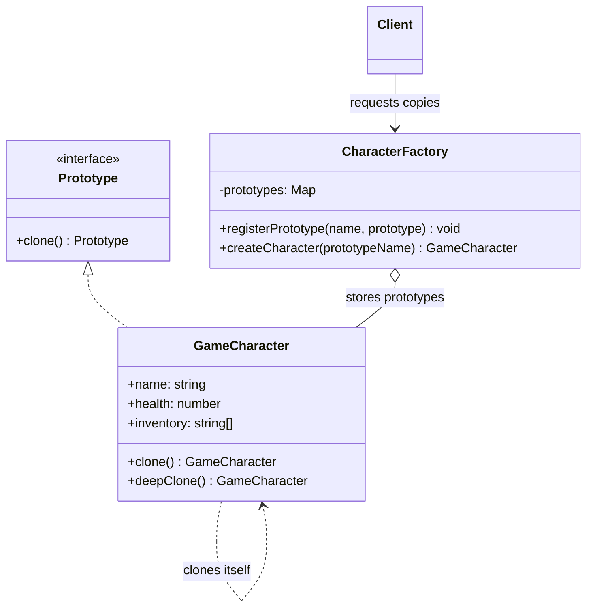

# Prototip andozasi (Prototype)

<CoverImage src="/covers/creational/prototype.webp" alt="Cover">
  <h1>Prototip</h1>
  <p>O'yinqaroq, futuristik klonlash mashinasi: unga bitta asl yashil shilimshiq maxluq kiradi, novlardan esa endigina chiqqan bir xil yashil shilimshiq klonlar qatori chiqib keladi.</p>
</CoverImage>

## Umumiy ko'rinish (Overview)

**Prototip (Prototype)** andozasi yaratuvchi (creational) loyihalash andozasi bo'lib, yangi obyektlarni noldan yaratish o'rniga mavjud obyektdan (prototipdan) nusxa olish orqali yaratish imkonini beradi. Asosiy masala — **sayoz nusxa (shallow copy)** (havolalarni nusxalaydi) va **chuqur nusxa (deep copy)** (ichki obyektlarni ham nusxalaydi) o'rtasidagi farqni ajrata bilish.

**Asosiy afzallik**: Initsializatsiya qimmat bo'lganda obyektlarni tezroq yaratish hamda murakkab konstruktor mantig'ini olib tashlash orqali obyekt yaratishni soddalashtirish.

**Zamonaviy nuqtai nazar**: Ko'pincha quyidagilar bilan almashtiriladi:

- Freymvorklarga o'rnatilgan obyekt klonlash mexanizmlari
- Copy-on-write ga ega o'zgarmas (immutable) ma'lumotlar tuzilmalari
- Serializatsiya/deserializatsiya kutubxonalari
- Oldindan sozlangan instansiyalarga ega Fabrika andozalari

Shunga qaramay, Prototip obyektni initsializatsiya qilish qimmat bo'lgan, unumdorlik muhim bo'lgan holatlarda qimmatli bo'lib qoladi.

## Hayotiy o'xshatish (Real-World Analogy)

**Hujjatdan nusxa ko'chirishni (fotonusxa)** tasavvur qiling:

- Asl hujjat: Prototip
- Nusxa ko'chirish mashinasi: Klonlash mexanizmi
- Fotonusxa: Xuddi shunday tuzilishga ega yangi obyekt

Agar asl hujjatda qog'oz qisqich bo'lsa, sayoz nusxa oluvchi mashina havolani nusxalaydi (ikkala hujjat bitta qisqichni bo'lishadi). Chuqur nusxa oluvchi mashina esa nusxa uchun alohida qisqich yaratadi.

## Tuzilma (Structure)



- **`Prototype`** `clone()` operatsiyasini e'lon qiladi (kod misollarida umumlashgan `Prototype<T>`).
- **`GameCharacter`** (Konkret prototip) o'z holatini nusxalash uchun `clone()` (sayoz) va `deepClone()` (chuqur) metodlarini amalga oshiradi.
- **`CharacterFactory`** (Prototiplar reyestri) oldindan sozlangan prototiplarni nom bo'yicha saqlaydi va so'rov bo'yicha ularning klonlarini qaytaradi.
- **`Client`** yangi obyektlarni konstruktorlarni to'g'ridan-to'g'ri chaqirish o'rniga klonlash orqali oladi.

## Muammo (Problem)

Ba'zi obyektlarni noldan yaratish qimmatga tushadi:

### Ssenariy: Qimmat obyekt initsializatsiyasi

```typescript
// ❌ Muammo: Obyektlarni yaratish qimmat
class Document {
  private content: string;
  private metadata: Map<string, any>;
  private styles: StyleSheet;

  constructor(path: string) {
    // Qimmat operatsiyalar:
    // - XML faylni tahlil qilish (100ms)
    // - Barcha bog'langan stil jadvallarini yuklash (200ms)
    // - Obyektlar grafini qurish (150ms)
    // - Jami: har bir hujjat uchun ~450ms

    this.parseXML(path); // Sekin
    this.loadStylesheets(); // Sekin
    this.buildObjectGraph(); // Sekin
  }
}

// 1000 ta o'xshash hujjat yaratish = 450,000ms = 7.5 daqiqa!
const documents = Array(1000)
  .fill(null)
  .map(() => new Document("template.xml"));
```

### Ssenariy: Murakkab obyekt holati

```typescript
// ❌ Muammo: Murakkab holatni takrorlash xatolarga moyil
class GameCharacter {
  public health: number = 100;
  public mana: number = 50;
  public inventory: Item[] = [];
  public equipment: Equipment = new Equipment();
  public stats: Stats = new Stats();
  public buffs: Buff[] = [];

  constructor() {
    // Qo'lda initsializatsiya qilish zerikarli va xatolarga moyil
  }
}

// Variantlar yaratish butun holatni qo'lda nusxalashni anglatadi
```

## Yechim (Solution)

Prototip andozasi buni quyidagicha hal qiladi:

1. **Obyektlarni klonlanadigan deb belgilash** (Clone/Copy interfeysini amalga oshirish)
2. **Nusxa yaratadigan clone() metodini taqdim etish**
3. Har bir maydon uchun **chuqur va sayoz nusxalashni** to'g'ri boshqarish
4. Tezkor kirish uchun **prototiplarni ro'yxatdan o'tkazish**

```typescript
// ✅ Yechim: Qayta yaratish o'rniga klonlash
interface Prototype<T> {
  clone(): T;
}

class Document implements Prototype<Document> {
  private content: string;
  private metadata: Map<string, any>;
  private styles: StyleSheet;

  clone(): Document {
    // Nusxalash tez - mavjud ma'lumotlarga havola qiladi
    const copy = new Document();
    copy.content = this.content;
    copy.metadata = new Map(this.metadata); // Chuqur nusxa
    copy.styles = this.styles; // Umumiy havola
    return copy;
  }
}

// Shablondan 1000 ta hujjat yaratish = ~5ms!
const template = new Document("template.xml"); // Bir martalik qimmat initsializatsiya
const documents = Array(1000)
  .fill(null)
  .map(() => template.clone()); // Tez!
```

## Amalga oshirish (Implementation)

::: code-group

```typescript [TypeScript]
// Prototype interfeysi
interface Prototype<T> {
  clone(): T;
}

// Konkret prototip
class GameCharacter implements Prototype<GameCharacter> {
  public name: string;
  public health: number;
  public mana: number;
  public inventory: string[];
  public skills: Map<string, number>;

  constructor(
    name: string,
    health: number,
    mana: number,
    inventory: string[],
    skills: Map<string, number>,
  ) {
    this.name = name;
    this.health = health;
    this.mana = mana;
    this.inventory = inventory;
    this.skills = skills;
  }

  // Sayoz nusxa - havolalar umumiy
  clone(): GameCharacter {
    return new GameCharacter(
      this.name,
      this.health,
      this.mana,
      this.inventory,
      this.skills,
    );
  }

  // Chuqur nusxa - ichki obyektlar ham nusxalanadi
  deepClone(): GameCharacter {
    return new GameCharacter(
      this.name,
      this.health,
      this.mana,
      [...this.inventory], // Massivni nusxalash
      new Map(this.skills), // Map ni nusxalash
    );
  }

  takeDamage(amount: number): void {
    this.health = Math.max(0, this.health - amount);
  }
}

// Prototiplar reyestri
class CharacterFactory {
  private prototypes: Map<string, GameCharacter> = new Map();

  registerPrototype(name: string, prototype: GameCharacter): void {
    this.prototypes.set(name, prototype);
  }

  createCharacter(prototypeName: string): GameCharacter {
    const prototype = this.prototypes.get(prototypeName);
    if (!prototype) throw new Error(`Unknown prototype: ${prototypeName}`);
    return prototype.deepClone();
  }
}

// Foydalanish
const warrior = new GameCharacter(
  "Warrior",
  150,
  20,
  ["sword"],
  new Map([
    ["strength", 18],
    ["constitution", 16],
  ]),
);

const factory = new CharacterFactory();
factory.registerPrototype("warrior", warrior);

const player1 = factory.createCharacter("warrior");
const player2 = factory.createCharacter("warrior");

player1.takeDamage(30);
console.log(`Player 1 health: ${player1.health}`); // 120
console.log(`Player 2 health: ${player2.health}`); // 150 - ta'sirlanmagan!
```

```python [Python]
from abc import ABC, abstractmethod
from typing import Dict, List
import copy

class Prototype(ABC):
    @abstractmethod
    def clone(self) -> "Prototype":
        pass

class GameCharacter(Prototype):
    def __init__(
        self,
        name: str,
        health: int,
        mana: int,
        inventory: List[str],
        skills: Dict[str, int]
    ):
        self.name = name
        self.health = health
        self.mana = mana
        self.inventory = inventory
        self.skills = skills

    def clone(self) -> "GameCharacter":
        """Sayoz nusxa"""
        return GameCharacter(
            self.name,
            self.health,
            self.mana,
            self.inventory,
            self.skills
        )

    def deep_clone(self) -> "GameCharacter":
        """copy moduli yordamida chuqur nusxa"""
        return copy.deepcopy(self)

    def take_damage(self, amount: int) -> None:
        self.health = max(0, self.health - amount)

    def __repr__(self) -> str:
        return (f"GameCharacter(name={self.name}, "
                f"health={self.health}, mana={self.mana})")

class CharacterFactory:
    def __init__(self):
        self._prototypes: Dict[str, GameCharacter] = {}

    def register_prototype(self, name: str, prototype: GameCharacter) -> None:
        self._prototypes[name] = prototype

    def create_character(self, prototype_name: str) -> GameCharacter:
        prototype = self._prototypes.get(prototype_name)
        if not prototype:
            raise ValueError(f"Unknown prototype: {prototype_name}")
        return prototype.deep_clone()

# Foydalanish
warrior = GameCharacter(
    "Warrior",
    health=150,
    mana=20,
    inventory=["sword", "shield"],
    skills={"strength": 18, "constitution": 16}
)

factory = CharacterFactory()
factory.register_prototype("warrior", warrior)

player1 = factory.create_character("warrior")
player2 = factory.create_character("warrior")

player1.take_damage(30)
print(f"Player 1: {player1}")  # health=120
print(f"Player 2: {player2}")  # health=150
```

```java [Java]
import java.util.*;

interface Prototype extends Cloneable {
    Prototype clone();
}

class GameCharacter implements Prototype {
    private String name;
    private int health;
    private int mana;
    private List<String> inventory;
    private Map<String, Integer> skills;

    public GameCharacter(String name, int health, int mana,
                        List<String> inventory, Map<String, Integer> skills) {
        this.name = name;
        this.health = health;
        this.mana = mana;
        this.inventory = inventory;
        this.skills = skills;
    }

    @Override
    public GameCharacter clone() {
        try {
            GameCharacter cloned = (GameCharacter) super.clone();
            // O'zgaruvchan maydonlarni chuqur nusxalash
            cloned.inventory = new ArrayList<>(this.inventory);
            cloned.skills = new HashMap<>(this.skills);
            return cloned;
        } catch (CloneNotSupportedException e) {
            throw new RuntimeException(e);
        }
    }

    public void takeDamage(int amount) {
        this.health = Math.max(0, this.health - amount);
    }

    @Override
    public String toString() {
        return String.format("GameCharacter{name='%s', health=%d, mana=%d}",
            name, health, mana);
    }
}

class CharacterFactory {
    private Map<String, GameCharacter> prototypes = new HashMap<>();

    public void registerPrototype(String name, GameCharacter prototype) {
        this.prototypes.put(name, prototype);
    }

    public GameCharacter createCharacter(String prototypeName) {
        GameCharacter prototype = prototypes.get(prototypeName);
        if (prototype == null) {
            throw new IllegalArgumentException(
                "Unknown prototype: " + prototypeName
            );
        }
        return prototype.clone();
    }
}

// Foydalanish
public class PrototypeExample {
    public static void main(String[] args) {
        GameCharacter warrior = new GameCharacter(
            "Warrior", 150, 20,
            new ArrayList<>(Arrays.asList("sword", "shield")),
            new HashMap<>(Map.of("strength", 18, "constitution", 16))
        );

        CharacterFactory factory = new CharacterFactory();
        factory.registerPrototype("warrior", warrior);

        GameCharacter player1 = factory.createCharacter("warrior");
        GameCharacter player2 = factory.createCharacter("warrior");

        player1.takeDamage(30);
        System.out.println(player1); // health=120
        System.out.println(player2); // health=150
    }
}
```

```go [Go]
package main

type Prototype interface {
    Clone() Prototype
}

type GameCharacter struct {
    Name      string
    Health    int
    Mana      int
    Inventory []string
    Skills    map[string]int
}

func (g *GameCharacter) Clone() Prototype {
    // Sayoz nusxa
    clone := *g
    return &clone
}

func (g *GameCharacter) DeepClone() *GameCharacter {
    // Chuqur nusxa
    clone := &GameCharacter{
        Name:   g.Name,
        Health: g.Health,
        Mana:   g.Mana,
        Skills: make(map[string]int),
    }

    // Inventarni nusxalash
    clone.Inventory = make([]string, len(g.Inventory))
    copy(clone.Inventory, g.Inventory)

    // Ko'nikmalarni nusxalash
    for k, v := range g.Skills {
        clone.Skills[k] = v
    }

    return clone
}

func (g *GameCharacter) TakeDamage(amount int) {
    g.Health -= amount
    if g.Health < 0 {
        g.Health = 0
    }
}

type CharacterFactory struct {
    prototypes map[string]*GameCharacter
}

func NewCharacterFactory() *CharacterFactory {
    return &CharacterFactory{
        prototypes: make(map[string]*GameCharacter),
    }
}

func (cf *CharacterFactory) RegisterPrototype(name string,
                                             prototype *GameCharacter) {
    cf.prototypes[name] = prototype
}

func (cf *CharacterFactory) CreateCharacter(name string) *GameCharacter {
    prototype, exists := cf.prototypes[name]
    if !exists {
        panic("Unknown prototype: " + name)
    }
    return prototype.DeepClone()
}
```

```rust [Rust]
use std::collections::HashMap;

trait Prototype {
    fn clone_prototype(&self) -> Box<dyn Prototype>;
}

#[derive(Clone, Debug)]
pub struct GameCharacter {
    pub name: String,
    pub health: i32,
    pub mana: i32,
    pub inventory: Vec<String>,
    pub skills: HashMap<String, i32>,
}

impl Prototype for GameCharacter {
    fn clone_prototype(&self) -> Box<dyn Prototype> {
        Box::new(self.clone())
    }
}

impl GameCharacter {
    pub fn new(
        name: String,
        health: i32,
        mana: i32,
        inventory: Vec<String>,
        skills: HashMap<String, i32>,
    ) -> Self {
        GameCharacter {
            name,
            health,
            mana,
            inventory,
            skills,
        }
    }

    pub fn take_damage(&mut self, amount: i32) {
        self.health = (self.health - amount).max(0);
    }
}

pub struct CharacterFactory {
    prototypes: HashMap<String, GameCharacter>,
}

impl CharacterFactory {
    pub fn new() -> Self {
        CharacterFactory {
            prototypes: HashMap::new(),
        }
    }

    pub fn register_prototype(&mut self, name: String, prototype: GameCharacter) {
        self.prototypes.insert(name, prototype);
    }

    pub fn create_character(&self, prototype_name: &str) -> GameCharacter {
        self.prototypes
            .get(prototype_name)
            .cloned()
            .expect(&format!("Unknown prototype: {}", prototype_name))
    }
}

fn main() {
    let mut skills = HashMap::new();
    skills.insert("strength".to_string(), 18);
    skills.insert("constitution".to_string(), 16);

    let warrior = GameCharacter::new(
        "Warrior".to_string(),
        150,
        20,
        vec!["sword".to_string(), "shield".to_string()],
        skills,
    );

    let mut factory = CharacterFactory::new();
    factory.register_prototype("warrior".to_string(), warrior);

    let mut player1 = factory.create_character("warrior");
    let player2 = factory.create_character("warrior");

    player1.take_damage(30);
    println!("Player 1: {:?}", player1); // health=120
    println!("Player 2: {:?}", player2); // health=150
}
```

:::

## Real hayotdagi misol: Hujjat shablonlarini klonlash

Hujjatlarni noldan yaratish qimmat, mavjud shablonlarni klonlash esa tez bo'lgan hujjat shablonlari tizimi:

```typescript
class DocumentTemplate {
  private templateId: string;
  private content: string;
  private styles: CSSStyleSheet;
  private metadata: DocumentMetadata;
  private assets: Map<string, ArrayBuffer>; // Rasmlar, shriftlar va h.k.

  constructor(templateId: string) {
    this.templateId = templateId;
    // Qimmat initsializatsiya: fayllarni yuklash, CSS ni tahlil qilish, resurslarni keshlash (~500ms)
    this.loadFromDisk(templateId);
  }

  // Chuqur klon - to'liq mustaqil nusxa
  clone(): DocumentTemplate {
    const cloned = Object.create(Object.getPrototypeOf(this));
    cloned.templateId = this.templateId;
    cloned.content = this.content; // String o'zgarmas (immutable)
    cloned.styles = this.styles.cloneNode(true); // CSS ni chuqur nusxalash
    cloned.metadata = { ...this.metadata }; // Metama'lumotlarni nusxalash
    cloned.assets = new Map(this.assets); // Resurs havolalarini nusxalash
    return cloned;
  }

  public setContent(newContent: string): void {
    this.content = newContent;
  }

  private loadFromDisk(id: string): void {
    // Qimmat I/O ni simulyatsiya qilish
  }
}

// Foydalanish
const templateLoader = {
  _templates: new Map<string, DocumentTemplate>(),

  loadTemplate(id: string): DocumentTemplate {
    if (!this._templates.has(id)) {
      // Birinchi yuklash qimmat (~500ms)
      this._templates.set(id, new DocumentTemplate(id));
    }
    return this._templates.get(id)!;
  },

  createDocumentFromTemplate(templateId: string): DocumentTemplate {
    const template = this.loadTemplate(templateId);
    // Klonlash tez (~1ms)
    return template.clone();
  },
};

// Shablondan 100 ta hujjat yaratish
const startTime = Date.now();
const documents = Array(100)
  .fill(null)
  .map(() => templateLoader.createDocumentFromTemplate("invoice"));
console.log(`Created 100 documents in ${Date.now() - startTime}ms`); // ~100ms
// Klonlashsiz: 100 * 500ms = 50,000ms!
```

## Sayoz va chuqur nusxa (Shallow vs. Deep Copy)

Har birini qachon ishlatishni tushunish juda muhim:

| Jihat                       | Sayoz nusxa                     | Chuqur nusxa                      |
| --------------------------- | ------------------------------- | --------------------------------- |
| **Primitiv qiymatlar**      | Nusxalanadi                     | Nusxalanadi                       |
| **Havolalar**               | Umumiy ko'rsatkich (pointer)    | Obyektning yangi nusxasi          |
| **Ichki obyektlar**         | Bitta instansiya                | Mustaqil instansiyalar            |
| **Unumdorlik**              | Juda tez                        | Sekinroq                          |
| **Xotira**                  | Kamroq xotira                   | Ko'proq xotira                    |
| **Qo'llanilishi**           | Faqat o'zgarmas maydonlar uchun | Murakkab ichma-ich tuzilmalar     |

```typescript
// Misol: Sayoz va chuqur nusxa
class Person {
  constructor(
    public name: string,
    public address: Address,
  ) {}

  shallowClone(): Person {
    return new Person(this.name, this.address); // address umumiy!
  }

  deepClone(): Person {
    return new Person(
      this.name,
      new Address(this.address.street, this.address.city),
    );
  }
}

const alice = new Person("Alice", new Address("123 Main St", "NYC"));
const aliceShallow = alice.shallowClone();
const aliceDeep = alice.deepClone();

// Manzilni o'zgartirish
alice.address.city = "Boston";

console.log(aliceShallow.address.city); // "Boston" - ta'sirlangan!
console.log(aliceDeep.address.city); // "NYC" - mustaqil
```

## Afzalliklari va kamchiliklari

### ✅ Afzalliklari

- **Unumdorlik**: Klonlash murakkab initsializatsiyadan ancha tezroq
- **Moslashuvchanlik**: Shablonlardan variantlarni samarali yaratish
- **Kamaytirilgan initsializatsiya**: Qimmat sozlash har bir obyekt uchun emas, bir marta bajariladi
- **Inkapsulyatsiya**: Klonlash mantig'i prototipning ichida joylashgan
- **Merosga muqobil**: Xatti-harakatni bo'lishish uchun kompozitsiyadan foydalaniladi
- **Kamaytirilgan bog'liqlik (coupling)**: Obyektlarga murakkab konstruktorlar kerak emas

### ❌ Kamchiliklari

- **Murakkablik**: Sayoz va chuqur nusxalashni to'g'ri boshqarish shart
- **Xotira sarfi**: Chuqur klonlash ma'lumotlarni takrorlaydi (ko'proq xotira)
- **Sayoz nusxa xatolari**: O'zgaruvchan (mutable) holatni tasodifan bo'lishib qo'yish oson
- **Aylanma havolalar (circular references)**: Chuqur klonlashda cheksiz sikllarga olib kelishi mumkin
- **Unumdorlik xarajati**: Katta graflar uchun chuqur klonlash sekin bo'lishi mumkin
- **Platformaga bog'liqlik**: Klonlash semantikasi tilga qarab farqlanadi

## Variantlar (Variations)

### 1. Serializatsiyaga asoslangan klonlash

```typescript
// Serializatsiya orqali klonlash (murakkab graflarni ham qamrab oladi)
function deepCloneViaSerialization<T>(obj: T): T {
  return JSON.parse(JSON.stringify(obj));
}

const cloned = deepCloneViaSerialization(character);
```

### 2. Prototiplar reyestri (Prototype Registry)

Nom bo'yicha mavjud bo'lgan oldindan sozlangan prototiplar (misollarda ko'rsatilganidek).

## Qachon ishlatish kerak

- Initsializatsiyasi qimmat bo'lgan murakkab obyektlar
- Ko'plab o'xshash obyektlarni yaratish
- Asosiy obyektning variantlari kerak bo'lganda
- Unumdorlik muhim bo'lgan obyekt yaratish
- Konstruktor murakkabligidan qochmoqchi bo'lganda

## Qachon ishlatmaslik kerak

- Yaratilishi arzon bo'lgan oddiy obyektlar
- Faqat bir nechta obyekt yaratilganda
- Sayoz nusxa semantikasi noaniq bo'lganda
- Obyektlar grafida aylanma havolalar mavjud bo'lganda
- O'zgarmas (immutable) ma'lumotlar tuzilmasi yaxshiroq mos kelganda

## Keng tarqalgan xatolar (Common Mistakes)

### ❌ Xato 1: O'zgaruvchan maydonlarning sayoz nusxasi

```typescript
// ❌ Yomon: Umumiy o'zgaruvchan holat
class Team {
  constructor(public members: string[]) {}

  clone(): Team {
    return new Team(this.members); // Massivni bo'lishadi!
  }
}

const team1 = new Team(["Alice", "Bob"]);
const team2 = team1.clone();
team2.members.push("Charlie");
console.log(team1.members); // ["Alice", "Bob", "Charlie"] - ta'sirlangan!

// ✅ Yaxshi: O'zgaruvchan maydonlarni chuqur nusxalash
class Team {
  clone(): Team {
    return new Team([...this.members]); // Yangi massiv
  }
}
```

### ❌ Xato 2: Aylanma havolalarni unutish

```typescript
// ❌ Yomon: Aylanma havolalarda cheksiz sikl
function deepClone(obj: any): any {
  if (typeof obj !== "object") return obj;
  const copy = {};
  for (const key in obj) {
    copy[key] = deepClone(obj[key]); // Aylanma bo'lsa cheksiz!
  }
  return copy;
}

// ✅ Yaxshi: Tashrif buyurilgan obyektlarni kuzatish
function deepClone(obj: any, visited = new WeakSet()): any {
  if (typeof obj !== "object" || visited.has(obj)) return obj;
  visited.add(obj);
  const copy = Array.isArray(obj) ? [] : {};
  for (const key in obj) {
    copy[key] = deepClone(obj[key], visited);
  }
  return copy;
}
```

### ❌ Xato 3: Turlarni to'g'ri boshqarmasdan klonlash

```typescript
// ❌ Yomon: Tur ma'lumoti yo'qoladi
const cloned = JSON.parse(JSON.stringify(obj));
// Metodlar yo'qoladi, Date string ga aylanadi va h.k.

// ✅ Yaxshi: Turlarni saqlab qolish
class Item {
  constructor(
    public id: string,
    public created: Date,
  ) {}

  clone(): Item {
    return new Item(
      this.id,
      new Date(this.created), // Date turini saqlab qolish
    );
  }
}
```

### ❌ Xato 4: Ish vaqtida qimmat klonlash

```typescript
// ❌ Yomon: Zich siklda klonlash
for (let i = 0; i < 10000; i++) {
  const copy = template.deepClone(); // Qimmat!
}

// ✅ Yaxshi: Bir marta klonlab, qayta ishlatish
const baseConfig = template.deepClone();
for (let i = 0; i < 10000; i++) {
  process(baseConfig);
}
```

## Bog'liq andozalar (Related Patterns)

- **Fabrika metodi (Factory Method)**: Obyekt yaratish uchun ko'pincha Prototiplar reyestri bilan birga ishlatiladi
- **Quruvchi (Builder)**: Murakkab obyektlarni qurish uchun muqobil
- **Abstrakt fabrika (Abstract Factory)**: Prototip obyektlarni taqdim etish uchun Prototip andozasi ishlatilishi mumkin
- **Singleton**: Prototip Singleton instansiyasini o'z ichiga olishi mumkin

## Zamonaviy muqobillar

### Til imkoniyatlari

- **JavaScript/TypeScript**: `structuredClone()` API (serializatsiyasiz chuqur nusxa)
- **Python**: `copy.deepcopy()` moduli
- **Java**: `clone()` interfeysi yoki konstruktorlardan foydalanish
- **Rust**: `Clone` trait va `derive(Clone)`
- **Go**: Qo'lda yozilgan nusxalash funksiyalari

### Freymvorklar

- **Serializatsiya kutubxonalari**: Protocol Buffers, MessagePack
- **ORM freymvorklari**: O'rnatilgan entity klonlash
- **O'zgarmas ma'lumotlar tuzilmalari**: Avtomatik ravishda samarali nusxalar
- **Copy-on-write**: Chuqur nusxalashni o'zgartirish sodir bo'lgunga qadar kechiktirish

## Intervyu savollari (Interview Insights)

**S1: Sayoz va chuqur nusxa o'rtasidagi farq nima?**

J: Sayoz nusxa obyektni va primitiv qiymatlarni nusxalaydi, lekin ichki obyektlarga havolalar umumiy bo'lib qoladi. Chuqur nusxa esa hamma narsani, jumladan ichki obyektlarni ham rekursiv ravishda nusxalaydi. Sayoz nusxa tez, ammo o'zgaruvchan maydonlar bilan xavfli; chuqur nusxa xavfsiz, lekin sekinroq.

**S2: Qachon Fabrika o'rniga Prototip ishlatgan bo'lardingiz?**

J: Prototip obyekt initsializatsiyasi qimmat bo'lganda eng yaxshi tanlov. Xarajatni prototipni yaratishda bir marta to'laysiz, so'ngra arzonga klonlaysiz. Fabrika esa oddiy tarzda quriladigan obyektlarni yaratish uchun yaxshiroq.

**S3: Klonlashda aylanma havolalarni qanday boshqarasiz?**

J: Tashrif buyurilgan obyektlarni Set/Map yordamida kuzatib borasiz. Allaqachon ko'rilgan obyektga duch kelganingizda, rekursiyaga kirish o'rniga havolani qaytarasiz. Bu cheksiz sikllarning oldini oladi.

**S4: Prototip andozasi zamonaviy tillarda hali ham dolzarbmi?**

J: Zamonaviy imkoniyatlar (nomlangan parametrlar, o'zgarmas tuzilmalar, serializatsiya kutubxonalari) tufayli kamroq dolzarb. Lekin initsializatsiya qimmat bo'lgan, unumdorlik muhim ssenariylarda hali ham qimmatli.

**S5: Prototip andozasi Object.create() bilan qanday bog'liq?**

J: JavaScript'dagi `Object.create()` belgilangan prototip obyektga ega obyekt yaratadi. Bu Prototip andozasi g'oyasining til darajasidagi amalga oshirilishidir.

**S6: Prototip va nusxa konstruktori (copy constructor) o'rtasidagi farq nima?**

J: Ikkalasi ham nusxa yaratadi, lekin Prototip tilga bog'liq emas va polimorf bo'lishi mumkin. Nusxa konstruktori esa tilga xos (C++, Java) bo'lib, to'g'ridan-to'g'ri maxsus konstruktorni chaqiradi.
