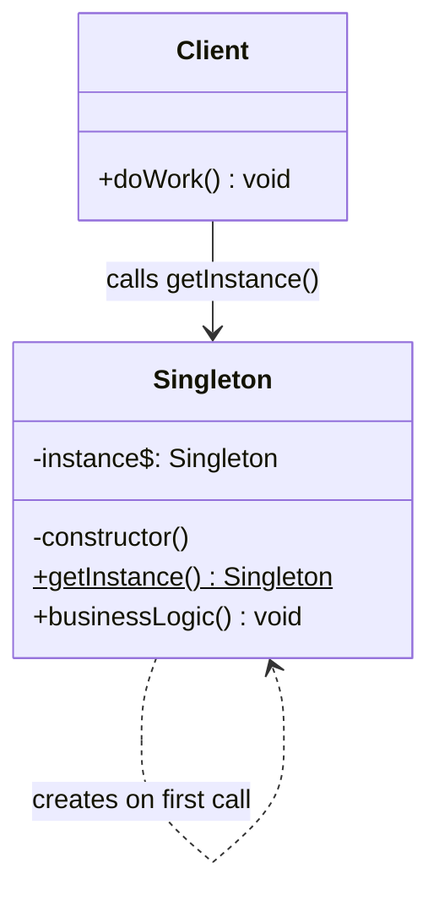
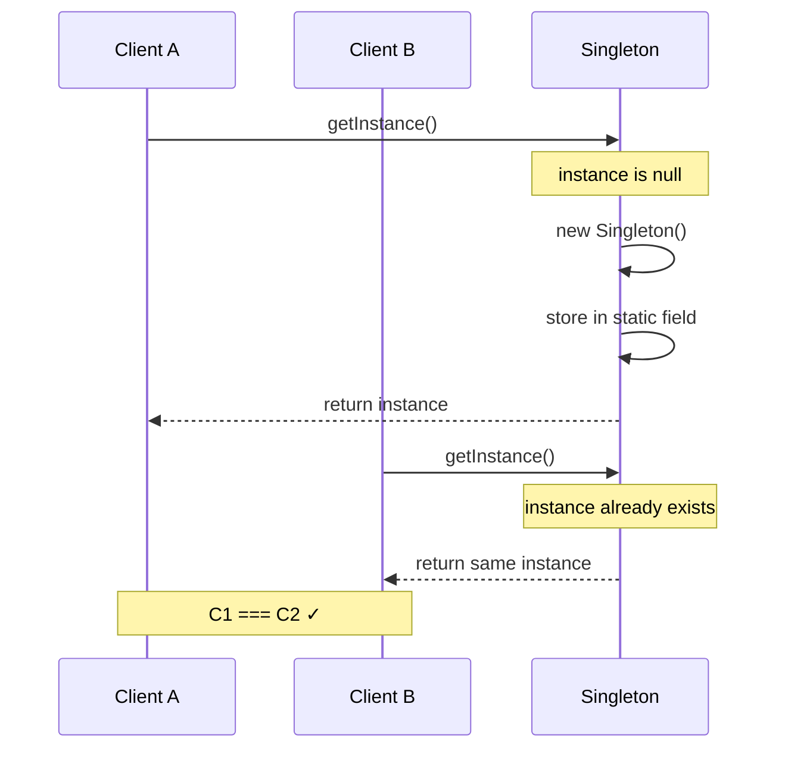
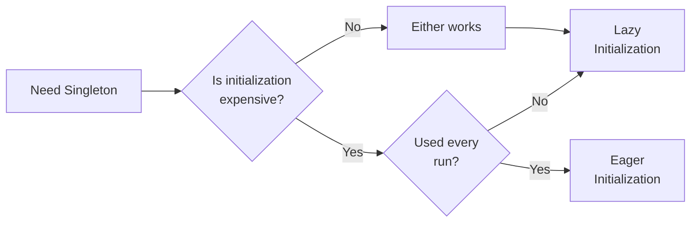
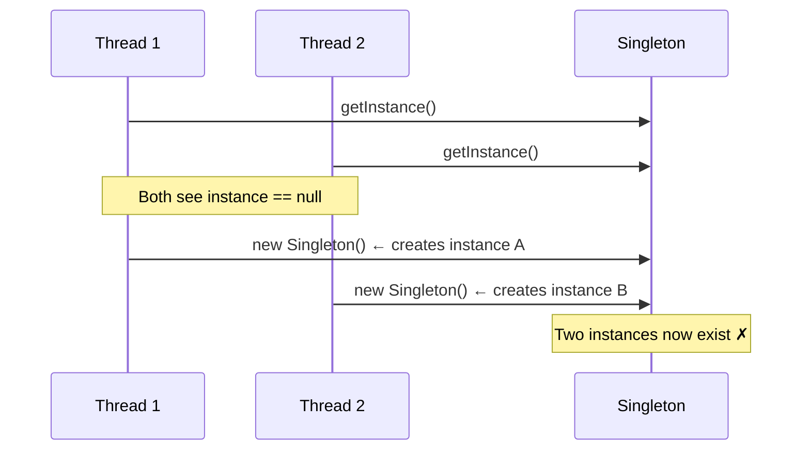
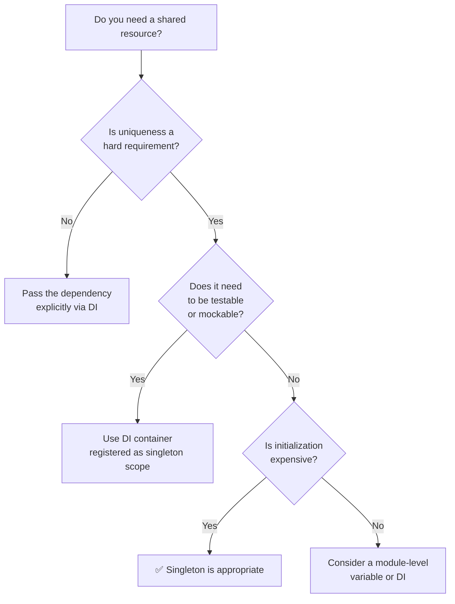

# Singleton andozasi

<CoverImage src="/covers/creational/singleton.webp" alt="Cover">
  <h1>Singleton</h1>
  <p>Oddiy oq tuxumlar qutisi ichida turgan bitta ulkan oltin tuxum — uni qo'lida fonarchasi bor kichkina, yoqimtoy qo'riqchi robot qo'riqlamoqda.</p>
</CoverImage>

## Umumiy ko'rinish (Overview)

**Singleton** andozasi klassning aynan bitta instansiyasi bo'lishini ta'minlaydi va unga global kirish nuqtasini taqdim etadi. Bu tushunish eng oson andozalardan biri va shu bilan birga noto'g'ri ishlatish eng oson bo'lgan andozalardan biridir.

Singleton bir vaqtning o'zida ikkita muammoni hal qiladi — bu o'z-o'zidan ogohlantiruvchi belgi:

1. **Nazorat qilinadigan instansiya yaratish (controlled instantiation)**: Har doim faqat bitta instansiya mavjud bo'ladi, bu resurslarning takrorlanishi yoki nomuvofiq holatning (state) oldini oladi.
2. **Global kirish (global access)**: Tizimning istalgan qismi instansiyani konstruktorlar yoki funksiya argumentlari orqali uzatmasdan unga murojaat qila oladi.

Muammolarning aksariyati aynan ikkinchi banddan kelib chiqadi. Global kirish qulay, lekin u bog'liqliklarni yashiradi va testlashni sezilarli darajada qiyinlashtiradi. Ko'pgina zamonaviy kod bazalarida bog'liqliklarni kiritish (Dependency Injection, DI) yaxshiroq mos keladi. Singleton'dan faqat yagonalik haqiqiy arxitektura talabi bo'lganda foydalaning — shunchaki qulay yorliq (shortcut) sifatida emas.

## Hayotiy o'xshatish (Real-World Analogy)

Mamlakatning bitta rasmiy poytaxti bor. Davlat ishlariga murojaat qilishi kerak bo'lgan har bir muassasa aynan shu shaharni ko'rsatadi — hech qanday noaniqlik ham, takrorlanish ham yo'q, ikkinchi poytaxt yaratish esa tartibsizlikka olib keladi. Poytaxt amalda singleton hisoblanadi.

Lekin e'tibor bering: muassasalar har bir ichki hujjatga "Vashington" deb qattiq yozib qo'ymaydi. Ular uni parametr, konfiguratsiya qiymati yoki bog'liqlik (dependency) sifatida qabul qiladi. _Tushuncha_ yagona. _Havola_ esa kerakli joyga baribir aniq (explicit) uzatiladi.

Mana shu farq — narsaning yagona bo'lishi va unga global murojaat qilinishi o'rtasidagi farq — Singleton andozasining asosiy ziddiyatidir.

## Tuzilma (Structure)



### Ishtirokchilar (Participants)

| Ishtirokchi | Vazifasi                                                                                                                                                           |
| ----------- | ------------------------------------------------------------------------------------------------------------------------------------------------------------------ |
| `Singleton` | Statik `getInstance()` metodini e'lon qiladi va private statik `instance` maydoniga egalik qiladi. Konstruktor private bo'lib, tashqaridan instansiya yaratishning oldini oladi. |
| `Client`    | Instansiyaga faqat `getInstance()` orqali murojaat qiladi. Hech qachon `new Singleton()` ni to'g'ridan-to'g'ri chaqirmaydi.                                         |

## Muammo (Problem)

Nazorat qilinadigan instansiya yaratish bo'lmasa, mustaqil kod yo'llari bir xil konseptual resursning alohida instansiyalarini yaratishi mumkin — bu nomuvofiq holatga, resurslarning tugab qolishiga yoki parallellik (concurrency) xatolariga olib keladi.

### Nomuvofiq holat (Inconsistent State)

```typescript
// ❌ Ikki modul konfiguratsiyani mustaqil yuklaydi
const config1 = new AppConfig();
const config2 = new AppConfig();

config1.set("theme", "dark");
console.log(config2.get("theme")); // "light" — sinxron emas
```

### Resurslarning tugab qolishi (Resource Exhaustion)

```typescript
// ❌ Har bir modul o'z pool'ini yaratadi
const pool1 = new ConnectionPool(10); // 10 ta ulanish
const pool2 = new ConnectionPool(10); // yana 10 ta
// Tizim 10 taga mo'ljallangan, lekin endi 20 ta ulanishni ushlab turibdi
```

Ikkala muammoning ildizi bir xil: obyektni yaratishni chaqiruvchi kod boshqaradi, shuning uchun yagonalikni hech narsa majburlamaydi.

## Yechim (Solution)

Obyekt yaratish nazoratini klassning o'ziga o'tkazing:

1. Konstruktorni **private** qiling — tashqaridagi hech narsa `new` ni chaqira olmaydi.
2. Instansiyani **private statik maydonda** saqlang.
3. **Public statik `getInstance()` metodini** taqdim eting: u birinchi chaqiruvda instansiyani yaratadi va keyingi har bir chaqiruvda keshlangan instansiyani qaytaradi.

```typescript
// ✅ Bitta ishonchli instansiya
const config1 = AppConfig.getInstance();
const config2 = AppConfig.getInstance();

config1.set("theme", "dark");
console.log(config2.get("theme")); // "dark" — muvofiq
console.log(config1 === config2); // true
```

## Lazy initialization qanday ishlaydi

`getInstance()` ning birinchi chaqiruvi obyektni yaratish xarajatini o'z zimmasiga oladi. Keyingi har bir chaqiruv mavjud instansiyani darhol qaytaradi.



## Amalga oshirish (Implementation)

### Asosiy qadamlar

1. Yagona instansiyani saqlash uchun **private statik maydon** qo'shing.
2. **Konstruktorni private** qiling.
3. Lazy initialization bilan **public statik `getInstance()` metodini** taqdim eting.
4. Barcha `new ClassName()` chaqiruvlarini `ClassName.getInstance()` bilan almashtiring.

::: code-group

```typescript [TypeScript]
/**
 * Lazy initialization — bir oqimli (single-threaded) JavaScript muhitlarida xavfsiz.
 */
class Database {
  private static instance: Database;
  private connected = false;

  private constructor() {
    console.log("Database: creating instance");
  }

  static getInstance(): Database {
    if (!Database.instance) {
      Database.instance = new Database();
      Database.instance.connect();
    }
    return Database.instance;
  }

  private connect(): void {
    this.connected = true;
    console.log("Database: connection established");
  }

  query(sql: string): void {
    if (!this.connected) throw new Error("Not connected");
    console.log(`Database: ${sql}`);
  }
}

// Foydalanish
const db1 = Database.getInstance(); // "creating instance" + "connection established"
const db2 = Database.getInstance(); // jim — allaqachon mavjud

console.log(db1 === db2); // true
db1.query("SELECT * FROM users");
```

```python [Python]
from threading import Lock

class SingletonMeta(type):
    """
    Thread-safe singleton metaklassi.
    Double-checked locking birinchi yaratilishdan keyin lock raqobatini kamaytiradi.
    """
    _instances = {}
    _lock: Lock = Lock()

    def __call__(cls, *args, **kwargs):
        if cls not in cls._instances:
            with cls._lock:
                if cls not in cls._instances:
                    instance = super().__call__(*args, **kwargs)
                    cls._instances[cls] = instance
        return cls._instances[cls]


class Database(metaclass=SingletonMeta):
    def __init__(self):
        self.connected = False
        print("Database: creating instance")
        self._connect()

    def _connect(self) -> None:
        self.connected = True
        print("Database: connection established")

    def query(self, sql: str) -> None:
        if not self.connected:
            raise RuntimeError("Not connected")
        print(f"Database: {sql}")


# Foydalanish
db1 = Database()  # "creating instance" + "connection established"
db2 = Database()  # jim

print(db1 is db2)  # True
db1.query("SELECT * FROM users")
```

```java [Java]
/**
 * Double-checked locking + volatile orqali thread-safe.
 * volatile barcha oqimlar to'liq initsializatsiya qilingan instansiyani ko'rishini ta'minlaydi.
 */
public final class Database {
    private static volatile Database instance;
    private boolean connected;

    private Database() {
        System.out.println("Database: creating instance");
        connect();
    }

    public static Database getInstance() {
        if (instance == null) {
            synchronized (Database.class) {
                if (instance == null) {
                    instance = new Database();
                }
            }
        }
        return instance;
    }

    private void connect() {
        connected = true;
        System.out.println("Database: connection established");
    }

    public void query(String sql) {
        if (!connected) throw new RuntimeException("Not connected");
        System.out.println("Database: " + sql);
    }
}
```

```go [Go]
package main

import (
    "fmt"
    "sync"
)

type Database struct {
    connected bool
}

var (
    instance *Database
    once     sync.Once
)

// GetInstance sync.Once orqali goroutine-safe.
func GetInstance() *Database {
    once.Do(func() {
        fmt.Println("Database: creating instance")
        instance = &Database{}
        instance.connect()
    })
    return instance
}

func (db *Database) connect() {
    db.connected = true
    fmt.Println("Database: connection established")
}

func (db *Database) Query(sql string) {
    if !db.connected {
        panic("not connected")
    }
    fmt.Printf("Database: %s\n", sql)
}
```

```rust [Rust]
use std::sync::{Arc, Mutex, OnceLock};

pub struct Database {
    connected: bool,
}

static INSTANCE: OnceLock<Arc<Mutex<Database>>> = OnceLock::new();

impl Database {
    /// Singleton instansiyasini qaytaradi. OnceLock orqali thread-safe.
    pub fn get() -> Arc<Mutex<Database>> {
        INSTANCE.get_or_init(|| {
            println!("Database: creating instance");
            let mut db = Database { connected: false };
            db.connect();
            Arc::new(Mutex::new(db))
        }).clone()
    }

    fn connect(&mut self) {
        self.connected = true;
        println!("Database: connection established");
    }

    pub fn query(&self, sql: &str) {
        if !self.connected { panic!("not connected"); }
        println!("Database: {}", sql);
    }
}
```

:::

## Lazy va Eager initialization



|                                     | Lazy                                                   | Eager                                             |
| ----------------------------------- | ------------------------------------------------------ | ------------------------------------------------- |
| **Qachon yaratiladi**               | `getInstance()` birinchi chaqirilganda                 | Klass yuklanayotganda                             |
| **Xotira**                          | Hech qachon ishlatilmasa, tejaladi                     | Har doim ajratiladi                               |
| **Thread xavfsizligi**              | Sinxronizatsiya talab qiladi                           | Tabiatan xavfsiz                                  |
| **Birinchi chaqiruv xarajati**      | Ha — initsializatsiya shu yerda bo'ladi                | Yo'q — allaqachon bajarilgan                      |
| **Eng mos keladi**                  | Kerak bo'lmasligi mumkin bo'lgan qimmat resurslar uchun | Yengil, har doim kerak bo'ladigan instansiyalar uchun |

### Lazy (eng keng tarqalgan)

```typescript
class Logger {
  private static instance: Logger;

  static getInstance(): Logger {
    if (!Logger.instance) {
      Logger.instance = new Logger();
    }
    return Logger.instance;
  }
}
```

### Eager

```typescript
class Logger {
  // Klass birinchi marta yuklanganda yaratiladi
  private static readonly instance: Logger = new Logger();

  static getInstance(): Logger {
    return Logger.instance;
  }
}
```

## Tillar bo'yicha thread xavfsizligi

JavaScript/TypeScript'da event loop bir oqimli — oddiy lazy initialization xavfsiz. Ko'p oqimli (multi-threaded) muhitlarda esa himoyalanmagan lazy initialization poyga holatini (race condition) yuzaga keltiradi: ikkita oqim ham `null` ni ko'radi va ikkalasi ham `new` ni chaqiradi.



Yechim tilga qarab farq qiladi. Quyidagi har bir idioma konstruktor aynan bir marta ishlashini kafolatlaydi:

| Til                 | Mexanizm                                 | Izohlar                                         |
| ------------------- | ---------------------------------------- | ----------------------------------------------- |
| **TypeScript / JS** | Oddiy `if (!instance)`                   | Xavfsiz — bir oqimli event loop                 |
| **Java**            | `volatile` + `synchronized` double-check | Standart enterprise yondashuvi                  |
| **Python**          | Metaklassda `threading.Lock`             | Ko'p oqimli ilovalar uchun kerak                |
| **Go**              | `sync.Once`                              | Idiomatik; qo'lda locking qilishdan toza        |
| **Rust**            | `OnceLock<T>` (std) yoki `Arc<Mutex<T>>` | Kompilyatsiya vaqtida majburlanadi              |

::: tip Go va Rust
`sync.Once` va `OnceLock` — har qanday mashhur tilda mavjud bo'lgan eng toza yechimlar. Agar Go yoki Rust'da Singleton'ga o'xshash initsializatsiya yozayotgan bo'lsangiz, qo'lda locking qilishga deyarli hech qanday sabab yo'q.
:::

## Singleton va statik klass

Keng tarqalgan chalkashlik: nega shunchaki statik metodlarga to'la klassdan foydalanmaslik kerak?

|                                    | Singleton                           | Statik klass                            |
| ---------------------------------- | ----------------------------------- | --------------------------------------- |
| **Holatga ega**                    | Ha — instansiyada saqlanadi         | Yo'q — yoki faqat statik maydonlarda    |
| **Interfeyslarni amalga oshira oladi** | Ha                              | Yo'q (ko'pgina tillarda)                |
| **Undan meros olish mumkin**       | Ha                                  | Kamdan-kam                              |
| **Lazy initialization**            | Ha                                  | Tilga bog'liq                           |
| **Testlanadi / mock qilinadi**     | Biroz harakat bilan (pastga qarang) | Qiyinroq                                |
| **Eng mos keladi**                 | Holatli umumiy resurslar uchun      | Holatsiz yordamchi vositalar uchun      |

Sof yordamchi vositalar (matematik yordamchilar, formatlovchilar) uchun statik klassdan foydalaning. Resursning hayot sikli (lifecycle), holati bo'lsa yoki uni testlarda almashtirish kerak bo'lsa, Singleton'dan foydalaning.

## Afzalliklari va kamchiliklari

### ✅ Afzalliklari

- **Kafolatlangan yagonalik** — tasodifan ikkita instansiyaga ega bo'lish imkonsiz.
- **Lazy initialization** — resurs faqat birinchi marta kerak bo'lganda yaratiladi.
- **Umumiy holat** — barcha chaqiruvchilar aniq muvofiqlashtirishsiz bir xil ma'lumotlarni ko'radi.
- **Xotira samaradorligi** — ko'plab bir xil obyektlar o'rniga bitta obyekt.

### ❌ Kamchiliklari

- **Testlash qiyinligi** — private konstruktor test dublyorlariga (test doubles) to'sqinlik qiladi; `getInstance()` bog'liqlikni qattiq kodlab qo'yadi.
- **Yashirin bog'liqlik (hidden coupling)** — chaqiruvchilar hech qachon bog'liqlik sifatida e'lon qilmagan global havolaga bog'liq bo'ladi.
- **Yagona mas'uliyat tamoyilini buzadi (Single Responsibility)** — klass ham o'z instansiyasining hayot siklini, ham o'z biznes mantig'ini boshqaradi.
- **Qaytarib bo'lmaydigan loyiha qarori** — Singleton'ni bir nechta instansiyani qo'llab-quvvatlaydigan qilib qayta ishlash har bir chaqiruv joyini o'zgartirishni anglatadi.
- **Oqimlar bilan bog'liq murakkablik** — ko'p oqimli muhitlarda lazy initialization ehtiyotkor sinxronizatsiyani talab qiladi.
- **Loyihalashdagi muammolarni niqoblaydi** — Singleton ko'pincha bog'liqlikni arxitektura bo'ylab to'g'ri uzatishdan qochish uchun ishlatiladi.

## Qachon ishlatish kerak

::: tip Singleton'dan quyidagi hollarda foydalaning...

- **Haqiqiy yagonalik cheklovi** mavjud bo'lsa — ikkita instansiya noto'g'ri xatti-harakatga olib keladi (shunchaki noqulaylikka emas).
- Resursni **yaratish qimmat** bo'lsa va u umumiy bo'lishi kerak bo'lsa — ulanish pool'lari, thread pool'lar, apparat interfeyslari.
- Bog'liqlik qabul qilinadigan va Singleton'ni alohida testlash talab qilinmaydigan **infratuzilma kodi** ustida ishlayotgan bo'lsangiz.

:::

::: warning Singleton'dan quyidagi hollarda qoching...

- **Testlanuvchanlik muhim bo'lsa** — bog'liqliklarni kiritishni (DI) afzal ko'ring. Bog'liqlikni aniq uzatish arzon turadi va testlarda darhol o'zini oqlaydi.
- **Keyinchalik bir nechta instansiya kerak bo'lishi mumkin bo'lsa** — multi-tenancy, parallel test ishga tushirishlar va plaginlar izolyatsiyasi Singleton farazlarini buzadi.
- **Bog'liqlik biznes mantig'i bo'lsa** — domenga xos har qanday narsa global emas, balki inject qilinishi kerak.

**Testlanuvchanlik taqqoslamasi:**

```typescript
// ❌ Qattiq bog'langan — testlarda Database'ni almashtirib bo'lmaydi
class UserService {
  private db = Database.getInstance();

  find(id: string) {
    return this.db.query(`SELECT * FROM users WHERE id = '${id}'`);
  }
}

// ✅ Aniq bog'liqlik — testlarda mock bilan almashtiriladi
class UserService {
  constructor(private db: Database) {}

  find(id: string) {
    return this.db.query(`SELECT * FROM users WHERE id = '${id}'`);
  }
}
```

:::

## Singleton'dan foydalanish kerakmi?



## Keng tarqalgan xatolar (Common Mistakes)

### ❌ Bog'liqlikni uzatmaslik uchun Singleton'dan foydalanish

```typescript
// ❌ Yashirin bog'liqlik
class PaymentService {
  private config = AppConfig.getInstance();

  charge(amount: number) {
    const key = this.config.get("stripe_key");
    // ...
  }
}

// ✅ Aniq bog'liqlik — testlash oson, tushunish oson
class PaymentService {
  constructor(private config: AppConfig) {}

  charge(amount: number) {
    const key = this.config.get("stripe_key");
    // ...
  }
}
```

### ❌ O'zgaruvchan umumiy holat (mutable shared state)

```typescript
// ❌ Istalgan joydagi istalgan kod buni o'zgartira oladi
class Settings {
  private static instance: Settings;
  public darkMode = false; // public + o'zgaruvchan = oldindan aytib bo'lmaydigan

  static getInstance(): Settings { /* ... */ }
}

// ✅ Faqat nazorat qilinadigan o'zgartirishni ochib bering
class Settings {
  private static instance: Settings;
  private _darkMode = false;

  get darkMode() { return this._darkMode; }

  setDarkMode(value: boolean): void {
    this._darkMode = value;
    this.emit("change", { darkMode: value }); // bog'liq qismlarni xabardor qilish
  }

  static getInstance(): Settings { /* ... */ }
}
```

### ❌ Ko'p oqimli muhitlarda thread xavfsizligini unutish

```typescript
// ❌ Race condition — ikkita oqim ham if blokiga kirishi mumkin
static getInstance(): Logger {
  if (!Logger.instance) {
    Logger.instance = new Logger(); // ikki marta yaratiladi
  }
  return Logger.instance;
}
```

Yechim: tilga mos sinxronizatsiyadan foydalaning (yuqoridagi thread xavfsizligi jadvaliga qarang).

### ❌ Singleton'lar o'rtasidagi aylanma initsializatsiya (circular initialization)

```typescript
// ❌ Stack overflow: Logger'ga Config kerak, Config'ga Logger kerak
class Logger {
  static getInstance() {
    return Config.getInstance().logger;
  }
}

class Config {
  constructor() {
    this.logger = Logger.getInstance();
  }
}

// ✅ Siklni uzing: ikkalasi yaratilgandan keyin birini ikkinchisiga inject qiling
const logger = new Logger();
const config = new Config(logger);
```

## Real hayotdagi qo'llanilishi

### Logger

```typescript
class Logger {
  private static instance: Logger;
  private logs: string[] = [];

  private constructor() {}

  static getInstance(): Logger {
    if (!Logger.instance) Logger.instance = new Logger();
    return Logger.instance;
  }

  log(level: "info" | "warn" | "error", message: string): void {
    const entry = `[${new Date().toISOString()}] [${level.toUpperCase()}] ${message}`;
    this.logs.push(entry);
    console.log(entry);
  }

  getLogs(): readonly string[] {
    return this.logs;
  }
}

// Barcha modullar bitta log oqimini baham ko'radi
Logger.getInstance().log("info", "Application started");
Logger.getInstance().log("warn", "Config missing, using defaults");
```

::: warning Production uchun eslatma
Production ilovalarida logger'ni DI orqali inject qiling, shunda alohida komponentlarni mock logger yoki hech narsa qilmaydigan (no-op) logger bilan testlash mumkin bo'ladi. Testlar o'rtasidagi global log holati noto'g'ri ijobiy natijalarga (false positives) va bajarilish tartibiga bog'liq xatolarga sabab bo'ladi.
:::

### Ma'lumotlar bazasiga ulanish pool'i (Database Connection Pool)

```typescript
class ConnectionPool {
  private static instance: ConnectionPool;
  private pool: Connection[] = [];
  private readonly capacity = 10;

  private constructor() {
    console.log("ConnectionPool: initialising");
    for (let i = 0; i < this.capacity; i++) {
      this.pool.push(new Connection());
    }
  }

  static getInstance(): ConnectionPool {
    if (!ConnectionPool.instance) {
      ConnectionPool.instance = new ConnectionPool();
    }
    return ConnectionPool.instance;
  }

  acquire(): Connection {
    const conn = this.pool.pop();
    if (!conn) throw new Error("Pool exhausted");
    return conn;
  }

  release(conn: Connection): void {
    this.pool.push(conn);
  }
}

// Ilovaning istalgan joyida foydalanish
const pool = ConnectionPool.getInstance();
const conn = pool.acquire();
try {
  conn.query("SELECT * FROM orders WHERE status = 'pending'");
} finally {
  pool.release(conn);
}
```

### ❌ Anti-andoza: Global ilova holati

```typescript
// ❌ Singleton holat xaltasi sifatida noto'g'ri ishlatilgan — bu qo'shimcha qadamli global o'zgaruvchi
class AppState {
  private static instance: AppState;

  user: User | null = null;
  theme = "light";
  notifications: Notification[] = [];

  static getInstance(): AppState { /* ... */ }
}

// Komponentlar global holatga to'g'ridan-to'g'ri murojaat qiladi — testlab bo'lmaydi, oldindan aytib bo'lmaydi

// ✅ To'g'ri state management yechimidan foydalaning
const store = createStore({
  user: null,
  theme: "light",
  setUser: (user) => ({ user }),
  setTheme: (theme) => ({ theme }),
});
```

## Zamonaviy muqobillar

### Bog'liqliklarni kiritish konteyneri (DI container)

Ko'pgina zamonaviy freymvorklar (NestJS, Spring, ASP.NET Core, Angular) singleton doirasidagi (singleton-scoped) ro'yxatdan o'tkazishlarni qo'llab-quvvatlaydigan DI konteynerlarini taqdim etadi. Bu sizga global kirishsiz yagonalikni beradi — hayot siklini konteyner boshqaradi va har bir klass o'z bog'liqliklarini aniq e'lon qiladi.

```typescript
// NestJS misoli — standart holatda singleton sifatida ro'yxatdan o'tkaziladi
@Injectable()
class DatabaseService {
  private connected = false;

  connect() {
    this.connected = true;
  }
  query(sql: string) {
    /* ... */
  }
}

@Injectable()
class UserService {
  // NestJS hamma joyga bir xil DatabaseService instansiyasini inject qiladi
  constructor(private db: DatabaseService) {}

  findAll() {
    return this.db.query("SELECT * FROM users");
  }
}
```

Bu har qanday jiddiy hajmdagi ilovalarda deyarli har doim to'g'ri yondashuvdir.

### Modul darajasidagi Singleton (Node.js / TypeScript)

Node.js `require`/`import` natijalarini keshlaydi. Bitta instansiyani eksport qiladigan modul jarayon (process) doirasida amalda singleton hisoblanadi — va u testlanadi, chunki testlarda modul keshini qayta tiklash mumkin.

```typescript
// database.ts
let instance: Database | null = null;

export function getDatabase(): Database {
  if (!instance) instance = new Database();
  return instance;
}

// Testlash uchun: testlar orasida qayta tiklash
export function resetDatabase(): void {
  instance = null;
}
```

## Bog'liq andozalar (Related Patterns)

- **Bog'liqliklarni kiritish (Dependency Injection)** — zamonaviy, testlanadigan muqobil. Yagonalik shunchaki qulaylik emas, balki qat'iy cheklov bo'lmasa, shuni afzal ko'ring.
- **Fabrika metodi (Factory Method)** — obyekt yaratishni markazlashtirish uchun Singleton sifatida amalga oshirilishi mumkin.
- **Abstrakt fabrika (Abstract Factory)** — ko'pincha aniq (concrete) fabrika sifatida Singleton instansiyalaridan foydalanadi.
- **Fasad (Facade)** — Fasad obyektlari ko'pincha Singleton bo'ladi, chunki odatda quyi tizimga faqat bitta interfeys kerak bo'ladi.
- **Servis lokatori (Service Locator)** — Singleton bilan bir xil global kirish muammosiga ega. Yangi kodda ikkalasi ham DI bilan almashtirilishi kerak.

## Intervyu savollari (Interview Insights)

::: details Qachon bog'liqliklarni kiritish (DI) o'rniga Singleton'ni tanlaysiz?

Kamdan-kam. Testlanadigan, qo'llab-quvvatlanadigan kod uchun DI deyarli har doim afzalroq. Singleton'ni quyidagi hollarda tanlang:

- Resursda haqiqiy yagonalik cheklovi bo'lsa (ikkita instansiya shunchaki isrofgarchilik emas, balki to'g'rilikni buzadi).
- Bog'liqlik qabul qilinadigan infratuzilma darajasidagi kod (ulanish pool'lari, apparat interfeyslari) yozayotgan bo'lsangiz.
- DI joriy qilish imkoni bo'lmagan eski (legacy) kod bazasida ishlayotgan bo'lsangiz.

Ilova darajasidagi kodda DI'ni afzal ko'ring va singleton doirasini konteynerga boshqarishga qo'yib bering.

:::

::: details Singleton'ga bog'liq kodni qanday testlaysiz?

Qiyinchilik bilan — bu Singleton'ning eng katta amaliy xarajati.

Sifati taxminan ortib boruvchi tartibdagi variantlar:

1. **Statik reset metodini qo'shing** (`Logger.reset()`), shunda testlar ishga tushirishlar orasida holatni tozalay oladi. Mo'rt, lekin tez.
2. **Seam'dan foydalaning** (Martin Fowler) — instansiyani test dublyori bilan almashtiradigan statik setter.
3. **DI'ga refaktoring qiling** — eng toza yechim. Bog'liqlikni konstruktorda qabul qiling va testlarda mock inject qiling.

```typescript
// Seam yondashuvi — ideal emas, lekin legacy kodda ishlaydi
class Logger {
  private static instance: Logger = new Logger();

  // Testlarga instansiyani almashtirishga ruxsat berish
  static setInstance(mock: Logger): void {
    Logger.instance = mock;
  }

  static getInstance(): Logger {
    return Logger.instance;
  }
}
```

:::

::: details Singleton va statik klass o'rtasidagi farq nima?

Statik klass (faqat statik metodlar va maydonlardan iborat klass) holatsiz bo'ladi yoki faqat klass darajasidagi holatni saqlaydi. Singleton esa instansiya qilingan obyekt — u interfeyslarni amalga oshirishi, qiymat sifatida uzatilishi, lazy initialization'ni qo'llab-quvvatlashi va undan meros olinishi mumkin.

Holatsiz yordamchi vositalar (formatlovchilar, matematik yordamchilar) uchun statik klassdan foydalaning. Hayot sikli va holatiga ega bo'lgan, shunchaki yagona bo'lib qolgan obyekt kerak bo'lganda Singleton'dan foydalaning.

:::

::: details Ko'p oqimli kodda lazy Singleton initsializatsiyasini nima xavfli qiladi?

Agar ikkita oqim bir vaqtda `getInstance()` ni chaqirsa va ikkalasi ham `instance === null` ni ko'rsa, ikkalasi ham `new Singleton()` ni bajaradi — ikkita instansiya yaratiladi. Odatda ikkinchisi birinchisini ustidan yozadi, lekin tekshiruvlar orasidagi vaqt oralig'ida ikkala chaqiruvchi turli obyektlarga havolalarni ushlab turadi.

Yechim — sinxronizatsiya: Java `volatile` + `synchronized` double-check'dan, Go `sync.Once`'dan, Rust `OnceLock`'dan foydalanadi. JavaScript bu muammoni butunlay chetlab o'tadi, chunki unda haqiqiy oqimlar parallelligi yo'q.

:::
