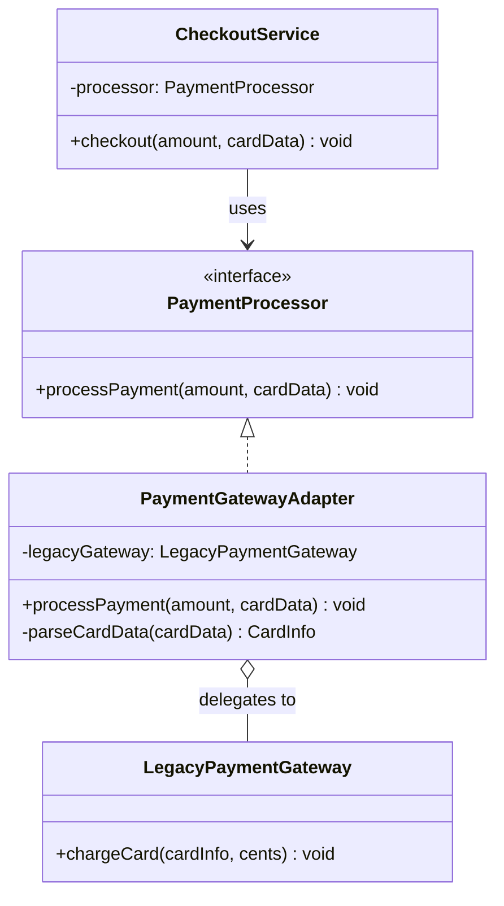

# Adapter Pattern

<CoverImage src="/covers/structural/adapter.webp" alt="Cover">
  <h1>Adapter</h1>
  <p>Standart AQSh 3 pinli vilkasini kichik rang-barang tishli g'ildiraklar yordamida g'alati uchburchak shaklidagi rozetkaga ulashga urinayotgan kulgili, haddan tashqari murakkab sayohat adapteri.</p>
</CoverImage>

## Umumiy ko'rinish (Overview)

**Adapter** — bu mos kelmaydigan interfeyslarga ega klasslarning manba kodini o'zgartirmasdan birgalikda ishlashiga imkon beruvchi strukturaviy (structural) dizayn patternidir. U bitta interfeysni o'rab oladi va boshqasini taqdim etadi: chaqiruvlarni, ma'lumotlar shaklini yoki nomlash qoidalarini tarjima qiladi, shunda mijoz (client) o'ziga tanish kontraktdan foydalanishda davom etaveradi.

**Asosiy afzalligi**: Eski (legacy) kodni, uchinchi tomon SDK'larini yoki freymvorklar o'rtasidagi nomuvofiqliklarni hech bir tomonni qayta yozmasdan integratsiya qilishingiz mumkin.

**Zamonaviy nuqtai nazar**: Adapter 2026-yilda ham juda dolzarb, chunki tizimlar tobora ko'proq API'lar, paketlar, servislar va eski ichki kutubxonalardan yig'ilmoqda. U ayniqsa chegaralarda keng tarqalgan: to'lov shlyuzlari (payment gateway), HTTP klientlar, ma'lumotlar bazasi drayverlari va platforma SDK'lari uchun o'ramlar (wrapper).

Muhim farq — maqsadda. Adapter xatti-harakat qo'shish uchun emas. U moslik (compatibility) uchun.

## Maqsad (Purpose)

- Mos kelmaydigan interfeyslarga ega komponentlar o'rtasida integratsiyani ta'minlash
- Mavjud kodni o'zgartirmasdan qayta ishlatish
- Vendor'ga yoki eski tizimga xos API'larni barqaror ilova kontrakti ortiga yashirish
- Kod bazasining qolgan qismini interfeys o'zgarishlaridan himoyalash

## Hayotiy o'xshatish (Real-World Analogy)

Sayohat uchun vilka adapterini tasavvur qiling. Noutbukingiz zaryadlovchisi bir xil vilka shaklini kutadi, lekin boshqa davlatdagi devor rozetkasi boshqacha. Adapter zaryadlovchini ham, devorni ham o'zgartirmaydi. U shunchaki ikki tomonni bir-biriga moslashtiradi.

Dasturiy adapterlar ham xuddi shunday qiladi: ular hech bir tomonni o'zgartirmasdan nomuvofiqlikni foydalanish mumkin holga keltiradi.

## Tuzilma (Structure)



- **`CheckoutService`** (Client) faqat `PaymentProcessor` interfeysiga bog'liq.
- **`PaymentProcessor`** (Target) — mijoz kutayotgan interfeys.
- **`PaymentGatewayAdapter`** (Adapter) target'ni amalga oshiradi va ishni uzatishdan oldin argumentlarni tarjima qiladi (dollarni sentga, satrni karta obyektiga).
- **`LegacyPaymentGateway`** (Adaptee) — mos kelmaydigan `chargeCard()` API'ga ega mavjud klass.

## Muammo (The Problem)

Tasavvur qiling, sizda toza processPayment(amount, paymentMethod) metodiga ega to'lov protsessorini kutadigan zamonaviy checkout servisi bor. Biroq mavjud yagona provayder — butunlay boshqacha shakldagi eski shlyuz: u karta obyektlarini, dollar o'rniga sentni va sinxron chaqiruvlarni talab qiladi.

Ikki tizimda:

- Metod nomlari har xil
- Parametrlar tartibi va o'lchov birliklari har xil
- Xatolarni qayta ishlash qoidalari har xil
- Ma'lumotlar tuzilmalari har xil

Siz hech bir tizimni o'zgartira olmaysiz, ammo ularning birgalikda ishlashi kerak. Aynan shu yerda Adapter patterni yordamga keladi.

### 1-ssenariy: Eski to'lov shlyuzi (Legacy Payment Gateway)

```typescript
// ❌ Muammo: mijoz zamonaviy interfeysni kutadi
interface PaymentProcessor {
  processPayment(amount: number, currency: string): Promise<void>;
}

// ❌ Muammo: eski gateway boshqacha API taqdim etadi
class LegacyPaymentGateway {
  chargeCard(
    cardInfo: { cardNumber: string; cvv: string },
    cents: number,
  ): void {
    console.log(`Charging ${cents} cents to ${cardInfo.cardNumber.slice(-4)}`);
  }
}
```

### 2-ssenariy: HTTP kutubxonasi nomuvofiqligi

```typescript
// ❌ Muammo: ilova fetch'ga o'xshash metodlarni kutadi
interface HttpClient {
  get(url: string): Promise<unknown>;
  post(url: string, data: unknown): Promise<unknown>;
}

// ❌ Muammo: eski kutubxona boshqacha atamalardan foydalanadi
class LegacyHttpLib {
  fetchGet(endpoint: string): unknown {
    return { status: 200, data: [] };
  }

  fetchPost(endpoint: string, payload: unknown): unknown {
    return { status: 201, data: payload };
  }
}
```

## Yechim (The Solution)

Adapter patterni quyidagilarni bajaradigan adapter klassini yaratish orqali yechim taqdim etadi:

1. Mijozlar kutayotgan interfeysni amalga oshiradi
2. Mos kelmaydigan adaptee'ni o'zida saqlaydi yoki undan meros oladi
3. Metod chaqiruvlarini, argumentlarni va qaytariladigan qiymatlarni tarjima qiladi
4. Moslik mantig'ini bir joyda saqlaydi

Ikkita asosiy yondashuv mavjud:

### Object Adapter (obyekt adapteri)

Adapter adaptee'ning nusxasini o'z ichiga oladi va ishni unga topshiradi. Bu TypeScript, Python, Go va Rust'da eng amaliy variant.

### Class Adapter (klass adapteri)

Adapter adaptee'dan meros oladi va target interfeysni metodlarni qayta aniqlash (overriding) orqali amalga oshiradi. Bu yagona meros (single inheritance) yoki mixin'ga o'xshash mexanizmlarga ega tillarda uchraydi, lekin kompozitsiyani qo'llab-quvvatlash odatda osonroq.

```typescript
// ✅ Yechim: yupqa moslashtiruvchi qatlam
interface PaymentProcessor {
  processPayment(amount: number, cardData: string): Promise<void>;
}

class LegacyPaymentGateway {
  chargeCard(
    cardInfo: { cardNumber: string; cvv: string },
    cents: number,
  ): void {
    console.log(
      `Legacy gateway: charging ${cents} cents to ${cardInfo.cardNumber.slice(-4)}`,
    );
  }
}

class PaymentGatewayAdapter implements PaymentProcessor {
  constructor(private readonly legacyGateway: LegacyPaymentGateway) {}

  async processPayment(amount: number, cardData: string): Promise<void> {
    const cardInfo = this.parseCardData(cardData);
    const cents = Math.round(amount * 100);
    this.legacyGateway.chargeCard(cardInfo, cents);
  }

  private parseCardData(cardData: string): { cardNumber: string; cvv: string } {
    const [cardNumber, cvv] = cardData.split("|");
    if (!cardNumber || !cvv) {
      throw new Error("Invalid card data");
    }

    return { cardNumber, cvv };
  }
}
```

## Amalga oshirish (Implementation)

::: code-group

```typescript [TypeScript]
interface PaymentProcessor {
  processPayment(amount: number, cardData: string): Promise<void>;
}

class LegacyPaymentGateway {
  chargeCard(
    cardInfo: { cardNumber: string; cvv: string },
    cents: number,
  ): void {
    console.log(
      `Legacy gateway: charging ${cents} cents to card ending in ${cardInfo.cardNumber.slice(-4)}`,
    );
  }
}

class PaymentGatewayAdapter implements PaymentProcessor {
  constructor(private readonly legacyGateway: LegacyPaymentGateway) {}

  async processPayment(amount: number, cardData: string): Promise<void> {
    const cardInfo = this.parseCardData(cardData);
    const cents = Math.round(amount * 100);
    this.legacyGateway.chargeCard(cardInfo, cents);
  }

  private parseCardData(cardData: string): { cardNumber: string; cvv: string } {
    const [cardNumber, cvv] = cardData.split("|");
    if (!cardNumber || !cvv) {
      throw new Error("Invalid card data");
    }

    return { cardNumber, cvv };
  }
}

class CheckoutService {
  constructor(private readonly processor: PaymentProcessor) {}

  async checkout(amount: number, cardData: string): Promise<void> {
    console.log(`Processing payment of $${amount.toFixed(2)}`);
    await this.processor.processPayment(amount, cardData);
    console.log("Payment processed successfully");
  }
}

const checkout = new CheckoutService(
  new PaymentGatewayAdapter(new LegacyPaymentGateway()),
);

checkout.checkout(99.99, "4111111111111111|123");

interface HttpClient {
  get(url: string): Promise<unknown>;
  post(url: string, data: unknown): Promise<unknown>;
}

class LegacyHttpLib {
  fetchGet(endpoint: string): unknown {
    return { status: 200, data: [] };
  }

  fetchPost(endpoint: string, payload: unknown): unknown {
    return { status: 201, data: payload };
  }
}

class HttpClientAdapter implements HttpClient {
  constructor(private readonly legacyLib: LegacyHttpLib) {}

  async get(url: string): Promise<unknown> {
    const response = this.legacyLib.fetchGet(url) as { data: unknown };
    return response.data;
  }

  async post(url: string, data: unknown): Promise<unknown> {
    const response = this.legacyLib.fetchPost(url, data) as { data: unknown };
    return response.data;
  }
}

const httpAdapter = new HttpClientAdapter(new LegacyHttpLib());
httpAdapter.get("/api/users").then((data) => console.log("User data:", data));
```

```python [Python]
from abc import ABC, abstractmethod
from dataclasses import dataclass

class PaymentProcessor(ABC):
    @abstractmethod
    def process_payment(self, amount: float, card_data: str) -> None:
        pass

class LegacyPaymentGateway:
    def charge_card(self, card_info: dict, cents: int) -> None:
        print(
            f"Legacy gateway: charging {cents} cents to card ending in {card_info['card_number'][-4:]}"
        )

class PaymentGatewayAdapter(PaymentProcessor):
    def __init__(self, legacy_gateway: LegacyPaymentGateway):
        self._legacy_gateway = legacy_gateway

    def process_payment(self, amount: float, card_data: str) -> None:
        card_info = self._parse_card_data(card_data)
        cents = round(amount * 100)
        self._legacy_gateway.charge_card(card_info, cents)

    @staticmethod
    def _parse_card_data(card_data: str) -> dict:
        card_number, cvv = card_data.split("|")
        if not card_number or not cvv:
            raise ValueError("Invalid card data")
        return {"card_number": card_number, "cvv": cvv}

class CheckoutService:
    def __init__(self, processor: PaymentProcessor):
        self._processor = processor

    def checkout(self, amount: float, card_data: str) -> None:
        print(f"Processing payment of ${amount:.2f}")
        self._processor.process_payment(amount, card_data)
        print("Payment processed successfully")

@dataclass
class LegacyWeatherApiResponse:
    temp_c: float
    condition: str
    humidity: int

class WeatherData(ABC):
    @property
    @abstractmethod
    def temperature(self) -> float:
        pass

    @property
    @abstractmethod
    def description(self) -> str:
        pass

class WeatherApiAdapter(WeatherData):
    def __init__(self, response: LegacyWeatherApiResponse):
        self._response = response

    @property
    def temperature(self) -> float:
        return self._response.temp_c

    @property
    def description(self) -> str:
        return self._response.condition

checkout = CheckoutService(PaymentGatewayAdapter(LegacyPaymentGateway()))
checkout.checkout(99.99, "4111111111111111|123")

weather = WeatherApiAdapter(LegacyWeatherApiResponse(20, "Sunny", 45))
print(f"Weather: {weather.temperature}C, {weather.description}")
```

```java [Java]
interface PaymentProcessor {
    void processPayment(double amount, String cardData);
}

class LegacyPaymentGateway {
    public void chargeCard(String cardNumber, String cvv, int cents) {
        System.out.println(
            "Legacy gateway: charging " + cents + " cents to card ending in " +
            cardNumber.substring(cardNumber.length() - 4)
        );
    }
}

class PaymentGatewayAdapter implements PaymentProcessor {
    private final LegacyPaymentGateway legacyGateway;

    public PaymentGatewayAdapter(LegacyPaymentGateway legacyGateway) {
        this.legacyGateway = legacyGateway;
    }

    @Override
    public void processPayment(double amount, String cardData) {
        String[] parts = cardData.split("\\|");
        if (parts.length != 2) {
            throw new IllegalArgumentException("Invalid card data");
        }

        int cents = (int) Math.round(amount * 100);
        legacyGateway.chargeCard(parts[0], parts[1], cents);
    }
}

interface HttpClient {
    Object get(String url);
    Object post(String url, Object data);
}

class LegacyHttpLib {
    public Object fetchGet(String endpoint) {
        return new Object();
    }

    public Object fetchPost(String endpoint, Object payload) {
        return payload;
    }
}

class HttpClientAdapter implements HttpClient {
    private final LegacyHttpLib legacyLib;

    public HttpClientAdapter(LegacyHttpLib legacyLib) {
        this.legacyLib = legacyLib;
    }

    @Override
    public Object get(String url) {
        return legacyLib.fetchGet(url);
    }

    @Override
    public Object post(String url, Object data) {
        return legacyLib.fetchPost(url, data);
    }
}
```

```go [Go]
package main

import "fmt"

type PaymentProcessor interface {
	ProcessPayment(amount float64, cardData string) error
}

type LegacyPaymentGateway struct{}

func (g *LegacyPaymentGateway) ChargeCard(cardNumber, cvv string, cents int) {
	fmt.Printf("Legacy gateway: charging %d cents to card ending in %s\n", cents, cardNumber[len(cardNumber)-4:])
}

type PaymentGatewayAdapter struct {
	legacyGateway *LegacyPaymentGateway
}

func NewPaymentGatewayAdapter(legacyGateway *LegacyPaymentGateway) *PaymentGatewayAdapter {
	return &PaymentGatewayAdapter{legacyGateway: legacyGateway}
}

func (a *PaymentGatewayAdapter) ProcessPayment(amount float64, cardData string) error {
	parts := splitCardData(cardData)
	if len(parts) != 2 {
		return fmt.Errorf("invalid card data")
	}

	cents := int(amount * 100)
	a.legacyGateway.ChargeCard(parts[0], parts[1], cents)
	return nil
}

func splitCardData(cardData string) []string {
	for i := 0; i < len(cardData); i++ {
		if cardData[i] == '|' {
			return []string{cardData[:i], cardData[i+1:]}
		}
	}
	return []string{cardData}
}

type HttpClient interface {
	Get(url string) (any, error)
	Post(url string, data any) (any, error)
}

type LegacyHttpLib struct{}

func (l *LegacyHttpLib) FetchGet(endpoint string) any {
	return map[string]any{"status": 200}
}

func (l *LegacyHttpLib) FetchPost(endpoint string, payload any) any {
	return payload
}

type HttpClientAdapter struct {
	legacyLib *LegacyHttpLib
}

func NewHttpClientAdapter(legacyLib *LegacyHttpLib) *HttpClientAdapter {
	return &HttpClientAdapter{legacyLib: legacyLib}
}

func (a *HttpClientAdapter) Get(url string) (any, error) {
	return a.legacyLib.FetchGet(url), nil
}

func (a *HttpClientAdapter) Post(url string, data any) (any, error) {
	return a.legacyLib.FetchPost(url, data), nil
}
```

```rust [Rust]
trait PaymentProcessor {
    fn process_payment(&self, amount: f64, card_data: &str) -> Result<(), String>;
}

struct LegacyPaymentGateway;

impl LegacyPaymentGateway {
    fn charge_card(&self, card_number: &str, cvv: &str, cents: i32) {
        println!(
            "Legacy gateway: charging {} cents to card ending in {}",
            cents,
            &card_number[card_number.len() - 4..]
        );
    }
}

struct PaymentGatewayAdapter {
    legacy_gateway: LegacyPaymentGateway,
}

impl PaymentGatewayAdapter {
    fn new(legacy_gateway: LegacyPaymentGateway) -> Self {
        Self { legacy_gateway }
    }

    fn parse_card_data(&self, card_data: &str) -> Result<(&str, &str), String> {
        let parts: Vec<&str> = card_data.split('|').collect();
        if parts.len() != 2 {
            return Err("Invalid card data".to_string());
        }
        Ok((parts[0], parts[1]))
    }
}

impl PaymentProcessor for PaymentGatewayAdapter {
    fn process_payment(&self, amount: f64, card_data: &str) -> Result<(), String> {
        let (card_number, cvv) = self.parse_card_data(card_data)?;
        let cents = (amount * 100.0).round() as i32;
        self.legacy_gateway.charge_card(card_number, cvv, cents);
        Ok(())
    }
}

trait HttpClient {
    fn get(&self, url: &str) -> Result<String, String>;
    fn post(&self, url: &str, data: &str) -> Result<String, String>;
}

struct LegacyHttpLib;

impl LegacyHttpLib {
    fn fetch_get(&self, _endpoint: &str) -> String {
        "{\"status\":200}".to_string()
    }

    fn fetch_post(&self, _endpoint: &str, payload: &str) -> String {
        payload.to_string()
    }
}

struct HttpClientAdapter {
    legacy_lib: LegacyHttpLib,
}

impl HttpClientAdapter {
    fn new(legacy_lib: LegacyHttpLib) -> Self {
        Self { legacy_lib }
    }
}

impl HttpClient for HttpClientAdapter {
    fn get(&self, url: &str) -> Result<String, String> {
        Ok(self.legacy_lib.fetch_get(url))
    }

    fn post(&self, url: &str, data: &str) -> Result<String, String> {
        Ok(self.legacy_lib.fetch_post(url, data))
    }
}
```

:::

## Haqiqiy hayotdagi misol (Real-World Example)

Amaliy adapter qatlami ko'pincha kod bazasining chekkasida joylashadi. Keng tarqalgan misollardan biri — bir nechta provayderlarni yagona ichki kontraktga normallashtirishi kerak bo'lgan ob-havo ma'lumotlarini jamlovchi servis.

Faraz qilaylik, ilovangiz oddiy shaklni kutadi:

```typescript
interface WeatherSnapshot {
  temperatureC: number;
  description: string;
  humidity: number;
}
```

Lekin provayderlar bir-biriga mos kelmaydi:

- OpenWeatherMap haroratni Kelvinda, ichma-ich (nested) tuzilmada qaytaradi.
- WeatherAPI Selsiyni boshqacha nomlash sxemasi bilan qaytaradi.
- Ichki eski kesh obyektlar o'rniga kortejlar (tuple) va kodlarni qaytaradi.

Adapterlarsiz ilova kodi provayderga xos shartli tarmoqlanishlar bilan to'lib ketadi. Adapterlar bilan esa har bir provayder o'zining tarjimoniga ega bo'ladi va tizimning qolgan qismi faqat WeatherSnapshot'ga bog'liq bo'ladi.

Pattern aynan shu chegarada eng ko'p foyda keltiradi: yuqori oqimdagi (upstream) API'lar o'zgarganda ham ilovaning qolgan qismi barqaror qoladi.

```typescript
interface WeatherSnapshot {
  temperatureC: number;
  description: string;
  humidity: number;
}

interface WeatherSource {
  fetch(): Promise<WeatherSnapshot>;
}

class OpenWeatherMapAdapter implements WeatherSource {
  constructor(private readonly response: unknown) {}

  async fetch(): Promise<WeatherSnapshot> {
    const data = this.response as {
      main: { temp: number };
      weather: { description: string }[];
      humidity: number;
    };

    return {
      temperatureC: Math.round(data.main.temp - 273.15),
      description: data.weather[0]?.description ?? "unknown",
      humidity: data.humidity,
    };
  }
}
```

## Afzalliklari (Advantages)

- Mavjud klasslarni o'zgartirmasdan qayta ishlatishga yordam beradi
- Tizim chegaralarida moslashuvchanlikni oshiradi
- Moslik mantig'ini markazlashtirilgan holda saqlaydi
- Mijoz kodining bitta barqaror abstraksiyaga bog'liq bo'lishiga imkon beradi
- Eski kutubxonalardan bosqichma-bosqich voz kechishni qo'llab-quvvatlaydi
- Uchinchi tomon yoki eski tizim integratsiyasini alohida test qilish mumkin bo'ladi

## Kamchiliklari (Disadvantages)

- Yana bir bilvosita (indirection) qatlam qo'shadi
- Kichik saqlanmasa, tarjima mantig'i uyib tashlanadigan joyga aylanib qolishi mumkin
- Adaptee API'si o'zgarganda qo'llab-quvvatlashni talab qiladi
- Chuqurroq semantik nomuvofiqliklarni hal qilmaydi
- Debugging'ni biroz kamroq to'g'ridan-to'g'ri qilishi mumkin
- Ikkala tomonni ham o'zingiz boshqarsangiz, qo'shimcha kod keraksiz

## Qachon foydalanish kerak (When to Use)

- Mos kelmaydigan interfeyslarni integratsiya qilishingiz kerak
- Biror klassdan foydalanmoqchisiz, lekin uning API'si ilova kontraktingizga mos kelmaydi
- Uchinchi tomon SDK'sini yoki eski modulni o'rayapsiz
- Bir nechta provayder ustidan bitta barqaror interfeys kerak
- Eski tizimdan bosqichma-bosqich ko'chib o'tyapsiz

## Qachon foydalanmaslik kerak (When NOT to Use)

- Asl interfeysni to'g'ridan-to'g'ri o'zgartira olsangiz
- Nomuvofiqlik oddiy yordamchi funksiya bilan hal qilinadigan darajada kichik bo'lsa
- Adapter juda ko'p biznes mantig'ini o'z ichiga olib qolsa
- Nomuvofiqlik strukturaviy emas, balki semantik bo'lsa
- Unumdorlik va xotira ajratish xarajatlari moslikdan muhimroq bo'lsa

## Keng tarqalgan xatolar (Common Mistakes)

### 1-xato: Biznes mantig'ini adapterga topshirish

```typescript
// ❌ Yomon: adapter narxlash, chegirmalar va siyosat bilan shug'ullanadi
class BadPaymentAdapter {
  process(amount: number) {
    const discounted = amount * 0.9;
    const cents = Math.round(discounted * 100);
    // bu yerda siyosat juda ko'p
  }
}

// ✅ Yaxshi: adapter faqat interfeys shaklini o'giradi
class GoodPaymentAdapter {
  process(amount: number) {
    const cents = Math.round(amount * 100);
  }
}
```

### 2-xato: Adaptee turlarini mijoz kodiga sizdirish

```typescript
// ❌ Yomon: mijoz hali ham eski shaklga bog'liq
function handlePayment(gateway: LegacyPaymentGateway) {}

// ✅ Yaxshi: mijoz barqaror abstraksiyaga bog'liq
function handlePayment(processor: PaymentProcessor) {}
```

### 3-xato: Tarjima qilingan kiritmalarni tekshirmaslik

```typescript
// ❌ Yomon: card_data'da har doim ajratuvchi bor deb hisoblaydi
const [cardNumber, cvv] = cardData.split("|");

// ✅ Yaxshi: o'girishdan oldin tekshiring
if (!cardData.includes("|")) {
  throw new Error("Invalid card data");
}
```

### 4-xato: Har bir chegara uchun emas, har bir metod uchun alohida adapter

```typescript
// ❌ Yomon: bitta provayder uchun ko'plab mayda adapterlar
class GetWeatherAdapter {}
class GetHumidityAdapter {}

// ✅ Yaxshi: bitta tashqi manba uchun bitta adapter
class WeatherApiAdapter {}
```

## Aloqador patternlar (Related Patterns)

- **[Facade](/uz/structural/facade)**: Interfeysni soddalashtiradi, lekin asosan mos kelmaydigan interfeyslarni tarjima qilmaydi
- **[Decorator](/uz/structural/decorator)**: Xatti-harakat qo'shadi; Adapter esa interfeysni o'zgartiradi
- **[Bridge](/uz/structural/bridge)**: Nomuvofiqlik paydo bo'lishidan oldin abstraksiyani amalga oshirishdan ajratadi
- **[Proxy](/uz/structural/proxy)**: Obyektga kirishni uning interfeysini o'zgartirmasdan nazorat qiladi

## Zamonaviy muqobillar (Modern Alternatives)

- TypeScript yordamchi funksiyalari va tiplangan DTO mapper'lar
- API gateway transformatsiya qatlamlari
- Maxsus transformerlar bilan OpenAPI klient generatsiyasi
- Korporativ servis shinalaridagi (enterprise service bus) integratsiya middleware'lari
- SDK'lar atrofidagi til darajasidagi o'ramlar (wrapper)

## Intervyu uchun maslahatlar (Interview Insights)

**1-savol: Adapter'ning asosiy maqsadi nima?**

J: Mos kelmaydigan interfeyslarni hech bir tomonni o'zgartirmasdan birgalikda ishlashga majbur qilish. Bu xatti-harakat patterni emas, moslik patterni.

**2-savol: Adapter Decorator'dan nimasi bilan farq qiladi?**

J: Decorator interfeysni saqlab qoladi va xatti-harakat qo'shadi. Adapter esa interfeysni o'zgartiradi, shunda bir tur boshqa tur kutilgan joyda ishlatilishi mumkin bo'ladi.

**3-savol: Qachon class adapter o'rniga object adapter'ni afzal ko'rasiz?**

J: Zamonaviy kod bazalarida deyarli har doim, chunki object adapter'lar kompozitsiyadan foydalanadi, ularni test qilish osonroq va ular meros cheklovlaridan xoli.

**4-savol: Adapter API'dagi buzuvchi (breaking) o'zgarishlarni yashira oladimi?**

J: Ha. U ko'pincha migratsiyalar paytida moslik qatlami sifatida ishlatiladi, shunda backend o'zgarayotgan bir paytda ilovaning qolgan qismi eski kontraktdan foydalanishda davom etadi.

**5-savol: Zamonaviy REST/GraphQL API'lar davrida Adapter hali ham dolzarbmi?**

J: Ha. U API klientlari, SDK o'ramlari va eski tizim integratsiyalari uchun juda keng tarqalgan. Aksariyat real tizimlarga hali ham tarjima qatlamlari kerak.

**6-savol: Adapter'dan foydalanishdagi eng katta xavf nima?**

J: Uning ikkinchi biznes qatlamiga aylanib ketishiga yo'l qo'yish. Agar adapter siyosat (policy), validatsiya qoidalari va orkestratsiyani o'z zimmasiga ola boshlasa, uni qo'llab-quvvatlash qiyinlashadi va u endi sof tarjimon bo'lib qolmaydi.
