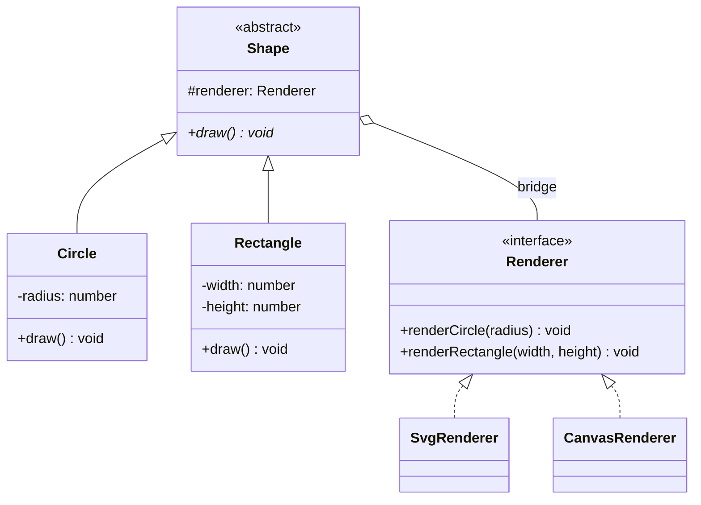

# Ko'prik andozasi (Bridge)

<CoverImage src="/covers/structural/bridge.webp" alt="Cover">
  <h1>Ko'prik</h1>
  <p>Suzib yuruvchi "Boshqaruv xonasi" sferasini (Abstraksiya) pastdagi turli almashtiriladigan "Dvigatel/Quvvat" doklaridan (Amalga oshirishlar) ajratib turuvchi, egiluvchan nurli quvurlar bilan bog'langan go'zal futuristik ko'prik.</p>
</CoverImage>

## Umumiy ko'rinish (Overview)

**Ko'prik (Bridge)** — bu abstraksiyani uning amalga oshirilishidan (implementation) ajratib, ikkalasining mustaqil rivojlanishiga imkon beruvchi tuzilmaviy (structural) loyihalash andozasidir. Har bir amalga oshirish tanlovini klasslar ierarxiyasiga singdirib yuborish o'rniga, Ko'prik abstraksiyani barqaror saqlaydi va ishni amalga oshirish obyektiga topshiradi.

**Asosiy afzalligi**: O'zgarishning ikki yoki undan ortiq o'lchovi (dimension) mavjud bo'lganda klasslar portlashining (class explosion) oldini oladi.

**Zamonaviy nuqtai nazar**: Ko'prik tizimda barqaror qolishi kerak bo'lgan interfeys mavjud bo'lib, bajaruvchi backend, rendering dvigateli, saqlash qatlami yoki platformaga xos xatti-harakat mustaqil ravishda o'zgarishi mumkin bo'lgan har qanday holatda foydali bo'lib qolmoqda.

Adapter'dan farqi nozik, lekin muhim: Adapter mavjud nomuvofiqlikni tuzatadi, Ko'prik esa tizimga boshidanoq loyihalab kiritiladi.

## Hayotiy o'xshatish (Real-World Analogy)

**Pult va televizorni** tasavvur qiling. Pult — abstraksiya. Televizor — amalga oshirish. Ko'prik kontrakti o'zgarmas ekan, pultni qayta loyihalamasdan televizorni boshqa brend yoki turdagisiga almashtirishingiz mumkin.

Pult uchun qurilma televizormi, karnaymi yoki proyektormi — farqi yo'q. U faqat qurilma interfeysi bilan qanday muloqot qilishni biladi.

## Tuzilma (Structure)



- **`Shape`** (Abstraction) `Renderer`'ga havolani saqlaydi va past darajadagi chizishni unga topshiradi.
- **`Circle` / `Rectangle`** (Refined Abstractions) abstraksiyani shaklga xos ma'lumotlar bilan kengaytiradi.
- **`Renderer`** (Implementor) primitiv operatsiyalarni belgilaydi; **`SvgRenderer` / `CanvasRenderer`** — Concrete Implementor'lar.
- Ikkala ierarxiya mustaqil ravishda o'zgaradi: shakl yoki renderer qo'shish boshqa tomonda hech qanday o'zgarishni talab qilmaydi.

## Muammo (The Problem)

Ko'plab shakllar va ko'plab rendering dvigatellarini qo'llab-quvvatlashi kerak bo'lgan grafik kutubxonani tasavvur qiling:

- Shakllar: Circle, Rectangle, Triangle, Polygon
- Renderer'lar: SVG, Canvas, WebGL, PDF

Ko'priksiz quyidagi kabi klasslarga ega bo'lasiz:

- SvgCircle, CanvasCircle, WebGlCircle, PdfCircle
- SvgRectangle, CanvasRectangle, WebGlRectangle, PdfRectangle

Bu ko'paytirish muammosini keltirib chiqaradi. Bitta shakl qo'shsangiz, har bir renderer uchun bittadan versiya qo'shishingiz kerak. Bitta renderer qo'shsangiz, har bir shakl uchun bittadan versiya qo'shishingiz kerak.

### Muammo misoli

```typescript
// ❌ Yomon: ierarxiya portlashi
class SvgCircle {}
class CanvasCircle {}
class WebGlCircle {}
class PdfCircle {}

class SvgRectangle {}
class CanvasRectangle {}
class WebGlRectangle {}
class PdfRectangle {}
```

Bunday tuzilmani kengaytirish qiyin va qo'llab-quvvatlash murakkab.

## Yechim (The Solution)

Ko'prik muammoni ikkita ierarxiyaga bo'lish orqali hal qiladi:

1. **Abstraksiya (Abstraction)**: mijozlar foydalanadigan shakl, UI komponenti yoki biznes tushunchasi
2. **Amalga oshirish (Implementation)**: renderer, saqlash qatlami, drayver yoki platformaga xos bajaruvchi

Abstraksiya amalga oshirishga havolani saqlaydi va ishni unga topshiradi.

```typescript
// Abstraksiya
abstract class Shape {
  constructor(protected renderer: Renderer) {}
  abstract draw(): void;
}

// Implementatsiya
interface Renderer {
  renderCircle(radius: number): void;
  renderRectangle(width: number, height: number): void;
}
```

## Amalga oshirish (Implementation)

::: code-group

```typescript [TypeScript]
interface Renderer {
  renderCircle(radius: number): void;
  renderRectangle(width: number, height: number): void;
}

class SvgRenderer implements Renderer {
  renderCircle(radius: number): void {
    console.log(`SVG circle with radius ${radius}`);
  }

  renderRectangle(width: number, height: number): void {
    console.log(`SVG rectangle ${width}x${height}`);
  }
}

class CanvasRenderer implements Renderer {
  renderCircle(radius: number): void {
    console.log(`Canvas circle with radius ${radius}`);
  }

  renderRectangle(width: number, height: number): void {
    console.log(`Canvas rectangle ${width}x${height}`);
  }
}

abstract class Shape {
  constructor(protected readonly renderer: Renderer) {}
  abstract draw(): void;
}

class Circle extends Shape {
  constructor(
    private readonly radius: number,
    renderer: Renderer,
  ) {
    super(renderer);
  }

  draw(): void {
    this.renderer.renderCircle(this.radius);
  }
}

class Rectangle extends Shape {
  constructor(
    private readonly width: number,
    private readonly height: number,
    renderer: Renderer,
  ) {
    super(renderer);
  }

  draw(): void {
    this.renderer.renderRectangle(this.width, this.height);
  }
}

const circle = new Circle(10, new SvgRenderer());
const rectangle = new Rectangle(20, 12, new CanvasRenderer());

circle.draw();
rectangle.draw();
```

```python [Python]
from abc import ABC, abstractmethod

class Renderer(ABC):
    @abstractmethod
    def render_circle(self, radius: float) -> None:
        pass

    @abstractmethod
    def render_rectangle(self, width: float, height: float) -> None:
        pass

class SvgRenderer(Renderer):
    def render_circle(self, radius: float) -> None:
        print(f"SVG circle with radius {radius}")

    def render_rectangle(self, width: float, height: float) -> None:
        print(f"SVG rectangle {width}x{height}")

class CanvasRenderer(Renderer):
    def render_circle(self, radius: float) -> None:
        print(f"Canvas circle with radius {radius}")

    def render_rectangle(self, width: float, height: float) -> None:
        print(f"Canvas rectangle {width}x{height}")

class Shape(ABC):
    def __init__(self, renderer: Renderer):
        self._renderer = renderer

    @abstractmethod
    def draw(self) -> None:
        pass

class Circle(Shape):
    def __init__(self, radius: float, renderer: Renderer):
        super().__init__(renderer)
        self._radius = radius

    def draw(self) -> None:
        self._renderer.render_circle(self._radius)

class Rectangle(Shape):
    def __init__(self, width: float, height: float, renderer: Renderer):
        super().__init__(renderer)
        self._width = width
        self._height = height

    def draw(self) -> None:
        self._renderer.render_rectangle(self._width, self._height)

circle = Circle(10, SvgRenderer())
rectangle = Rectangle(20, 12, CanvasRenderer())

circle.draw()
rectangle.draw()
```

```java [Java]
interface Renderer {
    void renderCircle(double radius);
    void renderRectangle(double width, double height);
}

class SvgRenderer implements Renderer {
    @Override
    public void renderCircle(double radius) {
        System.out.println("SVG circle with radius " + radius);
    }

    @Override
    public void renderRectangle(double width, double height) {
        System.out.println("SVG rectangle " + width + "x" + height);
    }
}

class CanvasRenderer implements Renderer {
    @Override
    public void renderCircle(double radius) {
        System.out.println("Canvas circle with radius " + radius);
    }

    @Override
    public void renderRectangle(double width, double height) {
        System.out.println("Canvas rectangle " + width + "x" + height);
    }
}

abstract class Shape {
    protected final Renderer renderer;

    protected Shape(Renderer renderer) {
        this.renderer = renderer;
    }

    public abstract void draw();
}

class Circle extends Shape {
    private final double radius;

    public Circle(double radius, Renderer renderer) {
        super(renderer);
        this.radius = radius;
    }

    @Override
    public void draw() {
        renderer.renderCircle(radius);
    }
}

class Rectangle extends Shape {
    private final double width;
    private final double height;

    public Rectangle(double width, double height, Renderer renderer) {
        super(renderer);
        this.width = width;
        this.height = height;
    }

    @Override
    public void draw() {
        renderer.renderRectangle(width, height);
    }
}
```

```go [Go]
package main

import "fmt"

type Renderer interface {
	RenderCircle(radius float64)
	RenderRectangle(width, height float64)
}

type SvgRenderer struct{}

func (r *SvgRenderer) RenderCircle(radius float64) {
	fmt.Printf("SVG circle with radius %.1f\n", radius)
}

func (r *SvgRenderer) RenderRectangle(width, height float64) {
	fmt.Printf("SVG rectangle %.1fx%.1f\n", width, height)
}

type CanvasRenderer struct{}

func (r *CanvasRenderer) RenderCircle(radius float64) {
	fmt.Printf("Canvas circle with radius %.1f\n", radius)
}

func (r *CanvasRenderer) RenderRectangle(width, height float64) {
	fmt.Printf("Canvas rectangle %.1fx%.1f\n", width, height)
}

type Shape interface {
	Draw()
}

type Circle struct {
	renderer Renderer
	radius   float64
}

func NewCircle(radius float64, renderer Renderer) *Circle {
	return &Circle{radius: radius, renderer: renderer}
}

func (c *Circle) Draw() {
	c.renderer.RenderCircle(c.radius)
}

type Rectangle struct {
	renderer Renderer
	width     float64
	height    float64
}

func NewRectangle(width, height float64, renderer Renderer) *Rectangle {
	return &Rectangle{width: width, height: height, renderer: renderer}
}

func (r *Rectangle) Draw() {
	r.renderer.RenderRectangle(r.width, r.height)
}
```

```rust [Rust]
trait Renderer {
    fn render_circle(&self, radius: f64);
    fn render_rectangle(&self, width: f64, height: f64);
}

struct SvgRenderer;

impl Renderer for SvgRenderer {
    fn render_circle(&self, radius: f64) {
        println!("SVG circle with radius {}", radius);
    }

    fn render_rectangle(&self, width: f64, height: f64) {
        println!("SVG rectangle {}x{}", width, height);
    }
}

struct CanvasRenderer;

impl Renderer for CanvasRenderer {
    fn render_circle(&self, radius: f64) {
        println!("Canvas circle with radius {}", radius);
    }

    fn render_rectangle(&self, width: f64, height: f64) {
        println!("Canvas rectangle {}x{}", width, height);
    }
}

trait Shape {
    fn draw(&self);
}

struct Circle<'a> {
    renderer: &'a dyn Renderer,
    radius: f64,
}

impl<'a> Circle<'a> {
    fn new(radius: f64, renderer: &'a dyn Renderer) -> Self {
        Self { renderer, radius }
    }
}

impl<'a> Shape for Circle<'a> {
    fn draw(&self) {
        self.renderer.render_circle(self.radius);
    }
}

struct Rectangle<'a> {
    renderer: &'a dyn Renderer,
    width: f64,
    height: f64,
}

impl<'a> Rectangle<'a> {
    fn new(width: f64, height: f64, renderer: &'a dyn Renderer) -> Self {
        Self { renderer, width, height }
    }
}

impl<'a> Shape for Rectangle<'a> {
    fn draw(&self) {
        self.renderer.render_rectangle(self.width, self.height);
    }
}
```

:::

## Haqiqiy hayotdagi misol (Real-World Example)

Amaliy ko'prik UI toolkit'larda uchraydi. Abstraksiya — tugma, modal oyna yoki diagramma kabi komponent. Amalga oshirish esa rendering backend'i: DOM, Canvas, mobil platformaning native boshqaruv elementlari yoki PDF chiqishi.

Amalga oshirish qatlamini almashtirish orqali bir xil tugma abstraksiyasidan brauzer ilovasida, desktop ilovada yoki hisobot generatorida foydalanish mumkin. Bu yuqori darajadagi API'ni barqaror saqlaydi va renderer'ning o'zgarishiga imkon beradi.

```typescript
interface ThemeRenderer {
  drawButton(label: string, primary: boolean): void;
  drawInput(placeholder: string): void;
}

abstract class UIComponent {
  constructor(protected renderer: ThemeRenderer) {}
}

class Button extends UIComponent {
  constructor(
    private label: string,
    private primary: boolean,
    renderer: ThemeRenderer,
  ) {
    super(renderer);
  }

  render(): void {
    this.renderer.drawButton(this.label, this.primary);
  }
}
```

Bu foydali, chunki komponent API'si o'zi brauzerda, iOS'da, PDF'da yoki terminal UI'da chizilayotganini bilishi shart emas.

## Afzalliklari (Advantages)

- Klasslar ierarxiyasi portlashining oldini oladi
- Abstraksiya va amalga oshirishning mustaqil rivojlanishiga imkon beradi
- Platformaga xos tafsilotlarni alohida saqlaydi
- Abstraksiyani test qilishni osonlashtiradi
- Abstraksiyani takrorlamasdan bir nechta backend'ni qo'llab-quvvatlaydi
- Merosdan ko'ra kompozitsiyani rag'batlantiradi

## Kamchiliklari (Disadvantages)

- Yana bir bilvosita (indirection) qatlam qo'shadi
- Juda kichik ierarxiyalar uchun ortiqcha bo'lishi mumkin
- Interfeysni oldindan puxta loyihalashni talab qiladi
- Oddiy meros daraxtiga qaraganda tushunish qiyinroq bo'lishi mumkin
- Ko'proq obyektlar va topshirish (delegation) yo'llarini keltirib chiqarishi mumkin

## Qachon foydalanish kerak (When to Use)

- O'zgarishning ikkita mustaqil o'qi mavjud
- Amalga oshirishlar tez-tez o'zgarishini kutyapsiz
- N×M klasslar o'sishidan qochmoqchisiz
- Bir nechta backend ustidan barqaror abstraksiya loyihalayapsiz
- Platformaga xos xatti-harakatni toza tarzda qo'llab-quvvatlashingiz kerak

## Qachon foydalanmaslik kerak (When NOT to Use)

- Faqat bitta amalga oshirish bor va real muqobil yo'q
- Abstraksiya juda oddiy va o'sishi ehtimoldan yiroq
- Oddiy strategy yoki factory yetarli
- Qo'shimcha bilvositalik sezilarli moslashuvchanlik bermaydi
- Domen modelini kuzatib borish allaqachon qiyin

## Keng tarqalgan xatolar (Common Mistakes)

### 1-xato: Ko'prikni Adapter bilan adashtirish

```typescript
// ❌ Yomon: mavjud mos kelmaydigan API'ni go'yo ko'prik sifatida loyihalangandek ko'rish
// Adapter mos kelmaslikni keyinchalik hal qiladi.

// ✅ Yaxshi: ikkita mustaqil ierarxiyani ataylab loyihalaganda Ko'prikdan foydalaning.
```

### 2-xato: Abstraksiyaning amalga oshirish tafsilotlarini bilishi

```typescript
// ❌ Yomon: abstraksiya konkret renderer turlariga qarab tarmoqlanadi
if (renderer instanceof CanvasRenderer) {
  // maxsus holat
}

// ✅ Yaxshi: abstraksiya konkret implementatsiyalardan bexabar bo'lsin
renderer.renderCircle(radius);
```

### 3-xato: Amalga oshirishning mijoz kodiga sizib chiqishi

```typescript
// ❌ Yomon: mijozlar to'g'ridan-to'g'ri SvgRenderer'ga bog'liq
const circle = new Circle(10, new SvgRenderer());

// ✅ Yaxshi: imkon qadar mijozlar Renderer abstraksiyasiga bog'liq bo'lsin
```

### 4-xato: Oddiy Strategiya yetarli bo'lgan joyda Ko'prikdan foydalanish

```typescript
// ❌ Yomon: bir martalik backend almashtirish uchun ortiqcha murakkablashtirish

// ✅ Yaxshi: Ko'prik bir nechta uzoq muddatli implementatsiyaga ega barqaror abstraksiyalar uchun
```

## Aloqador andozalar (Related Patterns)

- **[Adapter](/uz/structural/adapter)**: Mavjud nomuvofiqlikni tuzatadi
- **[Strategiya](/uz/behavioral/strategy)**: U ham xatti-harakatni topshiradi, lekin Ko'prik abstraksiya va amalga oshirishni loyihalash bosqichida ajratish haqida
- **[Abstrakt fabrika](/uz/creational/abstract-factory)**: Ko'prik uchun bir-biriga mos amalga oshirish oilalarini yaratishi mumkin
- **[Dekorator](/uz/structural/decorator)**: Abstraksiya va amalga oshirishni ajratmasdan mas'uliyatlar qo'shadi

## Zamonaviy muqobillar (Modern Alternatives)

- Interfeys kontraktlariga ega plagin arxitekturalari
- Backend servislar bilan bog'liqliklarni kiritish (dependency injection)
- Konfiguratsiyaga asoslangan rendering quvurlari (pipeline)
- Frontend freymvorklaridagi servis abstraksiyalari
- Kompozitsiya bilan birga trait, protocol yoki interfeyslarni tilning o'zi qo'llab-quvvatlashi

## Intervyu uchun maslahatlar (Interview Insights)

**1-savol: Ko'prikning asosiy maqsadi nima?**

J: Abstraksiyani amalga oshirishdan ajratish, shunda ikkalasi mustaqil ravishda o'zgara oladi. Aynan shu klasslar portlashining oldini oladi.

**2-savol: Ko'prik Adapter'dan nimasi bilan farq qiladi?**

J: Adapter mos kelmaydigan interfeyslarni yarashtiradi. Ko'prik esa loyihaga oldindan kiritiladi, shunda abstraksiya hech qachon bitta amalga oshirishga qattiq bog'lanib qolmaydi.

**3-savol: Nega shunchaki merosdan foydalanmaslik kerak?**

J: Meros o'zgarish o'qlarini bitta ierarxiyaga birlashtiradi. Ko'prik ularni alohida saqlaydi va N×M klasslar muammosidan qochadi.

**4-savol: Ko'prikni bog'liqliklarni kiritish (dependency injection) bilan ishlatish mumkinmi?**

J: Ha. DI ko'pincha amalga oshirishni abstraksiyaga kiritish (inject) uchun ishlatiladi.

**5-savol: Qachon Ko'prik yomon tanlov hisoblanadi?**

J: O'zgarishning mazmunli ikkinchi o'qi bo'lmaganda yoki abstraksiya qo'shimcha bilvositalikni oqlash uchun juda kichik bo'lganda.
