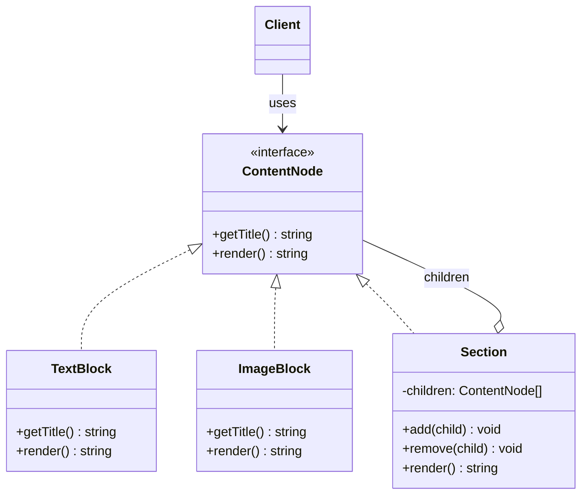

# Kompozit andozasi (Composite)

<CoverImage src="/covers/structural/composite.webp" alt="Cover">
  <h1>Kompozit</h1>
  <p>Geometrik qutilardan yasalgan yuqori texnologiyali modulli matryoshka tuzilmasi: katta qutini ochganda kichikroq qutilar chiqadi, ularning ba'zilarida haqiqiy mikrochiplar (barglar), ba'zilarida esa yanada kichikroq qutilar bor.</p>
</CoverImage>

## Umumiy ko'rinish (Overview)

**Kompozit (Composite)** — bu obyektlardan daraxt tuzilmalarini qurish va alohida obyektlar hamda obyektlar guruhlari bilan bir xil interfeys orqali ishlash imkonini beruvchi tuzilmaviy (structural) loyihalash andozasidir. Mijoz kodi barg (leaf) tugun bilan ishlayaptimi yoki konteyner tugun bilanmi — buni bilishi shart emas.

**Asosiy afzalligi**: Rekursiv ierarxiyalar bilan ishlashni osonlashtiradi va daraxt bo'ylab yurish (traversal) tafsilotlarini mijozlardan yashiradi.

**Zamonaviy nuqtai nazar**: Kompozit hujjat muharrirlarida, UI daraxtlarida, DOM'ga o'xshash tuzilmalarda, menyu tizimlarida, ruxsatlar daraxtlarida, AST'larda va CMS kontent modellarida uchraydi. Barg va konteyner bir xil operatsiyalarni taqdim etishi kerak bo'lgan har qanday holatda Kompozit juda mos keladi.

Kompozit qism va butunga bir xil munosabatda bo'lish haqida.

## Hayotiy o'xshatish (Real-World Analogy)

**Kompaniyaning tashkiliy tuzilmasini** tasavvur qiling. Oddiy xodim barg bo'lishi mumkin. Menejer ham xodim, lekin uning qo'l ostida bo'ysunuvchilar bo'lishi mumkin. Ikkalasiga ham bir xil savollar mantiqan to'g'ri keladi: rahbaringiz kim, ismingiz nima va lavozimingiz qanday?

Kompozit aynan shu umumiy shaklni modellashtiradi.

## Tuzilma (Structure)



- **`ContentNode`** (Component) — yakka elementlar va konteynerlar uchun umumiy interfeys.
- **`TextBlock` / `ImageBlock`** (Leaves) haqiqiy ishni bajaradi va bolalarga (children) ega emas.
- **`Section`** (Composite) bola `ContentNode`'larni saqlaydi va `render()`'ni har bir bolaga rekursiv ravishda topshirish orqali amalga oshiradi.
- **`Client`** barglar va kompozitlar bilan `ContentNode` orqali bir xil tarzda ishlaydi.

## Muammo (The Problem)

Faraz qilaylik, siz kontent boshqaruv tizimini (CMS) yaratyapsiz va kontent quyidagilardan iborat bo'lishi mumkin:

- matn bloklari
- rasmlar
- callout qutilari
- bo'limlar
- sahifalar
- ichma-ich joylashgan quyi sahifalar

Agar har bir mijoz barg tugunlar va konteyner tugunlar uchun alohida holatlarni ko'rib chiqishi kerak bo'lsa, kod `if` operatorlari, tur tekshiruvlari va rekursiya mantig'i bilan to'lib ketadi.

### Muammo misoli

```typescript
// ❌ Yomon: mijoz kodi ierarxiya haqida juda ko'p biladi
function renderNode(node: Page | TextBlock | ImageBlock | Section): string {
  if (node instanceof Section) {
    return node.children.map(renderNode).join("");
  }

  if (node instanceof TextBlock) {
    return `<p>${node.text}</p>`;
  }

  if (node instanceof ImageBlock) {
    return ``;
  }

  return "";
}
```

Daraxt o'sgani sari bu yondashuv kengaymaydi.

## Yechim (The Solution)

Kompozit barg va konteyner obyektlarga bir xil interfeys berish orqali bu muammoni hal qiladi.

1. Komponent interfeysini aniqlang
2. Oddiy xatti-harakatga ega barg tugunlarni amalga oshiring
3. Bolalarni saqlaydigan kompozit tugunlarni amalga oshiring
4. Rekursiv ishni bola tugunlarga topshiring
5. Mijozlarga istalgan tugunda bir xil metodni chaqirish imkonini bering

## Amalga oshirish (Implementation)

::: code-group

```typescript [TypeScript]
interface ContentNode {
  getTitle(): string;
  render(): string;
}

class TextBlock implements ContentNode {
  constructor(
    private readonly title: string,
    private readonly text: string,
  ) {}

  getTitle(): string {
    return this.title;
  }

  render(): string {
    return `<p>${this.text}</p>`;
  }
}

class ImageBlock implements ContentNode {
  constructor(
    private readonly title: string,
    private readonly src: string,
  ) {}

  getTitle(): string {
    return this.title;
  }

  render(): string {
    return ``;
  }
}

class Section implements ContentNode {
  private children: ContentNode[] = [];

  constructor(private readonly title: string) {}

  getTitle(): string {
    return this.title;
  }

  add(child: ContentNode): void {
    this.children.push(child);
  }

  remove(child: ContentNode): void {
    this.children = this.children.filter((node) => node !== child);
  }

  render(): string {
    const body = this.children.map((child) => child.render()).join("\n");
    return `<section><h2>${this.title}</h2>${body}</section>`;
  }

  listTitles(): string[] {
    const titles = [this.title];
    for (const child of this.children) {
      titles.push(child.getTitle());
      if (child instanceof Section) {
        titles.push(...child.listTitles().slice(1));
      }
    }
    return titles;
  }
}

class Page implements ContentNode {
  private children: ContentNode[] = [];

  constructor(private readonly title: string) {}

  getTitle(): string {
    return this.title;
  }

  add(child: ContentNode): void {
    this.children.push(child);
  }

  render(): string {
    const body = this.children.map((child) => child.render()).join("\n");
    return `<!doctype html><html><body><main><h1>${this.title}</h1>${body}</main></body></html>`;
  }
}

const page = new Page("Design Patterns Handbook");
const intro = new Section("Introduction");
intro.add(new TextBlock("Overview", "Composite models tree structures."));
intro.add(new ImageBlock("Diagram", "/images/composite.png"));

const guide = new Section("Guide");
guide.add(new TextBlock("Leaf", "A leaf has no children."));
guide.add(new TextBlock("Composite", "A composite contains children."));

page.add(intro);
page.add(guide);
console.log(page.render());
```

```python [Python]
from abc import ABC, abstractmethod

class ContentNode(ABC):
    @abstractmethod
    def get_title(self) -> str:
        pass

    @abstractmethod
    def render(self) -> str:
        pass

class TextBlock(ContentNode):
    def __init__(self, title: str, text: str):
        self._title = title
        self._text = text

    def get_title(self) -> str:
        return self._title

    def render(self) -> str:
        return f"<p>{self._text}</p>"

class ImageBlock(ContentNode):
    def __init__(self, title: str, src: str):
        self._title = title
        self._src = src

    def get_title(self) -> str:
        return self._title

    def render(self) -> str:
        return f''

class Section(ContentNode):
    def __init__(self, title: str):
        self._title = title
        self._children = []

    def get_title(self) -> str:
        return self._title

    def add(self, child: ContentNode) -> None:
        self._children.append(child)

    def remove(self, child: ContentNode) -> None:
        if child in self._children:
            self._children.remove(child)

    def render(self) -> str:
        body = "\n".join(child.render() for child in self._children)
        return f"<section><h2>{self._title}</h2>{body}</section>"

    def list_titles(self):
        titles = [self._title]
        for child in self._children:
            titles.append(child.get_title())
            if isinstance(child, Section):
                titles.extend(child.list_titles()[1:])
        return titles

class Page(ContentNode):
    def __init__(self, title: str):
        self._title = title
        self._children = []

    def get_title(self) -> str:
        return self._title

    def add(self, child: ContentNode) -> None:
        self._children.append(child)

    def render(self) -> str:
        body = "\n".join(child.render() for child in self._children)
        return f"<!doctype html><html><body><main><h1>{self._title}</h1>{body}</main></body></html>"

page = Page("Design Patterns Handbook")
intro = Section("Introduction")
intro.add(TextBlock("Overview", "Composite models tree structures."))
intro.add(ImageBlock("Diagram", "/images/composite.png"))

guide = Section("Guide")
guide.add(TextBlock("Leaf", "A leaf has no children."))
guide.add(TextBlock("Composite", "A composite contains children."))

page.add(intro)
page.add(guide)
print(page.render())
```

```java [Java]
interface ContentNode {
    String getTitle();
    String render();
}

class TextBlock implements ContentNode {
    private final String title;
    private final String text;

    TextBlock(String title, String text) {
        this.title = title;
        this.text = text;
    }

    @Override
    public String getTitle() {
        return title;
    }

    @Override
    public String render() {
        return "<p>" + text + "</p>";
    }
}

class ImageBlock implements ContentNode {
    private final String title;
    private final String src;

    ImageBlock(String title, String src) {
        this.title = title;
        this.src = src;
    }

    @Override
    public String getTitle() {
        return title;
    }

    @Override
    public String render() {
        return "";
    }
}

class Section implements ContentNode {
    private final String title;
    private final java.util.List<ContentNode> children = new java.util.ArrayList<>();

    Section(String title) {
        this.title = title;
    }

    @Override
    public String getTitle() {
        return title;
    }

    void add(ContentNode child) {
        children.add(child);
    }

    void remove(ContentNode child) {
        children.remove(child);
    }

    @Override
    public String render() {
        StringBuilder body = new StringBuilder();
        for (ContentNode child : children) {
            body.append(child.render()).append("\n");
        }
        return "<section><h2>" + title + "</h2>" + body + "</section>";
    }
}

class Page implements ContentNode {
    private final String title;
    private final java.util.List<ContentNode> children = new java.util.ArrayList<>();

    Page(String title) {
        this.title = title;
    }

    @Override
    public String getTitle() {
        return title;
    }

    void add(ContentNode child) {
        children.add(child);
    }

    @Override
    public String render() {
        StringBuilder body = new StringBuilder();
        for (ContentNode child : children) {
            body.append(child.render()).append("\n");
        }
        return "<!doctype html><html><body><main><h1>" + title + "</h1>" + body + "</main></body></html>";
    }
}
```

```go [Go]
package main

import "fmt"

type ContentNode interface {
	GetTitle() string
	Render() string
}

type TextBlock struct {
	title string
	text  string
}

func (t *TextBlock) GetTitle() string { return t.title }
func (t *TextBlock) Render() string    { return "<p>" + t.text + "</p>" }

type ImageBlock struct {
	title string
	src   string
}

func (i *ImageBlock) GetTitle() string { return i.title }
func (i *ImageBlock) Render() string {
	return fmt.Sprintf("", i.title, i.src)
}

type Section struct {
	title    string
	children []ContentNode
}

func NewSection(title string) *Section { return &Section{title: title} }
func (s *Section) GetTitle() string    { return s.title }
func (s *Section) Add(child ContentNode) { s.children = append(s.children, child) }

func (s *Section) Render() string {
	body := ""
	for _, child := range s.children {
		body += child.Render() + "\n"
	}
	return "<section><h2>" + s.title + "</h2>" + body + "</section>"
}

type Page struct {
	title    string
	children []ContentNode
}

func NewPage(title string) *Page { return &Page{title: title} }
func (p *Page) GetTitle() string { return p.title }
func (p *Page) Add(child ContentNode) { p.children = append(p.children, child) }

func (p *Page) Render() string {
	body := ""
	for _, child := range p.children {
		body += child.Render() + "\n"
	}
	return "<!doctype html><html><body><main><h1>" + p.title + "</h1>" + body + "</main></body></html>"
}
```

```rust [Rust]
trait ContentNode {
    fn get_title(&self) -> &str;
    fn render(&self) -> String;
}

struct TextBlock {
    title: String,
    text: String,
}

impl ContentNode for TextBlock {
    fn get_title(&self) -> &str { &self.title }
    fn render(&self) -> String { format!("<p>{}</p>", self.text) }
}

struct ImageBlock {
    title: String,
    src: String,
}

impl ContentNode for ImageBlock {
    fn get_title(&self) -> &str { &self.title }
    fn render(&self) -> String {
        format!("", self.title, self.src)
    }
}

struct Section {
    title: String,
    children: Vec<Box<dyn ContentNode>>,
}

impl Section {
    fn new(title: String) -> Self {
        Self { title, children: Vec::new() }
    }

    fn add(&mut self, child: Box<dyn ContentNode>) {
        self.children.push(child);
    }
}

impl ContentNode for Section {
    fn get_title(&self) -> &str { &self.title }

    fn render(&self) -> String {
        let body: String = self.children.iter().map(|c| c.render() + "\n").collect();
        format!("<section><h2>{}</h2>{}</section>", self.title, body)
    }
}

struct Page {
    title: String,
    children: Vec<Box<dyn ContentNode>>,
}

impl Page {
    fn new(title: String) -> Self {
        Self { title, children: Vec::new() }
    }

    fn add(&mut self, child: Box<dyn ContentNode>) {
        self.children.push(child);
    }
}

impl ContentNode for Page {
    fn get_title(&self) -> &str { &self.title }

    fn render(&self) -> String {
        let body: String = self.children.iter().map(|c| c.render() + "\n").collect();
        format!("<!doctype html><html><body><main><h1>{}</h1>{}</main></body></html>", self.title, body)
    }
}
```

:::

## Haqiqiy hayotdagi misol (Real-World Example)

Kontent boshqaruv tizimi Kompozit uchun tabiiy moslik, chunki sahifalar bo'limlarni, bo'limlar bloklarni o'z ichiga oladi, bloklar esa o'z navbatida ichma-ich kontentga ega bo'lishi mumkin.

Bitta render operatsiyasi daraxtning istalgan tugunida ishlay oladi, qolganini esa rekursiv topshirish hal qiladi.

```typescript
const page = new Page("Design Patterns Handbook");
const intro = new Section("Introduction");
intro.add(new TextBlock("Overview", "Composite models tree structures."));
intro.add(new ImageBlock("Diagram", "/images/composite.png"));

page.add(intro);
console.log(page.render());
```

Xuddi shu andoza menyular, mundarijalar, ruxsatlar daraxtlari va UI komponent daraxtlariga ham qo'llaniladi.

## Afzalliklari (Advantages)

- Qism-butun ierarxiyalarini tabiiy ravishda modellashtiradi
- Barg va kompozit tugunlarga bir xil munosabatda bo'ladi
- Mijozlar uchun rekursiv yurishni soddalashtiradi
- Daraxtning dinamik o'sishini qo'llab-quvvatlaydi
- Mijoz tomonidagi tur tekshiruvlari va tarmoqlanishlarni kamaytiradi
- Hujjat va UI tuzilmalariga juda mos keladi

## Kamchiliklari (Disadvantages)

- Dastlab modelni tushunishni qiyinlashtirishi mumkin
- Barg va kompozit tugunlarning imkoniyatlari bir xil bo'lmasligi mumkin
- Interfeys ortiqcha yuklansa, haddan tashqari umumiy bo'lib qolishi mumkin
- Katta daraxtlarda rekursiv operatsiyalar qimmatga tushishi mumkin
- Chuqur ierarxiyalarni debug qilish ko'proq kuch talab qiladi

## Qachon foydalanish kerak (When to Use)

- Sizga daraxt yoki rekursiv ierarxiya kerak
- Barglar va konteynerlar bir xil operatsiyalarni taqdim etishi kerak
- Mijozlar barg bilan ishlayaptimi yoki kompozit bilanmi — buni e'tiborsiz qoldirishini xohlaysiz
- Ierarxiya dinamik ravishda o'sishini kutyapsiz
- Hujjatlar, menyular, UI daraxtlari yoki AST'larni modellashtiryapsiz

## Qachon foydalanmaslik kerak (When NOT to Use)

- Tuzilmangiz rekursiv emas, balki tekis (flat)
- Barg va konteyner operatsiyalari toza birlashtirish uchun juda farq qiladi
- Ierarxiya juda kichik va o'sishi ehtimoldan yiroq
- Oddiy ro'yxat yoki map yetarli
- Bir xil munosabat muhim farqlarni yashirib qo'yadi

## Keng tarqalgan xatolar (Common Mistakes)

### 1-xato: Har bir bargni konteyner metodlarini qo'llab-quvvatlashga majburlash

```typescript
// ❌ Yomon: leaf'da ma'nosiz add()
class TextBlock {
  add() {}
}

// ✅ Yaxshi: leaf xatti-harakatini minimal va aniq saqlang
```

### 2-xato: Interfeysni haddan tashqari keng qilish

```typescript
// ❌ Yomon: bir-biriga aloqasiz metodlarga ega ulkan interfeys
interface ContentNode {
  render(): string;
  add(): void;
  saveToDb(): void;
  sendEmail(): void;
}

// ✅ Yaxshi: umumiy kontraktni ixcham saqlang
```

### 3-xato: Daraxt bo'ylab yurishni mijozlarga yuklash

```typescript
// ❌ Yomon: har bir chaqiruvchi daraxtni rekursiv aylanib chiqadi
// ✅ Yaxshi: rekursiyani kompozitning o'ziga joylang
```

### 4-xato: Kompozitni Adapter kabi qo'llash

```typescript
// ❌ Yomon: mos kelmaydigan interfeyslarni tuzatish uchun Kompozitdan foydalanish
// ✅ Yaxshi: daraxt tuzilmalari uchun Kompozit, moslik uchun Adapter
```

## Aloqador andozalar (Related Patterns)

- **[Iterator](/uz/behavioral/iterator)**: Kompozit daraxtlar bo'ylab yurishi mumkin
- **[Tashrifchi](/uz/behavioral/visitor)**: Ko'pincha kompozit ierarxiyalar bo'ylab operatsiyalarni bajarish uchun ishlatiladi
- **[Dekorator](/uz/structural/decorator)**: Daraxt tuzilmasini o'zgartirmasdan tugunlarga xatti-harakat qo'shadi
- **[Buyruq](/uz/behavioral/command)**: Daraxt operatsiyalarini buyruqlar sifatida ifodalashi mumkin

## Zamonaviy muqobillar (Modern Alternatives)

- JSON hujjat modellari
- React/Vue komponent daraxtlari
- AST kutubxonalari va sintaksis daraxtlari
- Grafga asoslangan kontent muharrirlari
- Tashrifchi (Visitor) yordamchi vositalariga ega rekursiv ma'lumotlar tuzilmalari

## Intervyu uchun maslahatlar (Interview Insights)

**1-savol: Kompozit qanday muammoni hal qiladi?**

J: U mijozlarga daraxt tuzilmasidagi alohida obyektlar va obyektlar guruhlari bilan bir xil tarzda ishlash imkonini beradi.

**2-savol: Kompozit Dekoratordan nimasi bilan farq qiladi?**

J: Kompozit butun-qism ierarxiyalarini ifodalaydi. Dekorator esa bitta obyektga xatti-harakat qo'shadi.

**3-savol: Nega Kompozit UI daraxtlari uchun foydali?**

J: UI daraxtlarida konteynerlar va barglar tabiiy ravishda aralash bo'ladi, lekin render yoki o'lchash (measure) kabi ko'plab operatsiyalar ikkalasida ham ishlashi kerak.

**4-savol: Kompozitdagi eng katta loyihalash xavfi nima?**

J: Umumiy interfeysni haddan tashqari keng yoki juda noaniq qilib qo'yish.

**5-savol: Qachon Kompozitdan qochish kerak?**

J: Tuzilma aslida rekursiv bo'lmaganda yoki barglar va konteynerlar bitta kontraktni toza baham ko'rish uchun shakl jihatidan juda farq qilganda.
